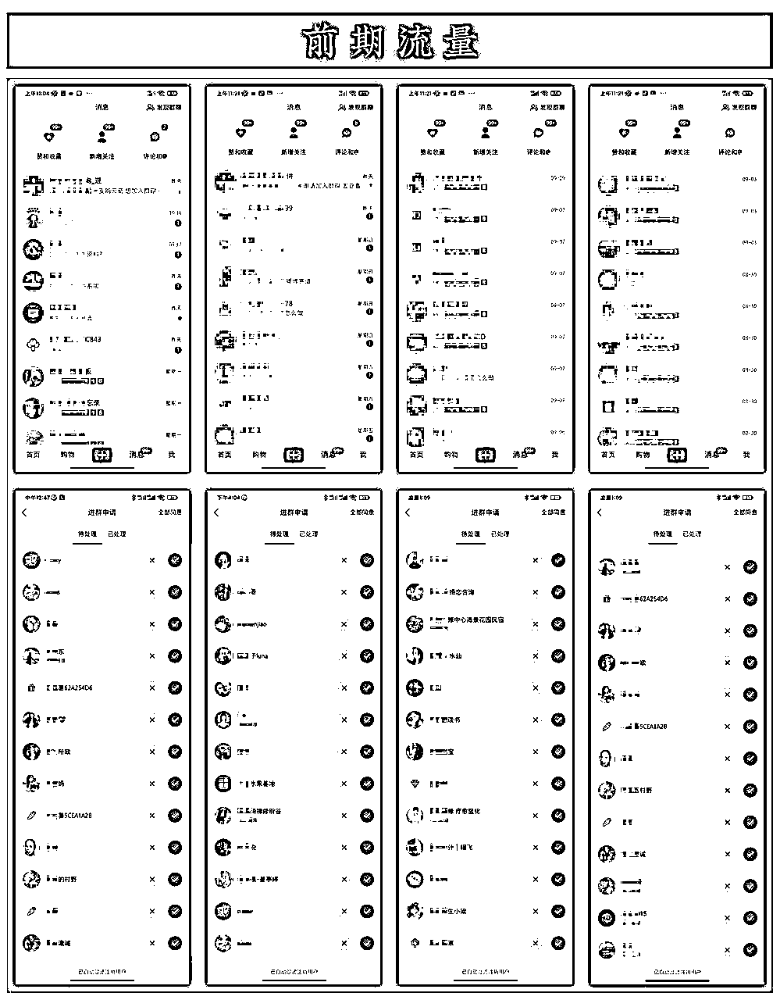
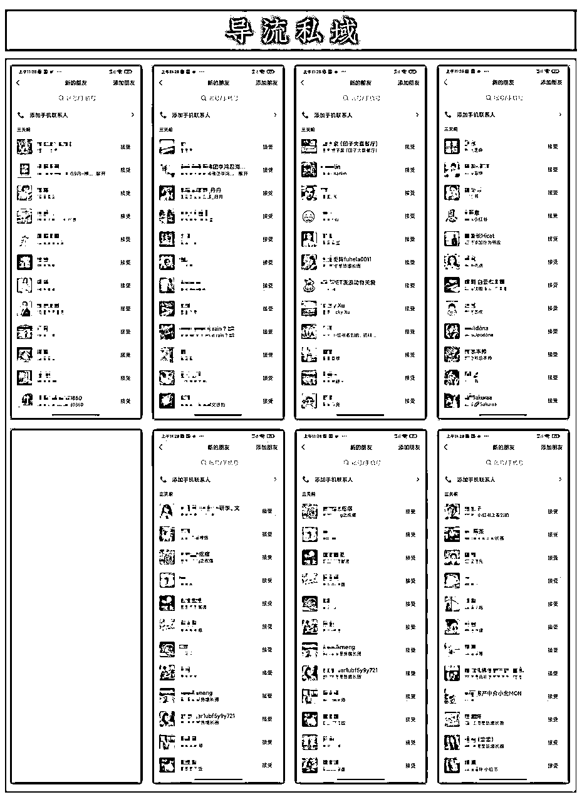
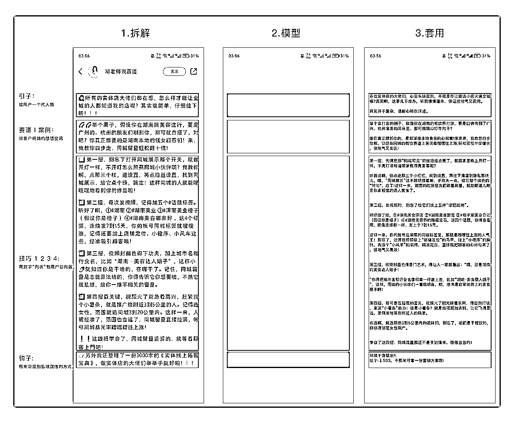
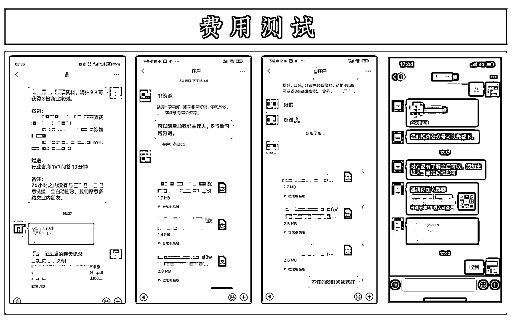
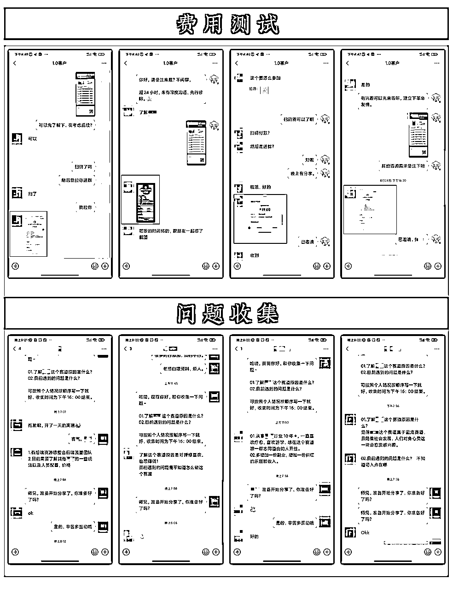
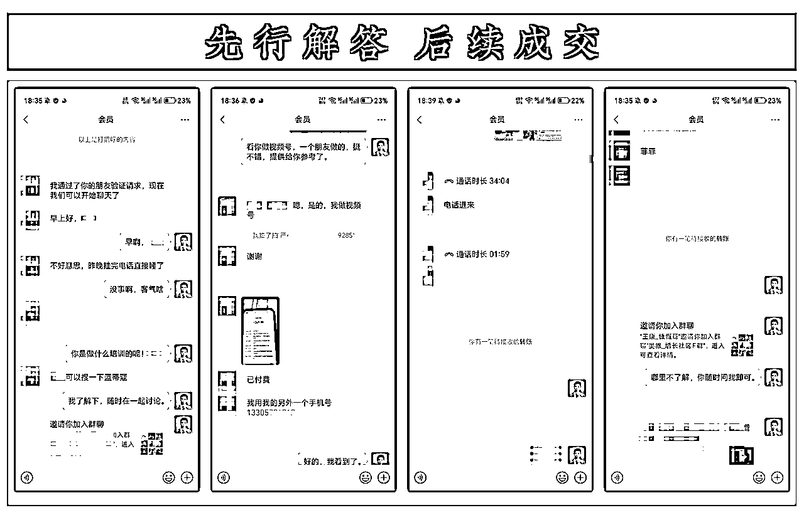
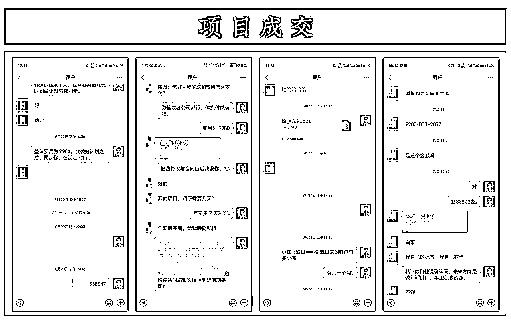
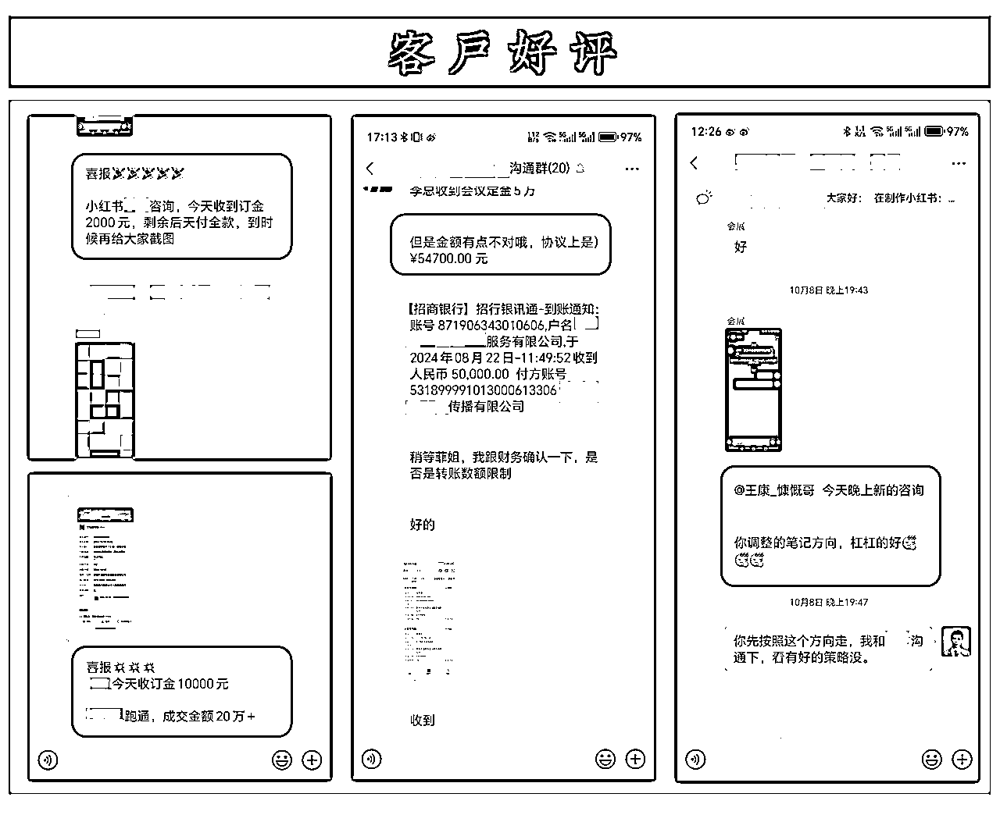

# 从0到1做项目孵化：我把这套冷启动打法，完整复盘给你

> 不整虚的，全是实操干货，建议先收藏再看

大家好，我是拾月。之前写了两篇复盘，收到不少朋友的认可，趁着最近手上项目告一段落，终于腾出时间来把这次的孵化经历好好梳理一遍——从什么都没有的状态，一步步跑通模式，最后真的把企业级项目孵化做了起来。

先说个背景：我自己手里本来就有几个在跑的业务产品，之所以想碰项目孵化，一方面是想给现有业务加加分，另一方面也是想给团队多找几条变现的路子。

我慢慢意识到一件事：光靠我们这几个人，想在市场里快速站稳脚跟，太难了。既然我们踩过那么多坑、积累了那么多经验，为什么不把这些东西沉淀下来，通过孵化的方式输送给更多人？大家一块儿把蛋糕做大，才是长久的路子。

但问题也随之而来：这事儿到底怎么做？我们配不配做？会有人为它买单吗？

市面上讲道理的资料课程一抓一大把，可说实话，那些东西也就是拿来参考参考，真照搬照抄反而容易翻车。这事啊，还得带点自己的脑子。

所以我给自己画了条路线图：**趋势洞察 → 案例拆解 → 社区沉淀 → 陪跑转化 → 项目联创**。走一步看一步，遇到什么坎就解决什么坎。

结局是好的——每一步都踩在了当初设计的节奏上，业绩也拿得出手。但我说的“满意”不是指赚了多少，而是按我自己定的流程和标准，每一步都走踏实了。

给你们看一组这次复盘的核心数据验证，仅供参考：

---

## 一、流量从哪来？先解决“精准”再谈“规模”

关于公域流量，我一句话概括：**从一开始就要把你的变现路径和用户引导说得明明白白**。方向清晰了，迷茫和焦虑自然就消了一半。如果还有，那就多设计几套话术去试，把用户反馈最好的那套留下来长期用。

至于流量怎么搞，我属于懒人打法——不可能所有平台都玩得转，所以我一开始就锁定了小红书，到现在没变过。

“取之于民，用之于民”嘛。一个平台深耕到底，养一个团队绰绰有余，这点信心我还是有的。

### 选题怎么找？给自己定个21天窗口期

刚开始做内容的时候，谁也不知道什么选题能火。我给自己设了一个21天的时间线，意思很简单：**不许走“深度种草慢慢等流量”的路子**。

我的做法是：跨赛道去找灵感。找了几个在养生、旅游、疗愈赛道做知识付费做得不错的账号，挑出一些简单粗暴的爆款选题，直接拆解、套用。

真挺实用的。

### 封面和内容？拆就完了

封面拆解就一句话：上下左右换位置，大字小字换属性。

逻辑链是这样的：**先定封面 → 再抽框架 → 最后换素材换内容**，三步下来，一个封面就吃透了。

内容也是。前期我本来追求的就是效率，细节后面再慢慢优化也不迟。平时看到同行里做得好的博主，直接收藏起来拆解，边拆边做边优化。

### 两个引流技巧

引流这块我用的就两招：**群聊 + 私信**。到现在为止效果都还可以。

具体操作细节这里我就不班门弄斧了，赚钱圈里很多大佬讲得比我细多了。总之铺好路，等着流量自己找上门就行。

---

## 二、私域成交：从“陌生人”到“合伙人”的四步跳

流量解决了，接下来就是转化问题。

根据我以往的经验，核心就一句话：**先突破“信任”这道坎，别老想着让人一上来就掏大钱**。

我的完整商业模式是这样的：

**付费筛选精准用户 → 收费分享建立信任 → 收取咨询费 → 项目孵化 → 合作联创**

一步步往下走，下面拆开说。

### 第一转：用收费筛人（价格自己测）

公域来的人基本都是冲着领案例来的。所以在筛选层，我就故意设置成收费模式。

这一招其实是差异化打法——大部分同行都是免费领资料，我偏要收费。为什么敢收？我们写案例花了大量心血和时间，收费天经地义。至于用户买不买单，那是后话，前期你得敢迈出这一步。

定价不知道定多少？那就测。我一开始设置了三个档位：**19.9、48.88、99**。

最终结果三个价位都有人买，但买单人数最多的是**48.88**，那就定在这儿。

这个环节就结束了。

### 第二转：低价分享养信任（19.9）

第一轮筛完之后，剩下的人已经比较精准了。这时候再通过案例趋势分享来继续做深度筛选。

既然做PPT又花了不少时间，那照样收费，但价格不能高，**19.9就行**。

为什么定价这么低？你想想，如果定199，用户预期会拉得非常高，那对我来说也是压力，我不想背那么重的包袱。

定低一点，反而为后面高客单价做铺垫。19.9这个价位，80%的人都能不眨眼地掏，完全无压力。

另外有个细节：分享之前一定要提前搜集问题、提前准备解决方案。别到时候讲得拖拖拉拉，显得不专业。

### 第三转：卖咨询而不是卖会员（365）

分享的目的，是为了多轮转化。

我在这儿特别强调一点：我收的是**咨询费**，不是社群会员费。为啥？

因为大部分用户都有自己的正职，关注你就是为了了解行业趋势，你给他讲一堆技能他压根不感兴趣。而一年的咨询服务，对我来说运营成本也不高，不会造成太大压力——人压力一大，动作就会变形。

那天晚上分享群里有50人，分享完当场转化了20%，客单价**365/人**。

当晚实际只成交了3单。说实话效率不算高，但问题总得解决。

分享完后我做了一件事：**挨个打1V1电话**，深入了解他们目前卡在哪儿了。第二天追加成交7单。

最终结果：50人里转化了10人。

### 第四转：项目孵化陪跑（9980）

三转后的1V1沟通里，我发现了不少用户的刚性需求。接下来要做的，就是根据他们的问题描述，顺理成章地承接项目陪跑服务。

但这一步急不得。客户需要时间来判断你到底有没有能力解决他的问题。

经过了**30到50天**的持续触达和沟通，我的项目孵化陪跑1.0终于迎来第一批客户。

关于陪跑产品，我一开始就没打算定死一个模板——太早固化反而不是好事。现阶段走的是**定制化陪跑**路线。

目前成交的客户里有旅游公司、团建公司、疗愈公司、团购工作室。随着陪跑业务推进，等升级到2.0版本时，方向会越来越清晰。

以上就是我从0到1跑通整个培训服务起盘的全流程。

---

## 三、这几个坑，我帮你踩过了

最后分享一些我自己的经验思考。这些方法论让我少走了很多弯路，不是说要指导谁，就是单纯把事实摆出来说说。

### 01 目标必须先画清楚

我一开始就给自己画好了完整的路径地图——从流量到最终变现。细节上可能有不少粗糙的地方，但只要流量基数够大，这些小瑕疵都不致命。

等整条路跑通了，再回过头来做“单点突破”。**前期目标清晰，比什么都重要。**

### 02 敢于谈钱，是一种筛选

我见过太多人一上来就是“求资料”——有同行，有白嫖党，也有真实客户。后者才是我们要找的人。

怎么筛？最合理的方式就是收费。

收费的好处太多了：价值可以反复售卖、能跟客户建立深度链接。但最大的好处是——**通过收费来验证你的方向对不对**。

### 03 坦诚，是最好的套路

为什么有些人在“转化”这件事上能做到炉火纯青？

我的理解是：营销套路和话术技巧都是外在的东西，决定上限的，是内在的“坦诚”。

这一点我一直在学小马宋老师，也把它用在自己身上。给用户解决问题时，既要专业，也要坦诚。

### 04 提供价值，而不是包装人设

现在社会上太多人喜欢把自己包装成“大佬”。包装没问题，但过度包装早晚翻车。

之前老有人喊我“大佬”，我听着浑身难受，后来干脆把网名改成了真实名字。好处是，我能够坦坦荡荡地给客户提供价值。

遇到有人问我视觉设计、思维方法的问题，只要时间允许且占用不大，我都会手把手帮。多跟客户接触，在提供价值的同时，其实也是在“利己”。

### 05 核心技能只有一个：流量

这点最重要，我必须敲黑板：

**不管你的计划做得多完美，基础流量问题解决不了，其他全白搭。**

我这些年苦练了几个技能：商业思维逻辑、产品构成逻辑。

但最关键的还是——我有能力靠个人把流量搞定。这样我就不用依赖任何人给我导流。别人愿意帮忙送流量，那是锦上添花，不是雪中送炭。

**核心技能，永远只有一个：流量，流量，还是流量。**

---

## 四、客户的反馈

顺便说一句，这次陪跑的客户结果都还不错，也收到了不少好评。

有个客户的陪跑服务马上就要结束了，明年他们公司的线上战略规划服务也已经确定继续由我们来做——合同11月到期后直接续签。

好了，这次的复盘分享就到这里。感谢你耐心看完，咱们江湖有缘再见。

