最近后台收到不少朋友问：AI 编程工具到底值不值得重度投入？今天我想抛开那些“小白三分钟做个游戏”的故事，从一个写了很多年代码的程序员视角，聊聊我日常怎么用 Cursor 维护项目、迭代功能。

先说下我的背景：我叫大铭，一直在写程序，现在在月嫂母婴护理行业创业，早年用信息化工具玩过这个领域，现在打算靠 AI 再来一次。这段时间 AI 工具爆发，我的效率确实被大幅拉高了——单说编码这件事，体感至少是以前的三倍。最初用的是 ChatGPT，之后试过 Copilot，也折腾过不少别的，现在彻底切换到了 Cursor。深度用了两个多星期就买了 Pro，如今每月 500 次的 fast 额度已经耗尽，算是重度用户了。

所以这篇分享，不聊概念，只讲我怎么在真实项目里用 Cursor。

## 一、真实项目不是“写完就丢”的小玩具

网上那些“产品经理用 Cursor 做了一个贪吃蛇”“小姑娘零代码写了小游戏”的故事，说实话打动不了我。和很多有经验的开发者聊过，大家普遍认为：Cursor 确实是个好东西，一旦用上就很难回去，但没传的那么神。

为什么？因为真实项目不是一次性作品。做一个贪吃蛇，写完可能再也不会打开。可我们日常维护的代码库，会一直处于“被持续打开、不断修改”的状态。那种让他从头生成一个新项目的兴奋感，最多撑第一天，甚至半天，之后根本不会这样用——毕竟我不可能天天开新项目。

再看看代码量。用代码量衡量工作深度有点片面，但对比还是有的。100 行代码不一定比 300 行差，可如果拿 100 行和 10000 行比，差别就出来了。网上大多数 Cursor 案例的 code base 基本见不到 1000 行以上。而我现在用 AI 重做一个月嫂 CRM 系统，刚起了个头：月嫂库没建完，履约任务做了一小部分，客户信息只写了一点，后面还有合同、产品点评一大堆功能。就在这种情况下，代码文件已经有 140 多个，总代码量接近一万行。而目前完成的模块只占 20% 左右，也就是说最终要形成一个五万行左右的项目，才勉强算第一个可用版本。

到这个规模，你还能说“啥也不管，让 Cursor 自己干”吗？这恐怕就是真实工作和网上演示案例最大的差距。

## 二、真正写代码时，很少有人从零开始

以我最近写的月嫂 CRM 为例。我想用 Java 但不想碰 Spring，最后选了 Micronaut 这个框架。检查之后发现它自带非常完整的脚手架生成器（https://micronaut.io/launch/）。

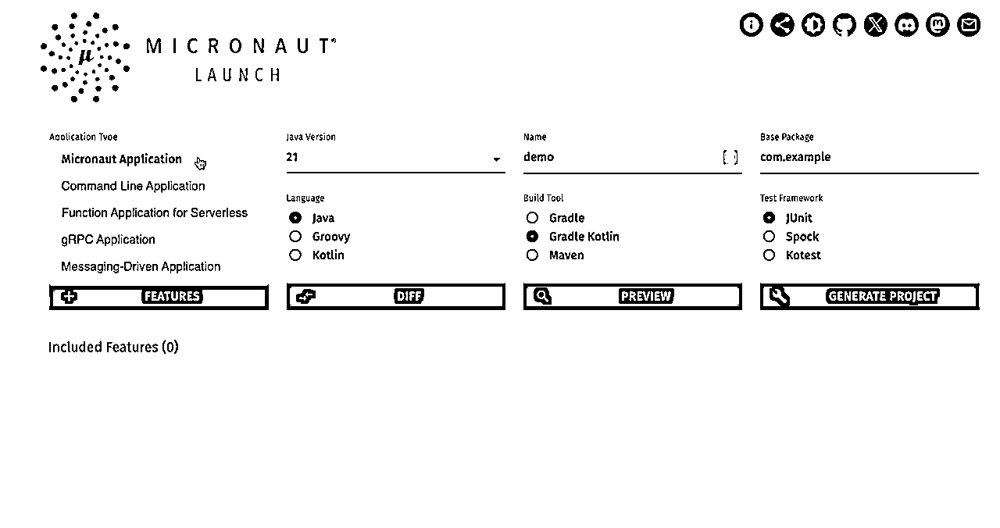

比如用 Java 21，项目名 ShengCai，包名 com.shengcai：

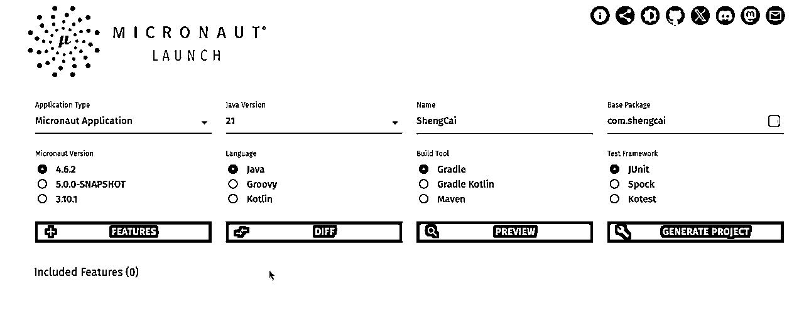

在 FEATURES 里勾选需要的支持：OpenAPI、Swagger、JPA 数据库、Redis……大体框架就出来了。点 generate project 再下载，本地就多了一个目录。

用 Cursor 打开 ShengCai 文件夹，会发现里面已经有不少替你写好的代码。也就是说，接下来所有编程都建立在这个框架之上，根本不是从零开始。

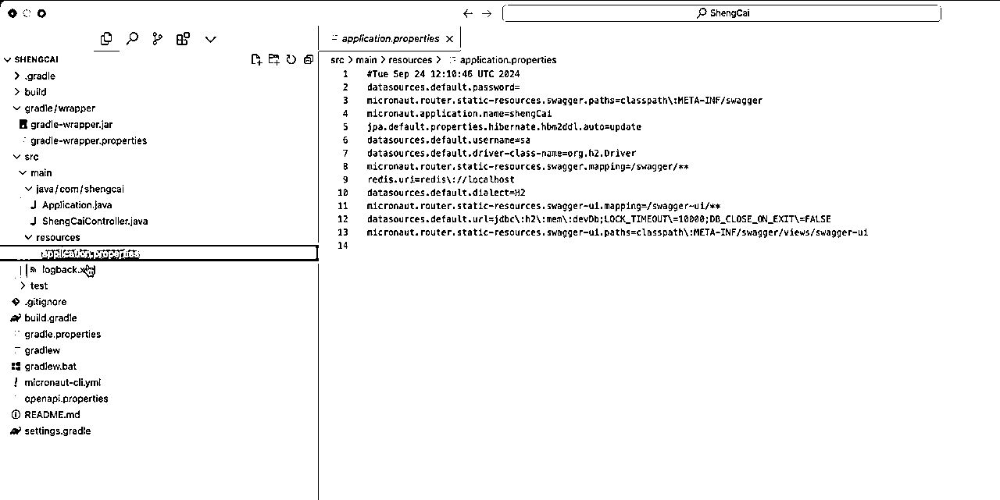

前端也一样。比如 Flowbite 这类工具会提供起步代码（https://flowbite.com/docs/getting-started/vue/），不用自己从空白文件写。

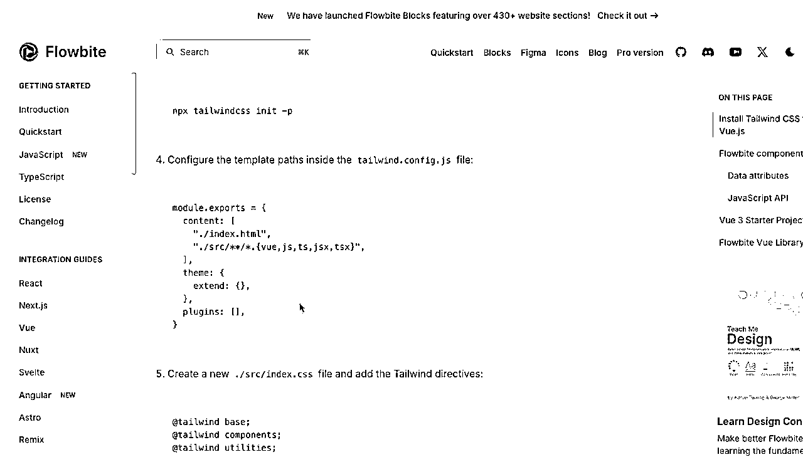

再比如要写一个浏览器插件，很多人第一反应是在 Cursor 对话框里输“这是一个 Chrome 插件”。而我通常会先去 GitHub 找一个 VUE 的 Chrome extension template，下载解压，然后在 Cursor 里 open folder，打开就发现里面已经有很多代码了。

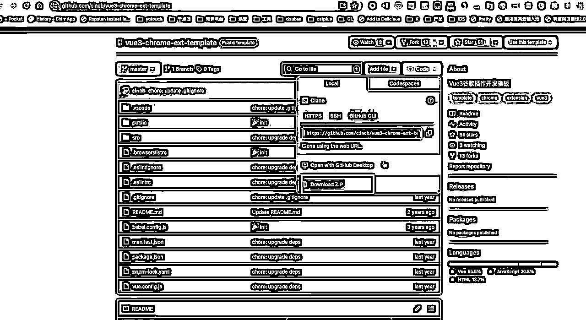

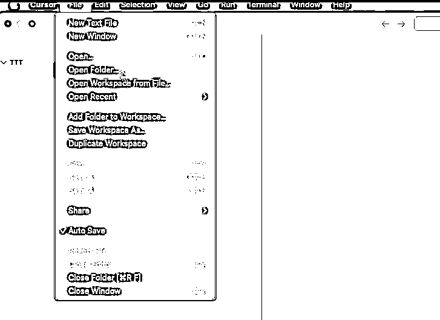

为什么要这么干？因为这样做等于提前给 Cursor 做了很多限定，告诉它不用重复造轮子。更重要的是，我先让它帮忙整理文件结构，然后我再有针对性地改。具体步骤是：先 @Codebase 让它 review 整个代码库，告诉我这是干嘛的、核心文件是哪些；然后我根据整理结果做定点修改。

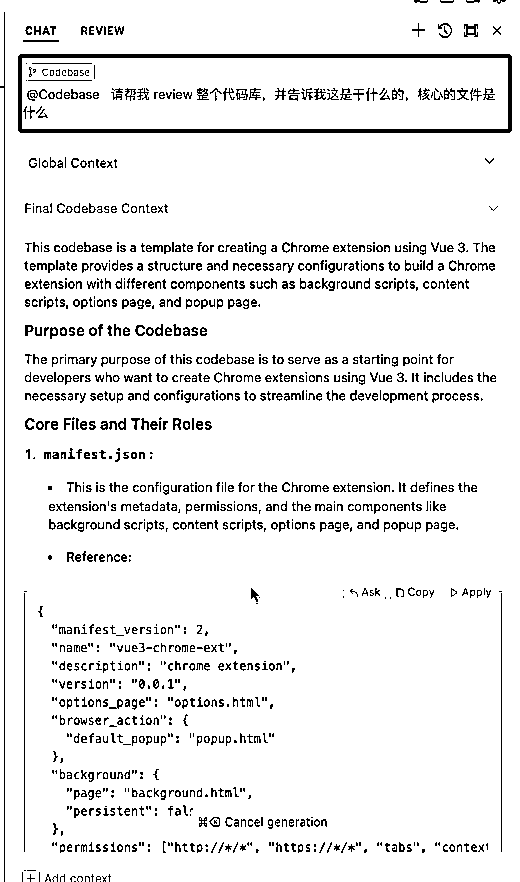

比如 manifest_version 现在是 2，但 Chrome 已经到 version 3 了，我就把相关代码复制到对话框，让它“帮我改成版本 3”，它就会只改这一部分。

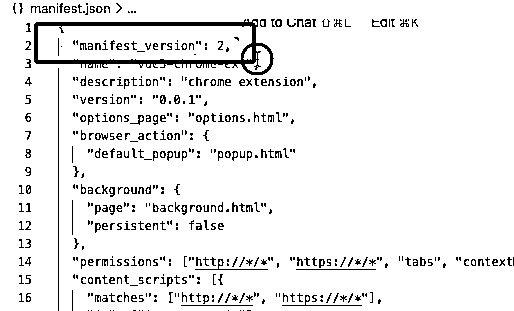

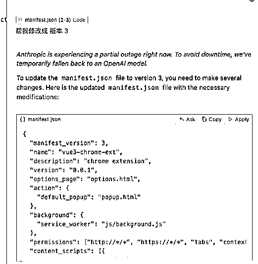

这才是我正常的工作流——不是从 0 开始。大家以后做项目，至少从框架层面看，网上一定有模板或脚手架，直接去找就行。如果是老项目，同样先让 Cursor 把代码读一遍，再去做后续修改。

还有一点很重要：编程这件事，限定是关键。粗分前端后端，后端有 Java、Go、Python 各种语言，每种语言都有类似的能力；前端语言只有 JavaScript 和 TypeScript，但框架极多，有纯前端、有 client render、server render，还有 Next.js 这种看上去是前端实际也能写服务端的。如果你不做任何限制，Cursor 会按它认为主流的方式生成代码，但那未必是你想要的。

举个典型例子：我想用 Java 写一个服务端接口，不限定的话，9×9 会选 Spring——因为它太流行了。可我不喜欢 Spring，启动一个简单服务快则 40 多秒，慢则一分钟多，这时间我忍不了。所以我必须告诉它：用 Micronaut。这时候脚手架代码就特别方便，所有配置文件该放哪都规规矩矩，用起来很舒服。

哪怕你是小白，我也建议去 GitHub 找模板。排在前面的基本都是主流语言、主流框架的示例，学习资料也相对完善。

## 三、Cursor 的几个核心功能

### 1. 交互方式：DIFF patch 才是灵魂

先澄清一个概念：Cursor 不是 IDE 插件，IDE 是 Cursor 的插件。我翻过 Cursor 团队的所有博客和创始人访谈，最关键的一点是：他们直接 fork 了微软的 VS Code，然后在上面做修改。所以它和 Copilot 这类工具最大的区别在交互模式——Copilot 只能针对光标位置往后生成代码，只有这一种模式；Cursor 是针对整个文件。

具体区别在哪？比如我在 Controller 里打出“inj”，下方灰字就会提示 inject，按一下 Tab 生成，同时上方也会出现一个 Tab 标记。

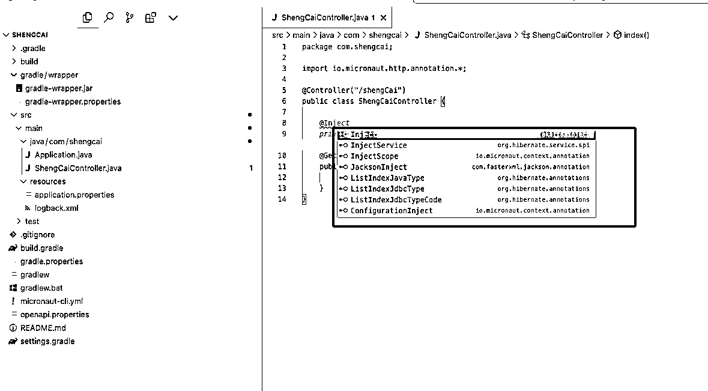

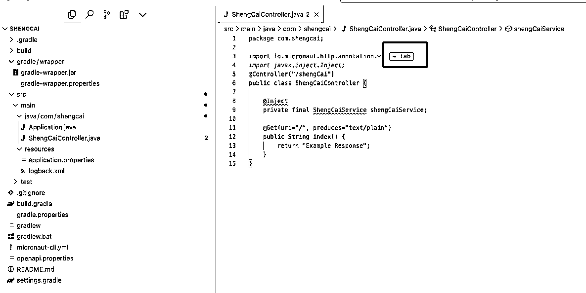

再点一下 Tab，光标跳回上面，那段灰色内容也被生成了。

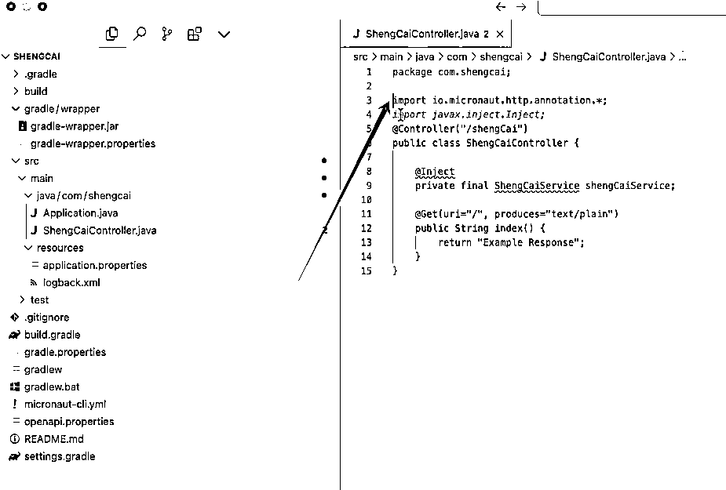

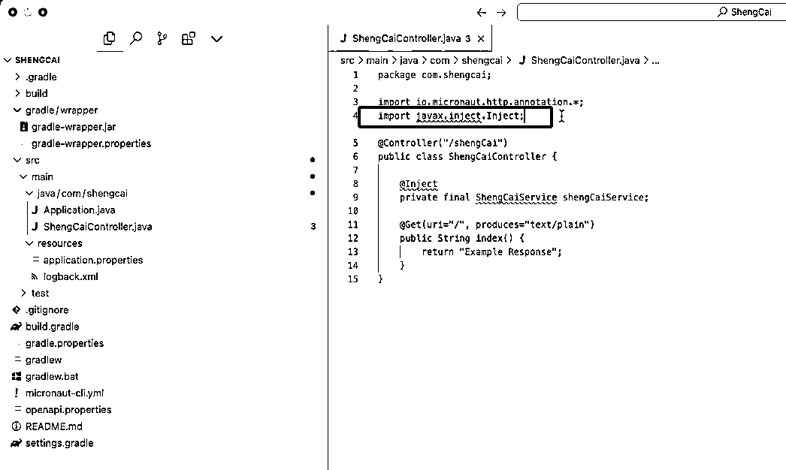

这种交互方式 VS Code 做不到，因为它只能从光标位置向后追加字符，无法在整个文件里跳转，所以只能 append；Cursor 则是 DIFF patch 模式，能隔行插入修改。比如我在配置文件里把鼠标放在 hbm2ddl 位置，告诉它“帮我做一个 MySQL 数据库连接，用户名密码都是 root”。

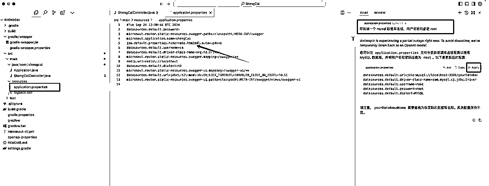

生成之后对应代码段右上角会有 apply，点开后能看到它是隔行插入的，我只要逐个 accept 就行。

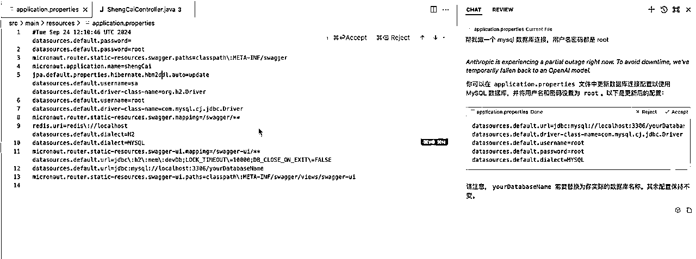

这事 Copilot 就做不到。同样改数据库连接为 sqlite、本地文件 a.db，它生成得挺好，但没有 DIFF patch 方式，直接插入整个文件就乱了。

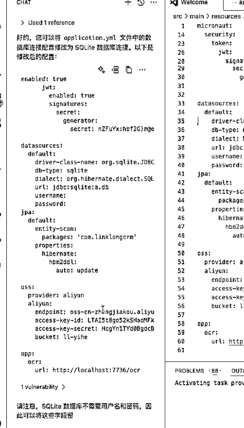

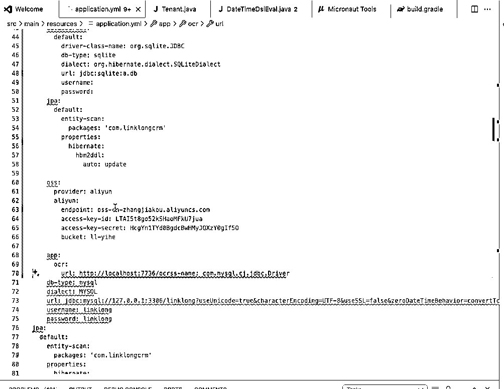

如果不插入呢？只能全部复制粘贴，可文件一长根本没法用。所以还是得像以前一样，一段一段手动替换。仅这一项功能，Cursor 相对其他 IDE 就能带来至少 10% 的效率提升。

顺着想，AI 时代到来后，只要我们确定了一个 target（对编码来说可能是某个文件、目录或整个 code base），是不是就能颠覆很多传统的、习以为常的工具？我认为有这个可能。

### 2. 文档功能：解决大模型知识过期问题

这是我目前维护的一堆文档：

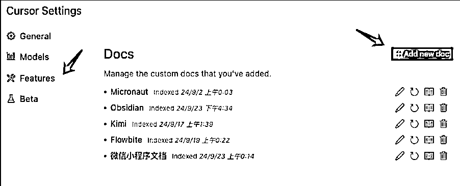

大模型语料库更新往往不及时。比如 Claude 的知识库截止到 2023 年底，如果你开发需要一些常用文档，就会发现它给的信息严重陈旧。像 Micronaut、Flowbite、微信小程序这些，去官网看版本迭代非常快，所以 Claude 给出的代码经常是错的。

怎么解决？Cursor 自带一个小爬虫，可以在 Features 里通过添加文档的方式把官网文档抓进来，之后调用文档就能获得更准确的代码。

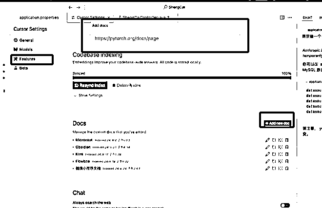

还是以项目为例。做一个用户登录功能，选中文件输入“帮我生成用户登录的 Controller，使用 JWT”，确实会生成不少代码，但细看会发现很多问题——比如右边红框里不是 javax.inject，而是……

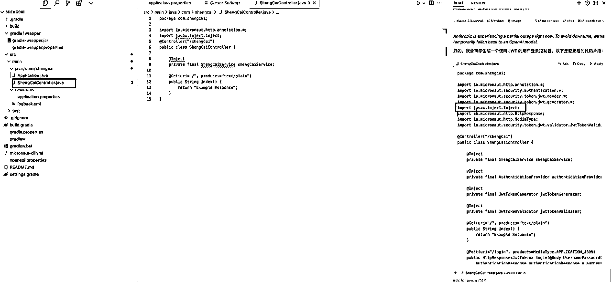

这时候补充提示词：“帮我生成用户登录的 Controller，使用 JWT @Micronaut，阅读最新的文档，使用最新的 API”，生成准确率立刻大幅提升。

这就是文档的用法。有时候 Cursor 会自己去看，有时候你可以主动让它看。一些特别小众的库可能没有文档或很难被收录，那就自己做一个。甚至你们内部文档也可以交给这个爬虫。当然，Cursor 的爬虫能力比不上 Google，但处理静态文档这类简单场景非常好用。

### 3. Composer：我把它当骨架生成器

@Time 的直播里讲了很多，我这里只说说我的习惯差异。Composer 以整个 code base 为基础，可以一次性处理多个文件。但对我来说，当代码复杂到一定程度，Composer 基本只能生成简单代码。

比如我现在的 CRM 项目里，涉及客户、出院记录、月嫂、服务总线，基础模块还有阿里云、附件、JWT、OCR……代码库复杂到这个程度，我的新代码得和已有代码交叉调用，Composer 生成的代码很难一次完成，甚至几轮都搞不定。

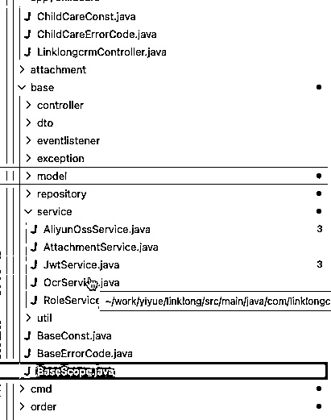

所以我的用法是：让 Composer 当骨架代码生成器，它只负责搭架子。骨架生成完，我进入对应代码文件，选中某一部分，点击 add to chat，继续后续对话。

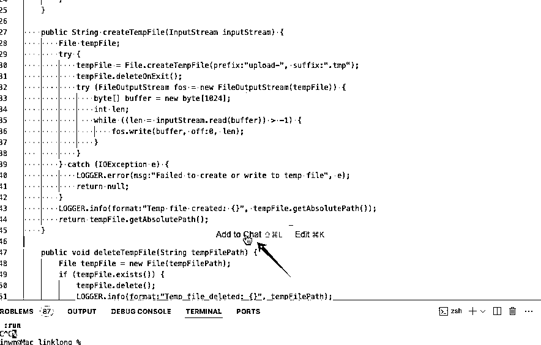

对我个人而言，最常用的其实是 Chat 模式，Composer 更多用在单一功能起步阶段，之后再慢慢改。

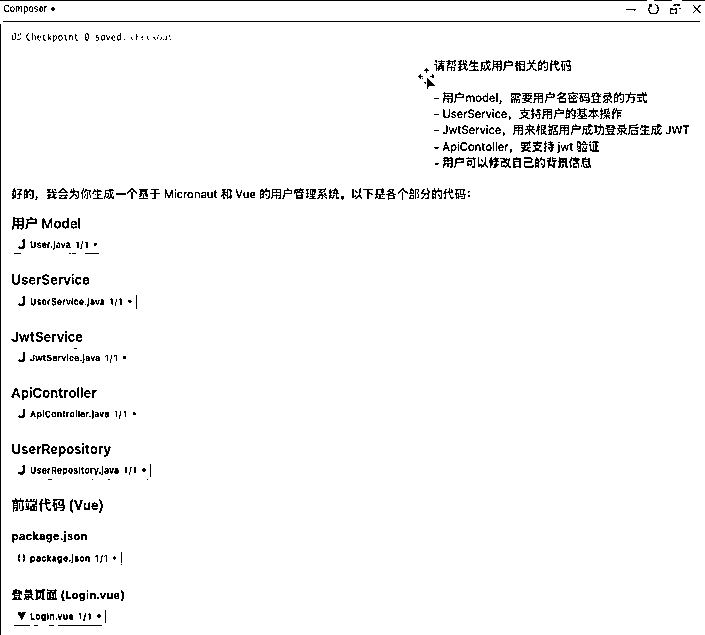

大概就是这样。简单总结：真正干活的时候，给 Cursor 一个不跑偏的框架、一份能读懂已有代码的上下文、一个需要它精准修改的小目标，它就能发挥出很大的价值。至于那些“一句话生成完整应用”的神话，听听就好——现实项目里，还是得一步步来。

当代码规模膨胀到一定阶段，你会有一种明显的体感反转：不是Cursor在推着你走，而是你正在拽着它跑。这时候，对代码的精准掌控就变得至关重要。而一旦你开始追求这种精细化控制，对我来说，compose模式的存在感反而越来越弱了。

### 聊聊Chat

平时用得最顺手的其实是Chat。怎么把Chat用好？我自己的经验很简单：

*   一是把需求描述得越细越好；
*   二是千万别忘了把相关文件用@挂上去。

我之前拿Cursor做过一个叫CHATFRIEND的“嘴替”项目。这个项目分两个代码库：服务端这边全是Java，仓库名是CHATFRIEND；前端那边全是Vue，仓库名是CHATFRIEND-FE。为了让两边互不污染，我直接把代码彻底拆开，Server归Server，Client归Client。

想避免混淆时，可以这样操作：比如服务端要做“用户登录”的功能，我就在CHATFRIEND这个代码库里写一条需求让Cursor去完成——

我需要一个用户登录的API，以及相关的用户代码

用户登录，使用手机号，验证码的方式，访问

/api/v1/user/login

然后切到CHATFRIEND-FE那边，把上面这段需求复制过来，再补一句：

帮我生成对应的前端界面，用户输入完手机号，点击按钮收验证码，按钮上60秒倒计时

说白了，同一个需求，我告诉服务端“前端我已经写好了，你生成后端代码”；又告诉前端“后端我已经写好了，你生成前端界面”。实际上两边代码都没有，但这样可以两头同时开工，再互相验证，速度飞快。

不过，前提是得做非常精准的控制。比如某次我说“我需要一个POST接口”，结果Cursor给我返回了一段TypeScript代码。可我的整个代码库是Java啊！问题就在于我没说清楚必须用Java：

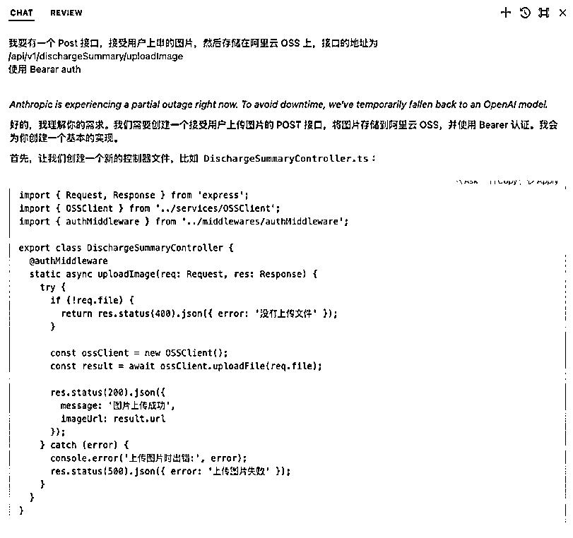

这也正是为什么说，在没有脚手架、没有现成代码基础的情况下，直接丢一个命令下去，Cursor很容易生成一些根本不是你要的东西。

所以我加了一句：是Java API Controller。重新生成之后，代码基本就对了，连package的位置都指得准确。

### Cursor里怎么找错？

我找错用的办法特别偷懒，但fast队列消耗也确实大。

方法就是：当报错出现后，我直接点错误提示右上角的“Add to Chat”，然后对话框里什么都不打，就发一个“？”。Cursor就会自动帮忙分析这段代码是干什么的、该怎么用。

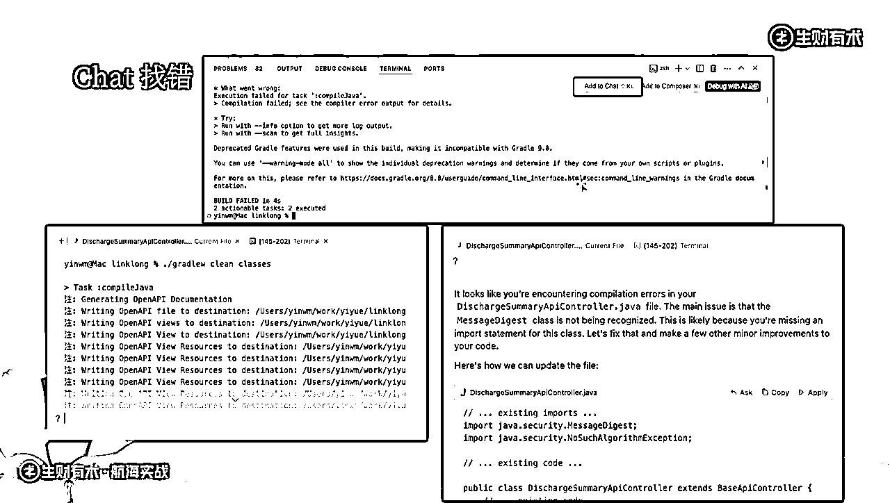

它改完之后，点一下「Apply」-「Accept」就好了，然后自己跑一下看问题还在不在。不管是编译期还是运行期的错，我基本都用这个套路，它能帮我干掉大约80%的常见错误。

但要注意，一旦逻辑复杂起来就不好使了，那种情况还是得靠人不停介入。

### @ 的妙用

「@」是我最喜欢的功能。这个符号能挂很多东西，比如你@一个文件夹，就能看到它列出了哪些文件可以被分析。

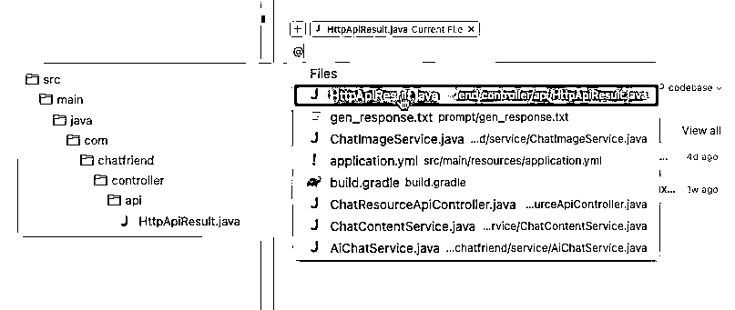

我常用的是直接下指令，比如：用户用手机号验证码登录，帮我把相关代码补进 @NannyService.java 中。如果当时不在@的界面里，点一下红框位置，再按「Apply」就行。

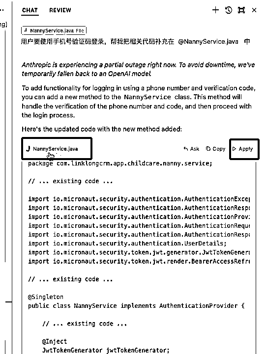

等它生成完，我们最好先review一遍。肯定会有不少错误，那就用上面2.4说的方式一个一个找、一个一个改。

这里额外补一点：当你指定@Web时，Cursor的小爬虫会去网上搜资料，然后基于搜索结果来生成代码。你可以在设置里的feature里找到“chat always search the Web”，默认是关的。打开后，Cursor就一直默认搜索网络。

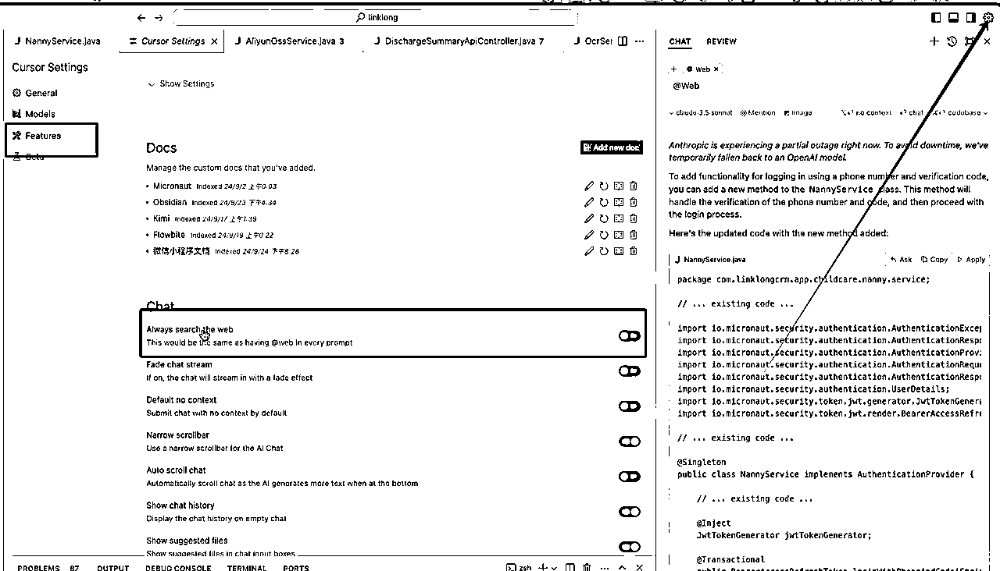

我本来是想让它调用接口时能找到最新用法，但试下来效果一般，反而有时候会让Cursor糊涂。所以我的做法是平时关掉，需要的时候临时输入@web就行。

用@的时候还有个技巧叫“全局限定”，大家值得一试。就像我们平时用AI时会给背景信息或角色设定来限制输出方向，Cursor里也能这么做。

在设置里找到「Rules for AI」，把你想要的限定条件写进去。这是全局的，对每个文件都生效。

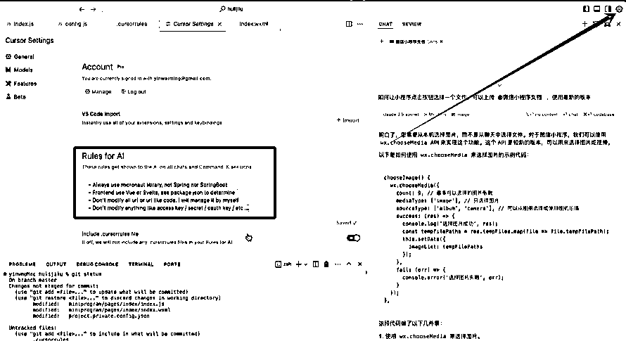

但如果只想让Cursor对当前项目的代码风格做限定，那就去找「.cursorrules」，把规矩写在这里。比如下面是个小程序的例子，里面就写了小程序开发规范：

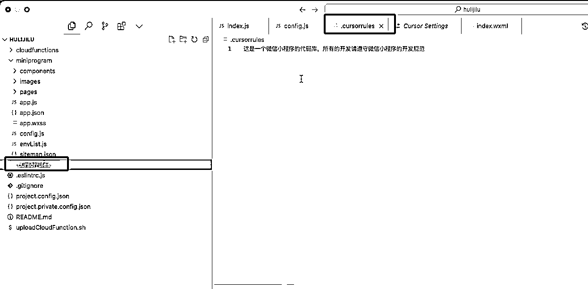

这部分我还是坚持“能从网上找就不自己写”的原则，推荐一个网站：https://cursor.directory/，里面全是别人整理好的现成规则，直接复制粘贴就行，非常好用。

### 分析git版本信息

我发现很多人写代码不爱用版本管理。但我强烈建议，一定要把git用起来。

以CHATFRIEND-FE为例，具体怎么用这个功能，你们可以直接看59分27秒到1小时8分那段：9月24日《【高手领航4】：cursor在实际项目中的使用经验分享》@大铭。

## 日常怎么跟Cursor配合

我现在跟Cursor协同编码，主要有两种状态。

*   第一种：把Cursor当结对编程的伙伴

因为我本身就是开发者，这时候Cursor解决的并不是编码本身，而是沟通问题。我再说一遍——我需要不断针对“我的想法如何落到代码上”这件事，跟它进行沟通、验证和review。我既要看它的代码，也要让它看我的代码。

从写程序的劳动构成看，可以分成体力劳动和智慧劳动。Cursor大约能包掉90%的体力活，智慧活大概能搞定30%。

“帮我写个快速排序”，这是体力劳动。

“消息队列该怎么设计？到底要不要加写缓存？分布式ID怎么定？”这类思考才是智慧劳动。

我会把很多思考拿去跟Cursor聊，让它给提示，让它审查代码，一起协作。这样效率提升非常明显，因为大量不确定环节被它消除了。在没有这样用之前，那些不确定性大概要占我总耗时的三分之一。

剩下70%-80%的时间，我们干的都是重复劳动——就是字面意义上一个字母一个字母敲代码。这种活让Cursor来做，一点毛病都没有。

*   第二种：把Cursor当“外包”

如果我是个小白、需求方，我把Cursor当成实施方，也就是外包团队，那又是一种玩法。

比如我一直写后端，对前端只有个大概概念，其实压根不熟。什么是VUE？哪个是react？小程序到底怎么写？我完全没谱。既不知道代码结构长什么样，也不知道具体细节怎么做。这时候把它当实施方，我会这么做：

① 先找一个脚手架代码。用脚手架把代码结构搭出来。比如这个小程序，我真正想要的只有“上传出院小结”和“账号登录”，底部那些“快速开发基础能力、业务实力”等模块根本用不上。但还是留着，因为这是现成模板，里面已经带了一大堆模板代码，用不到的回头再删就行。

② 用@code base的方式，让Cursor给我解释代码。

③ 这两步走完，我才会提真正想做的需求。如果代码大概能看懂，我会指定明确的文件位置；如果看不太懂，就用composer的方式，把需求写得更详细一点。

边生成代码边看，边看边同步review，我也就顺便学起来了。因为本来有编程底子，差不多三四个小时，我就能从“小白+需求方”模式切换成“开发者+结对编程”模式，效率又能往上提一截。

这两种状态最大的差别是：如果我把Cursor当外包，那它为什么这么写？干嘛要这么写？我完全看不懂，中途想干预也很难。从长远来看效率提不上去，而且也没办法插手，更没法把我想加的东西加进去。

所以我就不停地问Cursor，让它解释、教我。比如：

为什么小程序里要有json文件？这文件干嘛的？每个页面都要有吗？

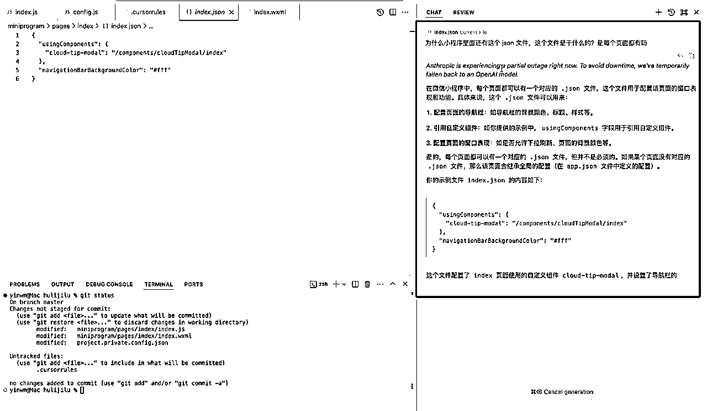

学完以后，我就能慢慢转成结对编程的方式了。导航栏、自定义组件这些，也就慢慢摸明白了，属于边干边学。

*   第三种：把Cursor当普通AI工具

比如生成文章、改写内容、补点文字之类的，本质上就是当普通AI用。

但Cursor使用的模型是专门针对代码场景的小模型，它会组合好几个模型来做编码领域的事。

这里有个很大的区别：基础大模型不保证代码完整性，而专门针对代码fine tuning过的模型，是刻意去保证代码完整性的。

所以我自己不会把它当普通AI，而是拿它去问跟编程、编码更相关的问题，像下面这样：

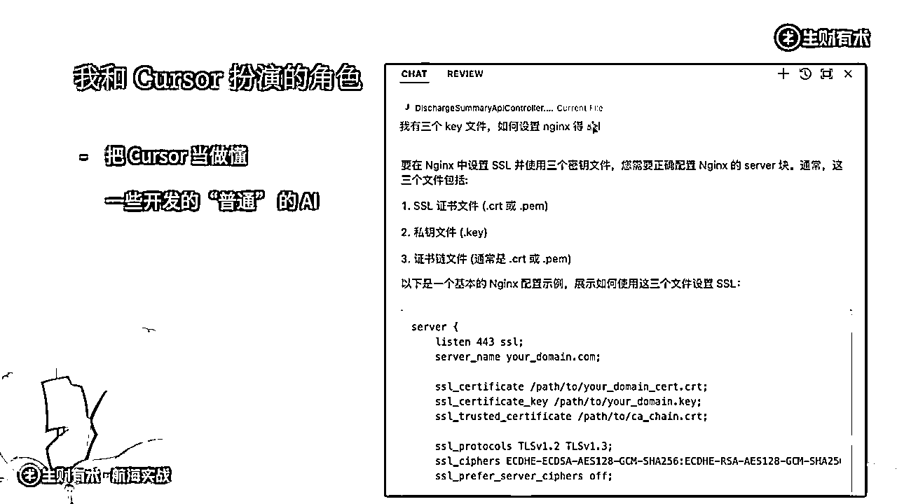

## 几个好用的组件推荐

### SQLite3 Editor

我本地开发大多用SQLite，这样协同起来很方便。

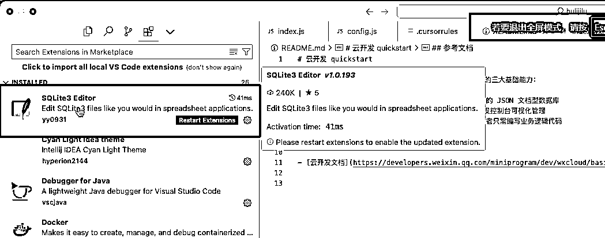

比如这个：我在做小红书视频转文字加分析的功能。截图里就是个SQLite数据库，用起来非常顺手。

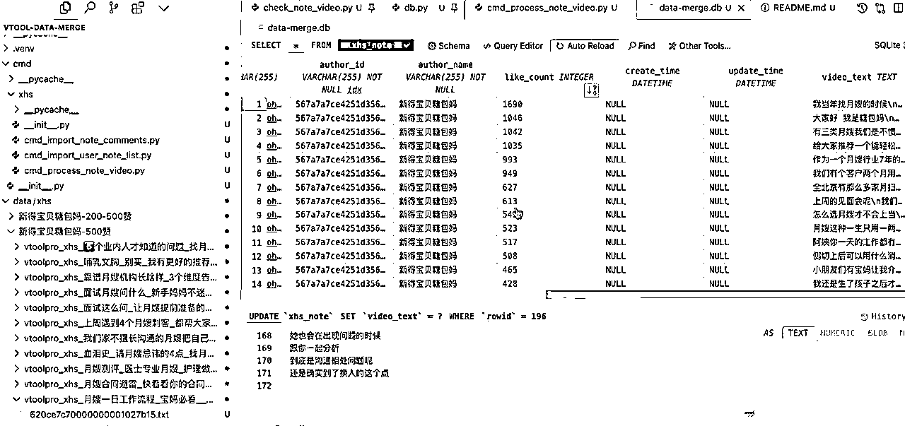

### Cyan Light idea theme

一个浅灰主题。我所有的IDEA都用它，因为我喜欢这种调调。

### Excel Viewer

用来查看Excel文件的，比如这里：

### Git Graph

这个超方便，可以直接点create、check out这些按钮。

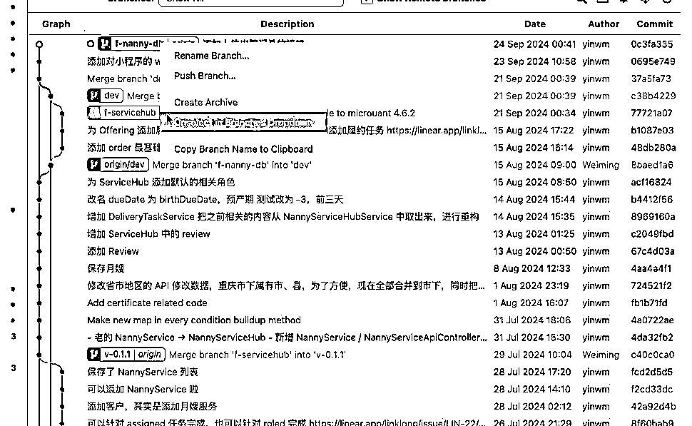

## 注意事项

1.  单个文件别太大，否则很容易把token撑爆。
我现在基本控制单个文件不超过600行。如果对编码不熟，一定要让Cursor帮你拆文件，因为文件大到一定程度，就不太好维护了。

2.  人工改和AI改混着来的时候，AI有可能把你的代码又改回原来的样子，逻辑很容易乱。这时候可以开个新对话窗口，重置上下文，让Cursor重新读文件、重新熟悉代码。

3.  多用git，常用git。

最后放个直播回放。这篇文章里我尽量把关键信息写清楚了，但如果你想看更具体的操作演示，可以去回放里找对应部分：9月24日《【高手领航4】：cursor在实际项目中的使用经验分享》@大铭。