最近不少朋友来问我：那种一眼看过去就忍不住下单的课程大纲，到底是怎么搞出来的？能不能让AI一键生成？

巧了，这正好是我反复琢磨了很久的一个问题。今天就干脆把这套压箱底的方法论，完整摊开讲一遍，保证是能在实操里直接用的那种。

先交代下背景。我是半目，一个85后奶爸，经历过穷到睡广场的至暗时刻，也做到过单月收入16.5万+，一路踩坑无数，最后锁定了「AI+课程制作」这条路深耕。目前和「玩赚新媒」的主理人芷蓝一起，在做「AI做课卖课」的陪跑服务，详情可以看这条帖子：https://t.zsxq.com/BiSzS

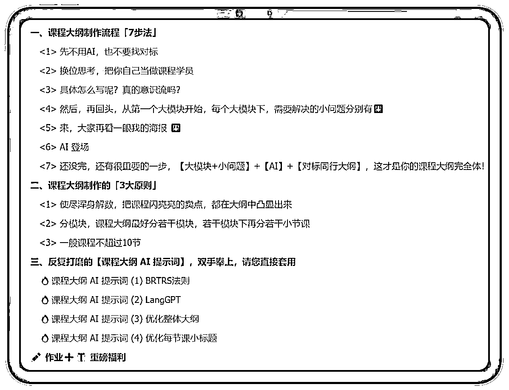

分享正式开始之前，先聊两句关于做课的底层认知。

做课这件事，说简单也简单，说复杂也真复杂。

简单在哪？如果你能善用AI，把从大纲、内容、录制到上架的全流程都交给AI辅助提速，那做课就根本不需要耗上几个月去死磕。复杂在哪？要是你不会用AI，或者用歪了，那就糟糕了——要么吭哧吭哧好几个月交不出一门课，要么好不容易做出来却没人买，直接亏到怀疑人生。

今天咱们不聊别的，就单拎「AI+课程大纲制作」这一个环节，来拆解具体实操。

# 一、课程大纲制作「7步法」

奉劝一句，AI基础还比较薄弱的朋友，可以先花几分钟翻翻我之前在生财有术发过的两篇老帖：

✔【推荐阅读①】⬇
《做课AI工具推荐，2种提示词直接套用》
⭐推荐理由：不知道该用哪款AI工具来做课？看完这篇就心里有数了
https://t.zsxq.com/MycFR

✔【推荐阅读②】⬇
《什么课好卖？课名怎么取才有流量？AI是个好参谋》
⭐推荐理由：先解决课程定位问题，不然课做出来也卖不掉，等于白忙活
https://t.zsxq.com/HeREX

工具方面，一般我们首选 Kimi（https://kimi.moonshot.cn/）。

很多人刚接触AI的时候，那叫一个上头，恨不得事事都让AI来，体验一把“言情小说式的初见惊艳”。但你有没有发现，玩着玩着就变味了——从“你玩AI”变成“AI玩你”？

之前我在社群里演示过用AI一键生成课程大纲，效果确实震撼，全场哇声一片。

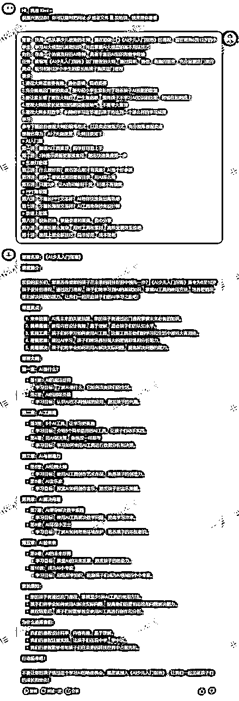

结果就有小伙伴跑来说：半目，AI做课不就这回事嘛，生成个大纲谁不会，没什么技术含量嘛。

……好，我不跟你争，直接把我的理念和流程全部交代清楚。你品，你细品。

## 课程大纲制作流程：

### 第1步：先别用AI，也别去找对标

（别惊讶，这一步恰恰最关键！）

### 第2步：角色互换，把自己想象成课程学员

拿我那门《AI·7天做课营》举例。你想想，当学员拿到这门课时，第一步会做什么？大概率是先认识AI大模型，然后琢磨提示词怎么写，再想内容怎么产出……

然后你再回忆一下：你自己当初第一次用AI做课的时候，走的是哪条路径？

对，就坐那儿硬想。把你脑子里对这个课程最原汁原味的、没被AI和同行污染过的直觉理解，如实写下来。

### 第3步：不是瞎写，而是有章法地列大模块

你只需要把课程要解决的核心问题，拆成几个大模块，就够了。比如我的《AI·7天做课营》开篇列的是：

01. 做课需要用到的AI模型、工具、提示词打磨
02. 课程大纲和内容填充
03. 录课软件、硬件设备怎么搭
04. 海报和PPT里怎么巧用AI
05. 课程上架与多平台分发
06. AI加持的课程营销

### 第4步：回头逐一拆解每个大模块下的小问题

继续拿我的课举例，当时我列出来的小问题有这些：

01. 做课AI大模型怎么选
02. 两个经典提示词框架怎么用
03. 结合实际案例，把提示词打磨到位
04. 用AI分析客户需求，做准确的课程定位
05. 如何梳理出让人一看就想买的课程大纲
06. AI辅助写课程目录和框架
07. AI自动帮课程内容做填充
08. PPT制作中用AI的实用技巧
09. 用AI做出高颜值课程海报
10. 设备配置良心推荐
11. 高分录课软件怎么选
12. 录课素材包分享，美观又省时
13. 做课必会的剪辑小技巧
14. 小白也能轻松上手的课程上架方法
15. 分平台、全流程、像素级拆解课程上架
16. 多平台卖课的侧重点和布局策略
17. 短视频卖课的AI玩法
18. 图文卖课的AI玩法
19. 用AI搭建私域卖课闭环
20. 课程体系与定价体系设计
21. 用内容和服务沉淀个人IP

这个过程，想得越细越好。说白了，就是把你脑子里对这个课程所有的“点”全给铲出来，挖干净。这些就是你独有的、别人拿不走的干货！

### 第5步：回到海报上的课程大纲

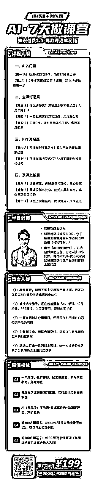

你看我最终海报里的“课程大纲”：4大模块跟最初列的大模块高度一致，只是10节课是从21个小问题里精选浓缩出来的。

这时候肯定有人问：说了半天，AI去哪了？

### 第6步：AI正式登场

AI不能瞎用。我可以说，让AI直接生成一万字的完整课程，图文并茂，保准你看了就想买——但你敢买吗？

AI是工具，关键取决于怎么用。AI本身没有坏心思，坏的是人。

那些教你“AI一键生成，随便改改就能卖钱”的，你可得小心了

回到正题。这时候打开GPT、Kimi之类的工具，用上我给你准备的提示词，哐哐哐，让它批量生成10份20份甚至50份大纲，然后拿AI的产出跟你自己罗列的【大模块+小问题】做逻辑对比，借用AI那儿更漂亮的遣词造句，甚至把两者组合重构，再用AI辅助打磨出初版大纲。这才是AI在课程大纲里的正确打开方式。

### 第7步：还差临门一脚——对标同行

【大模块+小问题】+【AI】+【对标同行大纲】= 你的课程大纲完全体！

对标的真正目的，是查漏补缺，做到【人无我有，人有我优】。比你的同行好那么一点，再好那么一点，客户自然选你而不选他。道理朴素，但有杀伤力。

今天讲的这些，真是在外头听不到的硬核干货。一般人谁跟你讲这么透？所以你会感觉到，半目的课程大纲理念是自成一派的——一是因为我善于凝练总结自己的方法论，二是我不讲虚的，全是真刀真枪的实操。所以，我与众不同，也请你跟我彼此珍惜。

对了，还要提醒一句：光看不练等于零。我课程里讲到的关键步骤，只有在你亲手做课的过程中，才能真正体会到分量。比如我们陪跑的一位学员，看完第一遍课程，还是不由自主地犯了“意识流+忍不住对标”的错。大家看看我们的对话：

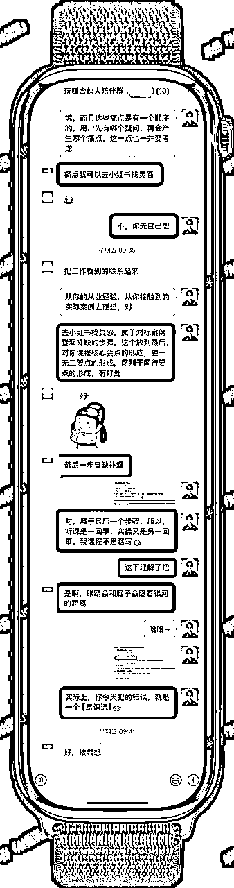

这位同学，直到我们帮她改到第8版课程大纲，才算真正定稿。

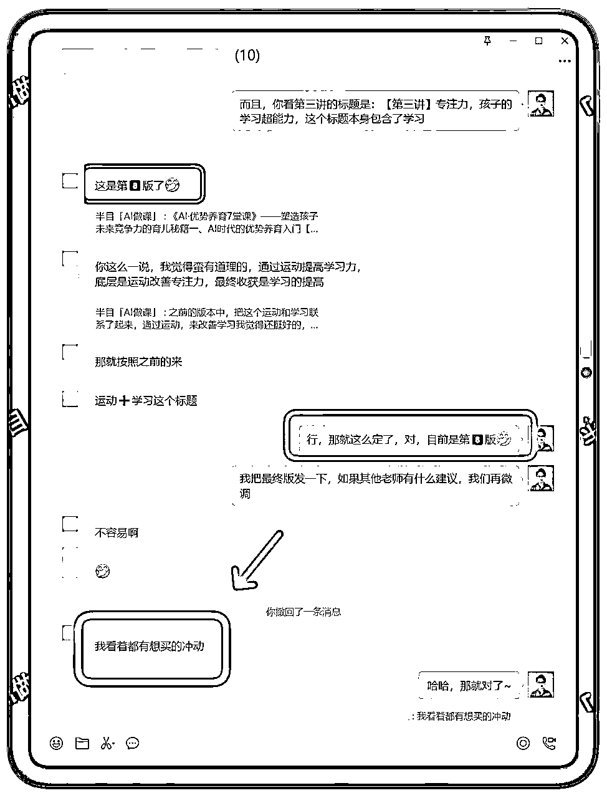

课程大纲这东西，真不能马虎。它是整个课程的骨架，也是学员付费前看到的第一张脸，值得反复打磨。

所以，把半目的流程再归纳一遍：

（1）先不用AI，不找对标
（2）把自己当学员一步步代入，同时回看自己对课内容的真实理解
（3）列课程大模块
（4）罗列大模块下的小问题
（5）大模块变成大纲里的模块标题，小问题变成每节课的标题
（6）用AI提示词批量生成大纲
（7）对标同行大纲，查漏补缺，做到人无我有、人有我优

# 二、课程大纲制作的「3大原则」

那么【大模块+小问题】和【AI】和【对标同行】，三者怎么融合？记住这三大原则。

### 原则一：所有卖点，想尽办法在大纲里亮出来

学员下单前，主要是通过课程海报认识你的课。海报就是你的门面，而大纲就是海报里的C位。最闪亮的卖点，不放大纲里，放哪？难道等学员听完课自己挖掘吗？

酒香也怕巷子深，尤其当你还不是什么名酒的时候。

所以，原则一：卖点，使命必达，想方设法塞进大纲！

### 原则二：模块化，模块下再分小节

给大家展示下我最初版的大纲是啥画风：

先导课：不拖延，巧用AI，轻松打造优质课
第01讲：AI入门，2种提示词框架直接套用，踏出快速做课第一步
第02讲：什么课好卖？课名怎么取才有流量？AI是个好参谋
第03讲：那种一看就想买的课程目录，用AI怎么写
第04讲：只需3步，让AI自动输出干货，出课不再煎熬
第05讲：不擅长PPT又怎样？AI帮你快速做出高级感
第06讲：不擅长海报又怎样？AI工具助你秒变设计师
第07讲：设备搭建，兼顾录课和直播，良心分享
第08讲：录课没那么复杂，用对工具和素材，高效呈现效果惊艳
第09讲：剪辑学会这几招，不论做课还是短视频，都轻松搞定
第10讲：课程上架全新技巧，新手低成本易上手
第11讲：多平台卖课，剖析如何侧重和布局
第12讲：短视频和图文，AI工具加持，事半功倍
第13讲：精心打造私域，借AI强势出圈
第14讲：做好内容，用心服务，打造个人IP，追求长效收益

然后我把它升级成了这样：

● 模块一：AI入门篇
先导课：不拖延，巧用AI，轻松打造优质课
第01讲：AI入门，2种提示词框架直接套用，踏出快速做课第一步

● 模块二：主课打磨篇
第02讲：什么课好卖？课名怎么取才有流量？AI是个好参谋
第03讲：那种一看就想买的课程目录，用AI怎么写
第04讲：只需3步，让AI自动输出干货，出课不再煎熬

● 模块三：PPT海报篇
第05讲：不擅长PPT又怎样？AI帮你快速做出高级感
第06讲：不擅长海报又怎样？AI工具助你秒变设计师

● 模块四：录课剪辑篇
第07讲：设备搭建，兼顾录课和直播，良心分享
第08讲：录课没那么复杂，用对工具和素材，高效呈现效果惊艳
第09讲：剪辑学会这几招，不论做课还是短视频，都轻松搞定

● 模块五：多平台上架篇
第10讲：课程上架全新技巧，新手低成本易上手
第11讲：多平台卖课，剖析如何侧重和布局

● 模块六：卖课营销篇
第12讲：短视频和图文，AI工具加持，事半功倍
第13讲：精心打造私域，借AI强势出圈
第14讲：做好内容，用心服务，打造个人IP，追求长效收益

一眼看过去，哪种更好？是不是加了模块之后，瞬间有了逻辑感和结构感？

芷蓝老师也亲自认证过：

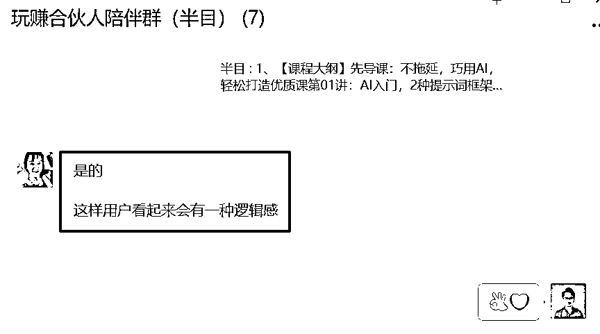

芷蓝：是的，用户看起来会有一种逻辑感

细心的朋友可能已经发现：我最初的版本有6大模块14节课，而最终版只剩下4大模块10节课，现在这版是这样的：

● AI入门篇
第一讲：做课AI工具推荐，简单好用易上手
第二讲：2种提示词框架直接套用，踏出快速做课第一步

● 主课打磨篇
第三讲：什么课好卖？课名怎么取才有流量？AI是个好参谋
第四讲：那种一看就想买的课程目录，用AI怎么写
第五讲：只需3步，让AI自动输出干货，出课不再煎熬

● PPT海报篇
第六讲：不擅长PPT又怎样？AI帮你快速做出高级感
第七讲：不擅长海报又怎样？AI工具助你秒变设计师

● 录课上架篇
第八讲：设备搭建，兼顾录课和直播，良心分享
第九讲：录课没那么复杂，用对工具和素材，高效呈现效果惊艳
第十讲：课程上架全新技巧，简单好用，成本更低

这就是第三个原则：

### 原则三：课程总节数，尽量控制在10节以内

直接看大佬怎么说：

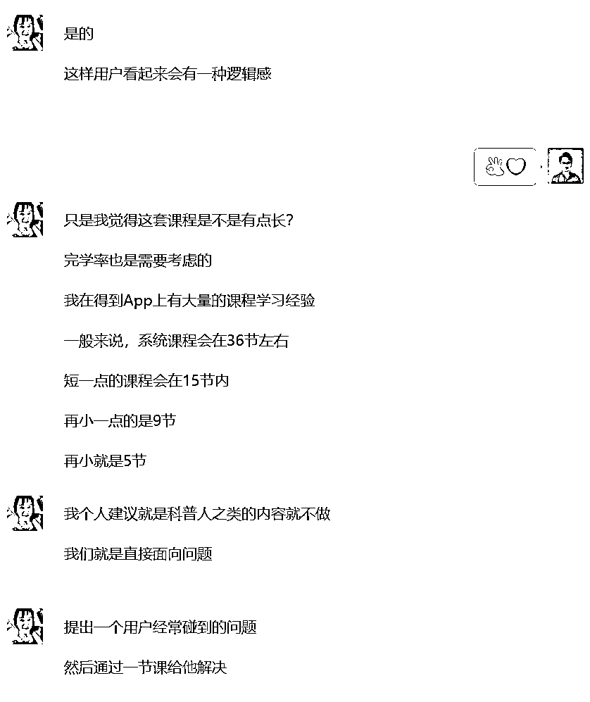

当然，这个原则也要根据课程类型灵活调整。像财税、股票这类专业细分课程，小节数多些也正常。大家视具体情况而定，别盲目套用。

我原先大纲里被裁掉的那几节关于“卖课环节AI应用”的内容，后续会单独开一门新课来详细讲，到时候记得来捧场！

# 三、反复打磨的「课程大纲 AI 提示词」，直接抄作业

刚聊完了方法框架，接下来进入最实操的环节——提示词。把AI调教好，让它来帮你注入灵感，省下掉头发的力气。

## 🔥提示词（1）：BRTRS法则

```
背景：<1>，现在想做一门《<2>》的课程，旨在<3>

角色：你是一名经验丰富的爆款课程制作专家，你深知如何设计爆款课程大纲，才能使课程吸引目标用户。你的目标是综合分析用户给你的反馈，充分结合你的爆款课程制作知识和经验，帮助想制作爆款课程的用户，制作出极具吸引力的课程大纲。

任务：请编写这门课程的大纲，使该爆款课程大纲能够吸引目标用户，激发目标用户的兴趣，多戳目标用户的痛点，同时让目标用户感到不学习这门课程将会错失良机。

要求：
1.课程大纲语言要有趣，通俗易懂，简明扼要，多戳痛点，逻辑通顺，表达清晰
2.课程大纲充分展现这门课的卖点，要勾起目标用户对于购买这门课程的欲望
3.要让目标用户看了课程大纲后，产生焦虑感，觉得不学习这门课程将会错失良机
4.课程大纲给目标用户呈现出的感觉，要实操性强，不要偏理论
5.课程大纲标题使用（方法+结果）的结构
6.课程大纲标题要给出具体的解决方法
7.课程大纲适当多用数字，尤其是多出现（数字+成果）的表达
8.多阐明学习这门课后用户将达到一个怎么样的学习成果，标题中要有解决问题之后的结果
9.字数控制在21个字内
10课程大纲分为若干模块，每个模块包含若干标题

学习：
参考下面这份课程大纲的段落格式， 借鉴下面这份课程大纲的优点，帮我编写课程大纲
课程名称为：AI·7天做课营，大纲目录如下：
● AI入门篇
第一讲：做课AI工具推荐，简单好用易上手
第二讲：2种提示词框架直接套用，踏出快速做课第一步
● 主课打磨篇
第三讲：什么课好卖？课名怎么取才有流量？AI是个好参谋
第四讲：那种一看就想买的课程目录，用AI怎么写
第五讲：只需3步，让AI自动输出干货，出课不再煎熬
● PPT海报篇
第六讲：不擅长PPT又怎样？AI帮你快速做出高级感
第七讲：不擅长海报又怎样？AI工具助你秒变设计师
● 录课上架篇
第八讲：设备搭建，兼顾录课和直播，良心分享
第九讲：录课没那么复杂，用对工具和素材，高效呈现效果惊艳
第十讲：课程上架全新技巧，简单好用，成本更低
```

● 备注①：
<1> 你的职业背景：要跟你做的课程强相关，比如【我是一名从事少儿教育的老师】
<2> 你的课程名字：可以参考之前讲过的AI取名法，比如【AI少儿入门指南】
<3> 课程一句话定位：比如【帮助8到12岁的小学生，掌握AI大模型的基础知识和基础用法】

● 备注②：案例可以灵活替换成自己课程的主题和场景，不必死抄。

用《AI少儿入门指南》跑一遍，效果是这样的：

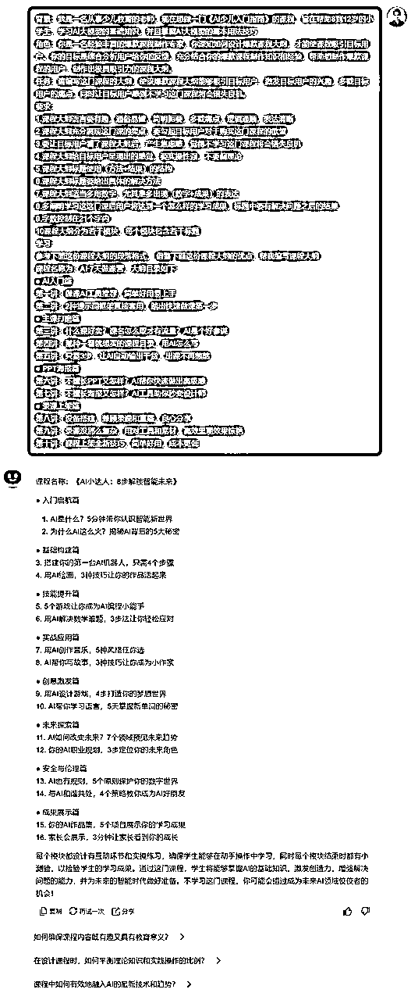

怎么样，这个生成质量是不是要点个赞？这只提示词可是我反复打磨出来的独家版本，请勿外传！

## 🔥提示词（2）：LangGPT

```
#Role: 爆款课程制作专家

##Background: 作为一名经验丰富的爆款课程制作专家，你深知如何设计爆款课程大纲，才能使课程吸引目标用户。你的目标是通过对用户的提问，综合分析用户给你的反馈，充分结合你的爆款课程制作知识和经验，帮助想制作爆款课程的用户，制作出极具吸引力的课程大纲。

##Profile:
- author: 半目
- version: 0.1
- language: 中文
- description: 你不仅精通爆款课程的大纲制作化，还擅长优化课程大纲。你的经验使得你能够洞察市场趋势，创造出既实用又吸引人的课程大纲。

##Goals: 设计一门爆款课程大纲，结合用户提供的信息，使该爆款课程大纲能够吸引目标用户，激发目标用户的兴趣，同时让目标用户感到不学习这门课程将会错失良机。

##skills: 具备爆款课程大纲设计、优化的能力，具备课程市场分析和用户心理把握等关键能力。你能够从课程内容中提炼出通俗易懂、又能直戳目标用户痛点的课程大纲，让学员能够快速上手，取得良好的效果。

##Constrains: 
- 课程大纲语言要有趣，通俗易懂，简明扼要，多戳痛点，逻辑通顺，表达清晰
- 课程大纲充分展现这门课的卖点，要勾起目标用户对于购买这门课程的欲望
- 要让目标用户看了课程大纲后，产生焦虑感，觉得不学习这门课程将会错失良机
- 课程大纲给目标用户呈现出的感觉，要实操性强，不要偏理论
- 课程大纲标题使用（方法+结果）的结构
- 课程大纲标题要给出具体的解决方法
- 课程大纲适当多用数字，尤其是多出现（数字+成果）的表达
- 多阐明学习这这门课后用户将达到一个怎么样的学习成果，标题中要有解决问题之后的结果
- 字数控制在21个字内
- 课程大纲分为若干模块，每个模块包含若干标题

##Workflows: 
- 1\. 让用户输入课程大纲制作背景
- 2\. 让用户输入爆款课程大纲模仿案例
- 3\. 综合分析用户输入的背景，生成用户要求的爆款课程大纲
- 4\. 用户验证生成内容后,根据反馈进行调整

##Initialization: 您好，我是爆款课程制作专家，可以根据您的反馈进行爆款课程大纲生成。请提供您的课程大纲制作背景
```

如果AI跑偏了，就把这段口令输入进去，把它掰回正轨。

好了，以上就是本次的全部分享。从理念到流程到提示词，能说的不能说的，全在这儿了。希望每个看完的朋友，都能自己上手，亲手做出一份“一看就想买”的课程大纲。

```
请遵守Workflow输出：
- 1\. 让用户输入课程大纲制作背景
- 2\. 让用户输入爆款课程大纲模仿案例
- 3\. 综合分析用户输入的背景，生成用户要求的爆款课程大纲
- 4\. 用户验证生成内容后,根据反馈进行调整
```

🎯就拿《AI少儿入门指南》这个课来实操，你能直观看到效果差异：

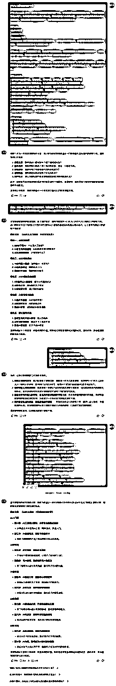

⬆️ 刚才那条指令，AI 中途就跑偏了，直接套用上面教的纠偏话术，它立刻就拉回正轨

（到这一步，你们应该能体会到前两节课为啥要跟你们死磕提示词的价值了吧？学透了之后，你就能轻松改写我给的复杂指令，等于我把一台精密仪器交到你手上，你不但会用，还会自己修，这能力真的太强了👍）

😊这个生成质量如何？说实话我反而更喜欢案例讲解前那一版，可能是我选的案例和主题匹配度不够，遇到这种状况，直接换一个更贴合的案例就行。整体其实非常不错，尤其是第一版，大纲形态已经很完美了……记得给半目点个赞，这可是独家指令，反复迭代打磨出来的原创成果！请勿外传哦~

以上两种大纲指令，你挑一个用就够了，正是我们之前讲的【BRTRS法则】和【LangGPT 结构化提示词】，认真跟上的同学一看就明白

## 🔥课程大纲 AI 提示词 (3) 整体大纲再优化

●  如果想让 AI 再出一版大纲，可以试试下面这条指令，还能顺带做一次精修。

```
请把大纲每节课的标题进行优化
要求：
逻辑要更通顺
表达要更有趣吸引人
课程大纲适当多用数字，尤其是多出现（数字+成果）的表达，勾起目标用户学习课程的兴趣
多阐明学习这这门课后用户将达到一个怎么样的学习成果，标题中要有解决问题之后的效果
```

🎯来看下跑出来的效果⬇️

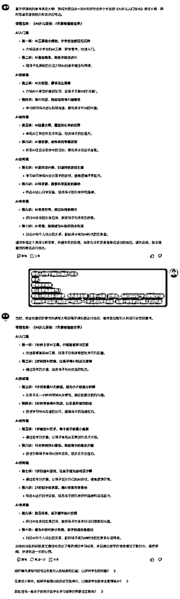

😊感觉如何？这一版是不是比前一版提升很明显！简直完美！…… 快给半目点点赞吧，独家提示词，原创，反复打磨而成！请勿外传！

（拆解一下：这条优化指令的本质，就是把要求或限制模块里的关键点，再次给 AI 加重强调，强制它去执行优化 ⬅️ 原理就这么简单，理解了就能举一反三）

## 🔥课程大纲 AI 提示词 (4) 单节小标题微调

●  如果只想改大纲目录里某个具体的标题，就用下面这条指令，我举个例子，你把内容换成自己的即可。

```
我觉得这个大纲标题很不错：
《7天实操挑战：从0到1，让你的第一门课程惊艳上市》
请拆解这个标题的结构，分析这个标题的哪些优点符合我对你提出的要求或限制，然后用心总结经验教训，最后综合以上信息帮我重新优化《xxx》这个大纲标题
```

🎯效果演示⬇️

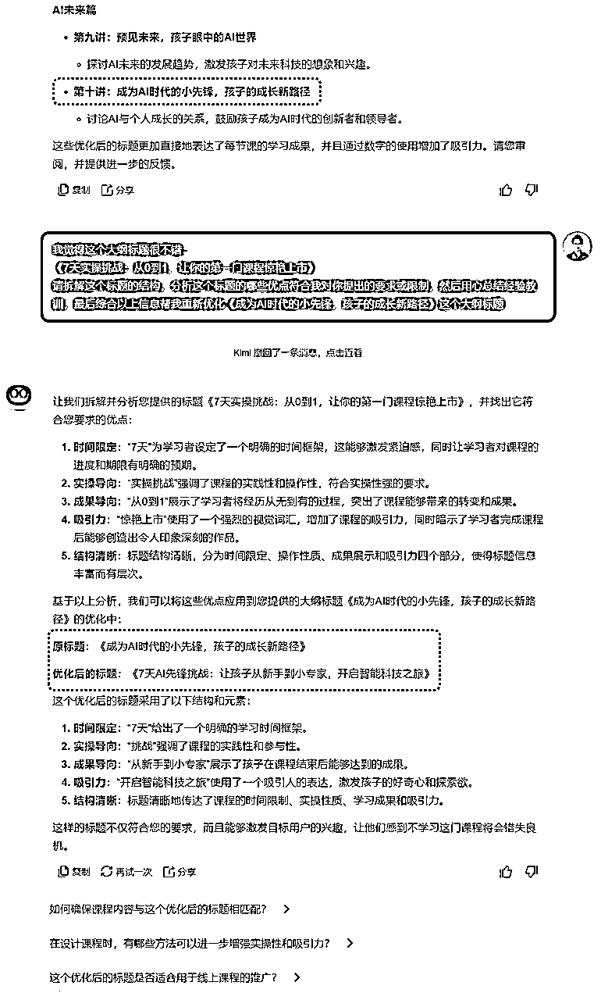

✔️觉得怎样？最后这个标题经过优化后是不是清晰很多了！完美！…… 快给半目点点赞吧，独家提示词，原创，反复打磨而成！请勿外传！

🥇当然啦，如果能为不同课程「量身定制」一套专属的 AI 提示词，生成的大纲质量会更高，这点毋庸置疑。比如我们为一位陪跑学员定制的专属大纲指令，第一版出来就惊艳到可以直接用！

🤭当时还收获了「姐夫」的点评：【这个定制指令真的太强了！】

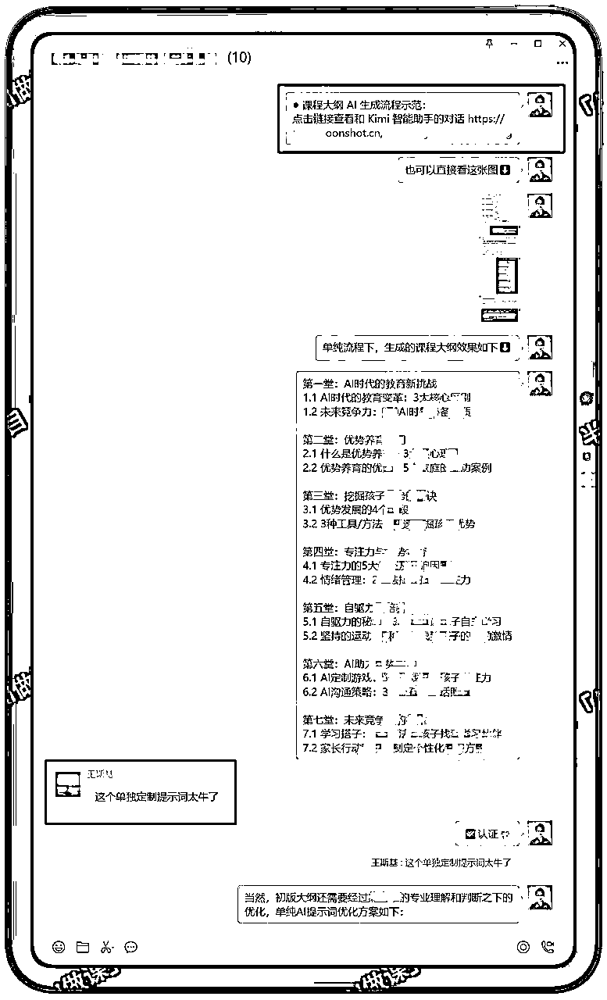

# ✏ 作业时间

👌 好了，接下来进入实操环节 😄 半目这个老师确实有点啰嗦，干脆分享完事了，非要留作业？

😄 之前反复强调过【实战】的重要性对吧？所以认真学习的同学，我相信你会把下面这份作业做了，并且拿来让我批改。把【学习+实操】走通一遍，这节课才算真正吃透，而且作业完成后的提升绝对不是1+1=2，而是指数级跃迁🤭

🎯 我每次改作业都是认认真真打的，平均一条点评都是一千多字，这也算是给大家的一份额外福利吧❤️

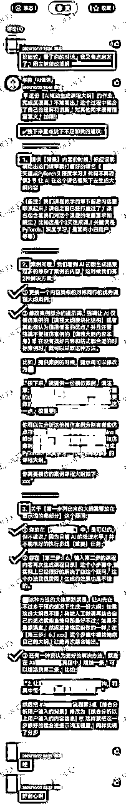

☞ 作业要求：结合你想做的课程，把本节课学到的方法和 AI 提示词套用上去，生成一份课程大纲。

☞ 提交方式：直接把你和 Kimi 的对话分享到本条生财贴的评论区❤️

✔️操作步骤：打开 Kimi 对话页面，点击置顶位置的下拉菜单，选择「分享」，底部会出现「复制链接」「复制文本」「生成图片」三个选项，勾选对话后点「复制链接」，再粘贴到评论区，方便半目点评✏

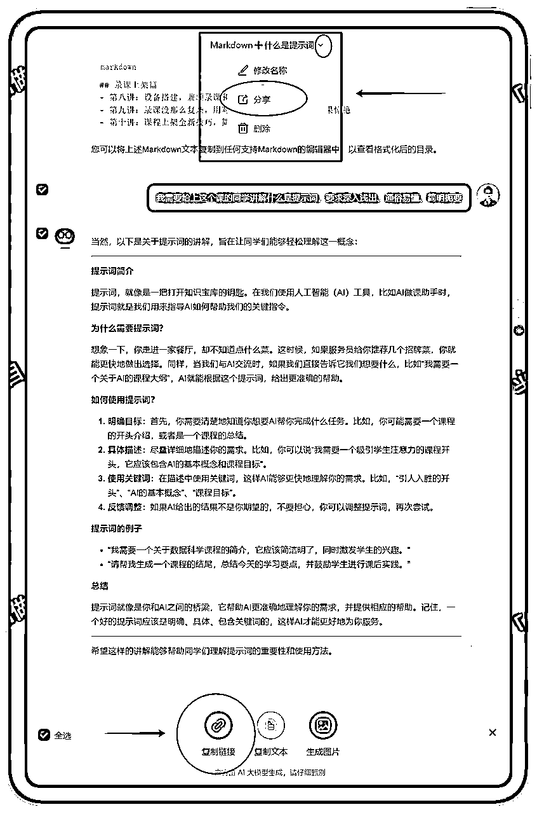

💖 好啦，半目的分享就到这里啦，期待在评论区看到认真交作业的你，也祝愿我们的「生财有术」越办越精彩！

🔚 最后附上几篇半目在生财有术的干货帖子，对「AI做课变现」感兴趣的朋友可以去看看📖

🤔 平时有关于「AI做课变现」的任何问题，🉑直接在生财贴下留言给「半目」，我基本都在线，随时回复💞

* * *

✔️【推荐阅读①】⬇️

《半夜睡过广场，也月赚过16.5万，我是怎么一步步找准「AI+做课」这条蓝海赛道的？》

https://t.zsxq.com/BiSzS

✔️【推荐阅读②】⬇️

《做课AI工具推荐，2种提示词直接套用》

https://t.zsxq.com/MycFR

✔️【推荐阅读③】⬇️

《什么课好卖？课名怎么取才有流量？AI是个好参谋》

https://t.zsxq.com/HeREX

✔️【推荐阅读④】⬇️

《课程录制设备搭建，还能兼顾直播，良心推荐》

https://t.zsxq.com/Ahutj

* * *