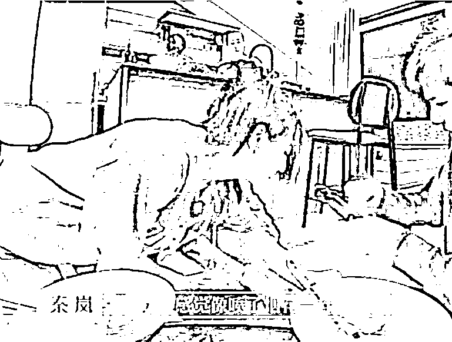
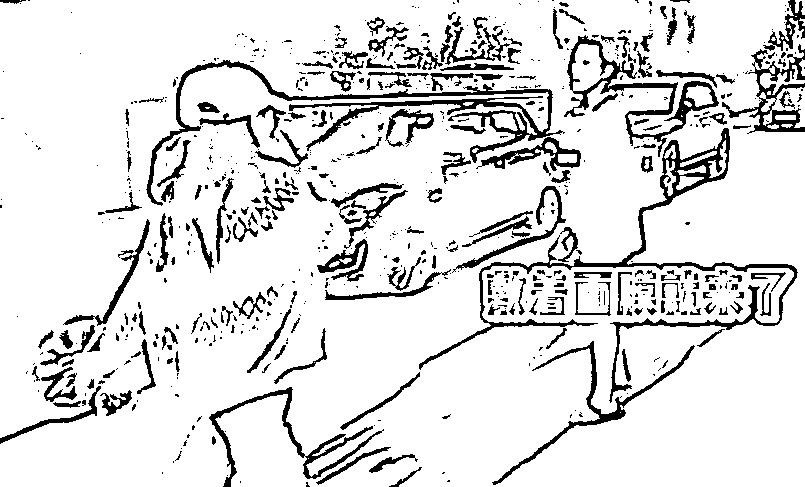
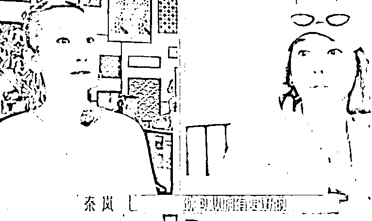
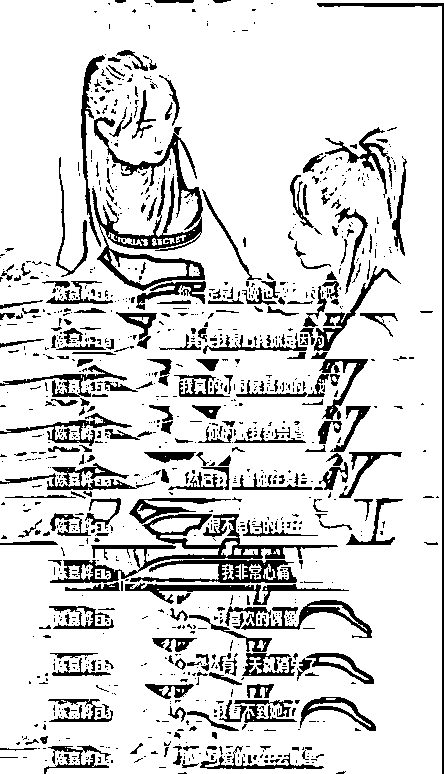
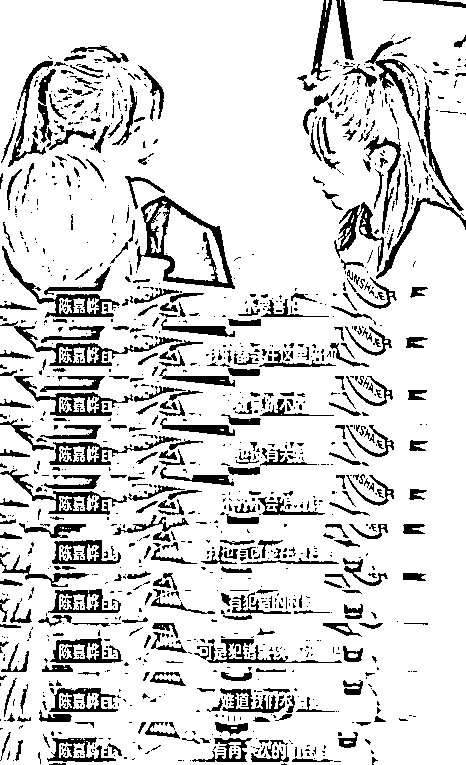
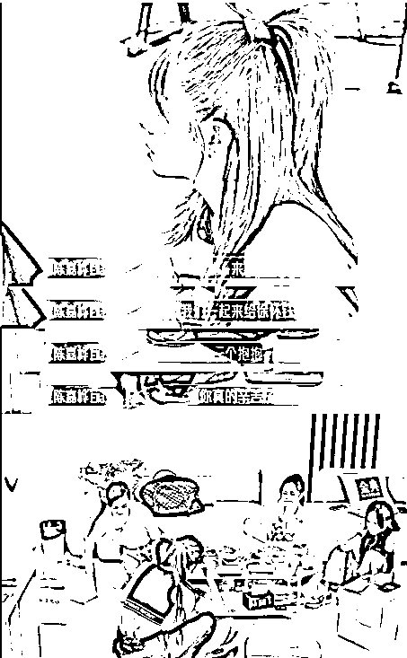
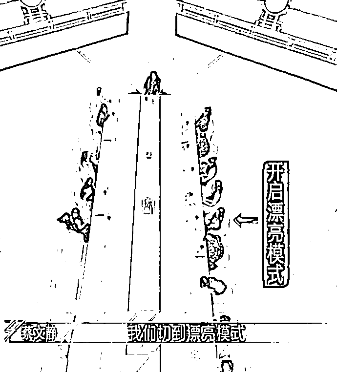

# 刷综艺，也能“无痛”学社交
作者：龙哥

你是不是也有过这些瞬间：话说得不对，被人误解；心里想得很明白，嘴上却说不出来，机会白白溜走；遇事明明占理，一张嘴却成了没理；人一多就紧张，最后干脆逃避社交，越来越没自信。

很多人不是不想练社交，是不敢迈出第一步。网上那些沟通技巧，看的时候觉得“我会了”，真到了要用的时候，脑子里一片空白，只剩尴尬和结巴。

其实，还有一个轻松的办法：看综艺。尤其是团体综艺，娱乐圈本来就聚集了一群会说话、懂人情的人，节目把这些人凑到一起，看他们怎么接话、怎么圆场、怎么安抚人，就是在免费围观高手过招。这种“沉浸式偷师”，比背一百条话术有效得多。

下面就拿几个综艺里的真实片段，拆给你看。

先从《花儿与少年·丝路季》（花少5）说起。这一季被很多人评为“封神”，里面确实有不少社交细节值得琢磨。

朋友不小心把可乐喷了一地，整个人又慌又窘。这时候可以笑着说一句：“新年快乐！这没什么，反而是庆祝！感觉像喷了烟花一样。”  哪怕那天根本不是新年，这句幽默也能瞬间卸下对方的自责，把一个小意外变成有点浪漫的插曲，气氛立刻就松了。

朋友来找你，半路迷了路，又怕给你添麻烦，只让你发个定位。真正用心的做法，不是发个定位过去，而是直接去找他，把人带到你面前。 “我来接你”这个行动，比任何客套话都让人安心，因为对方感受到的是实打实的重视。

朋友问你一条饰品好不好看。你心里觉得不太适合她，但别说“不值”“不好看”。换一种说法：“它配不上你的气质，你可以拥有更好的。”  用夸赞的方式表达否定，对方不但不难受，还会觉得你懂她，气氛也更融洽。

再来看《乘风2023》（浪姐4）里一个非常经典的处理。当时节目录到三公，一公才刚播出，Yuki徐怀钰因为一公表现不理想，被网友攻击到想退赛。队长Ella没有说教，而是认真对她说了一段话。 这段谈话，真的值得反复琢磨。

Ella的沟通方式层层递进：

第一，先共情。她让Yuki知道，自己看到了她的困扰，也理解她此刻的感受。这样一来，Yuki会觉得自己的情绪是正常的，不是矫情。

第二，再面对现实。Ella用客观的视角帮Yuki梳理问题，不回避也不夸大。这能帮她从情绪里出来，更理性地看待现状。

第三，接纳与确认。Ella告诉她，“有人喜欢你，就会有人讨厌你”。被讨厌是生活中的常态，不是她一个人倒霉。这种接纳，本身就是一种安抚。

第四，找共鸣。Ella说自己是Yuki的歌迷，还会唱她的歌。这会让Yuki觉得“原来我们是一边的”，信任感一下就建立了。

第五，给勇气。Ella鼓励她不要怕，犯错也没关系，每个人都会犯错。这句话让她感觉到自己是被支持、被托住的。

第六，用身体接触收尾。Ella招呼大家一起给Yuki一个拥抱。肢体上的温暖，比语言更能传递“有人站在你身边”的安全感。

这套流程中，最关键的是第一步：理解和共感。如果一上来就讲道理，对方的情绪没有被接住，后面说什么都听不进去。先承认“你有这样的感受是合理的”，她才会冷静下来，愿意和你一起想办法。

同场正好有一个反例。芝芙Chi Pu说“我觉得好丢脸”，吴倩马上回“没有，我一点都没觉得”；芝芙又补了一句“甚至在我唱的部分”，吴倩依然在讲道理：“但没关系。这只是一个小考。这不是正式的舞台上，对吗？我说过这不是一个舞台。我告诉过你会一直支持你的。”

吴倩的本意是好的，但她一开始就否定了芝芙的感受，想用理性直接把对方拽出来。结果反而是，芝芙觉得自己的情绪没有被看见，没有被接纳，自然也更难被安慰到。

最后看一个《乘风2024》里的救场片段。郭碧婷因为紧张，不习惯回应别人的热情，场面一度有些尴尬。蔡文静不慌不忙地打圆场：“让我们切到漂亮模式，因为漂亮是不能社交的。聊天的时候展现个性，安静的时候展现美貌。就我们安静了也很好看，我们一起来漂亮。”

这句话妙在哪里？概括起来有三个要点：当有人没能融入集体时，要把“我们”放在前面；把对方身上那个容易让人侧目的点（不是缺点）转化成优点，顺势夸她；如果能连带着夸到所有人，那就更高级了。

具体拆解一下：一，主语是“我们”，没有把郭碧婷单独划出去；二，给她的安静找了个理由，还夸她漂亮，释放了善意；三，一句“我们安静了也很好看”，把在场所有人都夸了进去；四，落脚点是“一起漂亮”，而不是“一起安静”，悄悄把话题重点换掉了。于是大家再看郭碧婷，心里想的不再是“她融不进来”，而是“她只是一个还在安静状态的美女”。

今天先聊到这儿。我是金多数，祝你周末愉快！