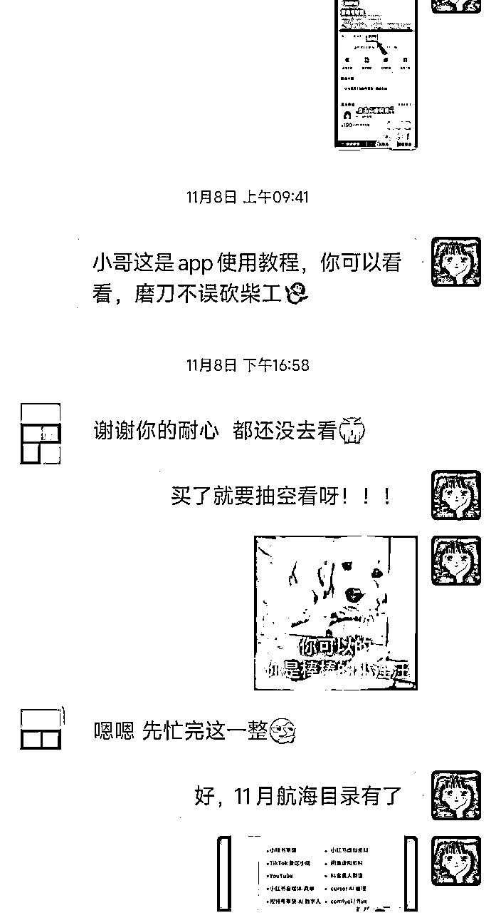
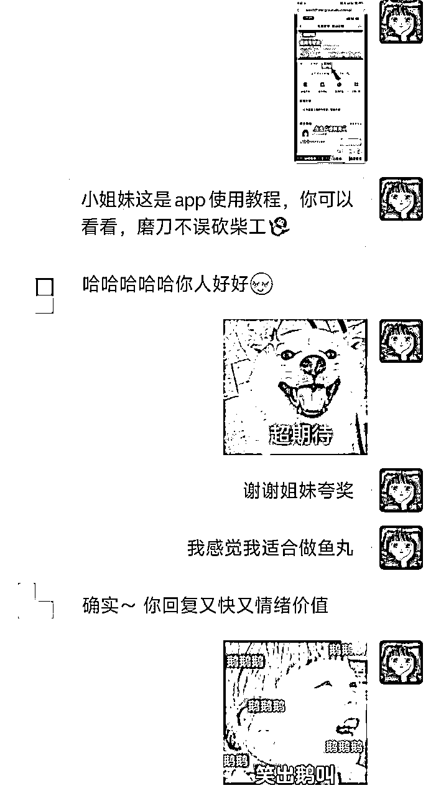
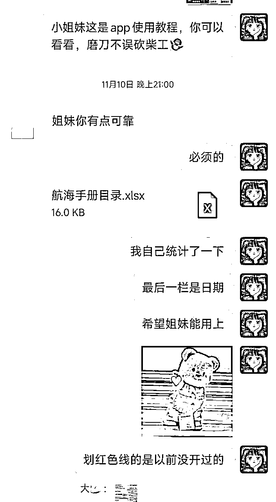
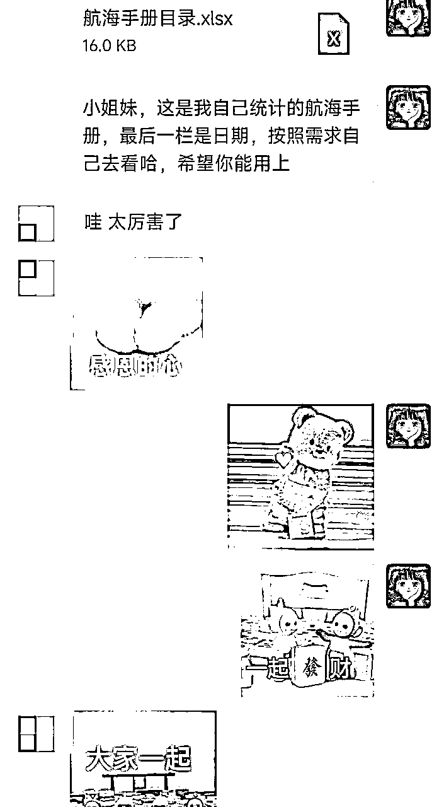
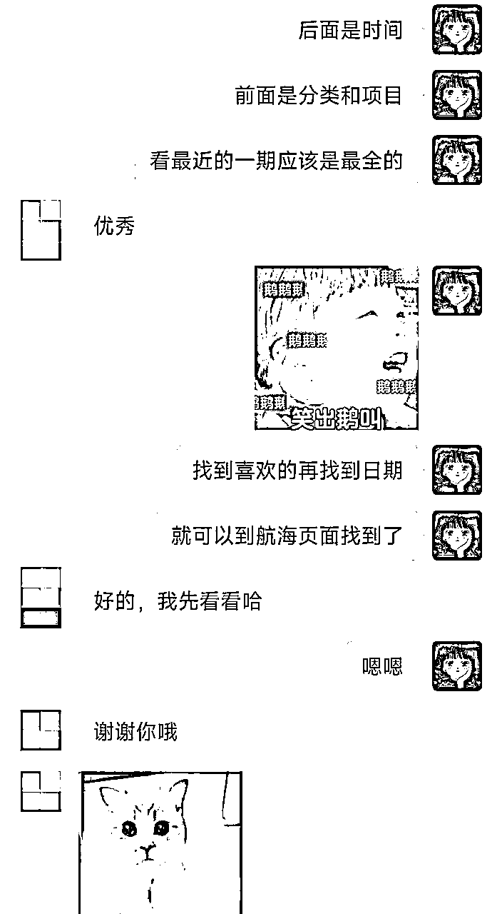
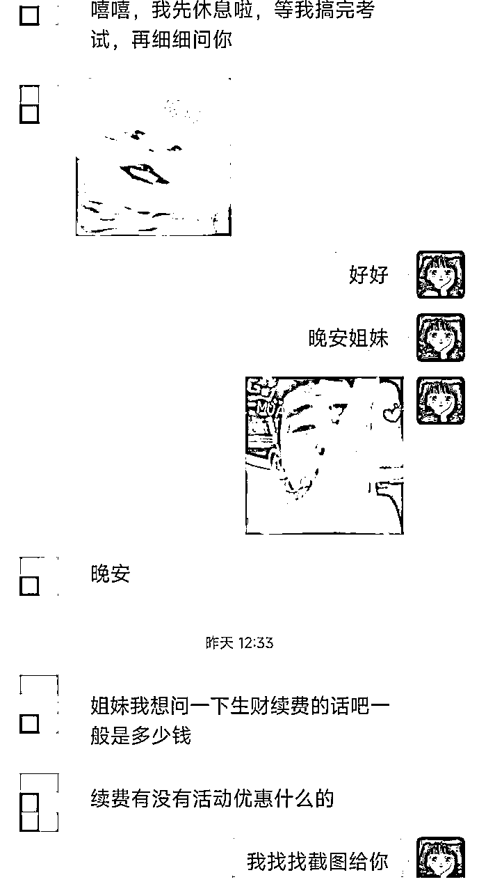

# 0投放、214粉、10天，我给赚钱招来了30位新成员

如果有人说，一个只有214个关注者、从没正儿八经做过运营的人，可以在十天内通过社交电商模式卖出一门高价付费社群，你会信吗？我自己动手试了试，结果确实成交了30单。

先交代一下背景：事情从11月2号持续到11月11号，投入只有一台旧手机和两个不活跃的账号，外加后来补的一套开播工具。整个过程没有花一分钱投流。

## 信号：为什么是我来做这件事

起因是11月2日晚上，我刷到赚钱即将调价的通知。价格本身倒还好，真正让我决定行动的是两个加在一起的信号：平台开出的邀请奖励比例相当有吸引力；而我作为新用户才体验了两周时间，感受是内容价值远超我之前买过的很多千元级课程。自己确实觉得好，推荐又能带来回报，这事就具备了开启的前提。

顺手算了一笔账：这个社群运行到第2596天时圈了6万位成员，折合日均增长约23人。我的目标很小：每天履约2~3单，听上去不算贪心，可以试试。

## 准备：我手里只有些什么

先清点手里的牌：一个用了很久的二手交易平台账号，信用分不错；另一个社交平台的个人号，粉丝数214，平时发发生活日常，互动不温不火，没开过小店，也从未挂过商品链接。11月5日，我又向主理人争取到了在红书做分销开播的许可，这才补了一套开播工具。

我还做了市场调研：在旧货交易平台搜了一圈，发现绝大多数同类帖子在卖资料包，真正做付费社群推荐的很少。我又以买家身份去问了几个正在操作的人，结果很不意外——回复不及时、话术生硬、配图普通、文案也没讲清价值。这些不足让机会变得更加清晰：只要做得更认真，就有空间。

## 动作：最小化启动与迭代

11月2日当晚，第一篇商品帖就在二手交易平台上线了。模式很轻：用户通过我分享的邀请链接完成付款，奖励自动结算；流程上是帖子先引流，有意愿的人进入私聊，聊清楚后把专属链接发过去。

我选择走星球App自带的交易频道，原因是平台佣金按七天周期结算；若是走社群官方渠道，则要拖到月末集中清算。对一个还没有建立公众信任的普通人来说，让用户等太久等于把机会推给别家。那些自带光环的大咖也许等得起，小透明只能选择更顺滑的路径。

3号之后，我每天都会做一点小优化：先把自动回复打开，不再漏掉任何咨询；重新设计封面图，把文案从自我介绍改成价值说明；商品页面里加入了官方入口和真实奖励记录的截图；每天固定时间段在平台内刷新一次，换取更高的展示位。

8号，开播工具正式到货。此前只是粗略翻了手册里的流程说明，9号就硬着头皮开了播。一小时下来场观21人，其中一位愿意继续聊，听完报价后没有下单。这次尝试基本可以宣告失败。原因事后看得很清楚：账号没有清晰定位，没有店铺和橱窗，粉丝也缺乏黏性。但我并不觉得白做——至少用最小代价确认了一条走不通的路。碰上不懂的地方，我就找鱼丸讨教，每次都能获得正向反馈，信心也在一点点涨起来。

## 交付：把服务做到超出期望

销售仅仅是开头的动作，真正决定口碑的，是成交之后的服务。我的原则是从用户立场出发：一个愿意信任小透明的新成员，应该得到十二分热情。除了基础指引，我还额外做了两件事：一是把手册目录重新整理成一页纸，方便按日期定位内容；二是把官方App操作教程下载好，直接发给不熟悉星球界面的新成员。很多新成员不会自己翻完所有指南，这样的附带服务能明显减少他们的上手阻力。

## 数据：这件事给了我什么反馈

十天跑下来的数据是：有效咨询53人，完成付款30人，成交率约56.6%。完成付款的成员里，约有三分之一此前通过免费活动了解过社群，还领过试读权益，只是在等一个更合适的优惠节点；其余三分之二完全是新面孔，第一次接触就选择相信我。

也是在那一天，我写的一篇经验帖被主理人加精，从那以后陆续有人来交流方法，也有同行开始复制路径。到10号和11号，其他人的邀请成绩也在上涨。12号价格正式调整后，找上门来的人明显少了。这个项目不会让人暴富，但当作稳定的小副业，每个月多一份零花钱，完全没有问题。

## 延伸：下一个可能的增长点

如果把视野再拉远一点，我还有个判断：这个社群目前只在微信直播渠道开播，而红书App上的内容生态还没有被充分打开。假如能先做起来一个定位鲜明的红书账号，配合开播去承接流量，同时让更多认可社群价值的成员在红书分享真实感受，很可能长出一条新的增长曲线。到那时候，社群声量外溢只是时间问题。

## 尾声：一些巧合与感谢

回想整个经历，最让我感慨的不是那30个数字，而是某条隐蔽的因果链：你投入了一点行动，世界就在某个瞬间给出回应。12号晚上，我在社群里随手发了一条简短分享，然后出门溜达了一圈，途中刚好在听一档对谈类播客，那一期的嘉宾昵称叫小鹅。回来打开手机，发现主理人与小鹅都来互动了，还交换了联系方式。那种巧合令人忍不住相信，很多事情之间存在隐秘的牵引。

我来这里的日子并不长，却已经完成了从旁观者到参与者的转身。感谢主理人给出空间，也感谢所有愿意陪跑的新朋友。希望这个平台能够继续给更多普通人以勇气；也希望那些选择相信我的人，能在这里得到真正的认知升级，并赚到实际的回报。

最后，借主理人此前分享过的一句话送给大家：不要等准备好再出发，因为最好的时机往往就是现在。很多你想要的反馈，会在你未曾预设的节点主动找上门来。