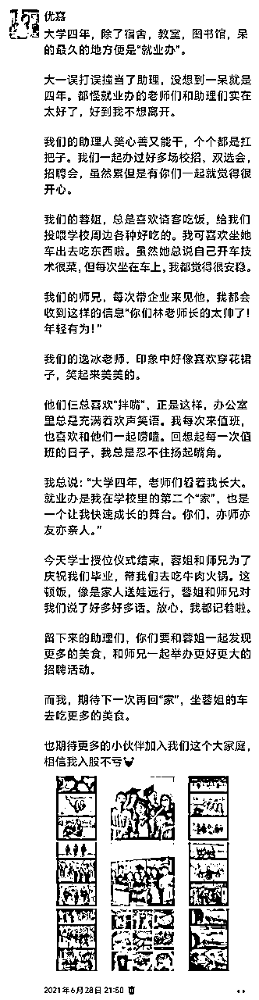

# 先找到一个小切口！

你有没有想过，为什么有些人到了新环境，总能很快打开局面？  
不是他们天赋异禀，也不是运气特别好，而是他们掌握了一种很底层的思考方式。

我是优嘉，今天想和你聊聊这个思维方式。

人这一辈子，真正能拉开差距的，不是努力本身，而是你遇到事情时怎么想。  
想法决定动作，动作决定结果。  
所以，想改命，先改脑。

去年国庆，我在家见了两位长辈，他们的孩子刚准备踏入社会，想听听我的建议。  
大道理他们早就听腻了，我没多讲，只是分享了自己一路走来的经历。  
也是借着那次复盘，我才发现：原来我做的每件事，几乎都靠同一个方法——找到一个很小的切口，先进去再说。

给你讲三个故事。

--- 

第一个故事，发生在大学。

我在广东读书，算是一个外地人，刚开学就一心想自己赚钱。  
可一个初来乍到的学生，没背景、没资源，唯一能拿得出手的，就是肯吃苦、有时间。

看到学长学姐发奶茶店兼职的消息，我立刻去应聘了。  
一开始手忙脚乱，点单打包都出错，后来慢慢熟练，能一个人hold住全场。  
这份工作让我练出了面对客户的沟通能力，也学会了随机应变。  
老板很认可我，经常带我出去吃饭玩。

但我清楚，靠体力赚钱效率太低。  
所以我一边干着，一边寻找新机会。

后来我一路面试，拿下了好几个岗位：  
学校就业指导中心的学生助理，一干就是四年。  
这个岗位像是给我开了一扇门——  
我自学了图文排版，开始管理官方👸号；  
接触了很多来校招聘的企业，做了好几家公司的校园大使，既赚钱又锻炼市场能力；  
靠着这些链接，我拿到了第一份中海地产的实习；  
每年接触毕业生，又认识了大量优秀的师兄师姐。

同时我还做了学生互助中心的辅导导师，凭着一个学期亮眼的成绩，为同学讲解功课，每个月有不错的收入；  
还去学校体育馆当活动人员，参与音乐节、演唱会、毕业典礼、篮球赛……认识了好多朋友。

有人问过我：你也不是没本事，干嘛非要从奶茶店做起？  
在他们眼里，那是份很low的工作。  
但我不这么看。

你刚到一个地方，啥都没有，凭什么拿到更好的机会？  
最好的办法，就是先找到一个能马上下场的切口，先钻进圈子里，再慢慢往上走。  
奶茶店就是我的入口。它让我站在了赚钱的圈子里，然后我才有机会接触更多信息、更多可能。

从零开始的时候，别给工作贴标签。  
这个高级，那个低端——都不重要。  
重要的是你先动起来，多接触，多尝试，机会才会慢慢长出来。

---

第二个故事，说说我怎么做上运营的。

我本来学财务，大二在中海实习的时候，发现自己打心底不喜欢这个方向，就开始找别的路。  
大三下学期因为疫情闷在家里，正好有时间看网上的信息。  
偶然看到黄有璨讲运营的内容，还读完了那本《运营之光》。

我一下子被吸引住了。  
然后开始疯狂搜索相关岗位，几乎关注了所有讲运营的👸号，拼命补课。  
大三暑假，疫情还没完全过去，我就在线上找机会。  
后来参加运营社的训练营，发现他们在招实习生，我去面试，过了，直接跑到上海实习了三个月。

在那边，我遇到了第一个领导波波，他教了我很多运营的本事；  
他们做的是运营技能培训，所以我能接触到各种行业前辈。  
这些连接对我大四找工作帮助巨大。  
我通过和前辈们聊天，了解每个人在做什么业务，最后选择加入一位前辈的创业公司，做了直播运营——这是我毕业后的第一份正式工作。

你看，人生就是这样一步步打开的。  
找到小切口，先进圈子，积累能力，然后看到更大的世界。

---

第三个故事，发生在今年换工作之后。

新公司新环境，和我同期进来的有5个人。  
老大前期会通过一些小任务来考察每个人的能力，而且项目不多，你得靠实力让他选你。

竞争很激烈，也很直接。

我怎么快速跳出来？  
还是老办法：找小切口。

我会的东西其实不少：短视频、直播、带团队、项目管理、销售、策划、发售……  
但关键是要找到那个能让老大一眼看到我的角度。

他来开会的当天，我就整理了一份会议总结发给他。  
他没要求我做，但我要用这份文档，主动展示我的理解力。  
他回了个👍。  
我是5个人里唯一做这件事的。  
很多机会，就是在别人看不见的地方，悄悄分出高下的。

后来他正式出题：根据一段信息，以项目负责人身份做一份项目规划，限时2小时。  
信息少得可怜，根本没法做具体推进。  
有人去找他问更多细节。  
我也知道信息不够，但时间太紧，必须先交出一份答卷。  
于是我用项目假设的方式，把整体框架搭了出来，还做了项目管理进程表。

会上，另一个领导质疑：这明明是个做不了的坑，你为什么不指出来？  
我当然知道是坑。  
但我的目的，是借这个切口展示我的项目管理能力。

老大看完所有人的方案，点评我：项目管理的专业度很强。  
第一层信任，建起来了。

还有一次挑战是做项目咨询：连续聊了8个客户，要把每个客户的情况整理成文档。  
这需要商业理解力，还要能把复杂信息可视化表达。  
我在这份文档上花了很多心思，最后拿到了老大很高的评价。

就是通过这一件件小事、一个个小切口，我的专业形象慢慢立住了。  
他评价我：很稳，有潜力，最看好的项目策划人选。

来公司15天，我拿到了两个项目机会。  
我当时没当回事，以为人人都有。  
后来开会才知道，我是手里项目最多的人，而且都是大项目。  
而同期进来的一些人，恰恰在这些细节上不那么用心，机会也就悄悄溜走了。

我一直相信：新到一个地方，就放低姿态，从小事干起，机会才会向你靠拢。

---

写到这里，相信你对“先找到一个小切口”有了更具体的理解。

这个思路，做所有事都适用。  
它的本质，是给自己找一个能先进入圈子、先下场的起点。  
我们很难一步登天，也很难一下子掌握整个项目——都是从一个个小步骤、小环节堆出来的。

先抓住一个小切口，快速进入，快速积累，然后跳到下一站。

我想起《有钱人和你想的不一样》里的一段话：

> “从你现在所在的位置开始，用你现有的一切，加入游戏下场玩吧。”

作者还提到自己在烘焙屋是从扫地、洗碗干起的。  
他说，这份工作不是丢脸的事，而是花别人的钱学习糕点行业，还能赚零花钱。

这就是我想说的思维模式：  
想进圈子，想看到圈里的机会，无论你过去多厉害、能力多强，都先找一个切口，先进去干起来。  
别眼高手低，别什么都看不上。

最近还看了润宇前辈分享新加坡的故事，特别受触动。

新加坡当年被迫独立，一穷二白，硬是杀出一条活路，成了今天的发达国家。  
靠的是什么？极其务实。

一开始，他们不谈什么高级低级，不贴标签，能活下来就好。  
包容所有人，不轻易评价，多交流，多创造机会，不把自己框得太死。  
这就是小国生存之道，也适用于大厂被裁的人、刚起步的创业者。

我特意去翻了李光耀的传记，学到几个重要的点：

第一，坚决不搞“等靠要”。  
当时很多同期独立的东南亚国家，靠着别国的补偿金过活。  
但李光耀说，新加坡不能这样——国际社会没有责任养我们，靠讨饭活不下去。  
他给国民注入了强烈的危机感。

第二，求商若渴。  
他让负责经济的部长们满世界跑，找机会。  
独立后的几年里，凡是愿意来新加坡的厂商，都被当作贵宾对待。  
不管能不能成，所有可能的机会他都愿意试。

第三，没资源、没矿，最大的资产是什么？  
是人民的信任。  
信任是宝贵的财富，用好了就是杠杆。  
新加坡人勤劳、节俭、好学——这些品质本身，就是致富的资本。

如果你也感兴趣，可以读一读《一生家国：李光耀传奇》。  
你会发现，一个有格局、有视野的人，是怎么思考问题的。  
那真的能极大打开你的视野。

希望今天这篇，能给你一点启发。

先找到一个小切口，下场干起来。  
你会发现，路，是一步步走出来的。