YouTube Shorts新号12天，播放90万+、订阅2700+，我把全过程拆给你看

先亮身份：我是方波妮，生财YouTube深海圈总教练兼航海教练。YouTube这条赛道，我算是深耕很久了。

这次的项目有多猛？从上个月26号正式开跑（亦仁24号刚发出超级风向标，我算是赶了个早班车），到今天整整12天，累计播放量90万+，订阅2700+。数据还是昨晚的，今天肯定又刷新了。更关键的是，这波从0到1的打法，用的几乎所有资源都能在生财里面找到。

先聊聊为什么我坚定看好YouTube。

亦仁有句话一针见血：同样的播放量，放到国内平台可能一分钱不值，放到YouTube上可能就是几千美金的收入。这句话我读了好几遍，又激动又心疼。抖音、视频号、小红书、B站我都做过，第一桶金就是从B站挖来的。做抖音那会儿，我单条最高50万播放，团队里有人冲到百万播放，结果呢？只能靠后端产品变现，流量本身根本不值钱。这就是生态选择的差距——环境很难改变，但我们可以选一个更好的环境，然后适应它。

我平时也爱刷YouTube，老高与小茉等各路博主都在上面更新，你会发现那些在国内被“和谐”掉的创作者，几乎全在YouTube扎堆了。加上亦仁说过，这是一个十年周期的事业，从他那会儿做到现在还能赚钱，而且越做越强，值得当事业认真对待。当然，它不简单——赚多少钱，和你克服多少困难成正比。国内都能卷出来，换到国外，没理由不行。

有句话叫“万事皆可从生财找”，做YouTube也一样。要是还在纠结选题，去航海和风向标里逛一圈就有答案。比如9月那期AI航海文档，里面全是现成的项目：AI老照片、AI写真、AI宝宝走秀、AI赛博机车、AI头像、AI壁纸……国内平台跑得通的东西，搬到YouTube无缝衔接。挑一个自己看着顺眼的，先干起来比空想一百遍都强。我当时选的是AI宝宝走秀，照着航海文档一步步走，方向稳得很。文档链接放这：https://scys.com/view/docx/FDiAdEKoioYSxGxxTJGcIRz2njd

不过儿童赛道有个避坑更新要说清楚：AI宝宝这个方向是可以开通YPP的，但YouTube因为以前向儿童投放过不合适的广告，被告过一轮，所以现在儿童类内容的广告投放范围被收得很窄，YPP收入也相对低一些。如果前期纯粹指望广告分成，AI宝宝走秀这个方向建议换掉——账号不用删，直接在原号上切换赛道就行，之前的老视频主动设为面向儿童即可。但如果你在儿童赛道有后端产品能变现，比如卖货、做玩具开箱，那继续做也没问题，路不止一条。

工具清单我也不藏着掖着，全部给你列好。

“魔法”自己想办法，某宝搜一下就有，这里不方便展开。

写提示词的：ChatGPT、Kimi、豆包都行。不想花钱可以试国内镜像mlyyai.com，不用魔法，免费30次额度，注册就能用。实在不行用谷歌翻译，中文描述翻成英文，把握“主谓宾”逻辑：先写主体再写次要信息，一样能出活。

出图用Midjourney。刚上手可以买某宝日抛账号，1-2元/天，先低成本跑通流程；月付共享号大约18块；官网直接订是10美刀起，适合长期深耕的人。

视频生成用runway或者国产可灵。runway也有日抛号，2-3元/天；官网订购20美刀起，地址：https://runwayml.com/ 可灵目前免费试用：https://klingai.kuaishou.com/

剪辑用剪映+QQ音乐。剪映负责拼接和配音，配乐用QQ音乐“听歌识曲”功能就能扒出爆款BGM。

下载视频用这个免费网站：https://vtool.pro/youtube.html 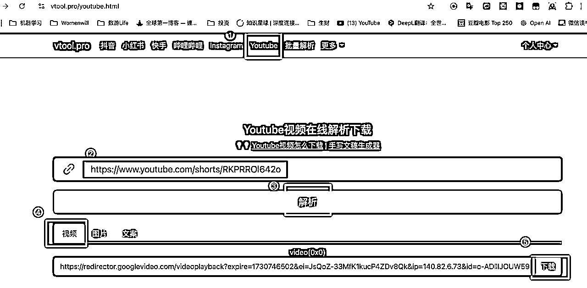 还有一个备用站：https://shortsnoob.com/zh 如果遇到下载失败，多半是节点问题，换个魔法节点、重开浏览器、清一下缓存就OK了。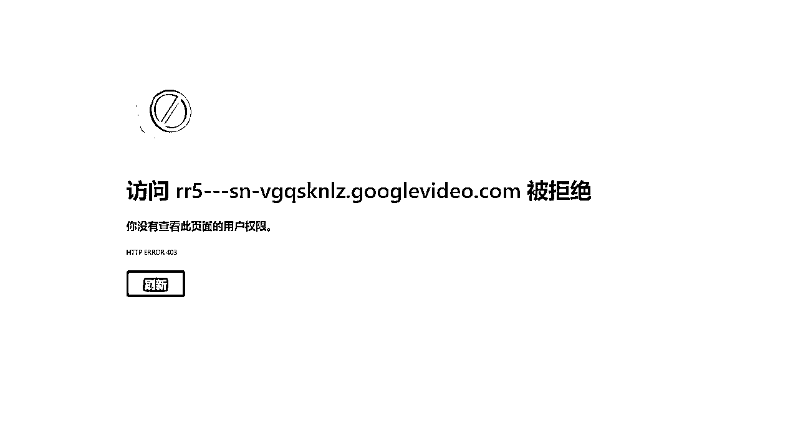

搭建账号别想得太复杂，生财2022年就有YouTube航海文档，链接先放这：https://scys.com/view/docx/doxcnPgun49EUoAyPo60slrnNIe 照着搭一个简单框架就能上视频了。别一上来就被“头像怎么弄”“封面怎么设计”“视频太丑怎么办”给困住——头像直接拿手机相册里的宠物或风景顶一下，或者用MJ做一张；封面同理。先完成，再完美。

记住，市场对“丑东西”也是很宽容的。我那条25万+播放的爆款，制作效果放在我自己眼里都算“拙劣”，可它偏偏就成了。所以别想太多，先把视频发出去，用数据说话。发错内容也别删，设为“仅自己可见”就好；前期保持一天1-3条，找到感觉后慢慢优化。关键动作只有一个：多找爆款，然后抄它！前期也不用有“洁癖”，觉得一个号只能发一种类型——可爱宝宝、可爱动物都值得试试，哪个数据好，就加码做哪个。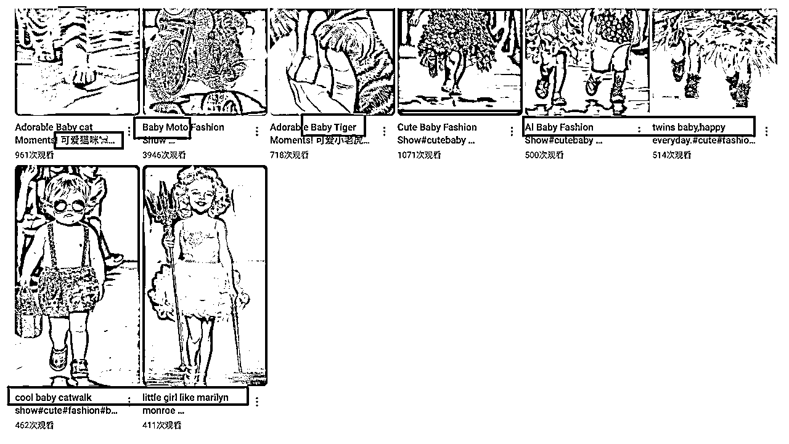

怎么筛选爆款和找对标？

新手最简单，像刷抖音一样去刷YouTube Shorts，平台给你推的优质内容，点赞、收藏、关注一条龙，统一放进收藏夹，后面照着模仿；也可以在搜索栏主动搜关键词，看YouTube给你推什么shorts。老手可以玩得更高级，参考生财圈友钱塘江鲤分享的RPA自动化流程，一键分析Shorts上的热门AI视频：https://scys.com/articleDetail/xq_topic/5121541548888524

我个人的对标标准是四条：YouTuber起号速度够快（说明有市场），订阅过万，单条视频播放过百万，并且反复发同一类型内容。四个条件全中，基本就是一个已被市场验证过的爆款模板。

我常用的三个对标账号：
- 对标一：www.youtube.com/@Babyfashionstar —— 我那条25万+播放的爆款就是模仿它做的。
- 对标二：www.youtube.com/@littleclassics7988 —— 可爱宝贝类型。
- 对标三：www.youtube.com/@pets-dog-cat —— 可爱萌宠类型。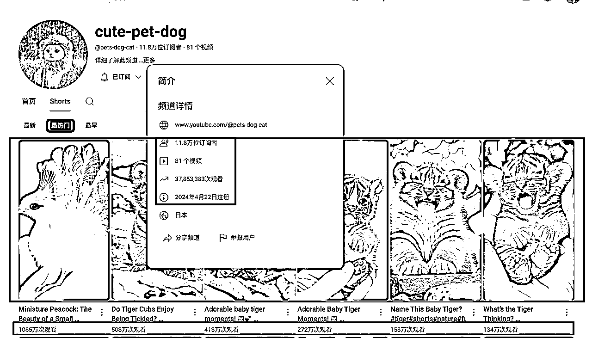

接下来说说一条视频具体怎么“抄”。

就拿AI宝宝T台秀当案例：工具组合是国内版ChatGPT+MJ+runway+剪映。

第一步，找一个千万级播放的原片。比如littleclassics7988这个号，2024年8月19号注册，现在27万粉丝，日常视频都是百万播放，最高那条直接破千万。账号主在小红书也有号，应该是自己人，可以放心抄。原视频链接在这：https://www.youtube.com/shorts/RKPRROl642o 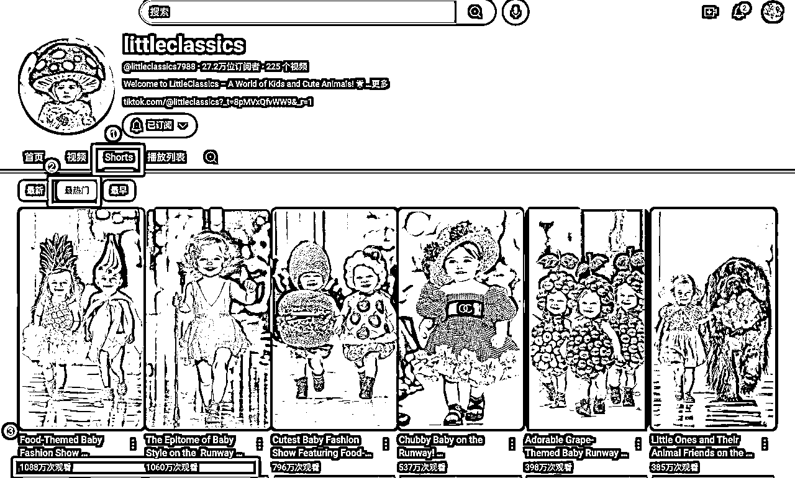 先用下载工具把视频和音频扒下来，视频用来截图做参考，音频正好当BGM。下载工具：https://vtool.pro/youtube.html 

第二步，用MJ复现画面。 一条路是用MJ的/describe功能，让它反推图片提示词，再拿生成的新提示词出图，效果不错。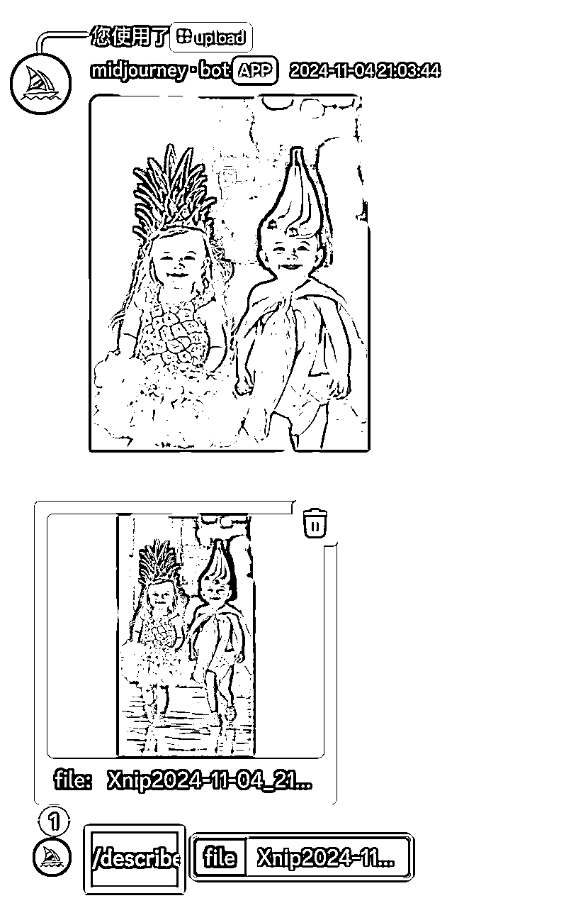 另一条路是让ChatGPT代写提示词。比如我当时的写法是：“男孩和女孩在巴黎时装秀上走秀；女孩穿菠萝样式的礼服裙，头戴绿色菠萝叶头饰；男孩穿香蕉样式衣服，头戴逼真香蕉头饰；两人很兴奋，牵着手走秀。照片必须逼真，细节丰富，4K画质，背景是明亮的巴黎时装周舞台。结尾加 --ar 9:16”。```
A nowborn baby boy and newborn baby girl walking hand-in-hand on a Paris fashion show runway; the girl is wearing a dress styled like a pineapple, complete with a green pineapple leaf headpiece, while the boy is dressed in an outfit inspired by a banana, with a realistic banana headpiece. Both are smiling happily, exuding joy as they walk the runway together. The photo should be highly realistic, capturing fine details like the textures of their costumes, their expressions, and the lively atmosphere. Ultra-high image quality, 4K resolution, set against a bright Paris fashion show stage. --ar 9:16 
```

第三步，用runway把图变成视频。依然让ChatGPT出提示词，我的模板是：以附图作为起始帧，让AI输出400字符以内的英文提示，重点描述“两个孩子在巴黎时装周牵手走秀、表情开心”这一画面。```
starting with the scene depicted in the uploaded image where a young boy and girl are walking hand-in-hand on the Paris fashion show runway, smiling joyfully. Capture their cheerful expressions and the stylish, themed outfits as they confidently stride down the runway. The video should maintain this high-spirited and fashionable atmosphere, focusing on their interactions, the details of their pineapple and banana-themed attire, and the vibrant Paris runway setting.
```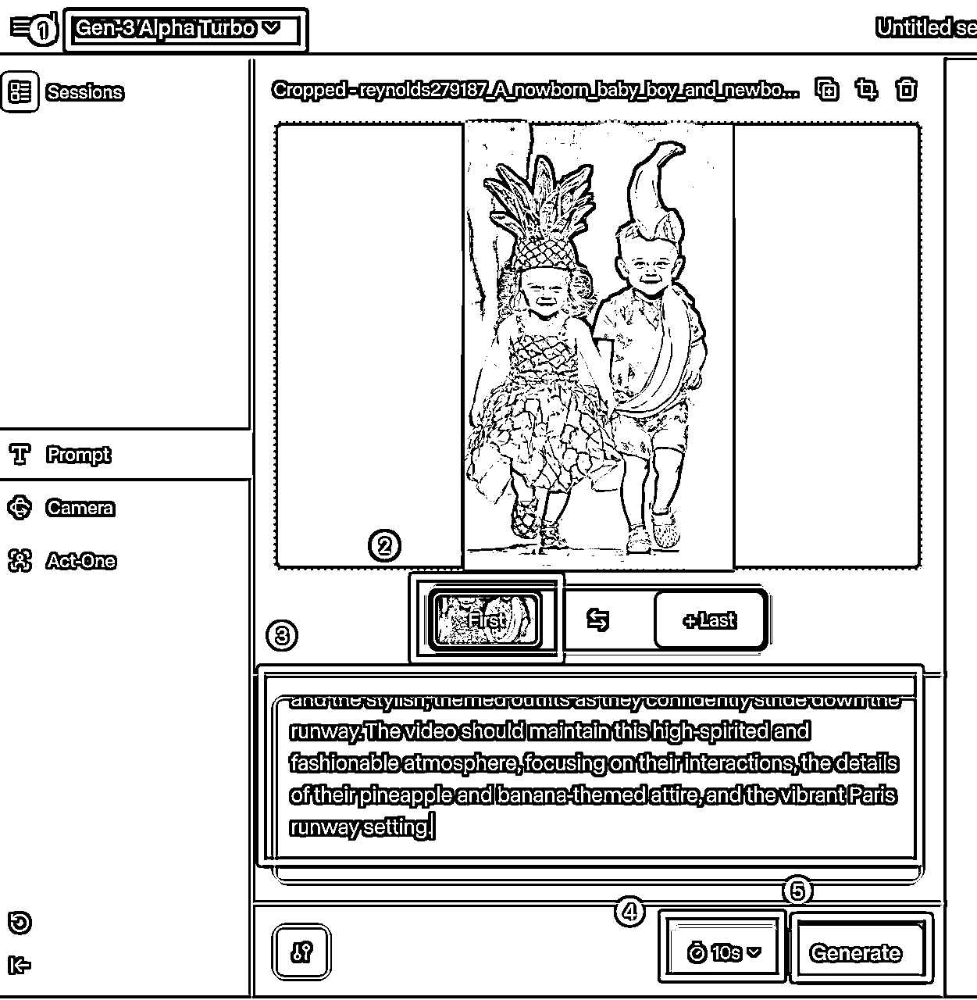

第四步，剪映剪辑+配乐。把生成好的视频素材拖进剪映，配上从爆款里扒来的BGM，按节奏卡点即可。

这里特别提醒一个关于版权的事：除了YouTube自带的免费音乐库，其他商用音乐多半都会被识别，触发Content ID版权标记。注意，这并不等于侵权。在开通YPP之前，用商用音乐不花钱；开通YPP后，音乐版权方会从你的广告收益里扣除版权费，可能扣得还不少。如果不想用有限的官方曲库，也不愿把钱分给别人，可以找免费音乐网站，或者用suno这类AI音乐工具自己生成。

还有一种“AI魔法秀”的玩法，完整的视频拆解可以看这篇分享帖：https://scys.com/articleDetail/xq_topic/2858241885558511

我们团队已经在批量复制这套打法了：昨天刚起了4个新账号，每个账号发1-3条不同类型的视频，连同现在这个号，一共5个在跑，一套“拖拉机”队形又拉起来了。顺带提一句，这个项目跟我去年做的抖音AI绘画矩阵几乎一个套路，当时做到过细分领域TOP 1，两份团队精华帖也一并放在这，想搞矩阵的可以参考：https://scys.com/articleDetail/xq_topic/814448141845482 和 https://scys.com/articleDetail/xq_topic/588284841125154

最后，踩坑总结。目前团队小伙伴已经有三个“上道”了，视频开始跑起来。但更多人在起号阶段就卡住了，两个坑最常见。

一个是选错了对标场。看了国内平台的数据，跑到YouTube上就想复制——赶紧打住。国内平台99%的用户是我们自己人，YouTube上90%是海外用户，人群不同，喜好天差地别。有条件一定要去YouTube本地找对标。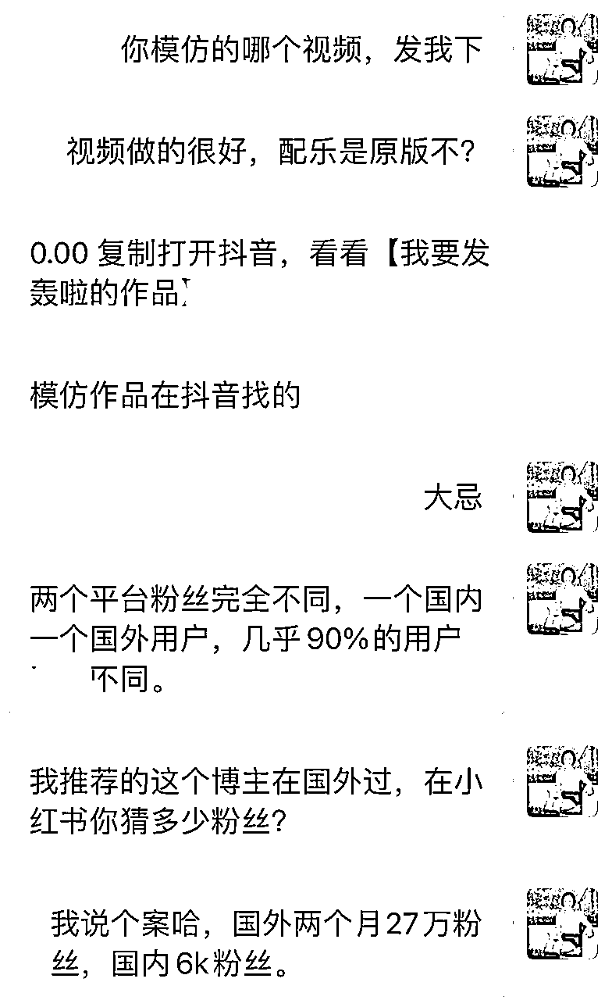

另一个是模仿只抄一半，或者一上来就搞“原创”。模仿的前提是先把爆款拆开：爆款内容本身，比如选题、场景、节奏，这个大家通常会照着做；但爆款为什么能爆，背后的门道你有没有琢磨透？原创不是不行，只是大概率会拉长出爆款的周期，甚至根本出不了爆款。最稳的打法还是先把别人跑通的路走一遍，等自己有了体感再谈原创。

把这两个问题解决掉，成功率会高不少。国内能卷出来的人，去YouTube只会更快。

好了，实操拆解就到这，赶紧开干吧。

不少做爆款视频的朋友都有个共同点：音乐用热门的，动画也照着爆款模板来改。你想想，看恐怖片的时候，要是把背景音关掉，或者换成一首完全不搭的歌，那吓人程度还剩下多少？所以咱们做配乐也别搞特殊，直接跟着爆款走。既然内容都参考了，配乐这点小事就别纠结啦。

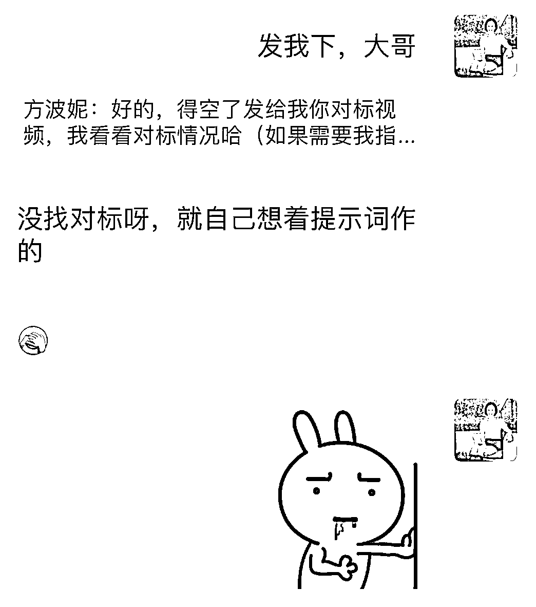

有位小伙伴分享的模仿方式让我又好笑又无奈，素人做号确实容易踩这种坑，直接看视频吧：

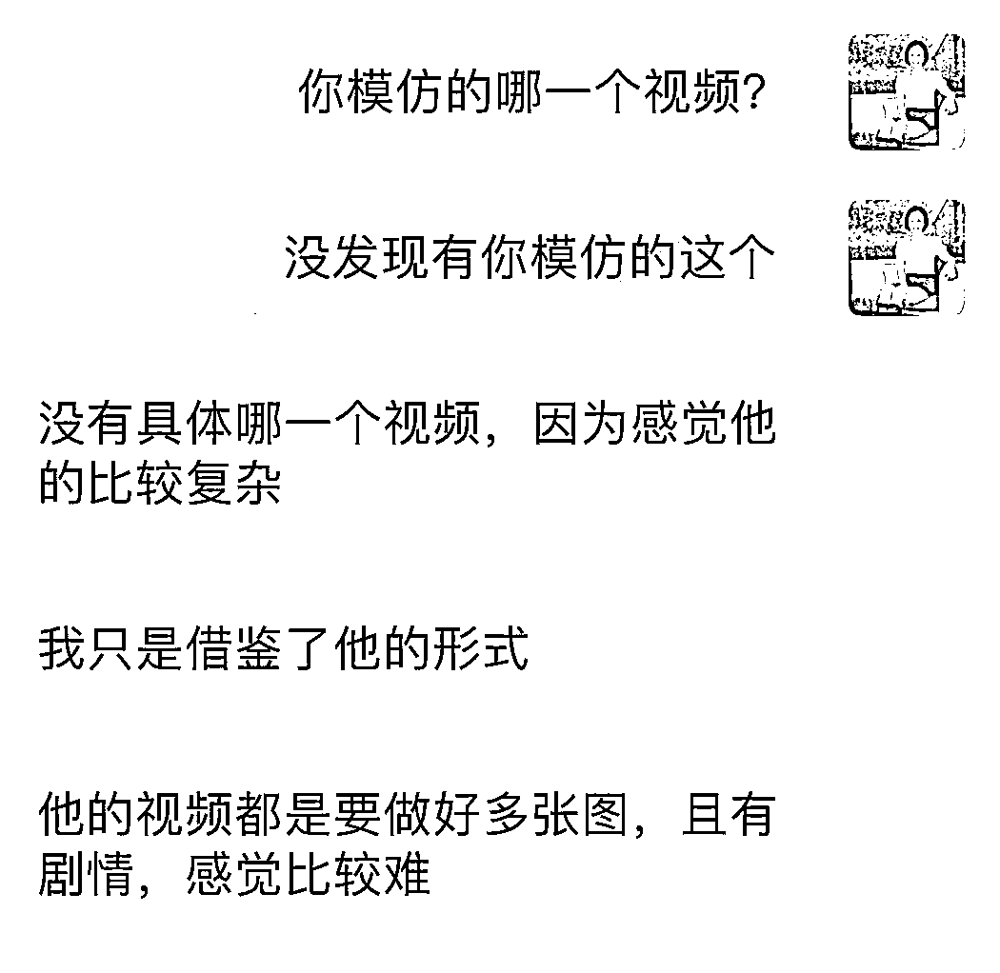

如果实在模仿不来，就去生财圈或者网上找现成的资源来参照；要是连资源都找不到，那就果断换个对标账号——找一个自己真能学得来的，不然“对标”这两个字就没意义了。

##### 给你们看一个复刻得不错的例子：

做得好的模板可以看，做得乱七八糟的就不放出来丢人了……有些作品跟原视频简直是两个物种。

真是旱的旱死，涝的涝死。这位小伙伴还觉得自己复刻得不够到位，我看着已经分不清谁是东施谁是西施了。

来，无奖竞猜：下面哪个才是原版？答案写在文档最后。

#### 3、出图工具没设置对，效果差得离谱

先说这其实是个小问题，但设置错了，出来的图真的一个天一个地。有小伙伴连着发了两条视频，播放量都是个位数，人都快抑郁了，后来把设置改过来，第三条视频立马就火了。

先按照下面的链接把服务器建好，然后在输入框里敲 `/setting`，回车，把版本调到 V6.1，或者直接选对标账号用的那个绘画风格。

https://blog.csdn.net/xutongbao/article/details/136214194


### 项目怎么才能拿到结果：（核心重点）

去年在生财圈跑通了不少项目，基本上只要你肯下场动手，就能赚到钱，比如抖音AI绘画、闲鱼二手书、黄金代购这些，还有一些圈外的项目。关键是要会筛选，这里简单分享一下心得，希望对大家有用。

#### 1、怎么筛项目

第一条也是最重要的一条：这个项目已经有人真赚到钱了。

第二条：项目能复制（生财的项目基本都满足这点，这里给生财点个赞👍）。

第三条：我自己能复制——我具备做这个项目的能力；如果暂时不具备，我也判断自己能在短期内学会（时间长了素人真等不起。我评论区经常有人留言：我发了条视频，0播放或者个位数播放，然后各种焦虑……）。

满足这三点，素人就可以开始跑了（这里专门说素人，大佬们筛选项目标准会更高，因为大家的时间成本和预期收益都不一样。）

#### 2、直接开干：

起号阶段：别想着高大上的原创剧情，老老实实对着对标账号模仿。模仿别人一点都不丢人，大不了就当东施效颦。想赚钱，面子先放一边，等赚到钱了，自然就有面子了。

包袱放下、愿意模仿了，那就往“像素级”去靠——能模仿的全模仿，模仿不了就找办法去模仿。刚开始肯定做不到完美，没关系，先抓主要矛盾，再慢慢优化。什么是主要矛盾？

第一：视频内容的形式

先做到东施效颦，再慢慢变西施。什么程度算到位？把对标视频和你的视频放一起对比，一眼就能看出你抄的是对方的样子，虽然还有点瑕疵；但绝对不能弄出一个跟原视频毫无关系的东西，只能说是同物种——那就等于白模仿了。

第二：配乐

看鬼片的时候把声音关掉，你感受下还恐不恐怖？吓不吓人？没有音效加成，恐怖片直接垮掉。所以请把爆款视频的背景音乐扒下来，这个文档里就有工具分享。

有小伙伴在这里又走偏了，选了一首自己觉得好听的歌就发出去……效果照样打折扣。还没搞清楚状况之前，就老老实实像素级模仿，等以后我们再原创，做属于自己的爆款。

#### 3、多点耐心

视频发出去了，几个小时过去，还是0播放/个位数播放，开始emo了怎么办？

心放回肚子里，凉拌不行。素人遇到这种情况太正常了，哪能这么快就给正反馈，又不是传销……

首先：才几个小时而已。YouTube给流量的速度比国内平台慢一些，但好处是后劲足——内容好，就会持续给你推。我播放量最高的一条已经破30万了，而且流量还在涨。

其次：先检查上一步做到位没有：视频是不是有了70%以上的相似度模仿？包括内容+配乐。（能到99%更好，到时候谁还分得清谁是真西施！我觉得你就是。）

最后：多发几条视频，一天发三条，早中晚各一条；至少坚持三天吧。提高概率嘛，就像买彩票，多买几注中奖机会更大（不提倡大家真去买啊，纯举例）。

总结一下：这些都做到了，账号还是起不来，那就换下一个项目——下一个更乖。把所有项目都这样跑一遍，我相信你一定能找到属于自己的搞钱路子。加油，素人赚钱不容易，但也没那么难，多在生财里挖一挖。

以上是我个人的看法，如果有不同意见，欢迎评论区交流。

## 七、接下来的行动目标：批量起号

三个月内：

第一个月目标：

*   开通YouTube合作伙伴创收计划，赚到第一美金；

*   带着小伙伴们做YouTube账号，跑矩阵，预期先跑十几个账号做标杆（目前已经有5个了）。

第二个月目标：

*   跑通账号赚到美金，然后批量复制账号，找不同的AI赛道去复制。

*   带第一批小伙伴开通创收计划。

第三个月目标：

项目沉淀、复盘优化、继续扩张。

## 八、做YouTube参考文章：

### 1、亦仁的超级标2：

https://scys.com/articleDetail/xq_topic/5121542448454444

### 2、竹子。AI宝宝走秀与Magic变身视频制作：YouTube Shorts实操指南

https://scys.com/articleDetail/xq_topic/2858241885558511

### 3、老马AI内容出海：YouTube Shorts项目崛起：小作坊的机遇与挑战

https://scys.com/articleDetail/xq_topic/4848528158581518

YouTube shorts的播放和收益截图：


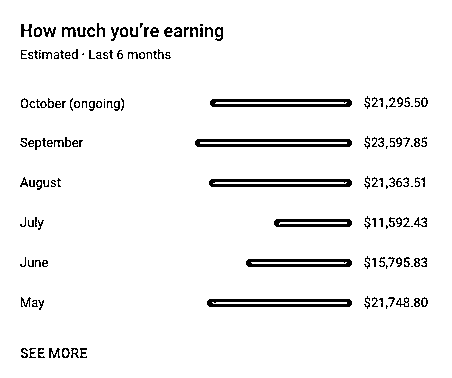

### 4、钱塘江鲤：利用RPA自动化流程分析YouTube Shorts上的热门AI视频

https://scys.com/articleDetail/xq_topic/5121541548888524

### 5、老马AI内容出海：YouTube Shorts 赛道选择与收益解读

https://scys.com/articleDetail/xq_topic/5121545551845854

### 6、浅笑分享YouTube大博主教人做油管的方法：

https://scys.com/articleDetail/xq_topic/2858245152412811

### 7、AI进化论-花生YouTube创收计划：YPP条件与分成机制解析

https://scys.com/articleDetail/xq_topic/5121541222242884

### 8、竹子。生财精华帖：

https://scys.com/articleDetail/xq_topic/814448141845482

### 9、一棵小苗苗生财精华帖：

https://scys.com/articleDetail/xq_topic/588284841125154

### 10、2024年9月热乎的AI航海：

https://scys.com/view/docx/FDiAdEKoioYSxGxxTJGcIRz2njd

### 11、2022年YouTube航海：

https://scys.com/view/docx/doxcnPgun49EUoAyPo60slrnNIe