# 从0到1做YouTube Shorts：12天90万次观看的真实复盘

大家好，我是方波妮。最近刚完成一轮YouTube Shorts新频道实操，趁热把整个过程梳理成文。先报一下成绩：从启动到第十二天，新号累计跑出90多万次观看，关注者增加2700多人。整个过程用到的资料、方法和工具，绝大多数都来自赚钱社区内部，基本没走弯路。

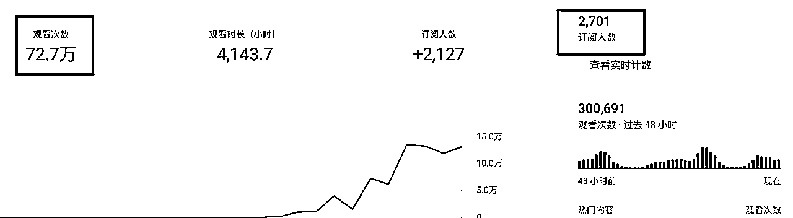

## 为什么会盯上YouTube

月初刷到龙哥发的一条信号：同样体量的播放，放在国内的内容平台可能换不来什么钱，但在YouTube上，收益可以是几千美金。这个对比我太有共鸣了——我之前在抖音、视频号、小红书都折腾过，也在B站赚到过第一笔钱。国内做内容常遇到这种情况：观看数据看着很高，但流量本身不直接产生收益，真正带来收入的往往是后端的产品。我自己在抖音上单条内容最高跑到过50多万次观看，团队里也有破百万的，但最终都得靠产品端变现。一句话：流量和钱是两回事。

龙哥还提到，这是一件长期可积累的事，值得当成事业来做。国外平台的生态和国内差异很大，很多内容类型相对蓝海。既然自己已经在国内内容战场摸爬滚打过，换个地方没理由不行——更何况，论“卷”，没人卷得过国人（笑）。

看完信号当天就动手了。团队同事先搭了4个新号，加上我手上的共5个频道一起开跑。下面是整个过程中最干的实操记录，全部来自真实经历。

## 赛道怎么选：把现成方向搬过来

很多人会在选题这一步卡住。赚钱里面其实不缺答案——各期航海计划、风向主题内容，随便翻翻就能获得不少灵感。龙哥也点过方向：YouTube Shorts适合用智能生成类工具来做，不需要真人出镜，对素人很友好，几乎没有包袱。

当时正好赶上2024年9月那期智能创作航海，文档里躺着一大堆方向：老照片活化、数字写真、虚拟形象、赛博风机车、个性头像、自定义壁纸……很多在国内已经有人做过，搬到YouTube就是一次“复用”。我当时挑了一个最顺手的切入点：用生成模型制作萌娃走秀内容。理由很简单，航海项目里的资料把操作细节写得足够清楚，照做就行。

有一点得单独提醒：走“萌娃”方向的频道，目前是可以申请变现资格的。但由于YouTube早前在未成年人保护上出过问题，现在儿童向内容的广告覆盖面比较窄，单次展示收益也偏低。如果一开始就是奔着广告分成去的，建议直接换个主题。已经发布了儿童向内容也没有关系，不用重新建号——直接在现有频道里慢慢切换内容类型就行。之前发过的短片，可以在后台把它们标记为“少儿内容”。不过，如果你本来就计划靠玩具带货、儿童用品推荐赚佣金，那么这类方向依然值得经营，后端的产品变现空间是存在的。

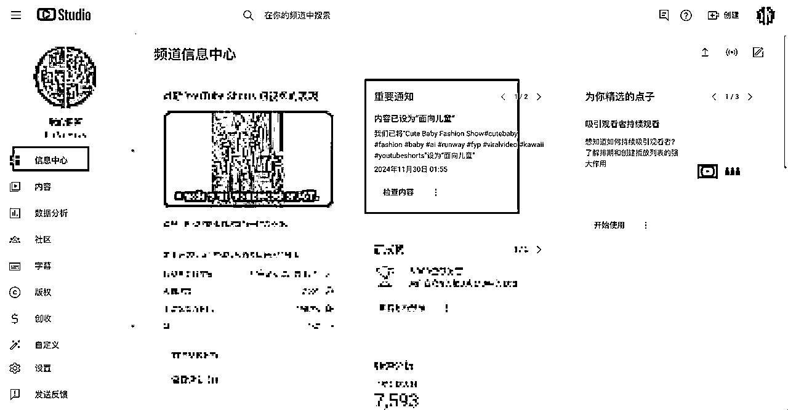

## 工具组合：怎样低成本跑通全流程

不方便公开聊魔法上网的部分，电商平台自行解决就好。

写提示词可以交给ChatGPT、Kimi或豆包。如果你完全不想折腾，也可以直接打开在线翻译：用最简单的“谁在做什么、什么场景、什么细节”这种逻辑，把中文描述翻成英文丢给绘图工具，基本够用。想体验ChatGPT但又不想付费的，有些国内中转站提供免费额度，比如 mlyyai.com 这个镜像站。便宜方案是买共享号，或者用Kimi、豆包这类国产大模型平替。

图片生成主推Midjourney。前期不确定要不要长期做，可以先买按天计费的共享号，一天一块多钱；如果准备长期投入，可以拼一个月约18元的共享套餐；更省心的可以直接在官网开通会员，每月10美元起步。

视频生成有两条路：一条是Runway，另一条是国产的可灵。Runway也有日租共享号，单价几块钱；官网会员月费20美元起步。可灵提供了免费试用额度，注册后就能体验。

剪辑用剪映就够了，BGM可以通过某音乐App自带的声音识别功能来获取——把目标短片的声音播放出来，让App自动识别出曲目即可。

需要下载YouTube上的短片用来拆解时，有两个免费站点很实用：一个是 vtool.pro 里的 YouTube 下载工具，另一个是 shortsnoob.com 的中文入口。偶尔会遇到下载报错，多半是当前网络节点的问题，切换一下线路，刷新网页并清一下缓存，往往就能解决。


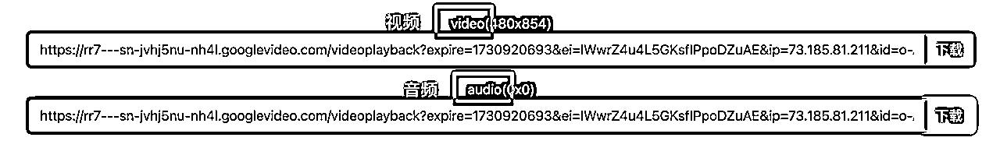


## 频道搭建：先完成，再优化

在搭建环节，很多人会陷入细节焦虑：头像没想好、封面不会做、主页不够精致。其实这些都不是新号阶段的核心。我的建议是先快速把账号框架搭出来，内容尽早发起来。头像可以从手机相册里随便选一张宠物或风景照，或者让Midjourney顺手生成一张；封面先参考热门内容的风格，跑起来之后再迭代。完成比完美重要，尤其在冷启动阶段。

我自己那条跑到25万观看的内容，制作上还挺粗糙的——但它确实火了。市场往往不按你的审美出牌，真实反馈才最值得参考。关于更精细的账号装修和矩阵策略，建议多看航海计划里的资料和圈内精华内容，长期做下去自然会有体感。

## 怎么锁定值得参考的样例频道

虽然从顺序上说，这个步骤其实应该放在建号之前，但按大多数人动手的习惯，先把简单的做了更现实。且实操中频道往往不止一个，第一个号的成败也没那么关键——先跑起来才是正经事。

找参考最朴素的方式，就是装作普通用户去刷YouTube Shorts，遇到数据出色的内容就点赞、收藏、关注，整理进一个专门的清单；或者用搜索框搜自己感兴趣的主题，让平台推给你高人气内容。新手用这个方法就够了。

老手可以参考赚钱圈友钱塘江鲤分享的RPA流程方案，他做了一套自动化分析工具，专门扫描YouTube Shorts上的高热度作品，效率会高不少。

我挑选参考频道时有几个硬标准：

- 注册时间不久但涨粉明显——说明题材有市场需求
- 关注人数超过一万
- 出现过百万级观看的记录——说明内容确实火过
- 长时间坚持发同一类主题——说明这个形态是被市场反复证明过的

我当时重点参考了这三个：

第一个是 Babyfashionstar，我的25万观看短片就是模仿这个号做出来的。

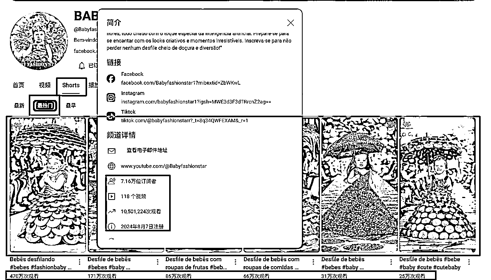

第二个是 littleclassics7988，主打可爱萌娃。

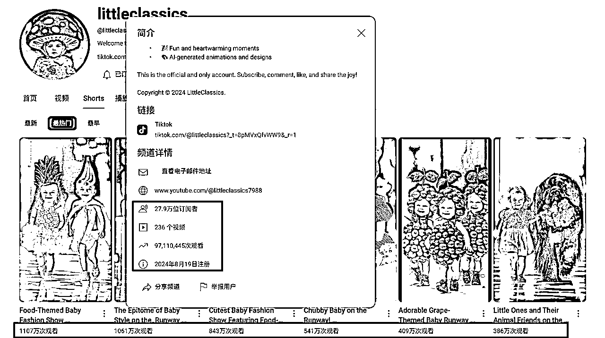

第三个是 pets-dog-cat，走可爱宠物路线，比如呆萌老虎。


## 第一条内容从哪下手

制作环节的心态也很重要：先求完成，再谈优化；前期保持一天1-3条的更新节奏，尽快找到发布感觉；发错了别急着删除，改成私密状态就好。几个参考频道分别代表不同风格，刚开始不用急着给账号定死标签，萌娃向和萌宠向都可以试水。跑出数据后再做减法，把精力集中到表现最好的类型上，持续复制。


### 参考案例：萌娃走秀短片怎么做

这条短片用到的工具组合是：ChatGPT（国内可用版） + Midjourney + Runway + 剪映。

第一步，先找一个具体的爆款作参照。比如 littleclassics7988 这个号：2024年8月19日注册，目前粉丝接近30万，最高单条内容超过千万次观看，日常更新也基本稳定在百万级。当时看中它一条千万次观看的shorts，直接用下载工具把画面和音频扒了下来，画面截图用于后续参考，配乐也一并存好备用。


第二步，用Midjourney仿制图片，有两种常用做法。

做法一：利用Midjourney自带的图片解析功能（/describe）。把参考截图喂给它，让工具用文字描述画面内容，然后把这组描述拿去生成新图。出来的效果基本满足需求。

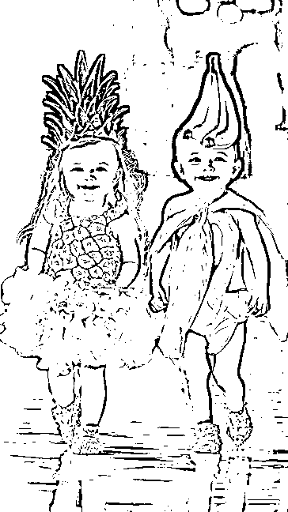


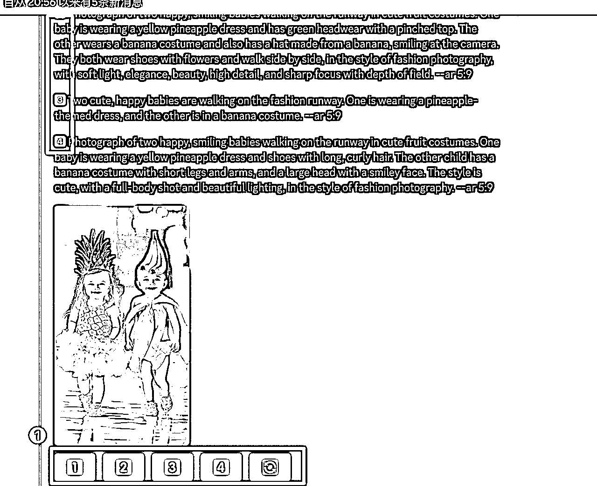

做法二：让ChatGPT代写提示词。举个例子，我想表达的是“巴黎时装周上，一个男孩和一个女孩牵着手走秀；女孩穿菠萝造型礼裙，头戴绿色菠萝叶头饰；男孩穿香蕉造型服装，头上顶着逼真的香蕉头饰；两人都很投入、很兴奋”。把这些要素交给ChatGPT，它会给出一段包含光线、质感、机位和背景的完整描述，翻译成英文，末尾标上“--ar 9:16”，复制进Midjourney就能直接生成超写实的高清画面。

```
A nowborn baby boy and newborn baby girl walking hand-in-hand on a Paris fashion show runway; the girl is wearing a dress styled like a pineapple, complete with a green pineapple leaf headpiece, while the boy is dressed in an outfit inspired by a banana, with a realistic banana headpiece. Both are smiling happily, exuding joy as they walk the runway together. The photo should be highly realistic, capturing fine details like the textures of their costumes, their expressions, and the lively atmosphere. Ultra-high image quality, 4K resolution, set against a bright Paris fashion show stage. --ar 9:16 
```

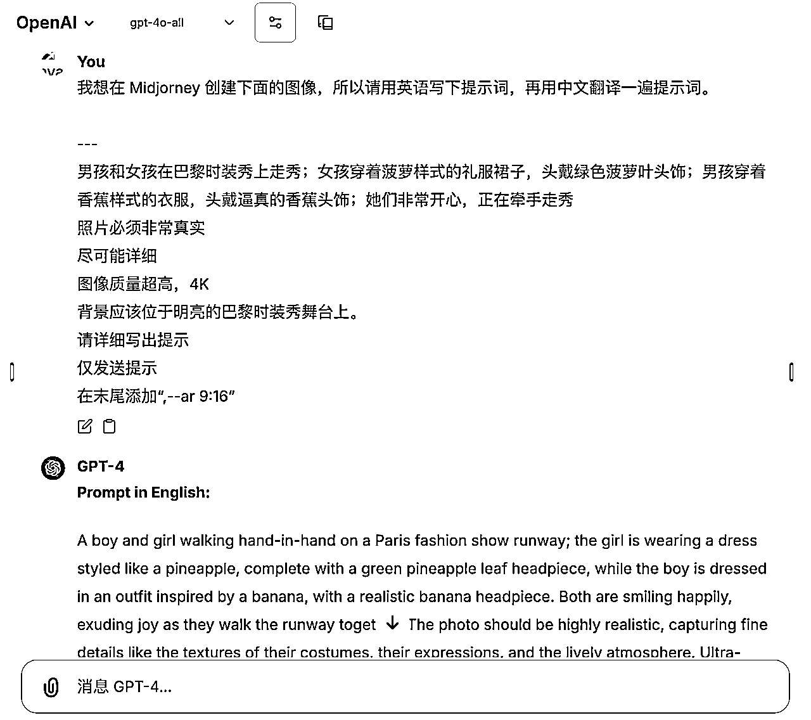

第三步，把静态图变成动态片段。打开Runway的Gen3模型，将Midjourney产出的图片作为起始帧。为了获得更好的运动效果，可以让ChatGPT对着图片内容写一段不超过400字符的英文描述，再粘贴到Runway中，画面就会动起来。

```
starting with the scene depicted in the uploaded image where a young boy and girl are walking hand-in-hand on the Paris fashion show runway, smiling joyfully. Capture their cheerful expressions and the stylish, themed outfits as they confidently stride down the runway. The video should maintain this high-spirited and fashionable atmosphere, focusing on their interactions, the details of their pineapple and banana-themed attire, and the vibrant Paris runway setting.
```


第四步，用剪映做最后组装。把生成好的素材按节奏拼接，配上先前保存的爆款BGM。这里单独聊聊音乐授权的问题。YouTube自带音乐库里可选曲目不多，且偏基础；用市面上的商业音乐，很可能会触发Content ID版权标记——这并不等于侵权判定，而是一种版权声明。在YPP资质生效前，即使被打上标记也能正常使用；一旦开通变现，相关权利人机构会从你的分成收益里扣除授权费用，这部分成本可能不少。想完全避免，可以去一些免费音乐站点找无版权素材，或者用Suno这类智能作曲工具生成专属配乐。

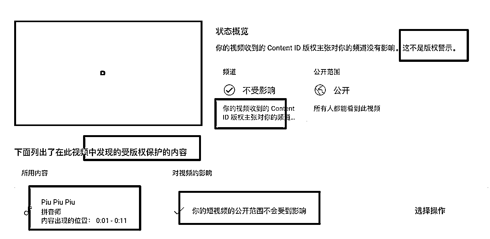

### 第二个案例：奇幻魔术类Short

这条内容的具体制作思路，可以参考赚钱圈友分享过的拆解帖，帖子编号是 2858241885558511，在赚钱站内搜索即可找到。想复现的话，按帖子里的步骤一步步来就行。

## 新手最容易踩的两个坑

目前团队里已有三个人跑出了量。复盘来看，有几个问题在起号期非常普遍，也不只适用于这个项目。

第一个坑：参考频道选错了池子。记住，找参考一定要到YouTube站内找，别拿国内内容平台的热门当模仿对象。原因很简单：国内平台受众几乎全是中国用户，YouTube上接近九成是海外用户，文化习惯和内容偏好差别巨大。既然最终要服务的是目标用户，模仿样本就应当来自同一个环境。


第二个坑：拆解只做了一半，或者一上来就想自己发挥。对热门内容的拆解应该包含完整两层——一是内容本身的模板，这一点多数人能做到；二是有少数人不满足于照搬，总想加入自己的“原创”。原创当然值得鼓励，但如果是完全没经验的新手，这条路的反馈周期会非常长，很难稳定产出火的内容。更合理的方式是先把已经验证过的路径走通，积累手感后再做突破。

以上就是我从0到1做YouTube Shorts的完整复盘。想说的最后一件事：赚钱的内部资料确实够用，真正拉开差距的，往往是行动力——先下场，再谈优化。

不少做爆款视频的朋友都有个共同点：音乐用热门的，动画也照着爆款模板来改。你想想，看恐怖片的时候，要是把背景音关掉，或者换成一首完全不搭的歌，那吓人程度还剩下多少？所以咱们做配乐也别搞特殊，直接跟着爆款走。既然内容都参考了，配乐这点小事就别纠结啦。


有位小伙伴分享的模仿方式让我又好笑又无奈，素人做号确实容易踩这种坑，直接看视频吧：


如果实在模仿不来，就去赚钱圈或者网上找现成的资源来参照；要是连资源都找不到，那就果断换个对标账号——找一个自己真能学得来的，不然“对标”这两个字就没意义了。

##### 给你们看一个复刻得不错的例子：

做得好的模板可以看，做得乱七八糟的就不放出来丢人了……有些作品跟原视频简直是两个物种。

真是旱的旱死，涝的涝死。这位小伙伴还觉得自己复刻得不够到位，我看着已经分不清谁是东施谁是西施了。

来，无奖竞猜：下面哪个才是原版？答案写在文档最后。

#### 3、出图工具没设置对，效果差得离谱

先说这其实是个小问题，但设置错了，出来的图真的一个天一个地。有小伙伴连着发了两条视频，播放量都是个位数，人都快抑郁了，后来把设置改过来，第三条视频立马就火了。

先按照下面的链接把服务器建好，然后在输入框里敲 `/setting`，回车，把版本调到 V6.1，或者直接选对标账号用的那个绘画风格。

https://blog.csdn.net/xutongbao/article/details/136214194

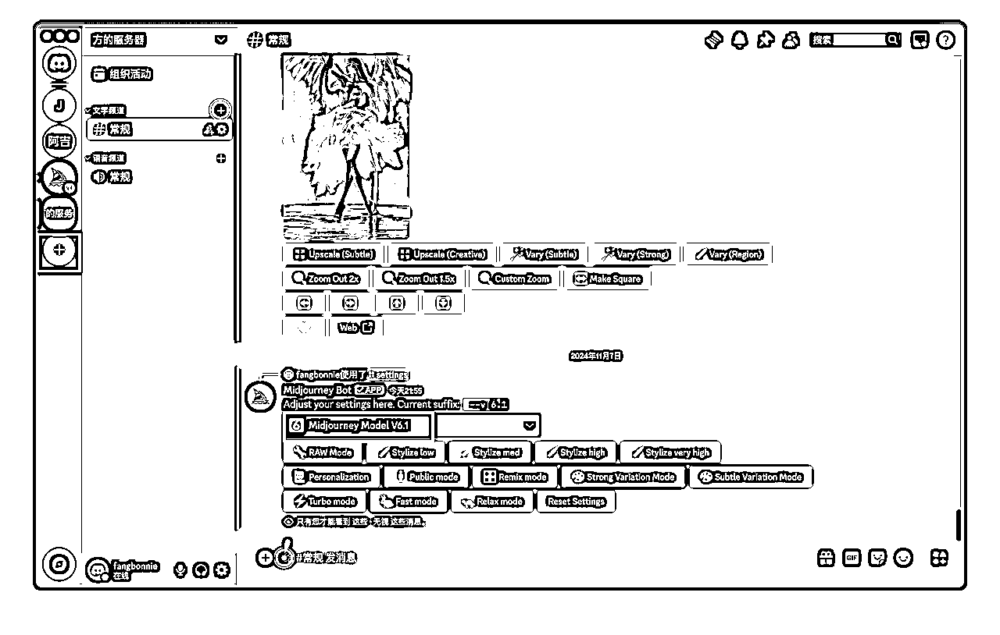

### 项目怎么才能拿到结果：（核心重点）

去年在赚钱圈跑通了不少项目，基本上只要你肯下场动手，就能赚到钱，比如抖音AI绘画、闲鱼二手书、黄金代购这些，还有一些圈外的项目。关键是要会筛选，这里简单分享一下心得，希望对大家有用。

#### 1、怎么筛项目

第一条也是最重要的一条：这个项目已经有人真赚到钱了。

第二条：项目能复制（赚钱的项目基本都满足这点，这里给赚钱点个赞👍）。

第三条：我自己能复制——我具备做这个项目的能力；如果暂时不具备，我也判断自己能在短期内学会（时间长了素人真等不起。我评论区经常有人留言：我发了条视频，0播放或者个位数播放，然后各种焦虑……）。

满足这三点，素人就可以开始跑了（这里专门说素人，大佬们筛选项目标准会更高，因为大家的时间成本和预期收益都不一样。）

#### 2、直接开干：

起号阶段：别想着高大上的原创剧情，老老实实对着对标账号模仿。模仿别人一点都不丢人，大不了就当东施效颦。想赚钱，面子先放一边，等赚到钱了，自然就有面子了。

包袱放下、愿意模仿了，那就往“像素级”去靠——能模仿的全模仿，模仿不了就找办法去模仿。刚开始肯定做不到完美，没关系，先抓主要矛盾，再慢慢优化。什么是主要矛盾？

第一：视频内容的形式

先做到东施效颦，再慢慢变西施。什么程度算到位？把对标视频和你的视频放一起对比，一眼就能看出你抄的是对方的样子，虽然还有点瑕疵；但绝对不能弄出一个跟原视频毫无关系的东西，只能说是同物种——那就等于白模仿了。

第二：配乐

看鬼片的时候把声音关掉，你感受下还恐不恐怖？吓不吓人？没有音效加成，恐怖片直接垮掉。所以请把爆款视频的背景音乐扒下来，这个文档里就有工具分享。

有小伙伴在这里又走偏了，选了一首自己觉得好听的歌就发出去……效果照样打折扣。还没搞清楚状况之前，就老老实实像素级模仿，等以后我们再原创，做属于自己的爆款。

#### 3、多点耐心

视频发出去了，几个小时过去，还是0播放/个位数播放，开始emo了怎么办？

心放回肚子里，凉拌不行。素人遇到这种情况太正常了，哪能这么快就给正反馈，又不是传销……

首先：才几个小时而已。YouTube给流量的速度比国内平台慢一些，但好处是后劲足——内容好，就会持续给你推。我播放量最高的一条已经破30万了，而且流量还在涨。

其次：先检查上一步做到位没有：视频是不是有了70%以上的相似度模仿？包括内容+配乐。（能到99%更好，到时候谁还分得清谁是真西施！我觉得你就是。）

最后：多发几条视频，一天发三条，早中晚各一条；至少坚持三天吧。提高概率嘛，就像买彩票，多买几注中奖机会更大（不提倡大家真去买啊，纯举例）。

总结一下：这些都做到了，账号还是起不来，那就换下一个项目——下一个更乖。把所有项目都这样跑一遍，我相信你一定能找到属于自己的搞钱路子。加油，素人赚钱不容易，但也没那么难，多在赚钱里挖一挖。

以上是我个人的看法，如果有不同意见，欢迎评论区交流。

## 七、接下来的行动目标：批量起号

三个月内：

第一个月目标：

*   开通YouTube合作伙伴创收计划，赚到第一美金；

*   带着小伙伴们做YouTube账号，跑矩阵，预期先跑十几个账号做标杆（目前已经有5个了）。

第二个月目标：

*   跑通账号赚到美金，然后批量复制账号，找不同的AI赛道去复制。

*   带第一批小伙伴开通创收计划。

第三个月目标：

项目沉淀、复盘优化、继续扩张。

## 八、做YouTube参考文章：

### 1、龙哥的超级标2：

https://scys.com/articleDetail/xq_topic/5121542448454444

### 2、竹子。AI宝宝走秀与Magic变身视频制作：YouTube Shorts实操指南

https://scys.com/articleDetail/xq_topic/2858241885558511

### 3、老马AI内容出海：YouTube Shorts项目崛起：小作坊的机遇与挑战

https://scys.com/articleDetail/xq_topic/4848528158581518

YouTube shorts的播放和收益截图：

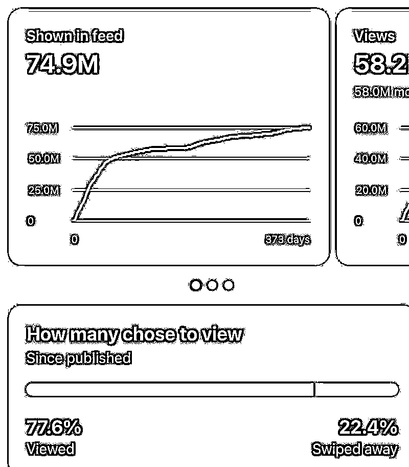


### 4、钱塘江鲤：利用RPA自动化流程分析YouTube Shorts上的热门AI视频

https://scys.com/articleDetail/xq_topic/5121541548888524

### 5、老马AI内容出海：YouTube Shorts 赛道选择与收益解读

https://scys.com/articleDetail/xq_topic/5121545551845854

### 6、浅笑分享YouTube大博主教人做油管的方法：

https://scys.com/articleDetail/xq_topic/2858245152412811

### 7、AI进化论-花生YouTube创收计划：YPP条件与分成机制解析

https://scys.com/articleDetail/xq_topic/5121541222242884

### 8、竹子。赚钱精华帖：

https://scys.com/articleDetail/xq_topic/814448141845482

### 9、一棵小苗苗赚钱精华帖：

https://scys.com/articleDetail/xq_topic/588284841125154

### 10、2024年9月热乎的AI航海：

https://scys.com/view/docx/FDiAdEKoioYSxGxxTJGcIRz2njd

### 11、2022年YouTube航海：

https://scys.com/view/docx/doxcnPgun49EUoAyPo60slrnNIe