零基础也能做YouTube长视频？这个AI音乐Lofi玩法太适合小白了

先交代一下我的情况：完全没做过视频，也从来没有碰过海外平台。既然剪辑这条路走不通，我就从AI内容的赛道里找突破口。把精华帖、风向标还有各种平台上“不露脸赛道”“AI赛道”的关键词都扒了一遍，几乎所有AI玩法都试了一轮。最后我的真实感受是：AI音乐Lofi是门槛最低的，没有之一。门槛低确实伴随着明显缺点，可问题在于，高门槛的赛道我也做不了。能找到一个自己够得着、并且近期还真有赚钱案例的方向，已经挺幸运了。

直接上案例。第一个账号9月中下旬注册，一个月前才刚开始发视频。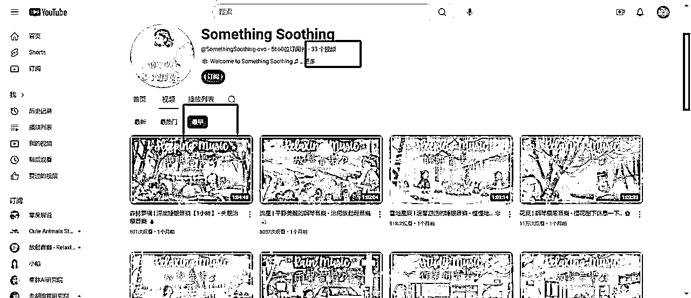 按当前数据保守推算，每月收益最高能到2.2万美元。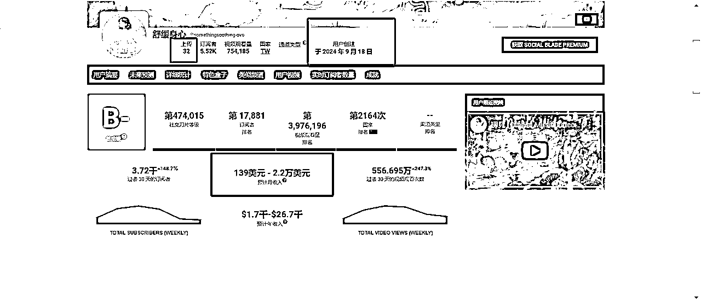 第二个账号是10月注册的，也差不多更新了一个月。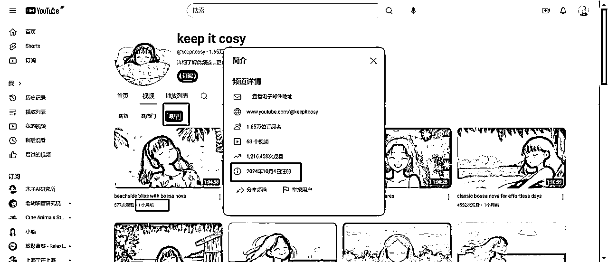 这个号的月收益预判峰值是3.3万美元。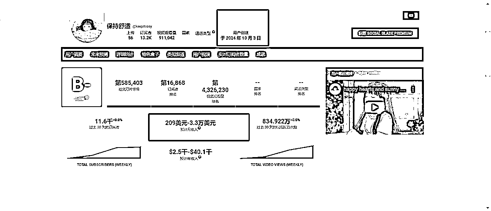

类似这样的素人账号还能再列几个：
https://www.youtube.com/channel/UCkK2B6D3imy6EnpqfrYm-5A
https://www.youtube.com/@HealingWithMe
https://www.youtube.com/@Lofi1980s
https://www.youtube.com/@LofiKittychannel
https://www.youtube.com/@CalmCity-channel

我当时筛账号的标准很简单：一年之内订阅还没到10万的素人号；已经开通了ypp；内容制作难度不高，最好是用AI做的；而且没有任何技术门槛，视频新人也能照猫画虎。

拿第一个案例来拆。封面的做法就是一张大图配几个大字，没什么复杂。图片走的是治愈系插画风格，AI完全能做出高度还原的版本。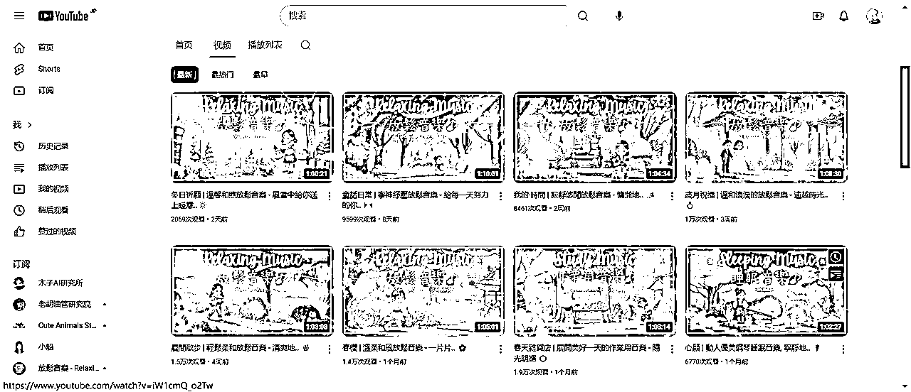 音频上放了两首Lofi calm风格的歌，循环播放把时长拉长；画面则配上特效、开场淡入、开屏文字这些爆款元素。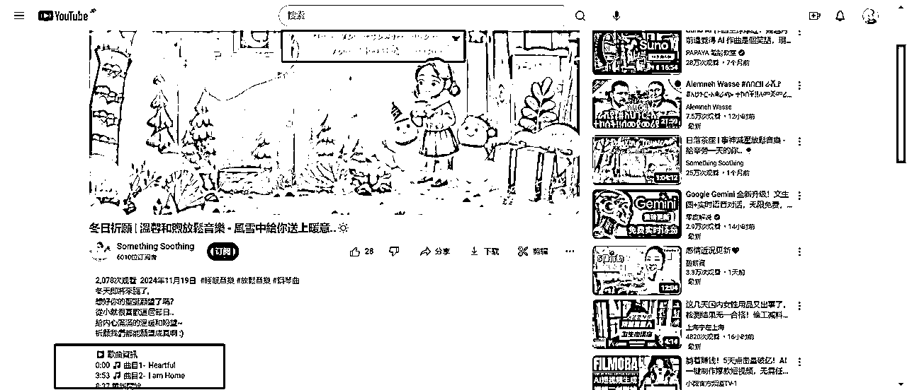 说实话，这种频道不需要去精修音频，反正放松类音乐只要风格对、听着舒服，大家并不会太挑剔。更重要的是想清楚用户需要什么：要陪伴感，要能搜得到的标题关键词，还要有爆款元素，让观众在前面三秒就愿意停下。想明白这点，视频就有机会跑出来了。

下面进入复刻流程。

第一步，生成图片。先找一条要复刻的爆款视频，我会直接选频道里最热的那期，也相当于做了爆款选题筛选。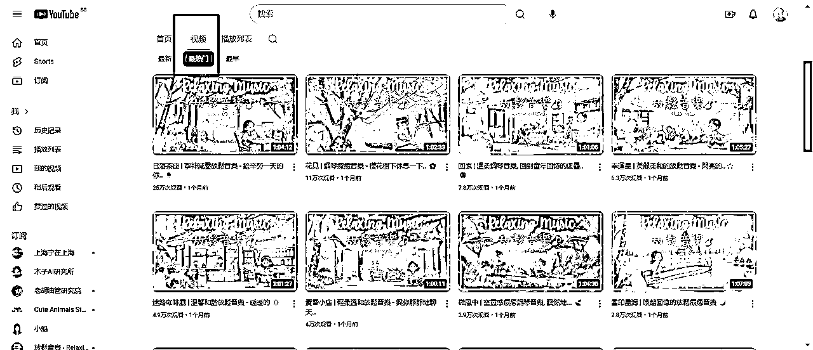 点全屏播放，等两秒，等标题和进度条自动淡出，再用Alt+A截个图。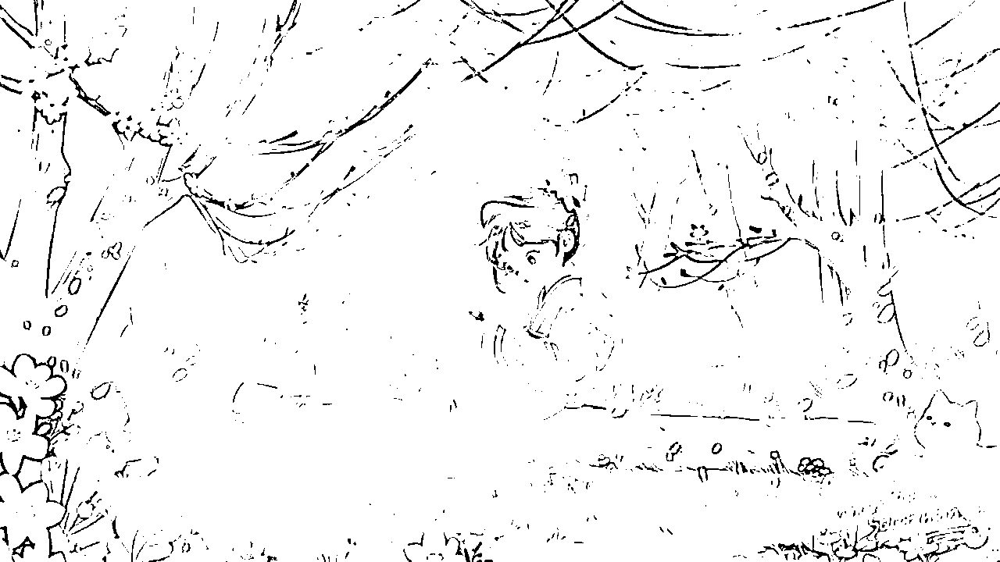 之后打开ChatGPT，在左侧的“探索GPT”里查“DALL”，选中“DALL, Eの 3 Prompt Craft”。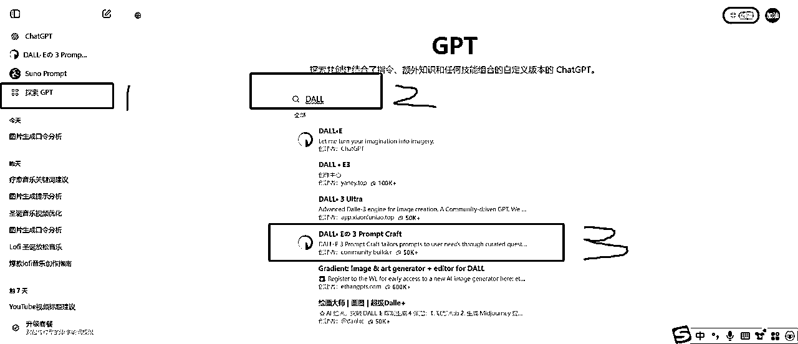 把截图上传，参考这个提问方式：请你扮演一个精通图片制作和文生图提示词的专家，先分析图片特点，再输出一段能生成90%相似画面的提示词。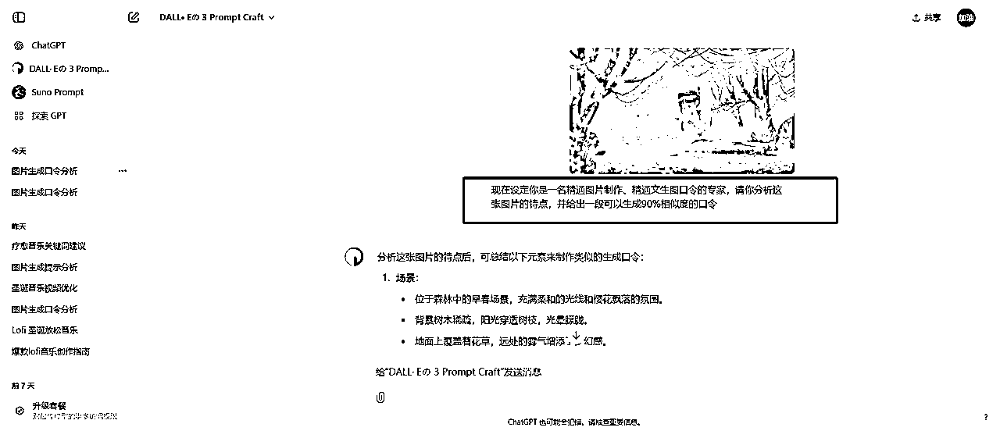 再去快手可灵的文生图页面，填好生成口令，顺便把原图作为垫图传上去，就能得到目标图片。可灵地址是https://klingai.kuaishou.com/。新用户会送几百积分，每次生成最多只花1积分，足够练到熟练。严格说Midjourney出图质量可能更高，但我想分享的是免费路线。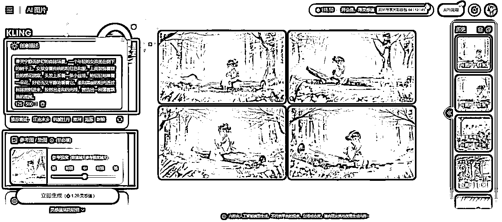 图片水印用美图秀秀就能去掉；我还会习惯性加一层“亚暗”或“治愈”滤镜，剪映里也可以调，总之让画面更有氛围。

第二步，生成音乐。获取音乐口令也靠ChatGPT：在“探索GPT”里搜索suno prompt，如果之前用过，它会直接出现在聊天列表里。上传图片，再带上这句：假设你是suno prompt的顶级高手，请结合这张图的意境，创作一首让人放松的纯音乐，并把你的提示词发给我。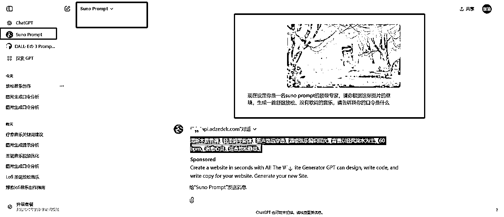 拿到口令后登录suno官网，点“创造”，把口令粘贴进去，记得把“器乐”开关打开，这样出来的才是纯音乐。每次会生成两首歌，大多是三四分钟的长度，好听的话就点延长；不满意就改改口令重新生成。suno.com的会员才能确保音乐可商用，其实不贵，我在闲鱼上花10块钱用了一个月。满意的歌曲直接右键就能保存。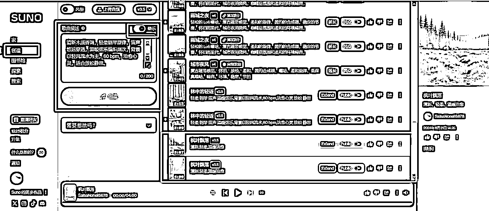

第三步，做可视化模块。先从suno挑两首满意的音乐导进剪映，给两首都设置10秒的淡入淡出，让衔接更顺滑，再合并导出。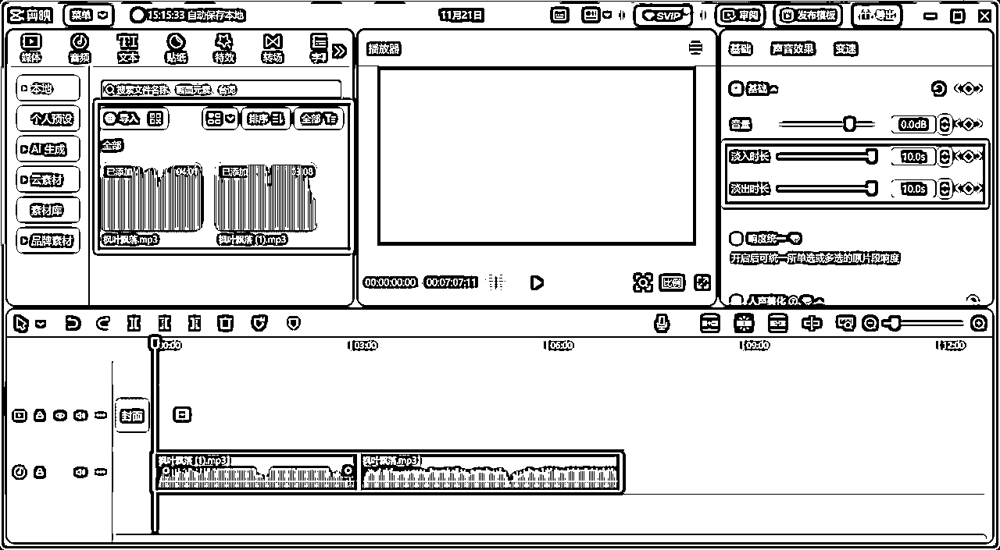 接着打开音乐可视化在线工具Tuneform，网址是https://tuneform.com/，找到光谱模板。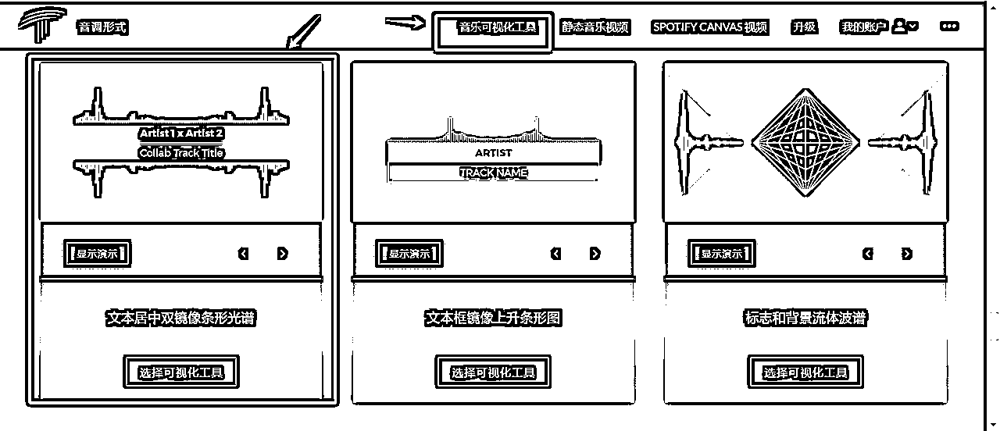 按页面提示上传音频，第一组颜色选白色，第二组选深色，文字随便填，反正后面会被裁掉。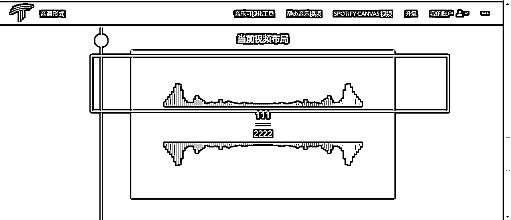 Tuneform和可灵一样，注册会送积分，可以免费生成。

第四步，剪映合成。先放图片和音频进剪映，把图片拉长到和音频同样长度，再根据画面适当加特效和贴纸。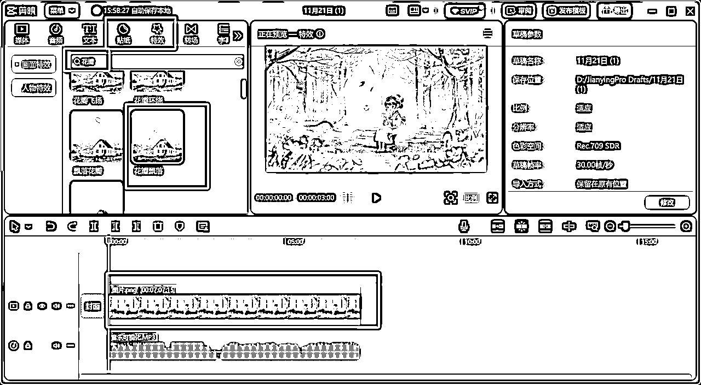 再把刚才的可视化视频导入，放到最顶层。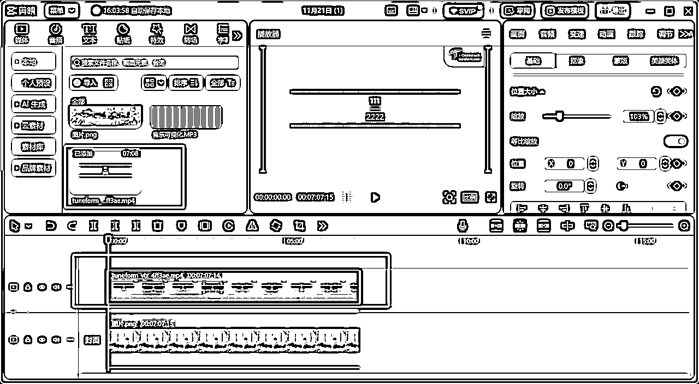 处理可视化素材时，先选“抠像-色度抠图”，鼠标点一下蓝色背景，蓝色就被抠掉了。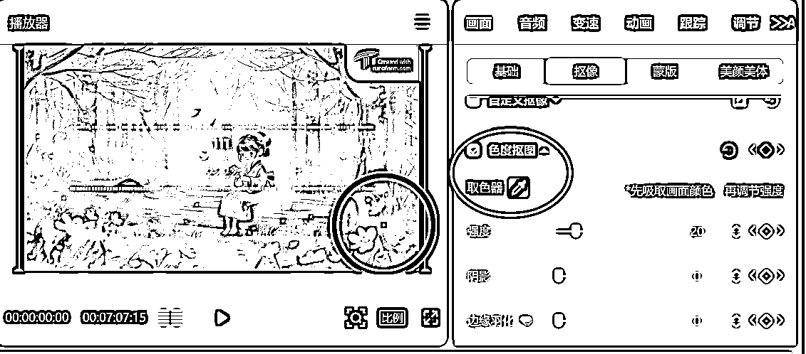 接着用“蒙版-矩形”框住一条横长的可视化图形，再点“基础-放大”，把它摆到屏幕最下方；千万别忘了把这段素材的音量调成静音。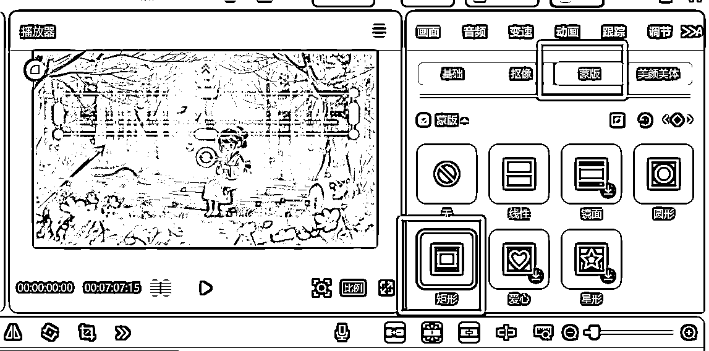 最后把所有这些画面合成一个片段，然后不断复制粘贴，直到时长接近1小时。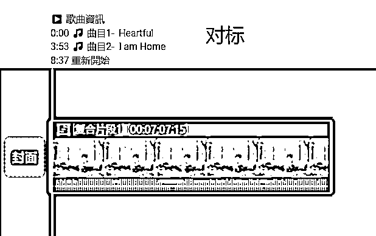 还想再稳一点，就参考同行加些爆款元素：白噪音、开场入场画面、有共鸣的文字，都是为了抓住前三秒。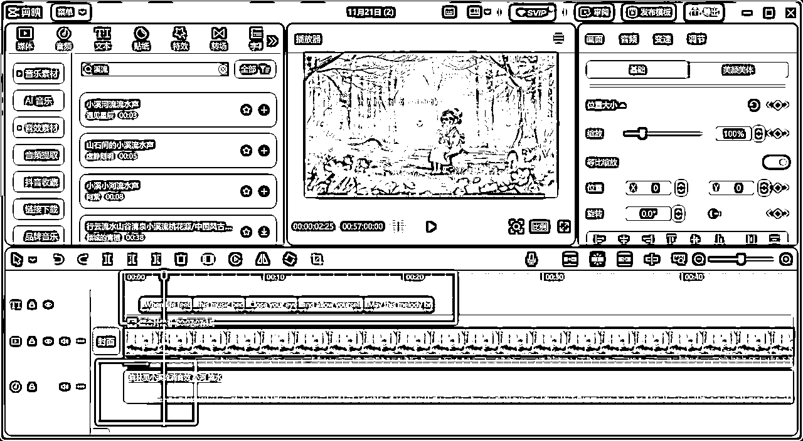

流程讲完了，放一个demo示意。demo里人物脸部其实还能继续优化，不过咱只做演示，就不磨细节了。

题外话：做矩阵的话，可以在模板上做点差异化，比如时钟爆款模板配上Lofi calm的音乐，思路就打开了。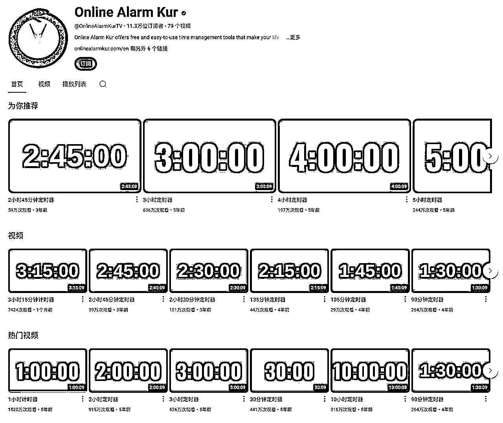