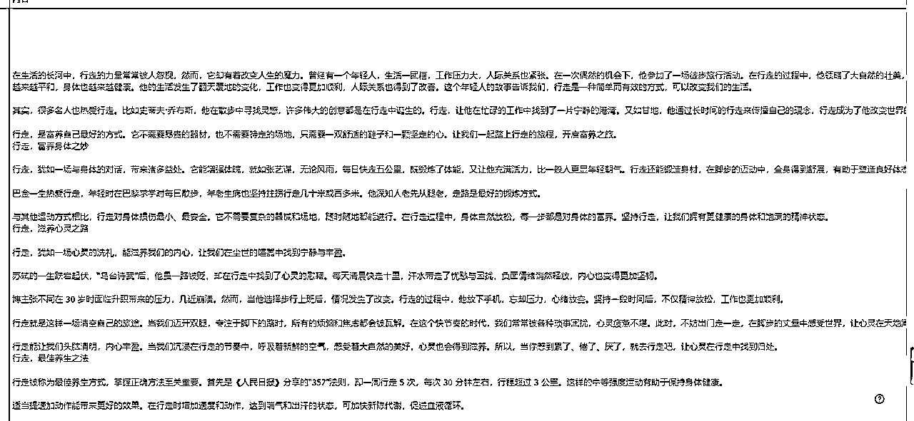
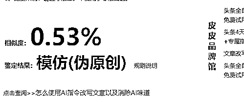
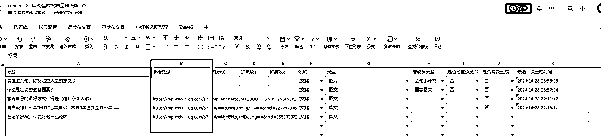
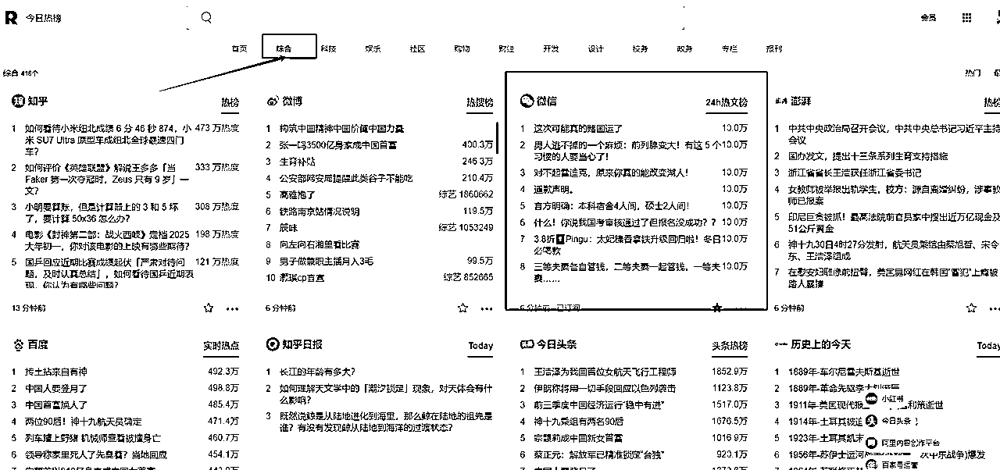
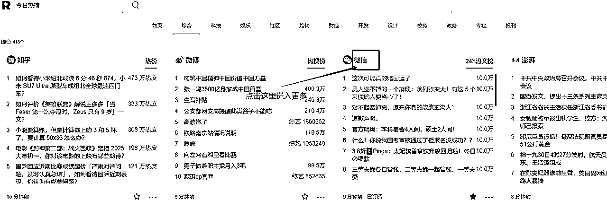
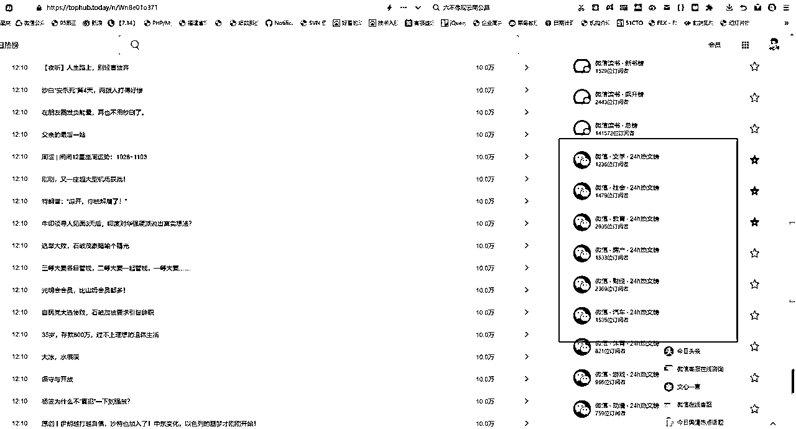
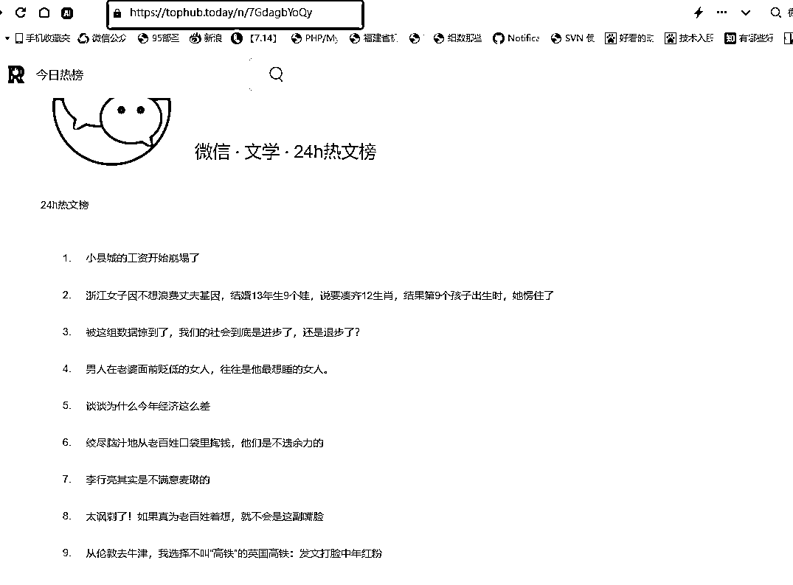
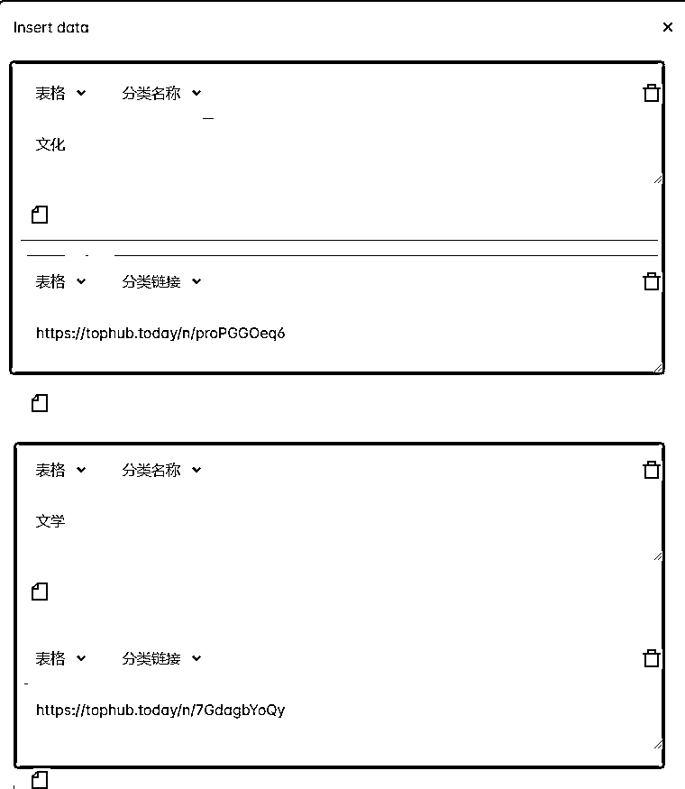

你是不是也经历过——每天打开公众号后台，不知道写什么，找选题翻半天，仿写又怕AI味太重，配图还要一张张找，发布还要守着时间点？

之前我分享过一套自动化方案，能把公众号和小绿书的内容生产流程串联起来。但当时只覆盖了国学文章和金句小绿书，很多人反映：需求对不上，用不上。

于是这两天，我又在熬夜掉头发，**给这套系统加了一个「文章仿写」工作流**。现在，一个真正意义上的批量内容生产机器，算是拼齐了。

给大家看一组实际跑出来的结果：

我用查重工具测了一下，相似度只有0.53%，完全在可接受的范围内。而且通读下来，AI味没有很浓，逻辑顺，语气也自然。

下面直接进入正题，聊聊怎么用这个仿写功能。

## 一、先把RPA脚本部署好

前提就不重复了，先按照之前的部署教程，把脚本跑起来，这是所有操作的基础。

## 二、仿写功能怎么用

看上面的截图，飞书表格里有一列叫「参考链接」。

你只管填标题；如果这篇文章需要仿写，就把原文链接丢进去（目前测试下来公众号链接是支持的，其他平台没验证过）。只要这个链接有值，工作流就会自动判定为“仿写模式”，调取AI去链接里抓取内容、重新生成。

另外，「领域」和「类型」是必填项，不然后续找不到对应的账号，发不出去。

## 三、热点不用找，RPA帮你搬进表格

说实话，仿写的痛点是：如果每篇文章都要自己手动去搜链接，那也够折腾的。

所以我又写了一个RPA脚本，专门干这件事：**自动爬取当天热点文章的标题和链接，直接录入选题表格里**。脚本挂着，文章就会持续不断地生成。

思路很清晰，分享给大家：

1. **打开今日热榜**，地址是：https://tophub.today/c/news  
   进入后切到“综合”分类，能看到一个“微信24小时热榜”。

2. **点进微信热榜**，页面里能找到更多细分领域的热榜入口。

3. **往下拉，看右边栏**，能找到具体的领域排行榜，这就是我们要抓取的目标。

4. **点进你感兴趣的细分领域，把网页地址复制下来**。

5. **把这个网址交给RPA脚本**，它就能自动爬取这个页面里的热点标题和链接。

整体流程不算复杂，你完全可以照着这个思路，自定义抓取任何你想仿写的领域内容，让AI替你写。

## 四、脚本配置说明

拿到脚本后，在“插入数据”节点里，按需配置你想要的领域。

这里注意一个坑：**一定要成对配置**——一条填分类名称，一条填分类链接。而且分类名称必须和飞书表格里的“领域”字段保持一致，否则无法匹配对应账号。

想加更多领域？按同样的格式往下加就可以了。和之前版本不同，这次用的是表格，不是变量，配置起来更直观。

好了，快去试试吧。让机器帮你干活，把时间留给自己。