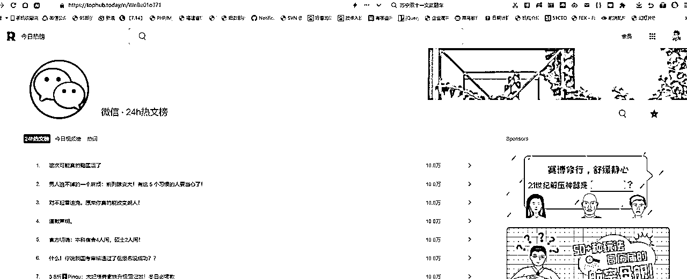
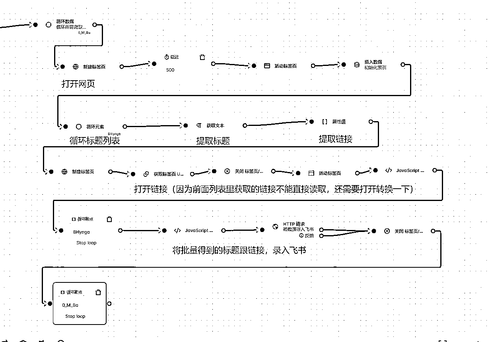

做自媒体最烦什么？不是写不出来，是每天重复的机械动作太耗人：刷热点、想选题、写初稿、找配图、点发布……一套下来半天没了。但如果这些步骤全都能自动跑，你是不是就能把精力放到真正重要的事情上？

我之前把公众号和小绿书的自动化流程整合过一版，不过那时候只支持国学类文章和金句类小绿书，适用范围有限，不少朋友说用不上。于是这几天我又埋头折腾了一番，总算把“文章改写”这个模块给补上了。到现在，一套批量产出的流水线总算闭环了。以下是实际跑出来的效果：

丢进查重工具验了一下，重合率只有0.53%，这数字相当能打。而且通读下来，机器的痕迹很淡，读着不别扭。

下面说说这个改写功能具体怎么操作。

先得把RPA机器人装好。之前那篇教程里写过详细步骤，没看过的先回去补课。

接下来是改写的使用方式。表格里专门留了一列“参考链接”，你填好文章标题后，如果有想模仿的范文，就把那篇的链接贴进来——目前公众号文章是验证过的，别的平台没测过不敢保证。只要这一列有内容，流程就会自动切换到改写模式，把原文抓过来重新生成一版。

这里有个容易漏的坑：领域和类型必须填，不然系统后面匹配不到合适的账号。

再来说说热点采集这块。有些文章需要手动找链接确实没法避免，但要是每一篇都靠人肉搜，那也太折磨了。所以我额外写了个RPA脚本来干这活：自动抓取热点榜单里的标题和链接，直接喂进选题池。机器不停，文章就不停。

分享下实现逻辑：

第一步，打开今日热榜，地址是 https://tophub.today/c/news 。进页面后点“综合”，往右扫能看到微信的24小时热门内容。

第二步，点那个“微信”，跳转到更完整的榜单页。

页面往下滚动，右侧区域就是各细分方向的排行，这正是我要的部分。

第三步，选定某个细分榜单，点进去，复制这一页的网址存好。

第四步，用RPA脚本去抓这个页面上的内容就行。

整体来说不复杂。照着这套逻辑，你想采集哪个方向的素材都行，拿到链接交给AI改写即可。

最后讲一下参数配置。拿到脚本的社群伙伴，还是在“插入数据”节点里，把你想采集的榜单类型填进去。

这里有个关键点：分类名称和分类链接必须成对出现，而且名称要和表格里的领域严格对齐。想多跑几个领域？照这个格式往下加就行了。跟以前不太一样的地方在于，这次是用表格来维护，不再是写变量那种方式。

行了，赶紧上手试试吧！