我是茜茜，一个零基础、纯素人，年初才加入生财。上半年靠AI写作赚到了第一桶金，而且这个项目现在还在给我带收入。早先也动过“赚美元”的念头，但一直没真正落地。最近带我入门的引路人@方波妮开始做YouTube，她跟我说那边收益很可观；亦仁老大的判断也是，AI生成的视频丢到YouTube和Shorts上，无论是广告分成还是电商带货，都有很大想象空间。

所以我也没多犹豫，直接开干。目前刚跑YouTube三天，一共发了6条视频，拿到了11个订阅、2745次观看。下面把起号过程分享给大家。

## 账号搭建
这一步直接参考2022年YouTube航海的账号搭建教程就行，不用自己瞎琢磨。

## 找对标账号
平时刷短视频，我发现萌宠类内容热度一直挺高。选定了一位YouTube博主作为对标：https://www.youtube.com/@CatKitten99/shorts
选择原因有三：宠物内容流量不错；视频制作门槛低；博主几乎每个视频都维持相同的动作、音乐和模板。既然爆款能靠同一套模板不断复制，那我只要把模板做出来，理论上也能复制出爆款。

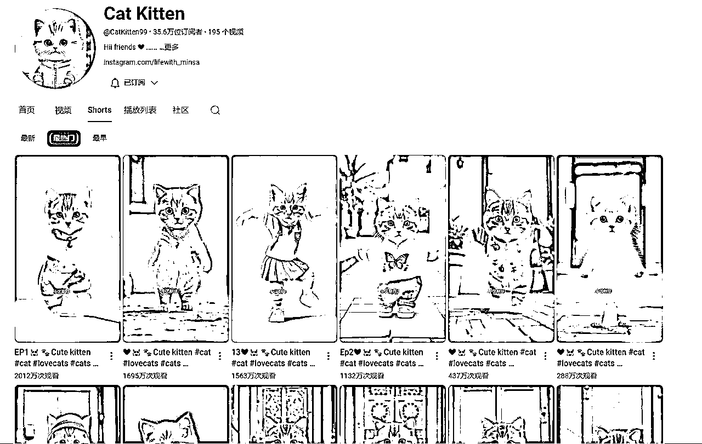

## 复刻爆款视频

### 1. 下载爆款视频
为了模仿对标视频，我用了一个免费下载网站：https://vtool.pro/youtube.html
从上面下了第一条对标视频，并截取了其中一帧作为参考图。

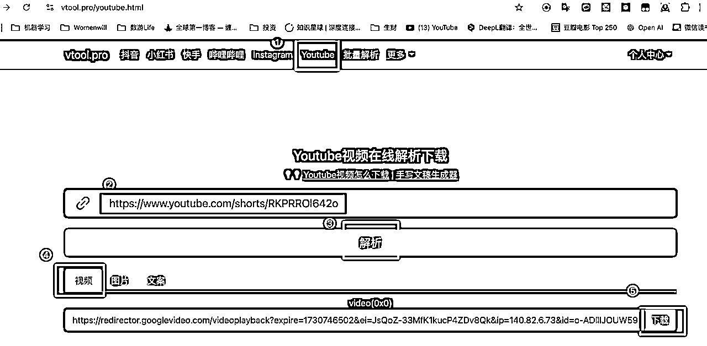

### 2. 用豆包/MJ/Kimi 生成图片

先打开豆包的图片生成功能，上传刚才的截图作为模板，再输入需要修改、润色的提示词，选好图片格式，生成一张新图。

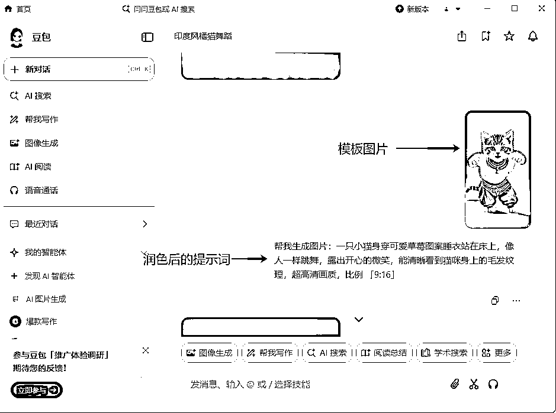

把生成效果满意的图保存到手机里，作为后续视频的模板图片。

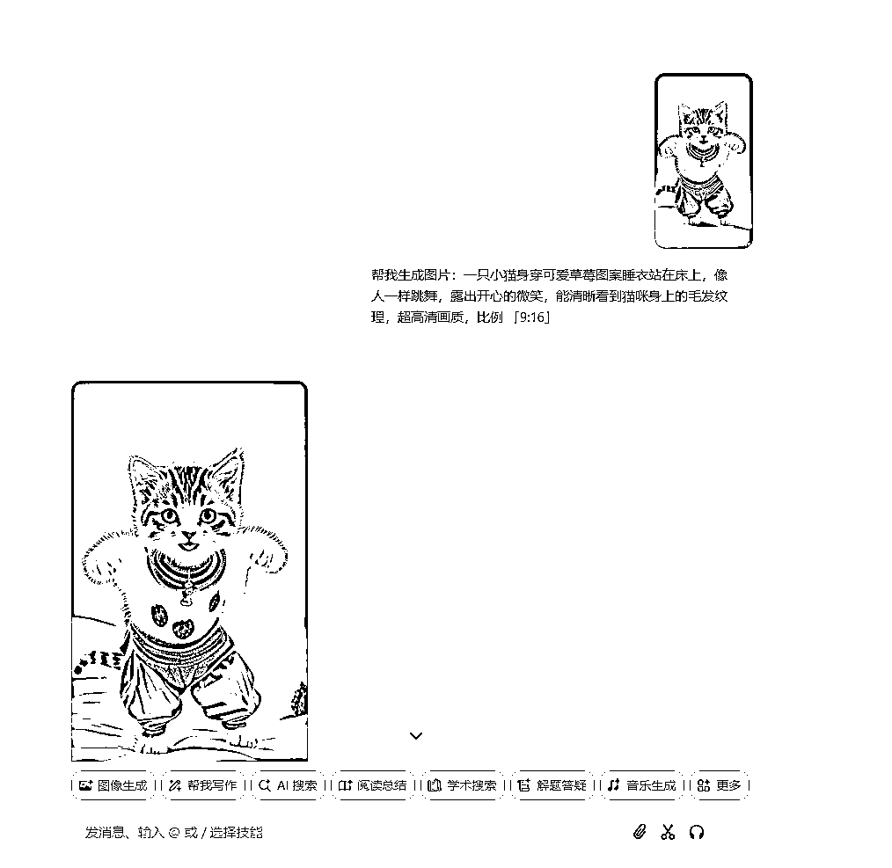

### 3. 生成“小猫咪跳科目三”视频
手机端打开通义App，在“全民舞台”里找到“全民舞王”，选一个想要的猫咪同款舞蹈，排队大概3分钟左右，就会生成对应的猫咪跳舞视频。
然后再打开剪映，把生成好的舞蹈视频做剪辑、替换音频，剪辑完导出发布就可以了。

### 4. 其他操作经验
如果想用RUNWAY生成小猫跳舞视频，登录地址是 https://app.runwayml.com/login
先制作模板图：把爆款视频截图丢给MJ，用/describe功能让MJ描述图片内容并给出指令。可以把MJ给出的指令复制并谷歌翻译成中文，再进一步润色、补充描述词，然后丢给Kimi翻译成英文，最后把英文指令放进MJ，用/image功能生成图片。

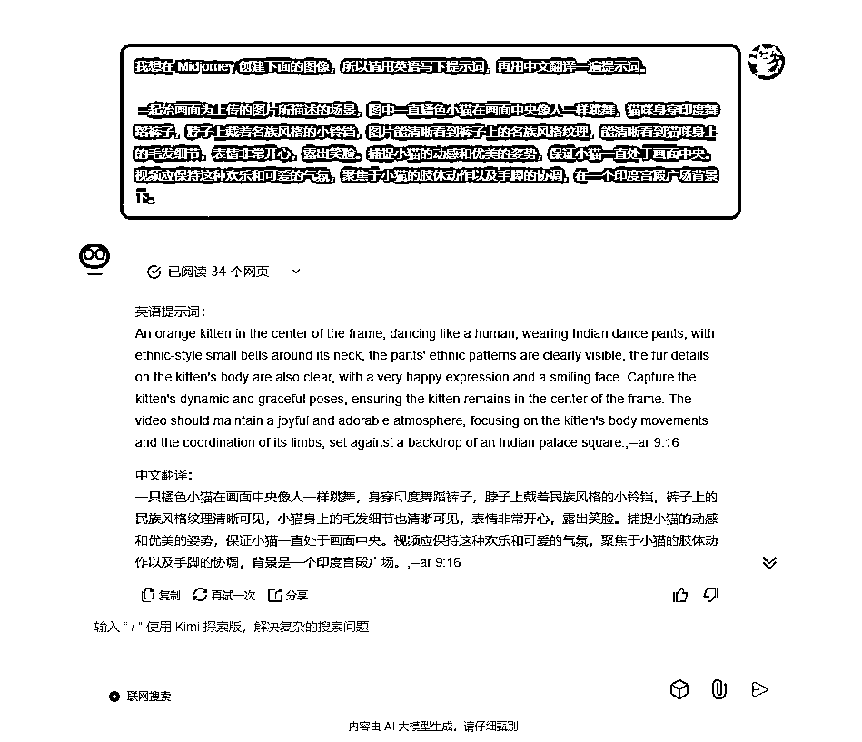

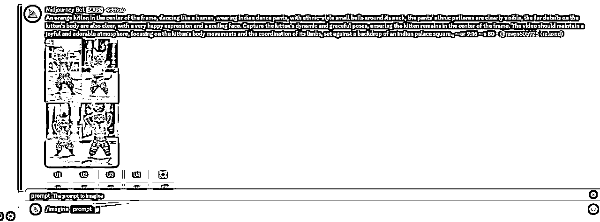

```
An orange kitten in the center of the frame, dancing like a human, wearing Indian dance pants, with ethnic-style small bells around its neck, the pants' ethnic patterns are clearly visible, the fur details on the kitten's body are also clear, with a very happy expression and a smiling face. Capture the kitten's dynamic and graceful poses, ensuring the kitten remains in the center of the frame. The video should maintain a joyful and adorable atmosphere, focusing on the kitten's body movements and the coordination of its limbs, set against a backdrop of an Indian palace square., --ar 9:16
```

接着生成视频：把之前放在Kimi里的中文提示词重新润色，加上动作、肢体等细节描述，再让Kimi翻译成英文。去Runway上传模板图片、粘贴英文指令，记得带上视频尺寸，就能生成视频。最后照旧用剪映剪辑和替换音频，导出发布就行。

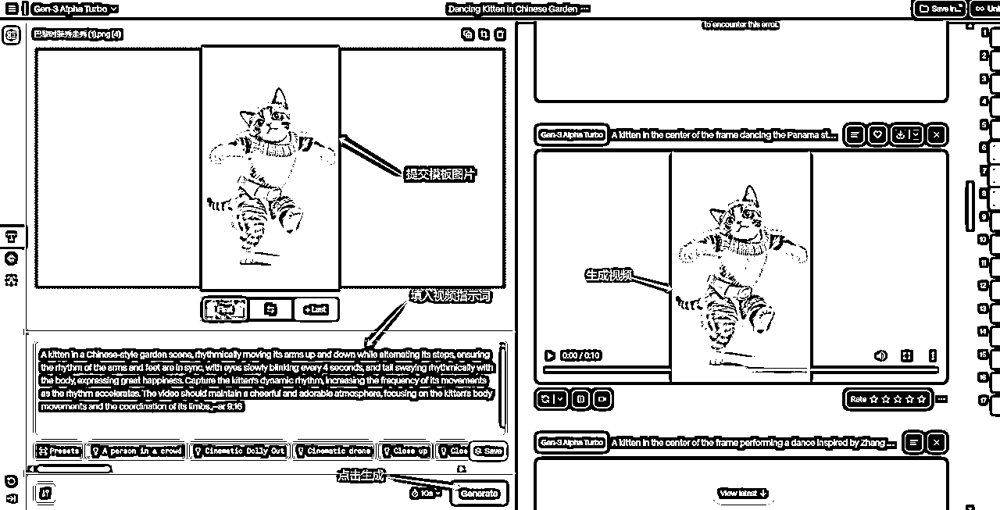

```
A kitten in a Chinese-style garden scene, rhythmically moving its arms up and down while alternating its steps, ensuring the rhythm of the arms and feet are in sync, with eyes slowly blinking every 4 seconds, and tail swaying rhythmically with the body, expressing great happiness. Capture the kitten's dynamic rhythm, increasing the frequency of its movements as the rhythm accelerates. The video should maintain a cheerful and adorable atmosphere, focusing on the kitten's body movements and the coordination of its limbs.,--ar 9:16
```

不过对比下来，RUNWAY生成的小猫跳舞视频，流畅度不如豆包。注意这里仅限于小猫跳舞这个动作。而且我分析过，猫咪跳舞视频能火，核心在于音乐和动作，猫咪长什么样关系并不大。所以我现在更常用豆包，因为它比MJ简单，也更容易上手。

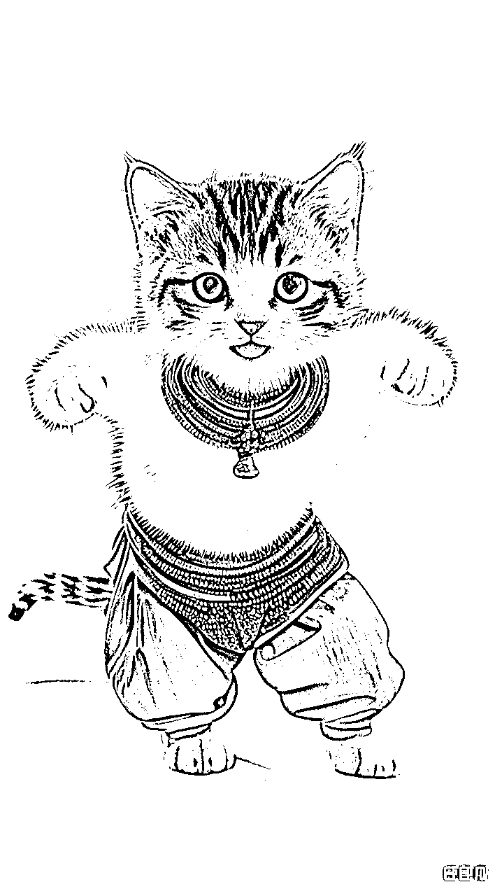

```
帮我生成图片：一只小猫身穿可爱草莓图案睡衣站在床上，像人一样跳舞，露出开心的微笑，能清晰看到猫咪身上的毛发纹理，超高清画质，比例 「9:16」
```

## 举一反三
在跑通流程后，可以继续找类似的爆款频道去模仿，多多益善。

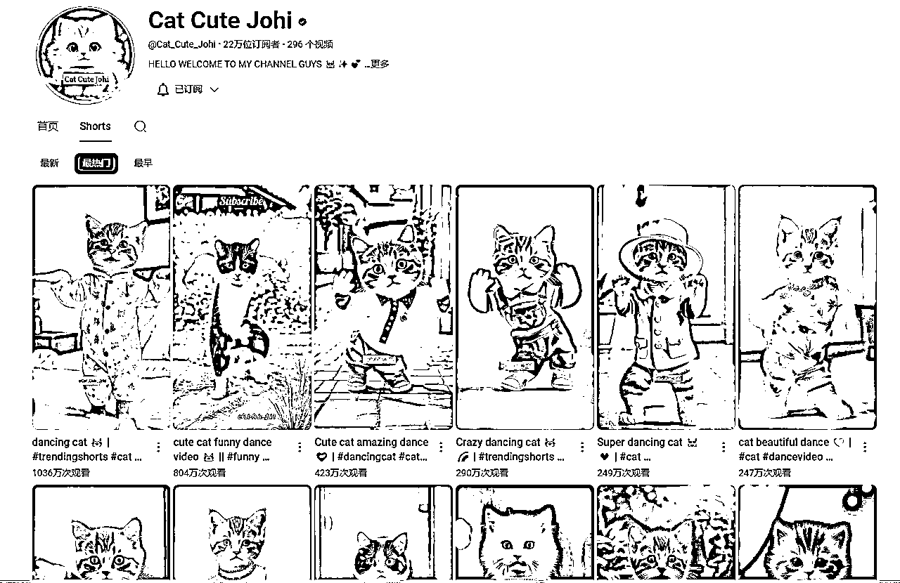

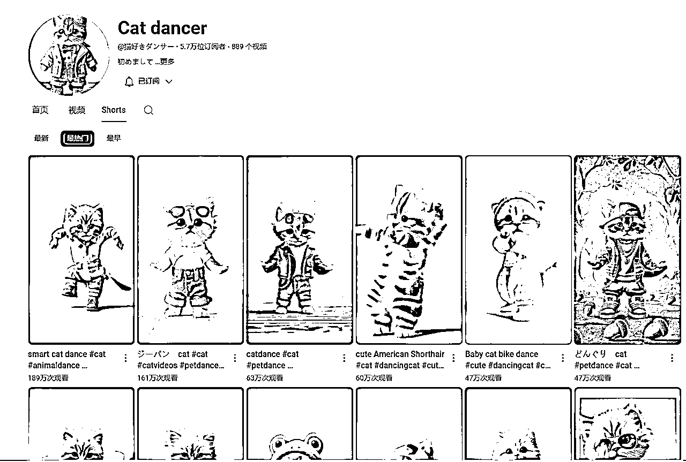

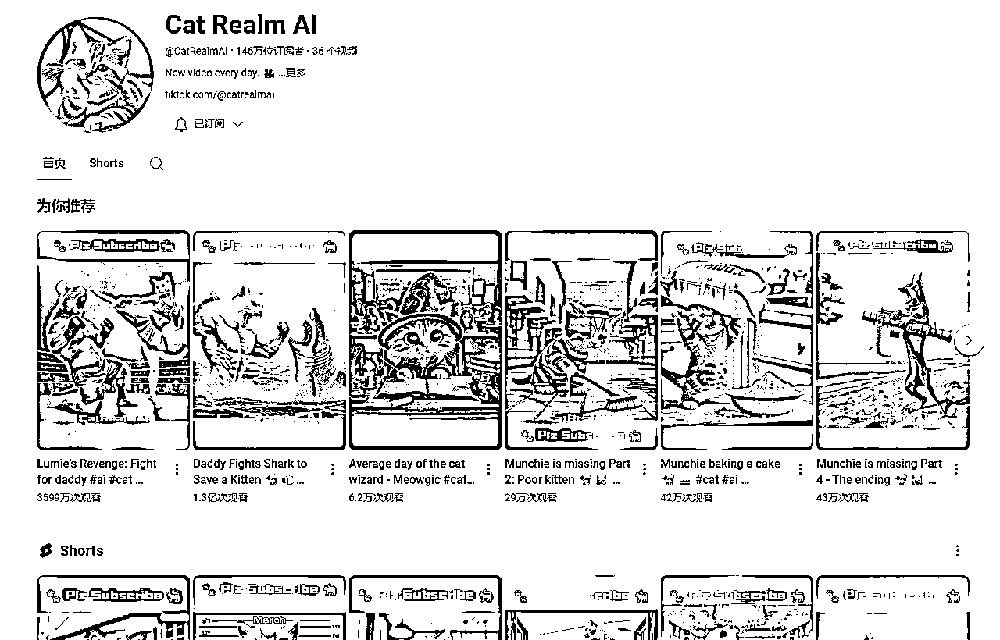

## 三个月的规划
1. 目前账号每天发3条视频；
2. 另外开一个新号，做小猫动画。我在油管上看到同一个“小猫剧情动画”给两个博主带来了1.3亿播放量，他们只是做了很简单的改动。我也打算照着这个思路去模仿；
3. 目标先定在500订阅/300万播放，争取早日赚到第一美刀。

最后想再次感谢亦仁老大的超级标和领路，还有新出的龙珠悬赏玩法。越来越喜欢生财这个平台，总有惊喜。祝大家一起生财有术！