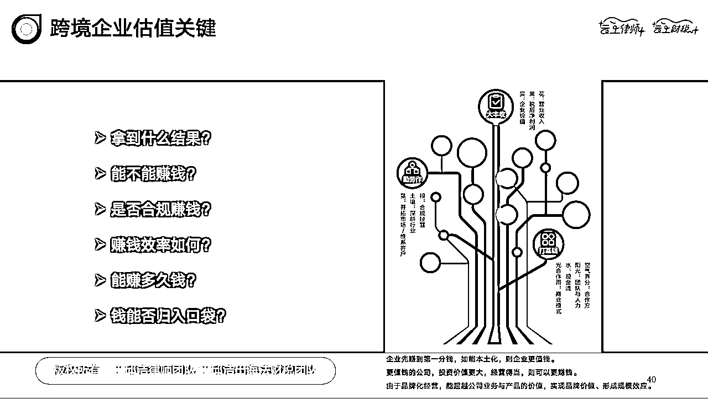
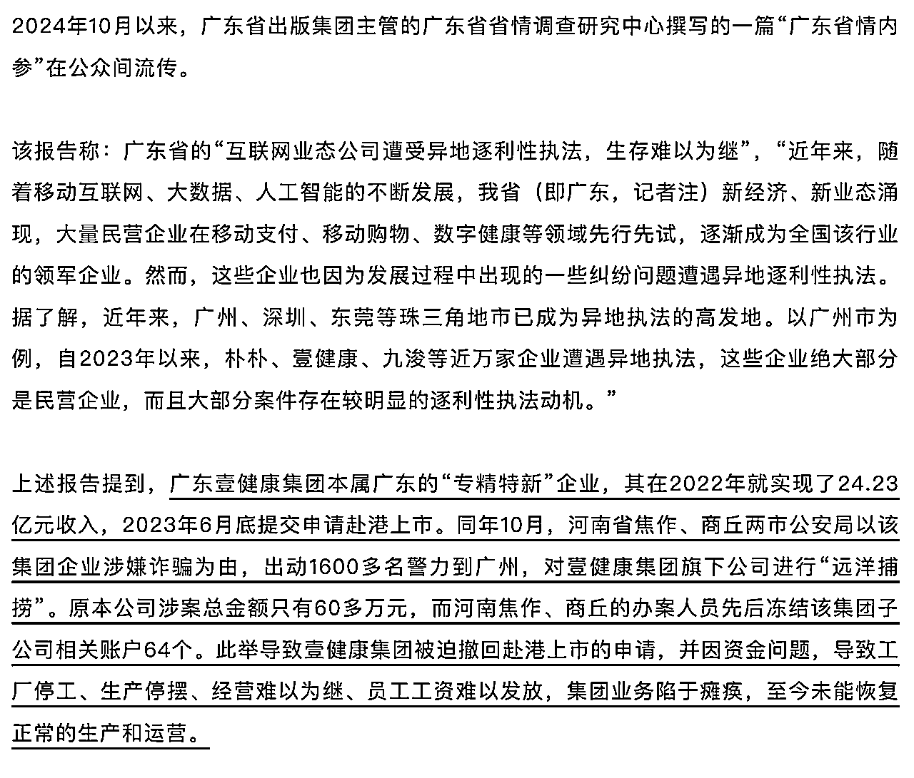
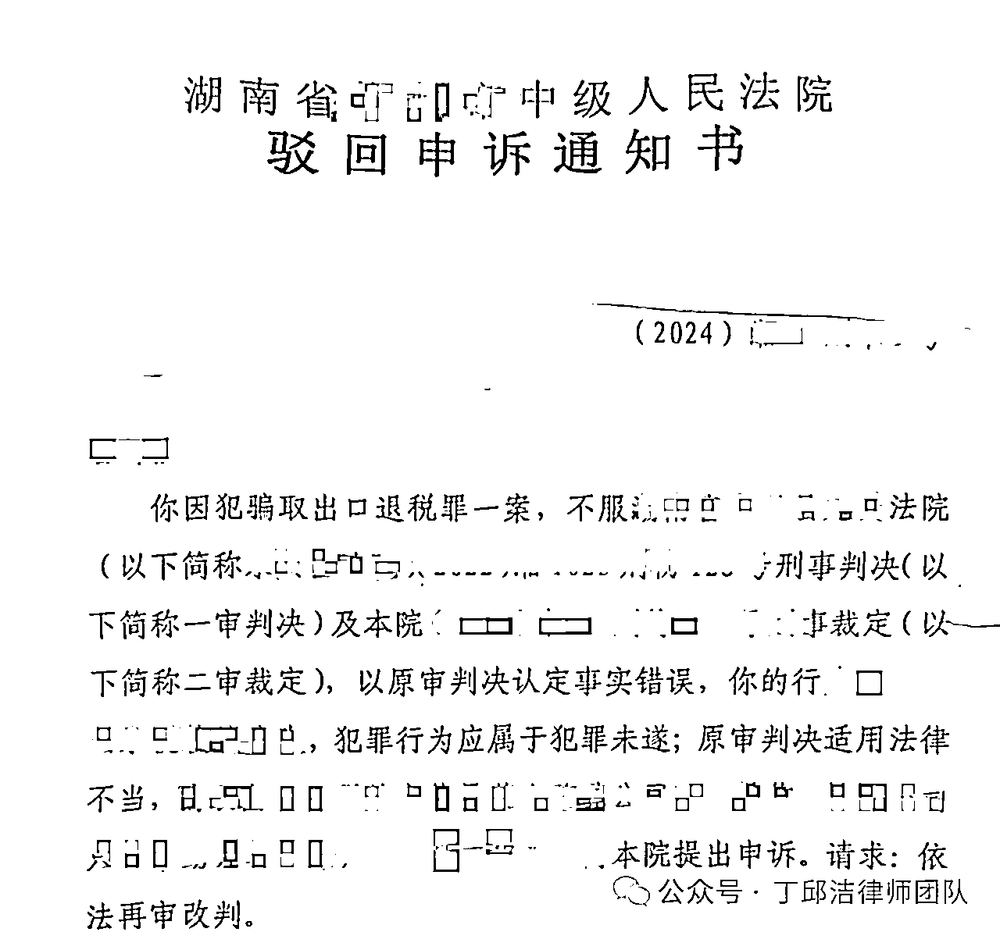
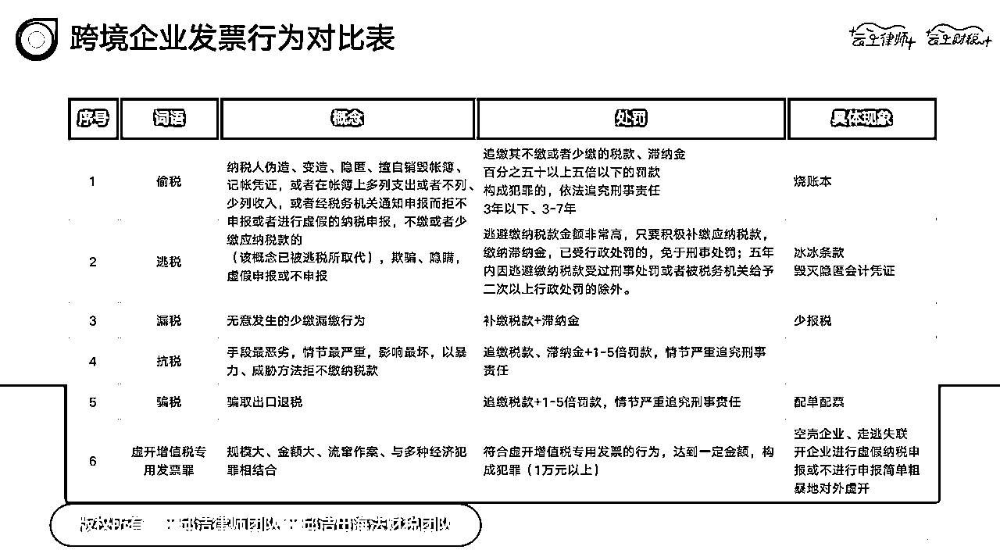
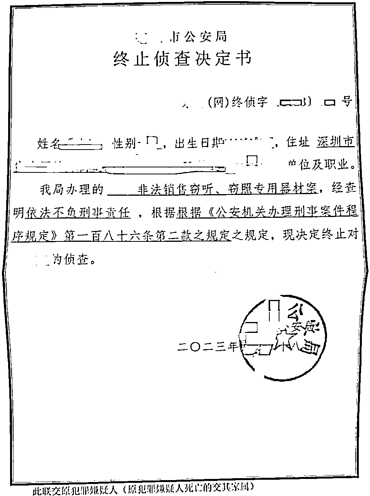
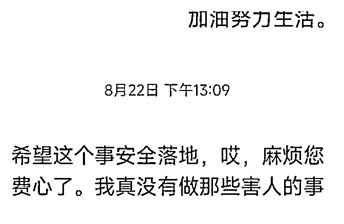

# 跨境经营的另一道关：如何识别并应对异地执法风险

近期，媒体对“远洋捕捞”现象进行了报道，并介绍了相关官方表述。这一话题受到关注，也提醒出海企业：类似案件可能陆续进入公众视野，经营者需要认真审视自身风险。

写下这些内容，是想给跨境电商及出海企业的负责人提个醒，也希望大家尽早开展内部检查。与其等待规则进一步完善，不如先主动了解风险、梳理业务流程，并提前想好遇到突发情况时该如何依法应对。

## 一、如何理解“远洋捕捞”？

这一说法通常用于描述一种现象：部分地方执法机关以利益为驱动，在异地采取抓捕人员、查封或冻结资产，乃至转移外地企业及个人财产等措施，且相关做法被指存在违规违法问题。此类争议近年屡有出现，对民营企业的信心和经营预期造成冲击。

长期为跨境电商、出海公司提供辅导，我们发现，企业价值评估不能只看增长、规模等指标。尤其近几年，另一个更现实的问题越来越值得重视：经营所得能否安全留存，而不是在风险发生后付诸东流。

结合行业变化，我们此前曾梳理跨境电商合规发展的几个阶段。当前究竟处于哪个阶段，尚难下定论；但可以看到，跨境业务面对的多边监管正在趋严，刑事法律风险也逐渐显现。对经营者而言，建立风险意识，是长期经营不可缺少的一环。

## 二、异地执法争议为何发生？

争议背后，地方执法与司法可能受到利益因素影响。刑事案件的管辖权与罚金、罚款、罚息及违法所得追缴等经济利益有关；地方税务部门和司法机关也各有财政与考核压力。立案、办结、定罪及量刑等指标，可能进一步加剧逐利冲动。

实践中，刑事管辖所称的“犯罪地”范围并不局限于单一地点。它可能涵盖行为实施、准备、开始、经过或结束的区域，也可能包括犯罪结果发生之处，例如被侵害对象所在地、涉案所得取得、藏匿、转移、使用或销售的地点。管辖范围宽泛，正是争议容易出现的背景之一。

## 三、受到关注的案件与消息

1. 媒体近期报道了广东一家大健康企业的相关情况，公开数据引发关注。

2. 9月，长期经营非洲市场的跨境企业传音控股CFO被采取留置措施，截至目前，案件具体情况尚未公开。

3. 杭州、深圳有关公安机关曾发布通告，强调异地办案应依法协作，反对未经本地民警协助而强行带人的做法，并表达了保护本地企业的立场。

## 四、团队办理过的相关案件

### 4.1 深圳外贸经营者在内地四线城市受审，最终获刑五年有余

我们曾代理一宗骗取出口退税罪再审案件。1月接到咨询，3月接受委托，5月提交再审申请，9月收到驳回申请的决定。直到“远洋捕捞”一词开始受到关注，我们才进一步意识到，这起2020年的案件带有典型的异地执法争议特征。

案件中，一名内地城市经侦负责人将深圳外贸企业经营者带走。经过两年多的一审、二审，原本存在争取缓刑的可能，最终却被判处五年多有期徒刑。尤其令人疑惑的是，当事人并不具备出口退税主体资格，为什么会被认定为骗税罪主犯？

办案过程中，还出现了诸多异常情形：据称有人以威胁、利诱等方式促使当事人更改供述；认罪认罚时，辩护律师未在场；原本似乎正在办理缓刑手续，后来却改为判处五年半；此外，案件还被质疑可能涉及不当利益往来。相关证据也引发了团队的强烈质疑。当地检察机关首次办理骗税案件，在判决遭到质疑时，曾表示无需参考广东省有经验的案例。

**案件带来的提醒：**

刑事再审本就困难，涉及税务且带有诈骗特征的案件，定罪后想要翻案尤其不易。不同地区的办案能力存在差异，具体诉讼中的每项证据都可能影响结果。对当事人来说，供述往往是自己能够直接把握的重要材料。据我们了解，这宗案件中供述的细微变化，对最终量刑产生了重大影响。面对讯问，应如实陈述、审慎核对，不能在压力下随意改变表达。

### 4.2 跨境卖家与前员工发生股权争议，随后遭遇异地刑事控告

另一起案件源自股权纠纷。前员工试图从店铺权益中分得一亿元，老板予以反对。员工先通过诉讼主张股东身份，法院判决不予支持；之后又在异地控告老板身边人士涉嫌职务侵占。

我们在对方首次接受传唤、讯问时介入。讯问结束当天，当事人获释，未被采取拘留措施，职务侵占指控也未能继续推进。此后，前员工又提出诈骗指控，目前团队仍在收集相关材料。

**案件带来的提醒：**

面对股权争议，民事程序需要积极应对；出现刑事控告时，也应尽快评估并处理。两年间，双方围绕纠纷进行了多轮诉讼，其中一宗在开庭当天撤诉，另一宗经历一审、二审后均未获支持。

刑事风险越早处理，通常越有利于争取主动。若被控告人从首次讯问后转为被拘留，后续处理难度往往明显增加。对企业负责人而言，核心员工被卷入案件，可能影响经营团队；讯问过程中还可能牵涉负责人本人，使商业争端进一步升级为刑事风险。

## 五、怎样降低涉刑风险？

### 5.1 预防在前，优于事后补救

#### 1）全面核查供应链，排除违法隐患

跨境电商多以贸易为主，自身的核心价值往往集中在供应链。竞争愈发依赖供应链能力，企业就更应把相关合规审查放在突出位置，尤其要排查可能导致刑事追责的环节：

- 不得虚开增值税发票，也不要参与相关安排；
- 不为他人骗取出口退税提供协助；
- 对来源不明的款项保持警惕；
- 谨慎处理与异常账户之间的资金往来。

#### 2）税务事项单独审核，严守合规边界

偷税、逃税、漏税、骗税、抗税等行为都应避免。依法处理违规事项后，更要建立长效机制，避免同类问题再次发生。

企业申请补贴、办理出口退税或参与奖励项目之前，应认真核实申请条件、业务依据和材料真实性。否则，已领取的资金可能被要求返还，严重时还会引出刑事责任。

「近期税务机关对温州一家跨境电商企业开展批量征税处罚，并追究相关涉罪问题」

#### 3）出口前核实许可，切勿让货物游走在监管之外

有些货代可能声称“可以正常出货”，报关环节也未必及时发现问题。但如果货物缺少必要的出口许可，且属于受限或禁止出口物品，海关查验后就可能引发走私等严重风险。罚款或许只是损失之一，企业负责人还可能承担刑事责任。合作方最终是否担责并不确定，不能把合规希望寄托在货代或报关行的口头承诺上。

#### 4）采购前确认商品属性，警惕特殊设备

不能因为维护客户关系，就忽略商品本身的法律属性。例如针孔摄像设备，相关产品若属于专用窃听、窃照器材，经营和销售可能涉及刑事犯罪。

案例显示，有人通过网络销售此类器材，因销售规模大、情节严重，被判处五年有期徒刑并处罚金。选品和采购时，应先核实资质要求及法律限制。

#### 5）防范跨国电信诈骗，避免被犯罪团伙利用

被国际通缉的人员可能在境外设局，以交易合作、销售商品、恋爱交友等方式接近目标。跨境经营者除了审核货物和合作方，也要保持警觉，不要因利益或情感因素卷入犯罪活动。

#### 6）妥善处理员工关系，减少举报风险

内部矛盾如果处理失当，可能演变为投诉或举报。劳动关系、股权安排和离职交接等事项，宜尽早规范。

#### 7）重视家庭成员的职业与合规安排

对配偶及其他家庭成员的工作情况也应有所了解，及时排查可能引发争议的隐患。

### 5.2 遇到调查时，如何依法应对？

#### 1）接到传唤后先咨询律师，再决定如何配合

若本人被通知接受调查，可先由律师了解案件情况、评估是否与案件有关、分析控告方可能掌握的材料，并预演讯问内容。必要时进行模拟准备，同时整理对自己有利的文件资料。银行盖章出具的材料，在某些案件中可能具有重要证明作用，可提前核实和备妥。

如果只是证人或其他协助调查人员，可以通过电话或书面方式向异地办案机关说明情况，并提出在所在地配合调查的请求。

若异地公安人员直接上门，应保持冷静，可联系本地公安机关，请其依法协助处理。根据《公安机关办理刑事案件程序规定》第三百四十六条，公安机关到异地执行传唤、拘传、拘留、逮捕，或进行勘验、检查、搜查、查封、扣押、冻结、讯问等活动，应向当地公安机关提出协作请求，在当地公安机关协助下开展，或委托其执行。

尽早让律师协助固定证据，并妥善保存手机信息、通信记录及其他关键资料。面对讯问，要区分事实性问题与可能影响案件定性的内容；涉及案件性质的回答尤其需要审慎，不能提供虚假陈述。

如果有人提出“转一笔钱就能解决”，应提高警惕。公安机关可以依法冻结涉案财产，但无权直接将冻结款项划走。企业也应尽可能通过合法渠道沟通，降低账户冻结对日常经营的影响。

#### 2）准备要提前，作答和签字不能草率

律师介入、材料整理以及心理准备，都应尽量提前。但讯问时回答问题、签署笔录，绝不是越快越好。必须仔细阅读记录，确认与本人陈述一致后再签字；不要留下空白内容，也不要签署未经核对的材料。

#### 3）当事人、家属与律师保持协调

当事人应避免自作主张或试图“聪明应对”，这些行为可能带来不利后果，甚至加重责任。

家属需要与律师充分沟通，避免因怀疑、反复更换意见或擅自采取行动，影响辩护工作；更不能销毁、藏匿证据。

律师、当事人和家属之间只有保持合作，才能共同维护企业、事业及家庭利益。企业负责人平时就应了解专业律师资源，避免事发后仓促寻找。

#### 4）拒绝不当“打点”，不要让错误选择扩大风险

若有人暗示以金钱影响裁判结果，切勿贸然交付财物；此类行为可能触犯行贿等法律规定。

看到别人找关系，也不意味着自己必须跟进。通过不正当方式干预案件，可能让原本仍有空间的辩护陷入更大被动。

选择律师也应审慎。若对辩护方案存在疑虑，应充分沟通并依法调整，而非频繁更换团队，白白耗掉宝贵的准备时间。

#### 5）围绕案件事实逐项核查，制定有针对性的辩护策略

调查开始后，可与律师按以下方向梳理：

- 执法机关是否对案件具有管辖权；
- 上门人员身份、证件及办案程序是否符合规定；
- 讯问记录是否完整、真实，有无先制作内容再要求签名等问题；
- 涉及什么罪名、由谁提出控告、争议缘由是什么；
- 被调查事项涉及本人、公司，还是员工的个人行为；
- 证据来源是否合法，内容是否可信，能否形成完整证明链条；
- 公安机关调查进展如何，案件是否移送检察机关；
- 认罪认罚具结书的内容和法律后果是否已经充分了解；
- 若可能被定罪，如何依法争取从轻处理、缓刑或其他适用的救济；
- 如何修复经营管理漏洞，避免同类问题再次出现。

面对调查要保持冷静，也要做好心理准备。企业员工和家人都在等待结果，但不能因此忽视法律程序。

#### 6）别忘了家人

企业经营者卷入刑事案件，承受压力的不只是本人。家人的支持很重要，处理每个决定时，都应想到家庭所要承担的后果。

## 六、为何“远洋捕捞”引发担忧？

这些疑问相互关联，核心在于：刑事案件对程序正当性和公正裁判有极高要求，但程序复杂并不意味着结果必然公正。

**第一，办案质量存在差异，纠正错误成本很高。**  
案件会受到地区、人员和具体证据等因素影响。已经公开的不公正裁判，往往需要耗费大量时间、精力与资金，才可能获得纠正，而这样的成功案例只是全部案件中的少数。

因此，企业更应在日常经营中减少涉刑风险，而不能等到出事后再寻找补救办法。开展普法和风险提示，并非只为法律服务本身，更希望民营企业能够稳定经营，让市场健康发展。

**第二，跨境经营涉及的风险更加复杂。**  
企业要关注的是经营活动中系统性的刑事风险，而非盲目接受所有指控，也不能对风险视而不见。跨境业务涉及多个国家和地区，监管规则复杂，合规要求更高。如果个别地方执法偏离防控犯罪、维护经济秩序的初衷，甚至把刑事措施用于地方利益，企业面临的风险就会进一步加重。因此，办案能否依法、公平、审慎，尤为关键。

**第三，民营企业的内部风控往往不足。**  
不少老板把主要精力投入业务，先解决生存问题，再考虑如何稳健发展，这种安排可以理解。但缺少合规知识、供应链审查和内部管理，可能让一时的侥幸心理付出沉重代价。经营者既要谋求生存，也需要持续补足风险管理能力，才能走得更稳、更长远。

## 七、呼吁依法保护民营企业，严肃治理异地执法乱象

我反对以异地执法为名、行逐利之实的做法。

一家企业从创立到成长，往往要跨过重重难关；而一次不当处置，却可能迅速摧毁多年积累。

今年5月办理骗取出口退税罪再审案件后，我才更加清楚地看到，民营企业家、小微企业经营者和出海创业者所承受的风险，也进一步思考法律工作者应当承担的责任。

民营企业要面对资金、信息、资源等多方面竞争，任何关键环节出现问题，都可能影响企业生存。跨境电商和出海业务还要应对不同国家和地区的监管要求。企业不仅要跨越海外市场的门槛，也需要面对国内监管中的不当做法。

令人痛心的是，有些公司尚未真正走向海外，就已在国内遭遇严重打击。

作为法律从业者，我们关注合规与风险控制，希望企业能以更可控的成本开展国际业务，持续优化供应链、建设品牌，并逐渐形成具有国际竞争力的能力。

回看办理过的刑事案件，再观察各地披露的相关事件，不禁要问：经营中的问题是否一定要用多年刑事追诉来处理？企业出现违规，能否先通过更恰当的方式及时纠正？即便已经涉嫌犯罪，是否仍能在依法追责的同时，为企业改正和继续发展留出空间？

冻结账户可能在短时间内切断企业资金链。一份公函就可能让多年经营陷入困境。执法权力需要受到制度约束，也必须接受监督。

过去，我相信帮助一家企业规范经营，就可能带动就业，也能提升中国企业在海外市场的影响力。如今我更加认识到，经营环节出现问题并不罕见，启动刑事程序却可能十分迅速。倘若只在案件发生后处理辩护问题，而不重视事前预防，企业合规就难以真正落地。

民营企业的真实处境需要被看见，相关问题也应得到认真对待。

从全球视角来看，中国企业和供应链走向海外，面对的挑战早已不只是产品品质、口碑或制造能力。国内监管中的不确定性，以及国际贸易调查、限制措施和地方保护主义，都可能成为新的障碍。普通民营企业要独自应对这些压力，能力有限。

我再次明确反对以逐利为目的的不当异地执法，并愿意为民营企业发声。尤其是中小微企业，只有获得公平、稳定的经营环境，市场才能保持活力，真正回到健康有序的发展轨道。