# 别让“远洋捕捞”把创业成果拖进铁窗

来源：[https://ga48invstw.feishu.cn/docx/YAsMdChCcoJRgFxf2G7cBqpEnSp](https://ga48invstw.feishu.cn/docx/YAsMdChCcoJRgFxf2G7cBqpEnSp)

丁邱洁律师：面向出海与跨境电商经营者的风险自救笔记 20241101

“远洋捕捞”已由官方媒体点名，并给出解释，这意味着同类情形很可能集中显现。

这篇笔记一面提醒跨境与出海的经营者，二面提示尽早自查漏洞。祸患若能提前止住，最好不要等到爆发。

指望立法、等细则出来被动兜底，对经营者而言太慢。能真正掌控的主动权，是提升风险敏感度，并在出事后懂得如何快速、有效处置。

目录
1、远洋捕捞指什么
2、为何会产生远洋捕捞
3、近期被关注的典型新闻
4、律师团队经手的实务案例及体会
4.1 出口退税类案件：深圳工厂负责人被带往内地小城，实刑五年余
4.2 跨境卖家股权纠纷引发异地刑事报案
5、如何降低被远洋捕捞的风险
5.1 事前防控远胜事后补救
5.2 事后处置要点
6、远洋捕捞与一般刑事案件的差异，为何让民企高度警惕
7、丁邱洁律师公开呼吁：守护民营企业刻不容缓，严惩远洋捕捞

# 1、远洋捕捞指什么

业内通说：因地方利益驱动，部分公安机关跨区域违法违规抓捕、查封、冻结乃至划转异地民营企业及个人财产的做法。近年此种现象反复出现，对民企安全感和信心造成较大冲击。来源：经济观察报

多年来我们服务跨境电商及出海客户，愈发感到传统估值框架已不完全匹配。

过去更聚焦估值树的上游，这三年深耕跨境大外贸，反而更关心最后一环：赚到的钱能否安全落袋。

结合行业变化，前一篇加精文章中我们梳理了跨境电商的四个阶段，当前究竟处在何种合规阶段并无定论，但跨境电商的双向、多向监管只会收紧，最近抬头的是跨境领域的刑事化风险，经营者必须重视，避免创业结局是铁窗。

# 2、为何会产生远洋捕捞

地方执法与司法之间的博弈，利益是主线。刑事案件只要沾边即可介入，管辖权往往对应罚金、罚款、罚息、追缴违法所得等经济收益。地方税务有创收考量，检法公也有财政压力。立案、结案、定罪、量刑的考核是硬指标，完成情况决定是否称职。

管辖口径被放得很宽：“犯罪地”包含行为地与结果地。行为地指实施地、预备地、开始地、途经地、结束地等；结果地指侵害对象地、赃款取得地、藏匿地、转移地、使用地、销售地。

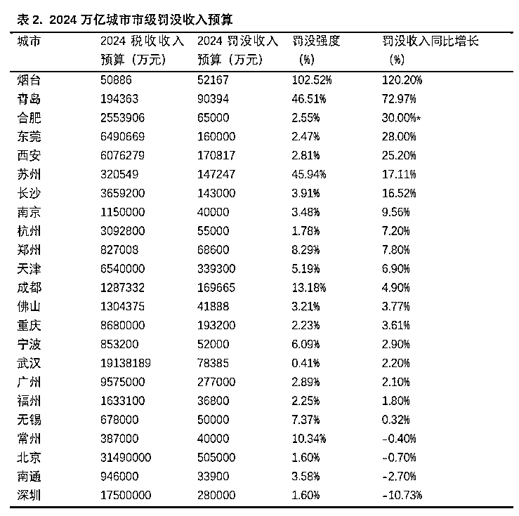

数据来源：澎湃研究所

# 3、近期被关注的典型新闻

1、官媒近期的广东某大健康企业报道，数据触目惊心：

来源：经济观察报

2、九月深耕非洲的知名跨境电商企业传音控股财务负责人被留置，案件进展至今未披露；
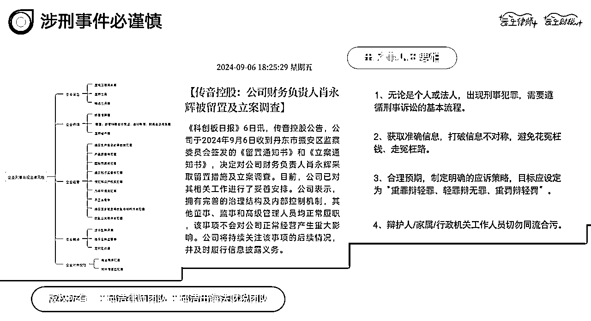

3、杭州某公安局、深圳某公安局发布通告，禁止无本地协作擅自带人，保护本地企业等。

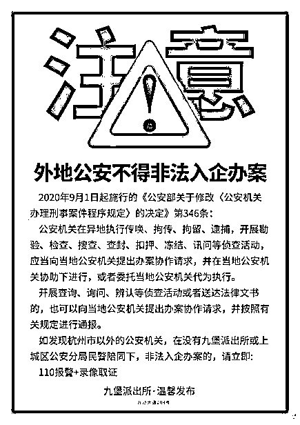

来源：网络

# 4、律师团队经手的实务案例及体会

## 4.1 出口退税类案件：深圳工厂负责人被带往内地小城，实刑五年余

有一起出口退税再审案件，我们一月接洽，三月受托，五月递交再审申请，九月收到驳回。再审被驳回后结合舆情才意识到，这起案件本质是2020年的典型远洋捕捞。内地某四线城市经侦将深圳外贸经营者带走，一审二审历时两年多，最终由可能缓刑变为实刑五年多。

从罪名看，当事人并不具备出口退税主体资格，为何认定为主犯？办案中出现了诱导改口供、认罪认罚时律师缺席、原拟缓刑突然改判五年半等情形，可能还涉及权钱往来。证据部分同样令人意外。该地检察院首次办理此类案件，在被质疑判决不公时，曾表示无需参照广东经验。

体会：
刑事再审难度极高。带骗税属性的税务类犯罪一旦定罪，多成铁案。不同地区办案水平差异明显，个案关键在于每个证据，尤其是当事人能掌控的口供。本案口供改动一字，角色就从从犯变主犯、刑期增至五年多。口供切勿轻易更改。

再审申请被驳回的通知书

## 4.2 跨境卖家被合作方两次民事起诉、异地报案两项罪名

有一起跨境卖家股权纠纷，前员工意图分走店铺价值一个亿的权益，老板强硬回击。员工先以股东身份起诉被法院驳回，随后在异地报案老板身边人职务侵占罪，我们在首次传唤阶段即成功阻断，人当日释放、未被羁押，职务侵占罪未成立。员工不罢休，再以诈骗罪继续施压，目前处于取证阶段。

体会：
面对恶意诉讼，民事股权战必须坚决。两年打了三场，前员工开庭当日撤诉一次，另案一审二审败诉。刑事阻断更要快，第一时间消除涉罪风险性价比最高。等到被羁押就晚了，每拖一步结局变化很大。身边人若被羁押，后续牵连老板的难度会倍增，民事变刑事风险骤增。

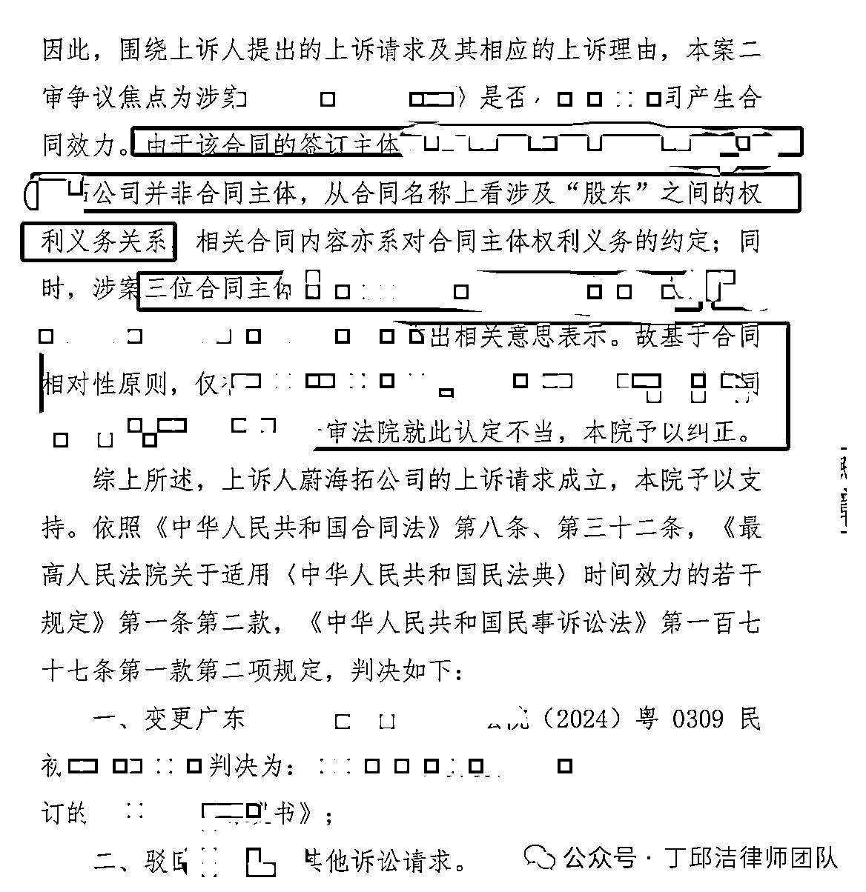

二审深圳中院民事判决书明确其并非股东身份

# 5、如何降低被远洋捕捞的风险

## 5.1 事前防控远胜事后补救

针对跨境电商卖家：

1）系统梳理供应链，杜绝涉罪链条
商贸型企业自身价值有限，眼下竞争核心是供应链。供应链合规与涉罪风险必须置顶：

不要虚开发票！
不要参与虚开发票链条！
不要协助骗取出口退税！
不要收受来源不明的资金！
不要与异常账户交易！

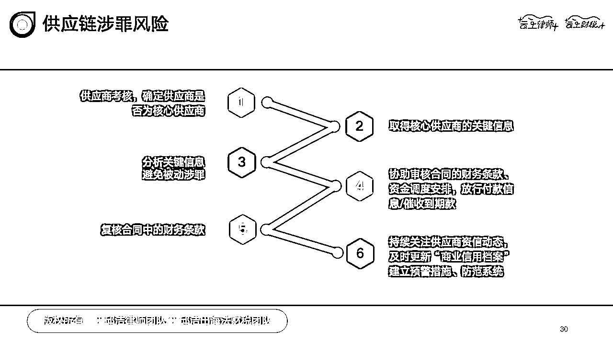

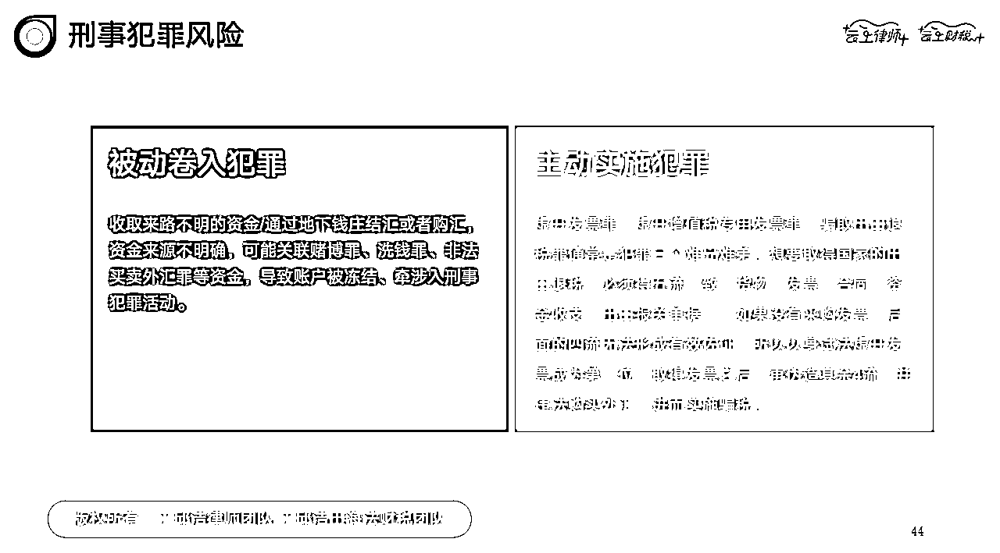

2）税务相关事项必须隔离
偷逃漏骗，一样都不要碰。偷税首罚后仍要合规，绝不能再犯。

拿补贴、做出口退税、参与奖补申报，都要三思。吃进去的必然要吐出来，还可能构成犯罪。

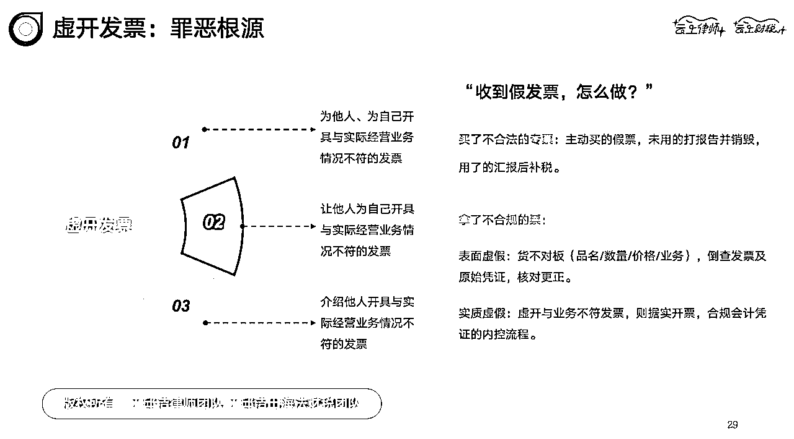

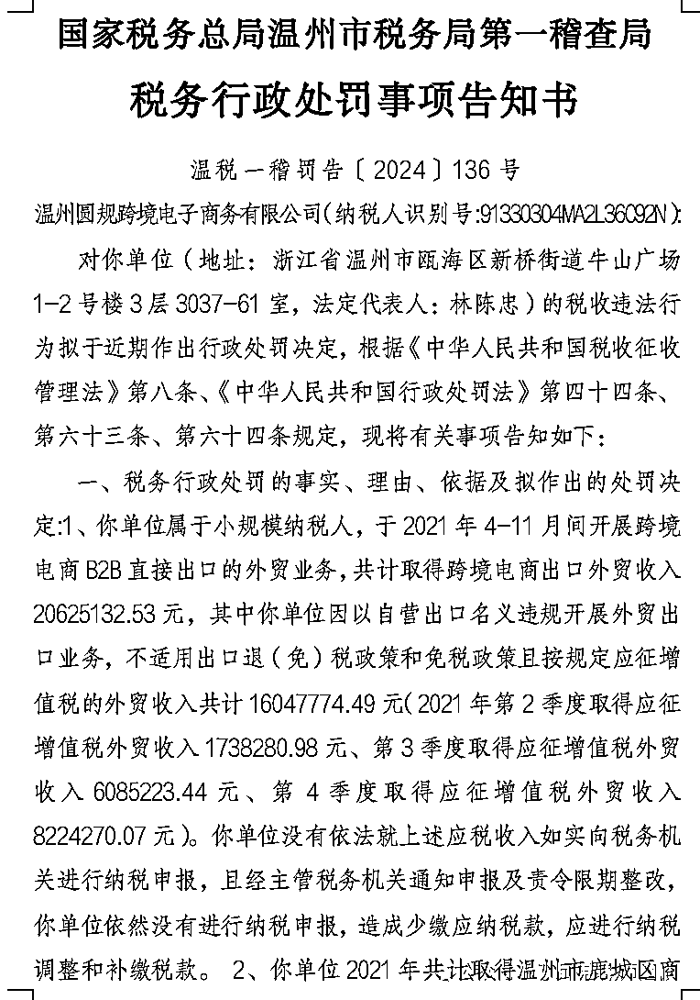

近期税局对温州一家跨境电商企业的批量补税处罚及涉罪追究

3）出口合规要做好，无证勿擅自出境
逃避海关监管，非法运输、携带、邮寄。若货代称没问题、报关行不当回事，货物上柜后被海关缉私查出无出口许可的违禁品，罚款只是小事，走私罪是大事。最终承担后果的永远是卖家，货代消失，报关行推卸。

4）严选产品，供应链可能在售非法品
维护客户关系不能乱来。例如采购针孔摄像头，不是违法而是犯罪。

案例要点：被告在网上非法销售窃听窃照专用器材，数额巨大。法院判处有期徒刑五年并处罚金，对同类犯罪起到了警示作用。

5）警惕跨国集团电信诈骗
被红色通缉的人在海外设局引诱犯罪，重重圈套等你上钩。可能是以卖货名义，也可能是恋爱交友。跨境经营者要管住货，也要管住人性。

误入跨国诈骗集团，最终转行政处罚，平安脱罪

最后两条最为关键，也是经营者最易唱铁窗泪的根源：

6）员工关系要管好，避免被举报！
懂得都懂。

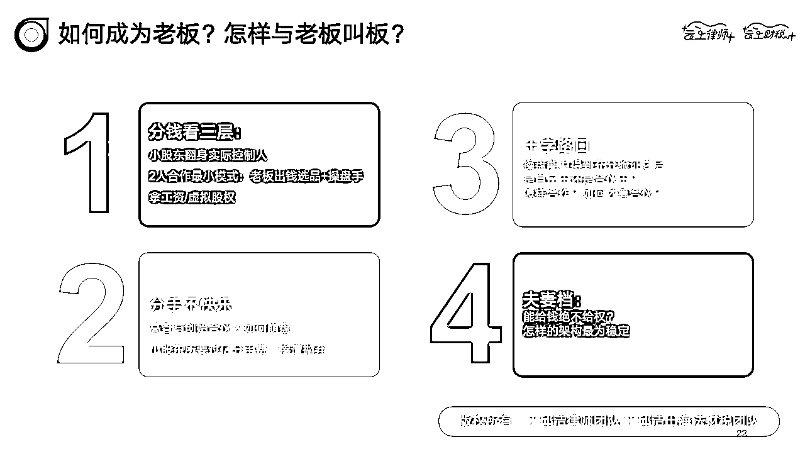

7）配偶工作安排要妥当，避免被举报！
懂得都懂！

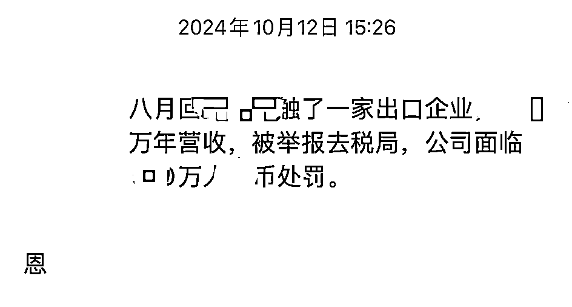

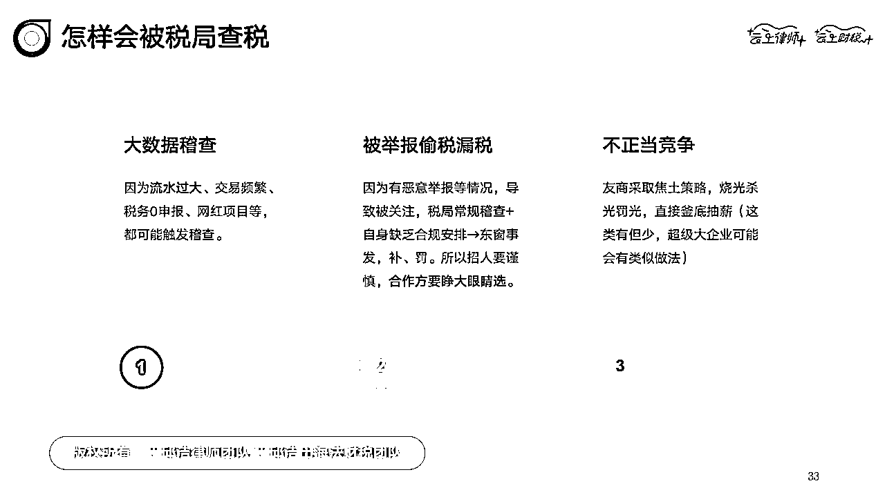

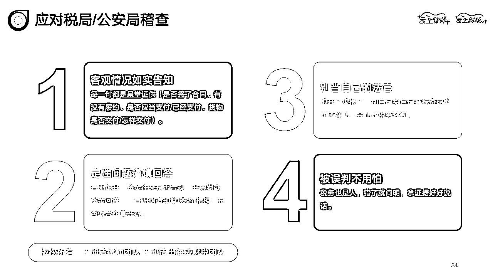

## 5.2 事发后如何处置

1）被传唤第一时间不是去，而是联系律师！
如果你成为当事人：先让律师评估是否构成犯罪、是否属实、举报人可能掌握哪些证据，推演讯问场景，必要时模拟。提前准备对自己有利的材料。

切记：带公章的银行材料最管用！

如果只是证人或配合调查的案外人，可电话或书面向异地办案机关说明，或要求到本地说明。

异地公安直接上门：他来了，可以报警，让本地警方介入，体面自救，避免被带走。

《公安机关办理刑事案件程序规定》第三百四十六条：异地执行传唤、拘传、拘留、逮捕等侦查活动，应向当地公安机关提出协作请求，并在当地协助下进行，或委托当地代为执行。

找律师固定证据，提前更换手机、留存关键记录、做心理预警。讯问时区分定性问题与常规问题，大原则：定性问题谨慎回答。

公安让你转账说能没事？公安只能冻结，不能直接划走，划走违法。但也要沟通，避免公司账户被冻影响经营。

2）早与快的区别
找律师越早越好，准备越早越好，心理建设越快越好。

但回答问题、签字笔录不是越快越好，要看清是否属实再签。

笔录不要留空！不要留空！不要留空！

3）当事人、家属、律师形成合力
当事人别自作聪明，常导致定罪加重。
家属别不信任律师，反复试探、自行毁证，最后含泪铁窗。
律师必须与当事人家属同心，才能保住家业事业。经营者要提前储备靠谱专业的法律资源。

4）不能走错任何一步
判决前法官让你给钱打麻将，给还是不给？给了是行贿，不给又提心吊胆。
别人找关系我不找会吃亏？找了就是行贿。
律师不行就换来换去？耽误时机神仙难救。

5）精准辩护，而非精准踩坑
看是否归这个公安局管
看办案人员是否刑警、证件是否齐全，两人以上执行
看讯问笔录是否合规，有无先备好笔录等你签字
看什么罪名、谁举报、目的为何
看是本人责任、公司责任，还是员工个人行为
看证据是否经得起推敲，如何博弈拆解
做强大心理建设，一大家子人等你回来
看公安是否结束、是否到检察院、认罪认罚后果是否清楚
如已定罪，如何争取缓刑、减刑假释、早日回归
永不回头，如何预防

6）爱家人
经营者犯罪，家人最痛。无论何时，家人是你唯一的依靠。

# 6、远洋捕捞与普通刑事案件有何不同？为何谈之色变？民企为何高度警惕？

三者互为因果。
刑事案件的公正需要严格程序保障，但：
1）难不代表公正
经营者要明白：办案水平因人因地因案而异，能看见的不公判决已耗费大量时间金钱，更不用说看不见的。让企业不沾边刑事风险才是关键，出事后踩坑只会人财两空。普法并非为了转化，而是为了让民企健康存活，市场健康，法律服务才有意义。
2）要防的是系统性涉罪风险
跨境出海行业涉罪风险更大更复杂。由于远洋捕捞并非为防控犯罪或维护秩序，不排除以刑事手段解决地方创收的可能，办案趋利性更强，对企业更具害性。
3）民企是重灾区
民企风控意识弱，一个贪念就葬送企业。现实是经营者忙于生存，等活下来才想合规。需要补常识认知，才能活得好走得稳。

# 7、丁邱洁律师首次公开呼吁：保护民企刻不容缓，必须严打远洋捕捞

发刊词：保护民营企业刻不容缓，必须严厉打击远洋捕捞 2024跨境电商太空漫游

我旗帜鲜明反对远洋捕捞。成就一家企业要万难，毁掉一家企业只需一瞬。

直到今年五月办理那起出口退税再审案，我才真正看到中国民营创业者面临怎样的风险，需要怎样的担当。

民企成长九死一生，资金信息资源竞争无处不在。对跨境电商而言，双边多边监管更加严苛。

企业要突破的不仅是别国高墙，还有国内不当监管。

我痛心看到，一些企业还没走出国门，就在国内被远洋捕捞击倒。

作为法律人，我们更关注合规与风控。希望企业以更低成本取得更好成绩，打磨供应链，塑造品牌，形成真正的国际竞争力。

复盘案件、研读各地涉刑案例，我不得不问：这些企业有什么罪需要被刑事追究三年又三年？经营中的不合规有没有更及时的化解方式？犯错了有没有更好的成长路径？

冻结账户是最浅最暴力的手段。一纸公函，一个辖区派出所，就能让十几年企业毁于一旦。谁的权利该被关进笼子？

过去觉得辅导一家民企就能解决一大群就业、提升海外声量。现在发现，企业出现问题太容易，一纸立案也太容易。若只着眼事后辩护，刑事合规就是空谈。

我们必须让声音被看见，让民企的艰难被重视。

放眼全球，中国企业尤其是供应链出海，横在眼前最大问题已不是质量口碑，而是国内监管的源源不断，刑事化成为打压手段。国际上贸易调查、封锁、管制、禁令层出不穷，地方保护主义抬头。

普通民企哪有能力应对？

我再次声明，我旗帜鲜明反对远洋捕捞。

我坚定站在民企一边，希望为更多民企发声。只有无数民企尤其是中小微企业能站起来，市场才有市场，法律服务才有意义。