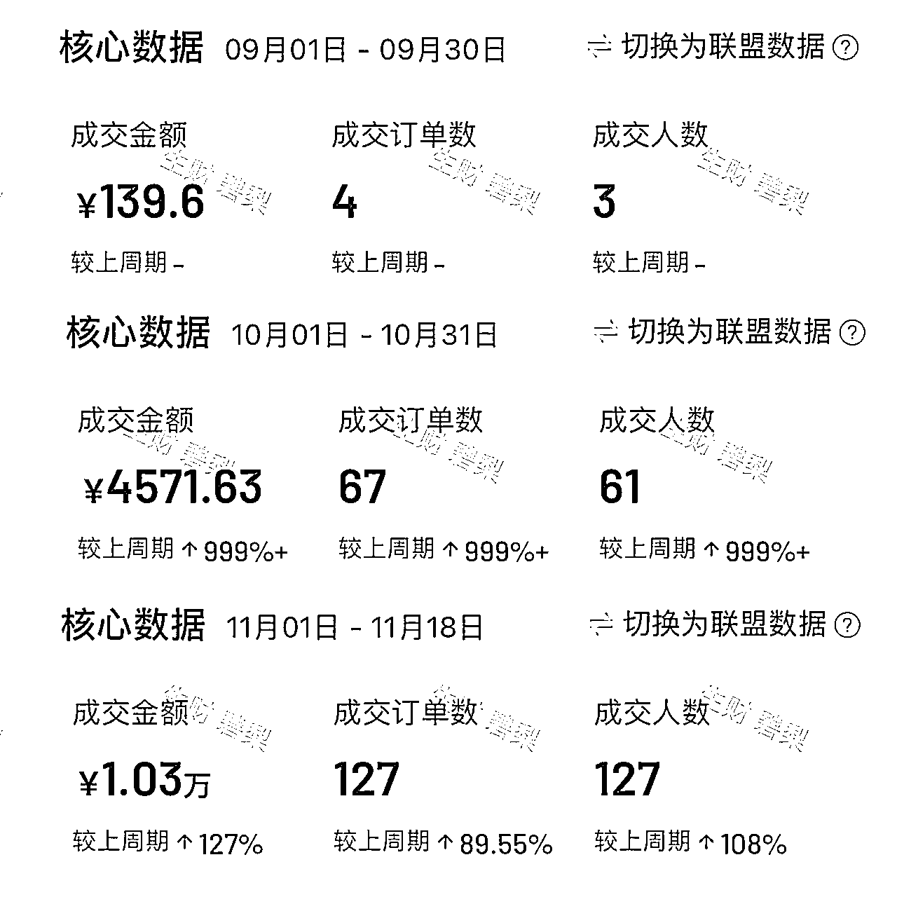
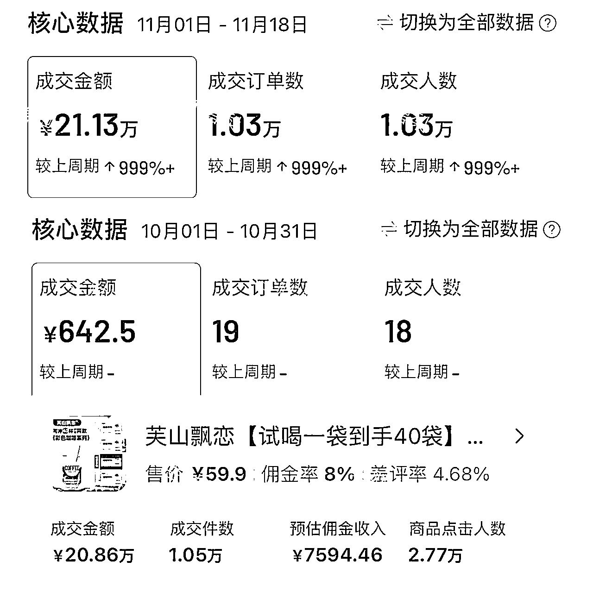
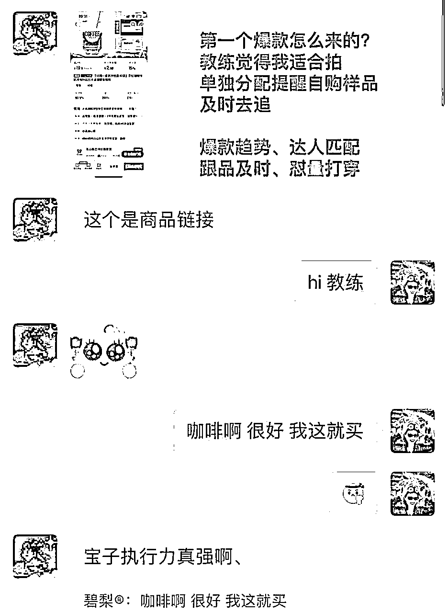
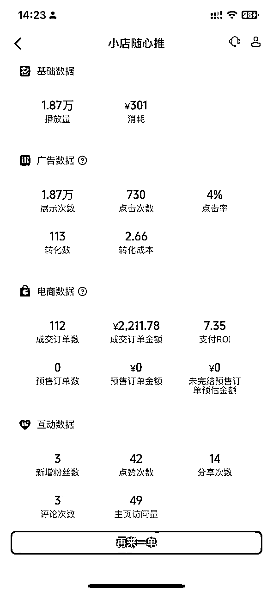
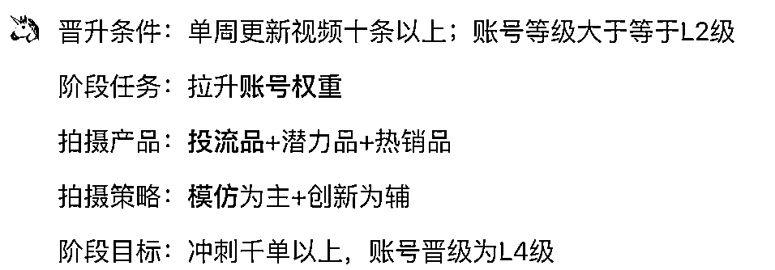
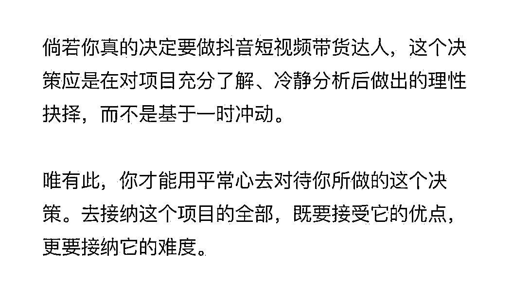
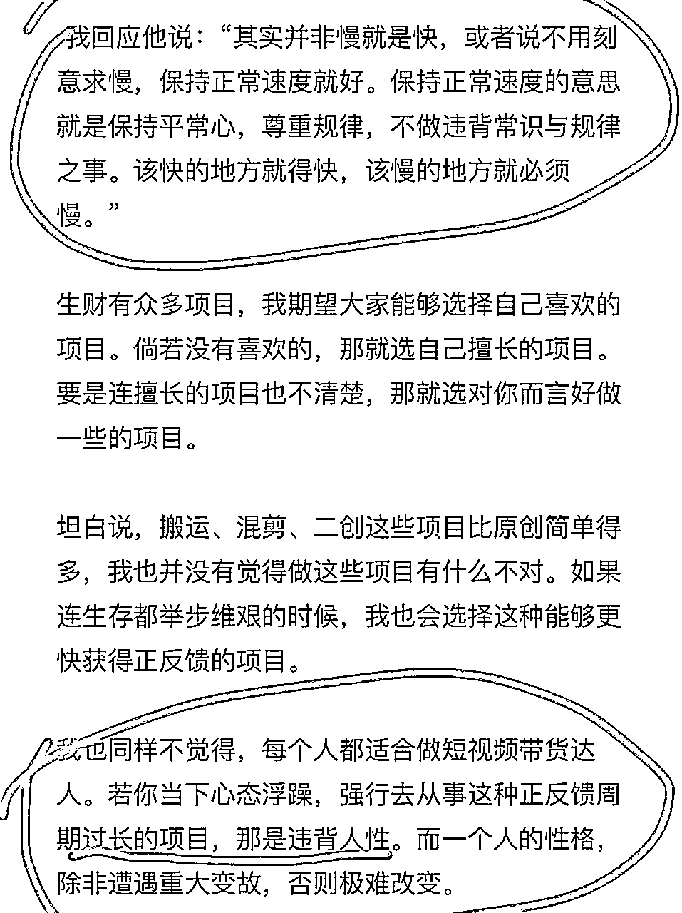

三个月的航海，从三位数到六位数，这个转变，我想认真聊聊。

先说说我的经历。今年四月底进了生财这个圈子，连着参加了三期航海：五月做视频号百货，七月换到视频号读书带货，九月又来到抖音精致达人。算下来，我也算是个“老船员”了。

成绩单长这样：五月份，GMV不过千；七月份，六千七；九月份，直接干到二十多万。

说实话，这一期我不是新手了。而且这次是全职投入，每天跟打卡上班一样，睁眼就开始干活，干到晚上十一点半都停不下来，真的干不完，根本干不完。

前面两次视频号航海，我花了三个多月，硬生生练出了出镜、剪辑、采编这几项基本功。以前我连镜头都不敢看，怕被熟人刷到我带货的视频，到现在哪怕旁边有人站着，我照样能眉飞色舞地口播。说到底，赚钱这事儿没什么好不好意思的，围观的看客不重要，真正下单的人才是你该在意的。

（先说明一下，这篇文章大部分是我个人的感受和经历，硬核实操不多。盗坤团队的精致达人孵化手册里已经写得很全了，教练也带得很细，可以说是一路点灯护航。）

接下来聊聊九月这次航海的关键节点。

### 能力建设阶段

9月19日，我发了第一条带货视频。其实10号就开船了，但我磨蹭了好几天才迈出第一步——一直在观望，对拍摄量有点畏难，再加上我本来就有点拖延症。

9月20日，我从新手村进了冲刺组。以前积攒的航海经验让我这次提速不少，真的没有白走的路，每一步都算数。

9月21日，出了第一单。当时播放量才100多，但那种开心，后面可能很难再复制了。

### 快速跑通阶段

10月16日，小号发了第一条带货视频，直接出了6单。我的大号是读书博主，靠社科流量视频涨到3000多粉，基本都是男粉。结果大号连着发了快一个月的带货视频，播放量特别低迷，而且每条视频推过来的人群画像都是男性，一单都不出，我整个人都麻了。

教练建议我开个小号，两个号同时发。这个决策后来看太对了——一个干净的新号，正反馈来得又快又猛。

10月17日，大号突然迎来第一个小爆，GMV 4571。大号好像有点“抖M”体质，当我重心转到小号的时候，它的画像开始跑正了，变成了30+女性为主。我也跟上了教练说的热度品——好运香水。当时不满足寄样要求，我就自己掏钱买了，跟品速度一定要快，趁热度冲上去，自然流高佣金，这就爆了。

文案库的含金量，懂的都懂。养成好习惯，每天把文案库涮一遍：会有新品，有重要且紧急的新品，还有还没来及出文案的重要且紧急的新品——这个要特别留心。你动作快，下一个爆款说不定就是你的。

### 杠杆：投流放大

11月3日，小号终于迎来第一个爆款，单品GMV直接破20w。

这又是我动作快、自己买样追上来的，而且当时只有我一个人这么干了（后来看到教练发言才知道）。所以教练群发的、私发的重要提示，一定要高亮注意！放在心趴上！这就是你跟品拍品的重点方向！赶紧转存到备忘录，群消息太多了，转头就忘。

教练信息的含金量，我跟你说，不懂的赶紧搞懂。

另外，新号送了一张随心推300元的优惠券，系统一直提醒我快过期了。好，那就试试吧。这一试，我算见识到了投流的作用。花1块钱，抖音送300块的付费流量，所以总消耗是301。ROI投到了7.35，特别快乐。我直接毛遂自荐发给教练，申请品牌方投流，然后开全域推广，连爆4条，直接干到20w+ GMV。

（这里说明一下：不是鼓励大家盲目投流。能白嫖就白嫖，普通人自己花钱投流，大概率扛不住。市面上有很多商家投流品，去拍那些就行。）

这次爆款是投流品，不是自然流。这也是为什么小号发了十几条视频就能快速起号——投流品对小号来说作用拉满，从lv0直接冲到lv4，人群和带货权重对新号来说，真的双丰收。

如果你在某些阶段觉得迷茫，就反复去翻《精致达人孵化流程》，孵化阶段那些答案，照着做就是了。

我在冲刺组的时候，所有动作都是围绕一件事——

11月16日，小号跟买人数破万。

* * *

### 执行力拉满，心力要稳：这是一场持久战

看到盗坤的中期航海文章，我也想做一次复盘。其实从进生财开始，我一直在尝试各种项目，给自己打鸡血，给足能量，把执行力拉满，去试错。从心气爆棚，到被现实磨到怀疑人生，再下桌转场；从轻易被割韭菜，到每次付费之前都要问“为什么”（感谢明白老师的“凡事多问为什么”精华帖）；从一个赛道跳到另一个赛道。这个过程，估计每个生财圈友都感同身受。

但回头看，就像文章开头说的：没有白走的路，每一步都算数。拉长时间线，那些当时看不出来的积累和变化，都在默默为你的起航蓄力。

抖音精致达人，最快也要两个月，而且是得有一定短视频带货、自媒体、拍剪经验的前提下，才能看到的最短成长周期。所以对更小白的船友，作为同期战友，我真心的建议是：踏踏实实做好每一件事，围绕你当下阶段该做的事去发力，执行力拉满，心力磨出来。你要清楚，这是一场持久战。

就算我爆过了，那也只是刚起号而已，一切才刚刚开始。

我还有很多问题：拍摄剪辑效率不够高，更新频率跟不上，总体的量拉不上去。怎么做到一爆再爆？怎么让视频质量再上个台阶？怎么保证每月的GMV目标？怎么提高自然流的效率？怎么把佣金收入再提一提？

这些都需要用很长的时间去学习、去调整、去优化。你看那些lv5的带货大博主，主页里躺着几百条甚至上千条视频——就是让你我清醒一点：哪有什么一蹴而就、短期正反馈拉爆的事情。马上就2025年了，清醒一点。

盗坤说得对：“保持平常心，尊重规律，不做违背常识和规律的事。尊重经营，尊重时间。”

