# 赚钱新人从龙哥大大说的"面包屑"里面搜集资料到月入一万的复盘

从“面包屑”里捡到金矿：一个赚钱新人把旅游攻略做成月入过万的完整复盘

今年四月中旬，我正式加入了赚钱这个圈子。刚进来那阵子，天天翻大佬们的分享，感觉干货很多，但自己真正能上手的却很少。直到某天读到龙哥老师写的那篇关于“面包屑”的内容，脑子里“叮”了一下——原来我早就摸到了碎片，只是没意识到它的价值。

当时我手里只有一个很粗糙的1.0版本玩法，说白了就是一块碎屑。但靠着赚钱社群里那些方法和资源，我一点点把它磨成了2.0、3.0，再到现在的4.0版本，赚钱也变得越来越省力。

整套东西的起点，就是从📕引流、卖低价旅游攻略；到了后面，又长出了各种衍生服务，收入翻着倍往上涨。眼下这个项目每个月能给我带来一万出头的进账，谈不上暴富，但后劲很足，我也还在继续深挖。

之所以想写这篇复盘，是因为它真的就是“1、2、3按步骤执行，勤奋几天就能见效”的活例子，三天变现不是什么玄话。我想用亲身经历告诉那些刚入圈、还在观望的朋友：网赚项目没有你想象中那么虚。

先说个很关键的认知：新手刚下场，别急着想“今天怎么赚到第一块钱”，那个预期太高，落空几次就泄气了。我当时给自己定的目标特别朴素——先靠执行力加够100个🛰️。目标一低，反而能每天闷头干下去。

另外提醒一句：这个路子很能跑长线，但对账号损耗比较大。建议直接注册一个全新账号开干，前期单账号照样赚钱，不用一上来就想什么矩阵布局。

先放两张近期的成交截图给大家看看：

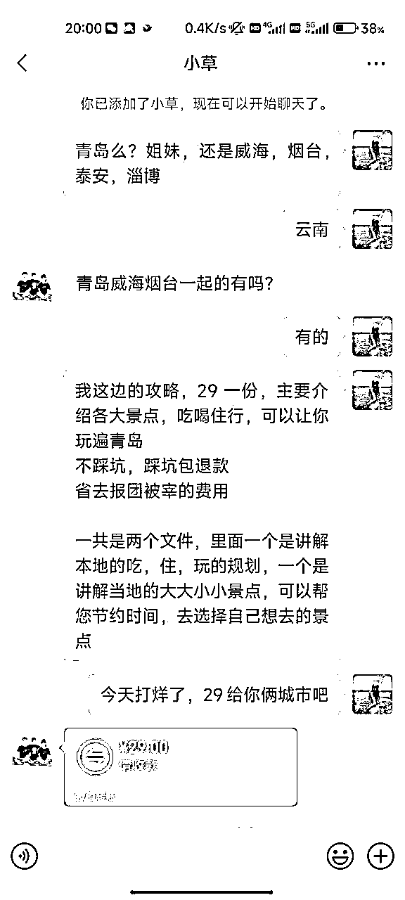
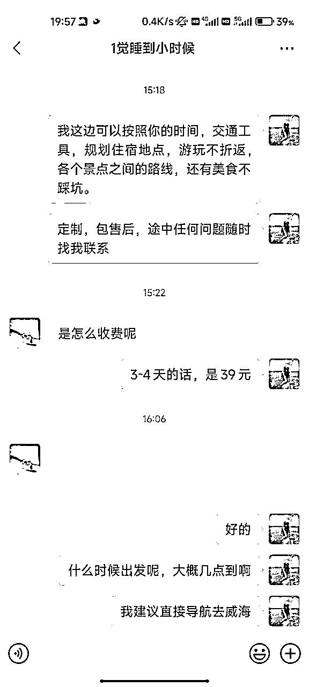

（图1是1.0版直接卖网盘成品；图2是2.0版靠AI生成定制攻略）

第一阶段：卖现成攻略，先把正反馈拿到手
最早我干的事特别简单：从网上七拼八凑些资料，或者在拼多多花9块9买一份全国旅游攻略的网盘链接，转手卖掉。这种通用攻略其实挺水的，被用户吐槽“电子垃圾”也不冤。但好处是价格低，买家决策成本低，所以正反馈来得特别快，能帮你撑过最开始那段没信心的日子。

顺带把那个网盘存的全国攻略合集链接放这，方便大家直接参考：
链接: https://pan.baidu.com/s/1ojx6drFnhGWg-vYOCZcqxA?pwd=wrbc
提取码: wrbc

第二阶段：用AI写定制攻略，客单价直接抬起来
后来文案我全交给AI（豆包）来写，自己再补几张住宿截图，成本几乎可以忽略不计，卖多少钱全凭自己定。

我去拼多多上摸过行情：定制攻略按天收费，一天20块。那我卖39、49，性价比一下就凸显出来了。和卖网盘成品比，这版本客单价更高，客户黏性也更好，回头客复购特别明显。

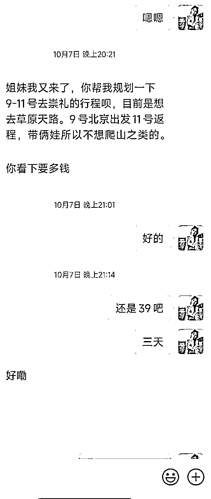

第三阶段：做二转、三转，靠资源吃差价
客人到了目的地以后，可以顺势对接一些高端酒店代订服务，一晚上能赚200到300块的差价；或者给他们安排点当地特色项目，比如青岛的海钓，一单能抽200到400的代理佣金。这里头的利润可比单纯卖攻略香多了。

以海钓为例，我这边拿货价给船长600，用户那边收800。有人可能会担心：游客上船之后跟别人一聊，发现自己“被宰了”怎么办？其实这个顾虑基本多余——船长自己巴不得有人帮他代理卖票，真被问到，他会主动帮你找话头圆过去。

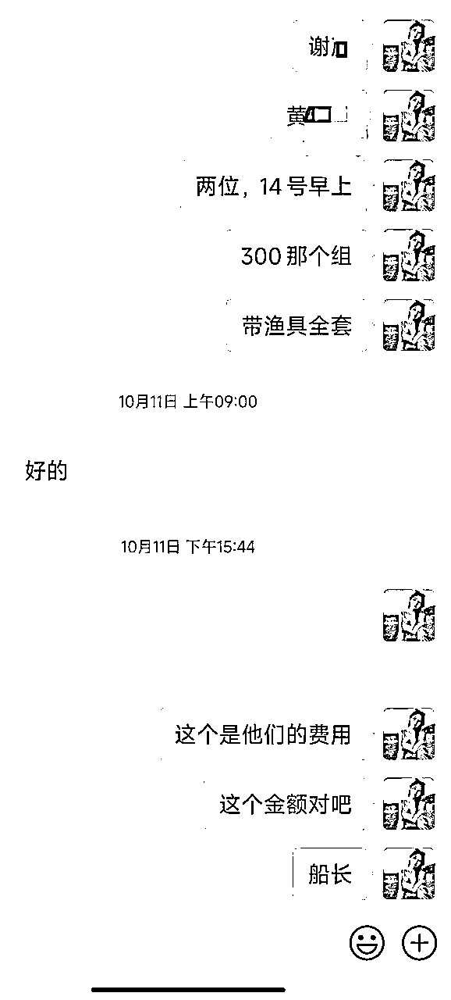
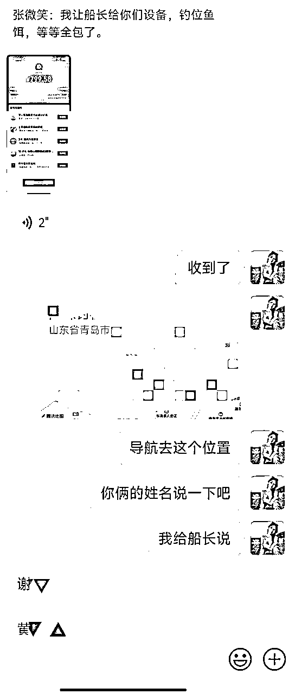

第四阶段：顺着人群做延展
买旅游攻略的粉丝大多挺年轻，那跟这拨人同类的需求就都能接——比如职场PPT代写、论文代写这些，我也顺手做起来了。

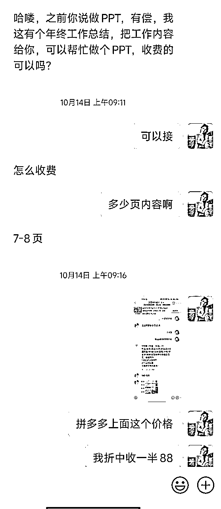
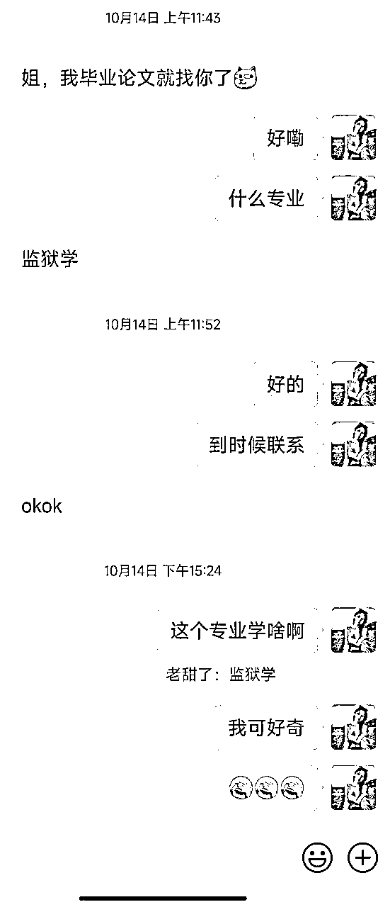

一、账号搭建
说白了就是：你打算发哪个城市的攻略，就专心做那个城市的内容。
素材去哪找？去抖音或者其他平台搜那个城市的美景图。最好选带人物的，显得更真实，有生活气。
注意两点：
1. 因为内容是发在📕，所以千万别从📕里面扒图，容易撞车。
2. 有水印的图记得去水印，复制链接到🛰️小程序里搜“轻抖”就能搞定。

文案参考逻辑：
大意就是——我跟团没？没跟团。自己去那个城市玩了一圈，自己做攻略也玩得很开心。
然后列“去玩了……”“去吃了……”就完事了。

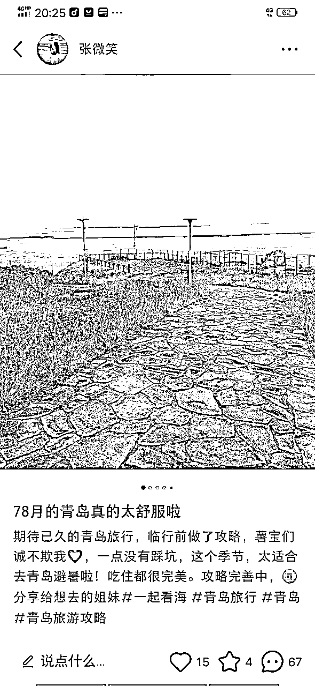

二、截流步骤
1. 锁定一两个热门旅游城市，直接去📕搜。拿青岛举例，可以搜“青岛旅游攻略”“青岛三日游”“青岛自驾游”这些关键词。
2. 挑作品有四个硬标准：
第一，点赞量至少1000以上，越高越好；
第二，发布时间越近越吃香；
第三，评论区要“热乎”，最好能翻到最近一天的留言；
第四，躲开那些作者本人回复特别勤快的帖子——那种地方截不到流量。

截流话术模板，直接套：
案例1：之前在威海上了四年大学，对各个景点都门儿清，需要威海旅游攻略的宝子可以滴滴，我自己做了一份攻略。
案例2：之前在青岛待了七八年，景点都熟得很，前段时间刚整理好一份攻略。
案例3：上个月全家去了一趟青岛，临行前自己做的攻略全用上了，想要的宝子可以滴我。
案例4：前几天一家三口去了青岛，我老公花了两天时间整理攻略，真的超详细，一点坑没踩。
案例5：以前没去过青岛，出发前找了个本地人，花点小钱帮我做了一份攻略，真的又赞又详细，需要的宝子可以滴。

咱们来把注意链条理一理：
1. 评论区千万别出现“私信”“私聊”“加v”这种字眼，一旦有人回复你的评论，可以说“厚台思我”“宝子思我”这类暗语，总之不能太直白。
2. 有人来后台私信你，也别一上来就说加🛰️、提“v”。那怎么把人引到私域？直接甩一张图片或视频过去。常用的引流图片视频要轮着换，别老发同一条。发完之后一定要补一句：“看到我发的图片了吗？”
为什么要多问这句？因为平台会吞消息——你这边看着发成功了，客户那边其实啥也没收到。

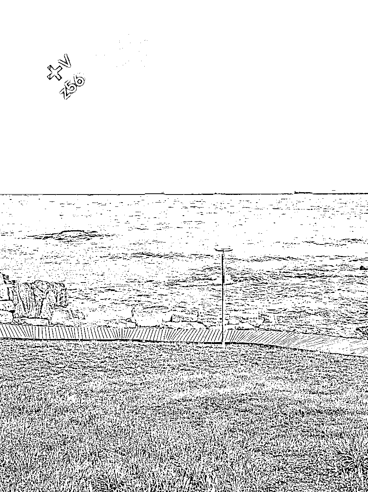

我现在的引流方式更省事：直接让客户发他的🛰️号，我主动加过去。
要是客户迟迟没发，有两种可能：
第一种：人家反感加🛰️，干脆不理你了。还有种情况是客户在📕上问“收费吗”——记住，绝对不要在平台上谈钱谈价，容易封号。
第二种：对方发了，但被系统吞了，你这边压根没收到。遇上这种情况，过5个小时再追一句：“宝子发了吗？我这边没收到，我不是旅行社。”

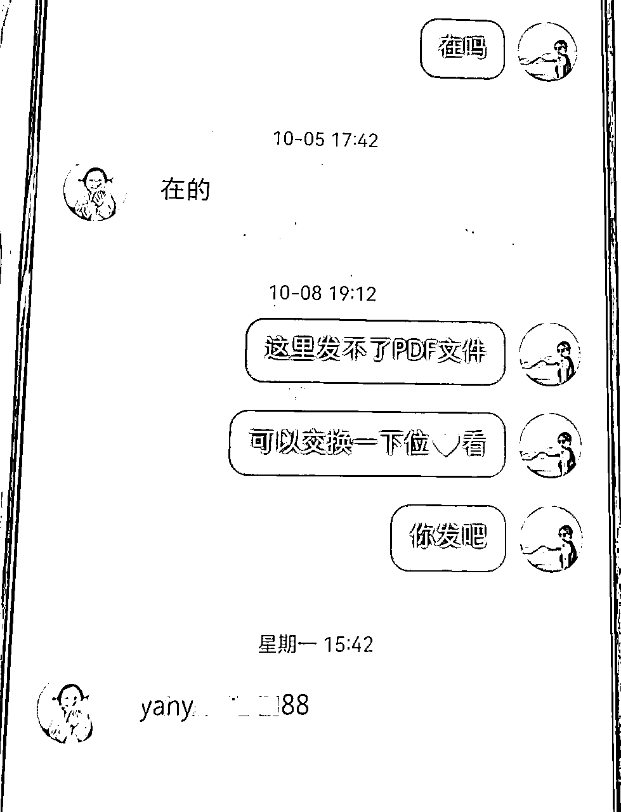

关于引流玩法，赚钱里面一搜一大把，足够你学了。
有人可能会问：开蓝V是不是就能随便发🛰️了？能是能，但蓝V要600块，还得注册个体工商户，再算上聚光投放1000多的费用，我自己试过，真没必要。

三、🛰️私域成交
到后期，成交概率大概能稳定在15%，但聊天这件事特别耗精力——这也是我后来没有继续铺开量的原因。
我习惯每成交一单就马上在朋友圈同步晒出来，所以新加过来的客户，看完朋友圈基本就明白，这东西不能白嫖。

聊天这块没什么灵丹妙药：多聊、多迭代。我自己到现在都还在调整话术。记住，别加上好友就甩广告。
刚开始可以先摸三个底：
去哪个城市旅游（因为我不止在一个城市下面埋钩子）；
大概什么时候出发（要是近期就走就正常聊，要是几个月以后，就当日常闲聊）；
有没有特别想玩的项目或想吃的店（这时候可以去📕搜点对应内容，再跟他聊，信任感一下就立起来了）。

下面分享三个从加好友到转账的完整聊天案例：

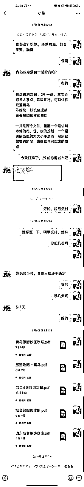
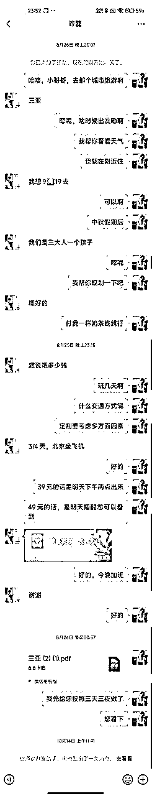

聊天里需要用到的案例模板，上淘宝、拼多多找同行的展示案例借鉴就行。

四、高频问题整理

问：AI攻略具体怎么生成？
我自己用的是豆包，AI这块不算什么高手，但提示词思路可以分享：身份+背景+目标+限制，按这四个维度去喂它，输出质量会稳很多。

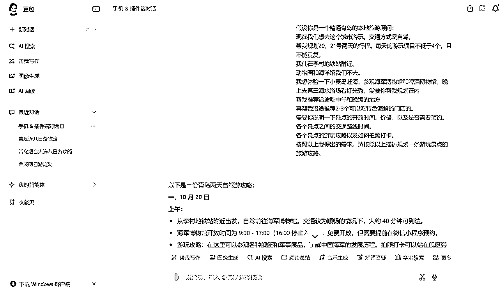

问：本地项目商家去哪对接？
直接在📕搜“城市名+相关项目”，比如“青岛海钓”，留下你的联系方式，对方看到会主动来联系你。

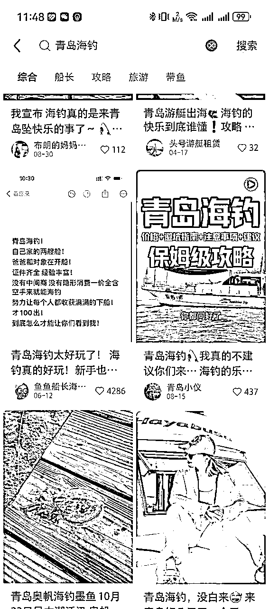

问：怎么判断哪个城市是旺季？
两个笨办法，但很有用。
一是直接打开旅游App看首页推荐，比如去哪儿上面推荐的城市就能做，像北京这种基本一年四季热度拉满。
二是去📕搜“全国各城市适合旅游的月份”，会跳出一张表格给你参考。

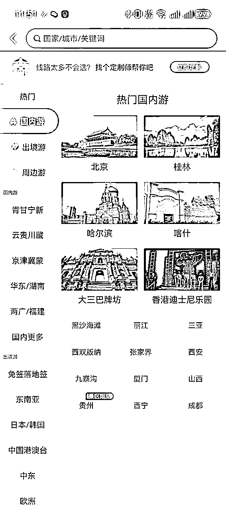
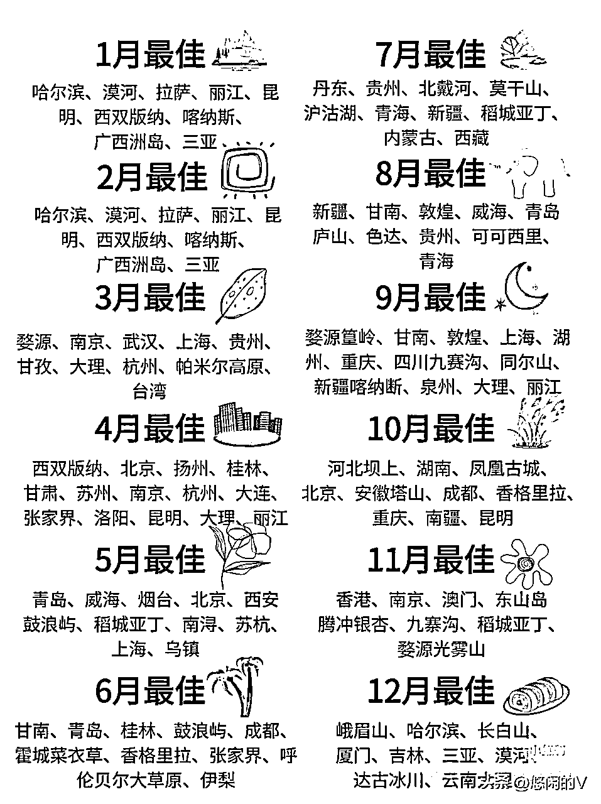

问：每天要发多少条截流评论？
我大概是20条左右，话术要轮换着来，不同时间段发一下就行。
而且这玩意儿有复利——我八月份埋的钩子，到现在十月了还在不断给我进人。越往后越舒服，有时候私信都回不过来。

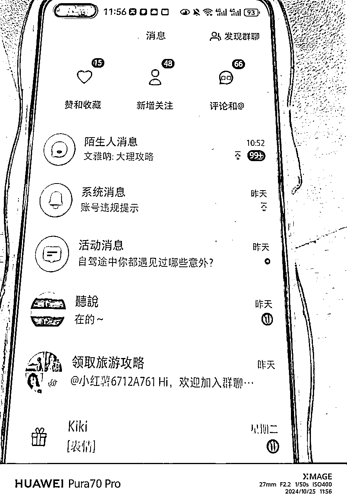

问：住宿怎么给用户推？
我基本用美团。流程就几步：
1. 先问客户每晚住宿预算；
2. 顺嘴提一句“我这边也能帮忙代订五星级酒店”。

酒店代订的话，需要问清楚酒店名字、入住时间、房型。赚钱里面有不少圈友在专门做这个业务，你在搜索框输入“酒店代订”，能翻到他们写的文章，然后通过鱼丸去对接就行。
注意：前期别急着给钱，可以先谈做他的分销，等后面单量起来了再规划下一步。前期让那些帮你对接资源的圈友赚一点，我觉得完全合理。

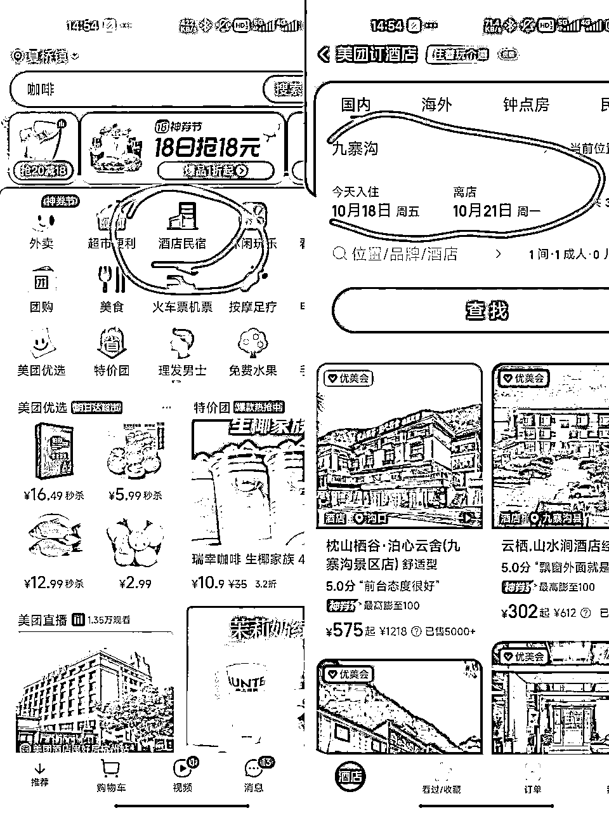

普通酒店推荐（注意，这里不是代订）：
美团上选好入住城市和时间，位置尽量选热门景点附近的，评分看4.7到5.0之间、参与评价人数多的，然后复制酒店链接发给客户。

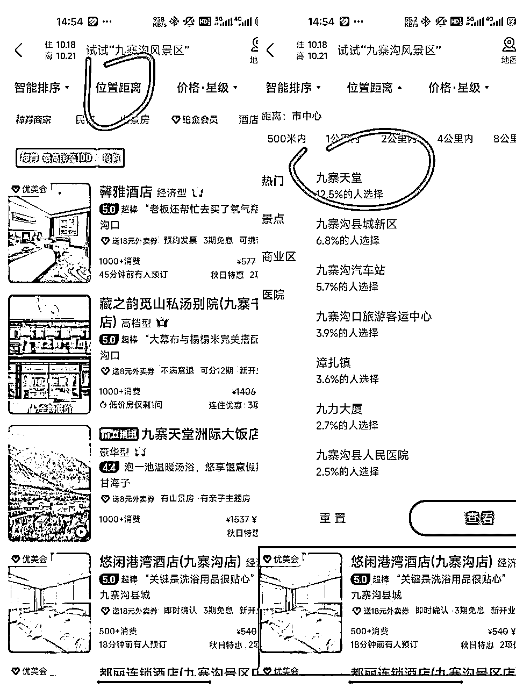

做了这么久，我发现一个特有意思的心理：客户自己刷一个小时酒店，眼睛都看花了，愣是定不下来；你花一分钟随手丢个链接过去，她反而很容易接受。
说到底，人总觉得“别人找的比自己找的靠谱”——更何况，你在他眼里还是个“定制旅游专家”。

最后说句实在话：我写这篇复盘，不是想证明自己有多厉害。恰恰相反，我想让更多跟我一样从小白起步的人看到——一个微不足道的“面包屑”，也有机会滚成雪球。关键不是起点多高，而是你愿不愿意弯下腰，把它捡起来，然后一步步往前走。