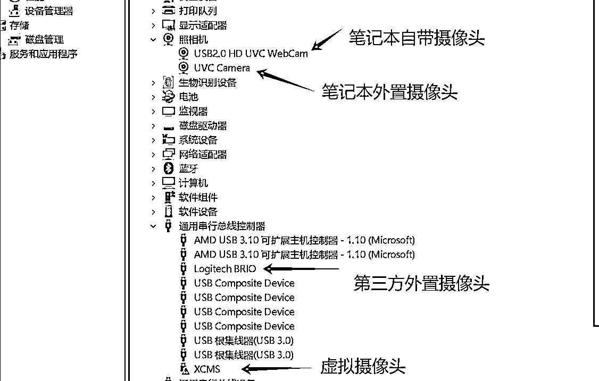
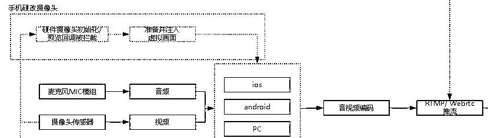
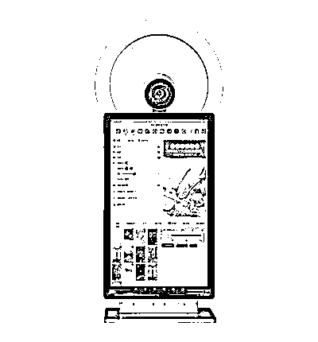
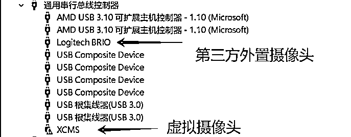
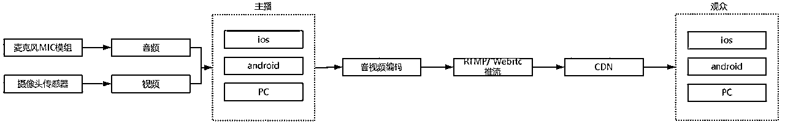

# 无人直播攻防实战：平台在查什么，玩家在躲什么，一篇讲透

你刷到的某个“人气直播间”，镜头前可能根本没有真人。画面是提前录的，声音是自动放的，你发出去的弹幕，收到的回复也未必是临时打字回你的。这行有个专门的名字：无人直播。这几年，平台和玩家之间的攻防战从没停过，有人靠它吃到红利，有人交了几万学费才搞明白规则。

这篇文章来自杨永，一个在外贸和跨境电商圈泡了十几年的老运营。最近几年他把B端业务全部收掉，转而All in C端，主战场是TikTok加独立站，其中直播矩阵就是重要的获客手段。他把自己踩过的坑整理了一遍，首发在知识星球，今天分享给大家。观点不一定全对，但确实是用钱和账号换来的经验。

## 直播是怎么跑通的？

别急着学套路，先看底层链路。

一场直播，说白了就是三件事：采集、上传、分发。主播这边的摄像头把画面变成数字信号，麦克风把声音变成数字信号；随后这些信号经由App、电脑客户端、网页端或者某个RTMP地址，被送进平台的服务器；再通过CDN同步转到所有观众的手机上。整个过程是实时的，观众看到的内容，和主播正在做的动作几乎同时发生。

下方这张简化链路图，可以帮你建立整体感觉：

链路理顺之后就会发现，主播端值得操心的其实只有六件事：
- 画面内容是什么；
- 声音内容是什么；
- 用什么设备采集；
- 走什么网络和IP；
- 从哪条通道上传；
- 如何应对弹幕互动。

后面的所有攻防，都是围绕这六个点展开的。

## 平台这一侧：它到底在摸排什么？

平台对直播间的态度，有点像物业对租户的态度——正常经营什么都可以，一旦发现你在“野蛮装修”，就会上门查。而平台判断一个直播间该不该给流量，核心是一套综合评分模型。评分差的、内容没有营养的、让用户留不住的，都会被划进“低质”区间；如果还被贴上“无人”标签，那就基本告别推荐了。

### 1. 声音经常先于画面翻车

很多玩家以为平台先看画面，其实音频常常才是第一批“重点审查对象”。平台可以做三件事：比对主播声纹、查重音频台词、在限定时间内保存音频文件。其中台词文本是最容易存储、也最容易做相似度匹配的，所以“重复使用别人的音频脚本”和“同一段话反复播”这两种操作，属于最容易中招的类型。这也顺带解释了一个怪现象：有些直播间确实是真人，但因为无意间用了热门脚本，照样被判重甚至被误伤成无人直播。

### 2. 画面也会被抽检

静止画面、永远在转的转盘、循环往复的机械镜头，这些画面特征极易被抽帧比对或二进制比对命中。多人共用同一张脸开播，更是高危行为。人脸识别的力度各平台不一样：有的只关注名人和大主播的脸，有的则对所有面孔一视同仁。正因如此，正规的数字人服务商通常都会硬性要求客户别长期使用同一张公共数字人面孔，本质上是替客户提前规避风控。

### 3. 平台封控是动态变化的

平台的监管力度不是一成不变的，它取决于服务器成本、研发投入、开发周期与实际回报。早年很多平台对人脸比对、OBS推流并不在意，于是靠一台电脑挂几十个录播直播间的玩法极为猖獗，有声书、商业管理类账号里头出过好几个著名的暴富样本。当平台意识到这些内容拉低了整体生态质量，漏洞被堵上只是时间问题。同样一套玩法，早几年是风口，现在就是刀口。

### 4. 对采集设备的真实性要求变高了

正常情况下，画面由摄像头硬件采集，声音由麦克风硬件采集，再通过协议交给平台客户端。平台因此会核对底层硬件信息，包括摄像头型号、声卡信息、驱动特征等。如果你拿着一个“虚拟出来的摄像头”去推流，平台在USB描述符、驱动协议、硬件ID等层面很容易察觉端倪。PC端常见的模拟USB摄像头端口、在非摄像头硬件上套用USB Camera协议之类，现在都不太行了。还有一种更隐蔽的异常：平台会记录承载账号的硬件固件码，如果某个ID频繁更换固件码对应的设备，这个行为本身就会被标成可疑。

看下面这张对比图，物理USB端口和虚拟USB端口在系统眼里都能被抽象成COM口，但在设备描述符、主板芯片、驱动信息、硬件ID这些细枝末节上，差异非常明显：

### 5. 网络IP是“连坐”重灾区

一个人拿着手机移动，网络IP当然会变。所以一个ID在多个IP下登录，并不奇怪；平台判断异常的标准，往往是“这个ID是否和已知异常ID出现在同一网络环境”。换句话说，哪怕你账号本身干干净净，只要跟一堆被标记过的号共用同一个IP段，也会被连带降低信任分。

### 6. 推流通道必须“名正言顺”

常规直播的推流路径是：APP/PC客户端/网页端 → 通过RTMP或WebRTC → 平台服务器。这条路径是平台可控的，前端后端都有日志，每条流的来源去向都清清楚楚。而那些绕过所有前端、直接用推流地址怼服务器的动作，就相当于绕开了大门走侧门。平台对侧门的态度，普遍是“先放任、再微管、最后严管”。

### 7. 互动质量和用户举报也会进评分

这里说的互动，指的不是非得有真人实时说话，而是直播间内产生的活跃和停留质量。另外用户举报也是评分因素之一。各平台在不同发展阶段的举报权重差异很大，比如视频号现在对换脸直播的举报，几乎是有举必封。这也能解释另一个常见困惑：为什么你举报某些直播间没有效果，而别人举报某个理由却一击即中——不同理由对应的权重不同。

## 主播这一侧：怎么在“无人”的前提下跟平台周旋

如果打定主意不想让真人出镜，那面对上面的考核维度，你要做的功课就清晰了：内容怎么来、设备怎么搞、声音怎么进去、互动怎么不露怯。

### 1. 内容生产：无人画面和无人声音的排列组合

画面这一块，大致有四种来源：
- 让真实场景自己“跑”起来，比如转盘转动、机械运转，画面基本静止，靠声音把场子撑住；
- 让虚拟场景自动运行，比如用脚本挂机打游戏、跑一个互动小游戏；
- 用提前录制好的视频做直播源，既可以是自己拍的真实内容，也可以是二创或混剪来的素材；
- 用AI实时产出画面，比如数字人形象。

音频方面，要么用预制好的音频，要么用AI实时生成的互动式音频。

把画面和声音一交叉，还能做出半无人组合：真人画面配无人语音，或无人画面配真人语音。

不过得说一句立场正确的话：无人直播存在的意义，应该是把优质内容的价值放大、把优秀主播的产能拉长，而不是为了“偷”别人的内容。视频切片授权的逻辑也一样——让好内容产生更多回报，而不是换一种方式搬运。

### 2. 设备采集：底层改造的三种段位

在App端，想绕开摄像头和麦克风，就必须从硬件或驱动层面动手。市面常见的Xposed框架加Hook摄像头方案，也就是大家口中的“软改”或“硬改”，只能针对某些特定机型、特定安卓版本开发，而且很容易被平台定点爆破，一波团灭。软改现在已经基本失效了。

在PC端，虚拟摄像头、改设备名称为硬件厂商名这类操作，同样经不起深查。平台稍微认真一点，马上就会现形。

真正相对“合规”的路线，是在严格遵循平台采集规则的前提下，在PC端的真实采集硬件里面做二次开发。比如市面上出现的模拟USB Camera黑盒，或者在原装摄像头内部做芯片级改造，平台从外部看到的还是正常硬件，但内容已经可以换成你要的东西。

还有一点容易被忽视：画面和声音在物理世界是分开采集的，摄像头管画面，麦克风管声音，两者在驱动上也是独立通道。所以一个正常的直播信号里，画面和声音严格分离才是常态。如果你在上传源里把音画过度绑定在一起，反而会暴露“非正常采集”的迹象。

### 3. 推流：要么走正门，要么另辟蹊径

平台前后端通常通过RTMP协议交互。无人直播的选择只剩下两条：走官方前端，或者不走官方前端。

不走官方前端的典型形态有两种：第一种是手机端第三方软件，通过劫持推流密钥，或者以白名单身份获取推流码，然后用自家App直接推；第二种是PC端的OBS，以及各类OBS套完壳的“商业软件”。

但这里有一个悖论：越是对推流码管控严格的平台，越不可能让普通账号拿到推流资格。真正拿到白名单推流码的账号，通常也不会拿来做无人直播。所以，有没有推流码，基本就决定了你在这条路上能走多远。

### 4. 无人直播怎么“假互动”

既然没有人，互动只能靠设计。目前常见的套路分三个段位：

第一档是预埋。在制作视频时就把互动可能提的问题想好，把回复做成台词放在片子里，让观众感觉“有人在理我”，其实只是巧合的对号入座。

第二档是关键词触发。提前预设一组关键词和对应的回复文本，直播过程中实时抓取弹幕，匹配到关键词就自动回复文字。这类工具已经很成熟，市面上一抓一大把。

第三档是数字人实时对话。流程大致是：抓弹幕→大模型生成回答→TTS语音合成→把语音插入数字人播报序列→驱动数字人口型播放。整个过程全自动，能制造出“真人实时回复”的错觉。头部数字人平台基本都具备这套能力。另外还有一种更轻量的方案：手机实景+语音播报，没有数字人口型驱动，成本更低，目前已经成了本地生活赛道的一门“显学”。

## 市面上的无人直播玩法：逐个拆解

如果按推流设备和实现原理来分，目前市面上跑得动的流派大致有下面几种。不算穷举，但基本覆盖了主流玩家的技术路线。

### 流派一：手机对着4K大屏拍

这个玩法历史相当悠久。流程很简单：电脑屏幕上播放4K分辨率的视频，手机放那儿对着屏幕拍，音频通过连线直接进手机麦克风。

显示器的门槛一般是4K分辨率、144Hz刷新率起步，这样肉眼几乎看不到波纹杂纹。

这套方案的好处是老实本分，不碰任何采集链路，完全是顺着平台的规则走；坏处是设备成本并不便宜（两千起步），而且平台理论上能通过细微信噪识别出肉眼忽略的波纹。这个流派已经被轮番清洗过好几轮了。它的升级方向通常是：叠加环境音、去掉画面里不自然的贴片元素来提高真实度。

### 流派二：手机实景+AI语音（当红炸子鸡）

这是近两年最热门的流派，尤其适合同城商家、工厂实景、自搭场景。

核心只是一个叫做“音频回环线”的小东西。它的原理极其朴素：把有线耳机的左右两个声道和麦克风接到同一条线路上，手机在播放音频时，声音经由耳机声道传出来，又被麦克风重新收进去，于是平台App“看到”的是一个在持续收音的真实麦克风。

有了这根线，你甚至不需要任何额外软件。打开手机播放本地视频、网页音频，或者随便一个App里的声音，摄像头采着真实环境画面，直播间就成立了。

AI在这里扮演的角色，也只是把脚本生成的文本转成语音文件，然后在直播过程中播放而已。它并不实时，但这确实帮普通商家解决了“素材从哪来”的痛点。市面上那些“手机智播盒子”“AI手机直播”产品，本质上全是这套链路。至于关键词自动回复，也是调用平台开放的接口就能实现的功能，早就是成熟的工业流水线了。

把套路简化成公式：
- 实景+语音 = 手机正常直播 + 音频回环线 + 手机播放声音；
- 实景+AI语音 = 手机正常直播 + 音频回环线 + 播放AI生成的语音文件。

如果你自己会用AI生成文本再转成语音，那总成本就是一根回环线：动手能力强的五块钱以内自制，淘宝上买成品也就十块钱左右。手机不用刷机，不用装任何特殊软件。但市场上卖“AI直播方案”的一年收费普遍在6000以上，值不值，心里有数就行。

优点很多：便宜、门槛低、不折腾设备。缺点也很明确：必须有真实场景打底，转盘、图片这种假场景属于低质内容范畴，不建议碰；而且不少平台已经开始做随机人脸验证，真碰上这种风控，实景直播间很难在短时间内切到真人音画去应对。

顺便说一句：有商家喜欢宣称自己拿到了平台授权。怎么说呢，理论上平台不太可能鼓励这类大批量制造低质内容的玩法，听到类似话术多留个心眼吧。

### 流派三：手机硬改摄像头

这个流派也属于老资格玩家。经过无数轮清洗，至今存活下来的安卓机型和系统版本已经少得可怜。

它的实现思路是：利用部分安卓固件预留的摄像头驱动接口，在root环境下挂上Xposed框架，直接拦截摄像头的打开、关闭、拍照、录制指令，达到“把提前录制的内容伪装成实时采集”的效果。再配合一根音频回环线，画面和声音就能一起蒙混过关。

这套玩法的优势即劣势：开发深度绑定特定机型和特定系统版本，还得root。平台的应对方式更简单——锁定这些机型，直接定向爆破。历史上被点名过的“幸运儿”包括摩托罗拉的Z2、G5，小米的6、9、Note8、12、12Pro，以及K30、K30 Pro等等。每次封杀之后，玩家就得换一批新的“神机”，也算是一段很有意思的军备竞赛史。

优点是一次投入、长期复用，手机端直播的带宽压力也不大。缺点是一旦被封号，机器只能回归普通手机的本职。我这边囤过的“退役款”都够开一个小型博物馆了，做无人直播不够格，发发短视频倒是还能用。

### 流派四：手机OBS

不是真正的OBS，而是那些自称“手机版OBS”的App。它们能拼素材、能叠加画面、能提供素材库，有些还内置了互动功能。但也仅此而已了。参照一下PC端OBS无人直播的阵亡率，这类带虚拟性质的方案，除非内容质量极其拔尖，否则很难在平台生态里持续存活。具体产品不点名，懂的都懂。

### 流派五：直播一体机

本质就是把推流软件预装好的一台安卓大屏设备，和手机OBS没有原理上的区别。卖点全靠包装，实用性相当有限。买回去大概率吃灰，不是推荐项。

### 流派六：云手机——有想象空间，但要分路线

单独盘点云手机，是因为它的确存在“真机”级别的操作空间。

第一条路线是ARM服务器虚拟化+真机硬件编号。说白了，就是用ARM架构的服务器虚拟出一批“手机”，再购买大量真实设备的序列号和固件信息，配置到虚拟机上，让平台误以为它们是真实手机。但直播对硬件资源消耗极大，用ARM云手机来做直播并不划算，所以它如今的主要战场其实是短视频矩阵。

第二条路线是远程操控真机/主板机。把手机或主板机批量布置在目标地理位置、目标网络环境中，通过远程方式统一操控。这种模式很适合跨境直播和短视频矩阵，也便于规模化运营。但它的命运是“成也团灭、败也团灭”——一旦被平台盯上，往往是一锅端。

下方引用一张华为云ARM云手机的架构示意，方便理解这类方案的存在逻辑：

### 流派七：PC软件+推流码

各平台在推流码这件事上的态度差别很大。有些平台管得松，任你用什么工具往服务器推，OBS直接怼就行；而管理严格的平台，推流码都是定向发放，你想绕都绕不开。只要能拿到码，用什么软件推都不重要了。

OBS+直播伴侣的组合，在玩家群体里也很常见。但结论摆在前头：只要互动做得足够好、内容足够扎实，不管真人还是无人，OBS推流都没问题。问题恰恰在于，如果自身的内容质量不够，却寄希望于用OBS虚拟摄像头蒙混过关，那你就已经偏离了正常采集路径。平台会验证推上来的视频流是否来自真实硬件；来自软件合成的内容，会被安排更高比例的查重和人工审核，死得当然更快。

---

说到底，无人直播的技术难度并不算高，真正难的是持续生产平台认可的内容。和平台规则赛跑，永远有下一轮；但把精力放在打磨真正值得复用的内容上，才能在每次规则变化后依然留下来。希望这篇笔记，能帮你少踩几个坑。

很多人为了提升直播的真实度，除了OBS的音视频流之外，还会在直播伴侣里接入硬件设备产生的音视频信号。这么做确实能降低被平台限制的概率，但要知道，硬件流同样逃不过平台的审核。有些“聪明人”想了个办法：在OBS里播放视频，同时插一个真摄像头放在旁边不动——结果发现，这招压根没用。真正有效的是有真实场景参与，比如有个真人一直在说话，这就进入了我们接下来要聊的“半无人”模式。

### 3、OBS + 真人（半无人）

这种玩法之前在某社群开过训练营，大家可以翻翻记录。现在平台对真实摄像头内容的要求是越来越高了，比如某音就要求真人必须占画面50%以上。

### 4、OBS/直播伴侣 + 互动游戏

这种直播间的互动氛围通常很好，画面内容也不容易重复。如果平台没有额外规定，哪怕没有真人出镜，内容本身也比较饱满，被封控的概率并不高。不过像某音这样的平台已经明确说互动直播必须有真人露脸，那就必须老老实实从摄像头和麦克风输出真人音视频了。至于那些没硬性要求的平台，就随意多了。

## （四）PC直播伴侣

### 1、直播伴侣 + 虚拟端口

前面说过，平台检测硬件主要看USB端口。于是又有人动了心思：我虚拟一个摄像头和音频的USB端口出来，不就能骗过系统了吗？看起来好像很有道理。

比如下面这个XCMS就干这个事。

它的基本逻辑如下：

但现实很骨感——所有USB端口都自带硬件信息。平台要不要升级风控，就看它愿不愿意了。像某音、某信这些，早就已经把这条路堵死了。其他平台目前还没跟上，所以用OBS也还能走。

### 2、直播伴侣 + 硬改真实摄像头

我们先回顾一下直播的正统路径：

*   从真实硬件摄像头和麦克风端口获取视频和音频
*   再通过官方APP/软件推流到平台服务器

也就是这张图：

只要能保证这条路径不受干扰，那么只能在真实摄像头和麦克风上下功夫。之前我们在第三章1.2里聊过从麦克风语音入手的策略，现在来说说同时从摄像头和麦克风一起动手的办法。

方式一，在硬件层面模拟真实摄像头，连接电脑时提供真实的USB端口。

这招目前在很多平台都行得通。

缺点也很明显：和虚拟USB端口一样，端口自带硬件信息，只要平台不升级风控就没事。但很多平台已经开始要求跳人脸读文验证了，遇到这种情况，号基本就废了。

方式二，直接在真实摄像头的主板上做开发。所有硬件都是真实的，没有任何虚拟成分。

优点是：硬件全真，既能录播，也能真人直播，还能随时无人播、随时切换到摄像头真人播。这样就能在无人直播的过程中穿插真人环节，把封控风险降下来。另外，像视频号这种平台时不时会弹出真人验证，纯无人直播遇到就死号了；而硬改过后的摄像头可以一键切到采集模式，让真人介入过关。

缺点是：和所有无人直播一样，放的是视频，主播没法实时互动，所以互动只能靠预录脚本+模拟互动+关键词工具。真要人工介入，也可以通过插麦克风做助播喊麦。

下面是一个工控摄像头的示例：

### 3、直播伴侣 + 数字人（音画）

现在市面上的数字人直播，推流方式基本都类似OBS生成虚拟摄像头，或者直接用直播伴侣采集窗口。

数字人直播的原理图如下：

本节内容节选自《人人都能玩赚跨境电商》，数字人的细节就不展开说了。

优点：可以无人值守，而且能实时互动（虽然相比纯无人直播有点延迟，但响应速度已经非常快了）。

缺点：主要还是口播为主，要是想搞非口播内容，就得训练大量真实场景模型，成本非常高。另外，内容要求严格的平台（比如某音、视频号）是禁止纯无人数字人直播的。数字人直播的启动成本也比较高，对直播运营理解不深的团队不太友好。目前市场上主流的是低训练模型数字人，因为成本低，但效果很容易被用户一眼看穿，一旦被看穿，后面播什么都很尬。

## （五）WEB 数字人推流

拿某度电商和某手电商举例，它们都有数字人直播功能，目前是免费的——不过有条件：前者要交保证金开店，后者要每天用磁力金牛投流500元。它们是直接在平台WEB端推流的，感兴趣的朋友可以自己去研究。

主流平台对无人直播的管控力度，从严到松大致是这样（道听途说，仅供参考）：

*   某音、某信视频号、TT
*   某手、某书、FB
*   各大电商平台（某宝、某东、某宝、某团）、油管

# 最后总结

想在内容平台靠直播间长期赚公域的钱，上面说的这些其实都没多大用。因为内容才是核心，不好好做内容、搞运营，想靠投机取巧走捷径，注定做不长久，数字人直播也一样。如果非要做，那就得遵循平台的采流推流规则，在硬件摄像头上真正下功夫，才可能有机会。

当然，无人直播也不是没有价值。它的价值主要体现在：1. 做IP矩阵获利；2. 做私域引流，目标不是公域收益；3. 快速测试商业模式，短期内拿到正向反馈。

以上分享，与大家共勉。