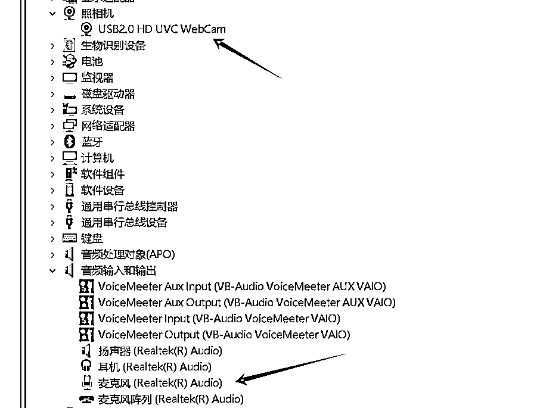
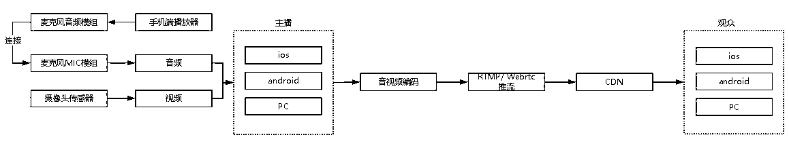
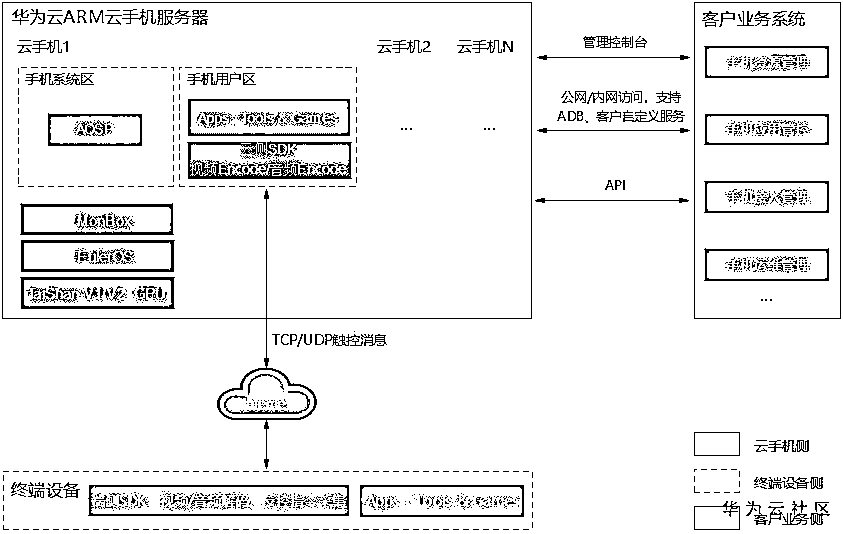
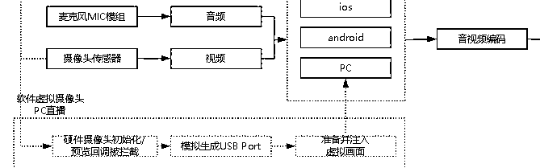
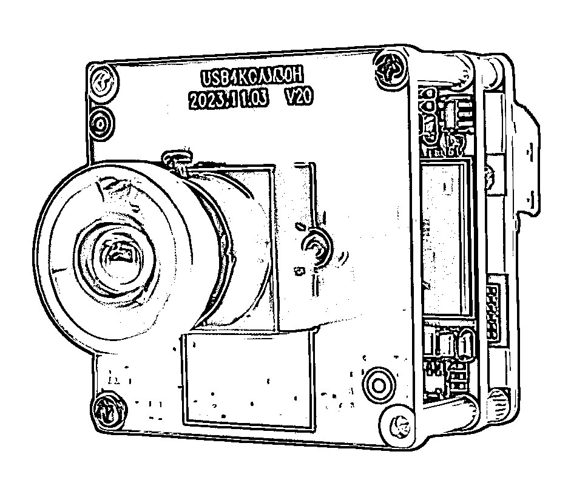
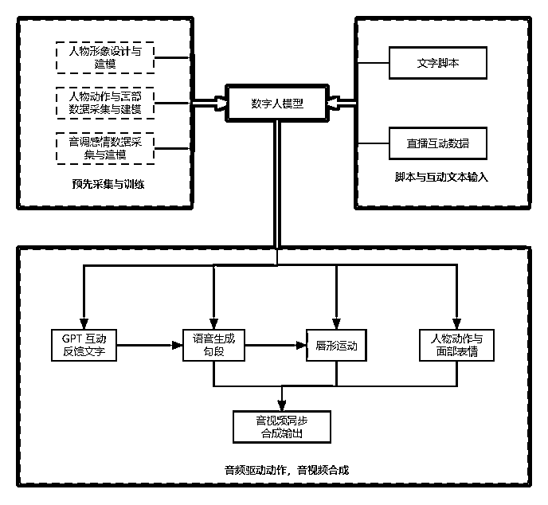

# 无人直播攻防拆解：这些坑，我替你踩过了

做了十几年外贸和跨境电商，最近四年全面转向C端，TikTok和独立站是主业，直播矩阵是重要获客渠道。一路下来，无人直播的坑踩了不少，今天把经验和教训整理出来，希望能帮你少交点学费。理解有偏差的地方，欢迎留言讨论。

## 一、先搞懂直播是怎么跑通的

想做好直播，尤其是无人直播，得先弄明白音视频是怎么从主播端跑到观众端的。

直播本质是一套实时音视频传输系统：主播用摄像头和麦克风采集画面与声音，然后通过APP、PC客户端或RTMP地址把数据传到服务器，服务器再通过CDN分发到观众设备上。整个过程几乎是同步的，观众在内容生成的同时就能看到、能互动。

我画了个简易流程图放在下面。

从主播端拆解，整个推流链路可以分成这么几块：

1. 内容——画面和声音
2. 硬件采集设备
3. 网络IP
4. 推流路径
5. 实时互动

后面所有攻防，都是围绕这几块展开的。

## 二、平台和主播，各自在打什么算盘

### 平台视角：什么会被盯上

平台考核直播间，从来不是看单一指标，而是综合打分。画面、音频、用户停留、互动、转化……这些都算进去。如果某个直播间被判定为“无人直播”，那肯定是低质直播间里比较严重的一种。

下面这几个维度，大概率是平台重点关注的：

**内容**

先说说音频。音频这块，平台可以检测主播声纹、比对音频脚本，甚至做限时存储。其中音频脚本是最容易比对、也最可能优先被审查的。也就是说，你用别人的直播脚本，或者自己反复重复同一段话，都特别危险。有些直播间明明是真人，却被判重或判定为无人直播，很可能就是栽在音频重复上。

画面上，平台可能会抽帧比对元素，静态画面、循环转盘这类重复内容会提高风险；多直播间共用同一张人脸更是高危操作。不同平台策略不一样——有的不管人脸，有的只认名人脸，有的所有脸都查。所以很多AI数字人平台会要求用户别一直用公用数字人形象直播，也是出于这个考虑。

另外要知道，平台的所有考核策略都不是铁板一块，它会综合服务器成本、开发周期、投入产出比来动态调整。早期人脸比对和OBS无人直播根本没人管，于是有人一口气开了几十个直播间同时放录播，某登、某强这些就是吃了那波红利起来的。

**内容采集方式**

正常直播，音视频来自硬件摄像头和麦克风，平台能拿到这些硬件的底层信息。但如果有人拿到了推流地址和密钥，就可以绕过官方客户端，直接用第三方软件把内容推到服务器。

每个平台对此的政策不一样：有的完全禁止，有的给部分账号开白，也有少数完全开放。这也是为什么市面上会有OBS、云导播，以及各种包装过的商业推流软件。

如果平台探测不到硬件信息，或者检测到虚拟硬件，而你的推流渠道又没开白，那直播间风险分就上去了。常见操作包括劫持直播伴侣里的RTMP地址和密钥，然后自行推流别的内容，这就是所谓的“硬改”推流手机。

PC端相对正统的做法是直播伴侣+摄像头，于是攻击点就集中在摄像头上：模拟USB摄像头端口让系统误以为接了真摄像头，或者用软件模拟USB Camera协议，或者在真实摄像头基础上做二次开发。

下面这张图是物理USB端口和虚拟USB端口的对比。从操作系统层面看，两者都被抽象成标准接口，但通过主板芯片、设备描述符、驱动信息、硬件ID、性能等细节，还是能区分出来的——这也是平台判断你用的到底是不是真实摄像头的切入点。

除了采集硬件，推流硬件本身也会被看。APP和PC客户端会读取硬件固件码，如果某个账号频繁更换承载硬件，这本身就是异常行为，不符合正常用户的使用习惯。

**网络IP**

网络IP不会永远固定，因为人要移动。所以一个ID出现在多个IP下是正常的。但如果你和某些被标记过的异常ID待在同一个网络里，那就比较倒霉了，很容易被连带盯上。

**推流路径**

正规路径是：APP、PC软件、Web端通过RTMP或WebRTC把流推到服务器。非正规路径只有一条——完全不经过平台前端，直接把内容怼到服务器端。平台当然能看到音视频流从哪来、到哪去，所以随着平台发展，对这类行为的管控一定会从宽松走向严格。

**实时互动**

互动更偏向内容质量考核，平台并不要求你必须真人实时互动。

**举报**

这个不展开多说。每个平台不同阶段的策略差异很大。比如现在视频号对换脸直播基本是“有举必封”。不同举报理由对直播间健康度的影响权重也不一样——这也解释了为什么有时候你举报一个直播间没反应，换了个理由就秒封。

### 主播视角：怎么和平台博弈

如果不想让真人出镜，那就要在内容、硬件、互动、IP、推流路径上跟平台斗智斗勇。

**内容生产**

无人参与的情况下，内容可以这么来：

画面：
- 真实场景里机器自动运转，比如静态画面、转盘、机械臂，配合音频一起编
- 虚拟场景自动运行，比如游戏脚本自动打怪、互动小游戏
- 预制视频：包括预先录好的真实内容、以前直播的二次剪辑、或者混剪来的素材
- AI实时生成画面：比如数字人形象

音频：
- 预制音频
- AI实时互动音频

组合上，可以全无人（无人画面+无人音频），也可以半无人（有人画面配无人音频，或者无人画面配真人音频）。

说到底，无人直播应该是对优质内容的高效复用，用来弥补真人主播没法长时间保持状态的短板，去放大单一IP的价值，而不是偷别人的东西。视频切片授权也是同一个逻辑。

**硬件采集**

前面说了，硬件是平台核查的重点。

手机端，摄像头传感器和音频模块是基本盘。除非直接替换硬件并做二次开发，否则很难绕过去。目前常见的xposed框架hook摄像头，也就是所谓的“软改”“硬改”手机，作用其实有限，只能针对特定手机型号和安卓版本开发，平台一锅端非常容易。

PC端也一样，hook摄像头、虚拟摄像头（比如OBS的虚拟摄像头）有一定效果，但突破不了平台审核，平台稍微认真一点就废了。有人说把虚拟摄像头名字改成硬件厂商名称就行——根本没意义。

真正“合规”的路径，是严格遵守平台的采集和推流规则，在PC端采集硬件上做文章，让平台感知不到异常。市面上那些模拟USB Camera的黑盒子、在真摄像头里做二次开发的，都是这个思路。

另外，音频和画面在正常情况下是分开采集的，驱动上也有明显区分。所以输入设备里摄像头和麦克风分开接，才是正常的配置。

**推流**

平台前后端一般通过RTMP走流。无人直播的切入点，无非是走平台前端，或者绕过前端。

绕过前端的常见形式：
- 手机端第三方软件，要么劫持、要么开白拿推流码，比如云导播、各种“手机版OBS”
- PC端OBS，以及各种OBS套壳软件，比如某象、数字人PC端

**实时互动**

没有真人，互动就只能靠“演”：

1. 预制视频里提前写好可能用到的回复，让观众感觉有回应，但不是实时的
2. 预设关键词，实时抓取弹幕，命中关键词就自动回复文字——这种工具已经烂大街了
3. 数字人方案：实时抓弹幕，大模型生成回答，再用数字人语音合成音频，插进播报队列，驱动口型，看起来就像真人实时互动。头部数字人平台基本都有这套能力。更便宜的做法是手机实景+语音播报，没有唇形驱动，本地生活直播里一堆厂商在做，质量参差不齐。

## 三、市面上的常见无人直播模式

按推流设备分类，现在市面上能见到的无人直播基本可以分为这么几类，当然不可能穷举，很多玩法都是下面这些的变种。

### 1. 手机 + 4K屏

很古老的方式：用4K分辨率的电脑屏幕放视频，手机直接拍屏幕，音频从电脑传给手机。屏幕至少4K 144Hz以上，肉眼看摩尔纹才不明显。

优点：简单、逻辑清晰、完全遵循平台的采集推流链路。  
缺点：成本不算低（两千起步），有些平台能识别肉眼不可见的细微摩尔纹，已经被封过好几轮了。也有衍生玩法，比如混入环境音、去掉贴片之类。

### 2. 手机 + 实景 + (AI脚本)语音

近两年特别火，主要用在本地生活、工厂、自搭场景。

玩法很简单：手机摄像头拍真实环境，声音来自手机播放的音频。通过一个“内录头”——原理就是把外置耳机的两个声道和麦克风接在一起，手机播放的声音从耳机声道出来，再被麦克风收回去，平台APP就误以为有一个真实的麦克风在拾音。

这种模式技术上极其简单，甚至不需要什么科技含量，插上内录头，播放本地或网页里的音频就行。画面又是实拍，简直是为实景场景量身定做，所以在本地生活领域特别受欢迎。

如果加上AI，只是用AI生成脚本，服务器转成语音，直播时播放这些语音文件而已。成本依然很低，但对商家来说解决了素材来源的大问题。

市面上那些“手机直播魔盒”“AI手机直播”，本质都是这套东西，最多加上关键词互动——平台开放接口，开发也不难，已经是非常成熟的业务模式。

总结一下：
- 手机+实景+语音 = 正常手机直播 + 内录头 + 播放音频
- 手机+实景+AI语音 = 正常手机直播 + 内录头 + 播放AI转出的语音

如果自己会用AI生成脚本，那核心成本就一个内录头，动手能力强的人五块钱搞定，淘宝大概十块。手机和软件完全不用改，所谓“AI直播手机”纯属噱头。不过市面上B类方案卖6000多一年，值不值自己算。

优势：便宜、简单。  
劣势：只能做有真实场景的直播，所以最适合本地生活。自己摆个转盘、放张图片，属于劣质内容，不太建议碰。另外很多平台已经上线人脸朗读验证，真遇到这种风控，实景直播很难临时切换成真人去应对。

顺带一提，有些商家宣称自己获得平台“开白授权”，这个我不太信。理论上平台不会允许这种大面积制造垃圾内容的形式存在。

### 3. 手机 + 硬改摄像头

这个玩法也挺久了。被抖音打了很多轮之后，现在存活的只有某米的某个版本。以安卓为例聊聊原理：

部分安卓固件保留了hook摄像头的驱动接口，root后用xposed框架可以拦截摄像头的打开、关闭、拍照、录制等操作，相当于在不改系统应用的情况下，对摄像头行为做深度定制。再配合内录头，画面和声音都能蒙混过关。

但这个玩法的优点也是缺点：必须针对特定型号和系统版本的安卓手机开发，而且要root。经过无数次封杀，现在最新能用的好像是红米12 Pro。平台封控很简单——针对特定型号定向爆破，常见特征是0推流和暂停直播。历史上被干掉的硬改手机很多：摩托罗拉Z2、G5，小米6/9/note8/12/12pro、K30、K30Pro等等，所以小米被称为“发烧友手机”不是没道理的。

软改就是不改驱动、不root，那种已经完全不行了，不提了。

优点：手机端直播要求低，视频和画面都是预录的，只需要一次性买手机投入。  
缺点：被封之后，手机就只能当普通手机用了。

我办公室还堆着好几台这样的机器，直播做不了，发视频倒没问题。

### 4. 手机OBS

市面上有一些自称“手机OBS”的软件，还提供不少素材和实时互动功能，确实能做到画面拼搭和互动，但能力也就到此为止。想想电脑端OBS无人直播为什么容易被封（下一节说），就能明白这种形式很难存活，除非内容特别优质。不举例了。

### 5. 直播一体机

本质就是一台能自己推流的大号安卓机，和手机+自推流软件没有任何区别，纯粹是噱头，除了多一个不太常用的硬件，没别的用，不推荐。

### 6. 云手机

云手机单独拿出来聊，是因为“远程真机”确实有操作空间。平台对地理位置、网络环境、实体硬件要求很高，但如果能在满足条件的地方部署大量真机或手机模块，再远程操控，就能实现批量操作和真实环境的完美结合，确实很理想。

目前主流是两种技术：一种是ARM服务器虚拟化+真机硬件编号，另一种是远程操控真机/主板机。下面借华为云ARM云手机的图来演示一下。

ARM虚拟化，就是用ARM服务器虚拟出手机，为了让平台认成真机，会买大量真实手机硬件编号配上去。这种模式在直播上并不划算——直播对硬件消耗太大，所以用得不多；但短视频矩阵里应用很广，因为比起真机，成本确实低。

远程真机的无人直播，和前面的硬改手机没有本质区别，区别在于手机真的在目标地点、目标IP下，而且可以批量操控。常见于跨境直播。缺点也一样，要么活一批，要么死一窝。短视频矩阵也很适合，这里不多说。

### 7. PC软件 + 推流码

各平台对推流码的控制力度差别很大。不管不问的平台，随便用，无人直播管理也松。严格的平台，推流码是定向发放的——能拿到推流码的都是白名单账号，而白名单账号一般不会去做无人直播。

所以，只要能顺利拿到推流码，用什么工具推根本不重要，不管OBS还是芯像这种套壳OBS，都一样。

### 8. OBS + 直播伴侣

先给结论：只要内容优质、互动强，不管真人还是无人，用OBS都没问题。

问题的关键在于：一切脱离正规采集推流路径的方式都会增加风控风险。OBS虚拟摄像头本身就是脱离正常路径的操作。

正常直播时，平台会检查有没有来自硬件摄像头和麦克风的音视频流，还会核验真实度。完全来自软件和虚拟端口的内容，会被提高查重和审核比例。换句话说，只是用OBS直播，查重率更高，死得更快。

## 最后说几句

无人直播本质上是在和平台赛跑。平台规则一直在变，今天能跑的玩法明天可能就封。想做得长久，要么内容足够优质，让平台舍不得动你；要么在硬件采集端做真正的“合规”二次开发，让平台无法感知异常。至于那些纯靠偷懒、盗播、恶意低质的内容，被封只是时间问题。

希望这篇能帮你在无人直播的路上少踩几个坑。有不同看法，欢迎留言交流。

做内容平台直播，很多人都在琢磨：怎么才能让直播间看起来“真”，又不用真人一直守着？尤其在被平台反复封控之后，各种“歪门邪道”开始冒头，但验证下来，大多数都是白费功夫。

先说一个常见误区。有人以为，只要在OBS里放视频，同时把一个真实摄像头摆在一旁做个摆设，就能骗过审核。实测告诉你：完全没用。平台要的是真实的音视频硬件流，不是摆样子。哪怕你接入的是硬件信号，平台照样按流程审核。真正有效的场景，是镜头前有个大活人一直在做真实表达，这就引出了“半无人”直播的概念。

**一、OBS + 真人（半无人）**

这种方式生财方面之前开过训练营，核心思路就是人在镜头前，但内容可以提前备好。现在平台对真实出镜的要求越来越高，比如抖音就要求真人出镜占比达到画面的50%。没有真人，就别想蒙混过关。

**二、OBS/直播伴侣 + 互动游戏**

这类直播间胜在互动性强，画面不会反复重样。如果平台没有强制要求，即便没有真人出镜，内容本身也足够丰富，封控率相对可控。但像抖音已经明确要求互动直播必须有真人，这时候就得老老实实从硬件摄像头和麦克风接入真实音视频流。至于没做强制要求的平台，操作空间就大不少。

**三、PC直播伴侣的几个“玩法”**

**1. 直播伴侣 + 虚拟端口**

既然平台检测硬件靠的是USB端口，有人就想到：虚拟一个摄像头和音频USB端口出来不就行了？表面上逻辑成立，原理也确实有对应的工具（如XCMS）可参考。

原理示意如下：

但问题在于：所有USB端口都自带硬件信息。平台到底要不要在这个层面升级风控，取决于平台自身。像某音、某某号这类平台，早就把这条路堵死了。其他平台目前还没完全跟上，用OBS直接推流基本上还能跑。

**2. 直播伴侣 + 硬改真实摄像头**

回顾一下直播的正统路径：

*   从真实硬件摄像头、真实麦克风端口获取音视频
*   通过平台APP/软件推流到服务器

也就是：

只要不脱离这条链路，就只能在硬件端动心思。麦克风端的策略前面提过，这里重点说摄像头和麦克风同时入手的方案。

第一种，在硬件层面模拟真实摄像头，并且给电脑提供真实USB端口。

这种做法在不少平台还奏效。缺点是：跟虚拟USB端口一样，硬件信息是藏不住的，只要平台风控一升级，立刻失效。而且很多平台已经开启“跳人脸读文验证”，触发就得死号。

第二种，直接在真实摄像头主板上做二次开发，所有硬件都是真材实料。

优点是：硬件真实，不但能录播，也能真人直播，还能无缝切到摄像头做真人出镜。核心价值在于：无人直播过程中可以间歇性插入真人互动，大大降低封控风险。拿视频号这类平台来说，不时会弹出真人验证要求，纯无人直播几乎是必死，而硬改后的摄像头可以实现一键切换采集模式，真人马上介入过审。

缺点也很明显：本质上播放的是视频，主播无法实时互动，只能靠预录脚本、模拟互动和关键词工具来撑场。想要真人在线喊麦，还需要额外接入麦克风作为助播。

工控摄像头示例如下：

**3. 直播伴侣 + 数字人（音画）**

市面上所有数字人直播，推流逻辑本质上都是“OBS生成虚拟摄像头”或者“直播伴侣采集窗口”这两条路。

数字人直播原理如下：

节选自图书《人人都能玩赚跨境电商》

数字人这里不展开细说。

优势：无人值守，互动响应及时（虽然有一点延迟，但比纯无人直播间体验好太多）。

劣势：以口播为主，非口播就需要大量真实场景模型训练，成本极高。内容要求高的平台直接禁止纯无人数字人，抖音和视频号都是如此。另外，数字人直播入门门槛不低，对直播运营认知较浅的团队来说，前期投入产出比很差。目前市面上大多数数字人走的都是低成本训练模型，画面容易被人一眼识破，用户一旦认出是数字人，后续再播什么都失去吸引力了。

**四、WEB 数字人推流**

以百度电商和快手电商为例，这两家目前都开放了数字人推流，前者交保证金成为平台商家即可使用，后者需要磁力金牛日投流500元。两者都通过平台WEB直接推流，有兴趣可以自己体验研究。

**主流平台对无人直播的管控程度，从严格到宽松大致是这样的（仅供参考，道听途说）：**

*   某音、某某号、TT
*   某手、某某书、FB
*   所有电商平台（某宝、某东、某某宝、某团）、油管

**最后总结几句**

如果你想在内容平台上靠直播间长期稳定获取公域流量，前面所有“玩法”都只是术，不是道。内容才是核心。不想好好做内容、做运营，一味走捷径和钻漏洞，注定做不长久，数字人直播也一样。真要尝试，就必须顺着平台的采流推流规则走，在真实硬件摄像头上做文章，至少还有一线机会。

但无人直播本身并不是一无是处，它的价值主要体现在三个方面：一是做IP矩阵，实现批量化获利；二是给私域引流，目的不在公域变现；三是用来测试商业模式，在短时间内拿到正向反馈。

以上，与各位共勉。