# 用 Automa 把海螺AI图生视频做成自动流水线

> 来源：[https://ktnwm6ohjn.feishu.cn/docx/YsbXd93s1ogCixxUVWFcVujPnBe](https://ktnwm6ohjn.feishu.cn/docx/YsbXd93s1ogCixxUVWFcVujPnBe)

大家好，我是土豆君，混迹代码圈的小程序员。

自从亦仁老大抛出AI视频的风向标之后，圈子里的人都在轮番上阵试工具，Runaway、Canva AI、海螺AI都在榜上。

我自己实操海螺AI时，最大的痛点就是出片太慢、要一直盯着点。于是花了几天把流程做成RPA自动化，下面这套思路你拿去也能复用到别的AI视频平台。

前提是已有海螺AI的会员，或有一批便宜的批量邮箱号来注册帐号，1个谷歌邮箱大约1-3元。国内版每天有免费额度，国际版前三天免费，用这套流就能做到持续批量生产。

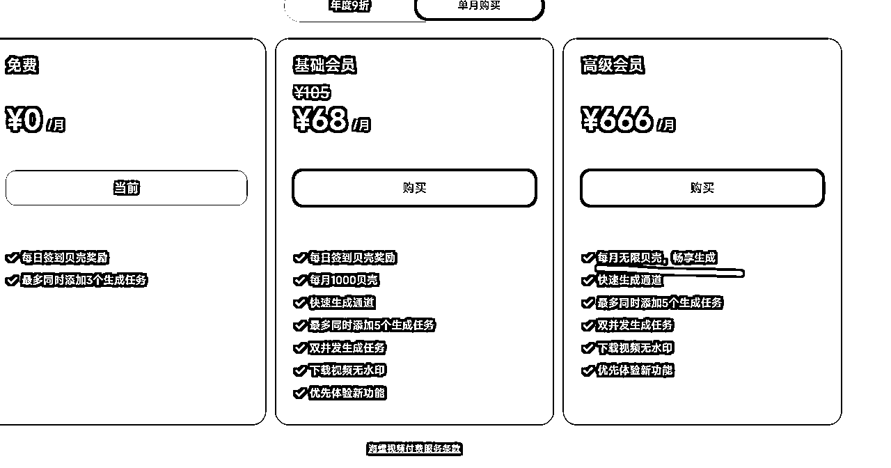

先说工具选型。RPA很多人第一反应是影刀，我一开始也一样。后来在研究比特浏览器多开指纹环境 https://www.bitbrowser.cn/ 的过程中，发现它自带了 Automa 开源扩展，才开始深入。

跟影刀相比，Automa的优势是插件形态，能装在任何浏览器里。配合指纹浏览器就能做到十几个窗口同时跑，影刀就做不到这种量级。比特浏览器已经内置了 Automa，工作流可以随意复制迁移，代价是上手门槛比影刀高一点。

官方地址：https://www.automa.site/
中文学习资料：https://automa.wiki ，建议结合B站教程一起看，单靠文档会比较吃力。

下面先说怎么用，以及我为什么这么设计。

## 流程总览

整个工作流的核心思路很简单：用一个固定提示词，批量读取指定文件夹里的图片，循环上传到海螺AI生成视频。如果用比特浏览器多开，每个窗口都是一条独立生产线，效率直接翻倍。

## 演示


Automa 页面截图：


点一下 ▶ 就开始执行，运行中会在扩展图标上显示一个 1️⃣ 的小角标。

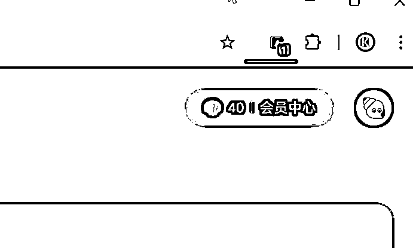

如果没看到 1️⃣ ，大概率是执行出错了，去日志里排查。查看日志入口：Tips - 查看日志


运行效果大概是这样：

## 成片展示

## 设计原理

了解原理可以更好定制，需要直接上手可以直接跳过。

在海螺官网实现自动图生视频，难点在于自动上传图片，按钮点击相对简单。

#### 图片预处理

上传需要图片路径清单。我用 Cursor 写了个小工具，把指定文件夹下的图片转成路径列表。

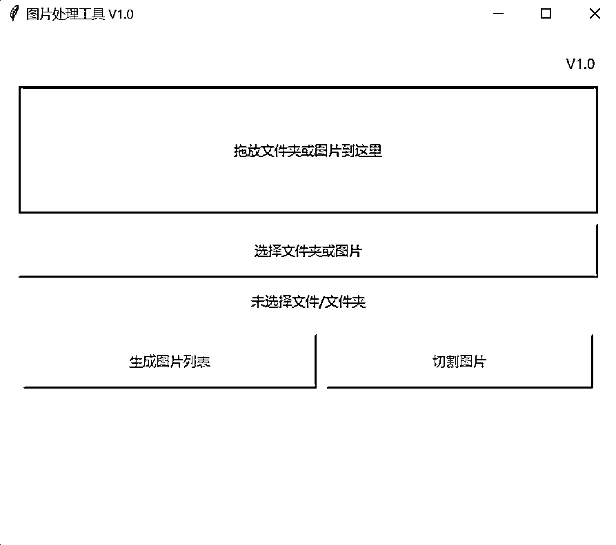

输出格式是这样的 JSON：


#### 执行逻辑

开头放触发器，然后通过切换标签页匹配目标网址。


接着是循环读取数据，用来遍历图片列表，跑完一张回到开头取下一张。


循环结束靠循环断点判断。

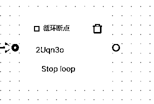

中间加了一段排队检测：判断当前页面是否有3个或5个视频在排队，如果满了就等3分钟再检查一次。


随后是写入提示词、上传图片。

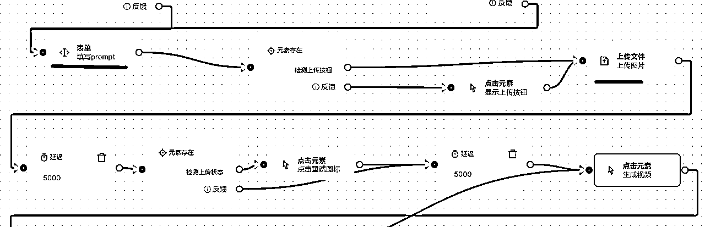

上传后会空等5秒确认是否成功，失败则重新点一次上传。


最后点击生成，并附带是否上传成功、是否进入生成状态的判断。


#### 基础操作说明

以提示词为例，表单元素负责填入内容，右侧的定位📍图标可以吸取页面元素，✔图标用来校验选择器是否有效。


选元素支持自动框选识别，可用 CSS 选择器或 Xpath。


在文本框里填入你要固定的提示词到对应位置。


## 使用步骤

#### 1 生成图片列表

文末有附件。解压后先运行：图片处理工具V1.0.exe

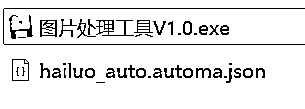

点“选择图片文件夹”或直接拖拽文件夹进去


也有网页版，操作更简便：

https://imgtool.tudoujunha.parts/


注意路径别放太深，否则容易上传失败。建议把文件夹放到根目录或桌面。

点生成后会在同目录下生成一个 image_list_时间.json ，生成完就可以关闭工具。


#### 2 安装 Automa

Chrome/Edge 用户可通过此链接安装

https://chromewebstore.google.com/detail/automa/infppggnoaenmfagbfknfkancpbljcca


打不开商店就用比特浏览器，在扩展中心直接添加。


需要中文界面在这里切换


#### 3 开启文件访问权限

Chrome/Edge 使用时记得给 Automa 开启文件访问权限，比特浏览器测试过默认已开。

把下面链接粘到地址栏打开设置：

```
chrome://extensions/?id=infppggnoaenmfagbfknfkancpbljcca
```

或者去扩展管理里找到 Automa：


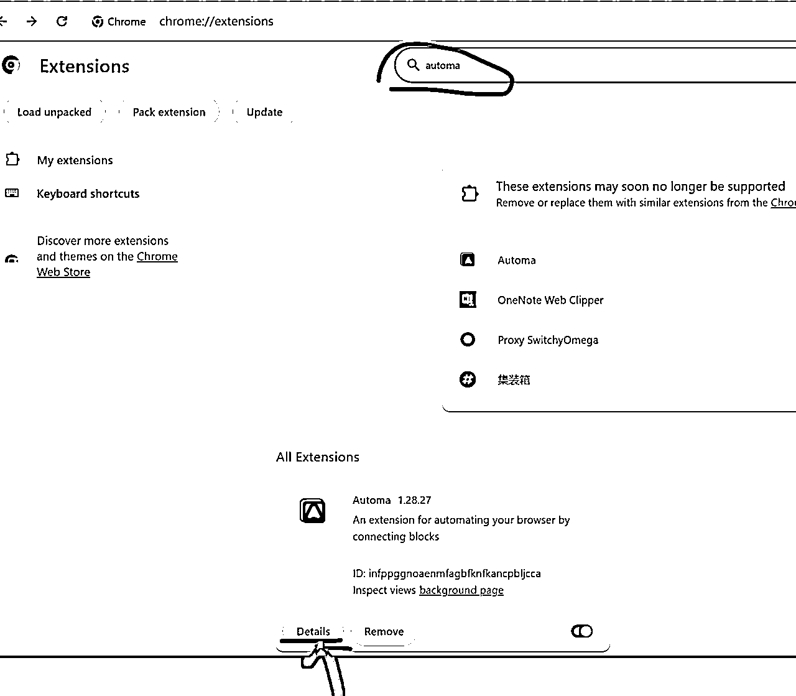

把“允许访问文件URLs”打开

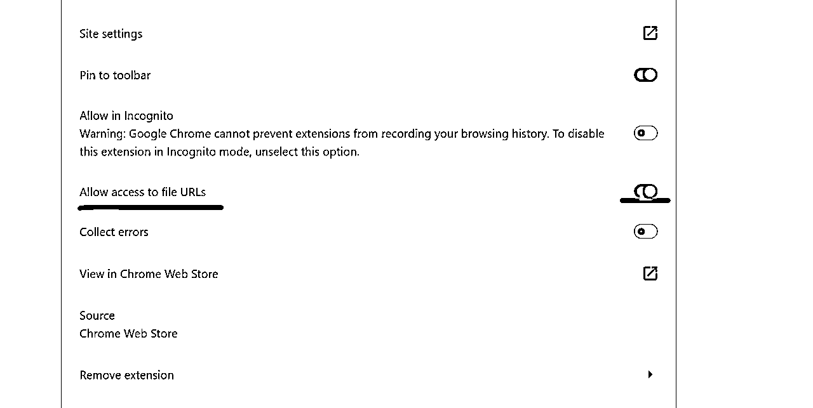

没开会提示：Automa 无权访问文件


#### 4 切换语言

进设置改语言为中文。


#### 5 导入工作流

打开后导入 RPA 文件：hailuo_auto.automa.json

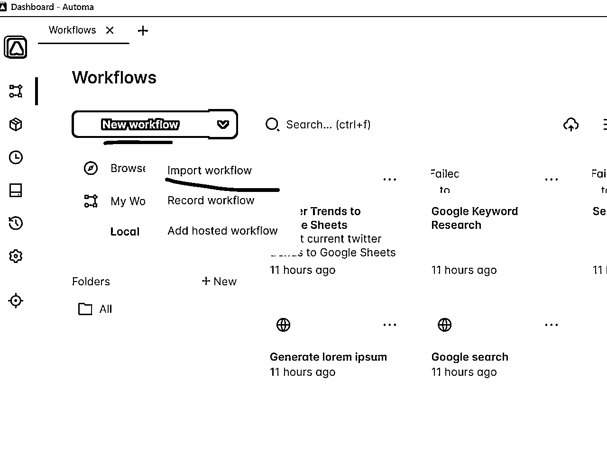

默认是海螺国际版，国内版用户看下面的 Tips 切换。

#### 6 设置提示词

双击 Forms 卡片填入固定提示词。


最新版里填的是 {{variables.prompt_text}}，如果你只用一个提示词，直接删掉变量填自己的词就行。变量的作用是支持多提示词，看 Tips - 使用多个提示词。

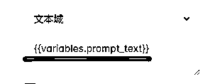

不需要提示词就清空内容或关闭开关，运行时会跳过。


#### 7 导入图片列表

导入后点工作流卡片打开，找到 Loop data 图片列表，双击或点右上角✏：

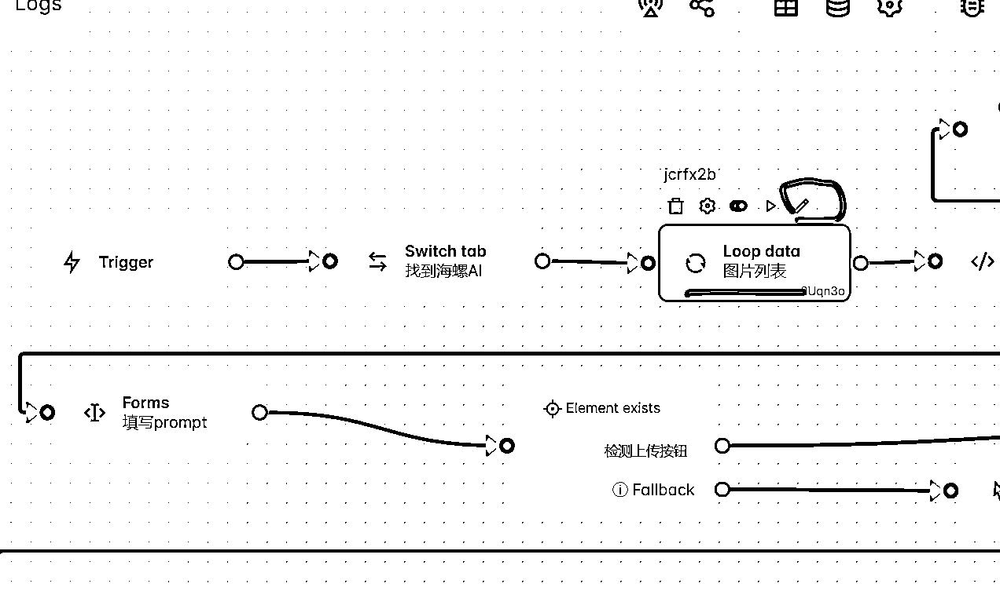

左侧显示 Loop Data 详情，点击 Insert data：


点 Import file 选择 image_list.json：


导入成功后点右上角❎关闭


最后一定要点 Save 保存才生效

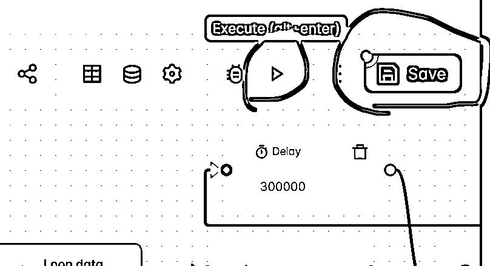

打开 https://hailuoai.com/video 点 ▶ 测试一下。

注意：
1. 运行期间不要操作当前浏览器，可以最小化但不能切标签或开新页，否则会报错。可新建 Chrome 用户或用指纹浏览器多开隔离。
2. 演示基于国内版，国际版基本流程一致，网址需要改一下见 Tips - 切换国际版。

### Tips

#### 多窗口并发

在比特浏览器流程设计里可配置 RPA 任务，会自动打开浏览器和 Automa。

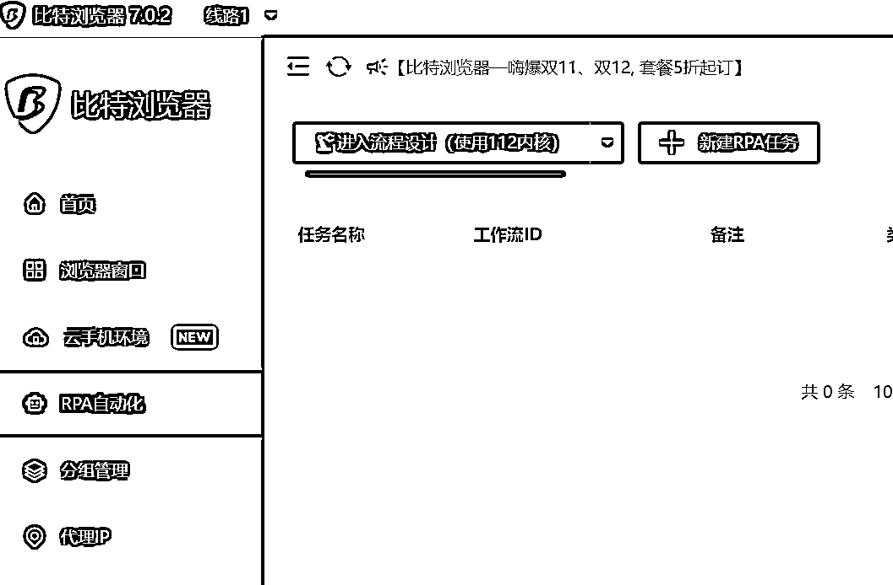

复制 Automa 工作流的 ID

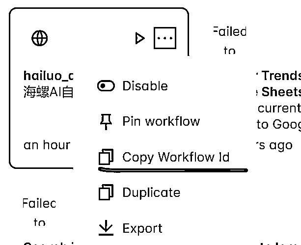

在 RPA 自动化页面新建任务填入 ID，就能多窗口同时跑。


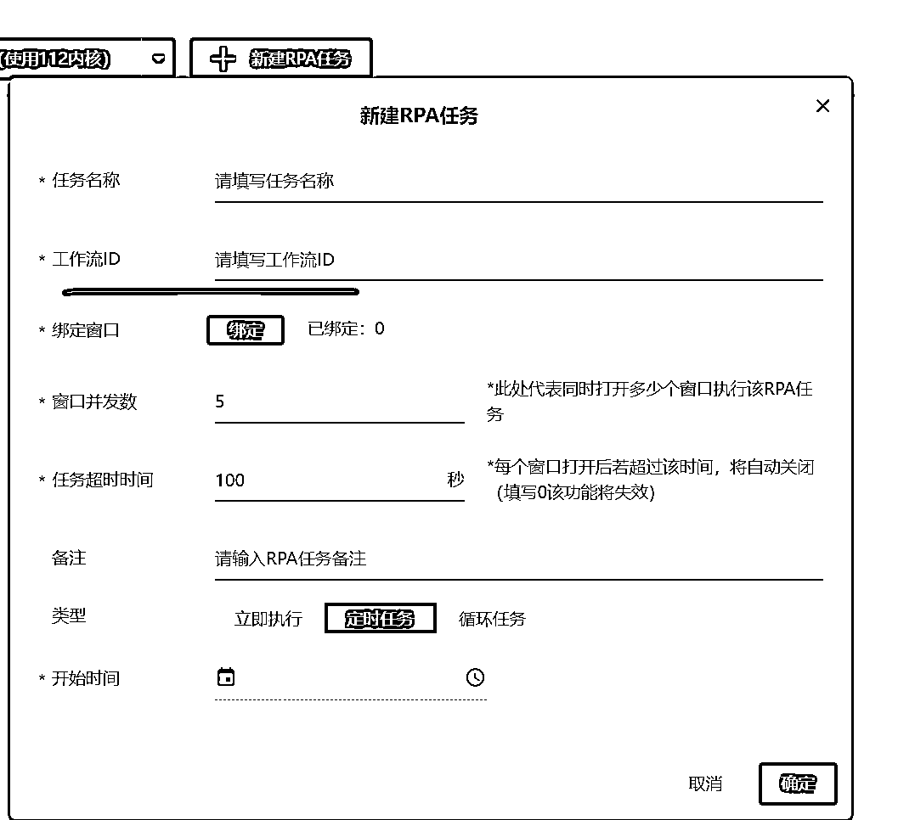

如果不想改配置，也可直接多开窗口各自装 Automa，按需启用。


#### 调整检测间隔

默认每3分钟检测一次生成位是否空闲，单位是毫秒，可自行改。

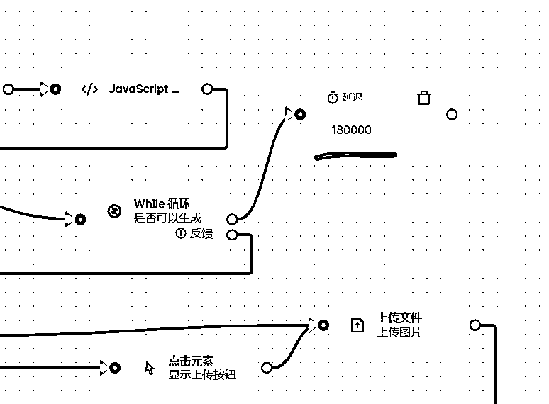

#### 日志查看

点日志可看到当前工作流运行记录，选 hailuo_auto 能看到详细报错，右侧显示运行状态，可停止。


点 Stop 停止正在运行的任务


点标题展开详细日志


#### 国内/国际版切换

国内版：https://hailuoai.com/video/create
国际版：https://hailuoai.video/create

切换时把标签页的链接改掉即可。

示例：国内 https://hailuoai.com/video/create 改为国际 https://hailuoai.video/create


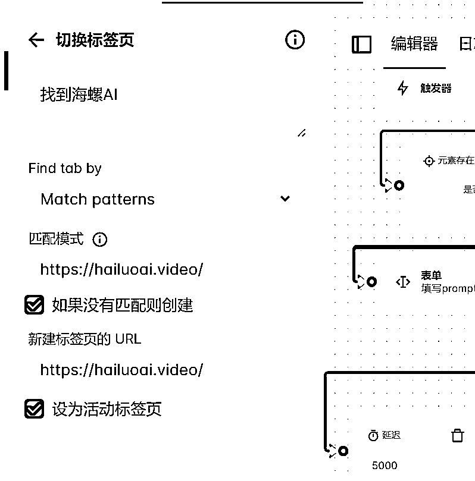

运行前记得把网页切到 Image to Video


#### 用 F12 看进度

在运行页面按 F12 打开控制台，可看到打印日志，比如 loop-index: 0 image_xxx_0.png，代表当前是第几张图。错误信息可忽略。

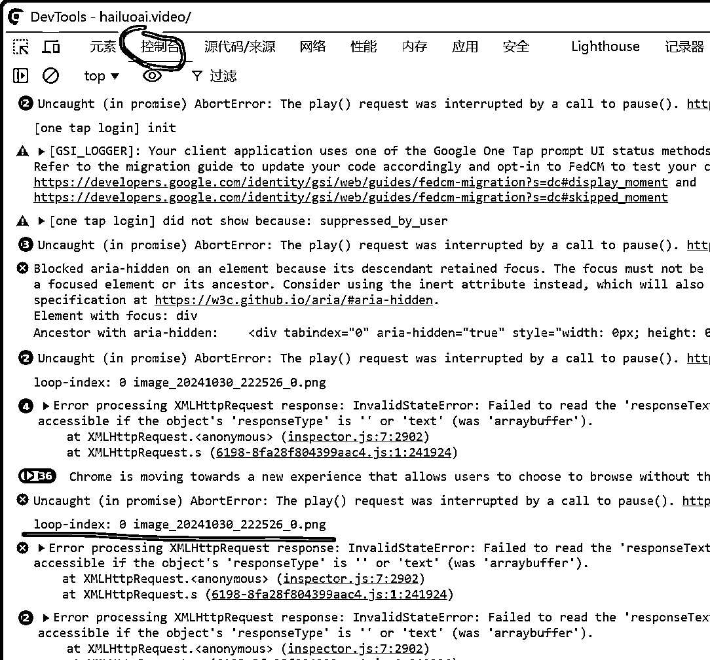

#### 上传失败处理

如果生成视频尺寸不对，说明是文生而非图生，大概率上传失败。若偶发，可把工作流里两个5秒延迟改成10秒。


#### 多提示词方案

现在支持按图片序号自动换提示词。例如前99张用提示词A，100-299张用提示词B，以此类推。

找到 JavaScript 块双击


点进代码区

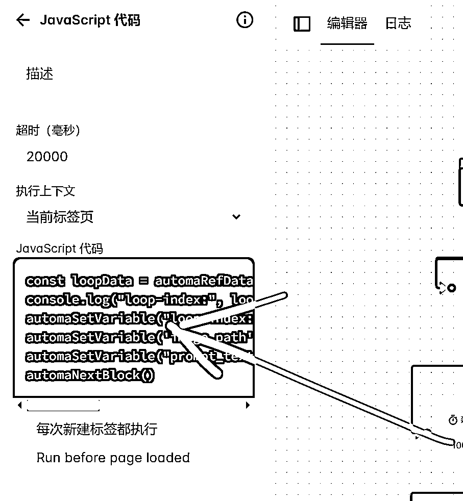

按格式填入自己的提示词，注意保留引号。

```
automaSetVariable("prompt_text", 
  loopData.$index < 100 ? "第一个提示词" : 
  loopData.$index < 300 ? "第二个提示词" :
  loopData.$index < 450 ? "第三个提示词" :
  loopData.$index < 500 ? "第四个提示词" :
  "超过500的提示词"  // 当索引大于等于500时使用的默认值
)
```

代码逻辑：0-99用第一个，100-299用第二个，500+用最后一个。


然后在 prompt 表单里填变量 {{variables.prompt_text}}

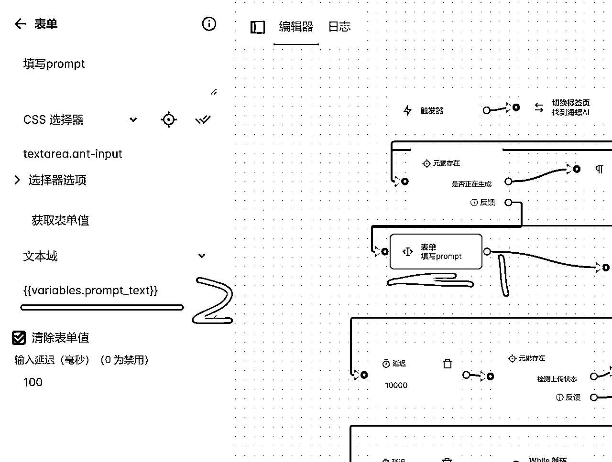

## 附件

#### 海螺AI工作流

下载：https://gitee.com/tudoujunha/rpa-gpt/releases/download/v1.0/hailuo_auto.automa_v1.0.json

#### 图片处理工具 Web 版

imgtool.tudoujunha.parts


#### 图片处理工具 Windows 版

Win 版 exe 下载


Win版图片处理工具下载🔗

#### 图片处理工具 Mac 版

Mac 版打包下载：

Mac版图片处理工具下载🔗

#### 源码

Python 源码：


运行命令：

```
# 创建虚拟环境
python -m venv .venv

# 激活虚拟环境
# Mac/Linux:
source .venv/bin/activate
# Windows:
.venv\Scripts\activate

# 然后安装依赖
pip install pillow

# 运行脚本
python filepath2json.py

# 打包命令
#### Windows
pip install pyinstaller
pyinstaller --onefile --windowed filepath2json.py

#### MacOS
pip install py2app
py2applet --make-setup filepath2json.py
python setup.py py2app
```

今天逛Gitee的时候发现一个挺实用的小工具，来自rpa-gpt这个项目，是一个叫filepath2json.py的脚本文件。

这个脚本挺有意思的，从名字就能看出来，是处理文件路径和JSON之间转换的。在自动化流程或者数据处理的时候，经常需要把文件路径整理成结构化格式，手动搞又麻烦又容易出错，这种现成的小脚本就派上用场了。

想直接拿代码去用的朋友，我把传送门放在下面了：

https://gitee.com/tudoujunha/rpa-gpt/blob/master/filepath2json.py

有需要的话可以看看，对这种小工具感兴趣的朋友可以收藏一波。

#效率工具 #Python #自动化 #实用脚本