# 利用cursor辅助，爆肝10天做了款shorts自动化制作工具

爆肝10天，我用Cursor造了一个Shorts自动化工具

大家好，我是龙哥，来赚钱圈没多久，这是第一篇帖子。平时最爱看大佬们的分享，每天都要花一两个小时刷帖子，学到了不少东西，也做了些小实操。前阵子龙哥老大发布了Shorts超级标，相关帖子特别多，我几乎每篇都看。受叉叉敌、钱塘江鲤、老马内容出海、土豆君、方妮波、竹子、星吟Singing、python大大、大铭等一票大佬的启发，正好自己的两个号都被封了，就趁这段时间爆肝10天，搞出了一款Shorts自动化工具。做工具的这几天，龙哥老大又发布了第三条超级标——AI应用，咱这个是不是也算沾点边？

这工具目前算是有个雏形，问题也不少，但先放出来给大家用，免得拖久了就烂尾。整体流程参考了大佬们的文章，自己也手搓了几个视频验证过。简单说就是：下载视频 -> 抽帧 -> 给图片写描述（这里我设计了两种，一种给文生图用，一种给图生视频用）-> 根据描述生成图片 -> 用图片加第二种描述生成视频片段 -> 最后合成视频。

我自己测试下来，背景音乐提取还有问题，在Cursor里跑得好好的，打包后就不行；SiliconFlow的生图接口也偶尔报错，可能和打包方式有关，后面再慢慢排查。

这个项目是我第一次深度使用Cursor。之前看别人拿它写个浏览器插件，觉得也就做点小demo，没太当回事。进了赚钱后，发现好多人在分享，龙哥老大也聊过Cursor和v0的使用感受，于是这次就用上了。效率提升是真明显，大概有3-5倍。以前我得把任务拆成小块让GPT写，再自己粘回项目里；现在直接和Cursor对话，省事多了。AI时代，只要愿意花时间，人人都能做出自己的产品。想想前几年自己一点点啃编程教程的日子，要是当时有这东西，头发能多保几根（狗头）。

对了，这两天又看了钱塘江鲤大佬的最新文章，也是做Shorts自动化的，各种操作秀得我头皮发麻，但还没亲手实操。不过有一点我很赞同：前端界面还是得用网站形式做，用Qt这类UI，Cursor不太能胜任。

工具打开后是首页，一个输入框加日志区。输入Shorts链接或点“浏览本地文件”选本地视频，再点确定就能下载。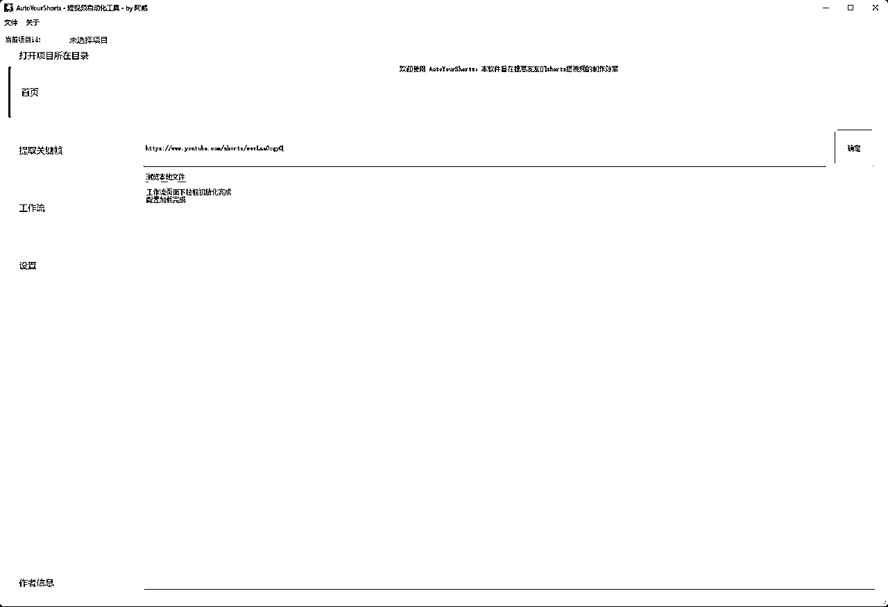 但先别急，得先去设置页配好三样东西，还要记得开魔法。

第一，可灵Cookie。即使暂时不生成视频，也得先填上，因为我们的图床白嫖的是可灵。之前看叉叉敌大佬用的GitHub，后来发现可灵也能白嫖，其实只要有图片上传功能的网站都能这么干。第二，阿里通义千问的API Key。默认流程里翻译、图片描述、图片生成都走阿里，配一个Key就能开跑。第三，YouTube Cookie，用来下载视频。配置步骤见下面各图，填好后一定要点保存。

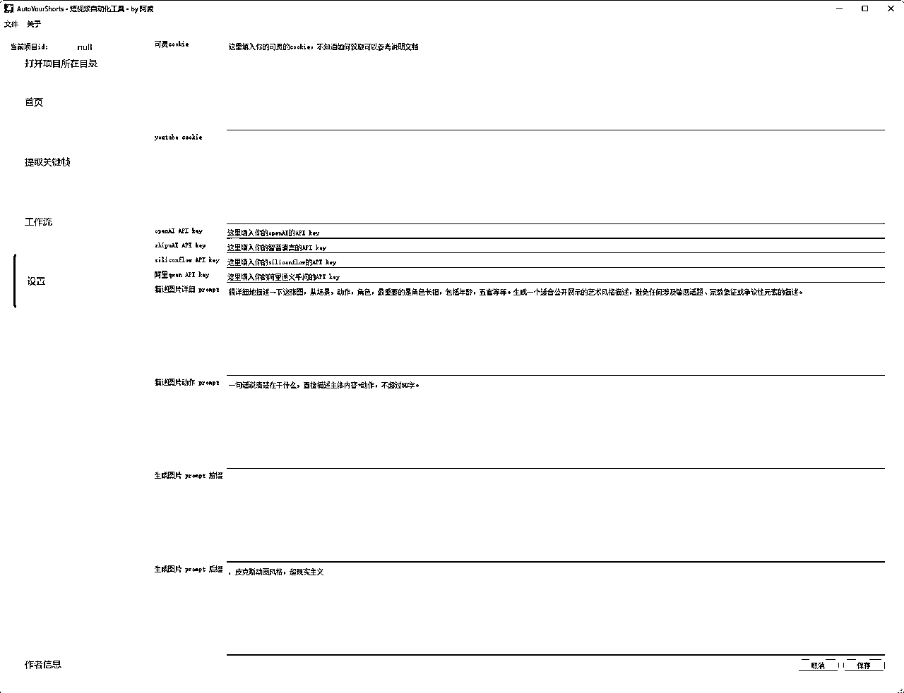

可灵Cookie获取：打开可灵页面，按F12进开发者工具，切到“网络”选项卡。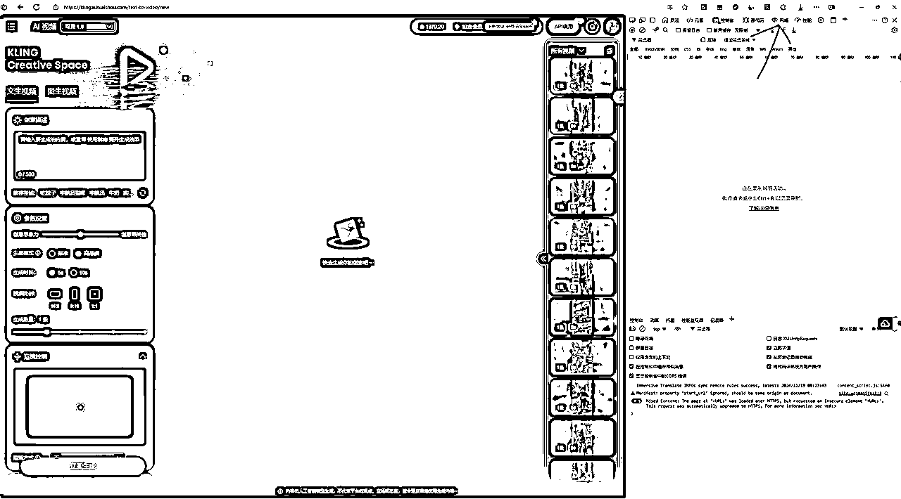 然后上传一张图片，找token开头的记录，复制那一长串cookie到软件设置页保存。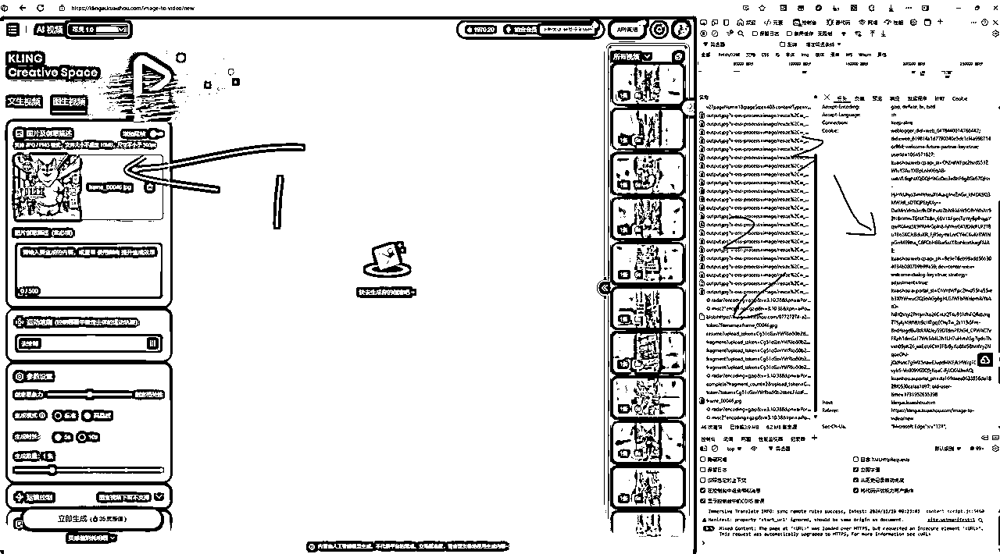

YouTube Cookie获取：先装一个叫Get cookies.txt Clean的浏览器插件。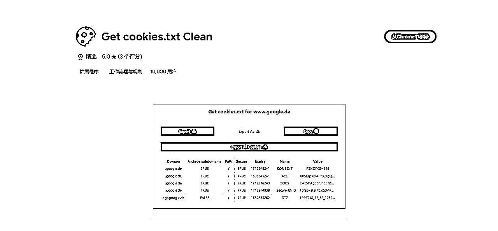 打开YouTube网页，点插件图标，点copy复制，把内容粘到设置页保存。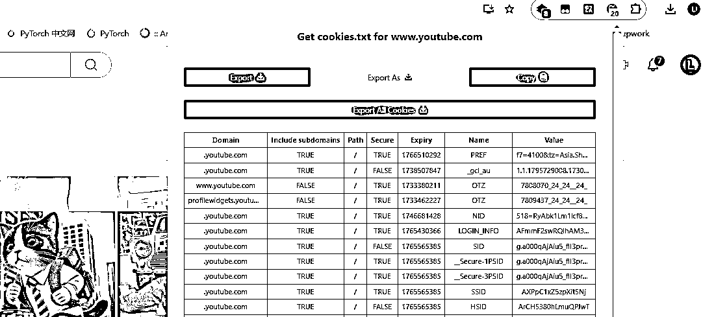

阿里API Key获取：进入阿里云百炼，点右上角头像，API Key，创建API Key，复制到设置页保存。阿里整体还行，就是文生图太慢，还经常超时，毕竟默认用的是FLUX模型，自家的万象模型效果不太行。后面想换的话，在工作流页面可以切换平台与模型。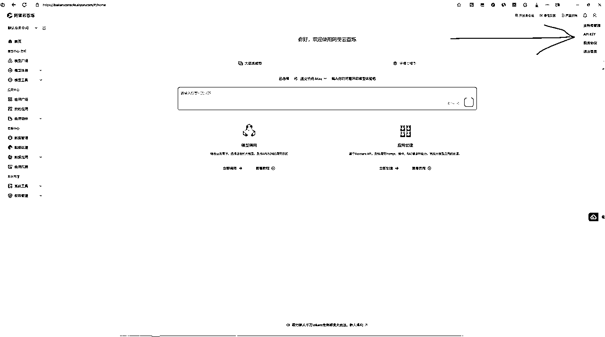

配置好就能开跑了。首页输入Shorts链接或选好本地视频，点确定，稍等片刻进入关键帧页面。这里参考了老马内容出海大佬的代码，可以自动抽帧，也能自己调阈值；拖动蓝色矩形方块预览画面，点“添加”就能加关键帧，右侧选中的帧点一下再点“删除”就能去掉。

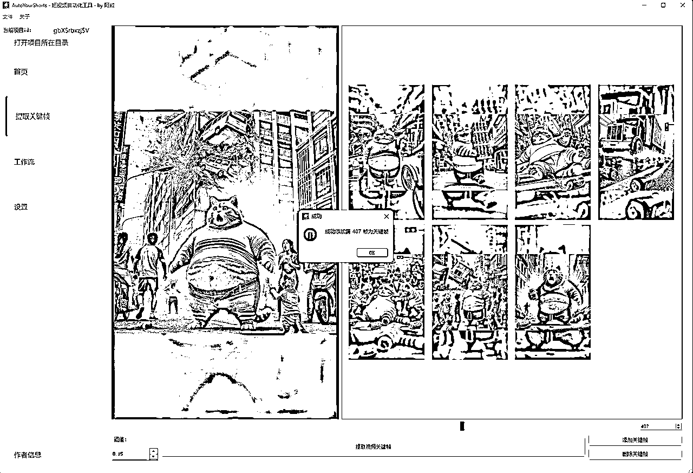

选好关键帧后进入工作流页面，所有参数都能随便设。如果只配了阿里Key，默认参数先别动。注意下方三个大按钮：默认第一个“图片描述”是开着的，另外两个需要手动按下。按下生效后，只要条件满足就会自动执行；再按一次就取消。右边两个按钮用于合成视频片段，但由于前面提到的音乐提取问题，现在暂时用不了，得去生成目录里找片段。

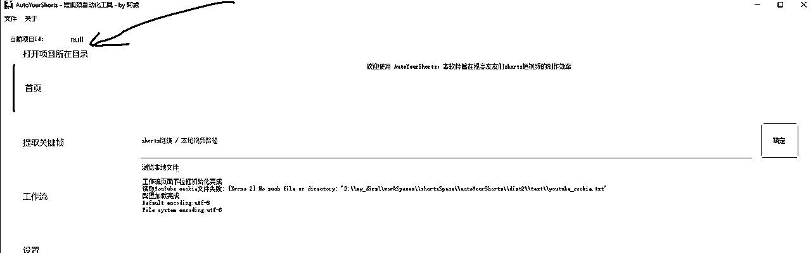

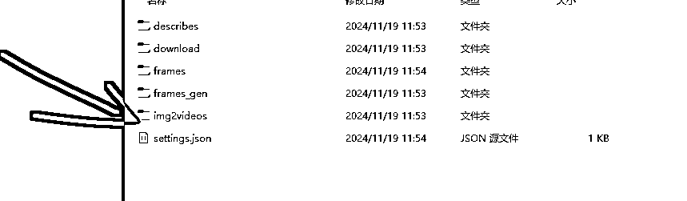

设置好后就是等待生成。阿里文生图比较慢，得有点耐心。想快的话可以换别的API，比如SiliconFlow，我前几天测的时候速度很快、效果也不错，但不知道为什么现在老返回501，我再研究研究。

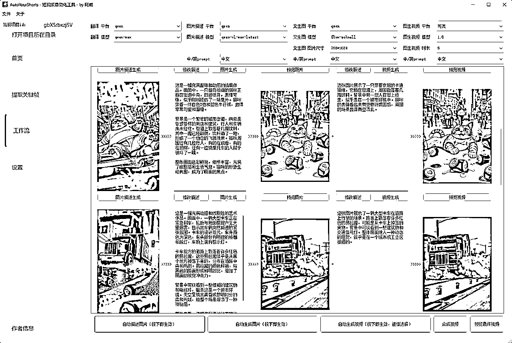

三个按钮一起按下，就能从图片描述一路做到视频生成。不过还是建议视频生成先别开自动化——图片不稳定的话，会白白浪费可灵积分。等出图稳定了再自动化也不迟。

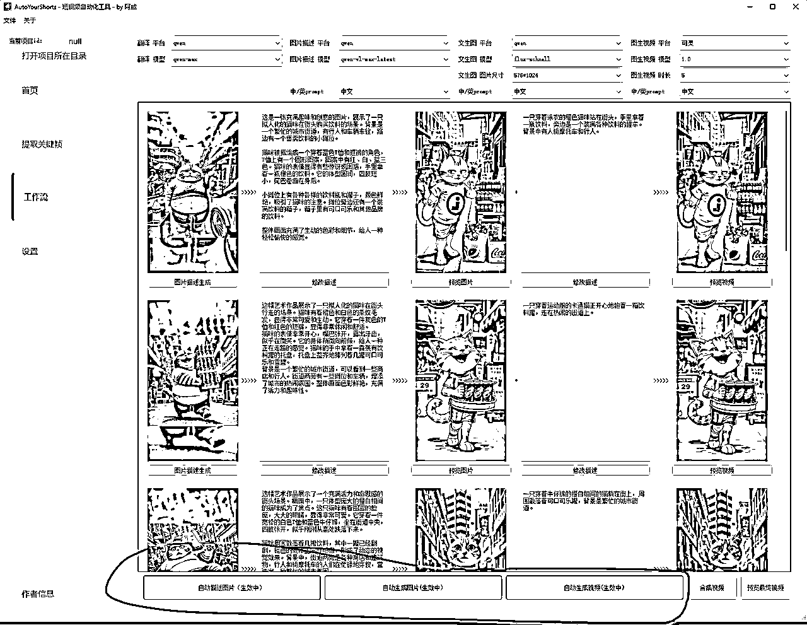

效果展示，原视频和复刻视频对比：前面几步用的都是阿里API，换更好的API效果还能提升。如果大家有需求，我后面再接入别的接口。对软件内部实现感兴趣的话，我也可以单独分享。

另外，打包exe的时候踩了个大坑，调了一整天才解决。没打包前跑得好好的，一打包就报错，Cursor和GPT都没帮我找到原因。最后发现是自己打包后忘记设置可灵Cookie，默认中文导致unicode解码错误，跟它磨了几十遍心态都快崩了，结果就是没设置，哭笑不得。

工具已经传到网盘，大家想用就下载：AutoYourShorts 20241118
链接：https://pan.baidu.com/s/1dXobmR-u-FQ9G8BrK9gPDQ?pwd=r1mj
提取码：r1mj
下载后解压，双击exe就能执行。后续如果有更新，就只需要下载一个十几M的exe文件替换掉即可。

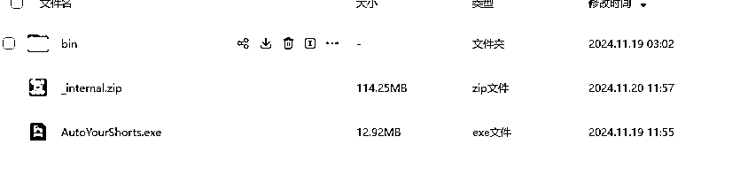

后续想法：修掉现有bug；优化角色一致性问题；支持多项目、多账号。