# 搞懂赚钱的复利，你的成长速度会快十倍

> 来源：[https://pznme756ly.feishu.cn/docx/Z0s1dpeDHoM8QKxTOGlclIg6nnc](https://pznme756ly.feishu.cn/docx/Z0s1dpeDHoM8QKxTOGlclIg6nnc)

前段时间亦仁转发了一条动态：https://t.zsxq.com/XPfLs，里面有句话让我印象很深：我坚信，任何时候都能直接面向市场变现的能力，是一个人最硬的底气和自信。我也坚信，只要持续学习和实操，生财有术的任何一位圈友都能培养出这种能力，都能持续赚到钱。

我特别有共鸣。因为我从一个只会敲代码的程序员，到现在能独立面向市场赚钱，完全是在生财有术里从零到一，一步步学、练、复盘、迭代打磨出来的。

在这个过程中，真正改变我认知的是「复利效应」这个概念。

正因为想通了这一点，我才坚定地相信，只要方法对、方向对，我未来一定能赚钱。也正因如此，我才能在很长一段没有正反馈、没涨粉、没变现的摸索期里，依然保持定力，去啃精华帖、琢磨、执行、复盘，让自己持续变好。

而之后，我在赚钱这件事上的学习效率和进步节奏，真实地提升了十倍。

我称之为：赚钱的复利。

如果当初没理解复利，我恐怕只靠一句“我要坚持我要赚钱”的主观意愿，是撑不下去的。

不合客观规律的事，终究走不远。

所以我觉得，对那些刚加入生财，还处在成长期、暂时看不到涨粉和变现回报的朋友，这个认知会非常有帮助。

今天就把我对这个概念的理解分享出来，希望能给你力量。

今天要聊的主题是复利效应。

别误会，我不是要讲银行存款滚雪球多少年翻倍，也不是讲棋盘放米粒那种无穷大的鸡汤。

我讲的复利，是和每个人的赚钱、工作、成长直接挂钩的实在东西。

# 1 复利到底是什么？

爱因斯坦说过：

“Compound interest is the eighth wonder of the world. He who understands it, earns it ... he who doesn't ... pays it.”

复利是世界第八大奇迹。懂的人赚钱，不懂的人被赚钱。

复利的现象随处可见，比如：

*   银行存款的复利增长曲线

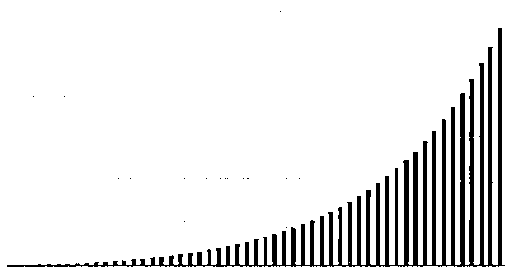

*   道琼斯指数过去两百年的增长曲线

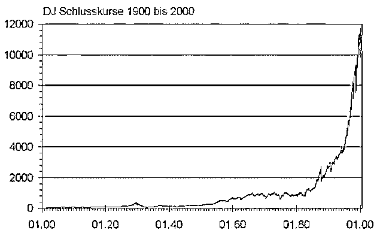

*   世界人口增长曲线

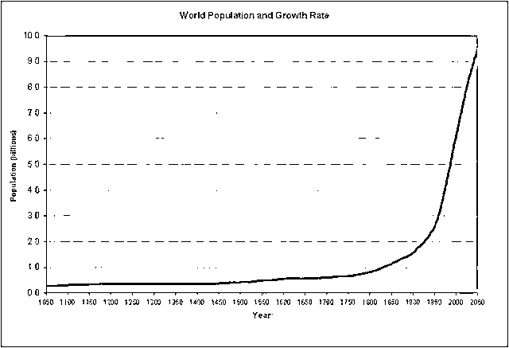

*   明白的爬虫课增长曲线

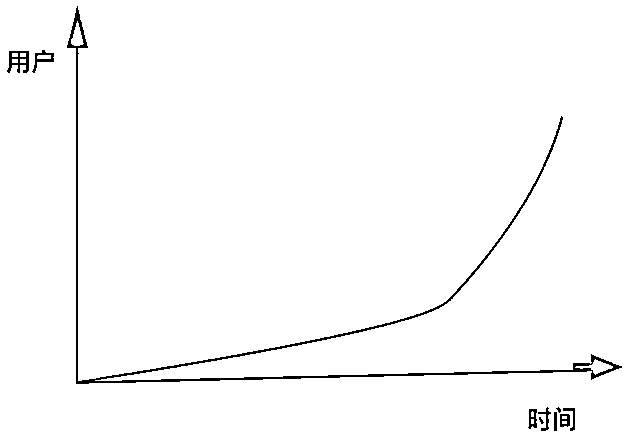

先别急着跳过。下面这个公式你一定见过 ——

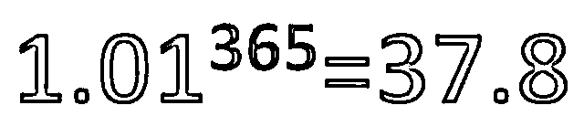

还有一句常被引用：一个人每天进步 1%，一年后能力会提升 38 倍。

这就是复利的本质。看到这里你可能还是没感觉，继续往下看。

# 2 相信复利会带来什么好处？

## 1 相信复利，你会不焦虑

2016 到 2019 年，我经常被焦虑困扰。

比如看到粥左罗老师的文章写得太好，我也想写出那种质感，但一对比自己的水平，就开始自我怀疑、焦虑不安。

想想你上次焦虑的时候，是不是也是这种状态？

看到身边的人轻松写出爆款、做出好课、航海变现，自己也想做到，但发现差距巨大，觉得怎么努力都追不上，于是焦虑感就上来了。

但如果你相信复利，焦虑会立刻减少一半。

为什么？

我们觉得别人遥不可及，是因为我们觉得他们现在做起来“很轻松”，而自己拼尽全力也达不到十分之一。

但真相是，我们从一开始就理解错了。他们看起来轻松，是因为他们已经跨过了“复利拐点”。

什么是复利拐点？看这张图：

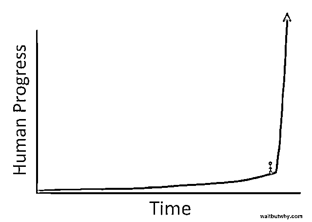

我之前写过：一个人一旦跨过复利拐点，图中小人站的那个位置，收益就会陡增，甚至超过之前所有时期的总和。

这里的收益可以是金钱，可以是能力，也可以是认知。

再说粥左罗老师，他为什么能稳定产出高阅读量的文章？

2015 年 8 月他入行新媒体开始写文章，到 2018 年 3 月开始创业，至今从未间断。

长时间的积累让他越过了拐点，写作能力才水到渠成。

所以他现在写文章阅读量稳定，而且创业收入远超他之前打工的总和。

这和你有什么关系？

关系很大。因为复利效应是客观规律，对所有人都一视同仁。

只要你相信它，并按正确的方法持续执行，总有一天你也会抵达拐点，能力与收入都会迎来跃升。

既然知道按对的方法一定能到达想要的高度，你的未来就掌握在自己手里，还会焦虑吗？

情绪上来时还是会，但用理性一梳理，焦虑就消散很多。我就是这样调节自己的。

## 2 相信复利，你会更自信

一个人的自信来自于清楚的认知：

*   哪些事现在能做，哪些不能做

*   哪些事现在做不了，未来也做不了

*   哪些事现在做不了，未来一定能做到

相信复利的人就明白，那些看起来很厉害的人，都是靠时间积累走到拐点才发力的。

复利对每个人都公平。也就是说，你现在开始积累，虽然目标此刻看起来很远，但在复利的作用下，日后一定会兑现，毫无疑问。

再看下这张图，看看小人站的位置。

你现在进步慢是正常的。在拐点前，必然有一段积累期，等积累够了，拐点自然会到来。

明白这一点后，你再去学习积累就会更有底气。遇到困境时也会更从容，因为你知道那都是暂时的。

你知道现在的付出都有意义，你知道未来由自己掌控，时间终会给出答案。

2019 年我升级《不用写代码的爬虫课》，整整一年都在大量阅读、学习、练习、拆解赚钱案例，然后把学到的东西用到课程和网站上。

前期很枯燥，几乎没有回报。但因为我相信复利，我知道这些积累未来会用在哪，会如何帮助我赚钱，所以我更有信心，也更有耐心。

## 3 相信复利，你会进步更快

前面说过：跨过拐点后，收益会激增，可能超过之前所有时期的总和。

这里的收益也包括财富。达到拐点后，你赚的钱可能就超过了过去所有时间的加总。

如果你相信复利，你现在做的每件事都是为了更快抵达拐点，更快赚到钱。

为了早点变现，你会投入更多时间去积累学习，这样知识和能力自然飞速提升。

相信复利的人，对刷抖音、刷朋友圈这种事毫无兴趣，因为它们对拐点毫无帮助。

花一天时间刷短视频，就等于晚一天抵达拐点，晚一天进入高收入状态。

把时间拉长，今天的每一秒都在复利。你还会浪费时间吗？如果你相信复利，你会明白，未来的每一秒不积累都是浪费。

## 4 相信复利，你会碰到更多好运

*   学 10 个知识，就能碰撞出 1 个赚钱思路；

*   做 10 件事，就能找到 1 个适合自己的机会；

*   见 10 个人，就能遇到 1 个愿意帮你的人；

如果把这些结果叫做好运，那么相信复利的人好运会更多。因为你相信未来一定会成功，所以你在没成绩时也能安心积累 ——

*   你会更用力学习

*   你会做更多尝试

*   你会接触更多人

和不信复利的人相比 ——

*   你学到的知识更多，赚钱思路自然更多

*   你做的事更多，选择的机会更多

*   你接触的人更多，贵人也更多

这些更多的思路、机会、贵人，会让你更早成功。

我有个朋友，叫他小明吧。

他不想拿死工资，业余开始自学。加了几个付费星球，看到大量以前没接触过的信息。

起初小明很焦虑，看案例别人轻松赚钱，自己却几乎看不懂。很努力学了几个月，还是没啥结果。

他无数次想放弃：“算了吧，反正学不会”。

一次偶然，他看到了李笑来在得到的专栏《财富自由之路》，里面讲复利，还配了那张小人的图，他好像抓住了救命稻草。

从那以后，小明每天学习时间明显增加。虽然基础差，但足够勤奋，随着学习的增多，焦虑也慢慢下降。

他练写作、学产品、运营、营销、增长黑客，慢慢看懂了星球里的信息，也开始有点自信。在星球分享心得，甚至得到大佬点赞，更坚定了他对复利的信念。

学了一年，能力虽仍有限，但他模仿案例做了一个课程。做完后才发现不懂怎么卖。后来他看到有人把课免费送朋友，就也去送。

他在常去的星球发帖，本来两句话的事，结果头脑一热写了 1000 多字，把学习过程、课程思路都写出来了。帖子被星球作者看到，觉得他很努力，就联合朋友帮他宣传，课程完成了冷启动。

为什么大佬愿意帮他？

生财有术里投资人李晨分享过：人们更愿意帮助努力的人，这是从线性成长到跳跃性成长的门槛。你的努力带来线性的能力成长，但被别人看见、被拉一把，就是跳跃性成长。

我觉得大佬是被他的努力打动了。后来他在课程迭代中能力飞速提升。

试想，如果小明不努力，没做课，没练写作写出那篇帖子，他还会有这个好运吗？正因为他相信复利，相信积累会有回报，他才做了那些事。

2021 年，那个星球新一期开放，小明帮星球带了 400+ 新用户。按价格算带货 100w+，佣金 20 万。大佬当时的判断是对的。

小明因为相信复利，不焦虑了，认真学习，能力提升，最后遇到好运，得到大佬帮助。

嗯，我就是小明，星球就是生财有术，大佬就是亦仁。

回到核心：复利是客观规律，对每个人绝对公平。

# 3 如何才能收获复利的成果？

要想吃到复利的红利，先要知道哪些东西具备复利效应。

## 1 知识的复利

### （1）知识联结带来的通汇贯通

很多人以为学习是线性累加：

学 1 个知识，收获 1 个

学 2 个知识，收获 2 个

学 3 个知识，收获 3 个

这忽略了关键：知识之间的联结。

当知识发生联结，收获就不是线性，而是指数：

假设基础为 0，

学到 1 个知识，收获 1 个知识

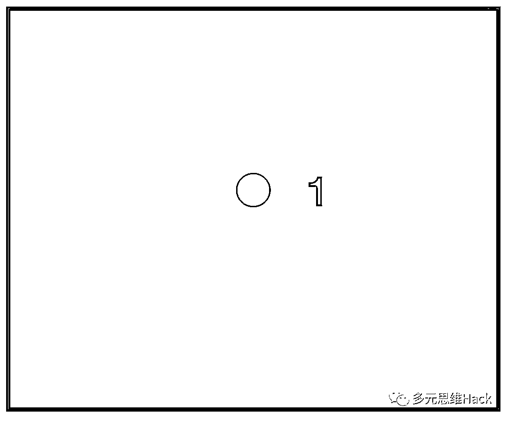

学到 2 个知识，收获 3 个知识，其中 2 个发生了联结 ——

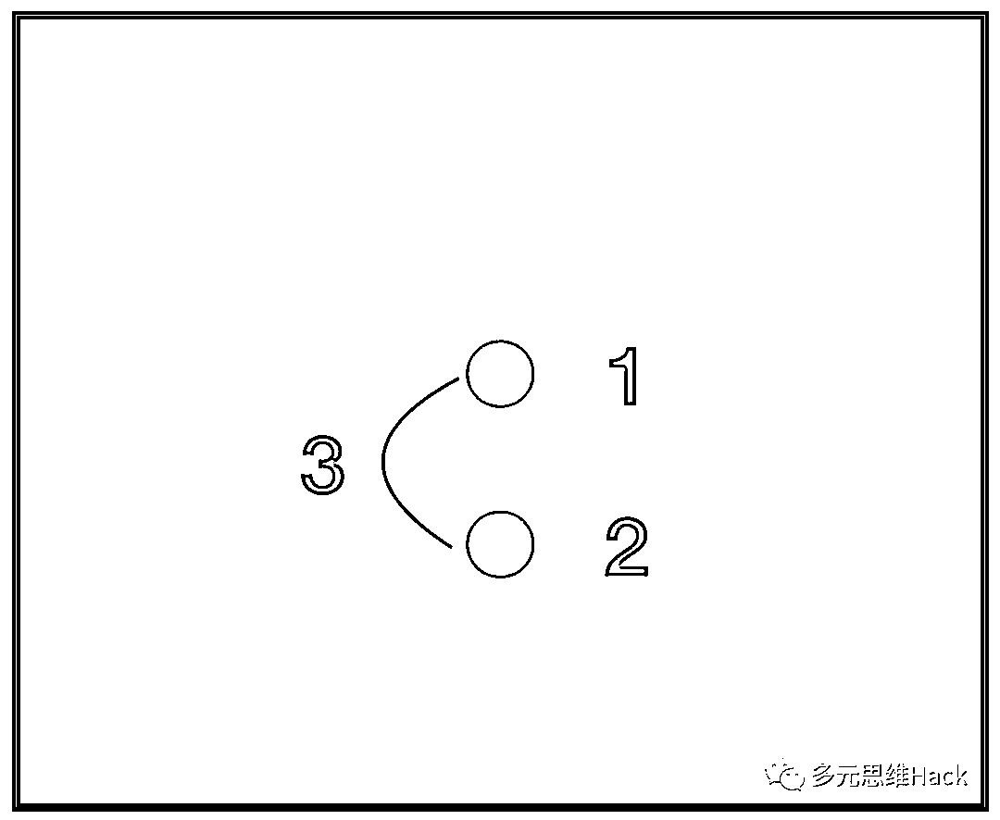

学到 3 个知识，收获 7 个知识，多个发生了联结 ——

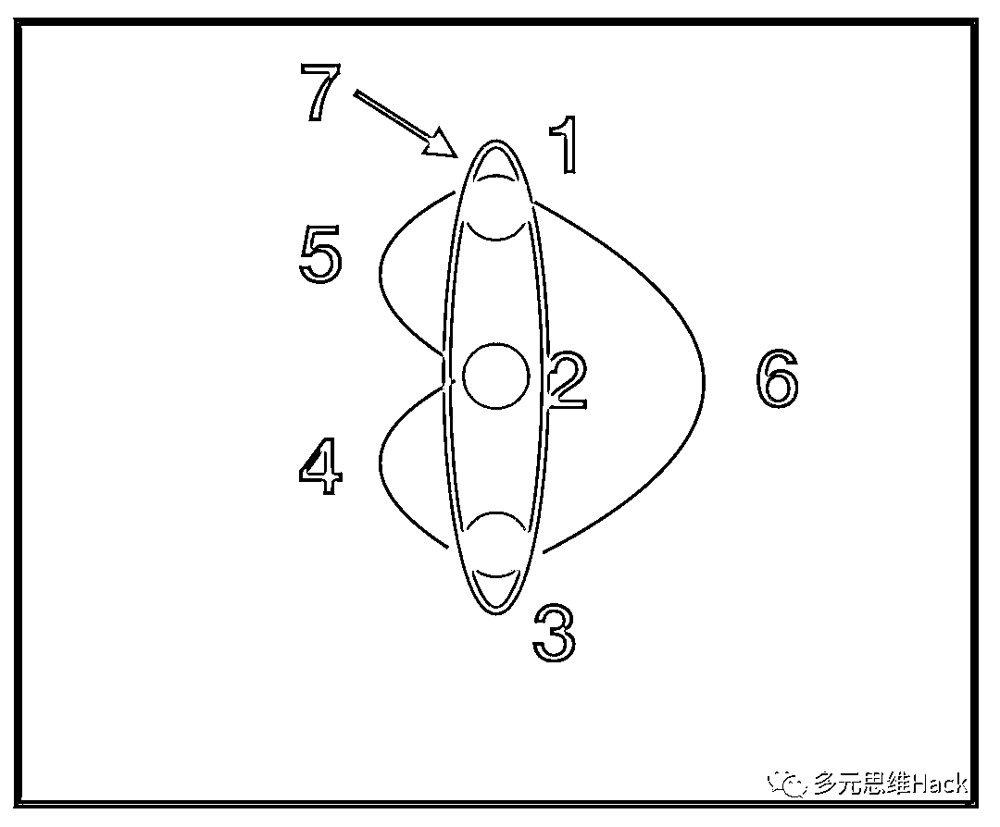

学到 4 个知识，收获 15 个知识……

理论上，学到 N 个知识，能收获 N^2-1 个知识。

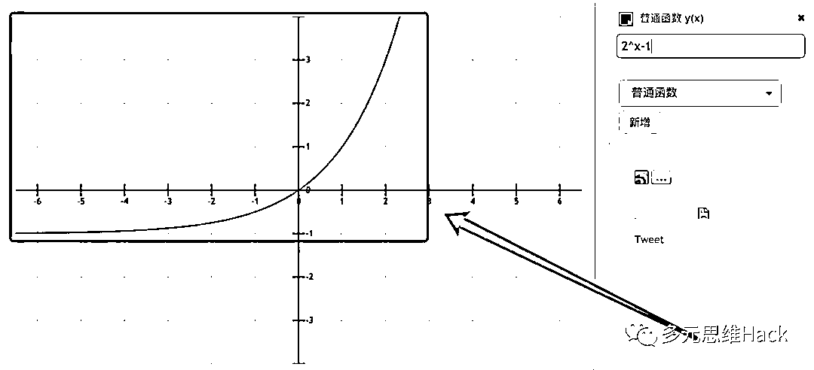

收获曲线和复利曲线形状很像。

现实中不可能每个知识都完美联结，也不是所有知识都值得联结，但足以说明：能把学到的知识串联起来，知识量就会显著增加，会有“突飞猛进”的体感。

很多人前期学很久都感觉不出来进步，有两个原因：

1 知识量太少，可联结的点太少

不是每个知识都能互相联结，掌握的越多，碰到熟悉点并联结的概率越大。

广撒网，鱼总会来。

不勤奋学得慢，知识量少，联结自然难。

2 深度不够，没能力联结

除了知识要多，还要理解得深，才能创造新的联结。这点后面会讲。

更重要的是，真实世界有价值的事，都需要多个知识组合完成。

做一张海报需要：文案、用户视角、心理学、研究、模仿、沟通……

写篇文章需要：写作、阅读、思考、逻辑、心理学、学习力、用户视角、模仿……

做个课程需要：写作、逻辑、模板能力、用户视角、学习力、设计、沟通、模仿……

单一知识解决不了真实问题。

当我们把知识联结起来并应用到生活中解决真实问题，才能获得实质收益，学习带来的成就感才会更强，“突飞猛进”的感觉才会更明显。

刚开始学时感觉不到进步，是因为知识量少，联结少。随着时间增长，知识增多，联结的可能增大，按 N^2-1 的趋势，我们会明显感觉到进步，知识联结也更可能解决真实问题，收获感进一步增强。

因此在某一个时刻会出现“突飞猛进”的感觉，因为那段时间知识大量联结并解决了真实问题。

所以，“开始慢后面快”不是玄学，是有规律可循的。

看一张图：

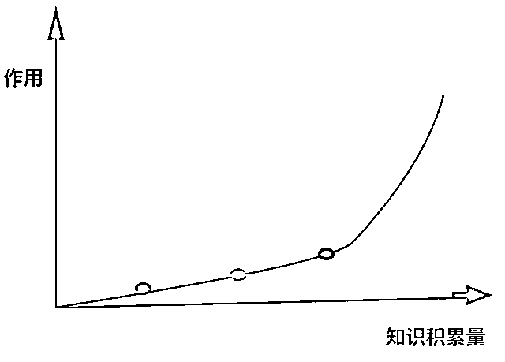

当只有少量知识且彼此孤立，作用很小，比如蓝点。

知识增多后，部分开始产生联系，能产生一些效果，比如绿点。

知识继续增多，抵达知识复利拐点，大量知识相互连接，效果会爆发式增长，红色区域。

客观事实是，并非每个知识都能产生联系 ——

拥有 5 个知识，可能有 2 个能联结；

拥有 10 个知识，可能有 4 个能联结；

拥有 100 个知识，可能有 40 个能联结。

发现了吗？知识越多，联结概率越大，作用越大。

如果你只有 1 个知识，即使想联结也不可能。所以不要因暂时看不到效果就停止学习。

只要持续学，总有一天积累到阈值，知识会自行融会贯通。

这就是知识的复利效应。

### （2）理解原理带来的触类旁通

前面讲到，知识联结会带来更大收获。那怎么联结？

除了多学习提高知识量，增加联结概率，更重要的是理解不同知识背后的原理。因为只有懂原理，才能把知识迁移到其他领域，和其他知识产生联结。

看这个图 ——

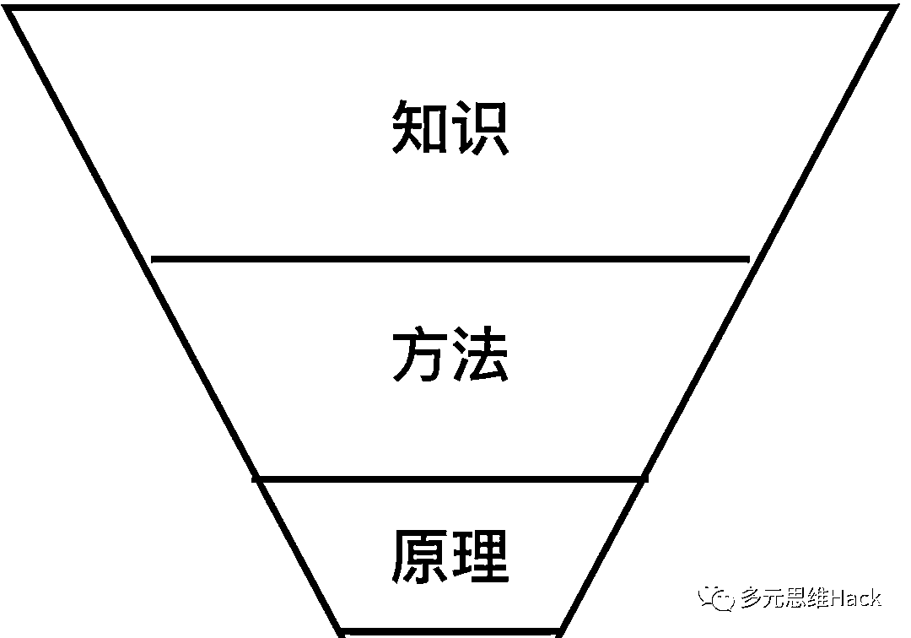

从上到下是不同领域的知识结构，

1 知识：概念、公式、理论，不同领域不同

2 方法：写文章、裂变、设计海报，部分方法可通用

3 原理：从众、锚定效应、价格歧视等，涉及心理学、经济学等，绝大多数原理可跨领域使用

当你理解了 A 领域的某个原理，再去学 B 领域，会有“这个好像在哪见过”的感觉。

这就是触类旁通。

这个“类”就是“类型”，即“领域”。

当你掌握了 A 领域的“原理”，就能用它去“旁通” B 领域的原理，更容易掌握方法、知识，也更容易把不同知识、方法联结起来，产生通汇贯通的感觉。

# 努力很久却没长进？你可能还没站上复利拐点

总有一些人，学习速度快到像是开了外挂：他在自己的主战场 A 里是高手，聊到 B、C、D、E 这些看似无关的领域，也能脱口而出「用 A 的方法就能干成」。这不是什么玄学，而是他把 A 的本质规律搞明白了。规律一旦内化，就能跨场景迁移，知识也会因此产生连接。

我身边就有一个现成的例子。朋友涛哥做电商，有次和他聊到爬虫，这位从不写代码的人，居然把几个技术要点说得有板有眼。我一开始挺纳闷，后来想通了：他在电商这条路上浸淫多年，早就摸透了生意的底层逻辑，而这些逻辑平移到爬虫领域依然成立。

于是结论就一句话：把原理吃透，旁通只是顺路的事。

那绝大多数人做不到，问题出在哪？

答案有点扎心：费劲。知识浮在最浅层，肉眼可见，几乎不用花力气就能学到；只有先攒下知识，才谈得上总结用法；用法熟练之后，才可能逆推出背后的原理。而要触到原理，就必须在一个领域里长期下潜，投入大量心力去琢磨、拆解、验证。

可惜，多数人学到表面那层就转身走了，扑向下一个领域。毕竟学新知识轻松又体面，还能随时晒战绩：「这周读完两本书」「又认识一个新概念」。跟烧脑的深度思考比起来，这种即时满足实在太诱人。也正因如此，很多人学了好几年，依然在原地打转。

解法其实很朴素：把脚步放慢一点，每学到一点东西，就往下再挖一层，去够那个原理。掌握的原理多了，知识之间的暗线会自动织成网，所谓的「跃迁式成长」也会不请自来。

## 能力是会利滚利的——两段亲历

### 1. 在生财圈「三年不鸣」

我当程序员时，技能树几乎是单点的：只会写代码，写作、产品、营销、商业全部一窍不通。2017 年，我进了「生财有术」。

那时的学习曲线，和上面讲的一模一样：

第一年，10 篇帖子有 9 篇像天书；
第二年，10 篇帖子有 8 篇像天书；
第三年，10 篇帖子忽然全通了。

真的是那种「一下子全通了」的感觉，当时自己也解释不清。最近为写这篇文章，我认真翻了翻记忆，才找到原因：第三年我尝到了知识互相连接的甜头，于是有意识地加大了这方面的投入。记得我还跟亦仁聊过当时的状态，聊天记录还在——

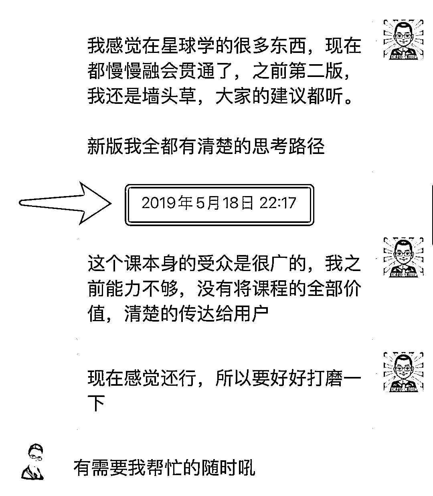

那时只是一种朦朦胧胧的直觉，现在回头看，直觉没错。2019 年，我靠分享精华帖拿了 10 颗龙珠。圈里不少熟识的大佬那年的评价是：明白突然蹿得飞快。这其实就是复利在拐点之后开始显形。

可能有人会说：学一样东西要三年，太慢了。可事实是，前两年我压根没想通这个道理，学什么都是浅尝辄止；直到第三年才隐约摸到门道，开始认真发力。放到现在，无论面对哪个陌生领域，我都有把握在 1 到 3 个月里做出一份像样的成绩。底气就在于：我已在不止一个领域摸到底层逻辑，可以自由地「借力打力」。

所以，别小看一年。即便你现在一无所知、是个纯小白，只要照这个方向死磕，一年后也完全可能蜕变为高手，并真正赚到钱。

### 2. 爬虫课「三年三进」

我的爬虫课迭代了三版，2019 年升级到第四版。做这门课的过程，本身就是一次能力复利实验。开课前，产品、运营、营销对我而言全是陌生概念。

- 第一版，我从零开始边学边做；
- 第二版，我勉强把学到的技能硬塞进课程里；
- 第三版，这些技能我已经能熟练调用；
- 到了第四版，我有把握新课质量比第三版高出不止一个档次，用户量也很有可能超过前三版的总和。

这份底气是从哪来的？前三版课程的积攒、微信群里无数次答疑、文案一遍遍推翻重来，让我对用户、对产品、对传播的认知彻底换了代。

请看这张图：

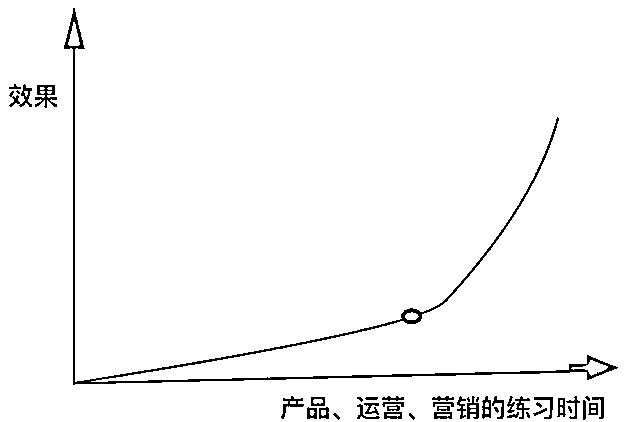

练习够久，技能就滚到了复利拐点，随后释放的能量远超从前。正因如此，后来我做知识星球站点、写公众号、做社群、搞 CPS 带货，起点都是第四版课程的高度，而不是归零重来。过去的积累让这些新项目全都顺风顺水。这就是能力复利最直观的证明。

## 让赚钱也滚出复利

知识有复利，能力也有复利。这两样东西，都在为成长持续供能。反过来推：任何一件事，只要不能让你成长，它就不会产生复利。

先重温那句最重要的话：任何人一旦到达复利拐点——也就是图中那个小人站的位置——收益就会陡增，甚至能超过此前所有收获的总和。

再看一次这张图：

想明白这一点后，再看生财的精华帖、参加航海实战，我就不会只盯着眼前能不能变现。不再轻易下判断：能赚钱的就是好内容，赚不到的就是垃圾；能变现的航海才算成功，不能的就是白费。我会多问一层——

这个帖子的知识、打法、思路，有没有让我对某个行业看得更清楚？对流量的理解有没有加深？对用户需求的洞察、对平台规则的熟悉、对商业模式的认知，有没有更进一步？只要有，它就是在给未来的新项目铺路，让我的下一次出手更漂亮。

这场航海实战，有没有让我更完整地看懂一个项目？有没有搞明白一篇笔记爆掉的原因？有没有看到别人面对难关的样子、拿到结果的人的行动方式？有没有意识到自己还缺哪些能力、需要在哪些地方做出改变？只要有，这次航海就值了，下一次的胜算也会更大。

把学习、思考、行动、复盘当成一个循环，每完整转一圈，你的知识储备和做事本领就厚一分。假设起跑线是零：

- 读 1 篇精华帖、参加 1 次航海，变成 10；
- 读 10 篇精华帖、参加 3 次航海，变成 30；
- 读 50 篇精华帖、参加 6 次航海，变成 70。

总有一天，当你再次下场航海，会猛然发现：以前觉得陌生的平台熟起来了；以前写一篇笔记要憋很久，现在顺畅多了；以前碰到难题就发懵，现在能熟练地搜索、思考、动手解决；以前不知道怎么卖东西，现在能轻松把产品的价值讲给用户，并完成成交。

所有好结果，都藏在积累到位之后，自己会冒出来。

这就是复利。

如果你希望未来半年或一年里，成长和收入都能迈一大步，请把下面三句话记牢：

1. 复利是铁一般的客观规律，它给每个人的机会一样多；
2. 只要真正相信复利，你就一定能走进高手那一列；
3. 唯有持续做有益于成长的事，才会收到复利的回报。

希望看完这篇文章，你也能更踏实地相信复利、相信时间、相信积累、相信坚持，从今天起更用心地学习、实践、提升自己。终有一天，你会练就一套独立面向市场变现的本事，让收入源源不断。

今天付出的每一分努力，都会在未来的某个节点，加倍回到你身上。

---

## 自我介绍

我是明白，在「生财有术」里待满了 8 期，星球编号 20。我是程序员出身，现在自己创业，运营成长社群《日新月异俱乐部》。

下面是我在生财历年的精华帖合集，也是一条成长轨迹，有兴趣的朋友可以点链接直达——

【2024 · 6 篇】

1. 《详解：写作和赚钱的 4 个关系！看完你一定会忍不住想开始写！》 https://t.zsxq.com/192OLDlds
2. 《7 年生财拉新 1100 +，我只做对了一件事》https://t.zsxq.com/19SqL7McC
3. 《赚钱急于求成的心态，该如何破除？》https://t.zsxq.com/wD6k5
4. 《如何借鉴其他行业经验拓展赚钱思路》https://t.zsxq.com/3wd8r
5. 《参加航海实战，如何让自己每天都有正反馈？》https://t.zsxq.com/9e2ns
6. 《当思考成为习惯，赚钱会更容易》https://t.zsxq.com/19vgy7kcp

【2023 · 1 篇】

1. 《身体残疾卧床 3 年，我在人生最低谷加入生财有术，有哪些成长？》 https://t.zsxq.com/19KWDvzz0

【2021 · 3 篇】

1. 《复盘 | 亦仁 3 年前的帖子，帮我每月被动收入 1 万块》 https://t.zsxq.com/19jaotwbv
2. 《嘉宾问答|“想去更好的公司，我该如何利用好时间？”》https://t.zsxq.com/1952Q3a92
3. 《2883 人向朋友介绍生财有术时，说的最多是 16 个词！》https://t.zsxq.com/19MYWwvCl

【2020 · 6 篇】

1. 《产品想要获得更大收益，应该不断向用户的真实需求靠近》 https://t.zsxq.com/19kQ7NILy
2. 《我的2019：普通人如何培养自己的用户视角？》https://t.zsxq.com/19fyFdZRL
3. 《如何通过分析成功案例，帮自己建立赚钱清单》 https://t.zsxq.com/19FNjtIjB
4. 《思路详解：如何为某个细分领域用户提供产品，并赚钱》 https://t.zsxq.com/19qoI1QQB
5. 《学习和赚钱是什么关系？》https://t.zsxq.com/19uQcuMzJ
6. 《5000 字深度拆解 | Manchuan 公众号 2 个月涨粉百万，普通人如何复制？》https://t.zsxq.com/19cD1keUB

【2019 · 8 篇】

1. 《在生财有术，普通人如何从 0 到 1，培养赚钱思维》 https://t.zsxq.com/19rA0kWrD
2. 《生财有术第 3 期，我是如果做到邀请 245 个用户的？》https://t.zsxq.com/1968tlTAx
3. 《公众号和抖音之间的赚钱机会》 https://t.zsxq.com/19OfzDckK
4. 《可复制，零门槛 | 如何借别人的流量，打造一个稳定的被动收入系统》 https://t.zsxq.com/19sVRn6Yx
5. 《做自己擅长的事，把技能树打通，然后再去赚钱》 https://t.zsxq.com/19evWC1Xl
6. 《信息整合：一个可复用，低门槛的成熟商业模式》 https://t.zsxq.com/192zoSooT
7. 《产品名字，只有一个目的：降低用户认知成本》 https://t.zsxq.com/19QUBrDOT
8. 《数据是需求的抽象化 | 帮你快速找到 100 个赚钱思路 》 https://t.zsxq.com/19QrIpsuC

【2018 · 3 篇】

1. 《分享一下，抓取其他微信号的方式，而且是精准粉》 https://t.zsxq.com/19sKQT9bF
2. 《如何几乎零成本做到1w多付费学员？》 https://t.zsxq.com/198XWAGhV
3. 《36 个小而美赚钱项目之一：蛋黄酥白皮书》 https://t.zsxq.com/19G4PKUXr

【2017 · 2 篇】

1. 《一个零成本，为公众号增粉，并高转化率为付费社群，进而再次付费转化加入小密圈的案例》 https://t.zsxq.com/19WJ8NILt
2. 《一款软件，webscraper，帮助非技术领域的朋友，做到爬虫可以做的事情》 https://t.zsxq.com/19RSl40n5