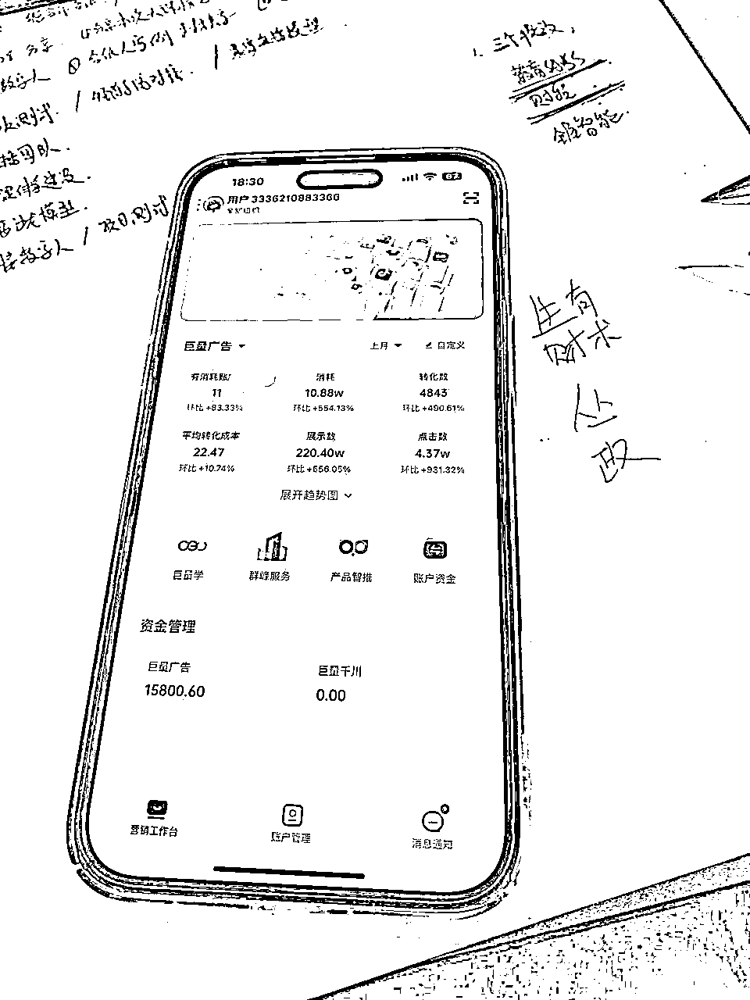

# 抖音本地推实操拆解：视频+图文批量获客的当下风口项目
作者：龙哥

先做个前置说明：

大家好，我是龙哥。关于我的背景以及对本地推这套打法的整体认知，我都放在了文章末尾，有兴趣深入了解的同行可以自行翻阅。

开门见山，先聊清楚几个核心问题：

1. 这套本地推方法，到底适合哪些人做？

只要你手里有实体生意，餐饮、酒店、家居建材、工厂、招商加盟、全屋定制、招生、项目销售、月子中心、兴趣培训、汽车后市场里的车衣洗车改装贴膜二手车等等，概括起来就是目前做着生意却感觉客户不够用的群体，都可以用这套玩法来持续拿到精准人群。客资成本平均在5到30元区间，高客单行业会略高一点。信息差就是在这里，几万块的投入就能实现全城曝光，流量是稳定可控、可不断放大的。而且，一旦在自己赛道跑通结果，还能反手给同行赋能做培训代运营，这条路径很多人已经在走了。比方说你做财税，手头客户资源多，先自己学会投放验证效果，后续就可以把获客交给这些企业主去做，【如果暂时没有这方面的能力，我们这边也可以全程协助】

2. 抖音本地推，和巨量AD、📕聚光、视频号投放有什么不同？

目前本地推强项在于门店曝光和团购类目，审核门槛相对更高，但获客成本更低，不过虚假点击会比较多，返点比例普遍在12%-15%左右。巨量AD更适合做线索沉淀，也就是拿留资。聚光和视频号则更多是作为人群和项目上的补充渠道。比如旅游类目在抖音是禁止投放的，这时候就可以结合聚光+自热内容来承接。现在抖音平台本身就在大力扶持本地推，顺着平台规则走会很顺畅。这次我把团队内部完整的操作流程直接拿出来，希望能给到实操价值。关于开户对接渠道，以及想系统学习多平台打法的朋友，可以通过鱼丸联系我。

3. 投流变现的真实案例，我身边就有：

郑州大鱼，专注本地推培训，10月份业绩做到300万；苏州鑫哥，深耕门窗和全屋定制工厂赛道，一个月业绩300万，利润保守估计超过40%。菏泽一个朋友，配了3个投手8个销售，做卤味招学员，一个月纯付费业绩过百万。西安金包银团队，5个人现在月均30-50万。河南一个字节出来的小团队做代运营，收4980一个客户，自己成本只要3000，靠返点多的时候能拿2万。这说明投放能玩的打法太多了。过去做IP、做矩阵、做转化起码要两个月起步，现在快的话一周，投2000-3000就能看到效果。

再补充一个近期很火的数字人玩法，1234567号模型，投入500就能撬动5000左右的业绩，投产比能做到1:10。等你真正沉下去做投放，就会发现可选的项目和赛道远比想象的多，因为流量问题被解决了。

4. 我想找什么样的合作：

我希望能和需要流量、需要获客、尤其是招商加盟类，以及有0-1可复制性的招商、工具、实体项目方进行嫁接。合作模式可以灵活讨论。如果你对这套模型感兴趣，欢迎深入沟通，我们负责交付模型变现，你们负责流量端即可。

下面就是本地推的完整实操部分，可以看成保姆级教程，是团队真实在跑的流程，直接拿出来对照操作。

不是纯理论的泛泛而谈，全程干货实操。

有任何疑问欢迎在评论区留言。

这篇内容是基于我自己投放结果总结出来的经验，上个月投入11万，团队完成80万业绩，正好是项目启动的第三个月。光靠自然流量根本达不到这种体量。

最后说几句：

找到你认可的方向，保持方向感，持续执行，最后一定会有结果。归根结底比的是执行力、认知差和信息差。

祝各位同行在2024年都能在自己的赛道上拿到更大突破！

有问题直接评论区提问，我都会回复！

我相信这篇拆解能帮助不少圈友今年实现业绩跃升！