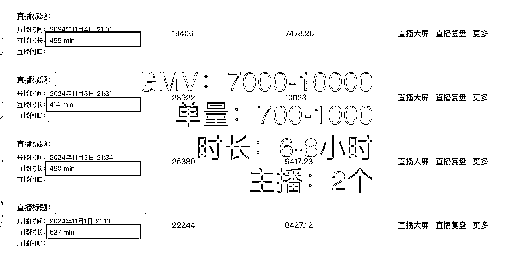
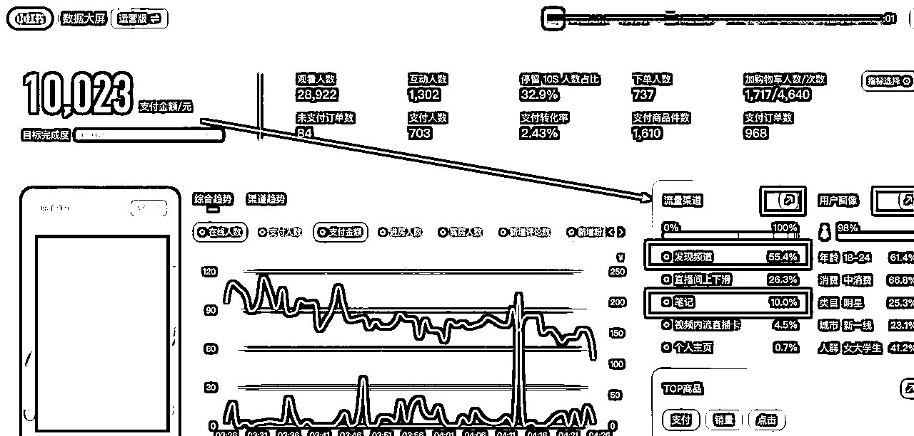
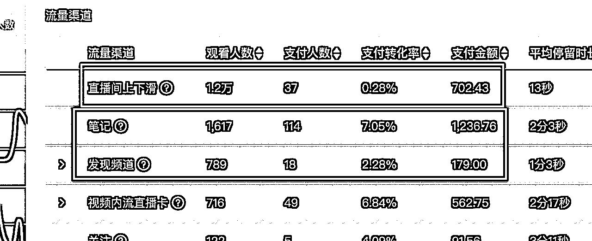
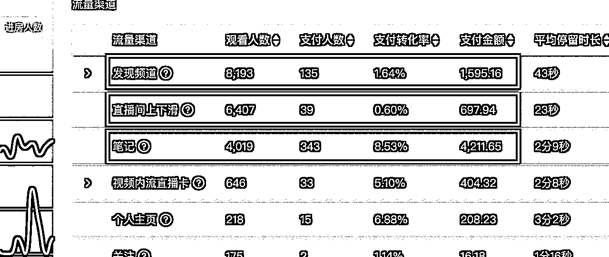
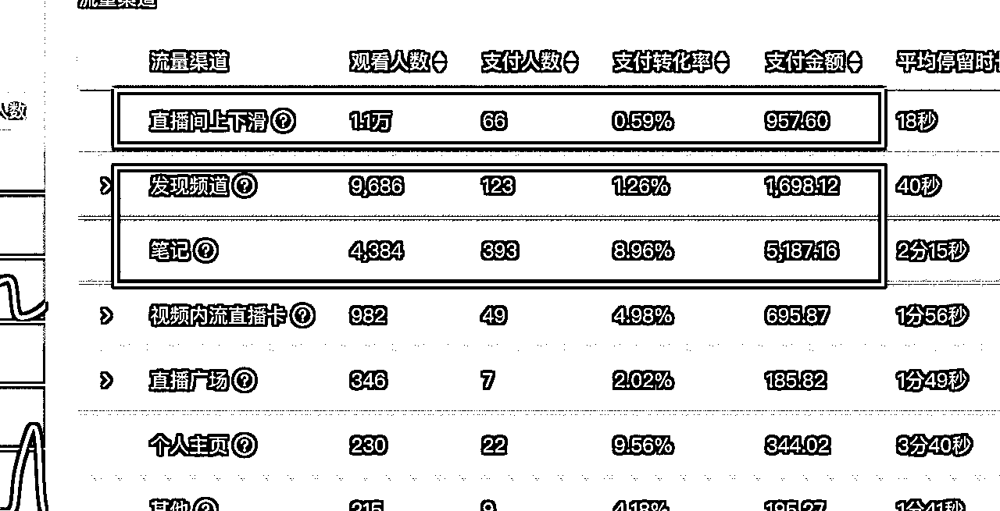
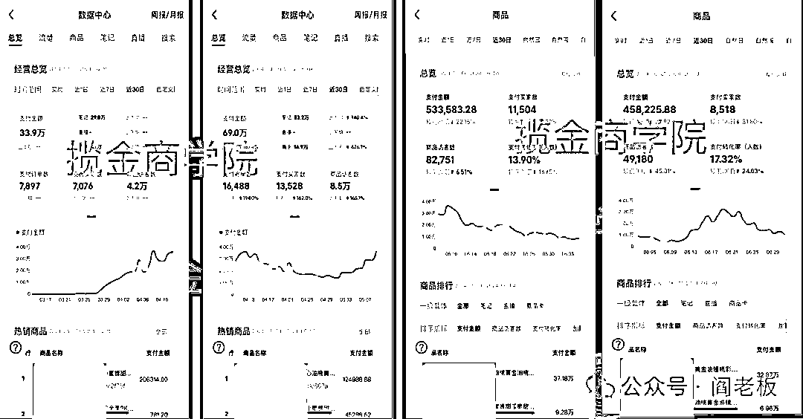
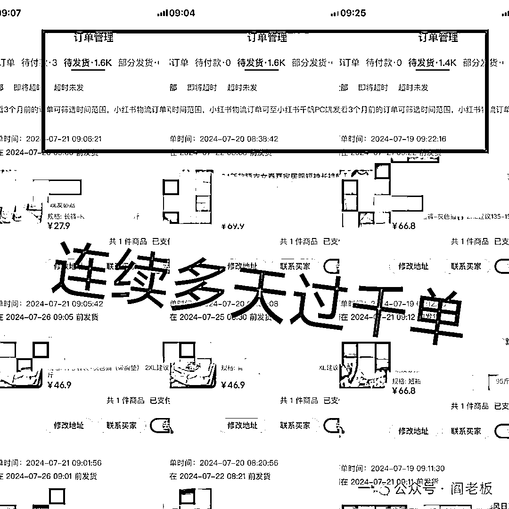
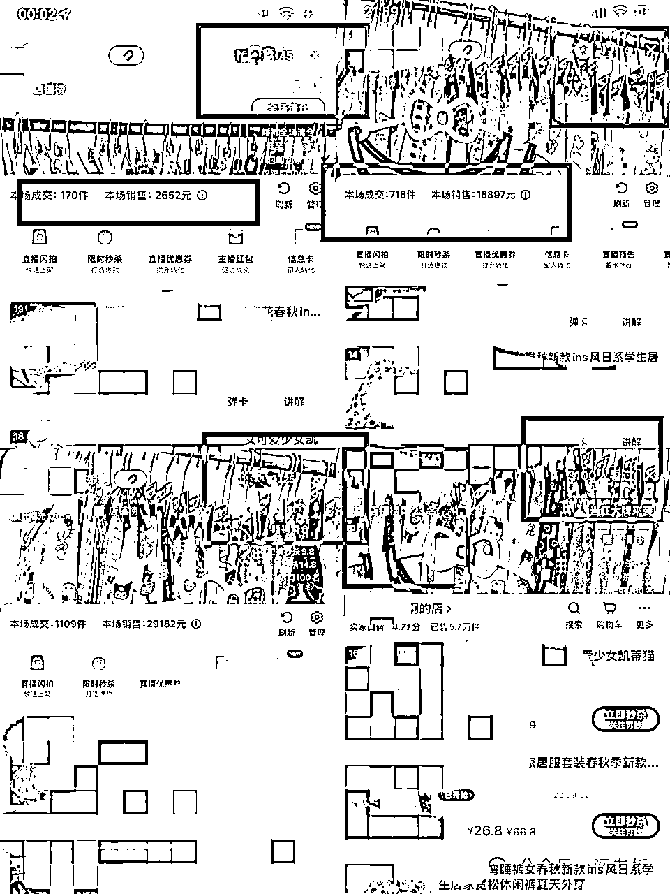

# 📕直播带货数据大屏复盘

这段时间我在一个内容社区试水美妆类目，双11之前连着播了7天，每天都冲过千单。从早期数据惨淡到后面的放量，积累了一些经验，写出来给大家参考。

先放三张对比图，看看策略调整后数据发生了什么变化。

初期的模式是每天播3-4小时，场均成交额1-2千，单量1-3百。后来试着把播的时间加到5-6小时，场均成交额提高到2-3千，单量来到3-5百。从这两组数能看出，把播间开久一点，成交额确实涨得快，这是最简单粗放的增长方式。但副作用也很明显，播主会非常疲惫，情绪一垮，成交率跟着往下走。

于是11月初我们做了两件事：一是把单场时间继续延到6-8小时，二是加了副播轮换。场均成交额跳到7千-1万，单量冲到7百-1千。同时平台上能参加的活动我们都报了一遍。

经过这轮调整，有三个重要判断：

第一，播主的精神状态才是基本盘。这个平台的观众不喜欢夸张话术，安静讲解、把产品讲清楚就够了。但麻烦的是，同时在线量很有限，看着屏幕上的几十人，心态很容易崩。所以延长播间时间的前提是播主还有体力，否则只是硬耗。

第二，平台组织的活动务必参加。很多小店销售额看起来普通，却能在榜单上排到前面，原因不是新账号有扶持，就是报名了平台活动。后台每月都会有新活动，参与后能在播间推荐上得到额外曝光。

第三，数据突然跳涨，通常不是因为播间被算法选中，而是某篇帖子爆了。如果你不是达人或者名人，没有名气加持，播放大厅的流量基本轮不到你。素人想出成绩，只能靠帖子引流。关于这种“帖子+播间”的配合，下面会细说。

看这组数据：一个单场销量破千、八成成交来自播间的个体小店，流量大头竟然是首页推荐和帖子，而不是播间上下滑。可见在整个带货链路里，帖子的贡献最大。这跟别的短视频平台用播间起号完全不同，在社区里纯靠播间打不开口子。即使是月销700万、九成成交都发生在播间的品牌商家，也一样要靠帖子带流量。具体看这个视频。

接下来是社群运营。不管货品单价高不高，务必把关注者拉进群里。社群的价值体现在三方面：

一、群管理员开始播时，群内会出现提醒，播间观看量立刻上升。
二、内容更新后丢到群里，能快速凑出起步互动，推动帖子进入更高的推荐池。特别是在播的头60分钟，上线前先在群里做预热，先做出一批成交，算法会给播间打上人群标签，再持续推荐类似用户，成交层级越高，播间热度越强。
三、有店铺的账号还能利用群内交易功能，即使没有在播，帖子也没放链接，照样可以在社群卖货。

至于怎么拉人进群，方法很朴实：解答日常问题、进群抽奖、清仓特价只给群友、帖子火了以后加上群入口并置顶评论引导。按这套走，通常一场就能凑满500人。

再讲核心买家的维护。从后台用户数据中能瞧出哪些老客消费能力强，这项能力我猜绝大多数人没认真看过，也没人公开讨论过。特别是做高单价商品，比如护肤品的，值得点对点维护。新品上市前，可以问她们对样品的体验；买过多次的人，不妨做个回访。这类用户就是产品的“精神合伙人”，她们的喜好直接影响选品、上新和研发。

还有一个极少人知道的入口：数据后台有个“用户明细”模块，可以直接看到关注你的用户列表，而且在这个社区里加好友也不用破解电话号码，绝大多数人没发现。详细操作方法看视频。

还有一些细节：播间没什么人时，播主可以盯着播主版数据面板做实时优化，例如让大家点亮关注标志、提醒放进购物车但没结账的人、看到提问就马上处理、根据停留情况决定换款还是催单。所有动作以数据为准。

另外，新手老板常担心露脸问题。这个平台对真人出镜几乎没有要求，规则宽松，不露脸也完全没问题，想播就上。

以上是播间层面的复盘。下面说说卖货的几种形态。以下内容是我7月写的数据观察，现在回看仍有效果。

很多人纠结：到底该发普通帖子、发带链接的帖子，还是专心做播？用三个案例来回答。

案例一：卖水果，3个月做到174万。

这位老板的优势在货源，自己能控价、控品、控量。能预售、能用顺丰、能处理售后、能持续上新。最终174万里，74%靠帖子带链接，零场播，25%靠帖子带出商品橱窗，其中有平台给到的流量倾斜，全部是免费流量。操作也不复杂：每天发1-2条带链接的帖子，封面始终围绕“多、大、满、真”来设计，把水果的实在感砸出来。随便搜一种水果翻翻封面，你就能理解。第一家店跑通后，他已经开出了第二、三家。

案例二：品牌商家播间，单月713万。

这个品牌有势能，也有多名播主轮番上阵，多店接力播。某家门店月销713万，95%来自播间，一半由帖子+播间协同带来，帖子不挂链接，纯免费流量。播得好的时候，一天能冲120万+。他们没玩什么技巧，就是品牌货安静讲解，不靠降价促销。对品牌商而言，现在入场是机会，因为很多类目在这个平台的播商板块还很少有人做，竞争程度远低于个人卖家扎堆的地方。

案例三：卖居家服的店，连续多天日出千单。

卖的是居家裤，日均1-3千单，80%来自帖子导流进播间。帖子延续电商文案风格，但故意不放购物链接。不带链接的帖子，推荐池比带链接的大得多。这家店没有天赋异禀，纯粹是执行能力够强，播间时间超过10小时，用最笨的办法把流量磨出来。

三个案例对应三种模式：
1. 纯内容带货、不开播，适合批量铺号。
2. 纯播间成交、零带货帖，适合有团队有货源的人。
3. 帖子不挂链接，全部导流到播间，也就是内容与播间深度配合。

这三种并非绝对，多试几次，才能知道账号重心在哪。我更推荐第三种，特别是低价、走实惠路线的商品，买家决策快，看到帖子一点就进，播间转化率随之上升。

再讲一个容易被忽略的细节：当你的同行没在播，而你在播，用户刷到你的帖子时，头像旁会亮起在线小灯，系统分发机制也会优先让正在播的账号露脸，对带有电商标签的用户尤其明显。我用一个专门刷购物的小号去搜商品，前排全是正在播的商家。可见播间状态本身也是一种排序加权。

当然，做播要耐得住冷清。白天榜单前三名的播间，同时在线量也就在千人上下。这个数字放在外面短视频平台可能不起眼，但在社区里已经不错了。商家榜的人气还会更低，但这也意味着机会——流量分散，竞争不激烈。

想了解同行动态，可以去翻达人榜和商家榜，你会发现同品类商家的在线量都很接近，几十人到几百人是常态。所以心态要稳，把时间撑住，增加被刷到的概率。只要熬得住，靠播间做到日销千单并不难。

哪怕播间里只有10-50人，也能做出千单。即便是新手，只要开口聊货，照样能出单。这个社区的消费力并不弱。几千人看过的播间，也可能挤进商家热卖榜前30。榜单并不只看销售额，新号初期会有流量倾斜，平台自然愿意多给你曝光。

最后补充一个观察同行的方法：直接搜品类词，比如“女装”或“珠宝”，往下刷，头像边闪着亮光的账号就是正在播。进入播间后，页面有榜单入口；或者在搜索结果的用户列表里，也能发现正在播的账号。

多尝试多调整，选对属于自己的路子才是关键。