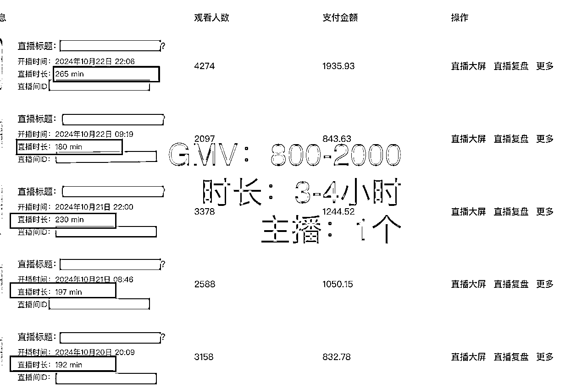
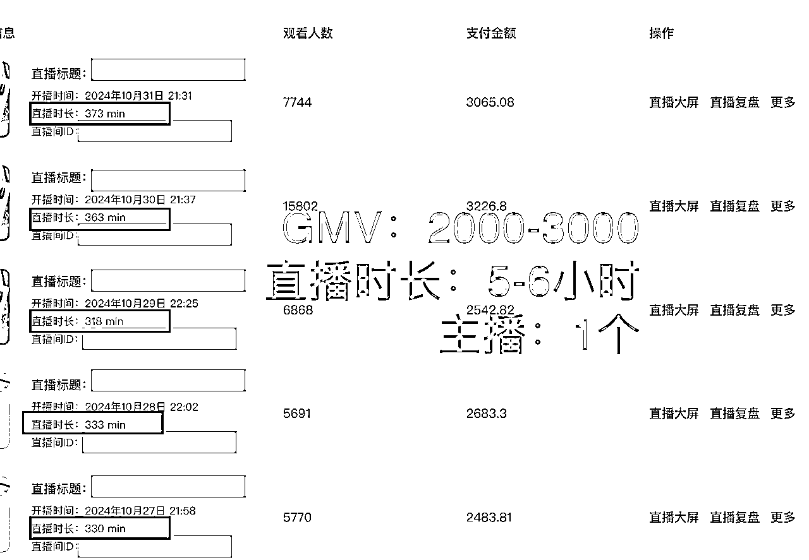
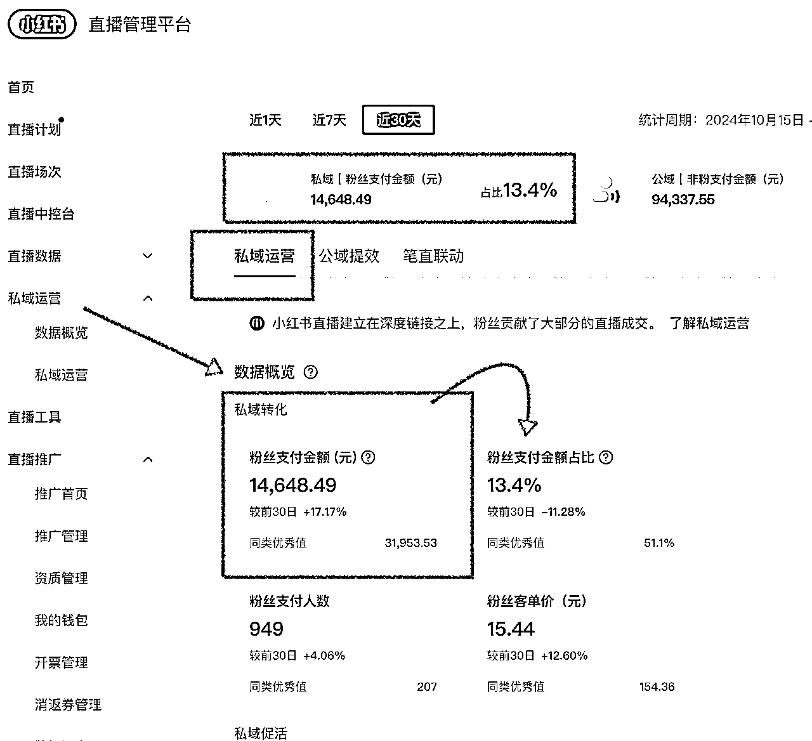
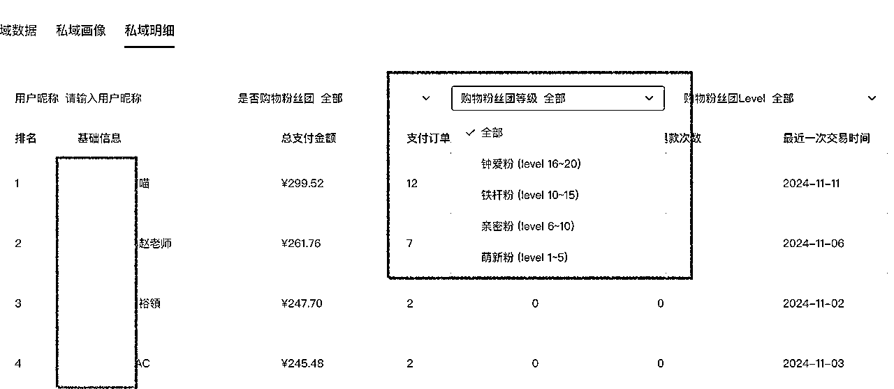
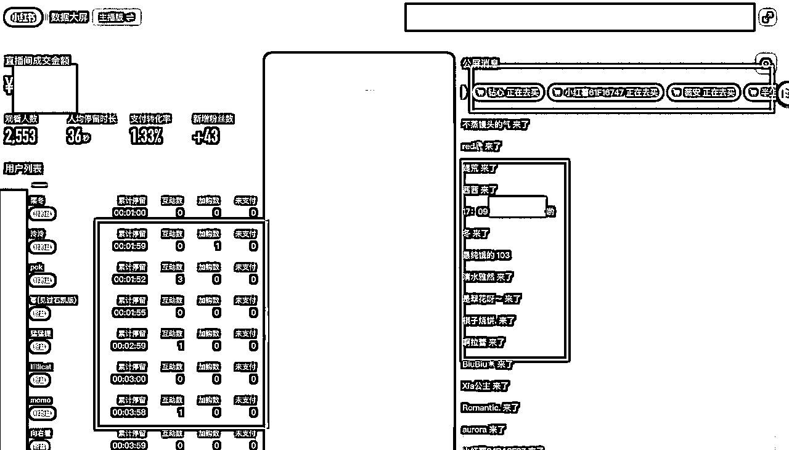
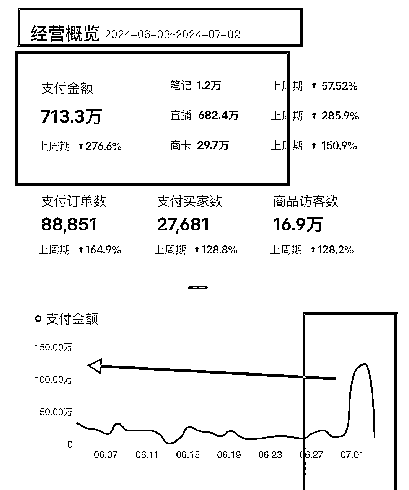
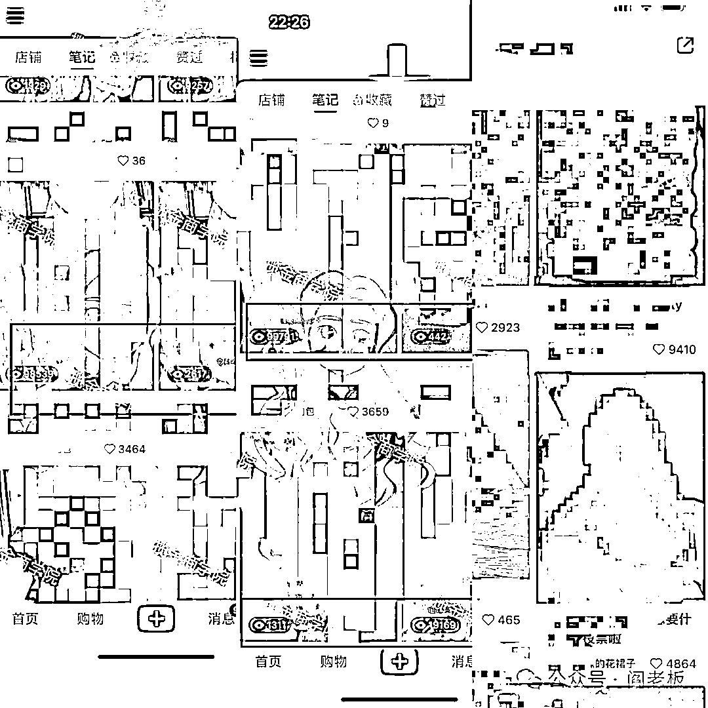
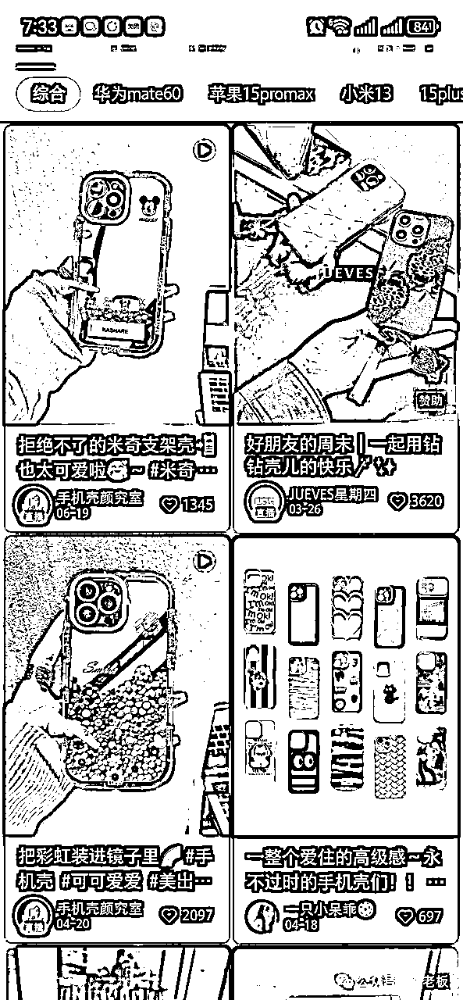

小红书直播带货复盘：7天破千单，我总结了这些关键经验

我是陶金金，在互联网行业摸爬滚打了6年，现在主攻小红书赛道，带过多个类目做到单月营收破百万。最近双十一前夕，我在小红书卖美妆，连续直播7天破了千单。这让我重新思考了小红书直播带货，今天把一些体会整理成这篇复盘。

先说结论：小红书直播带货，没有想象中那么难，但也绝对不轻松。

刚开播的时候，我每天播3-4小时，场均GMV在1000-2000元，订单量100-300。试着把时长拉到5-6小时后，场均GMV升到2000-3000元，订单量变成300-500。三组数据放在一起，差距很明显：

拉长直播时间确实是最直接、最省事的GMV提升方式，效果也立竿见影，但对主播的消耗非常大。一个人长时间播下去，精神状态很容易下滑，成交率反而会被拖累。

到了11月初，我把单场时长加到了6-8小时，同时增加一位副播，场均GMV一下子冲到7000-10000元，订单量来到700-1000单。这期间我还坚持报名官方活动。

这几轮优化里，我总结出三条经验：

第一，主播状态是核心。小红书的在线人数天然有天花板，不用像抖音那样堆大量话术，平播才是常态。可一旦直播间在线人数寥寥，主播心态很容易崩。所以拉时长可以，但前提是主播状态撑得住，否则就是在纯耗时间。

第二，官方活动一定要跟。有些个人店销售额看着一般，直播排行榜却靠前，背后要么是新号扶持，要么是踩中了官方活动。后台每个月都会上新活动，积极报名，直播推荐会拿到额外扶持。

第三，数据如果出现断层式增长，通常不是直播上了热门，而是笔记上了热门。买手和明星有知名度，还能吃直播广场的流量；普通人没有强人设和背书，更多要依赖笔记。这就是接下来要说的“笔直联动”。

笔直联动有多重要？直接看数据：

有一个个人店铺，单场销量1000多单，直播带货占比80%，但真正贡献流量的不是直播上下滑，而是发现频道和笔记。另一家月销700万的品牌店铺，90%靠直播带货，同样离不开笔记支撑。在小红书，直播带货功劳最大的流量来源，就是笔记、笔记、笔记。想靠纯直播起号，基本走不通——这跟抖音、视频号的暴力起号逻辑完全不同。

除了笔记，私域群聊也是必须做的一环。

不管你是低客单还是高客单，都建议建群，在群里持续触达客户。拉群有三个实打实的好处：

一是群主开播时，群里会有直播提醒，能有效拉高在线人数。
二是笔记更新后丢进群里，可以快速积累初始数据，让笔记有更大机会进入下一个流量池。尤其开播前在群里预热，把第一波成交做出来，平台算法就能根据这批用户画像，给你推荐更多相似人群，GMV层级也会被带高。
三是开通店铺的账号还有群内购功能，即使不直播、不发笔记带货，也能直接在群里发商品卖货。

引导进群的方法也很多：日常答疑、进群刷屏截屏抽奖、不定期清仓搞群内专享价，或者把已经跑出热度的笔记重新编辑挂上群聊入口，再在评论区置顶引导。用这套打法，基本一场直播就能拉满一个500人的群。

私域里还有一个容易被忽略的宝藏：

在直播数据后台的“私域明细”里，你能看到哪些客户消费意愿更高。这个功能我估计99%的人都没认真研究过，全网也没见谁提过。但用好了，你会发现之前私域里流失的订单真的不少。特别是高客单品类，比如护肤品，可以定期做一对一的维护。要上新品了，先问问老客对新品的体验感受；已经买过的品，也可以做回访调研。这些愿意为你付费的用户，其实是你的“精神股东”，他们的偏好直接影响你的选品、排品和产品迭代。

另外，再透露一个很炸裂的功能：在小红书做私域，不需要解密手机号也能加人，入口就在直播数据后台的私域明细里。

还有一些运营细节可以补充：

直播间人气不高的时候，主播可以打开主播版数据大屏，实时调整互动动作。比如提醒“加购未付款”的用户，及时答疑，根据停留时长换款或逼单，也可以用“加入粉丝团”这类指标判断场子热不热。千万别等数据冷了才动。还有，很多小白老板不知道：小红书真人直播不一定要露脸，平台规则友好，门槛很低，先播起来再说。

关于小红书卖货，到底该把重心放在笔记、挂车笔记，还是直播？这应该是99%的人都会纠结的问题。我7月份写过一份数据随笔，放在现在依然很受用。

先看三个样本：
1. 水果账号，3个月做到174万。
2. 品牌店播，单月做到713万。
3. 家居服，单日订单破千。

数据截图在这里：

第一个案例，水果老板的核心优势是供应链。他能自己控价、控品、控量，预售、顺丰物流、售后、上新品都游刃有余。174万里，74%来自笔记挂车，0直播，另外25%是笔记撬动商品卡带来的官方扶持，全程纯自然流。做法也不复杂：每天发1-2条挂车笔记，封面统一围绕“多、大、满、真”来呈现水果质感。一个店跑通后，立刻矩阵复制第二家、第三家。

第二个案例，品牌店播的优势在于品。品牌有势能，主播团队能力强，可以接力拉时长，多个主播多个店铺轮着播。其中一家店做了713万，95%靠直播带货，50%来自笔直联动，笔记不挂车，纯自然流。单日GMV最高可以到120万+。直播本身没什么技巧，就是牌子货平播、不破价。现在小红书直播板块里，很多品牌还没进来，竞争反而不像个人赛道那么激烈，品牌方完全可以试水。

再看两个数据截图：

第三个案例，卖家居裤，连续多天每天出单1000-3000单，80%靠笔记导流直播间。笔记继续用电商文案的写法，但就是不挂车。不挂车的笔记流量池，通常比挂车笔记更大。这个案例没有什么特殊优势，就是靠极强的执行力，直播时长经常超过10小时。这种很实在的“土办法”，只要你肯做，钱包基本都会有进账。

所以，小红书卖货的变现形式大致可以分成三类：
1. 纯笔记挂车、不做直播，适合重度笔记运营和多账号布局。
2. 纯直播带货、不做笔记，适合把直播作为核心，同时用非商业化笔记做铺垫。
3. 笔记全部不挂车，专门导流直播间，也就是“笔直联动”。

这三种不是绝对的，多去测试，找到自己的账号重心。特别推荐第三种，尤其是低客单价、主打性价比的大众品，用户决策成本低，非常容易跑量。

这里也放一张数据截图：

你看，同样的品、同样的粉丝量级、同样的销售量级，你的同行没在直播，而你在播，直播间左下角有呼吸灯在闪，意向客户大概率会优先点进来。这个呼吸灯也会继续加持爆款笔记的热度，让笔记有机会留在首页。平台推荐算法也会更倾斜给正在直播的号，尤其是有电商标签的人群，刷到你的比例会更大。我自己拿一个经常刷电商的号去刷手机壳，排在前面的几乎全是在直播的。

做小红书直播，一定要耐得住寂寞。白天热门时段排行榜前几的直播间，在线人数通常也就1000上下。抖音随便一个直播间就能有10万+，小红书就是1000+的玩法。品牌榜的在线人数还会更少，但这既是挑战，也是普通人的机会。你多看看主理人榜和店铺榜，和自己卖同类目的同行对比一下，就会发现大家在线人数其实都差不多，几十人、几百人。别嫌少，只要坚持播，让更多人刷到你，每天千单是有机会的。

哪怕直播间只有10-50人在线，同样可以做出千单。直播小白也不用怕，只要你开口讲，就会有人买，小红书人群的消费力是真的在。有时候直播间累计只有几千人看过，也能冲进小红书店铺榜前30。这个排行榜并不是只看销售额，新直播间开播基本都会拿到扶持，平台也希望能让更多人看到你。

最后说一个看直播的小技巧：直接在搜索框搜产品，比如“女装”“珠宝”，一直往下翻，就能看到头像带着呼吸灯、正在直播的直播间。点进去后，左上角会有排行榜，可以当参考；或者搜完产品后切到“用户”栏，也能看到正在直播的号。

多测试，找到适合自己的变现形式，才是最好的。