# 👸号文章、小绿书一条流程搞定：生成、配图、排版、发布（附最新 RPA 脚本）

之前我陆续搭建了👸号自动发布、小绿书内容生成，以及把📕内容转换成小绿书等工作流和脚本。实际部署后，大家反馈了不少使用上的难点：

- 工具分散，操作起来不够统一；
- 没有 Coze 使用经验的朋友，很难直接迁移和复用工作流；
- 有 IP 隔离需求时，旧方案不太适用；
- 文章排版仍需要额外处理。

于是，我花了一周时间把原有工具重新整合并优化。现在，这套方案可以做到：

1. 按照选题自动撰写文章；
2. 支持通过自定义提示词控制文章内容；
3. 根据主题生成金句类小绿书；
4. 提取内容关键词，自动生成配图；
5. 自动完成文章排版；
6. 自动发布👸号图文和小绿书内容；
7. 继续兼容此前的📕内容采集与小绿书转换脚本。

下面会介绍整套流程，以及配置和使用方法。

# 一、整体运行方式

1. 先在飞书选题表中填写准备发布的主题。
2. 由 RPA 脚本启动 Coze 工作流，读取选题后批量生成文章和配图。
3. 再通过 RPA 获取飞书中的待发布内容，完成👸号排版与发布。

# 二、部署前的准备工作

## 1. 配置飞书权限

首先要完成飞书应用申请和权限设置。这一步务必按照教程仔细配置，否则后续工具无法正常读取或写入表格。

## 2. 安装并设置比特浏览器

比特浏览器下载地址：  
https://www.bitbrowser.cn/

安装后进入系统配置，找到文件下载目录，将其改成你准备保存图片的路径。后续脚本会从这个目录读取下载的图片。

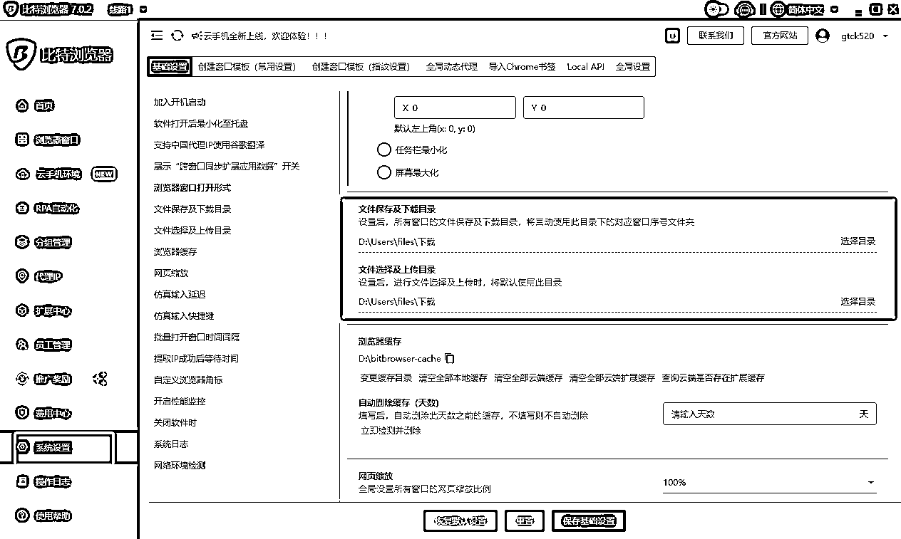

## 3. 导入 RPA 工作流

本方案需要导入三个脚本，请先把对应文件下载到本地。

打开比特浏览器，进入“RPA 自动化”，再点击“流程设计”。

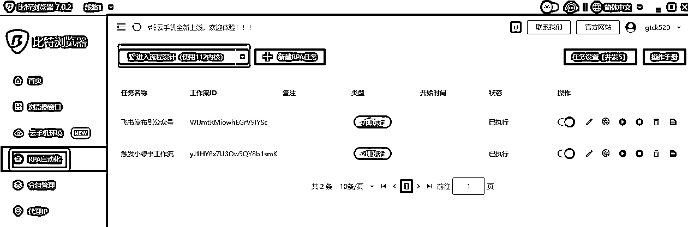

首次进入时，浏览器会初始化，并打开 RPA 调试窗口，Automa 插件也会一并安装。

打开 Automa，进入工作流页面，点击下拉菜单中的“导入工作流”，将下载好的工作流逐个导入。

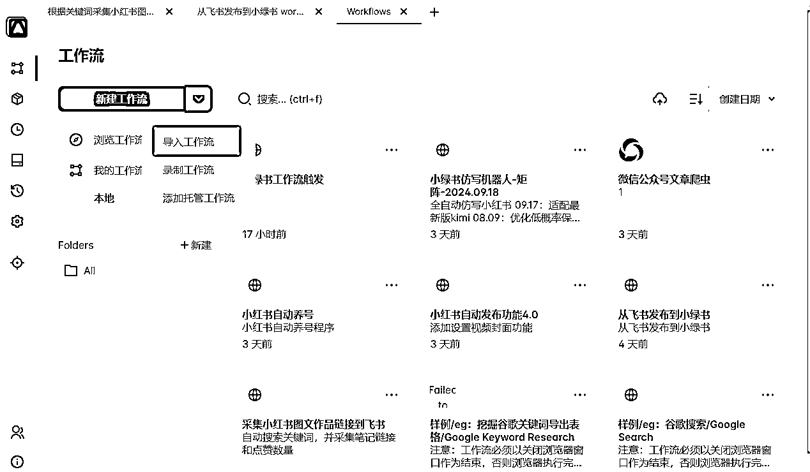

## 4. 准备墨滴排版页面

👸号文章的排版使用墨滴（MDNice）。AI 生成的正文采用 Markdown 格式，之后通过墨滴转换为👸号排版样式。

### 登录并创建文章

打开 https://www.mdnice.com/ ，注册或登录账号，然后新建一篇文章。

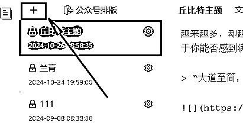

文章标题可以随意填写。

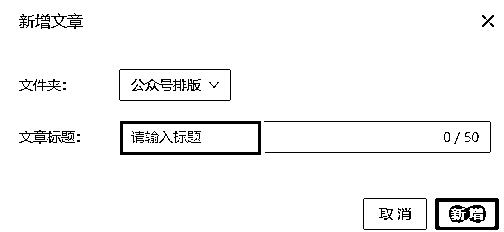

在正文里输入一些测试内容。

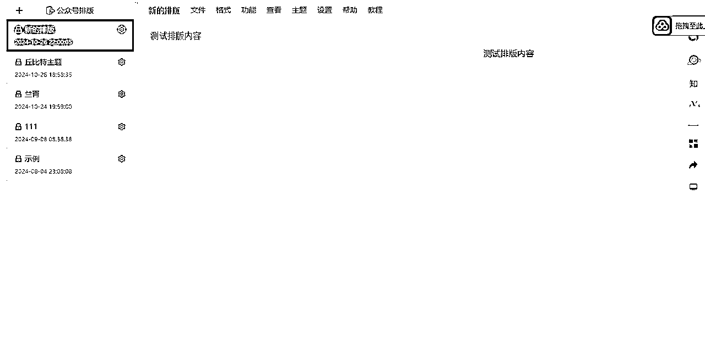

接着挑选自己喜欢的排版主题。之后生成的文章会使用这个主题。

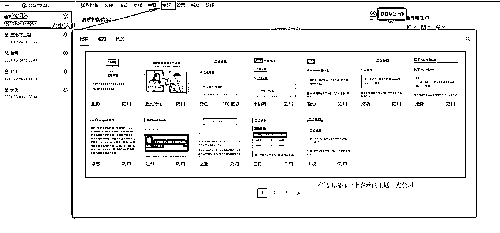

保存文章，并复制当前页面链接。稍后需要把这个地址填入脚本配置，复制完成后即可关闭页面。

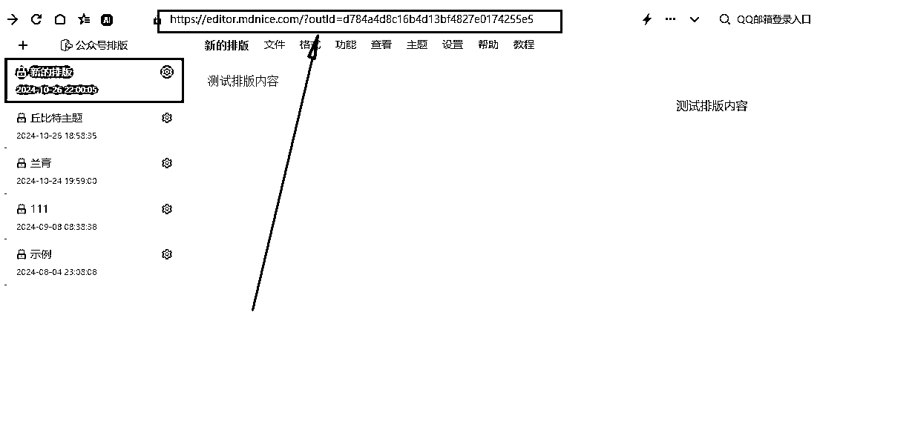

# 三、配置 RPA 脚本

## 1. 复制飞书模板

打开我的飞书表格并创建副本。

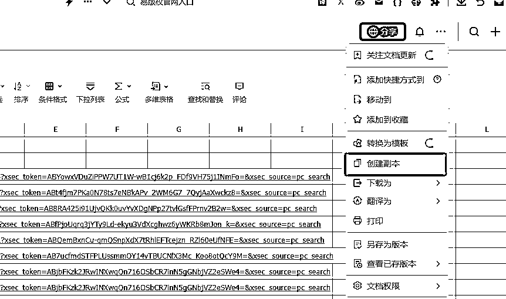

创建完成后，分别获取各个表单的链接。不同表单对应的链接各不相同，后面配置时需要准确填写，不能混用。

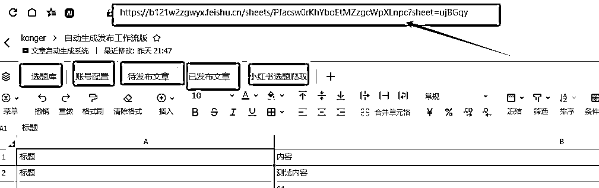

## 2. 修改脚本参数

在比特浏览器的“RPA 自动化”中进入流程设计，找到刚才导入的工作流并打开编辑页面。

在触发器后方找到“插入数据”节点，双击打开，再点击左侧的“insert data”。

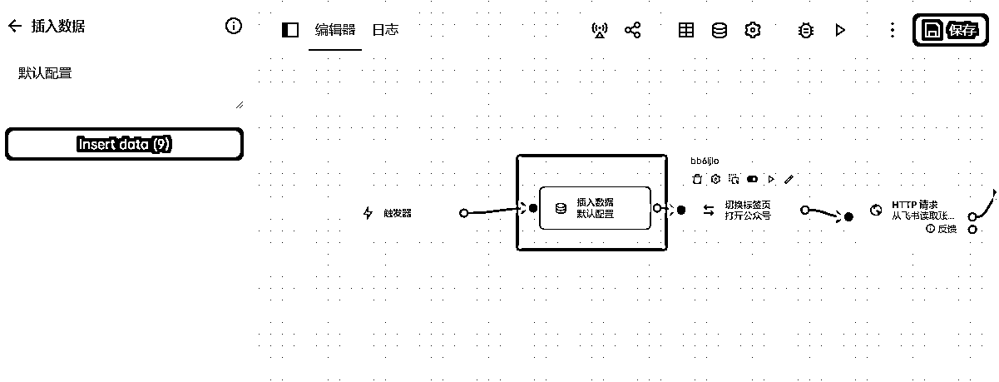

页面会显示一组参数。请将参数值替换成自己的信息，但不要修改变量名称，否则脚本可能无法正常运行。

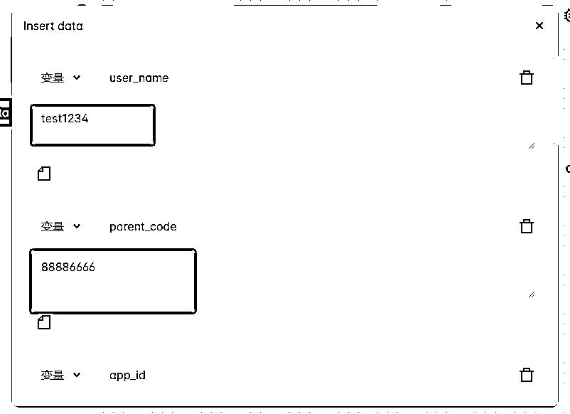

参数含义如下：

| 参数 | 填写内容 |
|---|---|
| `app_id` | 前面申请飞书应用时获得的 app_id |
| `app_secret` | 飞书应用对应的 app_secret |
| `daifabu_sheet_url` | 飞书“待发布”表单链接 |
| `yifabu_sheet_url` | 飞书“已发布”表单链接 |
| `zhanhao_sheet_url` | 飞书“账号配置”表单链接 |
| `sheet_url`、`xhs_sheet_url` | 飞书📕采集表单链接 |
| `save_draft` | 填 `1` 表示保存到草稿箱，填 `0` 表示直接发布（该功能仍待进一步测试） |
| `download_path` | 比特浏览器中设置的图片下载目录 |
| `is_bite` | 使用其他浏览器，或在比特浏览器 RPA 调试时填 `0`；正式绑定窗口运行时填 `1` |
| `markdown_theme` | 前面创建的墨滴主题文章链接 |
| `user_name` | 账号用户名，领取方法见后文 |
| `parent_code` | 上级邀请码，领取方法见后文 |

每个脚本都有自己的“插入数据”配置区域，别忘了逐个检查和修改。并非所有脚本都需要填写上表中的全部字段，按实际出现的参数对应设置即可。

## 3. 先调试，再绑定窗口

每个工作流配置完成后，先保存并单独运行调试。确认当前脚本正常，再继续处理下一个。

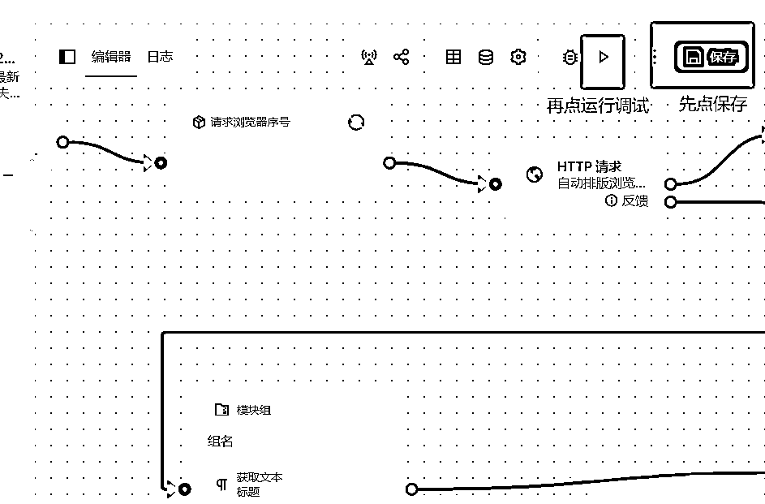

运行后可通过日志查看执行情况。

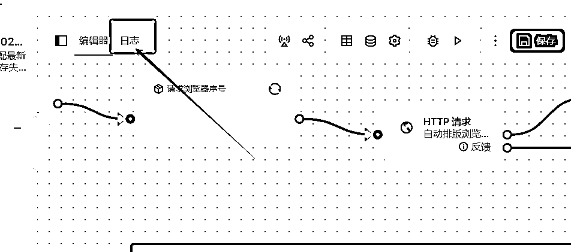

如果运行失败，通常会看到类似的报错提示。

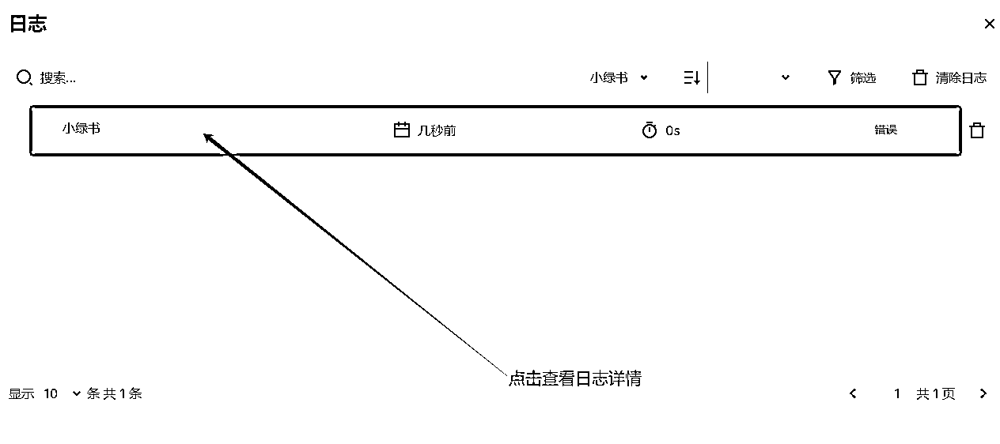

请根据报错内容排查。如果无法自行处理，可以打开错误详情，定位红色报错节点，并把具体信息发到交流群。

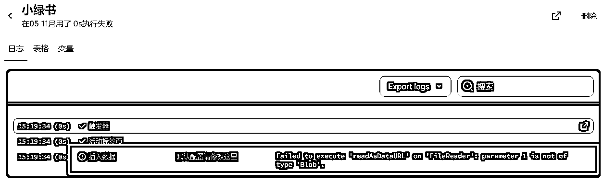

## 4. 将脚本绑定到浏览器窗口

完成基本配置后，脚本已经可以手动运行。若要支持多账号、定时任务和不同 IP 隔离，还需要将 RPA 工作流绑定到浏览器窗口。

### 创建浏览器窗口

进入“浏览器窗口”，点击“创建窗口”。

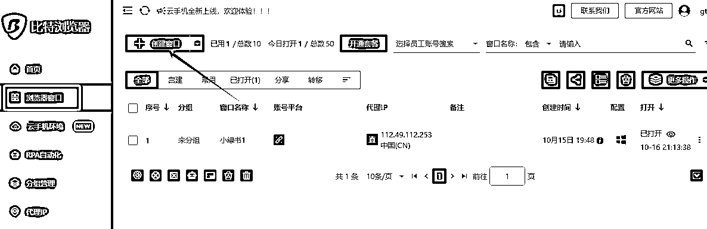

填写窗口名称，其他选项可以使用一键随机生成。

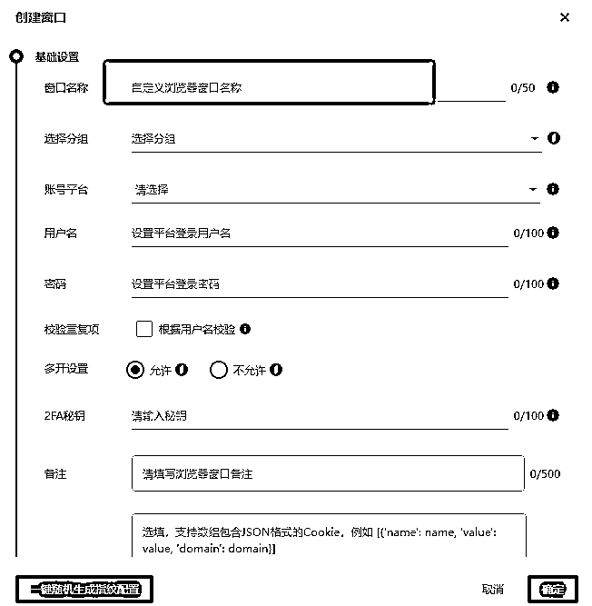

创建成功后，列表中会出现对应窗口。

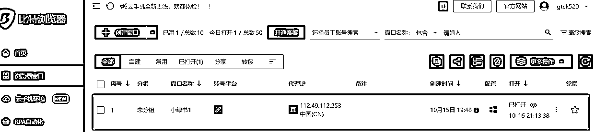

可以把每个窗口理解为一台独立运行浏览器的电脑。不同窗口可以配置不同 IP，因此多个👸号账号可以分别登录在不同窗口中，降低账号之间的关联。需要几个账号，就创建几个窗口，并在对应窗口登录相应🛰️。

### 新建并绑定 RPA 任务

进入“RPA 自动化”，新建一个 RPA 任务。

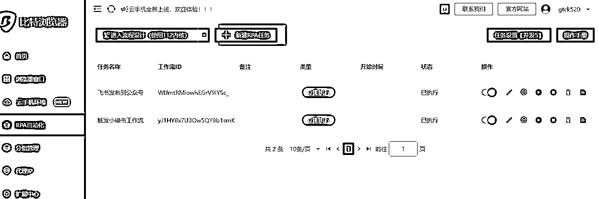

填写任务名称和工作流 ID，再点击“绑定”。工作流 ID 的获取位置见后面的说明。

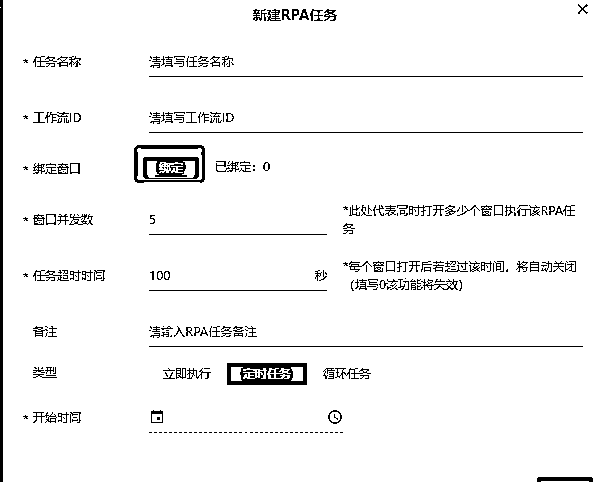

在弹出的窗口列表中选择要绑定的浏览器窗口。

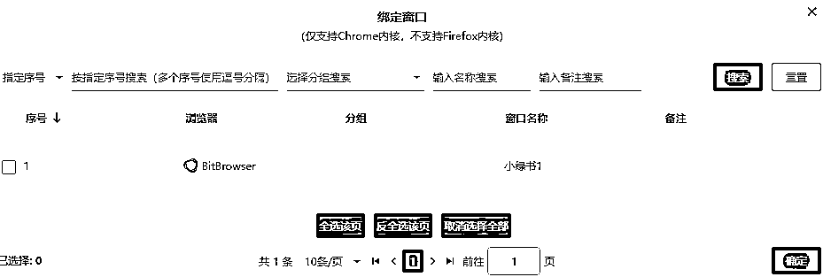

其他脚本也可以按照相同方式绑定。需要注意，📕采集脚本运行前需要填写输入参数，绑定窗口后操作不太方便，建议暂时不要绑定，除非已经了解如何调整脚本。

两个发布脚本都绑定后，页面会显示相应任务。

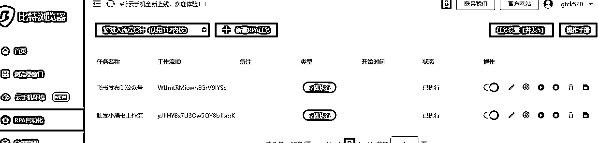

### 需要额外处理的权限

创建任务时填写的工作流 ID，可在以下位置复制：

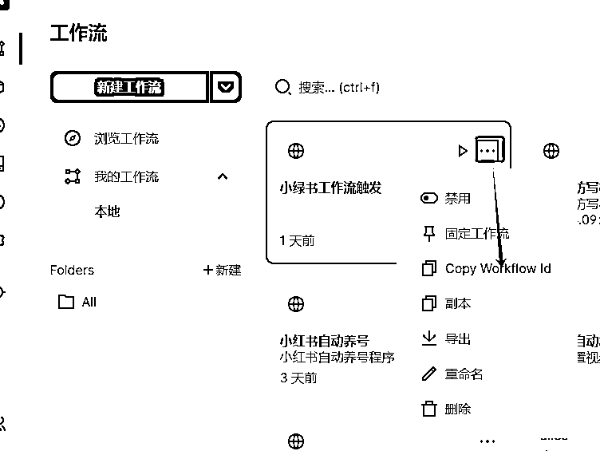

绑定默认窗口后，还要给“从飞书发布到小绿书”和“飞书发布到👸号”两个脚本中的“保存资源”控件授予下载目录权限。

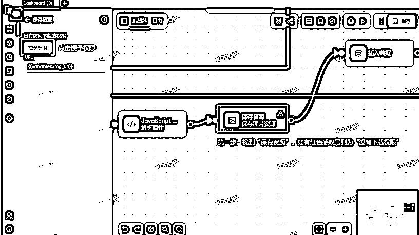

👸号发布工作流里另外有两个剪贴板节点，也需要单独授权。

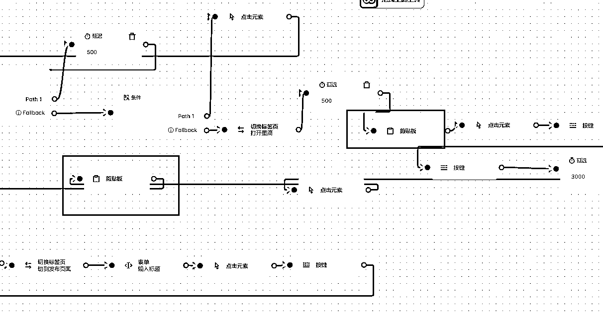

完成这些设置后，脚本即可开始使用。

# 四、飞书表格怎么填写

请不要改动模板表格的标题，否则脚本可能无法正确识别字段。

模板中主要涉及五类表单。

## 1. 选题库

选题库用于录入需要生成的内容主题，通常只要维护这张表即可。后续还计划增加热点自动采集功能，让选题也能自动进入表格。

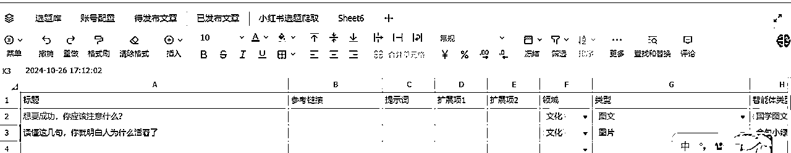

| 字段 | 用途 |
|---|---|
| 标题 | 填写要生成内容的标题 |
| 参考链接 | 填写需要参考或仿写的文章链接，目前测试支持👸号文章链接。若直接填写正文而不是链接，系统会按风格仿写处理。如果使用智能体生成内容，该字段必须留空；填入内容后系统会判断为仿写任务 |
| 领域 | 必填，用来匹配发布账号；只有领域与账号配置一致，内容才会分配给对应账号 |
| 类型 | 选择内容形式：图文代表👸号文章，图片代表小绿书内容 |
| 智能体类型 | 选择要生成的内容类型，目前支持金句类小绿书 |
| 是否可直接发布 | 尚未开发 |
| 是否需要生成 | 默认是否；选“是”后，每次都会重新生成 |
| 最后一次生成时间 | 有记录表示该标题已生成过。想重新生成时，可以清除时间，或将“是否需要生成”设为“是” |
| 提示词 | 智能体类型选择“自定义”时必填，用于指定生成要求 |
| 扩展项1 | 自定义类型必填，用来选择配图模型，可选“通用”或“人像” |
| 扩展项2 | 自定义类型必填，用来指定生成图片数量，填写数字 |

## 2. 账号配置

这张表决定内容发布到哪个账号。

| 字段 | 用途 |
|---|---|
| 账号 ID | 必填，填写数字且各账号不能重复，用于过滤已发布文章 |
| 账号名称 | 必填。👸号账号名称需与浏览器窗口中的账号名称一致，RPA 会据此匹配账号 |
| app_id | 旧版工作流发布需要填写，新脚本不需要 |
| app_secret | 旧版工作流发布需要填写，新脚本不需要 |
| 领域 | 必填，需与待发布内容的领域一致 |
| 平台 | 当前仅支持🛰️👸号，其他平台尚未开发 |
| 发布类型 | 必填，填写“图文”或“图片”，并与待发布内容的类型对应。如果同一账号既发文章也发小绿书，需要增加一条账号配置并修改发布类型，同时使用不同的账号 ID |
| 是否启用 | 旧版工作流发布时使用，新脚本不需要 |

## 3. 其他表单

“待发布文章”保存生成完成、等待发布的内容，一般无需手动调整。

“已发布文章”用于记录已经发布的内容，避免重复发布，通常也不需要修改。

“📕选题爬取”则用于上一篇教程中的📕内容采集流程。

# 五、领取账号信息

当前这套 AI 自动发布👸号的工作流需要邀请码。

## 领取步骤

1. 进入 Coze 团队空间，找到指定的智能体，点击账号领取。

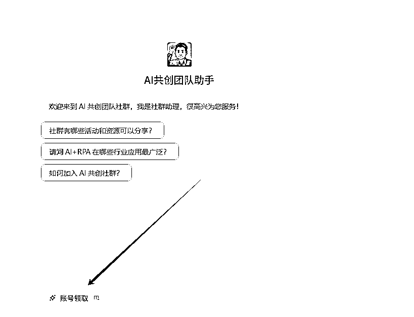

2. 打开机器人，点击右下角的“账号领取”，填写邀请码和用户名，即可生成自己的邀请码。

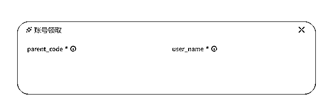

用户名相当于用户凭证。之后搭建部分插件时，需要同时使用上级邀请码和自己的用户名，请妥善保存。

3. 将领取到的信息保存好。

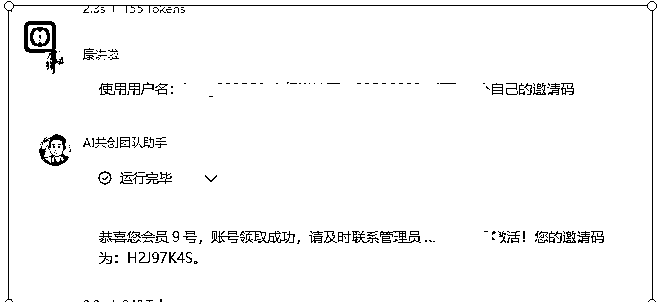

领取完成后，请发给我进行激活。没有上级邀请码的用户可填写 `88886666`。

# 六、常见问题

## 1. 📕采集显示成功，但飞书里没有数据

多数情况下是飞书权限或表格链接配置不正确。请先核对相关权限和表单地址，并参考飞书配置教程逐项检查。

## 2. 工作流提示同步失败或运行中止

如果脚本一启动就失败，通常需要检查配置；如果运行了很久、一直转圈后才报错，多半是 Coze 工作流超时。

遇到超时先查看飞书的“待发布文章”表格。如果内容已经生成，通常可以忽略这条超时提示。

## 3. 小绿书发布时报错，提示找不到“账号名称”或“标题”

例如出现 `Cannot read properties of undefined (reading '账号名称')`，或类似的“标题”报错，通常说明读取的表格没有数据。请确认表格内容不为空，并检查待发布表格链接是否正确。

## 4. 脚本没有报错，但👸号没有发布内容

请检查账号配置中的领域、发布类型是否与待发布内容一致，同时确认账号名称与👸号名称完全对应。只有匹配成功，脚本才会执行发布。

## 5. Mac 用户的图片路径问题

Mac 与 Windows 的路径格式不同。请在脚本“提取图片内容”代码块中找到 JavaScript 路径设置，把反斜杠 `\\` 改成正斜杠 `/` 后再试。

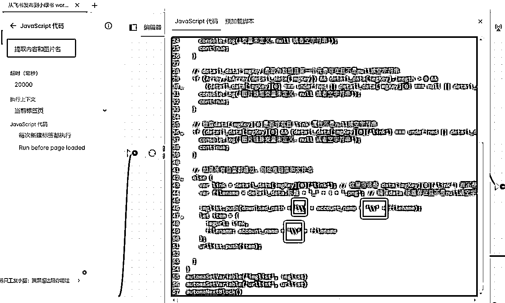

## 6. 服务号暂不支持

目前没有服务号用于测试，因此尚未完成服务号兼容，服务号暂时不能使用。

## 7. 比特浏览器内核版本

进入流程设计时，不建议选择最高版本内核。部分情况下高版本可能导致脚本无法触发，目前使用 112 内核相对稳定。

## 8. 提交问题时请提供日志

反馈时请说明具体使用的是哪个脚本，并附上错误日志。只说“不能运行”或“没有反应”，无法定位问题。

# 七、目前仍待优化的部分

1. **配图效果还不够稳定。** 目前系统会根据文章大意生成图片，但提示词是实时生成的，最终效果存在波动；同时 Coze 默认使用的通用模型有时会生成偏 2D 风格的图片。
2. **图片写入草稿箱偶尔会失败。** Coze 写入图片时可能遇到系统繁忙或插图失败，进而造成没有封面图，或文章无法成功保存。