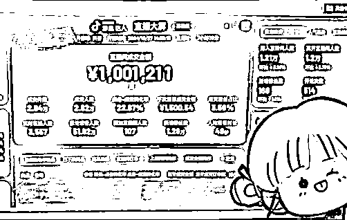
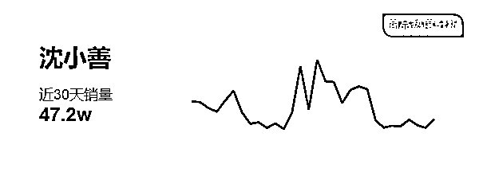
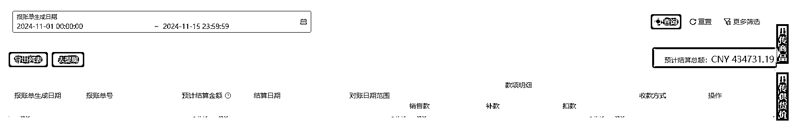
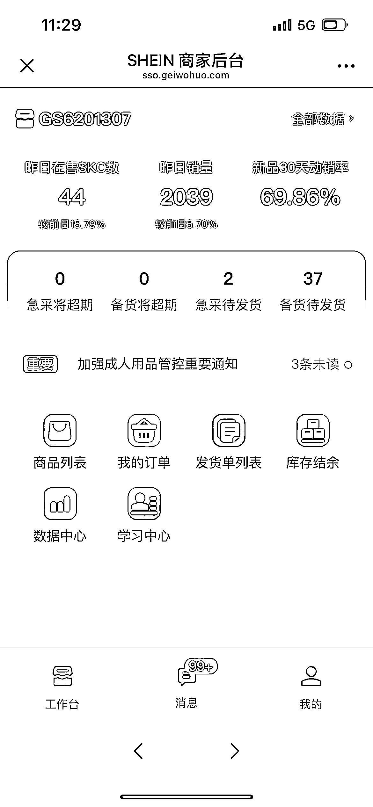
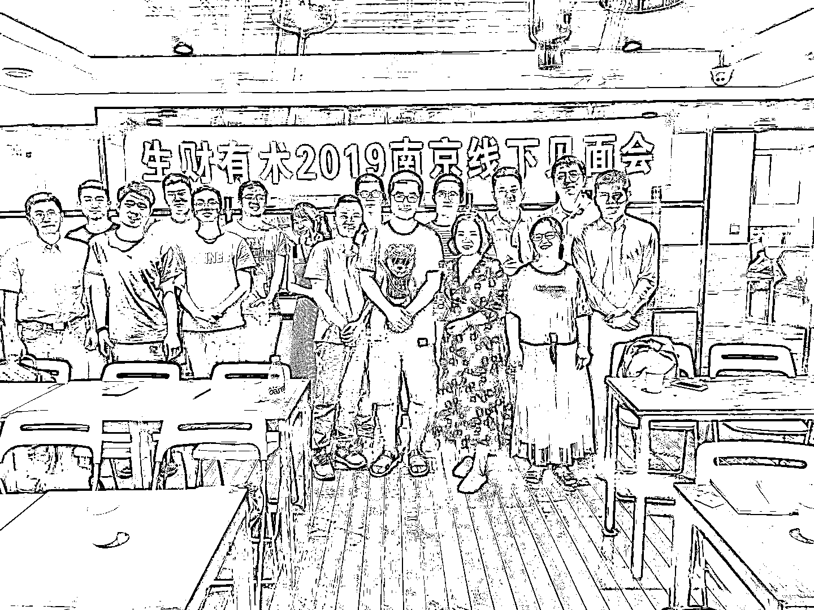
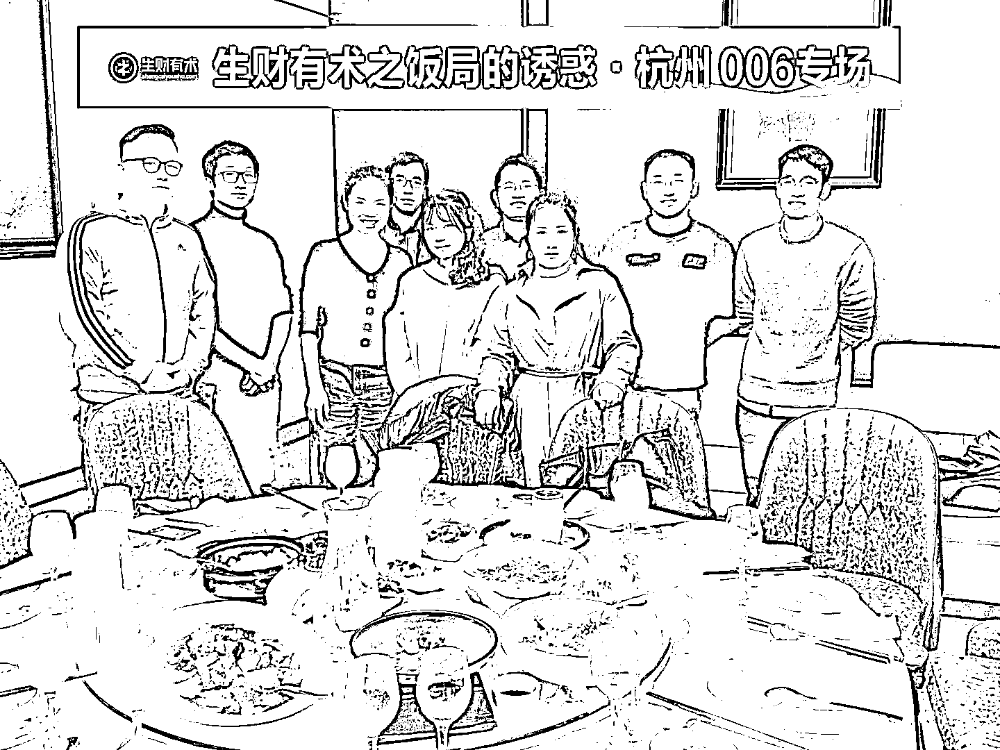

# ('项目实操：Shein 全托管-选品项目经验分享', (2, 25))

五年前，我战战兢兢地在赚钱有术发了第一篇帖子，标题是“进入星球很焦虑怎么办”。那时候看谁都觉得厉害，看自己哪哪都不行，干饭倒是第一名。

如今回头望，这五年像是被按了加速键。公司从十几个人一路涨到最高200多人，有了5000平的工厂；渠道从淘宝、京东、天猫，到抖音、拼多多、小红书、视频号，几乎每个平台都打出了成绩；单日销售额从三五万，一路冲到破百万。经常有人说今年生意难做，可我们反倒逆势往上走，国内电商里也算站上了第一梯队。

这五年，是我成长最快的五年，也是我学会“边挨打边记录”的五年。

说实话，能在国内这么卷的红海里活下来，我们已经磨出了一把还算锋利的剑。于是我开始想：这把剑能不能拿到国外试试？

原因有三个。第一，心里那口气一直没消，八国联军那笔账，我们这代人能不能用商业的方式讨回来？枪口对外，总比窝里斗痛快。第二，我想验证一下，我的产品方法论到底能不能跨越时间、空间、文化和种族。第三，也是最实际的：谁扛得住七倍效率赚钱的诱惑呢？

说干就干。9月，我彻底退出国内公司的管理线和业务线，跟我的好闺蜜、新合伙人小虹，俩人就冲进了出海赛道。

最初我们盯上的是TikTok。毕竟国内抖音的流量逻辑我们太熟了，单个SKU的量能有多大，心里清清楚楚。只要把这套打法搬过去，速度不就是七倍吗？想想就激动。

结果天不遂人愿。我们对比了中美消费者的需求，发现人和人之间的差异真的大到离谱。比如中国人地毯鞋子脏了要洗，美国人撒点粉末盖住味道接着用。倒是宠物相关的需求，全世界都差不多。于是我们首批就各运了300件宠物用品到美国。

等货的时候闲着也是闲着，我们顺手把SHEIN店铺注册了，随便上架一些产品打发时间。结果9月就开始零星出单。可那时候我们满脑子都是TikTok的星辰大海，货一到美国，立刻放下SHEIN，一头扎进素材研究里：美国人喜欢什么风格？评论区怎么翻译？视频怎么去水印？什么品好卖？怎么投流？

一边是TikTok需要大量原生素材和达人铺货，工作量巨到两个根本人扛不住；另一边是SHEIN随手上的产品，只花了TikTok十分之一的时间，一天却能出几十单。我们俩像被撕成两半，每天学英文、做素材、投流、还要采购发货，明明只有两个人，却感觉背着二十个人的责任。而我呢，只能在旁边打打气，具体活儿一样干不了。

10月，我们终于做了决定：先聚焦一个平台，暂时放下TikTok，全力打SHEIN。

奇迹就这么发生了。10月，单人利润做到3万；11月，预计能做到20万左右。截至11月15日，单店销售额已经冲到40万，店铺利润率超过20%。

这条路当然不是一帆风顺。从零开始做SHEIN，我们踩了一路的坑：

科学上网要解决；英语不好，得靠网页翻译辅助选品；店铺注册审核周期长，被打回好几次，搞了大半个月才通过；罚款规矩多，数据填错罚1000，少发货罚1000，简直哭笑不得；后来找到合作伙伴协助采购发货，集中采购才顺畅起来。

更折腾的是选品。一开始我们听说每店每月只能上15个品，后来好不容易找到一条可以无限上架的渠道，就疯狂试错，一天传8到10个新品，结果大部分连审核都过不了，更别说测试流量了。我们赶紧调整策略，改成每天只上传2到3个精挑细选的产品。这时候才明白，这个平台重视的是产品质量，铺货数量根本不重要。

接着我们做了一连串测试。上架了10到20个大品类产品，把供货价压到采购价的80%以下，结果平台对价格根本不敏感，就算比采购价低20%-30%也照样不卖。又把国内二三十个爆款直接搬过去，还是不行。中国人和外国人的需求差异，在这里被验证得明明白白。

于是我们彻底放弃原有思路，转身去研究外国人熟悉的产品，重点参考亚马逊、独立站和Temu的热销品。再经过一轮轮定向测试，不断优化上架原则和规律。到现在，我们上架的产品基本都能卖出去，只愁销量大小，不愁库存积压。

最后我们发现，SHEIN的订单非常稳定，平台不会轻易更换供应商，对价格管控也没有外界传得那么可怕。跟国内平台比，难度至少低了三个等级。只需要管好上下架，就能实现20%以上的利润率。

简单来说，我们的策略就是一句话：把外国消费者在Temu和亚马逊上买得勤、需求已经被验证过的产品，搬到SHEIN上来卖。

就这么个朴素的方法，在团队只有三个人、其中两个半还是新手的条件下，订单量突破了2039单/日。

很多人问，为什么现在做SHEIN还有机会？因为跟国内传统电商比，这里的竞争烈度真的降了至少三级。投入的时间少、需要的人数少、反馈速度还快。新手来做，第一个月每天花三四个小时，赚几千块钱不是难事，具体看你的选品能力。

这也是我愿意跟赚钱合作开这趟航海的原因。

顺便正式介绍一下：我们做的是SHEIN全托管项目。说白了，你只需要在中国选品和供货，SHEIN负责把货送到全世界，还帮你搞定客服和海外发货。销售环节，你基本不用操心。

运作流程就三步：第一，选品上架；第二，SHEIN会给商品测试流量，看转化表现；第三，如果卖得好，你就持续采购供货。

成本上，前期主要投入时间是选品和上架，初始采购3到5个样品就行，花不了多少钱。一个畅销品能卖2到6个月，就算表现不好，损失也就是时间和精力。我们团队目前能做到90%的采购商品都成功卖出去。而且我们提供成熟的店铺运营、必要的资金支持和行业经验，帮圈友快速突破新手期。

做成这件事，关键要素有两个：一是执行力。跨境电商要学全新的知识体系，光是适应不同的文字系统就劝退很多人，但门槛恰恰是竞争洼地，坚持下来的人就有机会。二是善于发掘平台差异化机会。我们已经总结出一些规律，但需要不断寻找符合规律的产品，同时持续优化迭代这些规律。

当然，难点也有。语言曾经是我最大的心理障碍，我大学英语四级都没过，但实际操作发现，用网页自动翻译就能解决，语言根本不是主要问题。真正的难点是适应新语言环境、熟悉新平台操作（比如亚马逊和Temu），以及为不同文化背景的消费者选品。这个过程需要持续的实践和耐心。

为了让圈友走得更顺，我们准备了全套支持：每天100-200个实战案例分析，错误原因精准标注，每天至少半小时在线答疑，还有群内互助交流。你只要交了作业，就能看所有人的作业和批注，快速得到反馈。

最后，说点心里话。

创业七八年，很多东西都变了，但“为这个世界做一些善良的事”这个初心没变。所以我想发起这次航海计划：中国人何必非要内卷？我们可以去跟美国人、欧洲人、巴西人竞争，实力一点都不虚。中华民族的伟大复兴，需要我们每个人出份力。让义乌的好小商品，摆满欧美家庭的餐桌和货架。

我见过太多普通人活在生活的漩涡里：男生为了赚钱不得不扛起责任；大厂的人担心明天被裁；想创业的人被账单捆住手脚。大多数人不努力吗？不是，只是方向可能偏了。但大家还是在坚持，还是在每天追求更好的生活。

几年前我写过一句话：我经历了很多失败，身边亲戚都劝我放弃，只有在这个社群，会有人鼓励我再试一次。这就是我爱这里的原因。

这一次，我想带着私心，请大家再试一次。

我的私心有三。第一，我想找志同道合的人，愿意为世界和用户做点善良的事。我知道这种人不多，但我还是想找。第二，我想为参与者创造价值，让不管是兼职还是全职的人，都能为家里带来可持续增长的收入，买得起一身好衣服，消费有底气。第三，我想帮助圈友认识自己，知道自己的长处和边界，让成功更近一步。所以这次航海准备了7天无理由下船的机会，不耽误你太多时间，只当给自己一次观察自己的机会。

这是我第一次“开船”。我知道我们团队更适合实干，不太会讲漂亮话，但我们真的在用心准备。我们希望让有产品运营天赋的人发光发热。如果过程中有任何问题，请立刻告诉我们，我们会全力解决。

如果我们真的努力了还是没做好，最后一定要骂的话……可以小声一点吗？🥺🥺

欢迎大家来报名，我们船上见。愿大家平安喜乐，远离忧愁和烦恼。时间真快，一晃五年，求仁得仁。这次，也一起冲一次吧。