我是赚钱圈子的施仁，今天继续做纯分享。先声明：我在赚钱发的东西全部免费，不招学员、不带项目、不收一分钱。无论你从哪个渠道找到我，咨询问题也好、请教细节也好，我都不收费。有疑问尽量在文章下面留言，我看到就会回，这样其他人也能参考，省得重复问。

为啥愿意白给？因为我在赚钱第三年了。第一年偶然在这认识了一个朋友，回头看那就是我人生的转折点；第二年靠着之前的积累，年底最后三个月到手130W+；今年8月就把自己定的年度小目标完成了。我觉得运气好，也真心感谢这个平台。所以想通过免费分享项目、软件、技术，去认识更多同频的人，一起合作共赢。

顺带说下合作需求：如果你手里有50个以上手机号，欢迎一起搞项目，这是硬门槛。要是你还有自己的工作室，手机卡、手机设备、电脑按50:5:2的比例配齐（大概50个手机号配5台手机、2台电脑），那就更完美了。

进入正题。这次说的是得物最近的一个活动，只要有手机号就能干。一个手机号可以拿到：4张88元无门槛券、2张100元无门槛券，做完进阶任务还能再拿1张200元无门槛券。缺点是：一个号只能做一次，到手的是券不是现金，而且周期拉得比较长，要6周才能把券全部拿齐。优点也很明显：号够多就能矩阵批量上，软件全自动操作，省人工。

# 券怎么变成钱？

1. **闲鱼转卖**：最主流，大家自己去闲鱼搜“得物券”，几折在卖一目了然，不同面额什么行情清清楚楚，不多介绍。
2. **撸货**：用券在得物下单，再把货转手出去。这条路需要渠道和经验，有资源的可以考虑。
3. **自用**：吃喝穿用，直接买。去年我就是一部分挂闲鱼，一部分自己消费掉了。

# 批量实操全流程

手机号少于5个的朋友，看完流程直接手动做就行，不用纠结批量问题。需要的软件和资料放在文末。

## 一、安卓手机环境搭建

系统最好在安卓10到12之间，13不稳定，得自己测。如果提示“网络连接请重试”，多半就是系统太新，跑不动。

这一步目的是做环境隔离，免得得物检测到同一个设备登录多个号。先装VMOS.apk和VMOS助手。打开VMOS助手会提示授权，一路同意就行。还需要开启开发者模式，不会就百度自己手机型号怎么开。

请注意最后这一步，有些手机就是设置不成功，我当年卡了很久才找到原因。无线调试要开着，同时手机通知栏会弹出一个对话框。点开无线调试，选择“使用配对码配对设备”。

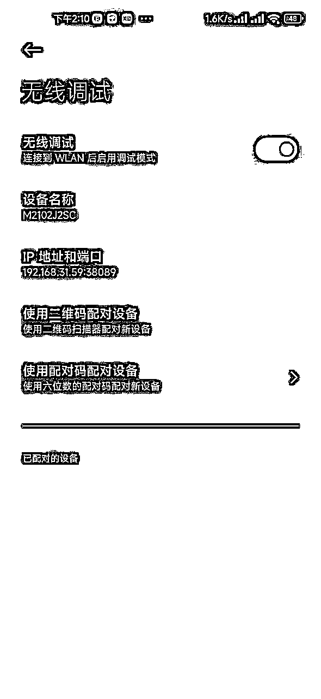

屏幕上会跳出一串数字，先记住它。

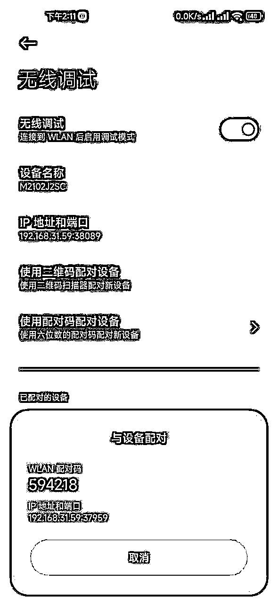

下拉通知栏，点“输入配对码”。如果没看到“输入对话框”，返回无线调试上一页，重新进来，再点“使用配对码配对设备”，拿到数字码后下拉通知栏输入。也可以检查一下助手有没有通知栏权限，权限必须给足。

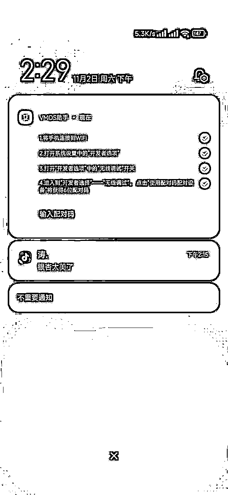

把那串数字输进去就行。

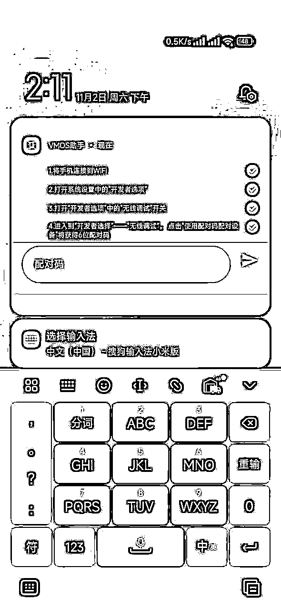

有的设备点“输入配对码”没反应。去手机设置里找通知栏，把通知栏样式改成原生版。如果通知被折叠，长按通知才能看到全部内容。

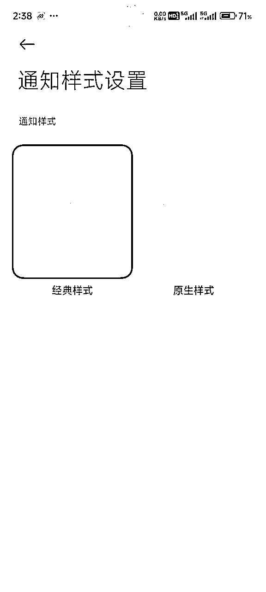

这个坑当时折磨了我好久，最后才找到解法。

## 二、在隔离环境里装APP、注册账号

先在真机上下载一个得物。然后打开VMOS，第一次打开可能会让你选模式，选最上面的“手动模式”即可。点右上角的加号添加设备。

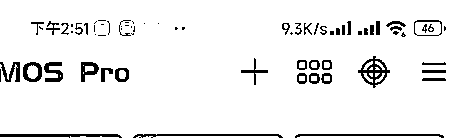

添加设备那里白屏也别管，点右上角三个点，选择“导入rom”，把2024虚拟机备份导入进来。这个压缩包我最后会分享出来。

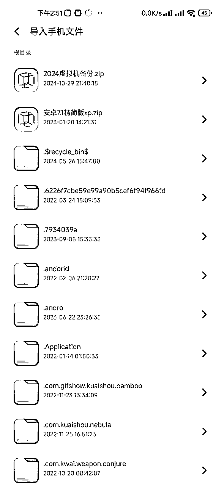

导入会花一两天？不，是一两分钟——稍微等等。如果虚拟机黑屏，退回主手机再进来，或者关掉虚拟机重新打开。接着点最下面的“导入”，勾选得物，再点确定，虚拟机就会自动装好得物APP。

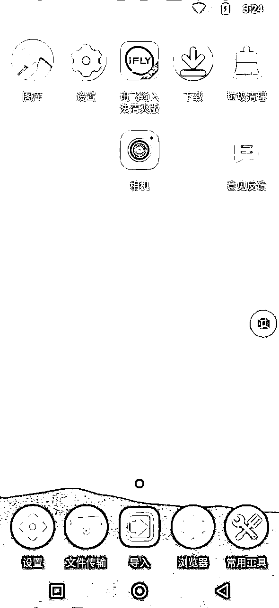

到这里，环境隔离就完成了。

## 三、提交活动资格

这个活动我前阵子其实在赚钱发过风向标，但没多少人注意到。

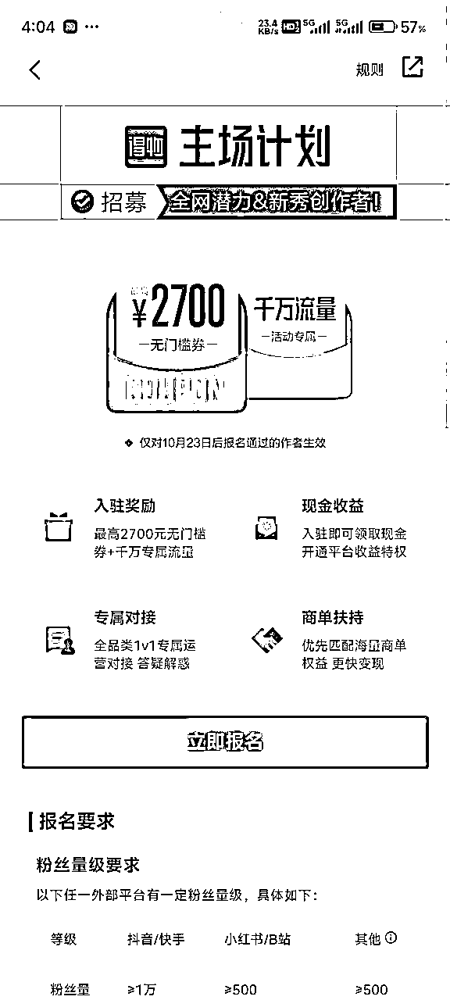

再说一遍奖励：一个号能拿4张88元无门槛券、2张100元无门槛券，进阶任务完成还能再领1张200元无门槛券。

活动入口：得物App里搜索“得物主场活动”，点进去就能看到活动页和具体要求。

* * *

（广告嫌疑部分删除）

* * *

最难的一步已经搞定了，后面就是等审核。一般提交后第三个或第四个工作日会出结果，周末会慢一些。审核通过会收到消息提醒，具体看视频；不通过也会有通知。收到通知后，点进去看活动要求和期限。活动当天就开始计时。

7天为一个周期，一共6周。任务逻辑举个例子，比如11月1号任务开始：

- 第一阶段：11.1-11.7内必须发三天视频，11.1-11.14内视频总播放>100。
- 第二阶段：11.8-11.14内必须发三天视频，11.8-11.21内视频总播放>100。
- 第三阶段：11.15-11.21内必须发三天视频，11.15-11.28内视频总播放>100。

以此类推。注意看任务期限：视频活跃任务是一周，播放量任务期限是两周。

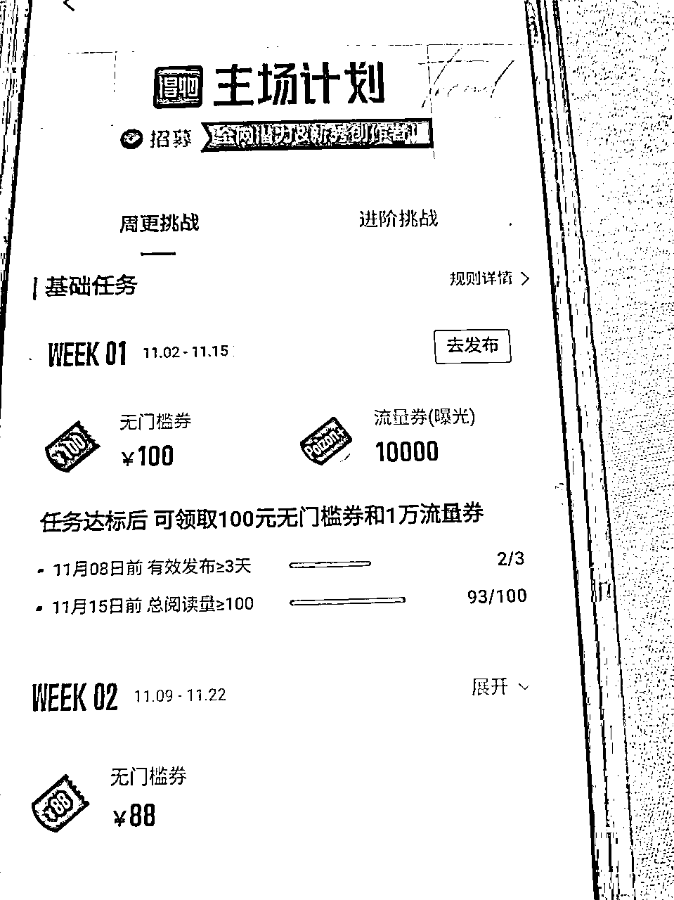

视频一共发三天，然后看播放量是否达标，总播放100就行。6个视频随随便便凑够一百播放，不够就每天再补发两个，五天左右肯定达标。再说播放量任务期限实际是两周，完全不用慌。

任务达标了怎么领券？你三天视频发完、播放量超过100，哪怕没到任务期限，也可以直接点“领取奖励”，点击领取后无门槛券就会到账。

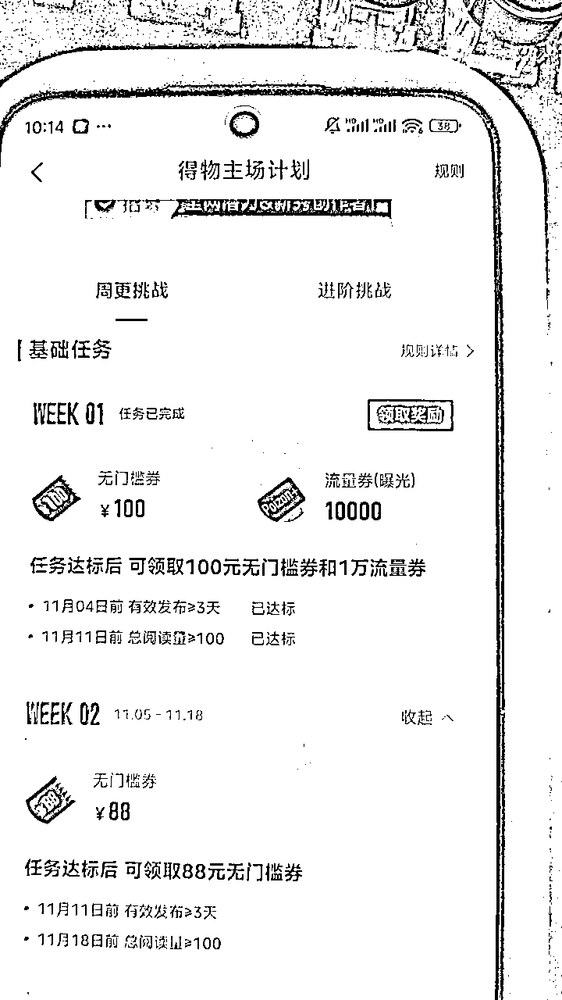

## 四、素材批量剪辑

这一步主要针对批量账号，号少的可以跳过。参加得物活动，一个号保险起见要发40个左右视频。可以下载油管视频或者其他平台视频（这里不多说，自己去领会，发的作品别被判搬运就行）。用分割的方式，把一个2分钟的作品切成5到6个40秒的小段。我会分享一个批量分割软件，能把一个文件夹里的所有视频全部按指定时长切开。

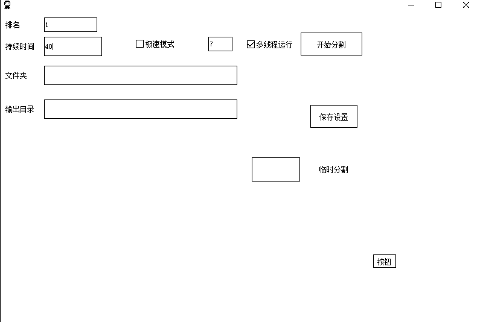

然后所有分割好的视频，按每个文件夹40个作品整理成多个文件夹，一个文件夹对应一个账号。

## 五、软件全自动批量发布

软件使用教程看视频即可。这里简单说下自动发布流程：先把所有账号登录，再给账号分组（不分组会默认归到默认分组）。点“账号设置”，右边下拉框把自动发布平台选成“得物”。

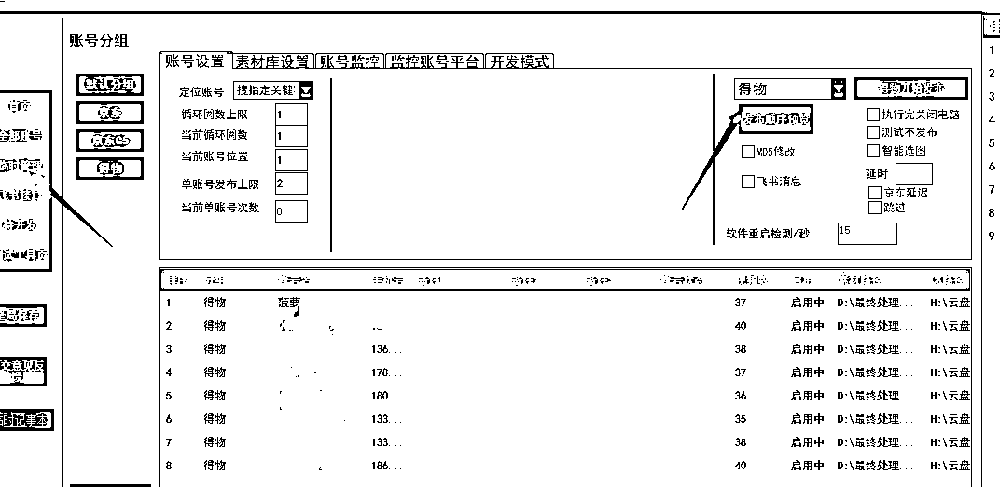

在素材路径那里选好你的素材文件夹，一个文件夹对应一个账号。

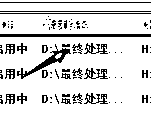

设置好后单击账号名字，会跳到素材库设置界面。可以单独设置每个视频的标题和描述，也可以一键批量设置。

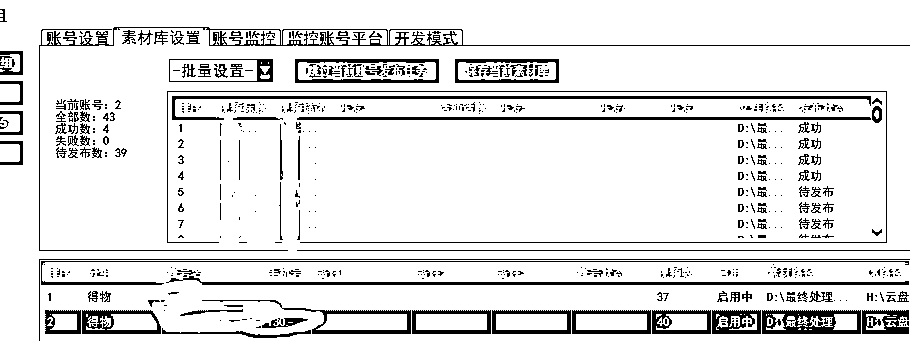

全部设置完成后，回到账号设置。

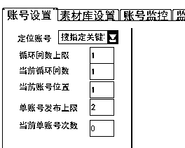

按我图里的顺序设置：每个号发两个作品，全部账号发完就停止。

然后点这个按钮，开始自动发布。

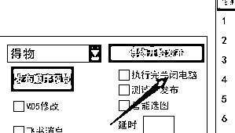

之后每天打开软件运行一次就行了。

## 六、复查作品达标情况

记好每个账号的任务完成时间，提前查看进度。我自己是用飞书表格，把每个得物号、活动开始时间、详情都列出来。任务要求是每周活跃三天，也就是每天发一个视频，至少发三天——这个用软件很轻松就能做到。播放方面，每周总播放100，不够就坚持多发两天视频，他要的是总播放量，不是单条播放量，很容易达标。特别注意：七天任务里必须发满三天视频，这是最关键的达标条件。

所需软件：

百度网盘分享的文件：DW2024  
链接：https://pan.baidu.com/s/1JIfs83bfmQMo5PMgWCAkiQ?pwd=tw2a  
提取码：tw2a

购买地址：

点击页面跳转获取