# 手工复原一个 Shorts 爆款 AI 视频，我花了 4 小时

> 来源：[https://qrm33w1izc.feishu.cn/docx/CBBpdId00o2k0fxM7ilcLCyhnOh](https://qrm33w1izc.feishu.cn/docx/CBBpdId00o2k0fxM7ilcLCyhnOh)

先看一下复刻前后对比

第一个是原片，第二个是我复刻的版本

新鲜出炉，左边原视频右边是我的复刻效果

放一起看就知道差距了，虽然名字叫复刻，其实差别不小。原版更细腻更顺滑，我这个第一版有点糙，但整体氛围和风格是跑出来了。毕竟是第一次尝试，流程已经跑通了，后面只要不断打磨，完全可以做到更接近。

全程大概花了四个小时，最耗时的就是出图环节。要是以后想做成自动化，这一块就是最大的卡点。下面就把我这次手工复刻的完整思路和踩过的坑都摊开说。

# 1. 先锁定对标账号

这次只是练手，直接拿了 @叉叉敌 大佬案例里的账号来拆。如果是正式做号去做内容，建议先去看 @老马内容出海 关于怎么找对标账号的文章，讲得非常细。

# 2. 把关键帧扒下来

我直接在播放页手动截图。对标视频一共十来个镜头，每个镜头截一张当参考。想自动截的同学可以去看 @叉叉敌 大佬的一键复刻那篇贴子。

# 3. 做出自己的基准图

底层逻辑都大同小异：

* 让 AI 先读图写出描述词
* 用描述词重新生成图片
* 图片出来后要么直接拿图做转场，要么再用 AI 把图扩成小视频，最后拼接成完整片子，两条路都能走

这次我是用豆包来做图片分析和出图，用 runway 来做图生视频。

## 3.1 用豆包拆解描述词

把截好的图直接丢给豆包，让它描述画面。它能概括出整体构图、主体、配色、光影、风格和背景，但细节会比较粗。要想补服装细节、表情神态，就得继续追问。想把表情动作也复刻到位，描述词就得反复微调。而我最头疼的就是这一步，写出来的词常常和脑子里预期的有那么一点点偏差。

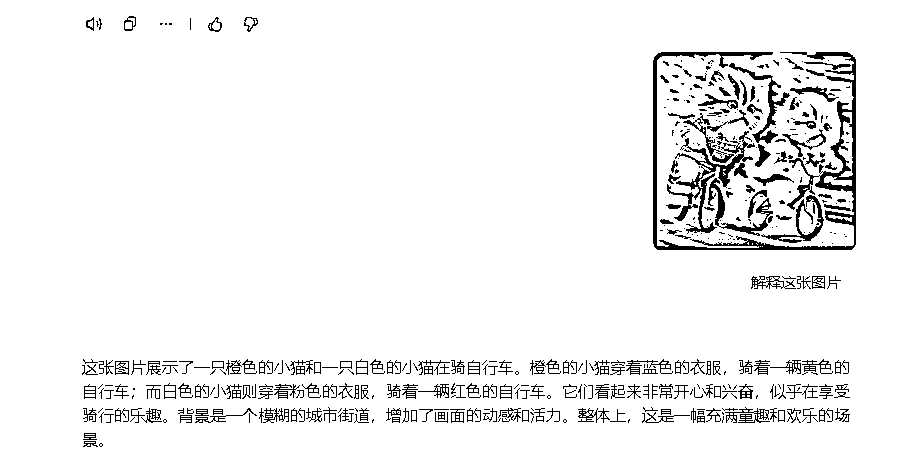

## 3.2 描述词调优时遇到的坑

我最开始想做像素级还原，干脆让它写一个相似度 90% 的提示词，然后再小修小改。结果出来的效果和之前差不多。想想也正常，几句话很难覆盖上千像素的信息。所以我放弃了追求完全一致的想法，后来连可灵也测了，同样一段描述，不同平台出来的画风天差地别。应该是模型差异决定的。能有 70-80% 的相似度我就认了，毕竟同一个平台也做不出 100% 一样的图。

关键词和实际效果对不上

我说要猫咪抬脚踹人，它纹丝不动；让它坐下，它也不坐；想让自行车倒在地上，我把能想到的词全塞进去，它就是竖着立。总结了几种典型状况：

1. 平台识别不到这个词。踢人、抬腿没反应，换成“奔跑”，画面看起来就像在踢。
2. 平台本身就不太吃这个设定。比如猫咪骑车的场景，我想让车倒地，试了无数种说法都不行，

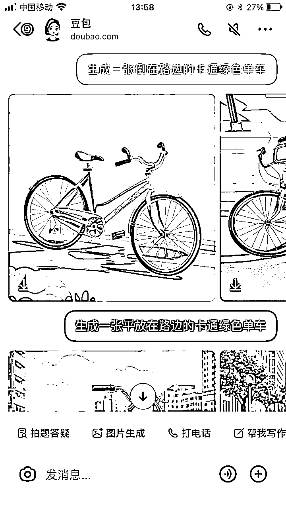

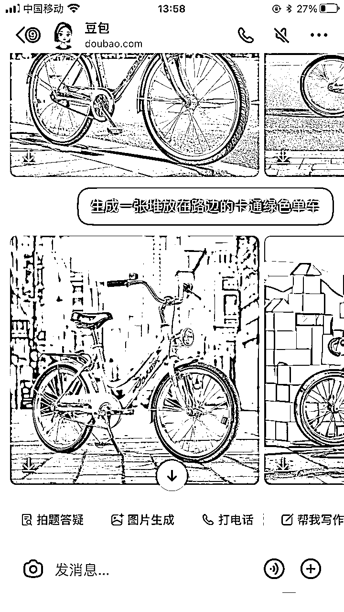

做着做着我都开始怀疑自己，是不是我表达有问题。转念一想，我是赚钱人，不能自我怀疑。于是我现场拍了一张真实倒地的自行车照片丢进去，让它先读图再生成，甚至照着它给的建议去调倾斜角度，还是不行。说明平台能看懂，但做不到，那就放弃，换个平台再试。

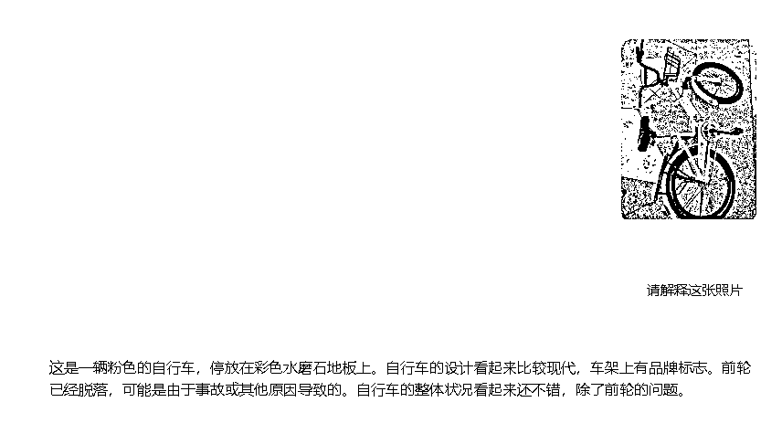

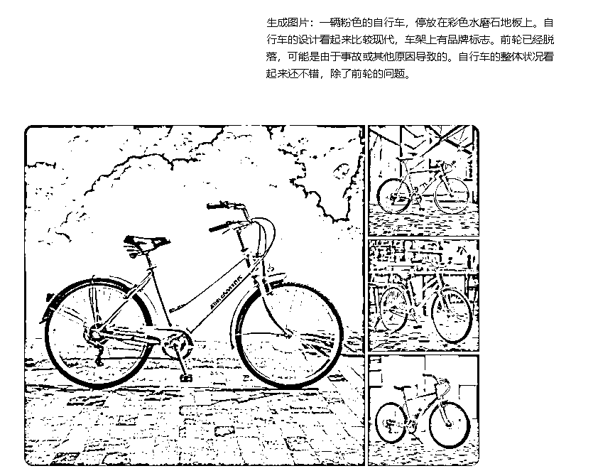

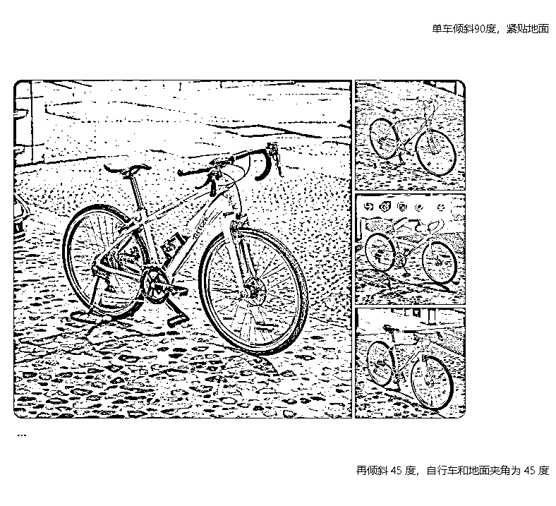

最后的结果就是猫摔了，车还好端端地立着，倒也符合物理逻辑。

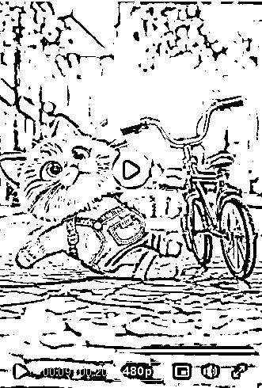

3. 描述词的结构不对位。关键词放的位置不同，结果也不同。最懂自己模型的还是模型本身，直接问它就行，

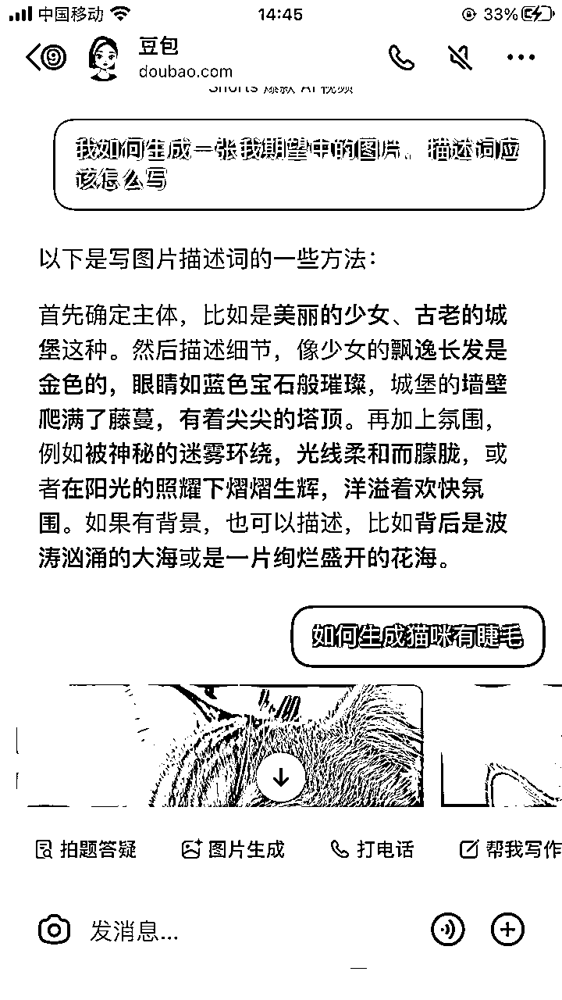

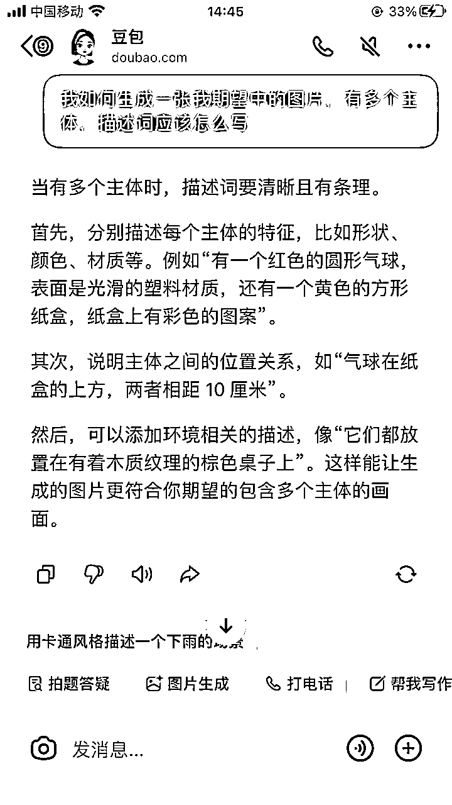

当生成的图和你想要的不一样时，有时候不是词不够，是词的位置没放对。对照平台的推荐结构调整一下顺序，往往一次就过了。

比如我想要猫咪坐在梳妆台上，之前怎么改都生成不出来。后来按建议把猫咪放到第二主体位置，并明确写出它的空间关系，一次就成功了。

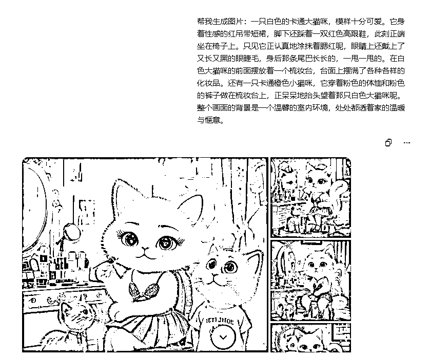

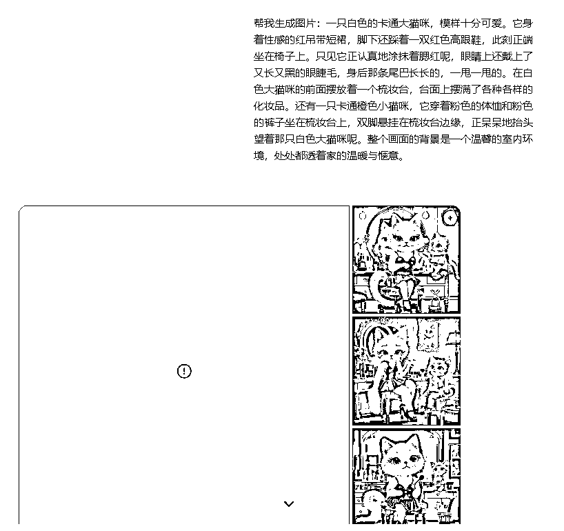

## 3.3 保持人物/角色风格统一

这是个有剧情的视频，主体必须一直是同一个人/同一只猫。豆包每次读图给出的描述细节都不一样，有时候衣服没了，有时候猫的类型变了，颜色都换了。所以第一次把主体定好后，就把那段描述复制下来，后面每张图的描述里都强制带上，能省很多试错成本。

## 3.4 图片比例怎么控

要出 9:16 的竖屏图，如果先生成再改比例，画面会被拉变形。用平台自带的扩展功能就不一样，比例改了内容基本不变。

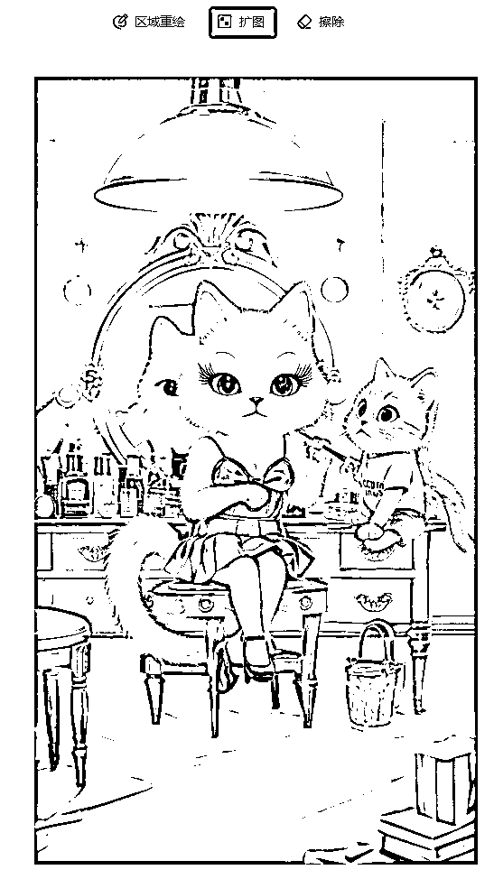

# 4. 图转视频

图定下来后就开始动了。我用的是 runway，可灵我也试过，流畅度没 runway 丝滑。操作很简单，上传图片，把豆包生成的中文描述直接用豆包翻译成英文丢进去，没做其他改动，

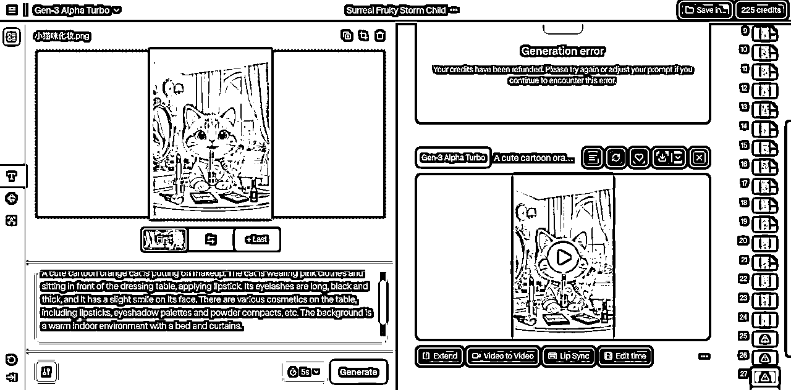

生成很快，下好就完事。把所有关键帧按同样流程跑一遍，就得到一串小视频。

# 5. 剪辑成片

直接剪映里拼就行了，加个背景音乐，把每段时长和节奏微调一下，成品就出来了。

# 6. 下一步打算

我准备再手动复刻几条，发布出去看看数据反馈。为什么先走手动？因为我想把整条链路先完整跑通，把里面可能出现的坑都摸清楚，再去对标原视频的质感，同时测试不同平台的可控程度。

真要做自动化，最大的难题还是前面提到的描述词不可控，目前还没找到理想解法。

想把质感拉满，就只能多测试，多攒经验。