# 电商创业思路图谱＋义乌机遇实地自检（星球版）

> 来源：[https://vow6kdbiak.feishu.cn/docx/E2bAdEJ4FoKVjvxTUEQcNkaBnvh](https://vow6kdbiak.feishu.cn/docx/E2bAdEJ4FoKVjvxTUEQcNkaBnvh)

# 特别说明

本文由阿甜独立整理，记录了我与豪哥年薪 50 万左右在义乌待了一年半的创业实操、复盘与思考。全篇包含大量避坑经验，能避则省。文中穿插视频仅作参考，核心要点已提炼成文字。视频为当时真实状态的记录。

# 先做个自我介绍

怕大家买了资料后找不到入口，放几个常用号：

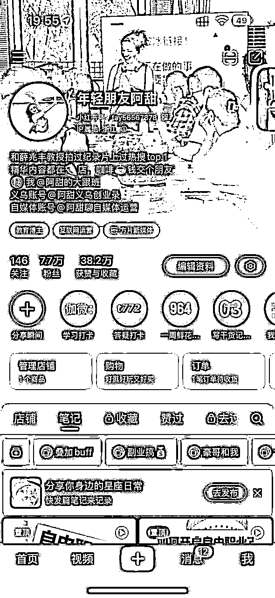

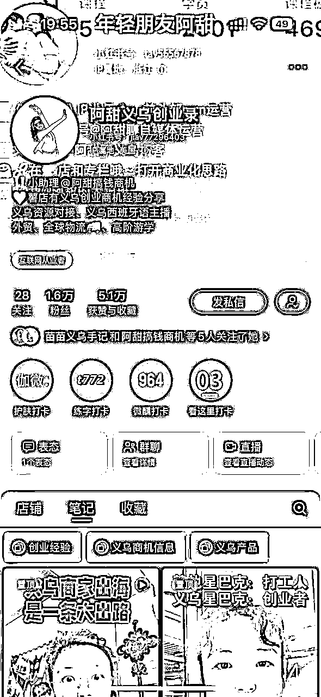

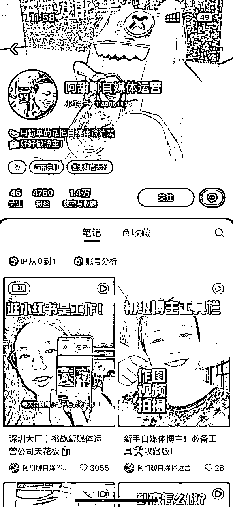

# 本文档覆盖哪些内容

## 1、初到义乌的心理波动
从激动，到平复，到自我消耗，到怀疑，再到重启。想创业的人大概率会经历类似阶段。情绪波动很正常，我自认乐观，也觉得过程很苦。

## 2、义乌做文具电商的实操与坑
文字结合已发布的视频，长视频是赠阅内容。网络信息太多，容易抓不住重点，我把可借鉴的部分罗列出来。别人的经验是否适用未知，我写的是自己走过的路。初入电商的教训集中在这里。

## 3、年货电商的踩坑与纪录片缘起
这是我们首次完全自主操盘，无人支援，真正意义上的第一次做电商。从年货项目开始，兴奋、疲惫、成长、惊喜接连出现。未来打算做电商的可以对照参考，我们踩过的坑你可以直接绕开。

## 4、思路再梳理：义乌创业重启
年货后我们决定不再做重资产电商，也不继续打包发货。原因有三：身边做传统国内电商的朋友被ROI卡住，生活圈被压缩；国内电商大概率向海外转移；电商本质是跟仓库工厂打交道，我更倾向学习、复盘、连接人脉。因此本节会展示转型后的方向，可直接借鉴。

## 5、带着目的看义乌
义乌被过度曝光，上央视、上新闻、常上热搜，头部博主扎堆造访。流量相互借势，义乌需要内容，博主需要数据。既然你被吸引想去看看，出发本身就是第一步。关于“要不要来义乌”的思考可看视频：

48 【带人游学逛义乌新赛道？轻创业到义乌怎么样？ - 年轻朋友阿甜 | 小红书 - 你的生活指南】 😆 XOlzMTy9QutmBkp 😆 https://www.xiaohongshu.com/discovery/item/67052233000000002c0172bd?source=webshare&xhsshare=pc_web&xsec_token=ABNbZHFESUe8Mo-vOTc5PK4O9bpuwinUZtWhF_R1j9jBU=&xsec_source=pc_share

## 7、义乌信息差与电商基础
计划定居或创业，电商往往是新手入门的路径。这里汇总了我此前学习主播的基础要点，帮助起步。可以带滤镜看义乌，也可以祛魅。地点并非决定性因素，人更为关键。

## 8、义乌可见的赚钱形态
在地创业者常说义乌遍地机会，商贸城宛如金矿。机会发现是必备能力。生意本质是买卖，买卖核心是交易，是人与人创造的价值。产品可虚可实，关键是卖什么、怎么卖、卖给谁。

* * *

# 适合阅读人群

## 1、准备起步做电商创业的
## 2、在外地想快速体感电商但拿不定主意的
## 3、想低成本轻创业却缺思路的
## 4、对义乌好奇但方向模糊的
## 5、已在义乌却找不到商机和市场的
## 6、除电商外找不到变现路径的
## 7、想先看看再说的心态

左侧栏可自行查阅以下内容：

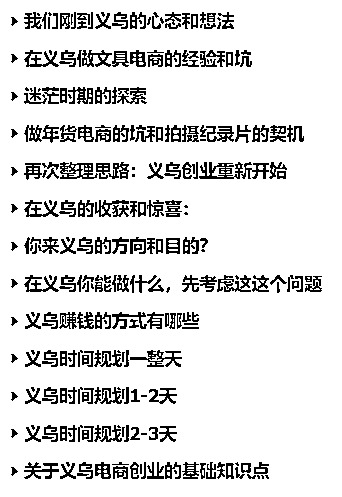

* * *

# 这份万字文档想解决的问题

1、我与豪哥已切到新赛道，不再碰重投入重资本的电商，想对过往做一次复盘。
2、义乌热度高，把所知的信息整理给需要的人。
3、为和我们一样硬闯义乌电商的朋友理清思路，作一份基础创业手册。
4、给在创业路上亏过本、走得很辛苦的朋友一些精神支持。

* * *

# 来义乌的动机与目标

来义乌的冲动往往带着目的，哪怕只是当作旅行，也该有收获。别像小朋友那样只吃喝玩乐。作为创业者，心里应有问题：能看到什么？能用上什么？能不能留下？能做什么？带着这些问题再去更好。我会尽量把当时心态与身边人的想法分享出来。

## 找货与选品

### 已有业务
已有产品线去义乌找货相对好谈，去对应品类区域洽谈即可。可自逛，也可先在1688比价格与规模再谈，目的性更强。

### 无业务背景
听说电商赚钱就想选品，没有经验的情况下难度很大。行业里有句话：选品决定生死。品的优劣基本决定账号与现金流是否起来。一般需要工具加长期沉淀才能从海量商品里筛出好卖的品。到商贸城更像大海捞针，逛几天常只剩“好便宜”“好喜欢”，却没有“怎么拿”“拿多少”“怎么卖”的答案。请克制冲动。

## 判断是否值得来义乌创业

### 内在条件
1、存款可支撑半年生活，不急于找工作
2、能力储备足，能独立完成多项工作
3、自学能力强，创业必须持续学习
4、不排斥社交，需与当地创业者交流
5、有发现机会的眼光与即时执行力
6、能沉住气，前期可能毫无水花，需有转赛道或坚持的判断

### 外在环境
1、周边创业者密度与人群画像
2、当地政府对创业的支持与政策
3、是否有可参与的创业分享，门槛如何
4、城市创业氛围是否契合，偏高端还是接地气
5、产业成熟度，能否快速找到可出货的产品

* * *

## 纯粹逛逛的心态
只想看看义乌到底是外界说的那样。下面是我一年半体验后的呈现。

### 交通
公共交通有地铁与公交，公交使用体验不佳。我们到一年多只坐过一次商贸城公交。地铁可去金华、横店，城区段主要通往商贸城，间隔约 10 分钟。因此日常多打车，居住区到商贸城核心约 20 分钟车程。

### 租房方式
网站找房效率低，多集中在电商村的紫金、五爱、北下朱一带，楼下公告栏信息量大。预算从 1k 到 6k 不等，村内单间约 1.5k。建议先看业务落点，花几天实地走动，选择村里还是商贸城周边。看地图找人群密集区，白天看环境是否干净，晚上看噪音与亮灯率。女生建议避开亮灯率低、人少的地方，私密性差的区域需谨慎。具体参考笔记：

56 【👉义乌的搞钱信息都在公告栏上！ - 阿甜义乌创业录 | 小红书 - 你的生活指南】 😆 bmJATf60oXqWB1j 😆 https://www.xiaohongshu.com/discovery/item/652b5aaf000000001e00d58e?source=webshare&xhsshare=pc_web&xsec_token=ABhSducNRp3TvRQsjvX-xM4oV_GRNAiCObMVbVx6FfRkU=&xsec_source=pc_share

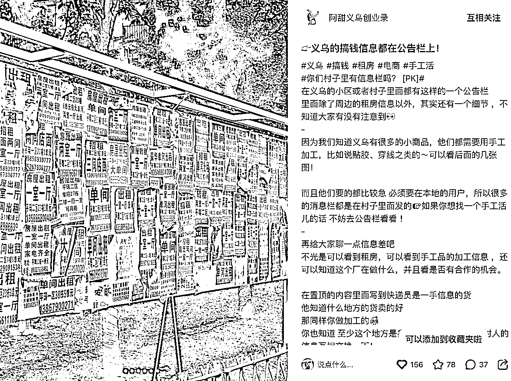

* * *

# 在义乌能做什么，先评估自身

## 资金储备
建议可支配资金至少覆盖半年生活开销，给自己试错空间。钱不够时容易接散工填肚子，半年下来几乎存不下钱。若已有半年到一年生活费，可用轻创业模式试水。后续章节会匹配能力与路径。

## 过往经历
既往项目很大程度上决定创业方向。若有半年存款，也可复刻我的老路，但不推荐。我曾在深圳做课程，豪哥是程序员，两人零经验入局电商，走弯路很多。直至现在才找到真正喜欢且擅长的方向。

* * *

# 义乌常见的赚钱方式

## 倒爷模式
义乌很普遍，线上对应无货源模式。1688或拼多多拿货，上架到淘宝或小红书赚差价。看到便宜好卖的商品，发朋友圈或短视频引流即可成交，需要一定的运营能力。核心逻辑就是低买高卖，如珠子 10 元一斤卖 20 元，伴手礼 20 元卖 30 元。整体来看，买卖本质都是倒爷赚差价。

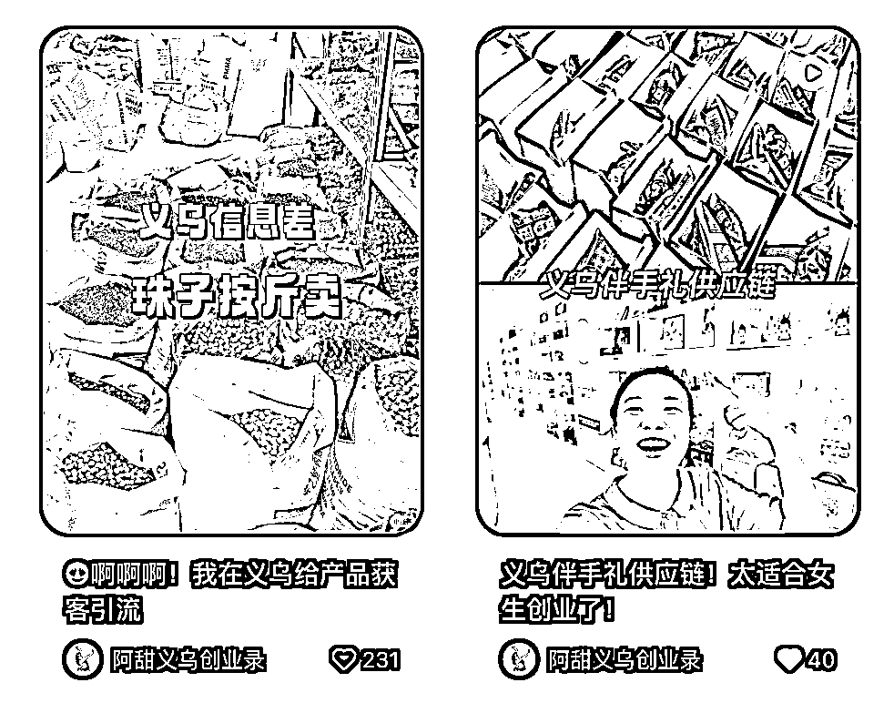

### 倒爷选品思路
产品极多，不必疯狂跑场。做法：
1、在商贸城拍视频记录，能向线上展示你有货源能力，引发主动询盘。
2、在小红书评论区找创业者需求，拍对应品类吸引他们。起步阶段选品能力弱，不要以为自己的喜好就是市场喜好。需明确目标客户、平台、价格带。

## 走播
如果倒爷主动性太强，可考虑逛街直播。观察下来，外向型人格更适应。

959 【义乌走播，是小白轻创业的方式吗？ - 阿甜义乌创业录 | 小红书 - 你的生活指南】 😆 GaUfPqA9JNtgrNB 😆 https://www.xiaohongshu.com/discovery/item/6704ad02000000001b020c26?source=webshare&xhsshare=pc_web&xsec_token=ABWDldV0AmYO1qeM5zjlaOXXzHufE3NEmFr_2B6UtImXg=&xsec_source=pc_share

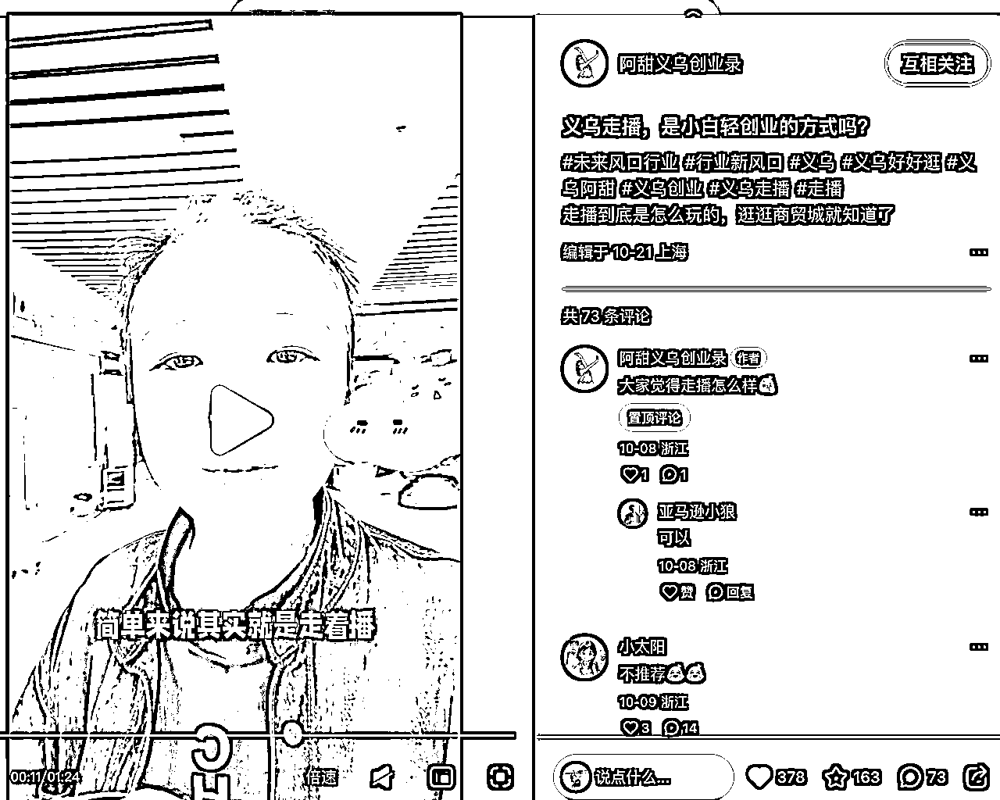

### 与商家合作要点
多在商贸城一区饰品小物件区，利润相对较高。
1、先准备账号，小红书抖音均可，小红书自然流仍可尝试。
2、与店主约定合作方式，在店内直播带货。
3、通常需交押金，不同折扣对应不同押金门槛。押金对商家相当于小 B 端客户，单量小或代发他们一般不愿接。有粉丝或私域可提升谈判力。

走播并不轻松：直播本身消耗大，边走边播边互动更累。必须有账号，零起步难度高，且需要熬。多数自然流主播至少要熬一个月，很多人坚持不下来，所以半年存款是安全垫。

## 主播

### 中文主播
资金有限想做内容，女生形象条件尚可可尝试。市场竞争激烈，义乌底薪约 1 万，杭州 1.5 万以上含提成。无经验多从助播做起，依兴趣与天赋决定是否转正。主播状态要求高，表情管理、镜头感压力大，但能近距离看到直播间搭建与后台。

### 外语主播
英语、西班牙语、阿拉伯语需求较大，英语内卷严重，部分主播转其他语种。有语言基础可尝试。注意播出时段多在夜间至凌晨，对应海外时区。

63 【义乌培训西班牙语主播，跨境贸易直播新宠 - 阿甜义乌创业录 | 小红书 - 你的生活指南】 😆 iZ7NtRgq9Y1p5bp 😆 https://www.xiaohongshu.com/discovery/item/670f893b0000000026036fe9?source=webshare&xhsshare=pc_web&xsec_token=ABoHzeYEF2rdYe7L6BwoO2Ps7sX1k0jmU9nDOtw1Qj5UQ=&xsec_source=pc_share

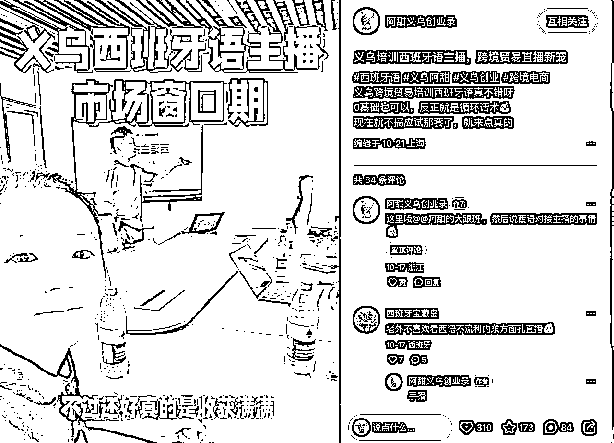

## 外贸员
依托外贸公司做国内采购卖到海外，主要服务 B 端。有些需自行开发客户，在 FB、INS、TK 发布内容获客，对接需求找货；有些只需跟单销售拿提成。语言要求不高，文字沟通可借助翻译。部分团队在 TK 做引流，后端公司承接。中间商需注意：产品要熟，不能事事问工厂；了解各地区运费与关税，避免亏损；非标品需对好规格颜色；外贸单金额大，需有耐心。

## 电商运营
义乌岗位较多，城市以电商起家。负责淘宝、TK、1688、拼多多等平台的曝光与转化，涉及命名、关键词、封面、点击率、详情页等。也可从学徒做起，边打工边学技术。

## 自媒体运营
各企业都在公域做曝光，抖音、小红书等平台需内容投放。公司有运营岗，也可代运营。若想切入，最好已有账号或作品案例。

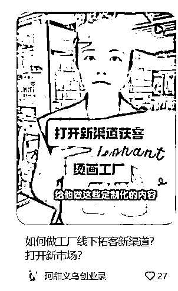

## 快递打包、外卖
学历不高、存款不多可先做基础岗位。义乌电商村的快递员与外卖员能第一时间感知爆品。我们曾听货拉拉司机做电商调研。外卖送餐可快速了解哪些区域热卖，适合社交型人群套信息。但切忌真的只做外卖，要把信息转化为销售。可开账号记录“外卖视角信息差”。

## 手工活
按件计费，如粘发夹、串珠。曾在理发店看到老板娘做蝴蝶结，一个 5 毛，每天几百个。核心不是做手工，而是套取上游信息，给活的老板通常就有货源，可直接拿货销售。常见渠道：电商村公告栏、村内小作坊。

* * *

# 义乌一天时间安排

## 商贸城

### 分区
搜索商贸城分区信息很丰富，但 1-2 天逛不完，一年也逛不完。我们常去一区、一区东，饰品集中，人流最多，其余 1-5 区连通。

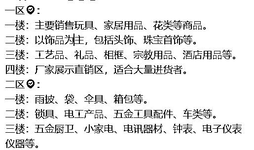

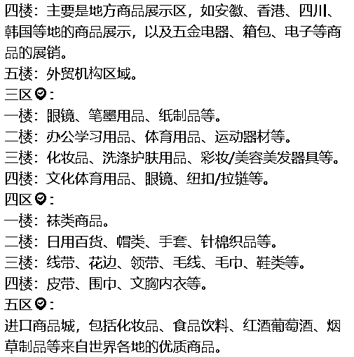

### 特点
五区规模庞大，统计上每个店停留数分钟，要走完需两年。因此更要精细化看品。若只求热闹，逛一区足够，是人流中心，其他区对散户友好度较低。

很多人来义乌，第一反应是直奔国际商贸城，但这座城市真正值得摸透的地方，远不止一个市场。这篇文章，我把自己从逛街、吃饭、踩点，到对接工厂、再到自己做电商踩过的坑，全部摆出来聊一聊。

### 商贸城怎么逛，产品名片怎么记

商贸城里的店铺并不是全都零售。有些档口只做批发，但你要是真对某样东西一见钟情，开口问一问也不是不行。看到喜欢的门店和陈设，想拍点照片作为参考，最好先问一句老板方不方便，别让热情变了误会。

要是逛完一圈，产品忘得精光、名片也一张没带，可以参考小红书上这个办法：

73 【逛义乌商贸城？完全忘了产品和名片怎么办？ - 阿甜义乌创业录 | 小红书 - 你的生活指南】 😆 yLj6KGrFmc6NPF4 😆 https://www.xiaohongshu.com/discovery/item/663eef21000000001e03196a?source=webshare&xhsshare=pc_web&xsec_token=ABm_50ko-_y2D151RnNWSQvw8a4xhiP-nHbSwLWtWey_Y=&xsec_source=pc_share

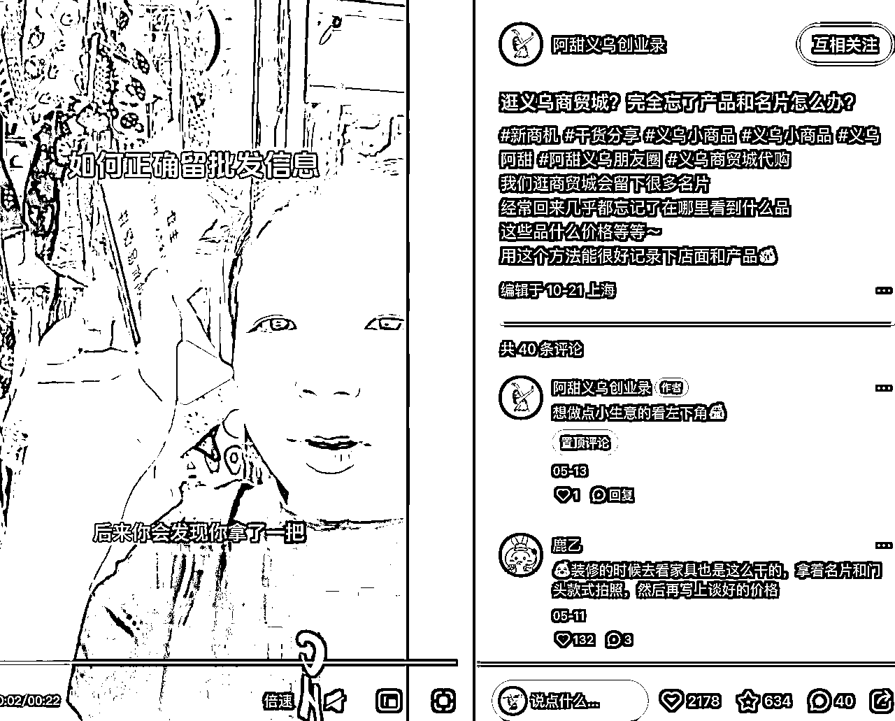

### 吃在商贸城：新光汇与苏坦土耳其菜

商贸城旁边有座商场，叫新光汇。里面那家苏坦土耳其餐厅，被不少人称作义乌排名第一的异国料理。既然都已经到义乌了，不妨试一次。店里外国食客特别多，很有几分“小联合国”的味道。吃不惯也没关系，地下负一层全是全国连锁餐饮，解决一餐饭很方便。

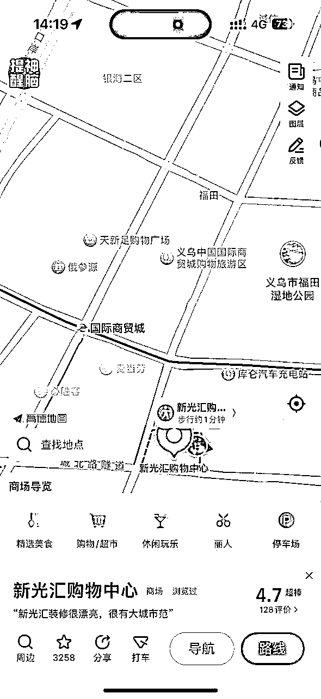

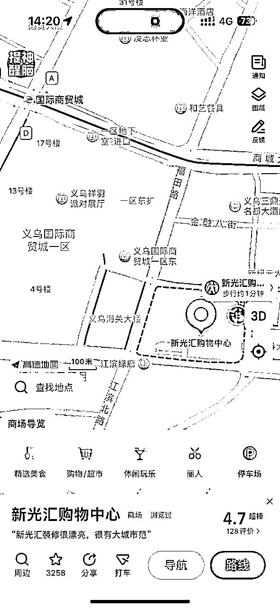

### 10月后的银海小区：年货档口里藏着旺季

吃完正餐，要是时间恰好落在10月之后到年前，不妨打车去银海小区。这里称得上是义乌的年货批发大本营，每年10月一开市，几乎所有门面只做三个月的生意。房租也高得吓人，我之前问过一家，光租金就是30万，老板却拍着胸脯说“肯定能赚回来”。这里的交易基本不面向散客，但你想看看当年准备发往全国各地的年货长什么样，倒是一次很有意思的窗口体验。

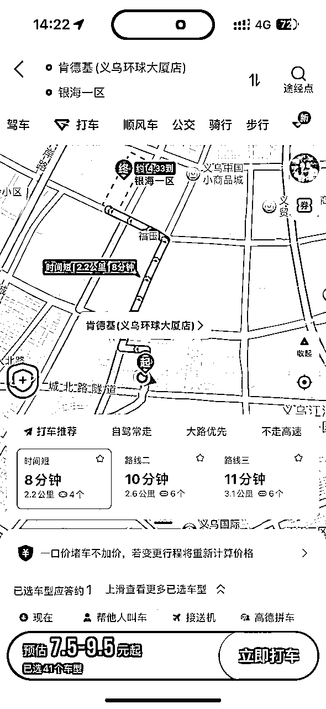

### 五爱库存街：按斤卖的货源世界

如果你到义乌的时间不在10月以后，下午可以去库存街转一转。听名字就知道，这里卖的全是库存尾货，价格能低到颠覆常理：皮筋一斤几块钱，发夹按斤称，耳环也是论斤卖的。我朋友圈里一个库存老板，曾经卖过整整一吨皮筋发到外地，直接上大卡车拉。这些库存甚至能走向海外市场，一些偏远落后的国家会整批买回去再卖。国内产能过剩，尾货的体量远超想象。

但库存街有一条信息差，必须记住：真正质量、款式都拿得出手的库存，根本不会放到这里。工厂会留在自家仓库，优先通知那些常年拿货、懂货的熟客。我们以前做文具电商时卖过一阵库存，最大的感悟就是：尾货之所以会流到库存街，背后一定有它的道理——款式、质量、品牌总有一项是短板，除了便宜，其他真不太能打。

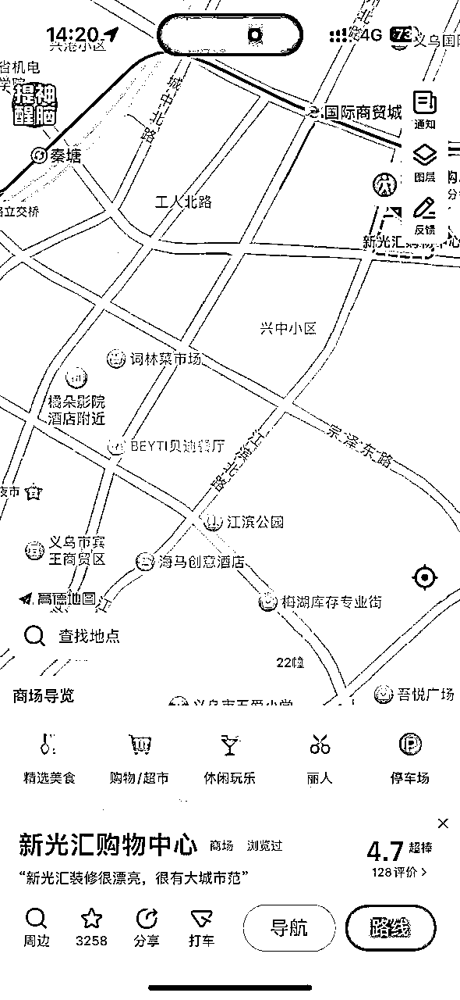

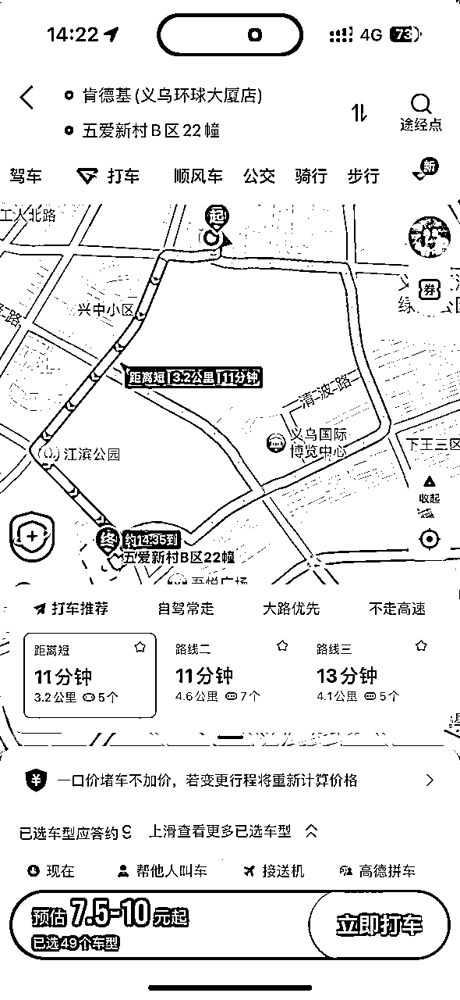

### 宾王夜市：六点去看一场“占道大戏”

晚上只要时间宽裕，一定要去宾王夜市。地图上标记🌟的那个位置，打车过去就行。

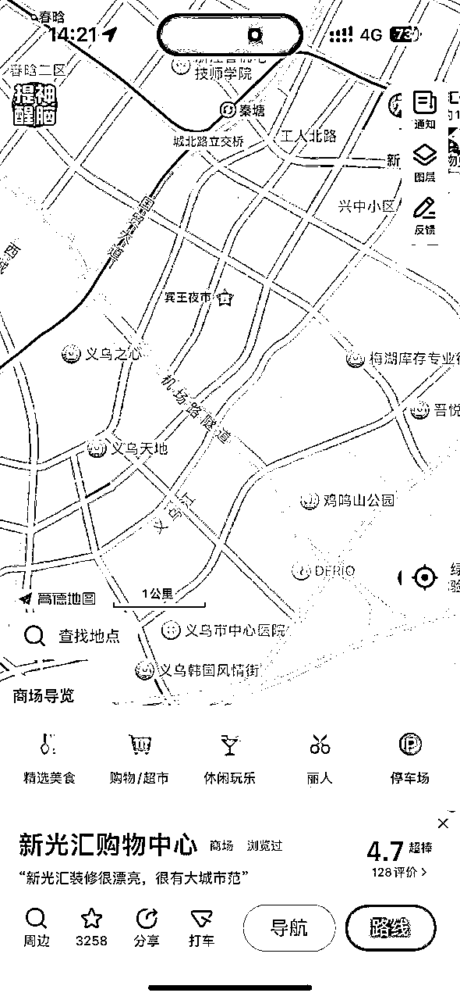

79 【义乌夜市，价格震惊！简直是线下拼xx！ - 阿甜义乌创业录 | 小红书 - 你的生活指南】 😆 7vOWdpOGOUXQdRR 😆 https://www.xiaohongshu.com/discovery/item/66cb2882000000001d03b950?source=webshare&xhsshare=pc_web&xsec_token=ABLcOYC1hJyyNU750LB42htUkrnvAp4-OpRs8a8lkMTxk=&xsec_source=pc_share

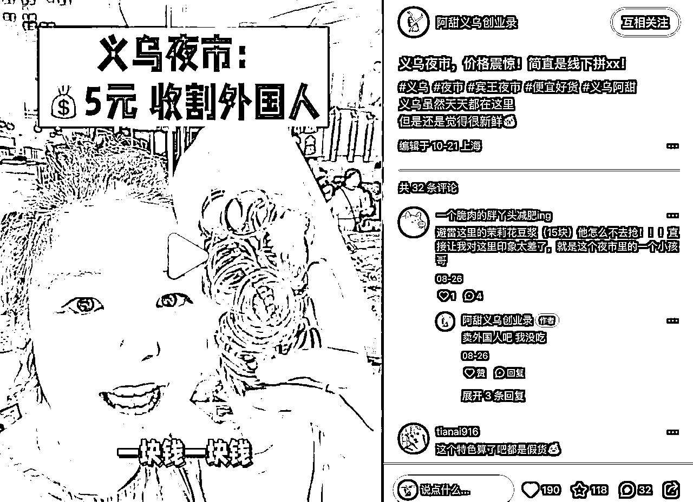

别听那些说“晚上七点再来”的攻略，我建议下午六点就到这里。夜市六点半才正式开始，那半个钟头正好让你看一场精彩的出摊仪式：一条宽阔的大马路，原本只有地上画的摊位编号，转眼就被推来的大型货架、大箱柜塞得满满当当。三条街一字排开，所以这里也叫三挺路夜市。有人独自开摊，也有情侣、中年夫妻互相搭把手，看着看着，竟觉得有些热血。

网上对宾王夜市的评价，基本逃不开几个关键词：东西便宜、像拼多多开到了线下、外国面孔密度高、价格低得出乎意料、小吃水准一般。这个见仁见智吧，但作为国内外国人密度最高的夜市，值得去凑个热闹。有一点记住：下雨天这里几乎没人，别白跑一趟。

### 义乌1-2天怎么逛：四个必到点加一个工厂选择

如果你只有一两天的时间，建议把国际商贸城、银海小区（仅限10月后）、五爱库存街、宾王夜市串成一条线。如果还有余力，可以去1688上物色几家义乌当地工厂，问问能不能实地去看看。

找工厂有个技巧：在1688上搜义乌本地厂家，选择离自己比较近的，直接问是否方便看货拿货。但身份别用普通游客，工厂根本腾不出时间接待没有来头的散客。比较管用的人设有两个：一个是自媒体人，想做采访、了解供应链、对接货源；另一个是自己在老家做生意，专门来义乌选品看样。这两个身份，能提高约到工厂的概率。

不过，找到工厂不代表能捡到最低价。很多工厂并不是全品类、全链路都能做，也许只生产某一个零部件，你第一次去合作、单量又小，价格自然不会太漂亮。也不要死磕低价，低价的另一边几乎都贴着低质。一个新手凭什么拿到比老手还便宜的价格？这不符合商业常识。低价更不是健康的生意循环，拼多多逼死商家的例子就摆在眼前。做生意的关键永远在销售渠道：奔驰保时捷有人卖，奥拓海马也有人卖，找到适合你的那群消费者，比一味压价有意义得多。

### 义乌2-3天怎么逛：把“人脉”写进行程

如果能在义乌待上三天，光靠两条腿瞎转悠，很难转出什么名堂。建议卡着时间，去小红书搜一搜当地的行业沙龙、博览会、展会信息，到现场看一看义乌到底在流行什么，那些正在这里创业的人，究竟每天都在忙什么。

展会也是认识人的最佳场合，能出现在这里的，大多是义乌的创业者和参展商。大方一点，多加上几个人，互相交换名片，顺便打听最近有什么展览、哪个市场出了什么新动向。这些信息，能在短时间里帮你摸清义乌的脉搏。认识更多本地创业者之后，组局、参加沙龙、互相交流，都是创业路上极其重要的一环。

现在的市场，单打独斗和闭门造车真的很难活。你去看那些互联网社群、各种会员群，本质上拼的不就是抱团和信息流动吗？但交朋友有个前提：信息和价值要双向流动，不能只是单向听某个人输出。如果每次见面都是别人给你讲课，下次大家大概就会离你越来越远。

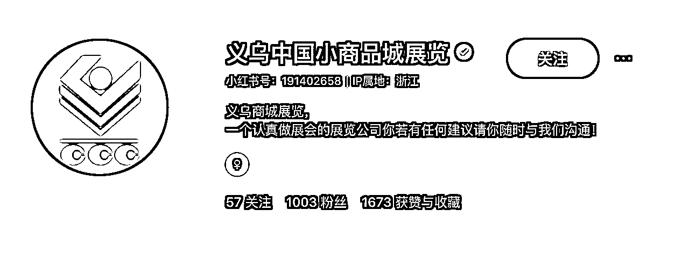

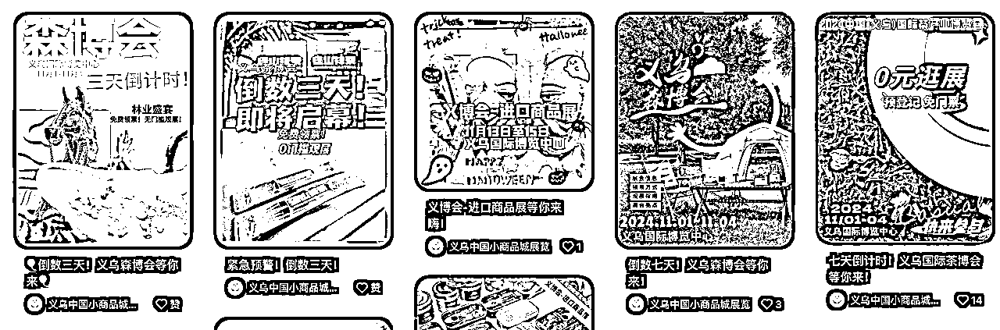

### 我们当初来义乌的起点

说实话，决定来义乌的时候，我们什么攻略都没查，小红书没翻，抖音也没刷。当时的想法非常简单：第一，既然想做自己的生意，就不能不去义乌看一眼，毕竟这里有一个巨大的商贸城；第二，2017年我在这里卖过几个月的衣服，赚了几万块，那段时间让我对这座城市一直带着好感；第三，我有个大专时的朋友在这边，一直喊我过去看看，顺便取经。

刚到时的状态，就是迷茫加兴奋。虽然朋友在这里，但我们从来没想过“投靠”这两个字——至少得能给别人提供点价值吧。所以我们决定先去摸清义乌的底，而不是稀里糊涂地乱闯。住在商贸城附近的酒店，周围几乎全是外国人，还带早餐，那种氛围让人觉得新奇又喜欢。对比深圳的消费，这里实在不高，加上那阵子我整个人是云游状态，心里第一反应是：这地方可以留下来。

### 第一次面向商贸城：兴奋、困惑与理性

我们第一次走进国际商贸城，是在2023年6月，当时和绝大多数人一样，第一站就是这里。商贸城一共五个区，大多数人最先去的是核心的一区，因为那里全是饰品和配件，也是小红书上出现频率最高的片区。至于汽配、新能源、宠物用品那些分区，我们逛完之后只能用一脸懵来形容。

但女生对饰品真的毫无抵抗力。我一看到那些小耳环，脚步就彻底挪不动了，没忍住拿了两百块的货，心想就算卖不掉，自己戴、送人也亏不到哪里去——一对耳环成本才1.5元，市场上能卖到十几块呢。

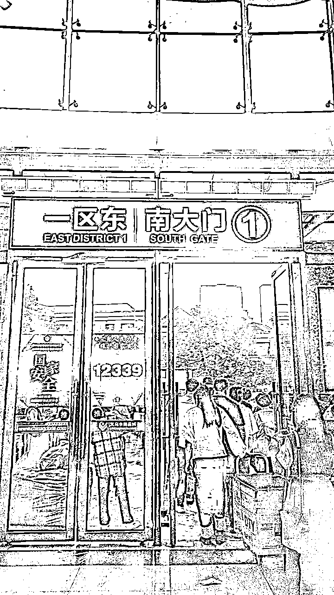

我还记得自己拿了一百来块耳环，大言不惭地放话：200块在义乌就能当老板。事实也差不多如此——这座城市里没有帅哥美女的称呼，走进市场人人都喊“老板”“老板娘”。想做点小生意，摆摊是最快验证逻辑的方式：你直接站在顾客面前，讲价、收款，几分钟就能完成一单。不用操心打包、物流、售后、压货、库存和客服，所有环节都发生在你和顾客之间。货、卖家、买家，这三样东西串成一条线，流量就是完整的。自媒体和电商的内核也一样，都是为了让这三方交易变得更高效、规模更大。

为什么初到商贸城会兴奋又迷茫？我自己复盘过。第一次来的时候，整个人是兴奋、激动的，觉得市场好大、货品好多，什么都想拥有，心里盘算的全是怎么把它们卖出去。后来陪朋友走了很多趟商贸城，看他们露出和我们当初一样的表情，而我自己已经彻底理性了：虽然每一次去还是会遇到没见过的店铺，还是会顺路加几个老板的微信，手上也总会拍到一些素材，但我已经不会头脑一热就下单，心里也再难掀起当初那种波澜。

这里本质上只是供应链的集合，货堆得再多，和你没有关系；价格压得再低，卖不出去就是零。你明明守着一座金矿，却一分钱也挖不出来，那种滋味会很不好受——无力，又可惜。如今商贸城对我的意义，更像一个漂亮的视频背景板、一趟带朋友游学时必到的站点；哪怕只是加上一位老板的微信，日后万一有人想找资源，这条人脉就已经值回票价。

### 那段在商贸城拍下的视频

2023年6月逛完商贸城之后，我留了一支视频作为记录：

https://www.bilibili.com/video/BV1cu411e7Tq/?vd_source=cd57d3a123a254526b23c45b10a3970f

### 老板娘到底为什么“冷”？

记得我们第一次逛商贸城时，老板娘打眼一瞧就知道我们不是来批发的。回想起来也正常，头一回见到那么大一片饰品海洋，我们俩的眼珠子肯定止不住地东瞟西瞟。老板娘自然清楚你拿不了多少，态度跟着就淡了下来。

这也是为什么小红书上总有人说商贸城老板态度差。人家的档口光租金就上百万，走的是批发，零售小单本来就入不了眼。她们早就练出了火眼金睛，哪些人是拿货的、能拿多大的量、做外贸还是内贸，心里门儿清。毕竟，人家是老板娘。我倒是没觉得被冷落过——能在义乌租下上百万门面的人，每天要对接的批发单子都忙不过来，哪有什么余力去理散客？

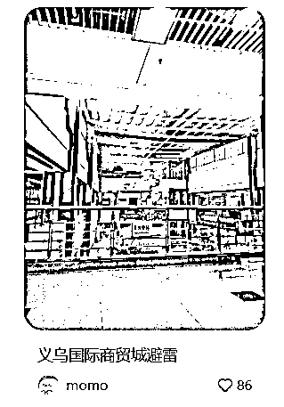

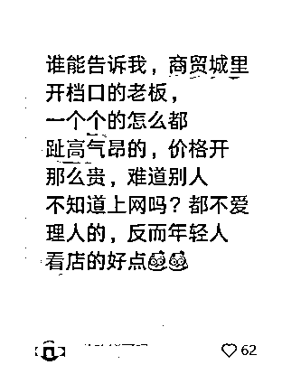

### 差一点就去宾王夜市练摊了

宾王夜市在义乌的名气最大，它还有个名字，叫三挺路夜市——三条街道排开，分作一街、二街、三街。这里也常被拿来和拼多多做对比。看攻略时会发现很多人说，正式出摊是六点半以后。我的经验是，最好六点就过去。你能看到原本空荡荡的大马路上，只有地上一排排摊位编号，忽然就被推来的大型货架和大箱柜填满了。有人一个人开摊，也有情侣、中年夫妻互相搭把手，整条街热闹又热血。不过有句忠告：千万别在夜市里吃东西。

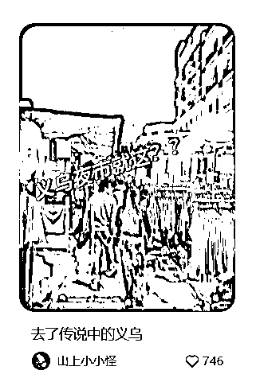

那阵子我们正处于极度迷茫的阶段，对电商完全不懂，货架电商、兴趣电商这些词，在深圳职场里根本听都没听过。淘宝、拼多多、小红书、抖音、快手，到底做什么、怎么做，脑子里一团浆糊。但就像前面说的，摆摊是最快触达用户的路径，既能面对面聊天，又能顺手加一批微信好友。我当时的规划是：顶着硕士学历去夜市练摊。这个标签对做自媒体、拍视频来说，话题度拉满，况且2017年我就在宾王夜市摆过摊，既有经验，又有故事可讲。

那为什么最后没做呢？因为这个想法被朋友劝住了。他说硕士毕业去摆地摊，画面“不太正能量”，容易让很多高学历的人冒出退学念头，也会让那些拼命想挤进金字塔的人开始自我怀疑。现在回看，他说得确实有道理。今天的市场环境里，硕士摆摊、轻创业失败、读书无用论这些话题早就漫天飞了。但我始终不觉得读研没用——读研的日子是无忧无虑的，快乐得纯粹。只是现在大家都更愿意走出来，去现实里找一点看得见的期待。创业圈待久了也会发现，这里的脑子转得是真快，这一年多学到看到的东西，远远超过过去在职场和学校里的总和。

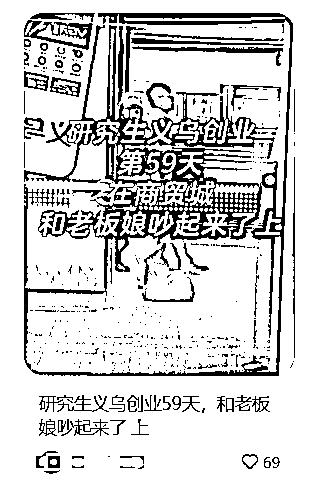

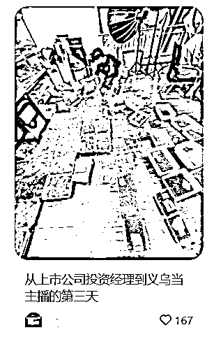

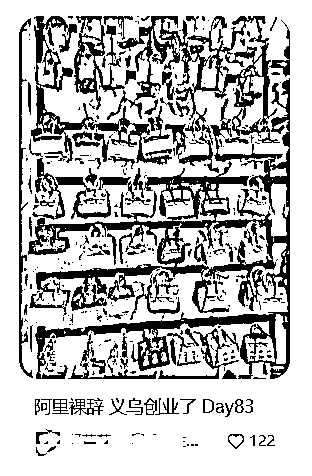

### 探厂打开新世界

“探厂”这个词，我从前没听说过。我只会说“去人家厂里看看”。没见过嘛！大仓库、生产车间、看着工人打包发货，每一件事都新鲜。如果你想探厂看产品，最简单的办法，我在下面三天规划的部分已经写到了。

https://www.bilibili.com/video/BV1uh4y1E7L7/?vd_source=cd57d3a123a254526b23c45b10a3970f

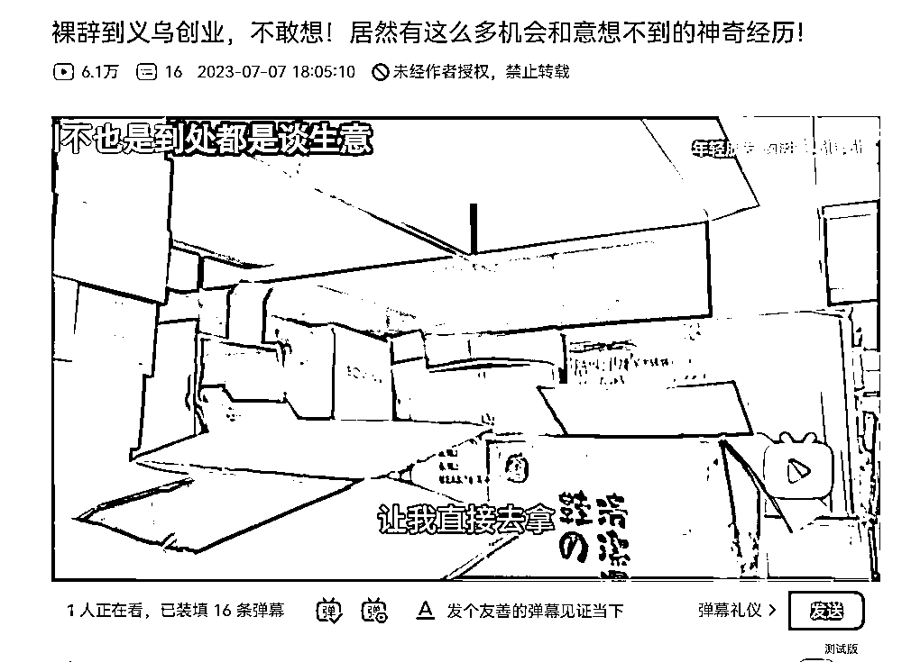

### 文具电商：一次亏本但值得的试水

决定做文具电商，是在2023年7月。那会儿我们还在义乌四处闲逛，每天都被各种意想不到的信息差刷新认知。朋友提议组一个文具项目的盘子：他们出钱出场地，我们出人力，算作边学习边分账。虽然最终的结局是亏本，但收获巨大，也是我们电商之路的真正起点。这样的机会和起点，确实很难再遇到第二次。

那个开局思路其实相当漂亮——时间点正撞上开学季，朋友又正好做文具工厂，而市面上正流行“仓播”：把仓库直接当直播间，用货堆和低价轰炸观众的视觉。我们当时的盘算是，买文具的主力是宝妈，而宝妈以后也能转成百货品类的客户。后来很多直播间都搭成了仓播的样子，不过是摆了一圈空箱子当背景罢了。

说起那段电商直播的日子，我到现在都想叹气。真的太累了。我由衷佩服每个能在镜头前大喊大叫、还要顺手演戏的主播。我的慢性咽炎，就是那阵子落下的后遗症。所以现在让我去干主播，基本不可能；偶尔帮忙看看账号、聊聊天、整理下资料还行，真要我扯着嗓子喊，嗓子第一个不答应。

团队连我和豪哥在内，一共五个人。我认领的岗位是直播话术，豪哥负责上架、运营和中控。另外三位各管一摊：一位是总投资人，专门组局；一位是操盘手，选品、上品、切品全在他手里，还要负责训我的话术；还有一位做运营教学和复盘，顺便把豪哥带出来。所以创业之前，第一步不是选品，而是先把自己的底盘掂量清楚：几个人、多少钱、各自能打什么位置。我们电商时期是五个人，后来收缩到只剩我和豪哥两个，后面我也会单独聊一聊一个人的玩法。

主播学习资料在这里，请挨个打开：

https://vow6kdbiak.feishu.cn/drive/folder/KOKbfXw2Yl3jO5dLhoScRNMXnfg?from=from_copylink

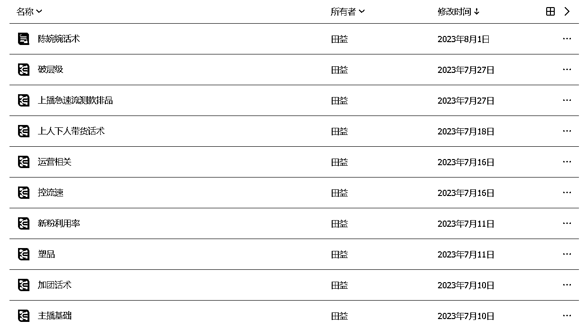

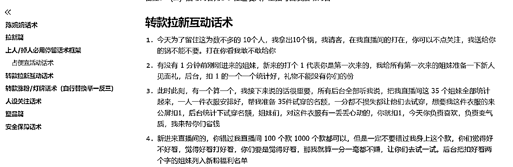

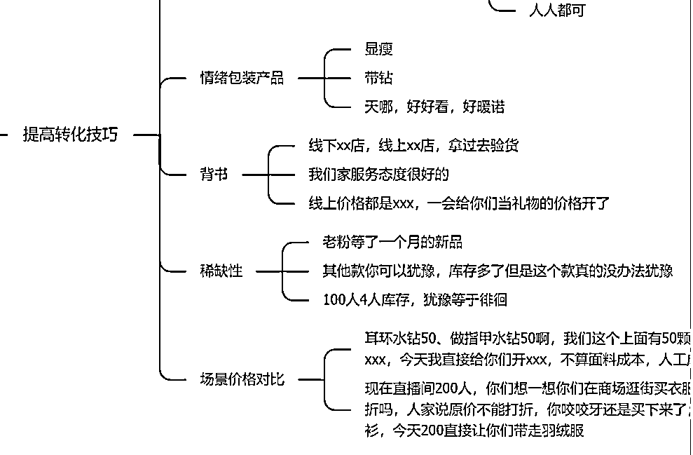

### 主播这个职业，远比看起来难

如果给个参照，我学的那套课程，线下三天，报价一万多，而且只招有经验的主播，属于进阶提升。行业内卷到最后剩一句话：“只筛选，不教育。”从零带一个主播出来，绝大多数公司都不愿意碰，难度太大，成功率又低。这也是为什么新人入行通常要从助播做起——主播真的没那么好当。

你想想，人人都能拿笔写字，可书法家是练出来的；人人都有嘴会说话，有人用它吵架，有人靠它讲课，有人做直播，有人站上演讲台。越是看起来没有门槛的赛道，真正能跑出来的人越少。主播就是其中典型。主播当天状态好不好，会直接写进当天的投产比和成交额里。这一点，主播和运营的感受往往比老板更直观——老板最后只盯着那个GMV数字。

ROI就是投产比，也就是投入产出比。打个比方，投入10元，回来20元，大概算作1:2，接近保本。GMV则是成交额，只看总共卖了多少钱，还没扣成本。另外再说一个听朋友提到的信息差：很多主播看到自己月薪2万加提成就飘了，喊着要跟运营出去单干。真出去以后才发现难如登天——她们根本看不到老板在投流上烧掉了多少预算。

### 我是怎么被“抠”成主播的

朋友眼里我算是比较社牛的人，ENFP，说话带感染力，自己也拍视频、讲讲课，算是“能说”的选手。但直播的节奏、话术和表达方式，对我来说完全是白纸。我先看基础课程，朋友帮我写好话术、梳理好逻辑，然后开始练习。

真正的难点是，我要对着手机自拍模式开口，他们一群人围在旁边，随时纠正我的表达、动作、语音重音。那几天的练习，连我这个社牛都觉得尴尬到脚趾抓地。原因有三个：第一，怕自己的进度拖累整个盘子的节奏；第二，朋友一边纠正一边露出无奈又疲惫的表情，我看着心里难受；第三，每个字、每个词都被拎出来反复抠，实在让人无所适从。

我也明白，这在别人眼里是多难得的机会，但那段日子真的不好熬。后来朋友觉得我练得差不多了，又请其他人来看，继续挑毛病，直到上播前才放过我。好在咬咬牙坚持下来了，之后转品、话术、塑品这几项基本功，总算都能拿得出手。

### 文具时期的视频记录

下面的视频，我按时间顺序排了一下。核心内容都放在视频前面，那是我当时的真实状态，看与不看，随你。

### 参观供应链

那会儿每天最重要的任务就是跑供应链，用现在的话说叫“探厂”。不过这次不同于以往，因为有朋友牵线，我居然能直接看到供应商的后台数据和直播间现场。头一回亲眼见到一场直播做到百万GMV，那个数字往上跳的感觉，真的把我看愣了。也是那一次才明白，他们一场光投流就得烧几十万，再扣掉仓库、人工、杂七杂八的成本，真正落袋的利润远没有外面想的那么美——GMV那串数字，从来不等同于赚到的钱。

如果你也打算去义乌闯一闯，或者去别的城市试试水，有机会的话，第一件事应该是先研究别人到底在卖什么、怎么卖。义乌看起来只是个县级市，但它的豪车密度绝对是县级市里的天花板。我楼下就有位开宾利的老板，直接买了一整层仓库做进口锅碗瓢盆的电商，他随口说，那一层楼的货值两个亿。老板本人穿得特别随意，一件短袖T恤，讲话也没什么架子，就跟普通人对货一样。

后来我想通了：老板不会吃人，就算他态度不好，大不了不合作呗。义乌老板的格局普遍是大的，尤其那些白手起家做到一定规模的，态度反而很好。他们特别欢迎直播团队来合作，常规玩法是：我们出主播，他们供货，最后利润分成。这也算是一种轻创业模式，但前提是团队自己得有两把刷子，手里要有账号、有销量。想让他们陪零基础小白慢慢练，那是不可能的，还是那句话——只筛选。

https://www.bilibili.com/video/BV1iV4y1q7DC/?vd_source=cd57d3a123a254526b23c45b10a3970f

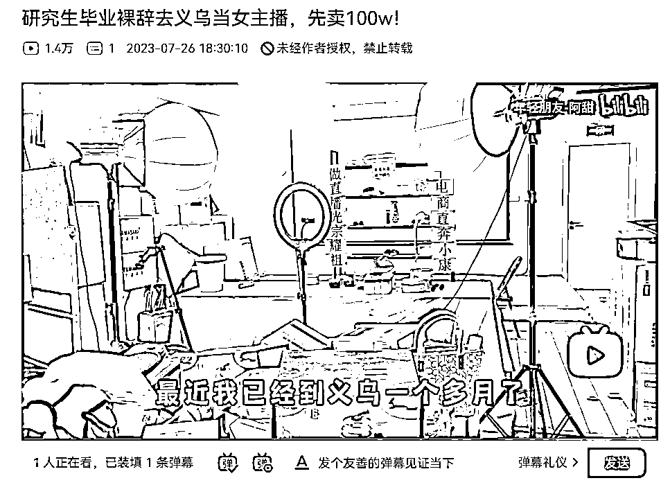

真正开始上场实操之后，才发现以前学的主播话术根本不够用。第一次实战，不仅平时一起合作的四个合伙人都在，连仓库厂长也跑来围观，那场面，只能说“小尴尬”已经是很含蓄的形容了。我自认为脸皮够厚，一开始还是觉得别扭。好在这帮人平时就是干直播的，会时不时提点我几句，告诉我怎样能播得更好。能碰上同频的创业者，真的是运气，自己一个人埋头摸索，太难了。

仓库里没装空调，因为实在太大，一般厂家都不乐意放空调。所以在40度的义乌，每天还得打包、直播、复盘、上架，真的热到怀疑人生。身体上的累倒是其次，周围人都觉得我口才好、爱聊天，天生适合当主播。但主播跟聊天根本是两码事！主播的核心就是五分钟循环一套话术，不停地说同样的话。

我没走主播这条路，最根本的原因是，我这种做内容的人需要新鲜东西来刺激创作。每天面对一样的话术、差不多的复盘、几乎没啥变化的产品，对我来说就是精神折磨。千万别信什么“只要赚钱什么都干”这种话，你得选自己既擅长又喜欢的事，不然太容易半途而废。

流量的波动大得吓人：我们经历过一个小时没一个人进来的冷场，也经历过一分钟涌入3000人的爆发。每天都像坐过山车，对刚创业的人来说，实在太考验心态了。

那会儿也是我第一次正经做电商，第一次体会到什么叫“电商时间”。晚上八点多开播，一直播到十二点左右。下播之后复盘、回家、洗澡，忙完基本是凌晨两点了。早上八点闹钟一响，先爬起来回抖店消息，因为30秒不回复就会被扣分。回完再等着朋友那边接管后台。中午起床吃饭，然后收拾东西去仓库打包。下午五点打包完回家，但还得看包裹量，特别多的时候要提前去仓库。快递五点来收货，错过了就得等明天，物流分又要被扣。下午正常吃个饭，然后跟朋友他们一起去仓库，准备开播。

https://www.bilibili.com/video/BV1mN411b7bk/?vd_source=cd57d3a123a254526b23c45b10a3970f

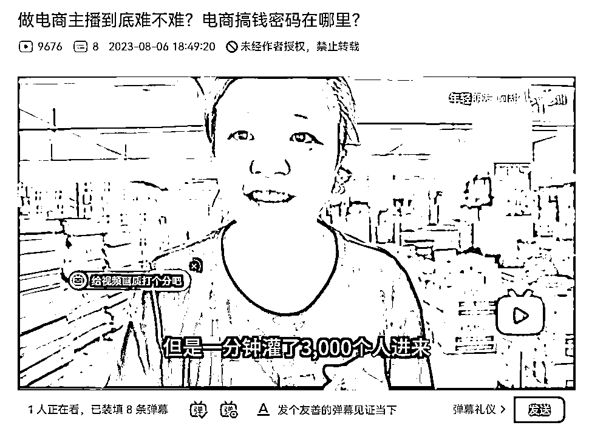

再聊聊我们当时卖的货：水笔、彩铅、普通铅笔、钢笔、电子笔、漂亮的胶带、快递小刀、本子、书包……基本上文具相关的都卖，后来也进了一些日用百货。顺便说一句，日用百货在义乌有个行话叫“日百”，是当地比较大的类目。

我们做电商是直接拿货模式，钱都是朋友在出，我们倒没有资金压力。但人家带我们是情分，我们当然也盼着能赚钱。自己不赚没事，朋友得赚啊。每次去拿货、跟快递结账的时候，压力还是特别大，因为那时候真的是“发一单亏一单”——我们用的套路是“亏品起号”。

https://www.bilibili.com/video/BV1814y1B7KH/?vd_source=cd57d3a123a254526b23c45b10a3970f

那“亏品起号”到底怎么玩？我们做的平台是抖音，但那时候早就没有自然流的红利了，流量几乎全靠花钱买。带我们的朋友每天投流都是一大笔钱。抖音的推荐机制是自动往下一条刷，只要钱花得多，下一条很可能就是广告。它给用户打的标签准得吓人，你想投放给谁、什么年龄段、用多少钱的手机、在哪个城市、消费力怎么样，全部都能设置。

所以我们玩的就是：用低到离谱的价格把用户吸引进来，前期拼命亏，后期再涨价找补回来。结果这个模式没跑通，原因后面细说。如果你手里没足够的钱投流，千万别碰这个玩法。

我们的亏品价格有多离谱？市面上卖一块钱一支的水笔，我们是一块钱十支，不是笔芯，是实打实的笔，连邮费都不够，这怎么赚钱？还有24色丙烯彩色笔，卖个位数，质量确实不错，但得先泡沫打包、再用纸箱封好，磕坏了还得赔钱。24寸行李箱只卖50块钱，但这东西不卖，拿来做福袋抽奖，只要跟我们互动就能抽。现在回想真是疯了，那些免费拿了奖品的人，关注完你转头就取关。

为什么后来没转高客单？不是不想转，是转了之后人直接掉光，就算有人留下来了，也是在等着捡便宜。系统给用户打的标签一旦定了，买便宜货的羊毛党会越推越多，他们根本不会为贵的商品下单。

羊毛党的恐怖程度，我亲身体验过。文具那波结束几个月后，我莫名其妙收到一条抖店客服消息，说我卖的紫色笔破损了，要退款。其实几块钱的东西我们平时懒得计较，退了就退了。但问题是，那批笔全是我亲手打包的，颜色只有蓝色和黄色，我还专门发过视频，根本没有紫色。我直接回了一句：这不是我们家的笔，别来碰瓷。对方就没声了。

抖音里的羊毛党还有个名字叫“彩虹党”，名字里喜欢挂彩虹表情，通常都是一群人待在一个群里，有组织，甚至可能是一门副业。只要他们发现哪家在做亏品起号，或者哪家是新店，马上把链接甩到群里，让姐妹们一起去薅。所以后来很多商家都不敢把价格标成一块两块，不是亏不起，是真的不想要这种人群。

还有一类副业专门盯着商家薅：有的培训团队专门钻广告法的空子，有的走拼多多、淘宝的漏洞。比如平台规定不能虚假挂产品，有人交了高额保证金，他们一旦发现违规账号，就一窝蜂冲上去薅羊毛，因为平台判定违规后，保证金会直接退给买家。还有人专门买假货，一千多的东西到手就投诉，反手要三倍赔偿。

https://www.bilibili.com/video/BV1mV411g7Bv/?vd_source=cd57d3a123a254526b23c45b10a3970f

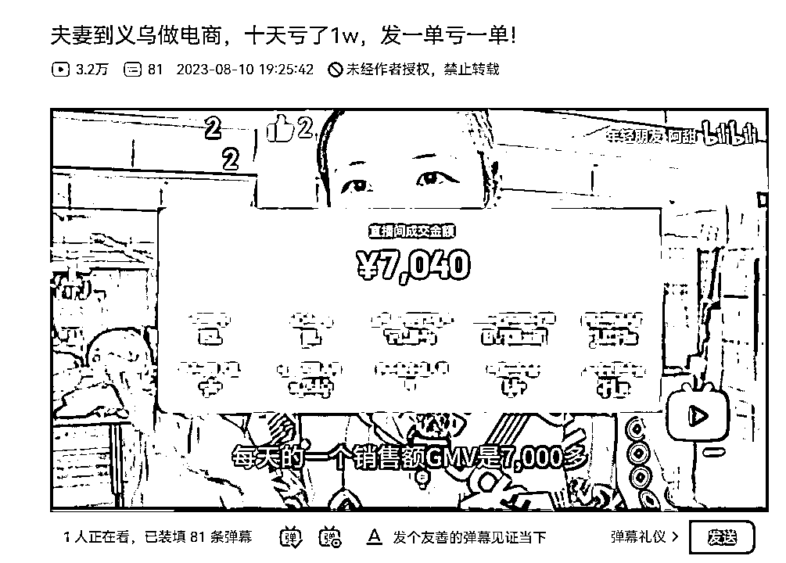

下面说说我们踩过的那些坑，算是真金白银换来的经验：

1. 用蚂蚁搬家这类工具搬运商品时，一定一定检查物流模板，偏远地区必须设置不包邮。我们当时没搞懂，新疆西藏也包邮，一单亏得更多。
2. 同一个人连续下了好几单时，要合并到一个面单打包，不然同一个客人发了几个快递，快递费白白打水漂。我们的货很杂，大小也不统一，一天一百多单，我和搭档连轴打包都得三个小时。而且全是非标品，本子、尺子、橡皮擦，款式一堆，专业打包工看了都不想接。
3. 临时链接记不住对应关系，1-1、1-3分别是什么货，一定要拿本子记下来。有时候要跑量、简单述品，像批发一样，就只能挂临时链接，用1、2、3、4标号。要是客户拍了什么自己忘了，还得倒回去看回放，特别烦。所以最好在做链接之前就记清楚。
4. 直播前的几十个福利品，价格要全部背下来。开播之后得手动改价格，不然有人会直接到店里薅。福利品就是完全不赚钱的钩子品，目的是给直播间做出成交数据，让平台觉得你有转化能力，才会给你推流量。下播之后要赶紧把后台价格改回来或者直接下架，不然店铺里还在卖，照样被薅。
5. 商品规格别写颜色，尤其是那种彩色的尺子、小刀、橡皮，SKU一多，打包那边不按颜色分类，前端一旦选了颜色，打包就要多几道工序，累死人。
6. 打单之后快递要24小时内揽收，不然店铺评分会掉。一般五点前快递来收货，但有时候系统还没点揽收，就要催快递先做揽收，之后再发货也行。义乌的货量太大了，你不催，人家根本来不及。
7. 抖音客服考核时间是早上8点到晚上11点，消息必须第一时间回。30秒没回，机器人就会自动回复，然后又要扣分。所以哪怕半夜一两点下播回家，早上也得定个八点前的闹钟，先回一波消息再睡。
8. 每晚下播后要把单子打出来配货，然后看还缺什么货。我们的操盘大哥也是负责配货的，他一般下午四点左右拿完货回来，先把配好的单子放在一边。当时我们是卖多少拿多少，囤货不算多。
9. 打单时要设置商品简称，不然备注太长显示不全，打包员根本看不清要装多少件。
10. 开播前一定要记得挂车！不然就是违规。我亲口吃了一个违规。
11. 不能说极限词，“最”“绝对”这些统统不行，说了也违规。
12. 上链接的时候，主播报的价格如果比成本低，要立刻通知主播，看看是改完价格再上车，还是不弹讲解。我们每天都有新商品新SKU，价格经常拍脑袋定，有时候我会报低，操盘手看到了就提醒我。
13. 上车后讲解要弹得勤快些。讲别的品的时候，也可以偶尔弹一下福利品的链接，吸引用户多点、多停留。
14. 下播前要看后台流量黄线有没有翘头。翘头的意思是往上走，只要黄线翘起来了再下播，下一场直播的推流才会更好。起号阶段一般等人数起来就下播，第二天再开播，极速流量会好一些。急速流就是开播前五分钟进来一大波泛流量，然后在里面找到真正愿意留下来的人。
15. 短视频刷粉可能把账号刷废，搜索流量占比很高，但推荐流量不行。
16. 如果每场下播时推荐流量都在90%以上，说明起号有戏。
17. 2.9元的笔送10支都没人要，后来改成1块钱来做测试，直播中途再改价。
18. 没设置限购，被羊毛党薅了10单，7单笔3单尺子。
19. 打包的产品乱七八糟，快递袋的规格也得备好多种，有的要拿透明胶固定，有的要用箱子装。
20. 换快递公司很麻烦，比如从申通换极兔，后台得重新配置。快递老板都很现实，今天你给1.3我就跟你合作，你要涨价我立刻找你竞争对手。只有永远的利益，没有人情可讲。
21. 批量发快递要先充值，就像会员卡一样，一般一次性充500单的量。要是超重了，每个月再单独补账单。
22. 店管家里可以授权主店铺和子店铺，共用在其他渠道买好的快递单号。

文具电商结束之后，有一阵子挺迷茫的。9月开学季一过，我们又得去找新产品对接。不过那段经历让我彻底不怕了：临场直播、拍视频、发朋友圈，随便来，反正互联网记忆就那么几天，谁还记得你之前的尴尬场面。

后面肯定要继续找市场和机会。朋友本身有自己的基本盘，所以不慌。我自己也有点小业务，但总觉得在义乌不摸货就亏了，所以朋友给我介绍了周围的一些小业务去了解。要是合适，就一起干、一起分钱。那阵子见识了不少稀奇古怪却非常赚钱的项目。

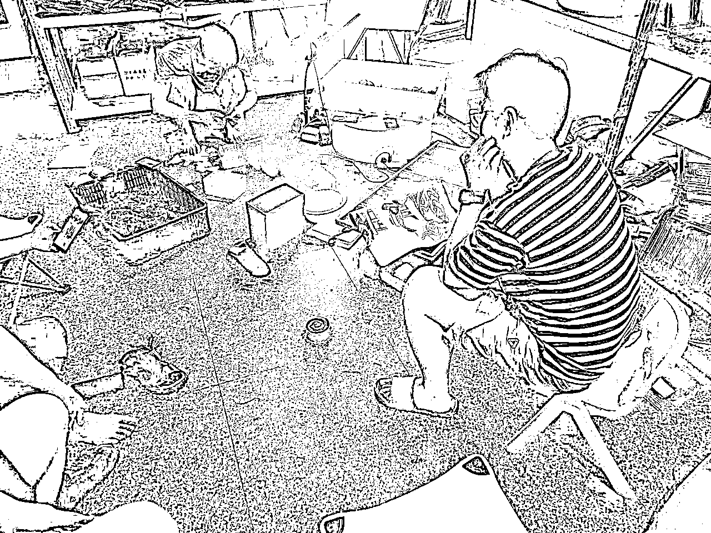

先是去看乌龟苗市场。义乌圈子特别小，大家互相都认识，而且一般不会做对方的竞品，都是各干各的赛道。朋友的朋友在做乌龟苗，就让我们去看看。乌龟苗？一听愣了一下，竟然真的是活乌龟。到直播现场的时候，因为我以前没接触过活物，感觉挺不自在的。那地方是个门面，其实也是个仓库，味道可真不怎么样。

乌龟的种类非常多，便宜的五块钱一只，贵的要几十块，都是乌龟苗。这生意前期不赚钱，利润在后面——靠私域。爱乌龟的人会像养宠物一样投入，买水槽、水草、氧气泵、环境布置，甚至还有几千几万的精品龟。他们赚的是长期的钱。乌龟越大越贵，说明养的年头越久。而且买贵龟的人大都有钱，经济条件很好。

但乌龟在运输过程中容易因为缺氧、储存条件差、温度不合适就噶了，看着怪可怜的。所以活物这个方向，我们直接pass。

再说说库存毛衣。之前做文具电商，朋友经常去库存街拿货。那边东西看起来不错，但用久了问题特别多，售后率很高。我们卖过品牌空气炸锅，才50块钱一个，原价可是299。真应了那句话：一分钱一分货。而且，库存会出现在库存街，那是有原因的。

后来跟一些品牌厂家聊才知道，真正的好尾货早就发给熟人了，根本不会流到库存街。所以我们在库存街买到的东西，只能再转手给收库存的人，库存再到库存，最后流向偏远的村子或者小县城。

顺嘴提醒一句：如果你自己出镜卖货，产品质量一定不能水。别人大概率是因为相信你这个人，才愿意下单。所以选品一定要把质量和售后放在第一位，价格反而是最不重要的。

那种库存毛衣，几块钱一件，质量还真不赖，主要市场是乡村县城赶集，能卖一百块三件！每天门口都停着卡车拉货。毛衣库存仓库门口，每天都有三五波拍段子的人，随手一刷抖音就能看到。话术无非就是“这件五块、这件三块”，核心就是让观众看见它够便宜。

义乌真是个有意思的地方。人人都说自己这里是仓库，但老板反而不爱拍视频，因为拍视频的人相当于在给老板做分销。老板们只负责接电话、发物流，他们特别欢迎带着相机来拍的二道贩子，也就是所谓的“倒爷”，反正免费宣传，何乐而不为。

https://www.bilibili.com/video/BV13u4y1r7PH/?vd_source=cd57d3a123a254526b23c45b10a3970f

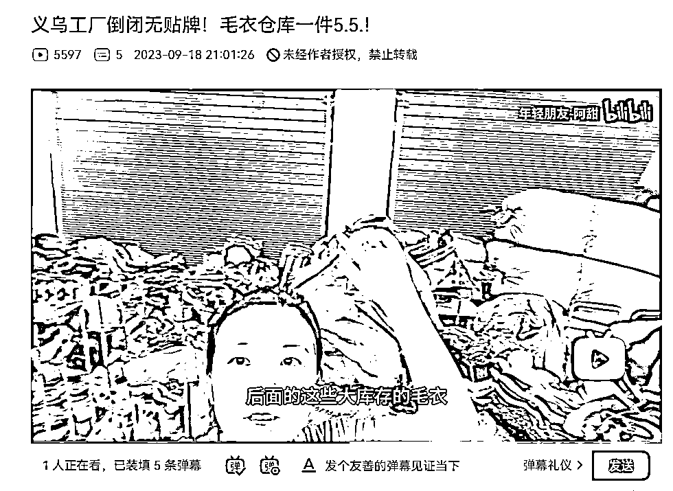

再看伴手礼。那段时间我准备回老家结婚，一直在找衣服、试衣服，顺便看伴手礼，想着能直接拿货就行。于是跑了好几个比较大的供应链场地，供应链跟工厂不一样，那里几乎是应有尽有。

一般的工厂只会生产同一类产品，除非是特别大的超级工厂。比如做全红婵乌龟的厂，它就专注做树脂类的乌龟，不会去做毛绒玩具，因为这完全是两个产业，工具都不通用。这就是供应链和工厂的区别。

伴手礼供应链的品类多到离谱，因为礼盒本身很杂，糖果、香皂、香水、化妆品、毛巾、蜂蜜……你想得到的东西都能塞进去。但转念一想就明白了——他们主要做的是“组装礼盒”，所以价格也没有想象中那么低。

聊下来了解到几个信息差：

1. 伴手礼供应链本质上就是资源整合，里面有2000多个品，可以单独卖，也可以拼成礼盒卖。
2. 伴手礼不支持单独拿货，通常要先交大几千的会员费，之后才能拿到相对低价。
3. 交完会员费后还能走“分销模式”，转手卖给别的有需要的人，因为伴手礼一般拿货量都很大。
4. 现场允许直播、拍视频，他们很欢迎这种合作。
5. 他们的销冠奖励是一辆奔驰，销售平时主要靠小红书引流、私聊收款。
6. 后来我意识到这未必是个好生意，因为囤货量实在太大了，当然那些老板本身有钱，亏得起。

https://www.bilibili.com/video/BV1z84y117Be/?vd_source=cd57d3a123a254526b23c45b10a3970f

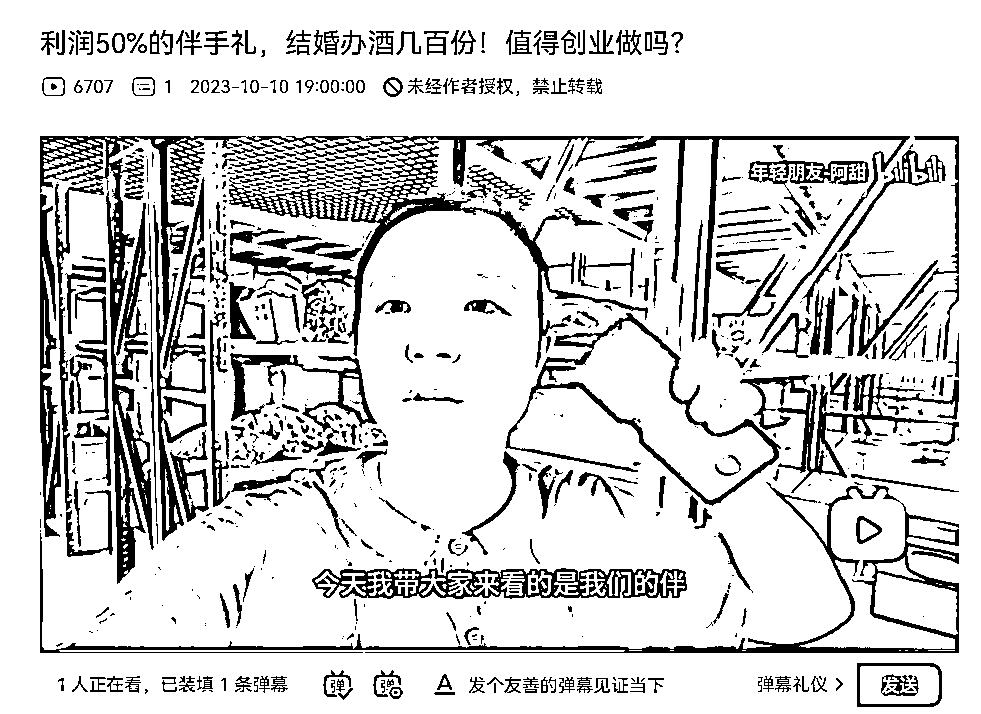

再后来，我处于自由职业状态，主线业务大概就是小红书和直播运营。之前有同事找我接合作，比如给教授搭直播间、做中控运营，这就是我尝试过的一段副业。

这个副业的好处是能接触到一些平时根本见不着的大佬，听他们聊天、看他们做事，本身就是一种学习。而且他们还会给我们安排五星级酒店，顺便拍点视频、体验好东西。

但它没法长期做。人家如果经常要直播，直接找运营团队就行，我们很快就会被架空。

https://www.bilibili.com/video/BV1Fu4y1C797/?share_source=copy_web&vd_source=17ec0460f8a49d17a4544a91f7b5ba99

最后说说对接珠子厂家。这个品其实是在我家楼下发现的，珠子特别漂亮，后来我经常去店里坐坐。这里解释一下：品，就是“选品”的那个“品”，它可以是任何东西。在义乌说“看看品”，意思就是看看你的货。

我本身就喜欢串珠，于是主动跟老板说，想在小红书上帮这个品打打广告。我在小红书开始做珠子图文内容，还找了二十多个伙伴一起用我的SOP跑，没想到效果还不错。后来我把这个SOP放到了“赚钱有术”社群，竟然拿到了龙珠精华帖，价值一万多！当然我也发到了自己的星球，但内容比较多，跟这个文档关系不大，就不展开说了。

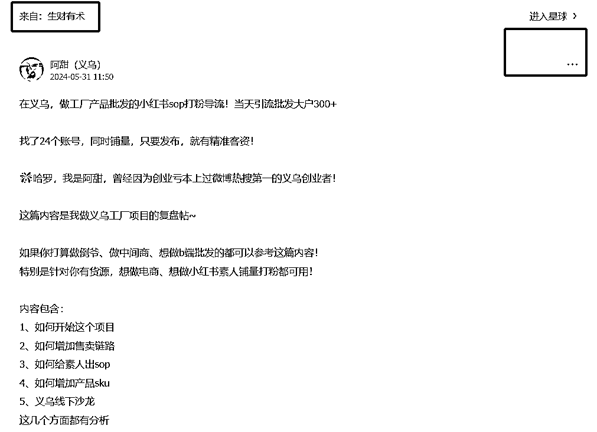

当时除了想找珠子的B端客户，也做了一些C端的尝试，主要有几种方式：

1. 老板报价，我们直接赚差价。
2. 有的客户拿货上万，我们把他对接给老板，之后等老板给提成，这样比较被动。
3. C端客户没法一次拿几千块的货，所以我把珠子按颜色分类，做成DIY串珠的形式，让他们能直接买单串。
4. 我还把串珠产品带到迪士尼，拍了很多出圈的图片，回来以后大家可以直接复制这套引流模板。

不过后来基本不做这个业务了，因为很多时候根本看不到客户有没有下单，二次下单也没分成。东西不在自己这里，就没有议价权，货量、颜色、邮费一概不清楚，说白了就是个传话筒。这事有办法补吗？也有。那家店不大，没有自己的聚水潭面单、代发这些，就只能靠之前的客户群来支撑了。

很多人可能不知道，如今做电商起步的门槛真的低了不少。你去问十家供货商，基本都能给你一件代发，后台的库存、颜色、尺寸、销量数据全都一清二楚，连快递面单都帮你打好，你只管专心搞流量、搞转化就够了。

https://www.bilibili.com/video/BV17h4y1B7tc/?vd_source=cd57d3a123a254526b23c45b10a3970f

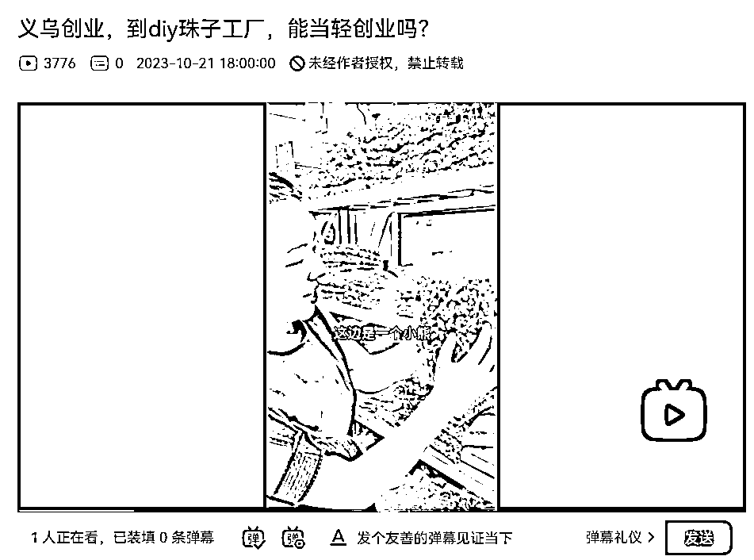

* * *

# 年货电商从零起步：那些踩过的坑，和意外撞上的纪录片机会

十月一到，年货季就算悄悄拉开帷幕了。刚好身边有朋友在做这一行，我们就从他那儿进货。他主营的是桃木挂件，单价不算低。我们匀了一批样品回来布置直播间，那阵仗豪哥和我算是真正意义上的“自己起盘”——没有外援，全靠自己跑完全程。

回想当初做文具那会儿，团队满打满算五个人，有人负责投资、有人管渠道、有人做运营指导、连仓库和快递都安排得明明白白。而这次，一切要自己来。

如果你也想走同一条路，那以下这些环节一个都躲不掉：

1. 选品——卖什么、有没有竞争力、货源方不方便拿或代发；
2. 直播间——货品决定你需要多大的场地、什么样的氛围；
3. 电商基本功——上下架、改价、做详情页、研究运营逻辑；
4. 直播逻辑——什么是浅层数据、什么是成交数据，什么节点上什么品；
5. 主播话术——拉流量、憋单、逼单、放单、卡库存，一样不能少；
6. 快递谈判——不是越便宜越好，要综合时效和取货便利度；
7. 打包物料——胶带、泡沫、包装袋、打印机，零零碎碎都要备齐。

后来我把我们当时整合的一些学习资料也放出来了，有需要的朋友可以直接拿。

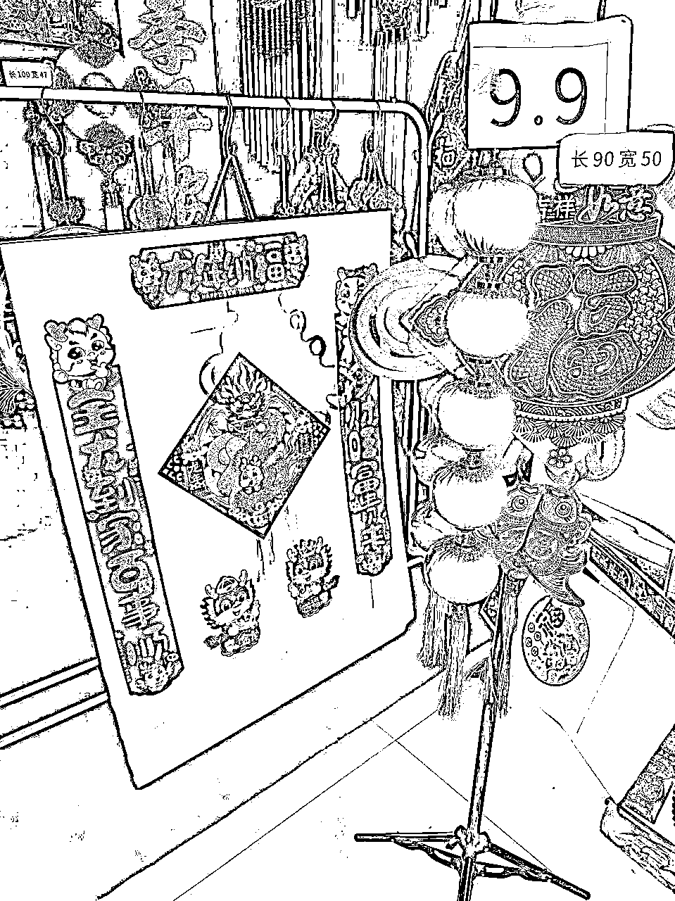

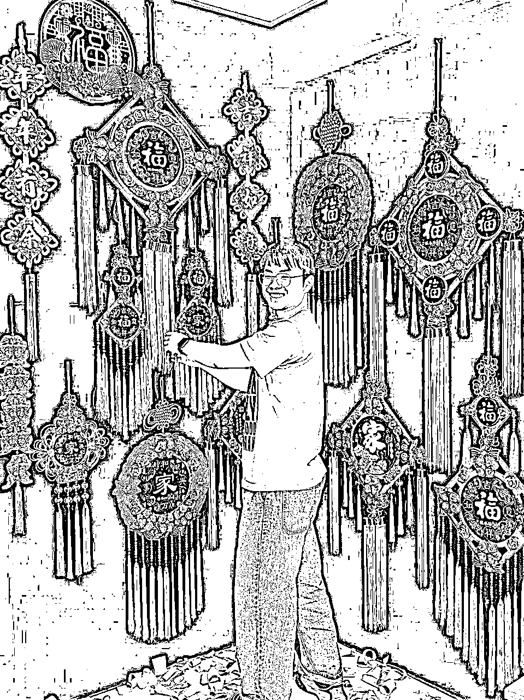

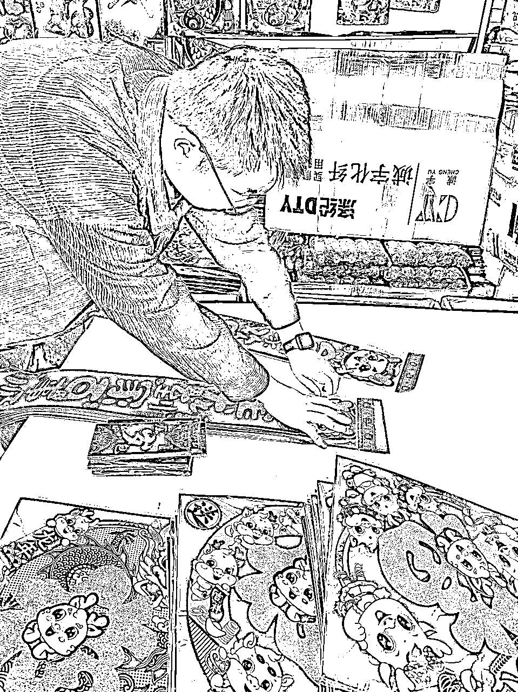

## 跑了一趟义乌商贸城，差点被年货区淹没

老远看见商贸城年货区的那一刻，整个人是真的激动到不行，品类多到根本看不过来。

如果你十月到十二月期间人在义乌，非常推荐去银海小区转转，特别是想摸一摸市场风向的，那里基本都是答案。（后面游学地图里也会提到）

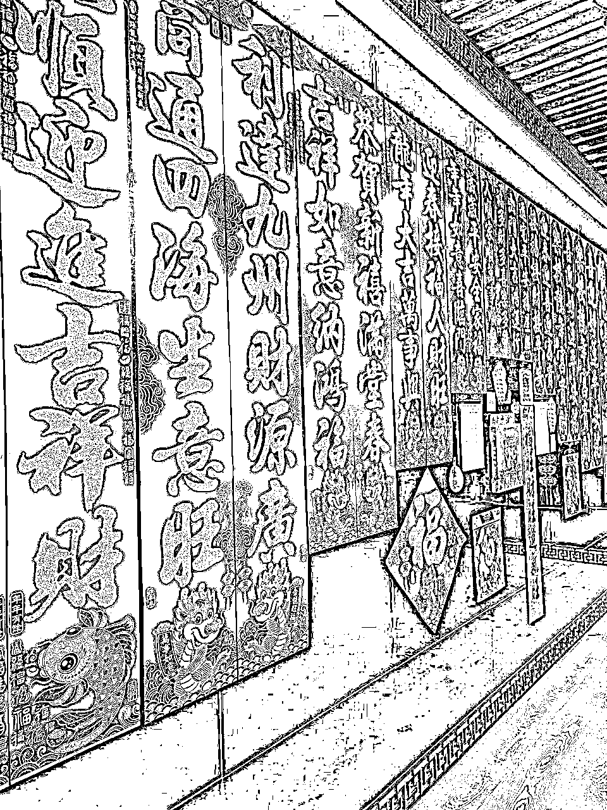

我们之前做直播对标的时候，已经眼熟了市场上几款爆品。结果到线下问价，好家伙，价格比直播间卖得还贵出不少，翻倍的都有。

但我们还是挑了一批：一部分是爆款跟卖，一部分是没人做但我们觉得有潜力的款，还有些是老板手里压着的去年存货，折价处理的。

拿货这个动作，是真的会让人上头。因为那时候在老板眼里，你已经不是闲逛的路人，而是会问批发价、谈数量、确认现货的小老板了——对方给你开单、帮你送货、约到货时间，那种感觉和偷偷拿手机拍照完全两个世界。

有些货是现货，当时就能拖走；有些要等工厂发，其实很多档口也是中间商，直接喊货拉拉从厂里拉过来。

在档口还遇见了许多外地来的老板，背包里全是账单和样品清单，下单后就在谈物流是到付还是现结。

说实话，生意场上的信任，有时候真的就是靠这种“先全款、后收货”的旧规矩撑着。当然也有骗子混在里面。货不对版怎么办？有瑕疵找谁？全靠缘分。

但要让我现在给一句实在话：千万别脑子一热就自己囤货。哪怕挂别人产品都能出单，你一旦压了货，卖不掉就是砸手里，除非你本来就在做线下实体。

义乌这边的优势也在于此。不止一家档口跟我们说：“1688挂什么价我们都清楚，但你在义乌本地，直接过来拿，价格肯定更香。”这也是这座城市让我好感倍增的理由。

拍那系列视频的时候，是从拿货、布置直播间一直到生意有了起色，全程记录。结果没过多久，我们就在一月把年货电商项目彻底停掉了。

https://www.bilibili.com/video/BV1Sc411U7FM/?vd_source=cd57d3a123a254526b23c45b10a3970f

## 布置直播间、写话术：每天忙到嗓子报废

那年货期间的节奏，我按从0到1的顺序说，因为比文具那次要忙太多了。

素材拍了一堆，根本剪不动。直播时长拉得比以前长很多，嗓子也经常干到发不出声。口播视频那段时间也很少更新，因为全链路都是第一次亲自跑：拿货、拍图、谈快递、买包装、打包、发货、客服、售后、搭直播间、上下架商品，每个环节都像在补课。

我们捡了个低成本的法子，在住房楼下租了个十几平的小房间。先在瓷砖墙上仔细规划好年货摆放的位置，再做标记，铺上黑色吸光布当背景，后面大家看到的展示图就是这么来的。那块黑绒布还藏着个信息差——朋友直播间一直在用，说是效果很好。但用过才知道，它好用是真的，粘墙也是真的，退租那天我们是一小块一小块抠下来的。

在这提醒一句：租房搞这种胶贴背景墙，一定要想清楚退租时的残留问题，不然押金可能就没了。

https://www.bilibili.com/video/BV1PN4y1a7jv/?vd_source=cd57d3a123a254526b23c45b10a3970f

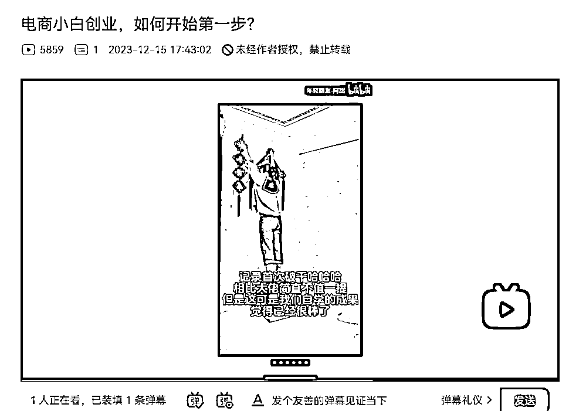

## 直播间搭建实战：从灯到支架都有讲究

直播间怎么搭，核心就两个词：产品、预算。

常见的有四种类型：

- **仓库直播间**：场地大，核心是“豪”，让人觉得你家底厚、货够多；
- **大直播间**：真人要站进画面，适合卖衣服、鞋子、箱包类；
- **中小直播间**：人坐着不动，靠聊天带节奏，吃播、知识、职场类都可以，重点是脸和表达；
- **手播直播间**：只要露手，适合首饰、盲盒这种精致小件，空间不用大，但氛围感必须拉满。

朋友直播间那套灯具下来要六千多，而我们的预算只有五十块。贵的灯确实不一样——脸不假白、不过曝，出来的画面干净。我们款主要是纯照明，就没奢侈一把了。

手机支架也没啥讲究，但一定要结实，因为你得挂着充电宝、手机，天热了还得上散热器。真上了直播才知道，这种多头支架太实用了，能同时架好几台手机，搞多平台直播或小号盯评论都不耽误。还有那种一拖三的插头设计：充电线、收音麦克风、散热器，全插一个手机上。

想深入研究的可以直接搜“直播间搭建”，会出来一堆针对不同品类与场景的方案。

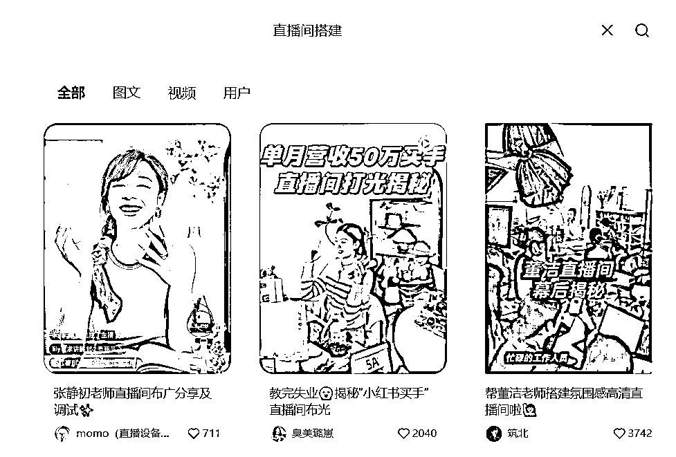

https://www.bilibili.com/video/BV1Wc41117rk/?vd_source=cd57d3a123a254526b23c45b10a3970f

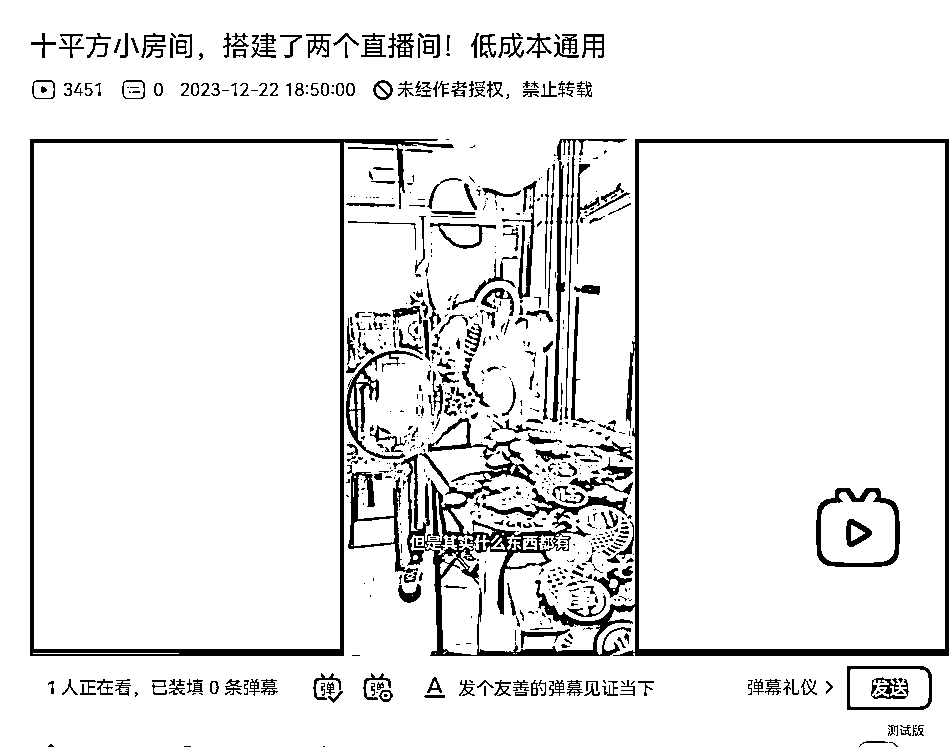

2023年那会儿做自媒体，还不像今天这么包容。评论里总有人说我在浪费时间，质疑声挺多的。我也想起刚来义乌那会儿，有人说我去摆摊不够“正能量”。

好在如今风向完全变了：硕士毕业摆摊、大厂裸辞做小生意、赚人生第一块钱……这些标题都被大家乐于接受。似乎越来越多的人变得勇敢了。没钱不去行动，还等着天上掉吗？大家越来越务实，这是个好信号。

## 打包对联：看似简单，累到手软

https://www.bilibili.com/video/BV1Qc411d7RA/?vd_source=cd57d3a123a254526b23c45b10a3970f

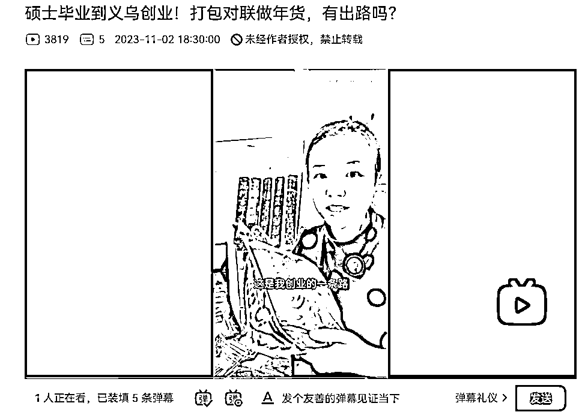

## 给年货店做宣传：十月卖年货，谁信？

十月份开始卖年货，不干这行的人根本理解不了，开口就是“这也太早了吧”。但他们不知道，九月份同行们就已经开播了，而且每天都还有新直播间冒出来。

我们白天研究别人的直播间布置、学话术、拆解产品结构，再回来调整自己的打法。做直播运营这活儿，真不是谁都能顶得住的。

因为货品客单价不一样，给不同人群推不同品，转款的时候也得想下一个品怎么接。可能因为我们是多品类的夫妻店直播间，节奏特别明显，反而让很多成熟同行看不出门道来。

后来我们慢慢摸出了规律：什么品能拉人，什么价格能促单，都在这段运营过程中一点一点被验证和细化了。当时产品线分两档：9.9到19.9的引流款，和更高客单价的，最贵到69，桃木件和带灯的款式比较贵。对联那个108件套，9.9还包邮，说实话我都替他亏——毕竟一年才贴一次的东西，便宜到这种程度确实让人没抵抗力。

做着做着又发现一个新市场：专门贴县城、农村大门的对联，客单价二十几，反而卖得格外好。桃木挂件也很多人买单，运气好的时候还能撞上一两个大户，拿啥卖啥。

正当我们觉得已经找到“流量密码”的时候，第二天流量的数据和GMV直接来了个对半斩。

https://www.bilibili.com/video/BV1tN4y1k76q/?vd_source=cd57d3a123a254526b23c45b10a3970f

## 突然被媒体围住：纪录片找上门了

做年货期间，媒体采访一波接一波。第一次收到邀约，整个人兴奋得不行，聊了一个多小时。像《一条》《财经》这种级别的也来过。可后来采访越来越多，我嗓子又难受，整个人疲惫到不行，就婉拒了当时几乎所有的采访。

那后来怎么又会跟薛兆丰教授那边合作呢？说起来也很巧——他们的导演联系我们的时候，没有在电话里聊太多，确认了一下情况之后，人直接开车到了我楼下。

我当时想着可能是随口一说，也没当真。结果电话再响，人已经到楼下了。就觉得这一趟，值得去见。更何况是薛兆丰教授，经济学家哎，站在更高的维度来看我们的现象，说不定能给出一些完全不一样灵感。

再忙也得去。至少想看看高段位的人怎么看、怎么想、怎么说。和薛老师的视频我放在后面了。现在回头看，还真的要感谢那个阶段的自己，成长是真的可以肉眼看见的。

https://www.bilibili.com/video/BV14N411u7rh/?vd_source=cd57d3a123a254526b23c45b10a3970f

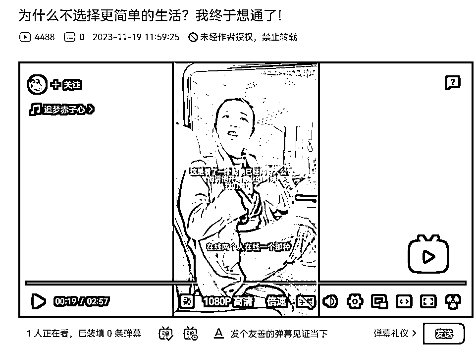

## 顺手试了试拼多多

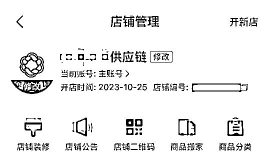

现在电商主流就是两条路子：

- **货架电商**：像超市货架，你想买就买，不太讲究平台大小，典型代表是拼多多、淘宝、京东；
- **兴趣电商**：本来没打算买，但看到喜欢的博主在推，突然就心动了，小红书、抖音就是典型。

我们当时抖音和视频号都做，重点压在了视频号。想着拼多多这种货架平台也开个店试试，于是很快就把店开起来、也出了一些单。结论是：没赚到钱，坑倒是踩了不少。具体如下：

https://www.bilibili.com/video/BV19C4y1C7z7/?vd_source=cd57d3a123a254526b23c45b10a3970f

## 拼多多关店全记录：退款的冲击力

开店之后就很快出单了，当时还觉得，拼多多是真不需要什么运营技巧啊，大家都这么说：平台让你报活动你就报呗，反正他们会把利润算到骨头里，生怕你多赚一分。

我们当时的利润结构是：一个商品客单价10块、净利1块。什么概念？只要来一个仅退款，等于前面十单白干。然后，我们就真遇到了能把人逼疯的“神奇客户”。

说几个印象特别深刻的：

1. 客户说对联有个角折了，要求仅退款。我们说买了运费险可以退货，说什么都不肯。平台最后直接介入，退款到账，那一刻我真觉得拼多多是强盗逻辑。
2. 我们那时为了冲量，按千单起的批发价在挂，就为了让权重快点起来。结果半夜凌晨两点多，来了一单，一个地址，把我们库存全买走了。一算：一单利润三毛钱，邮费75。整单合并发货，硬亏。后来有朋友说可以发空包让他退款的，我们才拍大腿，亏大了！
3. 9.9元108件套的对联，被说少了一个福字，要求仅退款。你说这退多少合适？关键还不确定是不是真少件。
4. 另一位客户，买了6件产品差不多3kg重，我亲手打包的。他说少了一个，我们懒得多想，直接退了。后来去楼下朋友那边玩，看到他回复客服消息，竟然发现同一个人也在跟他说少了一个。不用说，这人纯属惯犯。回头一查后台物流，更加铁板钉钉。

那阵子我和豪哥的心态真的快崩了。明明用的都是最贵的珍珠打包袋，怎么还会出问题？出了问题为什么不能退货退款，非要仅退款？说实话那段时间是真不想干了，太消耗人了。

https://www.bilibili.com/video/BV1Hp4y1d743/?vd_source=cd57d3a123a254526b23c45b10a3970f

## 复盘亏本真相：年货电商这步棋错在哪里

后面每次复盘这两次电商尝试，有几点感受特别深刻：

1. 看到别人赚钱，眼里就只有电商两个字了。没有思路、没有优势，纯靠一股冲劲。有句话怎么说来着？手里拿着锤子，看什么都是钉子。在一个行业待久了，思维真的会被框住。周围的人都干这行，你大概率也会照着走；要跳出来做别的，一切又从零开始，太难了，特别是没存款、没外援的时候。
2. 因为没有经验，每一步都是摸黑前进。确实学到了很多，但也真的浪费时间。当时没付费意识，全靠朋友带。像“群响”“赚钱有术”这类圈子，我后来才知道，却舍不得进。回想起来，要是当时花点钱去问有经验的人，可能能少走很多弯路。现在学聪明了，遇到不懂的，对方正好又需要我们的经验，那就做价值交换。
3. 没做市场调研，没找到自己的擅长点。看到别人做什么就跟风做什么，道听途说，没有根据地做判断。被媒体上年销千万的数字晃花了眼，却忽略了背后的成本、人力、库存、流程。做电商，真不是盯住一个GMV数字那么简单。
4. 贪心。明明挂个链接赚佣金差价也能做得走，嫌赚得少，非要自己拿货，最后全压在手里。这本是个能赚钱的项目——年货正常出单着呢，硬是被库存拖成了亏损。后来一细算，赔的全是产品和包装的钱。说不后悔是假的，但这条路的试错成本也让我们彻底明白：现在挂车这么方便，真没必要自己囤货！
5. 进货的时候，完全没有考虑打包的问题。只想着价格、款式能不能卖，忽略了包装的复杂程度。包装袋分大、中、小号这都正常，有些产品还得定制规格——比小的要大，比大的要小，不然客户体验不好。包装袋一般500个起拿，那段时间我们的洗手间全被包装材料占领了，单个成本有的高达1.5元。碰上易碎的还要泡沫、纸箱，这笔开销也不小。

https://www.bilibili.com/video/BV12D421J7v8/?vd_source=cd57d3a123a254526b23c45b10a3970f

## 决定放弃年货电商的那一天

我们是什么时候下的决心？有两个画面至今记得特别清楚：

1. 临近春节，竞争越来越惨烈。视频号的小二还来给我们打气，说马上要上量了。但我们的数据却一路往下掉，粉丝画像也越来越不精准。后来甚至喊出“互动就送”，也没人理。那天晚上一单没出，平均一分钟才进来一个人。我和豪哥隔空对视了一下眉毛，异口同声说：要不就算了吧。我点了点头，点了下播。
2. 某天深夜凌晨一点多，我们录复盘语音的时候，手机正好随机播到张信哲的《就懂了》。那天我们决定，从这一天起不再播了。坦白讲，有段时间我已经疲惫到看着时间表不想下楼开播，只想对着电脑发呆，哪怕就发几分钟呆都好。

https://www.bilibili.com/video/BV1xc41187ok/?vd_source=cd57d3a123a254526b23c45b10a3970f

其实还有好多年货电商的细节，属于“没苦硬吃”系列，再也不想回去经历一遍：

1. 我们从穿短袖播到穿棉袄。我怕冷，买了一张超大的发热垫，结果也只有脚底热；直播间穿棉衣不好上镜，所以就套着一件红色背心，我们还给它取了个外号叫【战袍】。可每次举品时人都在发抖，后来开了空调，又把头吹得发晕，经常没到下播就开始打呵欠，嗓子又疼——放弃的念头在心里闪过无数次。
2. 从年货季开始到11月张信哲演唱会，我们没出过门，每天就在二楼的直播间和六楼的家里两点一线。演唱会那天也没有停播，因为下午要出门，早上七点我们就开播了，嗓子基本是哑着硬撑下来的。那时候不会正确的发声法，嗓子后来彻底被累坏了。
3. 除了上播时要说话、要笑，其他时间我们几乎零交流。说每个字都费劲，表情、眼神、声音都像消耗品，只有保持“待机”才能维持能量。

https://www.bilibili.com/video/BV1eg4y1D7o/?vd_source=cd57d3a123a254526b23c45b10a3970f

* * *

# 调整方向，重新出发

年货电商停掉之后，回了趟老家、去旅行、参加婚礼，也接了一些杂七杂八的业务。

没有一件跟电商有关。有朋友来问我们做电商的建议，我也不会直接说他该不该做，只说我的经历。听完之后，大部分人自己就退缩了——其实不是我劝退的，而是他们身上，正在重演我当年的问题：没有想清楚自己的优势是什么，只看到别人赚了钱，却忽略别人起步的时机、本钱和积累的资源。

小白的失败往往源于冲动：拿自己一腔热血，去对比别人十年的功力。

那时候我跟豪哥心里只有一条准则：**绝对不做重资产电商，绝对不囤货。**
这个观点一直到今天我们都坚持。做电商的方式太多了，真没必要死磕在拿货囤货这条路上。

## 复盘电商：亏了钱，但未必是失败

很多人习惯用赚没赚钱来定义成败，我反而觉得那太片面了。

雷军不是说嘛，没干成的事，就别到处说了，就当没发生过。所以没赚到钱太正常了，真想干一件成一件还能赚钱的，那属于极少数。不然，大家怎么都那么爱看别人赚百万的案例呢。

但在那段经历里，我赚到的是大概率别人体会不到的东西——那些细节，是哪怕花几万块别人都不一定会告诉你的，是人生非常难得的一笔体验资产。

https://www.bilibili.com/video/BV14i421o7F4/?vd_source=cd57d3a123a254526b23c45b10a3970f

## 在家办了一场线下沙龙

那阵子我发现自己已经很久没和外界产生真实的交流了。回想此前的电商创业模式，基本是闭门造车。俩人既没时间，也不知道市面上有什么活动。与其继续沉默下去，不如自己组织一场分享。

我当时脑海里浮现的模式很简单：一手抓创业者，一手抓供应链，而我，当一个可信赖的平台站中间。

创业者需要供应链和好货；供应链需要找分销、找人卖。这不就是天然的一拍即合吗？

这一年在义乌，我没少折腾。从电商到数字人，从培训到跨境，中间换过好几个方向。今天把这些经历和思考一次性写清楚：有放弃，有收获，也有给后来人避坑的干货。

### 为什么我最终没做纯知识付费

说实话，当时没有继续做下去，是因为很多创业者给我钱的样子，像抓救命稻草。那种生意我接不了。我做的不是货物流转，而是一个人实实在在的信任和期待。我做过培训，知道交付有多重，真不想再做这种重交付的业务。现在回头想，问题还是出在自己身上——收费模式没设计好。其实完全可以改成押金打卡，或者按结果退款。单一收学费的模式早被市场玩烂了，大家天然会觉得你在割韭菜。哪怕你给了再多信息差、再多认知干货，也没用。小白真正需要的不是上课，是收入。这不是企业家培训。

### 不碰电商后，世界反而大了

不碰电商以后，我最大的感受是：世界一下子打开了。我们开始更新视频、认识新朋友、聊各种新机会，眼光也放得远了很多。从2月到11月，我和别人交流了一百多次，平均每次4小时，大小局都算上。现在除非是自己特别想见、或者有明确合作可能的人，其他邀约基本都推了，因为说话真的耗神。也是这时候才意识到，我的核心目标是赚钱，不是做电商。过去老把电商和赚钱画等号，其实狭隘了。走出来交流一圈，发现赚钱的路子多到数不过来。我的星球每天都在刷商机，我总觉得怎么什么都能赚钱。但很多星友说完全发现不了。那以后有机会，一起打卡看看哪些风向标有潜力。

### 数字人AI，算是撞上了风口

2024年1月年货季结束，豪哥开始做数字人AI业务。他是程序员，对这个东西天然有热情。他克隆了我的脸和声音，第一次放出来，我妈都说太真实了。后来我们又把“自己做数字人”的故事讲出去，乘着AI那波热度上了几个节目。这个过程中我明白了一个道理：采访不是你想有就能有的，关键取决于你正在做一件什么事。恰好做了热门的，恰好又是自己热爱的，才是皆大欢喜。因为这个业务，我们上了义乌电视台、浙江卫视，后来还帮他们做数字人克隆。现在豪哥在继续做数字人直播，专门服务美团服务商，至少已经走到B端了。

### 义乌厂家的小红书业务，为什么没继续

前面参加活动多了，认识了不少义乌老板，也带来了一些合作：一是厂二代IP出海，把人物IP克隆后发到海外平台，做产品对接和批发；二是义乌产品做小红书引流，当时接到的一家车企，玩的是低粉高变现；三是教义乌厂家做小红书，引流B端客户，顺便卖生产机器。这些是电商之后的探索方向。做小红书、做抖音IP、对接工厂，这个市场确实很大，而且小红书平台和义乌官方都在使劲推义乌电商。听起来很诱人，但最后我还是没做。原因很多：第一，义乌老板们还不信任小红书，他们是靠抖音起家的，嫌小红书太小；投流上也有自己的选择，不像抖音那么“暴力”。第二，小红书以内容为王，跟义乌那种简单粗暴的玩法天然相反。第三，没有理由再搞一个小红书团队去卖相同的产品，投产比太不确定。第四，很多老板觉得小红书运营、代运营就是割韭菜，我也懒得解释。第五，真正有付费意识的人太少了，都想要免费思路和全案，做起来看不到奔头。

### 跨境市场，打开了新视野

7月的时候，前同事创业做海外市场，搞内容出海，找到我来做交付。我们的基本盘是小红书海外代运营和定位全案。一方面因为我是三节课的IP讲师，另一方面也是因为在前公司只有我一个人做小红书，业务自然分到我这里。跟他们协作下来，我开始真正了解大陆以外的营销、产品和出海市场。

### 义乌商品出海，动心但没做C端

我也下载了TikTok，认真看直播、带货车、价格，发现这市场是我以前完全没见过的。虽然知道背后有广告、仓储、快递各种成本，但看到卖家把人民币直接换成美金，还是心动。不过想来想去，我还是不想做C端。义乌圈子的共识是：做外贸要做B端。

### 西班牙语主播培训：试过了，留了样本

12月听说TikTok要开西班牙区，我们就合作了西班牙语主播培训。这条路后面可以接着做TK培训引流，也算一门不错的生意。但西班牙语主播有个bug：既会西语又会主播技能的人，谁愿意一直给人打工？基本都想去自己创业。所以这条路很难走。不过好的一面是，我们完整走了一遍，也听到了潜在用户的真实反馈。当时还发了一条小红书，标题大概是《义乌西班牙语主播，我们先冲》。

### 这一年意料之外的收获

这一年也有不少高光时刻。最大的惊喜之一，是成为薛兆丰教授纪录片《万物经济学》的共创者之一。

再有就是上热搜。那次非常突然，直接冲到了微博榜一，但我完全不知情，是老同学来告诉我的。互联网上的讨论从来不是凭空来的，背后要靠话题、水军和互动一起撑起来。我没有去接这波流量，因为对我来说意义不大。不过既然它是真实素材，我就可以拿出来聊聊。

浙江卫视也来采访过。

义乌电视台也做过专题。

财经类的报道也有不少，澎湃新闻、一条、第一财经都聊过。

因为持续发小红书电商和义乌创业的内容，小红书官方账号也找到我，受邀去录了一期视频。

线下方面，我把赚钱有术的义乌局组了起来。这是一个副业创业圈子，里面的人质量很高。当时刚从外地回来，我答应他们把自己的精华帖做一次线下分享，把颗粒度缩到更小。

还受邀参加了义乌的女性创业活动。这种圈子很适合链接人，现在在义乌或其他城市，类似活动很多。我从观众一直做到分享者、组局者，这个转变都发生在义乌。想创业的话，最后一定要学会做组局的人。

义乌线下创业市集，我也去当过分享嘉宾。

### 给想入局者：3条基础认知

如果打算来义乌做电商，先搞明白三件事：怎么找货、电商基础怎么做；怎么成为一个运营型主播；以及自然流和付费流到底怎么选。

### 踩过的坑，全帮你列出来了

下面这些是实打实踩出来的经验，看得越细，越能少交学费。

#### 中控岗的坑

使用蚂蚁搬家这类工具搬过来的商品，一定要检查物流模板，偏远地区不包邮。可以在商品管理里通过过滤运费模板来排查。

放福利品的时候记得设限购，否则一个人能拍很多单，羊毛被成把薅走。

创建自由商品链接时，要弄清1-1、1-3分别放什么货，不然打包时一定乱套。

直播前的那几十个福利品，价格要全部记下来。开播后需要手动调价或者清空库存，否则用户会直接在小店里用福利价买走。

福利品的规格统一写颜色，不要写“款式不挑”。不然库存本来就不齐全，打包发货没法配置。

快递打单后，24小时内要完成揽收，否则影响店铺评分。

每晚下播后统计库存，库存不够第二天要及时补，不然直播开到一半没货了。

打单时要设置商品简称，否则备注太长，快递单上显示不全，打包员根本不知道要装几件。

上链接时，如果主播报的价格比成本低，必须通知主播。看情况决定改价上车，还是不弹讲解。

上车后讲解要弹得多一些。就算在讲其他品，也可以弹一弹福利品链接，既能吸引停留和点击，也能补成交密度。

已经上车的链接，通过查找商品会搜出多个关联品，比如搜索“本子”会搜出一堆，需要手动点击查找下一个。

没有设置每件限购1单，结果被人薅了10单羊毛！其中有7单笔、3单尺子，我到现在还记得。

巨量百应后台上链接时，可以直接选择置顶商品，这样不用每次手动修改1号链接。

如果是真上福利品，比如空气炸锅卖20，只上1单库存，并且不要弹讲解。一旦弹讲解，用户看到只有1单，会直接在评论区开喷。还要提前设置屏蔽词，比如“只上1单”。也见过其他直播间设置地区限购，比如只让新疆地区购买。用户点下单才发现买不了，这时中控再把库存清零，就显示“抢完了”。

错放类目会被系统检测到，如果提示类目异常，记得马上修改商品标题和主图。

#### 物流岗的坑

每家店合作的快递公司不一样，如果要换快递，比如从中通换成极兔，需要在店管家里重新配置。

发快递前要先往里充单号数量，没有单号数，打单、发货都做不了。

快递揽收时间一般是中午12点和下午五六点，具体要看合作快递公司。

#### 运营岗的坑

抖音开播前必须挂小黄车，不然上架喊价格就算违规。我吃到过这个违规。

下播前一定要看直播大屏的流量分析，黄线翘头之后再下播，能为下一次直播积累推流。

用短视频刷粉可能把账号刷废，最典型的表现是搜索流量占比很高，推荐流量却不行。

每次下播时，如果推荐流量能占到90%以上，那这个号就有起号的希望。

刚起号时流量很少，2块9发10支笔都送不出去，后来只能改成1块钱拉流速。

福袋不是必须发的。它虽然能提高停留和互动，但也容易招来一群只等福袋不下单的羊毛党。要不要用，得看账号自己情况。

抖音小店要70分才能挂精选联盟，72分才能发福袋。

货盘真的起决定性作用。常听人说“选品定生死”，但选品不只选款式，还要看这个品有没有稳定的货盘。别卖两天就断货，或者价格对比同行毫无优势。

直播中尽量不要让成交订单为0。因为有成交数据，抖音才会推更多人。尤其是在塑利润品的时候，塑品时间很长，需要靠低价商品来补成交密度。

直播推荐占比一定要高，最好90%以上，千次数据也要高。这样第二天开播才有极速流。

人均观看时长最好在40秒以上。

起号时为了做人气、互动，可以选低价品起号，但千次一定上不去。可以借助精选联盟来刷千次，只要每天的千次在递增，就是好现象。

利润品炸空了很正常，马上用福利品补成交量，防止数据下滑，导致下一个5分钟的推荐流量不够。

#### 主播岗的坑

不能说极限词，“最”“绝对”这些都不行，否则会违规。

主播状态不好，GMV会很差，还会影响整个团队的氛围。

新品过款的时候，特别容易报错价格。

#### 客服岗的坑

抖音客服考核时间是8点到23点，在这个时间段里的客服消息必须第一时间回复。

小额打款会直接打到用户零钱里，要先确认用户是否开通了零钱；没开通的话，可以让对方发微信收款码。

如果打单后用户退款，但快递还没揽收，要回收单号；如果快递已经在路上，要通知快递客服拦截；如果正在派送，就通知用户拒收。

有时候快递不是全部揽收，会有漏揽收的情况，也要主动通知快递客服做揽收。

如果客服消息有小号在线，消息会自动同步给小号，主号收不到会导致回复超时。

#### 打包岗的坑

产品一多，快递袋的规格也多，还要用透明胶固定，有的还得用箱子。

配单的时候要把单号和货搭配在一起，再打包。

店管家里可以授权主店铺和子店铺，共用一个快递单号。

气泡垫一定要用，能减少快递运输中的损坏。

有塑料壳的商品尤其要用气泡垫包好，防止快递暴力压损。

如果两件大件没办法统一打包，建议重新打单、单独发货。比如行李箱和空气炸锅分成2单。虽然多花一单快递费，但能防止合并打包后，在运输途中互相挤压损坏。

#### 选品岗的坑

精选联盟里大部分商品都不是性价比高的款。有些店铺会给大V开专属链接，价格更低，但素人去带货就没有价格优势。

日常基本只能跟品，素人想自己打爆一个品，太难了。

### 最后说说义乌这座城市

很多人觉得义乌很割裂：一边是堆满货的地下室，一边是漂亮的高楼和满街的外国人。

这里的新鲜事永远不缺，很多东西都被我拍成了素材：义乌人人都在做生意；义乌商贸城开始做零售了；商贸城每次去都有新东西可以更新；到处都能拍摄，酒店大堂、星巴克、肯德基都行；地下仓库、库存街、批发、打包、跨境……每一个词背后，都是故事。

这就是我在义乌这一年的真实记录。希望这些经验，能让你少走一点弯路。

## 义乌的面貌在悄悄换血：

聊聊我最近在义乌市场里观察到的一些转变：

过去大家给义乌贴的标签是【低学历、低成本】就能起家，如今走在市场里，你会看到【大厂离职潮】【留学的创二代回国】这些新面孔越来越多。

照这个趋势走下去，义乌的内卷焦點不会再是学历高低

比拼的是【打法】和运营思路

早年把义乌这块地盘打下来的前辈们，更多靠的是【野路子】【运气好】，而现在的创业者来到义乌，早已是【用思维导图梳理】【办线下沙龙交流】【做市场复盘】【请外语主播出海】，把布局做得明明白白。

学历本身从来不是创业的决定性因素，真正关键的是学习速度和学习方法！

是投身其中的决心，以及你每天能捕捉到多少有效信息！

* * *

# 结语：

只要我在义乌走一趟，就能带回新的灵感和故事。

在深圳那阵子，我的愿景很简单：写字楼上班、白领生活、月入过万。等这些都实现后，我发现往上再冲很难受，而且我也不喜欢管人，索性自己干。

到了义乌才发现，原来人人都可以是自己的老板，我能把供应链前端到销售后端全部扛起来，并且做得游刃有余。

我太爱这座城了！这里的商业气息、志同道合的创业者、琳琅满目的全球小商品，以及随处可见的外国面孔。

这是一座谈钱不伤感情的城市。

我从曾经羞于开口谈钱、穿着长衫都觉得不自在，到现在能淡定签单、谈分成，成熟了太多。

按豪哥【我老公】的话说，他来义乌一年半的收获，比在深圳待五年还要多。他从一个腼腆的i人程序员，最初直播都要用商品挡脸，到现在能直播三小时不喘、还能组织局谈成生意，底气完全不一样了！这不叫成长是什么？

写到这里已经超过三万字，感觉就像把我们在这里一年半的经历浓缩成了一份复盘。

可我依然有一种人生才刚刚开始冲刺的兴奋感！

你看我这些经历，起伏跌宕，不就是在体验人生嘛？

希望我的故事能给你一些启发，也祝愿未来的你，前程似锦、财源滚滚！