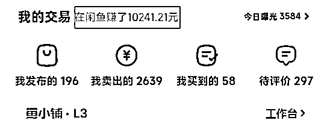
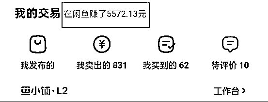
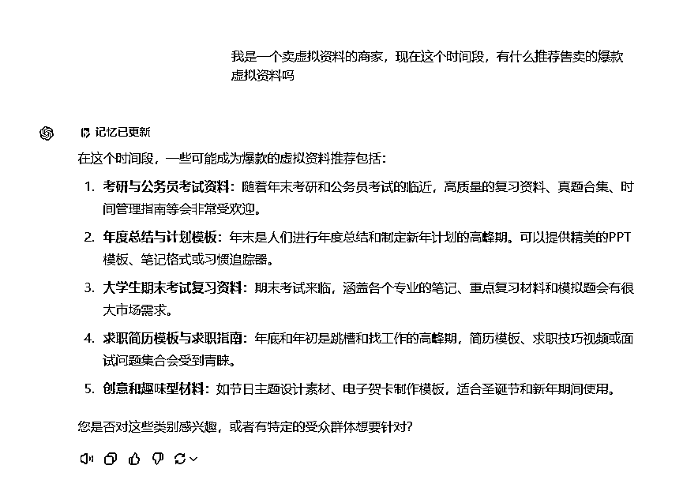
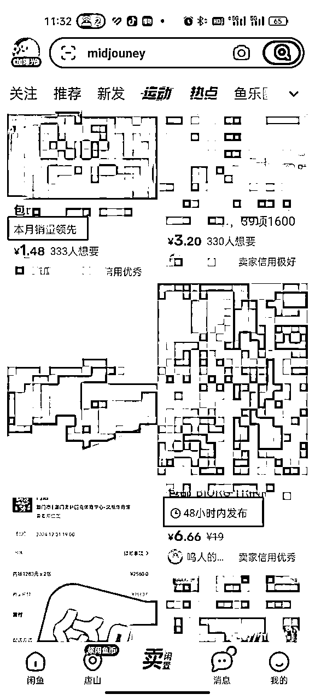
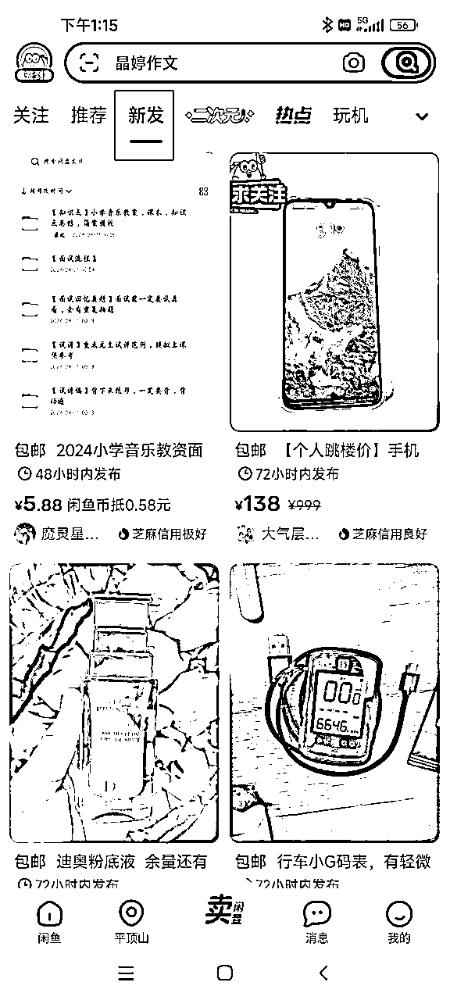
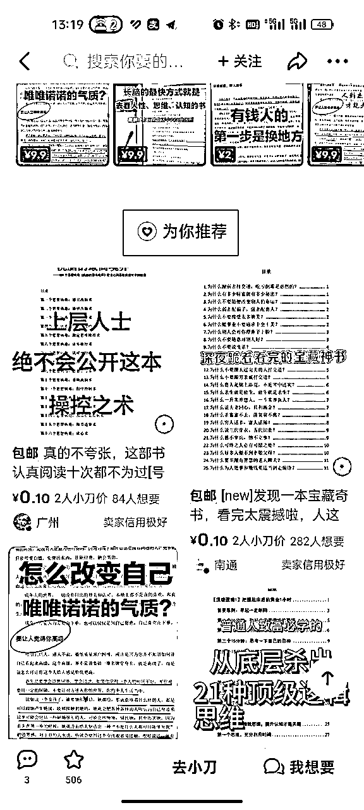
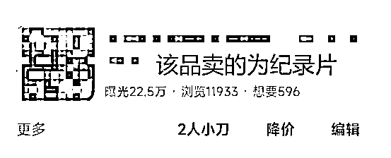
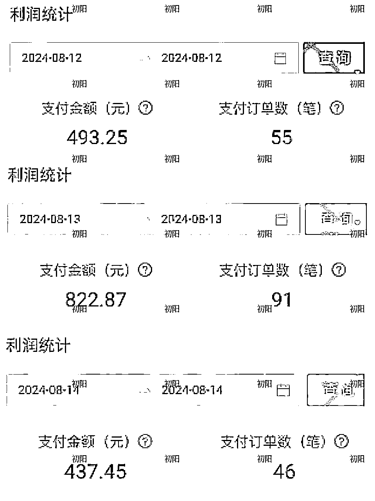

# 两个闲鱼号，两个月变现1.2W+：虚拟资料项目实操拆解

很多人找副业，第一要求是低成本、能快速跑通。闲鱼虚拟资料正好符合这个条件，这也是为什么在一众赚钱项目里，它尤其适合从零开始的新手。

今天这篇内容，来自一位刚毕业的圈友初阳的实战复盘。他从七月初开始操作虚拟资料，用两个闲鱼号，两个月内做到了1.2万元以上的变现。不吹不黑，每个环节都是自己踩出来的经验，下面我把他的方法整理成一份可以直接照着做的小白操作指南，全程高浓度干货，建议先收藏再细读。

## 一、把最多精力花在选品上

虚拟资料这个生意，不存在库存压力，你不断上架新商品的过程，其实就是不断“测品”的过程。真正决定胜负的，是你测到爆款的概率。下面是五个经过验证的选品方法，其中推荐页是初阳日常用得最多的渠道。

**方法一：让AI替你找灵感。**如果完全不知道该卖什么，用ChatGPT这类工具问一圈，往往能挖到意想不到的细分方向。他当时就是靠这个思路找到了“法语自学资料”，查了一圈发现只有一家闲鱼店铺在卖，而且还没设置自动发货，马上去跟卖，最后卖了50多单。

**方法二：刷推荐页，每天刷200个以上链接。**刷的时候按四个标准筛选：
1. 看“想要”数：优先选100+甚至500+的，同时“想要”数除以浏览数接近1:10；
2. 看留言区：留言越集中在最近这几天越值得注意；
3. 点进卖家主页，翻动态和买家评价。就算动态关了，从评价页同样能锁定热销单品；
4. 留意系统标记，比如“本月销量领先”或“72小时内发布”。

举个例子，他第一个大爆款，就是刷到一个“72小时内发布”的新链接，“想要”数已经到了70多，赶紧跟卖，最终把它做成了稳定出单的爆品。

**方法三：每天抽点时间刷“最新发布”页。**前面说的新发标签在推荐页面只是少数，而新发页里全是近几天刚挂出来的商品，时不时翻一翻，很容易发现潜力品。

**方法四：商品页往下滑，利用“为你推荐”板块。**把里面数据不错的商品点开，跳转到同行的店铺，再用方法二的标准做交叉验证，合适就考虑上新。

**方法五：关注一批同行卖家。**优先关注那些手里同时有好几个“100+想要”产品、而且最近还在持续上新的人。不知道选什么时，就去他们的主页翻动态、翻评价，爆款方向一下子就清楚了。

## 二、开始之前，想清楚店铺打哪种

闲鱼上的虚拟资料店铺，基本就杂货铺和垂直铺两大类。

**杂货铺**卖得很杂，纪录片、电子书、小说、考试笔记都往架上放。好处是市场风向怎么变都能跟着变，什么火就上什么，选择面大、出单快；缺点是回头客少，用户粘性偏低。

**垂直铺**只卖一个方向，比如只做考证笔记、只做电子书、只做短剧或小说。好处是用户非常精准，复购率也更好；缺点是货源渠道必须稳定，不然容易碰到版权和下架问题，而且选品面比较窄，对判断力要求高。

新手入门，更推荐先用杂货铺试水，因为可选范围广，更容易靠大量上架快速撬动第一单。如果你手握独家的资料渠道，再考虑垂直铺，具体方向可以参考赚钱九月内容里关于小红书教育资料引流的赛道梳理。

这里还要提个醒：闲鱼的运营逻辑和小红书差别很大。小红书靠笔记内容引流，内容越垂直越好；闲鱼是直接卖商品，所以多数卖家反而都靠杂货铺模式跑量。这个区别如果没想清楚，方向容易走偏。

## 三、利润放大：比“一味降价”聪明得多的两个方法

人人都知道闲鱼虚拟价格卷得厉害，小红书卖10多块的产品，在闲鱼可能只卖1块。刚开始他也习惯性压价，别人卖5块他就卖1块多一点，单倒是出了不少，利润却少得可怜。后来他总结出了两个真正能放大收益的打法。

**第一个方法：起量之后果断涨价。**不是所有产品都适合涨价，前提是卖了几天的产品突然有了起爆迹象，正好处在流量上升期。他有三个典型例子：
- 自己一款资料，刚上架标价1.69，两天内“想要”冲到70多，立刻把价格提到5元。结果流量没有掉，反而越卖越火，最终成交了一千多单。
- 另一款产品从2.68起卖，成交十几单后觉察到起爆信号，调价到3.99，现在“想要”数做到了596。
- 有位朋友卖的电子书，定价1.99，连续两天大量出单。初阳让他把价格提到3.99，结果流量没跌，利润和成交量直接翻了倍。

当然，涨价幅度不能拍脑袋。参考同款产品在闲鱼的整体均价，在均价基础上上调50%到200%都是合理区间，具体看产品本身的受众和稀缺程度。

**第二个方法：专挑高客单的蓝海链接。**说白了还是做“价格差”，但上家的定价本来就高，你以相对低价切入，利润空间自然可观。八月份有人给他指过一个品，当时全闲鱼只有两三个卖家在卖，分别标价26、18.8、13.6。初阳直接把价格打到9.99，三天靠这一个品挣了1700多。

这个玩法对选品功力要求更苛刻，但一旦卖爆，回报非常惊人。如果你刚入局，建议还是先走“低价起量、再适当涨价”的路线，成功率更高，操作也更稳。

## 四、店铺运营的五个操盘细节

1. **进货号和卖货号一定要分开。**留一个“空白闲鱼号”专门用来找上游拿资料。拿营业中的号去进货，对方大概率没售前没售后；遇上认货的同行，还会直接拉黑你。
2. **持续上新不能停。**初期按每天10个品的节奏走，可以上午3个、下午3个、晚上4个，也可以根据自己的空闲时间自由拆分。
3. **没有鱼小铺时**，50个位上满以后，把从前几天上架的商品里挑出浏览量低、曝光差、始终不出单的替换掉。之后每天上架2到3个、下架2到3个，始终保持50个品的满铺状态。
4. **有鱼小铺则简单一些**，保持每天上架10个品，同时定期优化已有商品的信息。
5. **抄作业只在上新初期有效。**等熟悉流程后，商品首图和标题尽量自己做。观察那些持续爆单的品，首图和标题基本都改过，这是容易被忽略却非常关键的细节。

## 五、两条不能碰的红线

虚拟资料不是什么都卖。

第一，**色情类绝对不能碰**，包括黄色小说、黄色漫画、黄色游戏。这类品在闲鱼确实容易出单，但它属于典型的得不偿失型，暗里的风险大家自行想象。

第二，**强版权类产品同样别碰**，尤其是图片里带机构名、带老师名字的，比如学e思、赵海凡讲银行、kai叔讲故事这类内容。轻则店铺被封，重则可能吃官司、赔钱。

## 写在最后

闲鱼虚拟资料不难，真正的门槛在于你有没有把“选品+节奏”坚持执行。这套打法里没有玄学，有的只是大量刷品、持续上新、科学调价的笨功夫。

如果你正准备入局，不妨给自己定一个周期，先把这套方法跑通，结果自然会来。这篇内容源自圈友初阳在赚钱有术的分享，也感谢内容负责人莞尔老师在打磨过程中的指导。希望每个想在副业上做出成绩的朋友，都能更快拿到第一桶金。