# 小红书影视号做流量主，小白无门槛拿到的首笔 5000 元，完整复盘

> 来源：[https://o16m4rgdmt3.feishu.cn/docx/R2U7d6Kj1oZ0SyxE4K3c9UtNnYe](https://o16m4rgdmt3.feishu.cn/docx/R2U7d6Kj1oZ0SyxE4K3c9UtNnYe)

## 零成本搞钱的唯一捷径

答案就是抄。抄是最省事的路子。

赚钱的机会明明就在眼前，你却总觉得别人说的不可信。我上一篇文章就讲过，赚不到钱的人大都在死磕理论，要么就是空有执行力却用错方向。今天分享的是一次带大一表妹实操的复盘，对从未在网上赚过钱的人特别有参考价值，看完就能直接开干，正好赶上流量窗口。

市面上项目那么多，为什么偏挑这个讲？就因为它符合大多数人的通病：没执行力。把完整玩法摊开给你，也坚持不过三天。三天都扛不住就想赚钱，对钱太不尊重了。今天这个玩法，只要你能有三天的耐心，就能拿到看得见的正反馈。

接下来我会把一个互联网零基础小白，如何拿到人生第一笔 5000 元的整套操作流程完整拆开。这个赛道现在依然能玩。

市场上做培训的不少，请擦亮眼睛。就算培训的人，也未必讲得清楚。我会先说清楚我为什么选它，从零到一具体做了什么，为什么能让一个从未碰过互联网的人拿到第一个 5000。

干货都是亲手跑出来的。

为了阅读体验，建议移步飞书阅读。

## 故事从哪开始的

表妹突然跟我说想做副业。之前我已经让她试过更新小红书，小红书起号我很熟，手里出过百万粉的号。可现实是大多数人三分钟热度，很难沉下去。

这次我换了思路，直接给她一个门槛最低、回馈最快的玩法。如果这样都坚持不下去，那我也没办法了。她也不明白为什么选这个赛道，文章里我会讲清楚选赛道的逻辑，方便你以后自己判断项目。

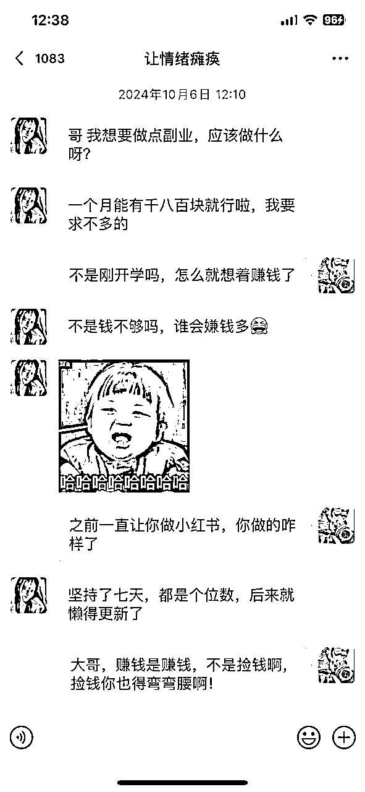

## 项目失败的根源

基本上跟大部分人一样，非要觉得自己是天选之子，结果事与愿违。没有天赋就用数量去堆，不要总想走捷径。

所以不能再给她那种周期长、拿不到反馈的项目，哪怕一个月一千也很难坚持。

## 赛道定位才是关键

这次的定位只有一点：短期价值，快速正反馈，哪怕只是流量反馈。

这里给你一个看数据的工具，各凭喜好。

新人可以领三天 VIP 去看看，买不买我不推荐。

https://xh.newrank.cn/

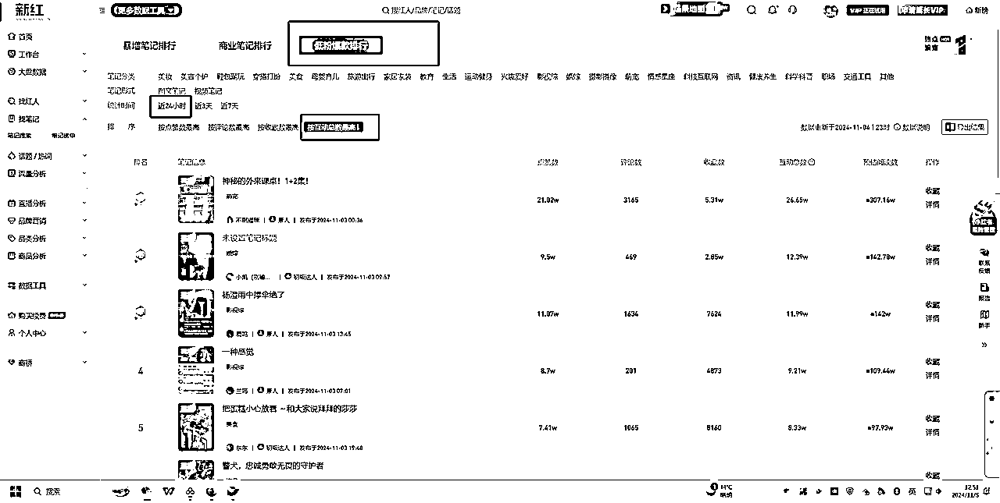

直接看低粉爆款榜。

核心就是要能看到别人短时间内就能做到的事，最好选 24 小时内的。按互动排序，我的经验是，一个帖子互动很少，即便你去抄，也很难爆。这是做小红书的老问题了。

我现在找不到十月份的榜单，就用今天的榜单演示，逻辑完全一样。

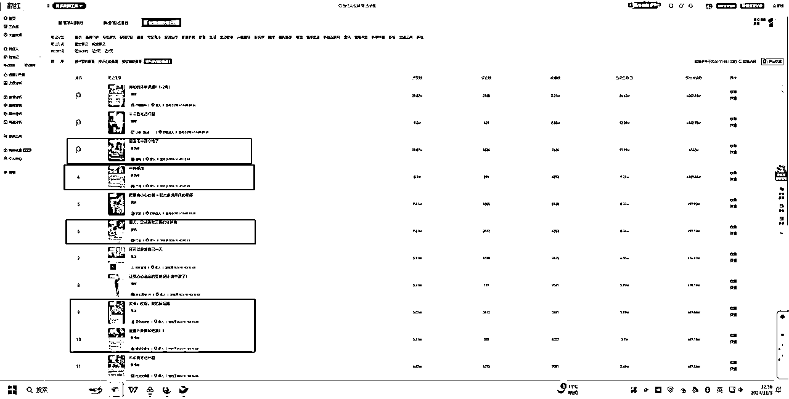

把图缩小，方便大家看清楚。想短期上手，必须找真正符合当下能抄的低粉爆款，不是随便挑一个就上，那样爆不了。

做小红书的都懂这个思路，任何领域都适用。

从榜单能看出，十条热爆里有五条是同一种内容，我下载了两个给你看。

为什么说内容一样，看下去就明白。

只放两天的内容对比：

就是直接搬运+把评论区截图拼进去生成新的视频。看到这里就完全符合定位：短期价值，正反馈，哪怕只是流量。

## 账号拆解

从播放来看肯定没问题。那收益呢？后台看一下。

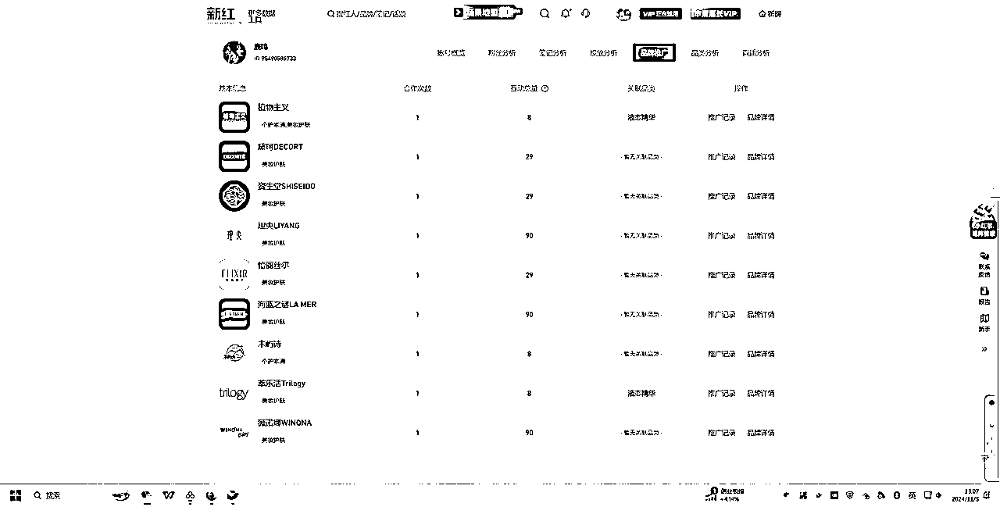

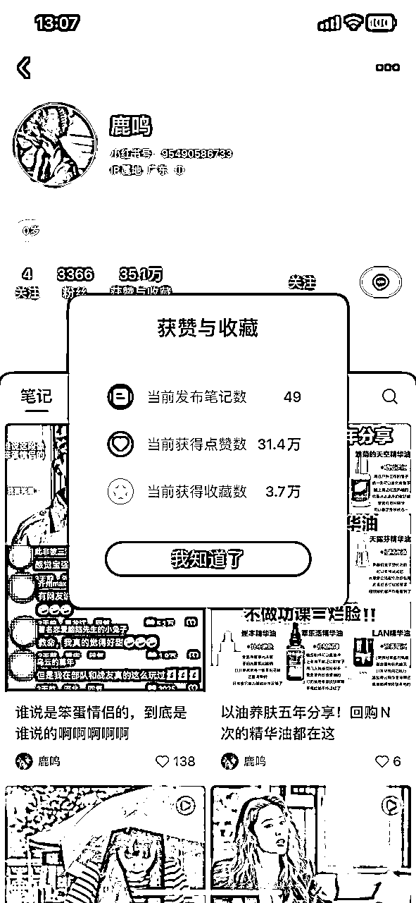

能看出这个号一共发了 49 个作品，单接广告就有十条。其他号也一样。图里的五个号都有广告投放，说明这种号就是靠播放量开蒲公英接广告赚钱。按一条一百算，这个号也有千元起。这就是基于定位找内容的完整路径。

如果到这里就结束了，这篇就不会存在。因为离 5000 还有距离。

先说这种视频怎么做，再解决大家的疑问。

大家常说变现=产品-流量-转化。产品围绕流量展开，就是蒲公英接广告，有流量就能接广告。转化是随机的，有人找你就赚钱，没人找就没钱。

提醒一下，要搞清楚自己赚钱的目的。不要只盯播放量。我有一个号目的就是引流，一个作品十万播放我也不在乎，下一个几百播放也没关系，能带来引流价值就行。

接下来拆起号、内容制作、发布、接蒲公英。

## 起号

说起号逻辑的都可以拉黑了。但实际情况不一样。你账号不是零播放，就没问题。直接注销重来也可以，如果这也算养号我没话说。

之前个位数的播放号能否用？可以，而且完全没问题。案例用的就是这种号。

之前违规过的号能不能用？也能用。底下这个号就违规过不止一次。即便偶尔爆款不稳定，一旦垂直更新出爆款，后续概率会高很多。

我觉得起号的核心就是能不能为平台提供价值，提供了平台没理由限流。

起号能写 5000 字，我就不展开了。直接上手跑起来就行。

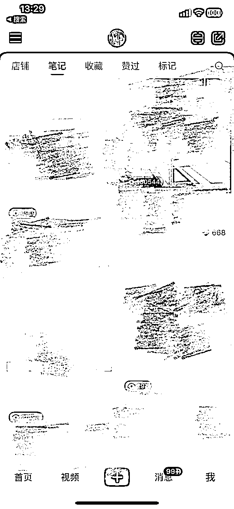

## 账号搭建

直接抄对标号。头像、简介、背景、名字，这四件套看一眼就好。建议换成女生头像和女生常用名，因为观察到的对标号大多如此。

视频都抄了，四件套直接借鉴就行。

## 内容制作

很简单，素材需求少。怎么找爆款？以我亲眼见证起号的那个号为例。你们直接对标上面榜单的号就行。上个月大家都知道发红楼梦、哈利波特，因为一直在热搜滚动，只要发就有流量，十分钟跑几千。参考上面五个号，别人剪什么片段你就剪什么片段，很容易爆。

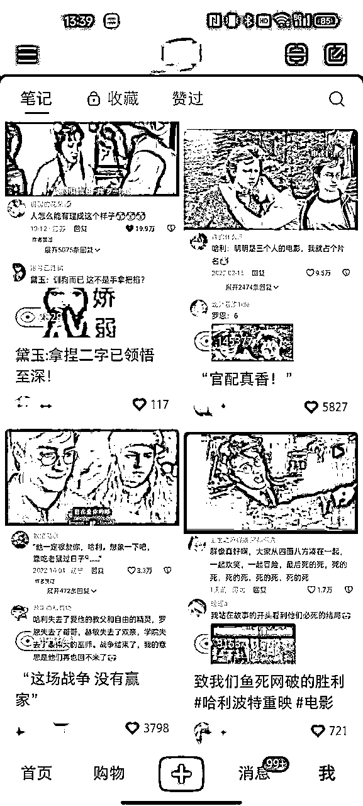

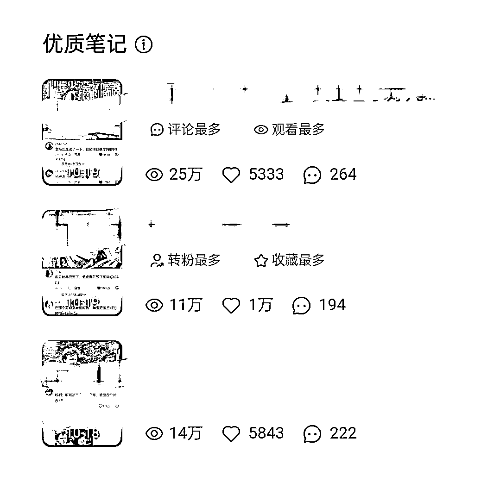

以红楼梦为例，去抖音搜就行，上个月下拉词全是热搜。

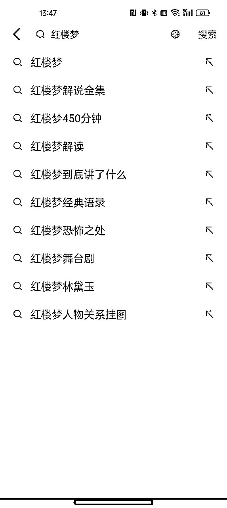

挑一个播放量高的视频，搬运就选播放多的。

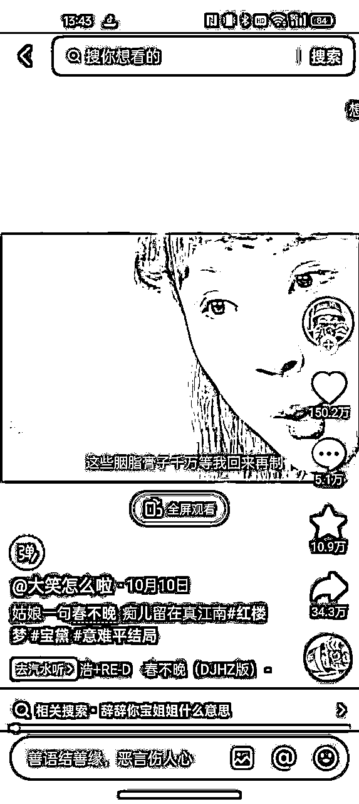

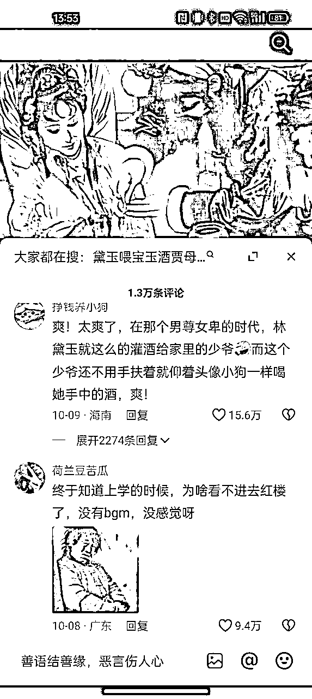

复制链接，用小程序去水印，可以扫码也可以微信搜索。各有优劣，自己选。去水印后下载原视频，然后打开评论区随便截个图备用。能看到每个评论区都是十万点赞，这类直接截图存着。

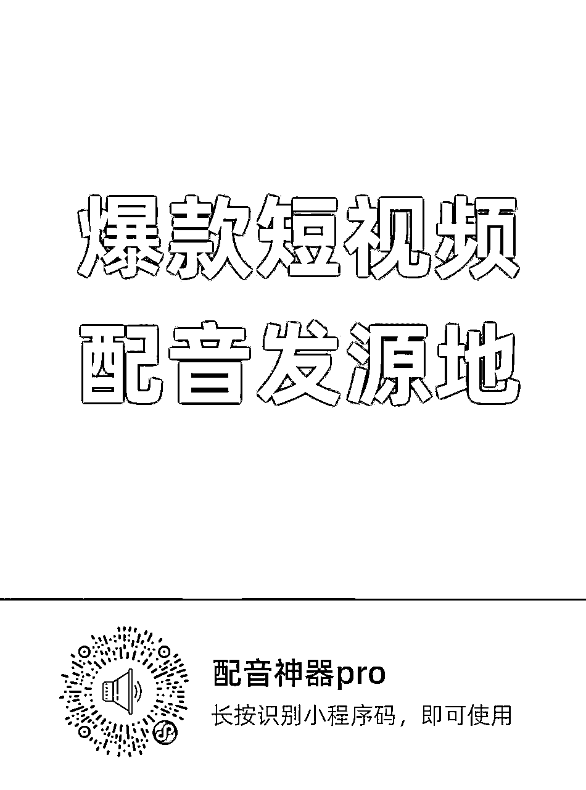

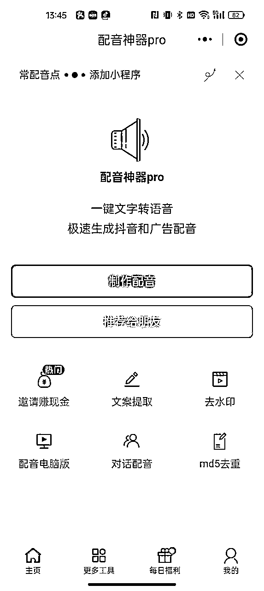

## 视频剪辑

我用的是剪映，习惯了。现在识别字幕收费，分享一个可用的安装包，手机电脑都有。注意别更新。

链接：https://pan.baidu.com/s/1YfLRSL39ES21Pxv00a2BEg?pwd=WsCL

提取码：WsCL

剪辑很简单，不需要去重。AI 去重都这么专业了，没必要折腾。很多人到处找教程买课学不会，其实是方法问题。要为学习而学。

想学字幕，直接搜怎么识别字幕就行。别搜合集，十几分钟的视频看不完，买课放着生灰有什么用。

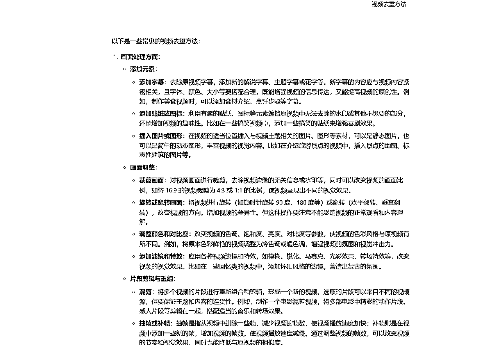

第一步选视频，比例调成 3:4，小红书常用比例。然后拖到顶部，做画中画准备，把画中画和主视频对应好。

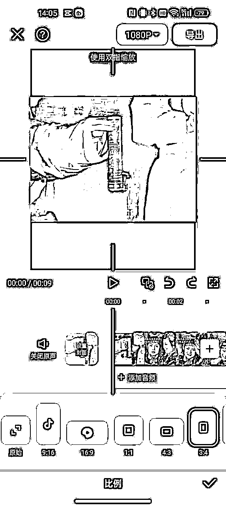

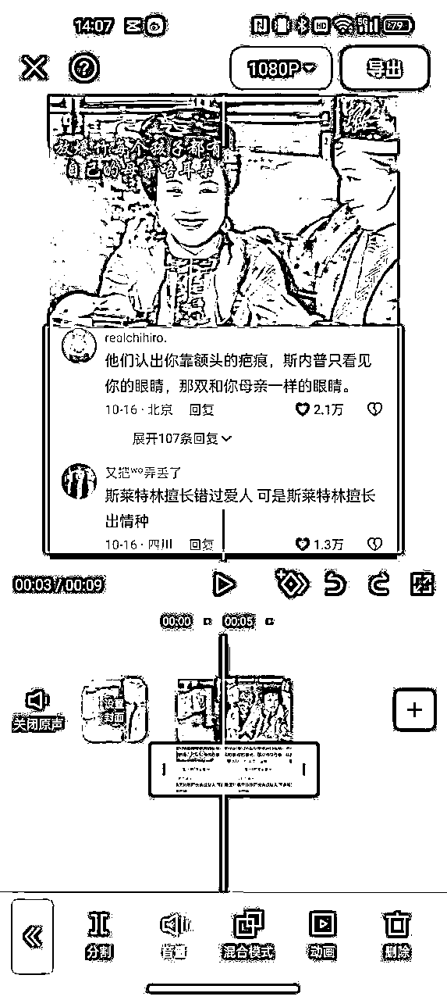

最后加个画面特效，复古就行。

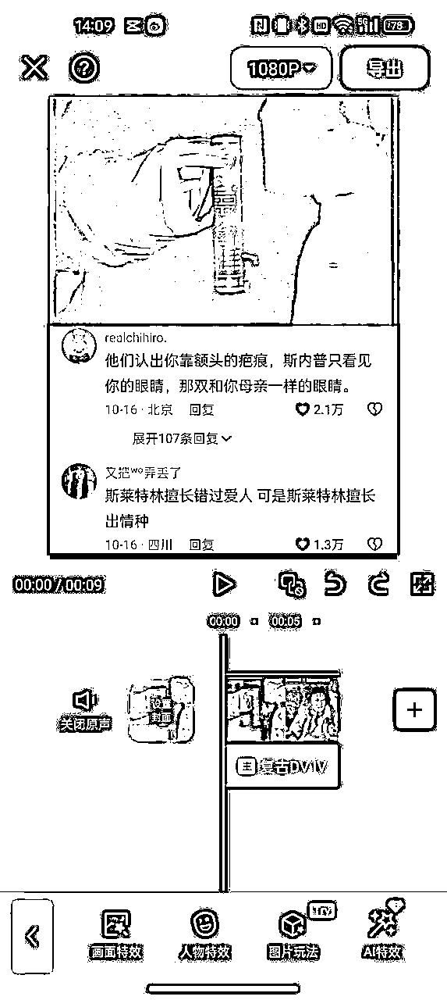

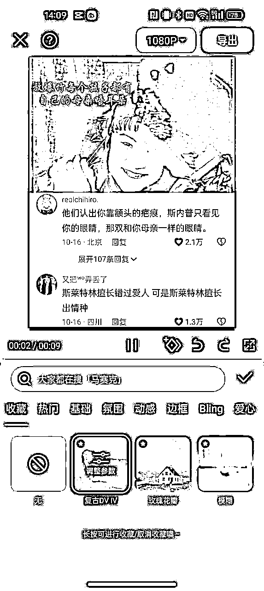

一个完整视频就做好了。其实没那么复杂。不懂就单点学，别贪多。

## 内容发布

一天发几条合适？我测过，一天十五条没问题。

标题怎么选？直接抄小红书别人的标题，或去水印时复制抖音标题。

封面怎么做？挑一帧顺眼的就行，没要求。

没流量怎么办？多发。头二十条别管流量，只管发。

间隔多久？最快五分钟一条，账号正常。保守就一小时一条。

被判定抄袭怎么办？正因为可以直接搬运，申诉基本能过。申诉就把剪辑作品传上去就行，还能拿到流量券。

小红书是比较友好的平台，违规申诉即可。侵权会让你发邮箱审核，直接删内容就行。

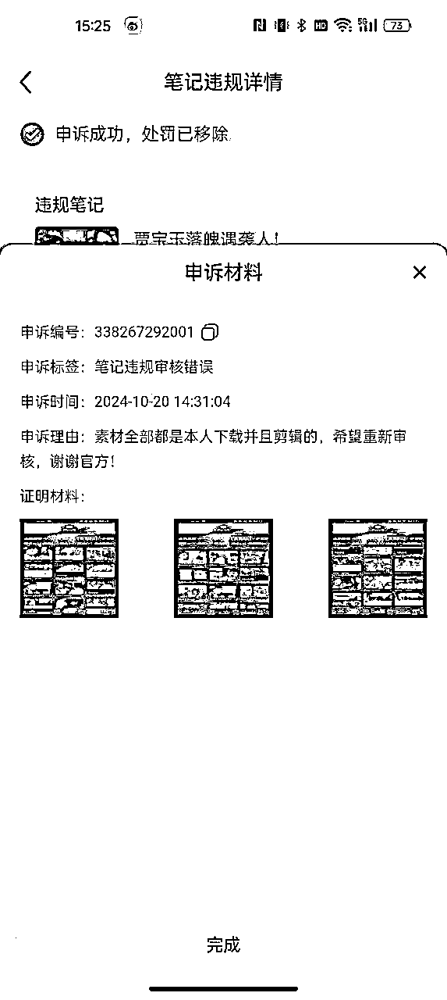

## 变现方式

新手先做蒲公英。账号过一千粉再实名即可。不实名也有人找你，不过多是拉你进 MCN。个人觉得没必要，不加也能接广告。这种号有钱就赚。

看下面会发现，卖号也算一种收益。不实名还能走起号卖号的路线。

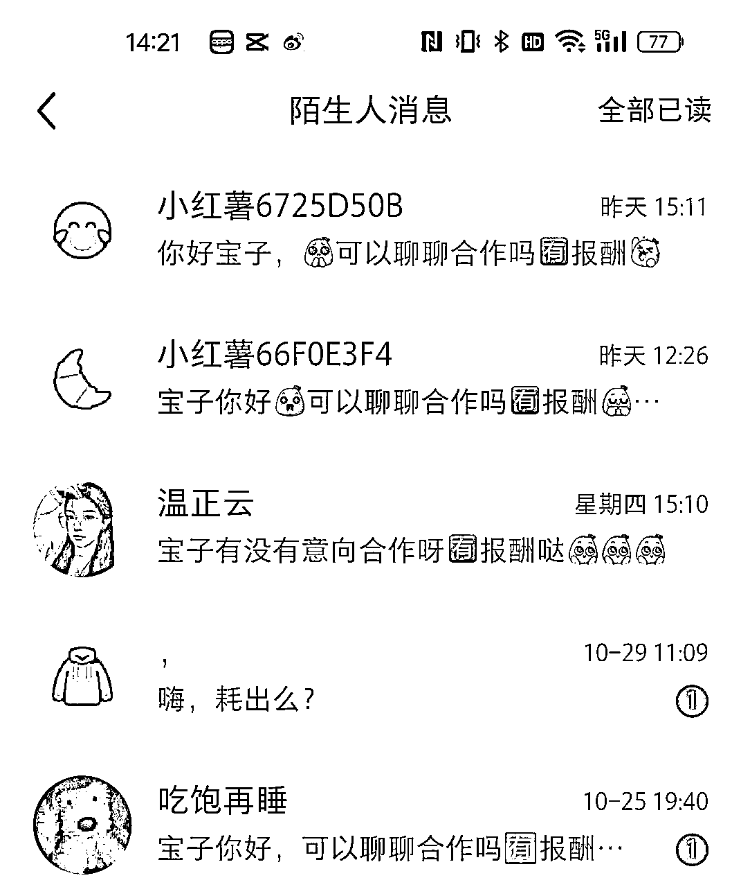

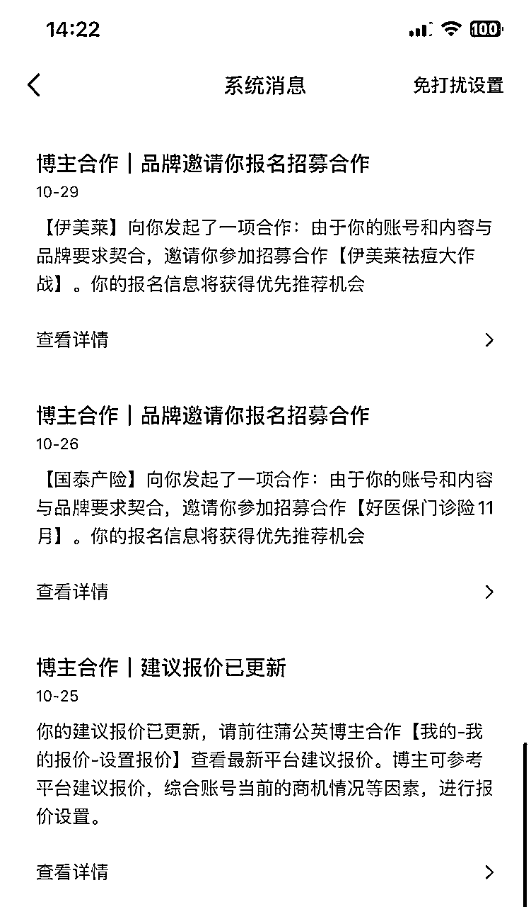

到这里本应结束，但我手上还有一个闲置的微信号，里面都是做兼职的粉丝。这说明很多事都是连起来的。

之前看过一个引流兼职粉的帖子，我去试了，吸了上千人。感谢赚钱有术，里面的帖子确实要重视。

如果有这个号，她每个月接广告也能有稳定收入。但我直接把号交给她运营，零宣传，号本身就是女生身份。

### 对引流感兴趣的回复“感兴趣”，后面再出一篇引流兼职粉的文章。

## 重点复盘

如实说，如果让一个小白自己搞知识付费+产品引流+后端变现，难度太大。

所以这篇文章定位就是最快获得正反馈。直接给她现成的微信号，省去她自己跑流量的卡点。按她三分钟热度的状态，让她自己跑流量，中途肯定放弃。

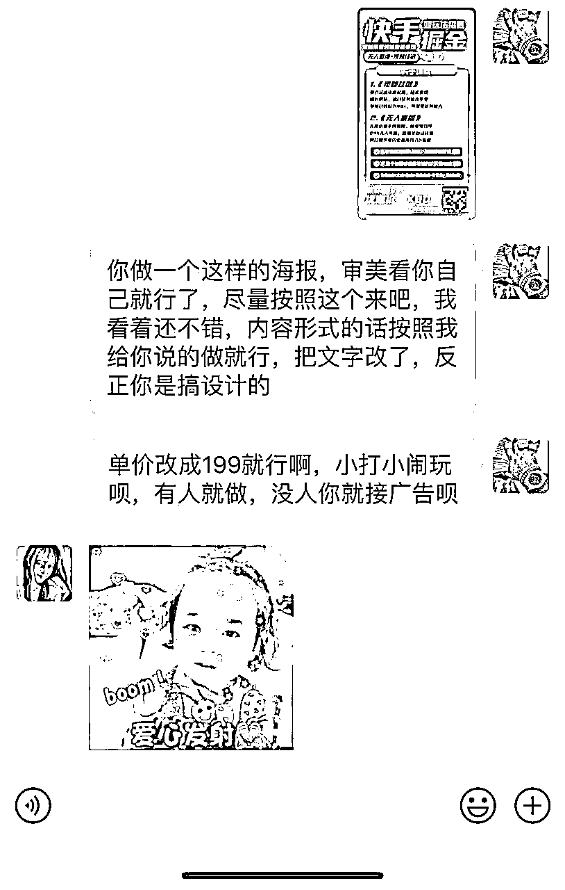

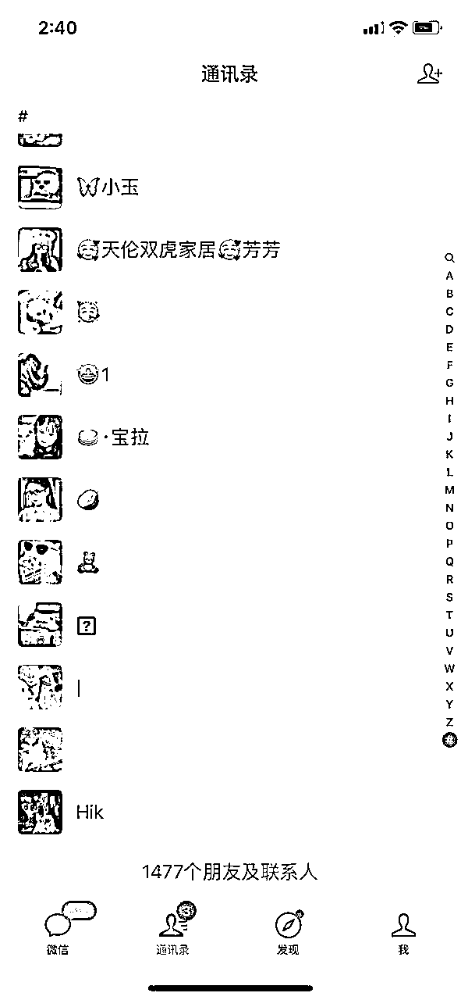

就这样，让她把收益截图和营销海报发朋友圈，三天收了 13 个人。知识付费收钱确实快。

这算是一个小闭环，她自己没接触过引流，我觉得做得不错。

营销也是模仿我们的号发广告，一天一条，这我真不能理解，能赚钱就多发点，像跟钱有仇一样。

她现在做了两个号，一个两千粉，一个五千粉，没事接点广告就行。每月千八百能稳定也很不错了。至少体验了一次赚钱的感觉。

复盘她为什么能赚到钱：

第一，定位。之前让她做小红书，SOP 都给了，但执行力不够，七天坚持不下来。这次是冲着快速出结果去的。一开始我也没想到接广告这么快。坚持下来的原因是第一篇小红书就跑了一万播放，对她来说是冲击，后面就愿意发了。

建议：做事先想清楚是长期价值还是短期价值。长期价值就别三天没结果就放弃。

第二，执行难度。赛道够简单，就是抄。提取视频，复制粘贴，没复杂操作。

再看流程：产品-流量-转化

第一部分收益靠平台，有流量就有广告就能变现。

第二部分收益变成知识付费，这也是上篇文章讲的核心。你没有自己的产品，跟谁学都可能失败。因为你少一个环节，其实少得更多。

如果我没给她那个一千人的微信号，是不是还要她自己跑流量？跑流量期间没有正反馈，不是更容易放弃？尽快让自己有产品，然后一点点沉淀，连点成线。

## 写在最后

手里没项目的话可以直接上手试试。

第一，体验一下有流量的感觉。
第二，早点赚到互联网的第一块钱。
第三，小红书账号成本忽略不计，违规就注销。
第四，很多人看完帖子赚不到钱，是因为不知道为什么这样做。这篇文章从定位开始讲，方便理解。
第五，举一反三。别的平台火的内容，按这个方法搬到小红书就行，现在也能操作。

很感谢赚钱有术这个星球，能看到真正利他的分享，也感谢首负推荐，接触负总才明白什么是交付，真正的交付不是理论。

这几天发现很多人过度准备，自媒体还没做就先脑补各种困难，买一堆设备内卷，预想怎么解决，最后还没上手就累了。有些人遇到事就解决事，干脆利落。

你总觉得自己有很多观众，每件事都要极致完美。事情刚发生就脑补一堆困难点，逼自己紧张到极致。这时候很多事其实没那么重要。

可以分享一个建议：不要过度准备，先做一堆垃圾出来。

先做一个垃圾出来，不预设困难，不追求完美。开始时接受自己做的是垃圾，文章先写一堆口水话，视频先拍一堆结巴粗糙的，之后再迭代。你会发现真正的问题，而不是脑补的问题。就像现在也一样，又有七千字了！

很多人都幻想过“一夜暴富”吧？
因为这种方式最直接、最省力，不用长期积累，也不用去应对那些复杂的工作难题和人际博弈。说白了，暴富的念头，天然符合人性的懒。

但问题在于：如果一直把暴富当目标，人就很容易掉进“捷径陷阱”。

一旦尝过走捷径的甜头，思维和行为就会慢慢形成惯性，越来越依赖这种“低成本高回报”的方式。慢慢地，人就养成了所谓的小聪明。

小聪明用在生活里，确实无伤大雅，有时候还挺管用；可一旦放到商业世界里，就会变成彻头彻尾的毒药，越用越危险。

和上次讲道理不一样，这次是实打实的项目实操。
如果觉得内容有用，别忘了点个赞，感谢你能看到这里！