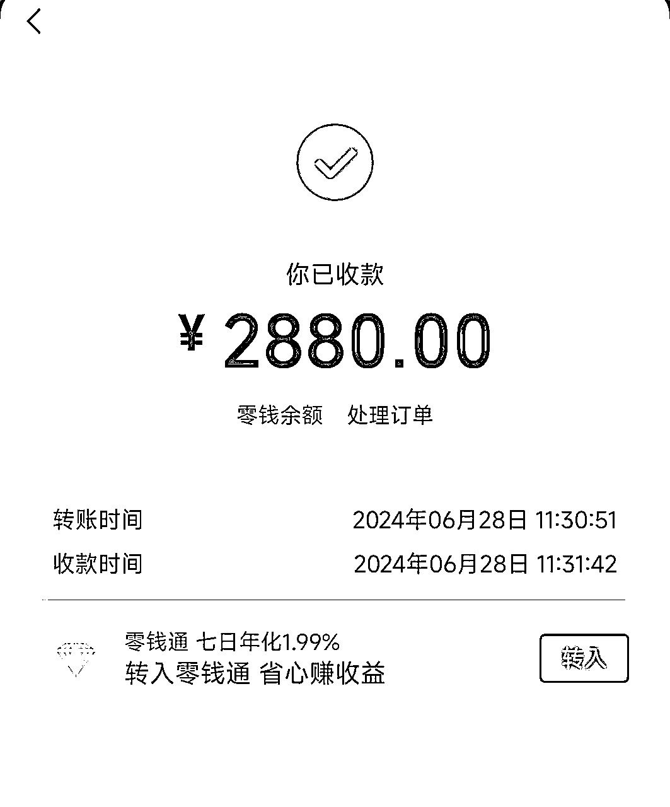
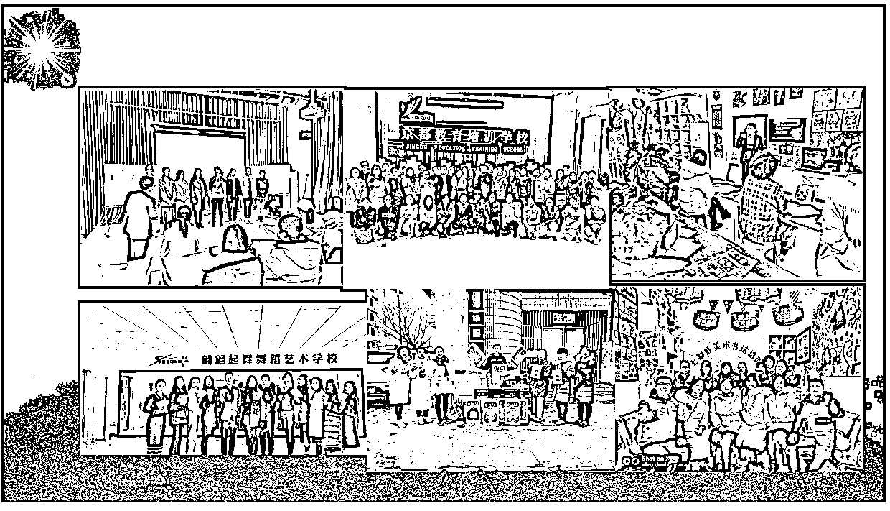
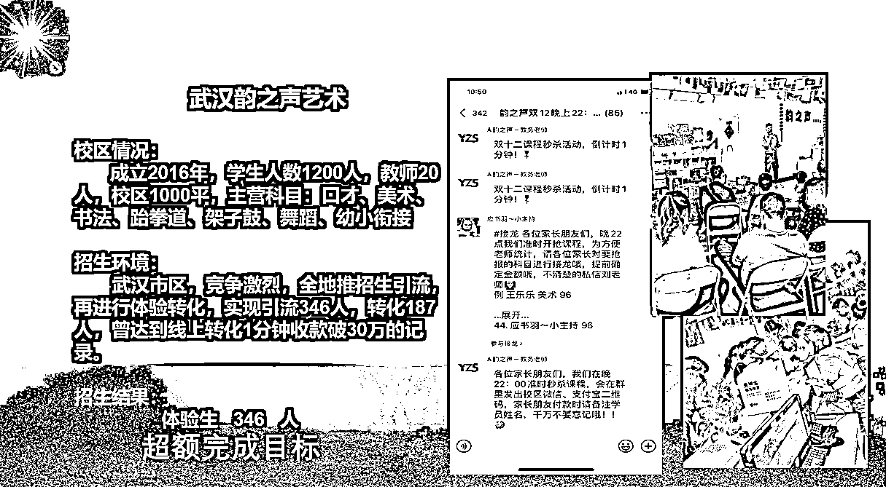
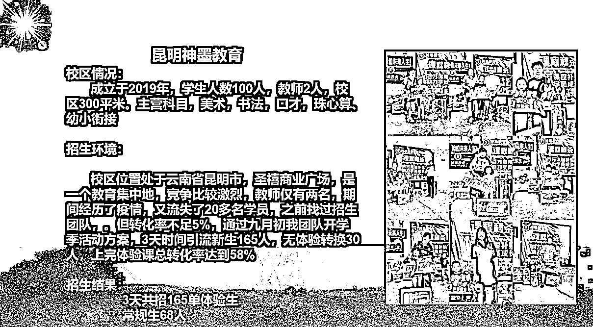
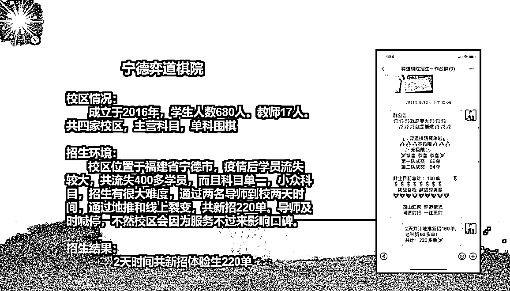
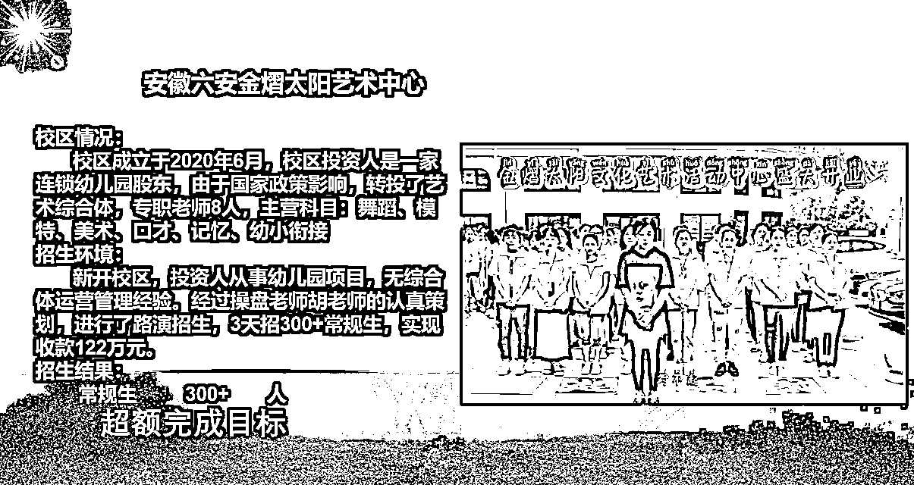

# ('【项目实操】从0-1剖析农村暑期补习项目', (2, 22))

暑假刚结束，趁热打铁把这几个月的数据盘一盘，也算给圈子里的朋友一个交代：教培到底还能不能干？这个话题，我来说点大实话。

先说结论：教培不是暴利生意，更不是赚快钱的赛道。身边做电商、做自媒体的朋友，动不动月入百万、年入千万，听着确实猛。但教培这种项目，一个周期下来利润一般就是几十万，真没有网上说的那么夸张。如果你目标是一年挣上百万、上千万，看到这里就可以关掉了。

我是谁？赚钱老圈友，泡了四年，侥幸拿过一枚龙珠，一直干教培营销。有句话想送给所有想入局的朋友：别站在行业外看行业。你在外面看，永远看不透；如果门外汉都能看明白、都能轻松赚钱，那行业里的前辈也太没面子了。很多大佬嘴上说简单，但从不告诉你他背后有什么资源、什么人脉。你真去干，发现根本不是那么回事——这就是被割的根源。

很多人以为自己了解教培，其实只是见过补习班。不信？我列一串名字：天地人和、西点军校、腾跃、朗培、君学、欧美思、北京现代、和君、华德汇智、正贤、小来、小水滴、汇爱、领跑……如果你大部分都没听过，那你对教培的认知，基本停留在“培训班”三个字。这些都是教培商学院，专门教机构怎么招生、怎么运营。

我本人，网名简峰校长（曾用名：精简峰、裂变王子、道一），之前在国内最大的教培商学院之一——北京欧美思教育集团，负责全国15000家会员校区的招生服务。这些年跑遍全国，带团队落地过4000+校区的招生活动，整个团队累计为机构引流近百万生源。

说句掏心窝的话：经济好的时候，你可能看不上教培。但最近这几年，如果你没有特别硬的项目资源，教培反而是普通人最踏实的出路。再穷不能穷教育，补习这件事，经过十几年沉淀，已经被家长彻底接受了。四五六线城市，一科补习3000左右；二三线3000到6000；新一线6000到8000；一线城市基本1万。再往上，击剑、网球、足球、钢琴这类高端课，收费更高。

口罩那几年，大环境不好，我也焦虑过。看到赚钱里大佬们月入几百万，谁不心动？我去做过电商、短视频、直播带货：快手一个月做到70万粉丝，视频号一个月12万粉丝。结果呢？变现一塌糊涂，还不如老老实实招生来得快、来得稳。后来还碰过茶叶、和田玉、翡翠、天珠、星月菩提这些文玩，也没做出什么大成绩，好在没被坑，平安收场。

兜兜转转一大圈，还是觉得教培好：现金流稳，提前收费，市场足够大。对普通人来说，在眼下这个环境里，真没有比教培更靠谱的了。城市已经卷成一团浆糊，生源少、查得严，反倒是农村，成了被忽略的价值洼地。我今天要拆的，就是我自己在做的农村暑期补习项目。

先看成绩单。这个项目疫情前我们跑过3次，2022年基本停摆；2023年重启，但当时主要精力在兰州暑假班，农村只收了100多个孩子；今年2024年，一口气收了460人。往年的完整数据是：2016年，周边镇上收了60人，亏损；2017年330人，利润30万；2018年390人，利润40万；2019年310人，利润30万；2023年140人，利润12万；2024年460人，利润42万。下面是最近的收益截图：

为什么农村暑期补习是刚需？因为那里有大量留守儿童。暑假一到，老人管不住，孩子满村跑，安全隐患一大堆。要是有一个地方能帮忙看孩子、辅导暑假作业、顺带预习新课本，家长简直求之不得。所以只要宣传做到位，成交非常容易。

咱们再算一笔账。现在农村路修得好，镇就是周边村子的中心。一个镇往往覆盖几十个村，每个村几百号人，学生少则几十、多则几百，整个镇的小学初中生加起来，轻轻松松上千人。一般乡镇招三五百人没问题，一人收1000，就是30万以上营收，成本也就几万块，一个月搞定，短平快。

收费一般是1000-2000元一个月，全天全科目，不管接送不管饭。这个模式每年暑假都能做一次。按单点算，营收大概30到50万；如果多镇同时布点，一个月40到300万。费用结构也很简单：房租1万，水电5000，500人能收50万，配10到15个大学生老师，按最高的15人算，每人工资3000，总共4.5万。宣传成本不高，利润自然可观。

招生对象是农村孩子，小学一年级到初二。幼儿园太小，不敢收；初三面临毕业，也收不了。场地怎么找？两种思路：一是找幼儿园谈，暑假空着也是空着，房租便宜；二是找被合并后闲置的小学，跟村委谈，给村里孩子一点优惠就行。选址一定要选交通方便的镇中心，老人接送不费劲。

这个项目本质上是个短期生意，平时很难做，北方尤其如此。一开学，家长没这个意识，耗课周期长、收费低，忙活一学期也赚不到几个钱。暑假集中上课、快速耗课，才是正确打开方式。南方乡镇经济发达，常年班是存在的，广东、浙江、福建的镇上都有。所以这套模式更适合北方；南方老老实实走正常教培路径，个别地方也可以套用暑假模型。

下面是我们的转化报名图片：

这是我们招过生的校区：

接下来重点说说流量怎么搞。

第一步走渠道。如果你是本地人，优势太大了——认识老师、知道哪个村人多、能轻松搞定场地。城市老师暑假偷偷开班，农村老师其实也想赚外快，只是没环境。那你就找会来事的老师合伙，谈好分成。她们工资不高，要求也低，家长群发个消息，单子就来。每年多少孩子溺亡，家长心里都怕，把“安全”和“学习”两个点包装好，校长、主任能搞定一个，后面就顺了。

第二步赶集。每个镇都有固定大集，十里八村的人都来买东西。守好出入口摆个摊，跟客群重合的商家搞搞异业合作，送西瓜、套圈，反正开封西瓜便宜，效果直接。

第三步下村。根据已有的报名数据整理出重点村，挨家挨户发单页。没人住的旧房子就别发了。更高效的办法是，在每个片区找一个当地妇女，给她60块左右一天加提成，她最清楚哪家有孩子。实在不行，开个三轮车拉着大喇叭，全村喊：有小孩上学的，免费领西瓜！简单粗暴，但真有用。

第四步线上裂变。利用前面积累的家长，做一个老带新链接，礼品、介绍费给到位。农村是熟人社会，一个社牛能认识全村人，七大姑八大姨全沾亲带故，传播起来以秒计算。只要机制设计得好，学生就跟海水一样涌进来。

现在复盘一下2023年我们是怎么从0做到1的。

师资方面，我大学毕业十年了，拉不来老同学，但我们有研学项目，长期跟3所大学合作，培养了一批在校大学生当研学导师。如果你没有学校资源，找校内协会、学生会谈介绍费也行。人员配置按30-50个学生配一个老师，500人只需要15人；工资一个月后结算，启动成本极低。

场地方面，我们用了一所公立小学搬走后的空教室，又谈了一家幼儿园——代价是帮他们宣传秋季招生。

招生引流方面，我侄子在一个初中，从他班主任入手，介绍一个给200，拉了30多个学生；另一个班又拉了十几个。侄女在小学，直接覆盖3个班，收了小100人。下村跑了16个村，凑了180多人。镇上赶了4次大集，送西瓜留了300多个电话，最终报名86人。线上转介绍五六十人。加起来就是当年的数字。

交付很简单：半天排课，内容有四块——暑假作业、课外阅读、游戏活动、三门主科预习。别担心质量，暑假作业本来就该写，我们只是帮孩子安排好时间；阅读和游戏大学生最拿手；小学初中的知识点也不难，稍微备备课就能讲。关键是全程没有考试，没有成绩对比，也就没人说你教学质量差。

安全是头等大事。签到签退必须严格，入学时家长或监护人签安全协议，明确校外安全由家长负责。每个孩子买一个月意外险，家长出钱。

一路走来，坑也不少。2016年我们脑子一热，在县城开1200平米四层楼，想走农村包围城市，结果根本招不到生。后来试图用车把周边乡镇的学生拉来，被交警查了，再也不敢。那年亏了，但也让我们发现乡镇的真实需求。

2017年转战农村，最大问题是人。第一批招的大学生，放假全跟着学长学姐跑去南方电子厂打工，储备12人只来了4个。没办法，临时去县城高中找班主任介绍学习好的高三毕业生来辅导，后来干脆包装成“高考状元伴读”，报名哗哗涨，那年收了300多人。这招还顺带打开了我们的文化课加盟业务。

场地一开始也没经验，在镇上租临街二楼，5间小屋，每间最多塞30人，夏天热到不行。后来一位家长介绍，租了他亲戚的私立幼儿园，一个月1万，才舒服了。

宣传更是磨人。一开始大家放不开，只会发传单，招不到人。后来我们三个合伙人亲自上阵，雇了大妈发单页，留一个电话给1块，底薪50，西瓜管够。早上一批人进村干到10点，下午4点半再战，晚上8点收工。大妈们干劲十足。收集到的电话和微信，就邀约来体验，3天最好——时间短了搞不定孩子，3天混熟了，家长直接转账。报名后我们还给学生返钱，1000块直接给100，学生拉学生，速度极快。

安全上也出过幺蛾子。有一次学生放学后跟同学跑出去玩，晚上八点家长找不到人。老师骑着电动车连夜跑三个村，才把那孩子找回来，吓得半死。还有一次，隔壁机构的学生游泳溺水，村里喇叭天天喊，家长不敢让孩子出门，我们的学生缺勤、退费二十多人。所以，安全协议、意外险、每次签到签退，真不是走形式。

门槛高不高？不高，而且基本不存在亏本。工人工资结算是干完后，招多少学生配多少人，天然不会亏。场地一个月一万以内，也就10个学生的学费；不是本地人也没关系，花千把块买个二手三轮车，拉着大学生去招生。唯一要注意时间：这是纯暑期项目，平时运作完全不同。地域上，北方农村更适合——人口多、生源大、留守儿童多；南方乡镇常年班已经成熟，也可以参考这套打法。

最后说一句：项目是死的，人是活的。操盘手要接地气、有执行力，最好本身就是本地人。这个项目利润可观，特别适合想创业的大学生，搞一个暑假，顶得上别人打一年工。干好了，明年再来一轮，稳稳的。

如果你正准备创业，或者已经在路上，请先想明白一件事：至少得清楚最基础的商业常识。不需要多高深，只要知道生意的钱从哪来、流向哪去，并且清楚自己最终能不能拿到想要的那份收益就够了。

另外，别急着给任何一个项目下结论。再冷门、再小众的领域，都有人做到年入百万千万。真正该花心思的，是你深入了解后，问自己一句：这件事适不适合我？

说到底，创业拼的不是运气，也不是下注的手气，而是把它当成一件必须做成的事来对待。当你真正拥有了商业判断力和清晰的逻辑，看待项目就会变得全面、有章法，也会先在脑中推演整个走向，直到确认它大概率能成，甚至是百分之百能成。落地过程中遇到意料之外的状况，不用慌，靠自己的本事去解决就好。

希望每一个认真向前、不断进取的人，都能稳稳赚到属于自己的那份钱。