# ('【来来】使用ComfyUI批量高仿AI视频工作流（附带教程+工作流+模型下载）', (2, 41))

如何用ComfyUI免费批量“复刻”短视频？从抓取到成片的完整工作流分享

最近我在研究用ComfyUI批量制作高仿短视频，整体流程并不难，而且几乎全靠免费开源模型。今天就把整个操作链路梳理出来，给大家一个可以直接上手的参考。概括下来，完整流程是这9个环节：

- 下载参考视频
- 提取视频关键帧
- 反推提示词
- 生成图片
- 图片转视频
- 生成音乐/音效
- 生成对白/旁白（可选）
- 视频高清化
- 最终剪辑

接下来一步步说。

**1. 下载参考视频**

先找一条你想要模仿的短视频，拿到它的链接后，用在线下载工具就能保存到本地。这类网站多备几个准没错，免得一个挂掉就卡住。我常用的有这些：

- https://addyoutube.com/ 
- https://youtube.iiilab.com/ 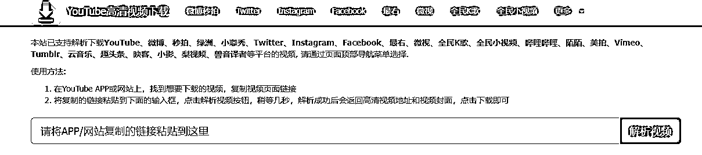
- https://hhm.zzrjcp.com/ 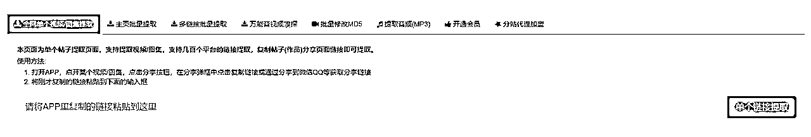
- https://youtube4kdownloader.com/ 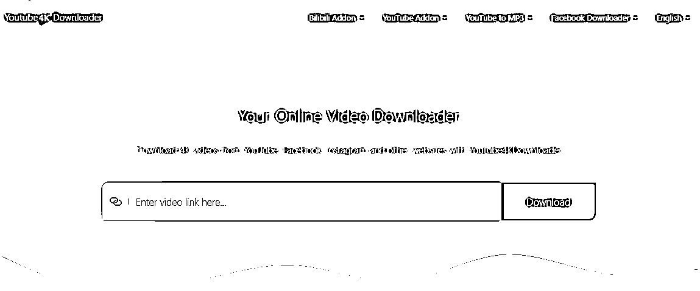
- https://ytshorts.savetube.me/1keen2 
- https://y2down.cc/zh/ 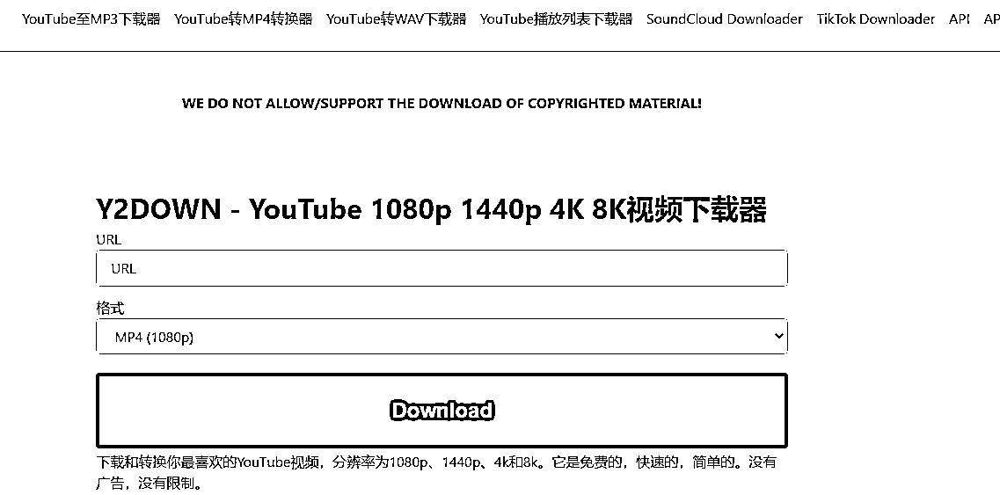
- https://www.freemake.com/cn/free_video_downloader_best/ 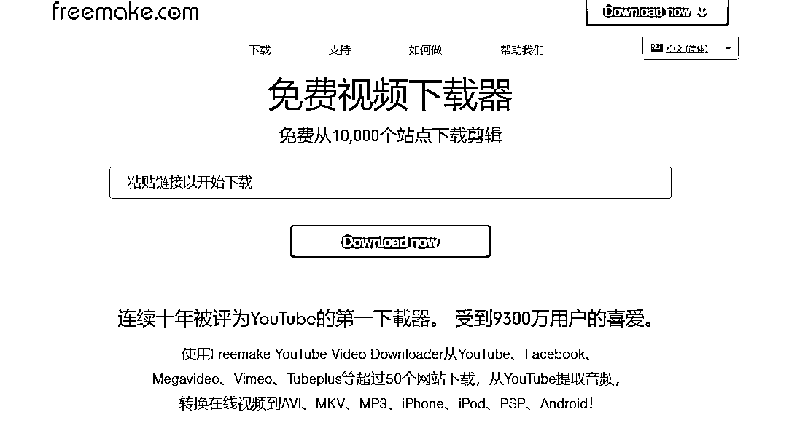

以YouTube Shorts为例，我搜索“cat”后选了一个视频来当模板。链接是 https://www.youtube.com/shorts/-AXxWdR74k0 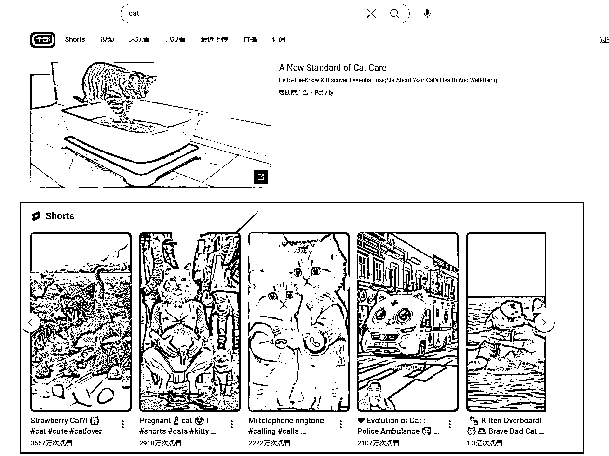 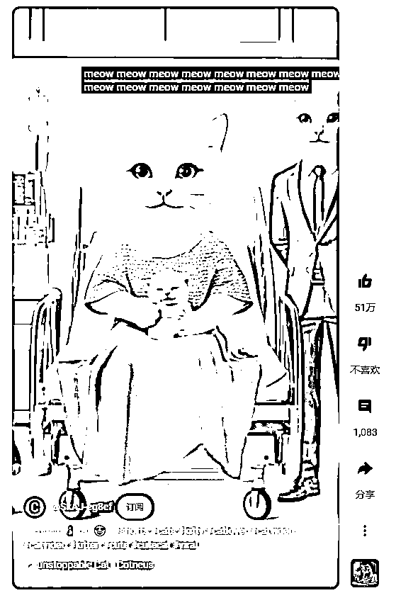，复制到addyoutube.com这类站点，点下载就得到原始视频了。

**2. 批量提取关键帧**

这里我用的是赚钱圈友@老馬🐎 提供的软件，下载地址：https://pan.baidu.com/s/1QFVnSLKYSG9nUe4nFE-O1g?pwd=lai6

打开软件后，会自动生成“输入”和“输出”两个文件夹，把视频丢进输入文件夹。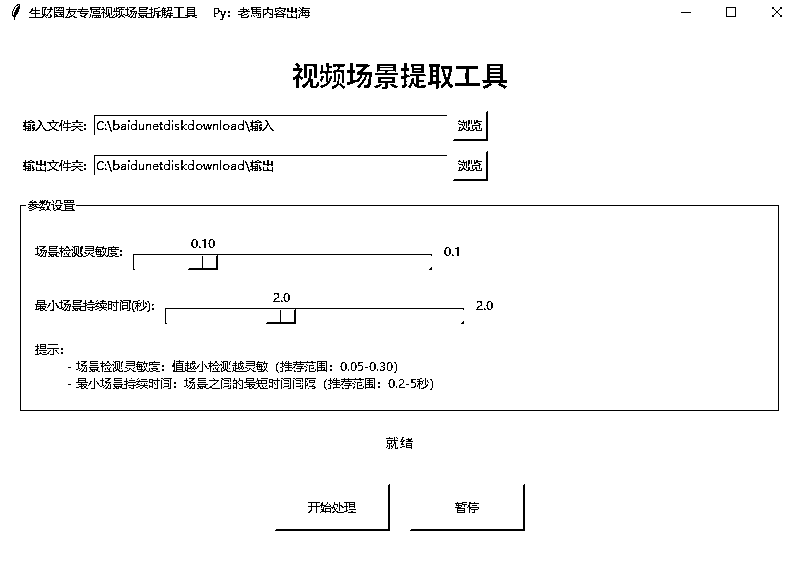 参数保留默认，点“开始处理”，软件会自动处理该目录下所有视频。 完成后，输出文件夹中会出现大量关键帧。以我这次的视频为例，忽略第1张黑屏和构图重复的几张，最后从3~10号里挑了8张可用画面。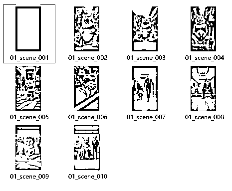 如果嫌帧图不够，可以把时间间隔调短、灵敏度调低，但也要防止产生太多相似构图。所以参数还是要根据视频内容动态调整。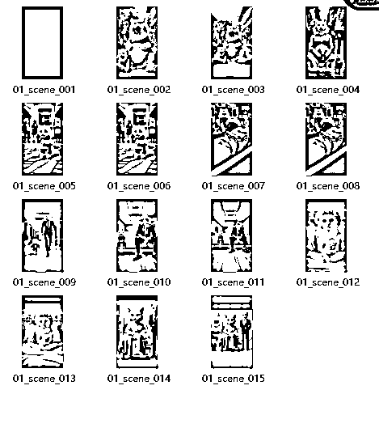

**3. 批量反推提示词**

有了8张关键帧后，需要为每张图生成文本提示词，方便后续用AI重新出图。ChatGPT虽然能胜任，但考虑到成本和魔法，我选用本地ComfyUI来操作。ComfyUI里有很多反推模型，我挑了一个速度快的，效果中等，日常够用了。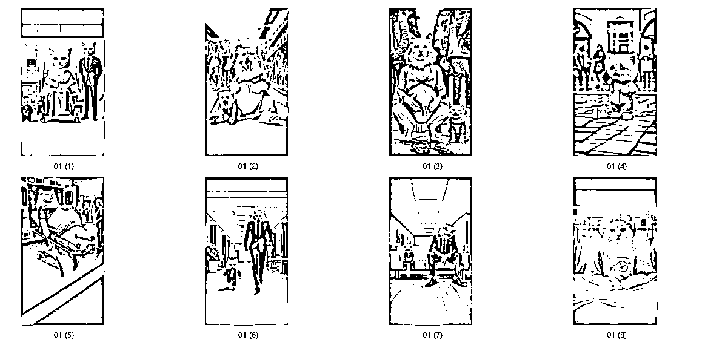

几点提醒：自己按教程搭好ComfyUI；Lib在线版有WD14节点BUG且不支持文件夹批量处理，建议用本地版。批量反推时，记得先把“YES”打开。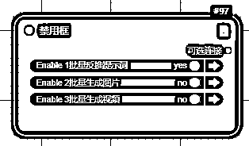 只有一张图就点“加载图像”上传，多张图则用“加载图像（文件夹）”，粘贴要处理的目录。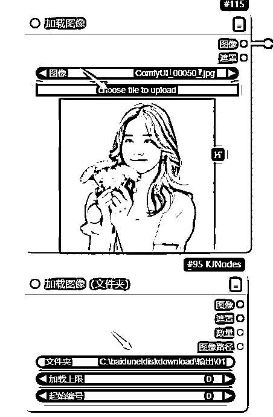 右侧模型选带“V3”的，效果会更好。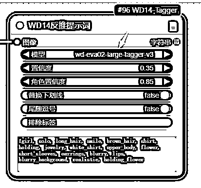 点“执行队列”，单张图直接出提示词，多张图则输出文件夹里所有图片的提示词。 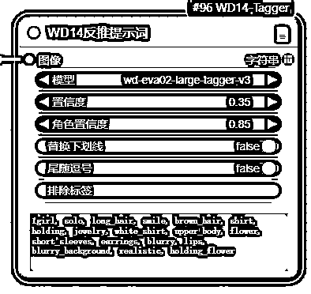 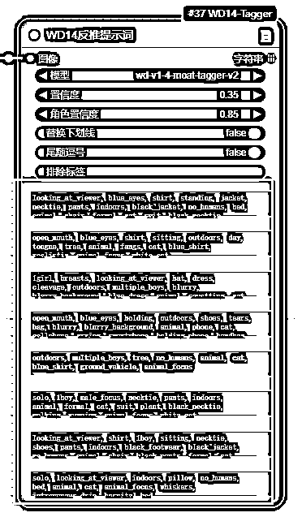

**4. 批量生成图片**

拿到的8条提示词，直接作为图片生成的条件。这一步我还是用免费的ComfyUI来做。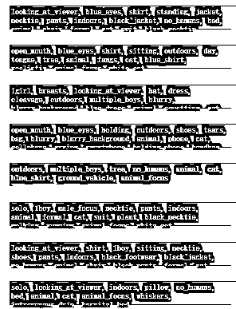 提醒一下：Lib在线版处理不了文件夹和多图批量，所以还是本地ComfyUI。进入批量模式，点“YES”。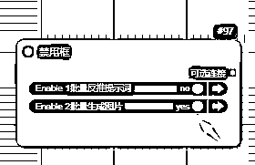 Checkpoint模型不用动，LORA可以换成FLUX风格模型。原视频是皮克斯风格，我故意选了个3D风格，让成品有差异化；如果你想要完全还原，就用皮克斯风格LORA。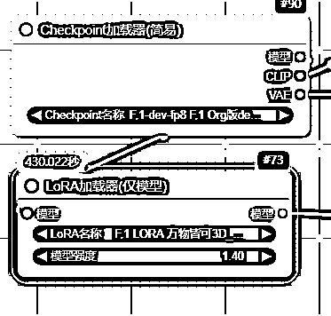 接着把8条提示词填进去，提示词参考如下：

- looking_at_viewer, blue_eyes, shirt, standing, jacket, necktie, pants, indoors, black_jacket, no_humans, bed, animal, chair, formal, cat, suit, black_necktie, animal_focus, black_suit, white_cat, intravenous_drip, hospital_bed, hospital_gown
- open_mouth, blue_eyes, shirt, sitting, outdoors, day, tongue, tree, animal, fangs, cat, blue_shirt, realistic, animal_focus, white_cat
- 1girl, breasts, looking_at_viewer, hat, dress, cleavage, outdoors, multiple_boys, blurry, blurry_background, blue_dress, animal, squatting, cat, green_dress, pregnant, puddle, aqua_dress
- open_mouth, blue_eyes, holding, outdoors, shoes, tears, bag, blurry, blurry_background, animal, phone, cat, cellphone, crying, smartphone, holding_phone, handbag, overalls, animal_focus, white_cat
- outdoors, multiple_boys, tree, no_humans, animal, cat, blue_shirt, ground_vehicle, animal_focus
- solo, 1boy, male_focus, necktie, pants, indoors, animal, formal, cat, suit, plant, black_necktie, walking, running, animal_focus, white_cat
- looking_at_viewer, shirt, 1boy, sitting, necktie, shoes, pants, indoors, black_footwear, black_jacket, no_humans, animal, chair, black_pants, formal, cat, suit, couch, black_necktie, wooden_floor, animal_focus, black_suit
- solo, looking_at_viewer, indoors, pillow, no_humans, bed, animal, cat, animal_focus, whiskers, intravenous_drip, hospital_bed 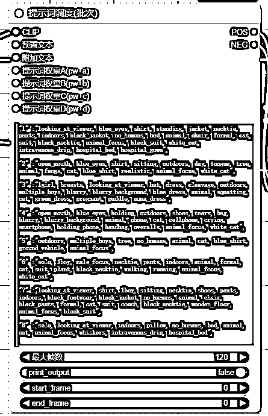

然后设置图片宽高，批次大小设为8，其他参数保持默认。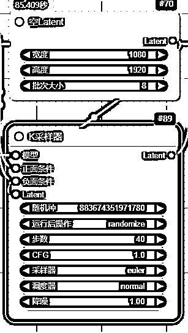 执行后就能得到8张风格统一的图片，画面与原始关键帧差别明显，这正是我想要的二次创新。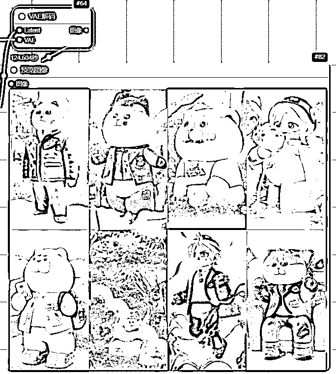 想复刻原风格，直接换皮克斯LORA重跑即可。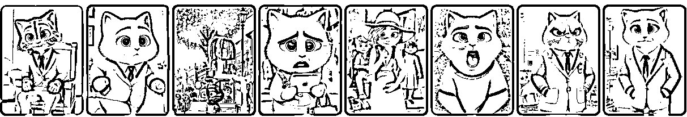

**5. 批量图片生成视频**

图片搞定后，下一步是把每张图变成视频。继续使用本地ComfyUI。 进入批量模式，点一下“YES”。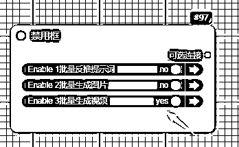 随后加载SVD视频模型，checkpoint保持默认。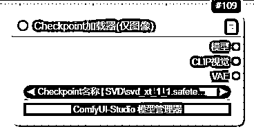 图片导入可单张上传，也可通过文件夹节点一次性载入多张。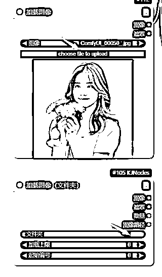 参数方面，视频宽高必须和图片一致，同时保证每张图片分辨率相同，其他选项默认即可。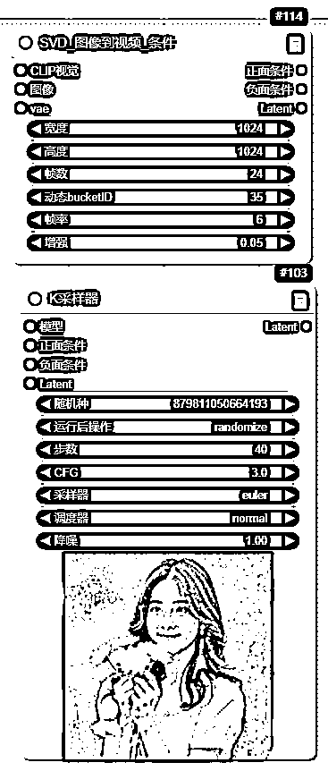 点执行队列，8个视频就会全部生成，而且和原图的一致性很高。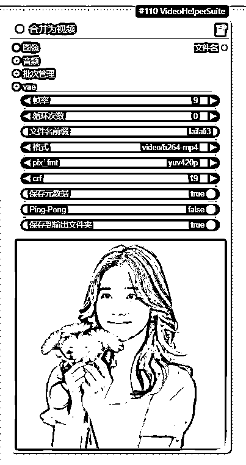

**6. 批量生成音乐/音效**

视频有了，配上声音才算完整。这里有两种选择：要用原视频的声音，就把短视频链接再扔回下载站，选“下载音频”就能单独提取原声，比如 https://youtube.iiilab.com/ 就支持。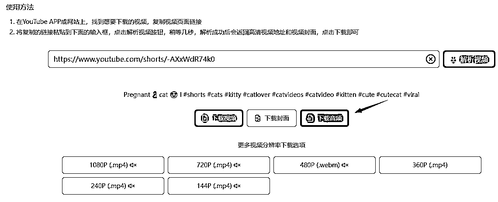 要独立生成，则在ComfyUI里加载 stable_audio_open_1.0 和 t5_base 两个模型。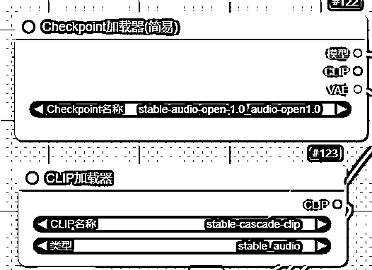 接着设置音频时长和生成数量。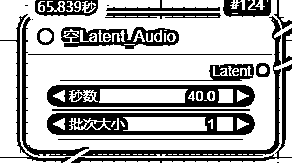 然后填入提示词，比如：

- Very relaxing and pleasant jazz music, suitable for vlogs.
- A summer night with many frogs croaking.
- Thunder and lightning, accompanied by the sounds of the wind and waves 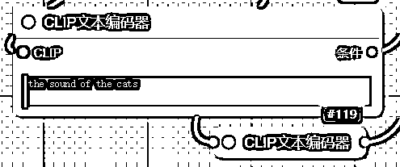

其他参数默认，开始生成即可。完成后音乐文件会保存在Liblib图库，记得去下载。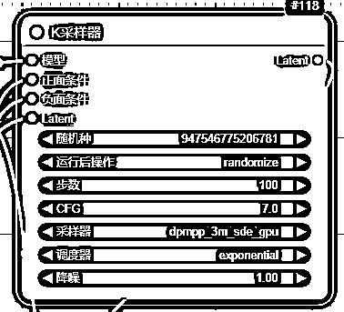 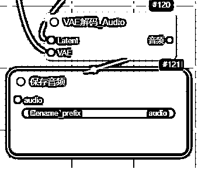

**7. 批量生成对白/旁白（非必需）**

很多Shorts根本不需要对白，所以这一步是可选的。如果你想要，可以用ComfyUI中的ChatTTS节点，项目地址：https://github.com/shadowcz007/Comfyui-ChatTTS。这个节点能创建音色、复用音色，还支持多人对话。输入文本时不需要手动加[speed_3][laugh_2]这类控制符，写起来很省事。

**8. 视频高清化**

原教程中这个环节没有详细展开，实际应用时可以在ComfyUI里接上超分模型或放大节点来提升画质。这里暂不展开说明。

**9. 剪辑**

最后一步是把视频和音频合成一条成片。ComfyUI暂时没有找到好用的自动剪辑节点，所以我推荐用剪映CapCut来操作。之前龙哥盟也开过视频剪辑相关的航海，想系统的朋友可以去翻翻。

以上就是整个工作流的拆解。从下载参考视频到最后成片，每一步都用免费工具和开源模型完成，批量生成8条甚至更多视频都是可行的。参数可以多调几次，找到适合自己的风格组合，剩下的就是大量实践了。祝大家都能批量产出自己的高仿AI视频。