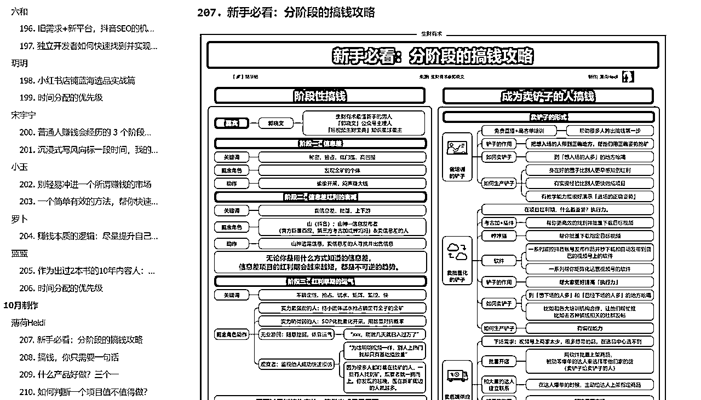

# ('在赚钱输出1000张思维导图后，得出10倍增长的6个心得', (2, 30))

我是罗卜，一个靠思维导图在赚钱被越来越多人认识的普通人。

说实话，最开始接触思维导图，纯粹是因为喜欢。它是我做读书笔记、开会记录、头脑风暴时顺手用的小工具，我从没想过，有一天它会成为我链接人脉、带团队、做IP的起点。

后来，我看到思维导图航海特训在赚钱推出后，许多外部平台也开始把它当成重点能力去推。那一刻我很高兴：这项技能终于被更多人看见了。也正因如此，我选择在赚钱持续分享它，想告诉那些还在找方向的人：你不一定要很厉害才开始，你可以先做一张图，再慢慢靠近你想成为的人。

如今，当我在赚钱累计做完第1000张思维导图后，我最想和你分享的，是下面这6个“10倍增长”心得。

**第一个心得：别想太多，先大量做图，以做代练。**

去年4月18日，我加入赚钱。5月第一次参加航海，我只分享过2-3张导图，几乎没什么人注意。那时候的我，怕曲解原意、怕被人批评、怕被当成引流，甚至不敢在图上留下微信和二维码。

但我慢慢想明白了一件事：整理、提炼、逻辑、表达，这些都是能力，而且它们会在你一张张作图的过程中偷偷长大。于是我开始一个人闷头啃精华帖，把《龙哥盟项目精选》里想学的项目几乎全做成导图。很多图没公开、没转成竖屏版，但它们全成了我练级路上的经验值。

后来，胖大魔邀请我参加【赚钱研学社】共读《龙哥益语》。那天起，我每天等小伙伴分享完，就立刻开始做图。最拼的时候，为了在2小时内出图，干到凌晨2点才收工；实在太累，就第二天早上5点爬起来继续，8点前完成。

那段时间，我公开发了21张思维导图，私下做的却多得多。也正是这种“以做代练”的笨功夫，让我把思维导图软件玩得越来越顺手，也让我看到大部分分享还以文字为主，导图反而是稀缺内容。于是，我开始坚持用图去表达，也渐渐找到了自己在赚钱的独特位置。

**第二个心得：用导图去敲门，是建立链接的最好方式。**

航海活动中，教练们经常做图文或视频分享。图文整理相对简单，视频整理才是真正的挑战：要全程认真听，还要消化嘉宾临场发挥、延伸内容和实战案例。

每次整理完，我会主动去加教练微信，备注通常是：“听了您的分享，做了一张思维导图想分享给您。”大部分教练都会通过。发图前，我会先发给自己检查一遍，再诚恳地问对方：有没有需要调整的地方？

就靠这个动作，去年8月航海，我帮好几位教练做了竖屏思维导图。这些图不仅是对他们分享的回馈，也换来了很多鼓励。有教练主动帮我传播，还有人在群里@我，让更多圈友注意到我。

最重要的是，我发现这件事是可以复制、可以迁移的。整理资料的门槛不高，很多工具都能做；竖屏导图需要一点功力，但方法都一样。你在赚钱能用它链接人，换到别的社群，一样有机会。

**第三个心得：复盘不是炫耀，而是让自己被看见。**

在一次航海家分享会上，HEXIN教练说了一句话，深深击中我：靠谱的人要具备三种能力——“真诚，利他，会组局”。

那时候我才意识到，自己一直觉得“还是新人，没什么好分享”，其实是一种自我设限。后来我开始尝试写复盘。虽然写得不算深刻，但那是让别人认识我的一个好机会。

我发现一个现象：很多人连复盘都不愿意写，因为他们太珍惜自己的文字，怕暴露自己的优秀，结果什么也没留下来。但这个世界是奖励表达者的。所谓的“1990法则”就是：1%的人在表达，当你开始发声，就已经领先了大多数人；持续分享，你就已经超越了99%的人。

我写下第一篇复盘后，评论区里出现了一个名字：陈雪。她不但给我留言鼓励，还邀请我做了几期训练营，最终我赚回了门票费的数倍。回头看，胖大魔是让我发现技能的伯乐，陈雪则是把我推向下一个高度的贵人。

而连接我与他俩的，正是那一次看似普通的复盘。

**第四个心得：一个人走得快，但一群人才能走得更远。**

我第一次组队是在去年8月，当时还是个临时拼起来的“草台班子”。但因为有了那次尝试，我们后来才配合得越来越默契。

11月和12月，我连续收到赚钱官方的制图邀请。我们团队一起完成任务，还为成员争取到了官方奖励，那种感觉特别有成就感。再后来，左烨紫和小鹅邀请我们以志愿者身份参加杭州线下航海家大会，我们跟着一起整理分享、制作导图，被更多人看到。

最近一次共创，我和20多位小伙伴一起做精华帖思维导图，目前已经完成了160张。看着曾经的新人一个个能独当一面，我特别欣慰。现在不管是公益制图，还是付费项目，我都能拉起一支稳定、高效的线上团队协同完成。

组队这件事，不是把别人当工具，而是把每个人的长处拼在一起，最终利人利己。

**第五个心得：线下组局，总会遇见意想不到的惊喜。**

我第一次在线下组织导图分享局，就遇见了几个学过竖屏思维导图的圈友。他们带来了很多真实案例，聊导图怎么用在生活和工作里，还分享了如何用思维导图做自我介绍、找个人定位。那种面对面的碰撞，是线上聊天永远给不了的。

后来我组织一次思维导图变现分享会，七小是第一个报名的人。我既开心又紧张，担心自己在大佬面前讲砸。但七小到现场后，不仅没让我尴尬，反而贡献了很多独到见解，帮我在做思维导图的路上避开了不少坑。

在我加入航海家之前，线下的聚会就常常出现龙珠圈友和航海家成员。每一次偶遇，都让我看到新的思路和玩法。如果你总是等别人组局，你永远不会知道主动出发会遇见谁。组局的价值，恰恰在于它的不确定性。

**第六个心得：真诚利他，才是长期主义的流量密码。**

到目前为止，我在赚钱组织过32次小型聚会，每次人数不超过10人。为什么刻意控制人数？因为只有小场，交流才够深。

很多人问我，花这么多时间组局、做图、分享，不累吗？我说，稻盛和夫讲过，“利他”不需要大张旗鼓，先人后己就是特别简单的事。做思维导图是这样，组局也是：先把价值给别人，把别人放在心上，机会自然会向你靠拢。

有时候，你多发一张图、多写一次复盘、多做一次分享，并不会马上有什么回报。但这些“利他”的小事，会慢慢积累成你的信任资产，再在某个意想不到的时刻，变成你的增长杠杆。

如果你也正在找方向，不知道该做什么，不妨像我一样，先从一张思维导图开始。大量做图，主动链接，认真复盘，找人组队，走向线下，然后保持真诚。

这张图，也许就是你打开赚钱之门的钥匙。

你有没有发现，每一次线下碰面，我们总能在不知不觉中聊上三个多钟头。在这些坦诚的交流里，大家把自己走过的路、踩过的坑、攒下的经验全都摊开来分享。我亲眼看着不少圈友，正是在这样的氛围中，鼓足勇气迈出了属于自己的第一步。

我比谁都清楚，愿意抽出时间来参加线下聚会的人，付出的成本绝不只是那几个小时。正因如此，我始终在琢磨同一件事——怎么让每位到场的朋友都觉得“这一趟来得值”，怎么让大家离开时，脑子里多出一些真正能带走的东西。这些收获未必是“明天就能上手的项目清单”，而是一些更底层的东西：对事物运行规律的理解，对自身处境的重新审视，对行动方向的基本判断。它们不会直接给你一条捷径，但会为你铺下一块最重要的垫脚石。

坦白说，想在任何一个领域走得更远，光靠原来的思路和惯性是不够的。旧有的认知框架像一个透明的房间，你以为自己已经站到了边界，其实只是望着墙发呆。真正的转变，是从承认“我可能想错了”开始的。所以，我鼓励每一位参与的朋友，不仅在聚会现场去听、去学，更要在离开之后去试、去做、去把自己的想法亮出来，去组织属于你自己的场子。只有当行动真正发生，那些认知才能落地生根，你也才会真切地感到：自己正在做的事情，是有分量的。

聊到这里，不得不提纳瓦尔的一句话：如果社会可以培训你，那么社会也可以培训别人来取代你。凡是能被批量复制的能力，本质上都是可雇佣的技能；而那些真正属于你自己、经由你亲身经历和思考获得的东西，才无法被轻易替代，也才有可能成为你未来事业的支点。顺着这个思路，我越来越坚定地相信：与其单打独斗，不如一起共创，把每个人独特的那部分价值释放出来。

前些日子，我陆续在帖子里分享过几篇思维导图的整理思路，包括怎么理解“赚钱”这个概念、怎么把理念转成可落地的动作，以及我们一起为精华帖做的那些导图。说实话，前后对比一下，你会很容易发现一个变化：我亲手做的导图越来越少了，而其他伙伴贡献的导图越来越多了。

这不是偷懒，恰恰相反——我比任何人都清楚，一个人想要独立完成几百张高质量的竖屏导图，几乎是不可能的。每个人的时间都很贵，经验也都是独一无二的。所以我发起了一个共创计划，邀请愿意加入的朋友一起来做这件事。我希望它不只是一个分工任务，更是一条能让人成长的路径：在共创中突破自己的边界，在协作里被更多人看见，让作品获得更广的传播。

共创的内核，其实是一种各就其位、彼此成全的精神。在这里，每个人既在分享，也在吸收；既在教别人，也在被别人的视角刷新。通过我们共同打磨出的这些导图，我希望能搭起一座从知识通往行动的桥，让那些被文字掩埋的洞见，变得直观、可触、可上手。

说到选精华帖，也有自己的尺度。被加精的文章自然经过了筛选，但没被加精的，也不代表没有价值。每一篇都有值得琢磨的地方。具体到做导图这件事上，我倾向于选三类：

一类是“易操作”的——大多数人看完就能明白，做成导图之后更是一目了然，读者不需要费力就能抓住主线，看完就能上手试一把。

一类是“普通化”的——注意，不是指内容普通，而是项目本身不花哨、不猎奇，甚至容易被忽略。但这类内容的好处恰恰在于：它能被长期看见，学起来门槛低，跑通闭环也不费力。

还有一类是“周期性”的——有些内容到了特定节点就会被重新翻出来，比如七夕节前后的鲜花生意，年底的红包封面，还有一些区域特色明显的小项目。它们像日历上的标记，到点自然会响。

最后，想对还没找到合适方向的新朋友说一句：如果你暂时没有明确的项目，不妨先去掌握一门技能。它不一定马上带来收入，但它会改变你思考问题的方式。拿思维导图来说，你可以用它拆解任何一个感兴趣的项目，顺着分支去延伸、去联想、去碰撞；也可以在读一篇好帖时，用它来帮你加深理解。做完之后，这张导图甚至还能成为你和写帖人之间的一座桥梁。

而且，思维导图的价值不止于“赚钱”这一个圈子。你可以把它用在任何领域：复盘、梳理SOP、做会议纪要、拆解一个账号……它就是一个通用的思考工具。

我是罗卜，在“赚钱”这个圈子里，大家因为思维导图认识了我。我也希望借由它，让更多人感受到整理思想的力量。以上是我一路走来的真实心得。罗卜与19位伙伴，共创81张思维导图的成果展示，都在下方的往期分享里了。