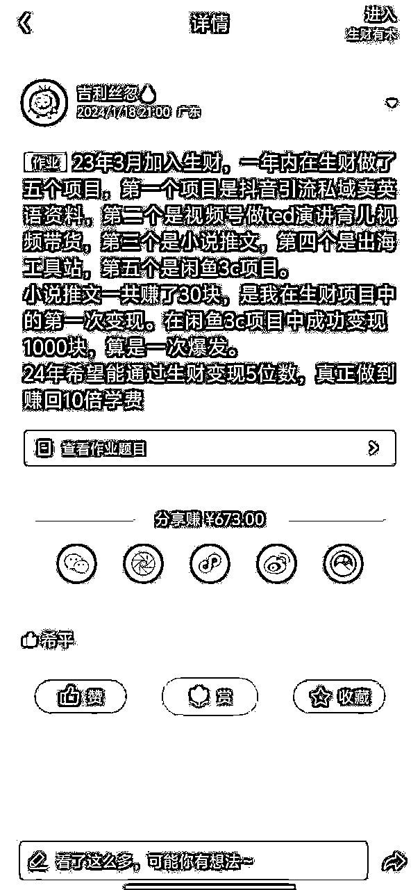
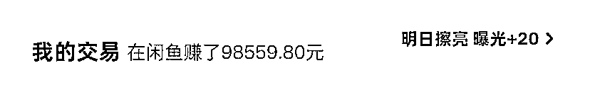
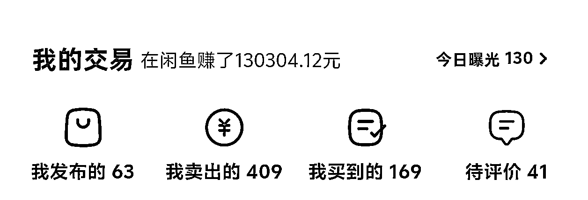
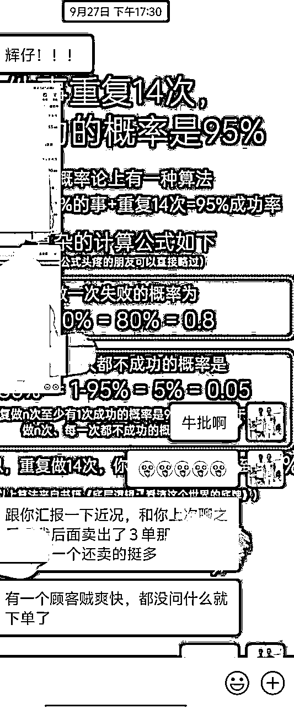
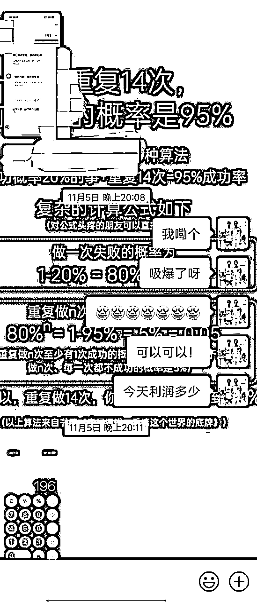

# 从迷茫到月入翻倍：一个02年毕业生如何在闲鱼赚回20倍门票

最近刷到很多圈友在问：副业0到1到底怎么跑通？今天想和大家分享一个真实的故事，希望能给正在摸索的你一点力量。

故事的主人公是dunker辉仔，一个02年刚毕业的年轻人。今年3月，他参加了赚钱有术的闲鱼高客单带货航海，结果不到半年时间，不仅跑通了整个项目，还实现了年初给自己定下的目标——通过赚钱变现5位数，赚回10倍学费。而实际上，他做到了20倍！

为什么敢定这么高的目标？他说，之前有段时间做项目收益惨淡，特别难受。后来看到龙哥大大在一篇帖子里写过：在你赚到10倍赚钱门票之前，所有的情绪都是假的。这句话深深刺激了他，也成了他的信念。

先上数据！他做得最好的两家店铺，一家累计GMV冲到了13万，另一家也接近10万。

很多人好奇，他凭什么能做到？他说最感谢的是师傅动物园园长，在赚钱无私分享闲鱼卖货的干货，让他第一次看清了闲鱼赚钱的底层逻辑。而且这一次航海，是他第一次全勤打卡，每次打卡都有说不完的思考和感受。这恰好印证了郭晓文老师在航海补给站说的那句话：“当你真正投入项目，每天的打卡5分钟就能搞定，你会觉得异常轻松。”

其实他的起步并不顺利。航海开始前一个多星期他就启动了项目，目标是第一个月赚3000。可一个月过去，只赚了400多，心里别提多难受了。但他没有放弃，坚持每天上链接、回复客户、刷对标，把所有基础动作做到位。到了第二个月，终于做到了3000，完成了目标。

## 这个项目带给他的，远不止赚钱

他说，以前对赚钱的理解全是脑子里想象的，现在终于有了真实的体感。半年的项目历练下来，他完整走过了这样一条路径：

先把项目闭环跑通，然后看着收益慢慢放量；接着把成功经验复制出去，做矩阵化店铺，进一步拉高收益；再往后，开始思考搭建团队，把工作做细致分工，让伙伴们各展所长，或者把琐碎事务外包出去，自己专注最核心的20%的事；最后，授人以渔，带着身边的朋友一起做闲鱼，体会交付的快乐。

这里还有个小插曲。他的好兄弟小羊也是赚钱圈友，听说他想带人做闲鱼，立刻把女朋友推荐过来，成了他的第一位“学生”。这次带人经历让他深刻体会到，自己会做和教会别人做，完全是两码事。

有意思的是，自从有了组建团队的想法，他看项目的视角完全变了。他开始站在团队leader的角度思考问题，慢慢理解了每个岗位为什么存在、团队之间怎么配合才能更高效。他甚至看懂了boss直聘上每个招聘岗位背后的商业机会，一下子明白了龙哥大大在小灯塔分享的那句话——从各大求职平台挖掘项目信息。

随着闲鱼项目越做越深，他明显感觉到自己的思维已经一点点从打工人的思维，蜕变成了老板思维。以前书本上学到的认知，终于不再是纸上谈兵，而是真正变成了自己的一部分。

## 为什么他能做成？他说就两点

这些年他也参加过不少航海，做过七八个项目，为什么偏偏闲鱼做成了？他分析了两个关键因素：

第一，给自己创造好的项目圈子氛围。除了航海群，他还会去各大平台搜闲鱼无货源的信息，看别人在聊什么，捕捉一手项目动态，让自己泡在全是闲鱼信息的空间里。当然，他也会谨慎分辨这些圈子和信息的可靠性。

第二，多问教练，跟着千万赚百万。实操中遇到卡点，他试了一两遍还是不明白，就立刻跑去问群里的教练。以前他总觉得问题太傻不敢问，怕被人笑。现在想想，那种想法才真的傻。教练们实战经验丰富，你碰到的难点，他们基本都踩过坑、解过题。多和他们交流，他们会告诉你什么重要什么不重要，比自己闷头瞎做强太多了。

## 多做失败了损失很小、成功了回报很大的事

他想借这个机会分享一点个人经历。去年12月秋招上岸，他其实找到了一份收入挺不错的工作。但实习一个月后，他发现自己真正想要的不是这个。他渴望锻炼一种能力：不依赖公司平台，不上班也能赚钱。说白了，就是不想上班。

今年1月，他还在想，还有半年才毕业，特别想体验一次靠项目赚钱、实现经济独立的感觉。那时他刚好在喜马拉雅听到一个关于职业规划的播客，里面有一句话他记到了现在：“多做失败了损失很小，成功了回报很大的事儿！”

他算了一笔账：如果毕业前这半年能把项目跑通，赚到10倍赚钱门票，那得到的不仅是钱，还有非常丰富的实战经验，甚至以后能靠自己独立赚钱。这不就是回报很大的事吗？就算失败了，自己也还有秋招找到的工作兜底，回去老老实实上班学技能存钱，损失也完全能接受。

就这样，他开始做闲鱼、参加航海、持续执行。如今不仅赚到了20倍赚钱门票，还拿到了比钱贵重得多的经验和认知，对他来说是无价的。

最后，他想用《富爸爸》里的一句话送给所有在航行路上的圈友：“大胆梦想，长远考虑，每天设定一个小目标，并且一小步一小步地来完成，这是获得长期成功的关键。”

希望他的这段经历能给你带来冲劲，为你的航程注满能量。我们一起，赚钱有术！