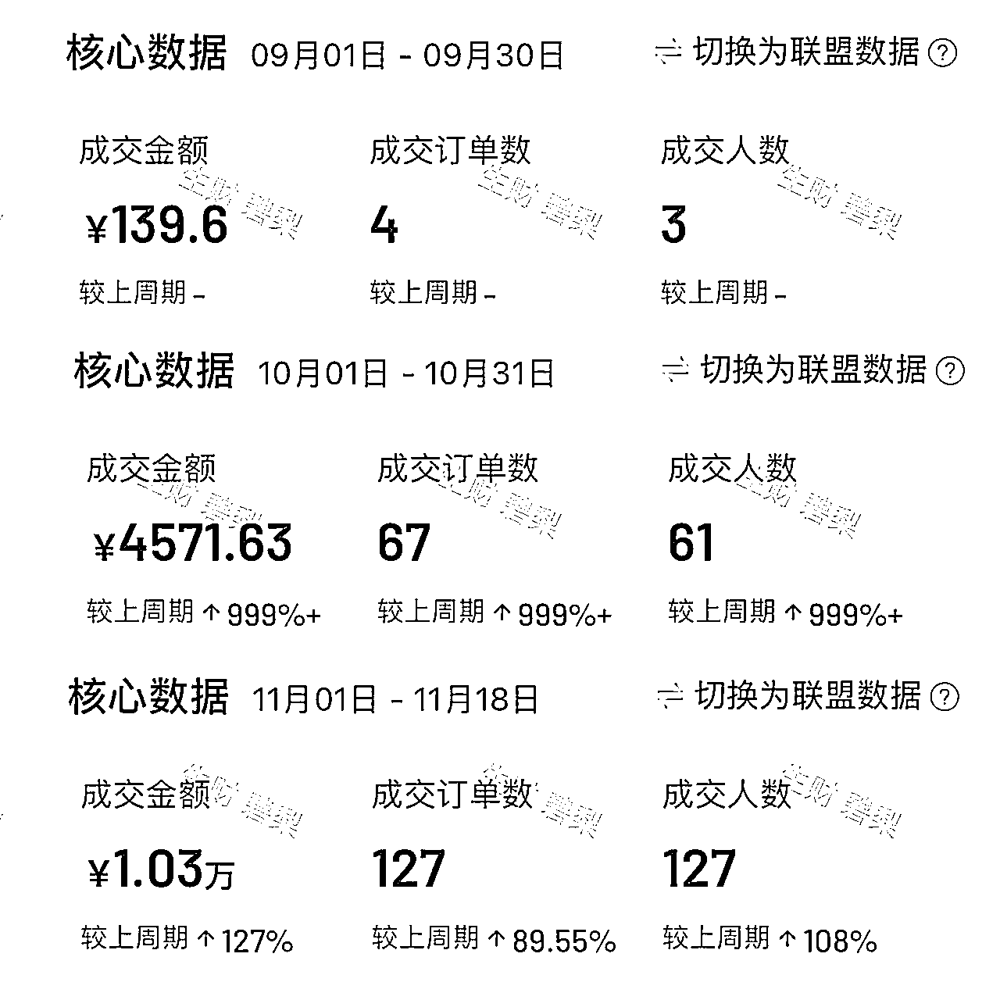
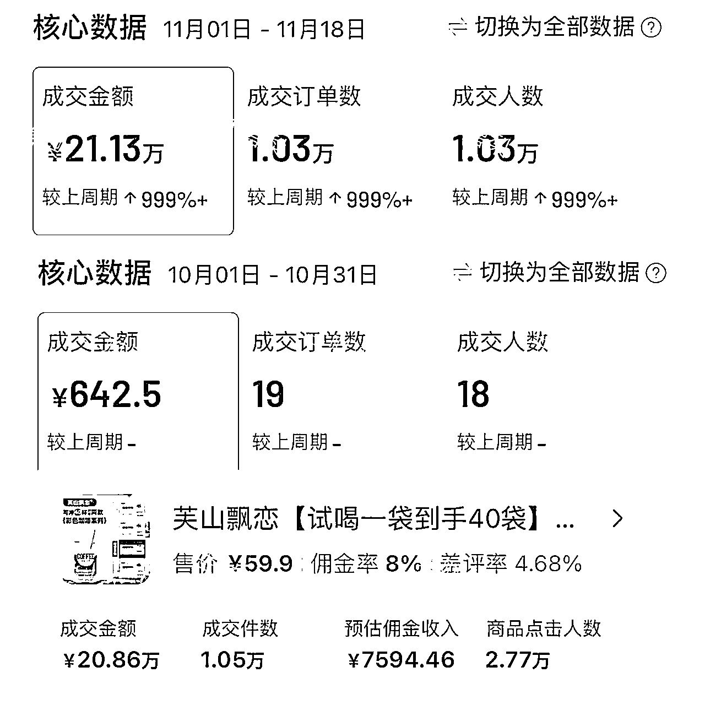
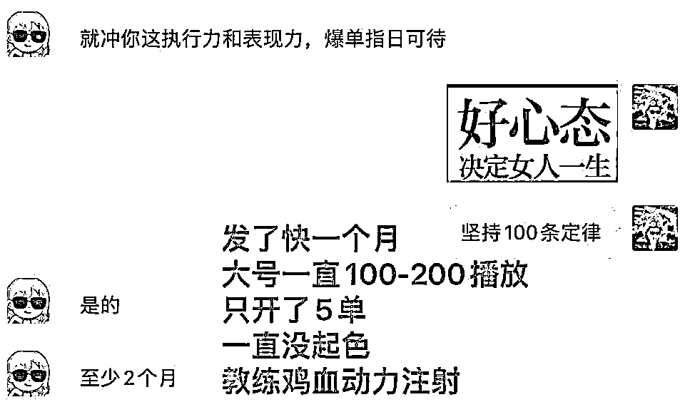
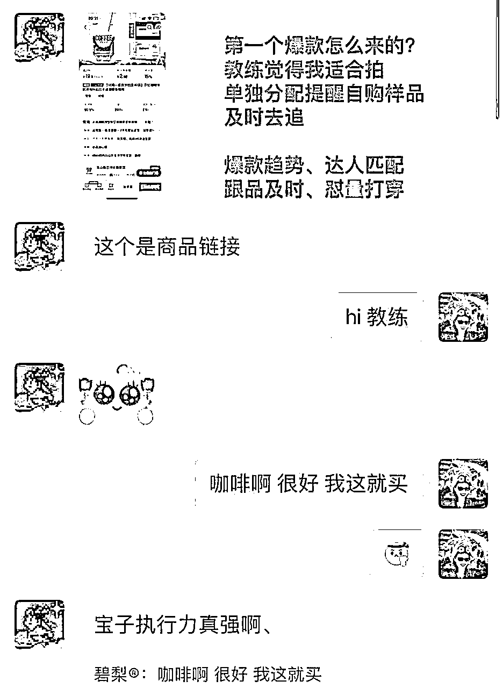
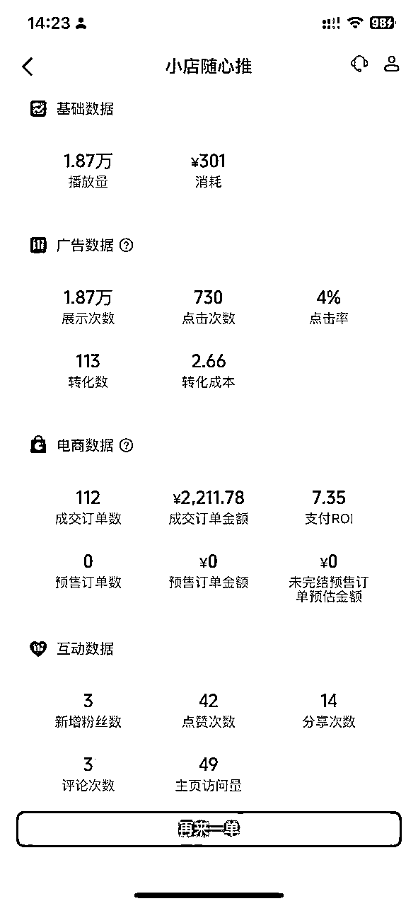
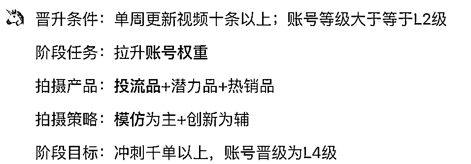
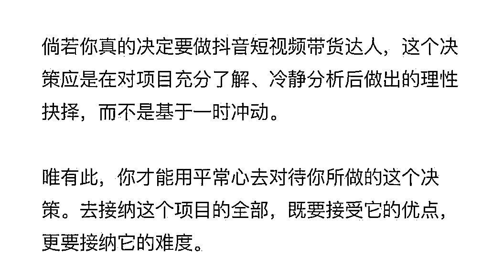
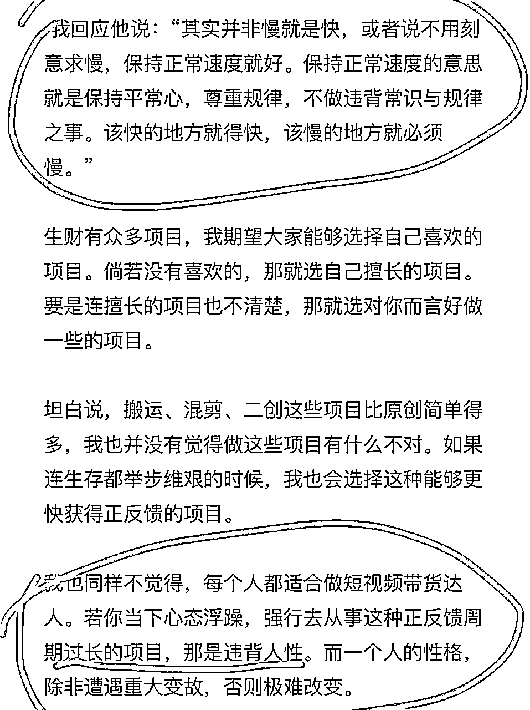

从GMV不到1000到20万+：三次航海之后，我终于明白这是一场持久战

大家好，我是碧梨。今年四月底登上赚钱这艘船，随后连着跟了三期航海：5月视频号百货打品，7月视频号读书带货，9月抖音精致达人。成绩单大概是：5月销售额没破千，7月做到6700，9月直接冲到20万+。说是老船员，不为过。

这一期我不是零基础萌新，而且是全职参赛。每天按上班作息来：一睁眼就扑在项目上，直到晚上11点半才被迫收工，事情依然清不完。

先说一句心得：三个多月的浸泡，让我把出镜、剪辑、采编这三样本事练了出来。最开始连露脸都发怵，怕熟人刷到我的带货视频；后来哪怕旁边站着人，我也能当着面讲完一整段。面子这东西，在带货这件事上真没那么重要——围观的人不买也不影响你，真正重要的，是从你视频里下单的人。

这篇文章偏个人体验，实操细节不多。想看具体打法的，直接去啃盗坤团队的《精致达人孵化手册》，里面写得够细；教练也是不厌其烦，熬夜给你指路。

接下来，按时间线聊聊9月这期精致达人航海。

### 第一段：练能力，攒底气

**9月19日，发出第一条带货视频。**
10号开船，我拖到19号才迈出第一步。原因很简单：一直观望，又怕拍摄工作量太大，再加上P人固有拖延，迟迟没动手。

**9月20日，从新手村进到冲刺组。**
前两次航海没有白折腾，这次明显上手更快。没有一步路是白走的，每一步最后都算数。

**9月21日，卖出第一单。**
当时播放量只有100，但出单带来的快乐很真实，这种快乐以后可能很难再复制了。

### 第二段：跑通模型，拿到正反馈

**10月16日，小号发第一条带货视频，开出6单。**
大号原本是个读书博主，发社科类流量视频做到3000多粉丝，但主力是男粉。将近一个月，大号带货视频播放不好，就算有流量，推给的人群也基本是男性，根本不出单，我整个人都麻了。
教练建议我开个小号，两个号一起发。这个决定很对——小号干净、全新，反而正反馈来得又快又猛。

**10月17日，大号迎来第一个小爆，GMV 4571。**
大号像是有“抖M体质”，我正准备把重心放到小号时，它的人群突然跑正了：30+女性为主。我同时跟上了教练提到的好运香水这个热度品；不够寄样条件，就自己买来拍。跟品一定要快，热度来了，自然流+高佣金，第一个小爆也就来了。

文案库的含金量，谁刷谁知道。我给自己定的习惯是每天必须过一遍：重点盯新品、重要且紧急的新品、还没出文案的重要且紧急新品。你动作够快，下一个爆款可能就是你。

**11月3日，小号迎来第一个爆款，单品GMV 20万+。**
这个品又是我自己买样、快速跟上的；后来看到教练发言才知道，全船好像只有我一个人追了这个品。教练群里群外发的重点信息，一定要高亮保存，最好马上转存到备忘录。群消息实在太多，一眨眼就会忘掉。

教练信息的含金量，劝你越早懂越好。

与此同时，新号收到了抖音送的300元随心推券，系统一直提醒再不用就过期。好，那就用。
结果：自己只花1元，抖音附赠300元付费流量，实际消耗就是301。投产比做到了7.35，快乐得很。我把截图发给教练，申请品牌方投流，接着开启全域推广，连爆4条视频，直接拉满20万+ GMV。

但这里要拧清楚：我不是劝大家给自己的视频投流。能薅就薅，普通人自费投流，大概率扛不住长期消耗，真没必要拿自己的钱梭哈。市面上有一大把商家投流品，挑着拍、跟着拍就行。

所以，这次的爆款本质是投流品，不是自然流。这也是为什么小号只发了十几条视频就能快速起号——投流品把人群和权重都喂了起来：账号从lv0直接冲到lv4。对新号来说，人群模型和带货权重可以说是双丰收。

如果你也常对带货阶段感到迷茫，那就反复看《精致达人孵化流程》的【孵化阶段】部分；答案早就写在里面了，照着做就行。我在冲刺组的时候，全部动作都围绕这个核心来：

**11月16日，小号跟买人数破万。**

### 第三段：拼执行力，也磨心力

看到盗坤在赚钱发的中期复盘文章后，我也决定给自己做一次阶段总结。进入赚钱以来，我试过不少项目。状态起起伏伏：有时给自己打满鸡血、拉满执行力，有时被现实敲打；也曾下桌换场，从一个赛道换到另一个赛道，从轻易被割，到每次付费都先问一句“为什么”——这一点受明白老师的“凡事多问为什么”影响很深。
这个过程，我相信很多圈友都经历过。

但回头看，没有一步是白走的。把时间拉长来看，那些当时几乎察觉不到的积累，正在悄悄替下一次扬帆蓄力。

抖音精致达人这个项目，我看到的结论是：最快也要2个月。而且这个周期是建立在已有短视频、带货、拍摄剪辑、自媒体运营等经验储备的前提上的。如果你比我更小白，我真心建议：把现阶段该做的事一件件做扎实，别急着要结果；执行拉满，心力也要练厚。它真的是一场持久战。

哪怕我已经爆过一次，也只是把号初步立起来了，离“做好”还差很远。
我现在的问题依然很具体：拍摄和剪辑效率不高、更新频率不稳、作品量也堆不上去。怎么做到一爆再爆？怎么让视频质量更好？怎么稳定完成月度GMV？怎么提高自然流的产出效率？怎么继续提升佣金收入？
这些都需要更长时间去学习、调整、优化。看看那些lv5的带货博主，主页上几百条、上千条作品就摆在那里。它们都在提醒你我：哪有什么一蹴而就、短期拉满的暴富神话？马上就是2025年了，清醒一点。

最后，盗坤那句话我一直记着：保持平常心，尊重规律，不做违背常识和规律的事。尊重经营，也尊重时间。

