# 当你看懂赚钱的复利逻辑，成长速度会直接翻十倍

> 来源：[https://pznme756ly.feishu.cn/docx/Z0s1dpeDHoM8QKxTOGlclIg6nnc](https://pznme756ly.feishu.cn/docx/Z0s1dpeDHoM8QKxTOGlclIg6nnc)

前阵子龙哥转了一篇内容：https://t.zsxq.com/XPfLs，里面有句话让我印象很深：我坚信，任何时候都能直接面向市场赚到钱的能力，是一个人最大的底气和自信。我同样坚信，每个赚钱有术的伙伴，只要持续学习和实战，都能拥有这样的能力，都能持续赚到钱。

这段话我特别有共鸣。因为我从一个只会写代码的程序员，到现在可以独立面向市场变现，完全是在赚钱有术里从0到1，一步步学、做、复盘、迭代练出来的。

在这一路里，最大的转折点是想通了「复利效应」这个概念。

正是因为搞明白了它，我才敢肯定、坚定地相信，用对方法做对事，我未来一定能赚到钱。于是即便在很长一段时间里，外部反馈几乎为零，没有涨粉也没有变现，我依然能保持稳定输出：学精华帖、拆解思考、动手实操、复盘总结，让能力持续累积。

等到了反馈回来的阶段，我在赚钱上的学习效率和成长速度，直接提升了十倍。

我把这叫做：赚钱的复利效应。

如果当时没理解复利，我不可能靠一句空洞的「我要坚持，我要赚钱」就坚持下来。

违背客观规律的事，靠意志力是撑不住的。

所以我觉得，这个认知对刚加入赚钱，正在成长期，还没等到正反馈的新人，会非常有帮助。

今天就把我对这个想法的理解整理出来，希望能给你一些确定感。

今天的主角是：复利效应。

先说好，我不是要讲银行存款几年翻几倍，也不是讲棋盘放米的那种故事。

我要聊的是和赚钱、工作、成长直接挂钩的真实复利。

# 1 复利到底是什么？

爱因斯坦曾说过：

“Compound interest is the eighth wonder of the world. He who understands it, earns it ... he who doesn't ... pays it.”

复利是世界第八大奇迹。懂的人赚，不懂的人被赚。

在很多地方都能看见复利的影子，比如：

*   银行存款的复利增长曲线

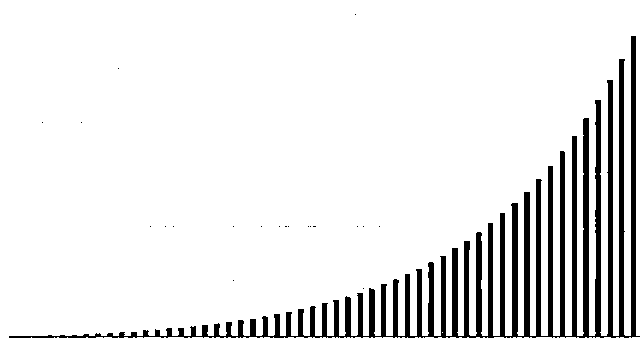

*   道琼斯指数过去两百年的增长曲线

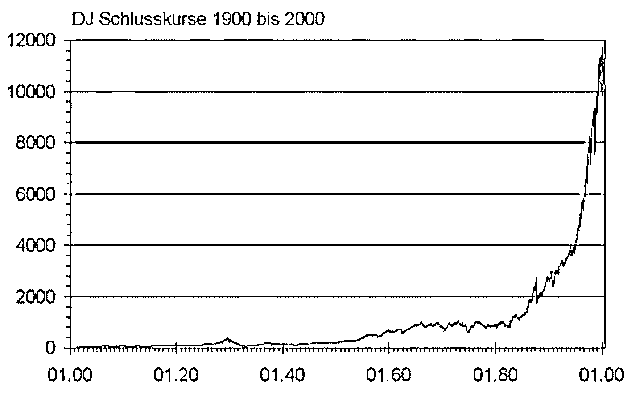

*   世界人口增长曲线

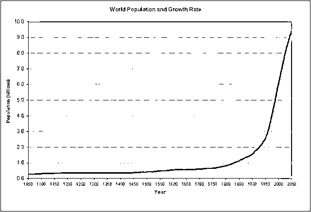

*   明白的爬虫课增长曲线

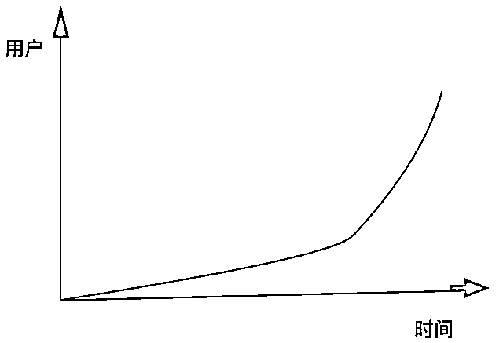

别急，等等再展开。下面这个公式，相信你也见过 ——

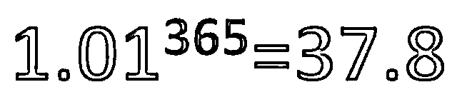

还有一句常见的说法：如果一个人每天进步1%，一年后能力会提升38倍。

这就是复利的底层逻辑，到这里你可能还是没感觉，没关系。

# 2 相信复利能带来什么改变？

## 1 相信复利能让你不再焦虑

2016到2019年，我经常被焦虑困住。

比如看到粥左罗老师的文章写得太好，我也想写出那种质感，但一看自己的水平就开始自我怀疑。

你回想一下你焦虑的时候，是不是也差不多？

看到身边优秀的人轻松写出爆款、做出好课、航海变现，自己也想做到，却觉得能力差距巨大，怎么努力都追不上，于是焦虑就来了。

但一旦你相信复利，焦虑会立刻被稀释一大半。

为什么？

我们觉得别人遥不可及，是因为眼里的他们看起来「轻而易举」。但其实我们误判了，他们现在的轻松，是因为已经跨过了「复利拐点」。

什么是复利拐点？看这张图：

我以前写过这样一句话——

一个人一旦抵达复利拐点，图中小人站的地方，他的产出会陡然加速，甚至超过之前所有时间的总和。

这里的产出，可以是钱，也可以是能力、认知。

再说粥左罗老师——他为什么每篇文章阅读量都高？

2015年8月他入行新媒体开始写作，一写就是到2018年3月创业，之后至今每天一篇，没断过。长期积累让他过了拐点，写作能力才指数级提升。

所以现在他写文章轻松，出来创业的收入也远超之前上班的总和。

这和你有什么关系？

关系很大。因为复利是客观规律，对任何人都绝对公平。

只要你相信它，并按正确方法持续执行，总有一天你也会抵达自己的复利拐点，那时能力和收入会一起爆发。

既然未来是可控的，自己完全可以靠积累走到想要的高度，你还会焦虑吗？

情绪上来时或许还是会，但用理性一梳理，焦虑会很快平复。我每次都是这样调节自己的。

## 2 相信复利能让你更笃定

自信的本质是清晰：

*   知道什么事现在能做，什么事现在做不了

*   知道什么事未来也做不了

*   知道什么事现在做不了，未来一定能做到

相信复利的人会明白，厉害的人都是靠时间堆出来的，然后在拐点处爆发。

而复利对每个人一视同仁。意味着你现在开始积累，那些此刻看起来遥远的目标，在复利作用下会在可预见的时间内实现，毫无疑问。

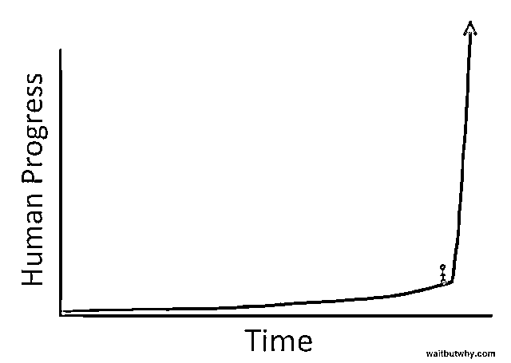

再看这张图，注意小人站的位置。

现在进步看起来慢，是正常的。拐点之前必然有积累期，等积累足够，拐点自然到来。

明白了这一点，学习时会更有底气，遇到困境会更从容。

因为你知道这些都是暂时的。

因为你知道当下的付出在为未来加息。

因为你知道未来由你自己掌控，时间终会给出答案。

2019年我为了升级《不用写代码的爬虫课》，整整一年都在大量读书、拆解赚钱案例、反复练习，然后把学到的东西用在课程和网站上。

前期枯燥、没收益，但我因为相信复利，清楚这些积累迟早会变成变现能力，所以更有耐心和信心。

## 3 相信复利能让你进步更快

前面说过，过了拐点，收益会超过之前所有时间的总和，包括财富。

如果你相信复利，你现在做的每一件事都是为了更早抵达拐点，更早拿到更高收入。

为了更早拿到钱，你自然会用更多时间去学习和积累，于是知识和能力会加速提升。

相信复利的人，对刷抖音、刷朋友圈这种事基本无感，因为这些事和拐点无关。

花一天时间在无效消耗上，就意味着拐点晚来一天，高收入状态也晚一天。

把时间拉长，你会发现当下每一秒不积累都是损失。

## 4 相信复利能让你碰到更多好运

*   学10个知识点，能碰撞出1个赚钱思路；

*   做10件事，能找到1个真正适合自己的机会；

*   见10个人，能遇到1个愿意帮你的人；

如果把这些叫好运，那么相信复利的人，好运会更多。因为你相信自己终将有所成，所以在没成绩时依然愿意做积累——

*   你会更用力学习；

*   你会做更多尝试；

*   你会接触更多人。

相比不信复利的人——

*   你掌握的知识更多，赚钱思路也就更多；

*   你尝试的事情更多，选择机会也就更多；

*   你认识的人更多，贵人也就更多。

这些额外的思路、机会和贵人，会让你更快成功。

我有个朋友，叫他小明。

他不想拿死工资，于是业余时间加入了几个付费星球学习。刚开始他特别焦虑，看别人的案例感觉别人轻松赚钱，自己却一脸懵，努力几个月没什么收获，几次想放弃。

有一次他读到李笑来在得到的专栏《财富自由之路》，看到了复利的概念和那张小人的图，他好像抓到了一根救命稻草。

从那以后，小明每天投入更多时间学习，基础差但够勤奋，焦虑也慢慢减少。他开始练写作、学产品、运营、营销、增长，之前看不懂的信息逐渐清晰，自信心慢慢回来了。他在星球分享心得，偶尔得到大佬点赞，更坚信复利了。

学了一年，他模仿案例做了一个课程，却发现不会卖。后来他模仿别人送课的打法，在常去的星球发了一个帖子，本来两句话的事，他写成了1000多字，把学习过程、研发思路全写了出来。这个帖子被星球作者看到，作者欣赏他的努力，联合朋友帮他宣传，课程完成冷启动。

为什么大佬愿意帮他？

龙哥在赚钱有术分享过：人们更愿意帮助努力的人，这是从线性成长到跳跃式成长的门槛。你的努力本身是线性的，但被别人看见、被拉一把，就是跳跃。

这次帮助让小明的课程迭代能力飞速提升。

如果当时他不够努力、不写那个帖子，这次好运就不会发生。而他能做出这些行为，正是因为他相信复利，相信积累终有回报。

2021年，星球新一期开放，小明帮助星球带来400+新用户，按价格算带货100万+，获得20万佣金。大佬的判断是对的。

小明因为相信复利，不焦虑了，认真学习，能力提升，最后撞上好运，被大佬扶一把。

嗯，我就是小明，星球就是赚钱有术，大佬就是龙哥。

核心依然是那句话：复利效应是客观事实，对每个人绝对公平。

# 3 如何才能收获复利？

要拿到复利成果，先要知道什么东西具备复利属性。

## 1 知识的复利

### （1）知识联结带来的通汇贯通

我们习惯认为学习是：

学1个知识，收获1个知识

学2个知识，收获2个知识

学3个知识，收获3个知识

这忽略了关键——知识之间的联结。

一旦知识发生联结，收获就会指数级扩大。

假设基础为0：

学到1个知识，收获1个知识

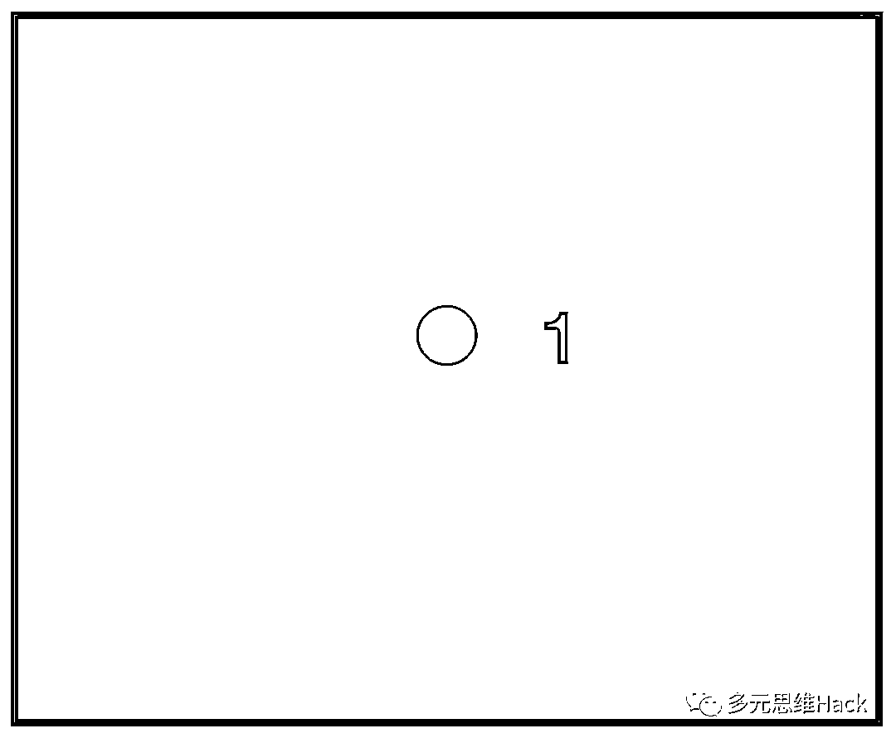

学到2个知识，收获3个知识，其中2个发生联结——

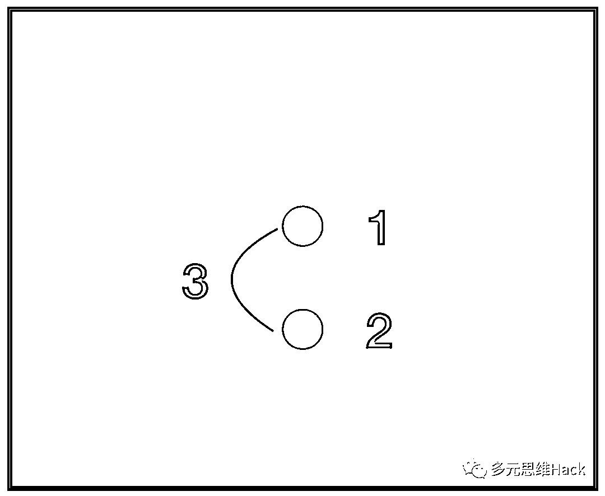

学到3个知识，收获7个知识，多个发生联结——

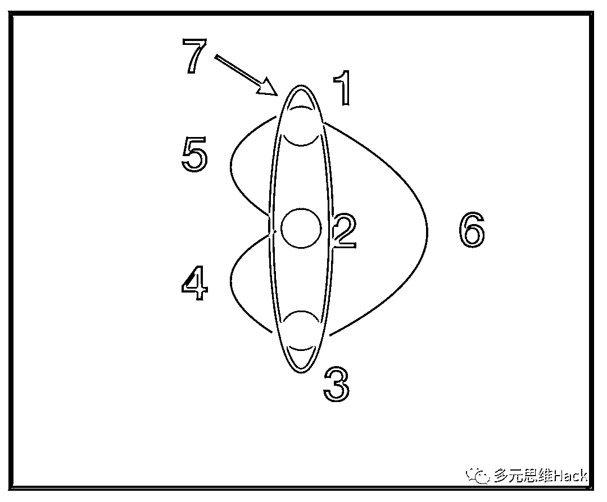

学到4个知识，收获15个知识……

理论上可以推导出：学到N个知识，能收获约N^2-1个知识。

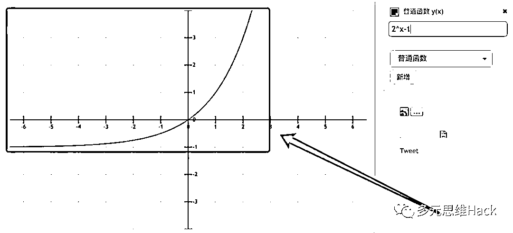

收获曲线和复利曲线形状几乎一致。

现实中不可能100%联结，但只要部分知识能联结，你的知识量就会大幅膨胀，产生突飞猛进的感觉。

刚开始感觉学不动，往往有两个原因：

（1）知识量太少，能联结的点太少

不是所有知识都能互相联结，掌握的知识越多，碰到熟悉点的概率越大。

广撒网，鱼自然多。如果学得慢，知识量少，联结就难产生。

（2）不够深入，缺乏联结能力

光有数量不够，还需要足够深度才能创造新联结。这点后面再讲。

更重要的是，真实世界里有价值的事，都需要多个知识组合完成。

做一张海报需要文案、用户视角、心理学、研究、模仿、沟通……

写一篇文章需要写作、阅读、思考、逻辑、心理学、学习力、用户视角、模仿……

做一门课需要写作、逻辑、模板、用户视角、学习力、设计、沟通、模仿……

单一知识解决不了真实问题。

当知识被联结起来并应用于生活解决问题时，你会切实感受到学习的回报，「突飞猛进」的感觉会更强烈。

刚开始进步慢，是因为知识量少、联结少。随着时间推移，知识增多、联结增多，按N^2-1趋势，你会明显感受到进步，并且能够解决真实问题，收获感进一步增强。

所以「前期慢，后期快」不是玄学，是必然。

看一张图：

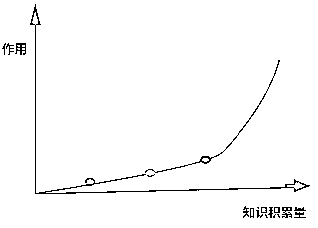

知识少且不联结，作用有限，像蓝点。

知识增多后开始联结，产生了一些效果，像绿点。

知识继续增多，达到复利拐点后，大量联结产生巨大效果，像红色区域。

有个客观规律：并非每个知识都能联结。拥有5个知识可能有2个联结，拥有10个可能有4个联结，拥有100个可能有40个联结。

知识越多，联结概率越大，作用越大。

不要因为暂时看不到效果就停下。只要持续学，总有一天积累足够，知识会自动融会贯通。

这就是知识的复利。

### （2）理解原理带来的触类旁通

前面说过，能联结知识，收获才更大。

怎么联结？除了增加知识量，还有理解背后的原理。只有懂原理，你才能把知识迁移到不同领域，实现联结。

看这张结构图：

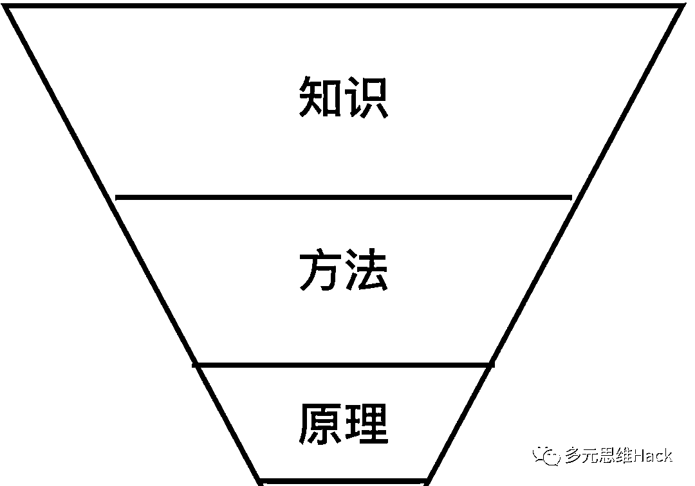

从上到下是不同领域知识的结构：

1 知识：概念、公式、理论等，各领域不同。

2 方法：写文章、裂变、设计海报等，部分方法可跨领域通用。

3 原理：从众、锚定效应、价格歧视等心理学、经济学原理，大部分可迁移到多个领域。

当你理解了A领域的某个原理，再学B领域时会产生「这个我好像见过」的感觉。

这就是触类旁通。

掌握A领域的原理，就能通向B领域的方法和知识，更容易把不同知识和方法联结起来，产生通汇贯通的感觉。

你有没有遇见过一种人：只在一个专业里深耕，却能对其他领域的事情张口就来，还说得头头是道？

一句话：他把自己那亩田里的底层规律看透了。这套规律挪到别处，依然管用。规律在手，跨领域迁移就是水到渠成的事。

我有个朋友叫涛哥，一直吃电商这碗饭。他完全是技术外行，可一次闲聊说到爬虫，他抛出的几个判断专业得让我吃惊。后来我琢磨过来了：他在那一行里泡了十几年，早就看穿生意的底层逻辑，这套逻辑搬到爬虫上一样好使。

所以，握住规律的人，自然懂得举一反三。

遗憾的是，能做到的人极少。

因为费劲。

表层知识天生好拿，扫一眼、听一耳朵就有了。但只有先把知识攒够，方法才会从中长出来；只有把方法吃透，背后的规律才会显形。这是一级一级往深处走的台阶，每一级都要花大力气。

想挖到规律的根，就得在一个领域里反复下探，投入大量时间去拆解、推敲、验证。

可惜多数人刚摸到一点皮毛，就急着去追新概念。毕竟学新东西轻松，还能立刻带来谈资——“我又啃完几本”“我又多了几个谈资”。相比费神的深度思考，这种马上兑现的快感显然更诱人。

这也是许多人长年苦学、却始终原地踏步的真相。

试着放慢步子，在关键处多深挖一层，规律自然浮出水面。掌握的规律越多，知识间的暗线就越密，那种“突然贯通”的爽感也会来得越来越频繁。

## 2 能力会自己滚雪球

### （1）先说说我自己这三年

我曾经是标准的码农一枚，整天就知道写程序。写作？不会。产品？不懂。营销？没碰过。商业？更是一窍不通。

2017年，我进入「赚钱有术」。接下来的剧本，和前面写的一模一样——

头一年，翻开十个帖子，九个像天书。

第二年，能看懂的依然只有两成。

第三年，突然就像打通了任督二脉，全都懂了。

那份通透来得莫名其妙，当时我完全不知道发生了什么。直到最近写复盘，我才理出头绪：第三年，我第一次体会到知识联网的威力，于是开始有意识地强化这件事。

我当时还把这个感受讲给龙哥听，聊天记录还在——

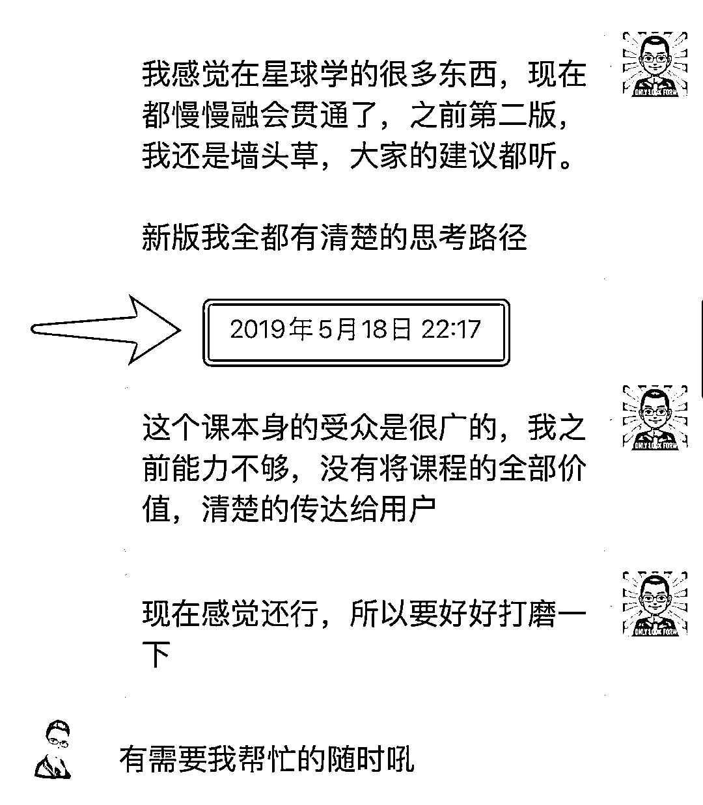

那时只是模模糊糊的直觉，如今回头看，我的方向没错。

2019年，我拿到了十颗龙珠，全靠分享帖子赚来的。那年很多老朋友都说，明白像坐了火箭。说白了，我已经冲进复利曲线的陡升段。

有人觉得三年太久。其实不然。我之所以花了三年，是因为前两年压根没想通这个理儿，大多数知识都在浅尝辄止；第三年隐约摸到门道，才真正甩开膀子干。

换成现在，面对任何陌生领域，我都有信心在1到3个月内吃透并做出成绩。因为我已经从几个领域里抽出了底层规律，拿去旁通其他领域，轻车熟路。

所以，哪怕你现在一无所有，只要照做，不出一年也能修炼成高手，开始赚钱。

### （2）从一门课看能力的滚雪球

再说我那门数据采集课程。它前后出了三版，2019年迭代到第四版。做课这个动作本身，就在不断抬高我的能力水位。开课前，产品、运营、营销对我而言全是盲区。

第一版，我边做边学，拿自己开刀。

第二版，我勉强把这些技能往课里装。

第三版，我已经用得得心应手。

第四版，我敢说：新课质量会比第三版整整强一个段位，用户规模也能压过前三版的总和。因为前三轮的沉淀，加上社群里几百次答疑、文案一改再改，用户、产品、营销这三件事在我脑子里早就换了模样。

就像这张图展示的：

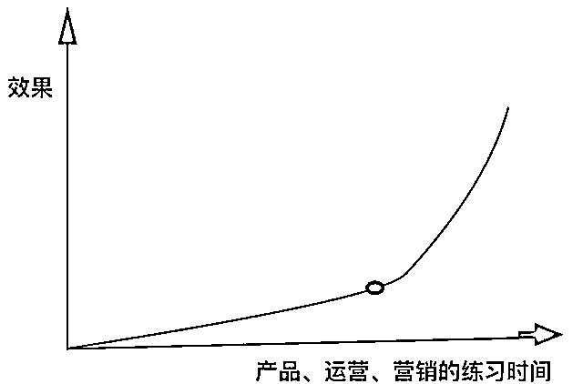

练得够久，技能就迎来了复利曲线的拐点，此后释放的能量会远超从前。以后再开发别的产品，我也不是从零起步，而是直接从第四版的高度继续往上走。

后来我做星球、写公号、组社群、做CPS带货，样样都顺。靠的全是前面攒下的本钱。

能力就是这么滚雪球的。

# 4 让赚钱也产生复利

知识会复利，能力也会复利，这两样东西，是长期成长的双引擎。反过来讲，任何事做完了，人却没变强，那它就不值得碰。

再说一次那个关键论断：一旦你跨过复利的临界点，收益就会冲天而起，比此前多年的总和还要多。

再看这张图：

把复利装进脑子后，再看这个圈子的干货、再去参加实战，你的眼光会整个换掉。过去只盯一个指标：能不能马上变现？能就学，不能就丢。现在会多想一步：它有没有加深我对某行的认知？有没有让我更懂流量、更懂用户、更懂平台、更懂商业？

如果有，那它就是在给未来的新赛道储备弹药。下一仗，一定比上一仗打得漂亮。

出海实战也是这样。一趟下来，你能看清整条赛道的轮廓，弄明白什么样的内容会爆，瞧见别人怎么从泥坑里爬出来，也照出自己的短板和盲区。再出发时，赢的把握自然更大。

所有读过的文字、琢磨过的问题、踩过的坑、写下的复盘，终会融进你的认知和能力里。

假设你的赚钱功底初始为0。认真吃透一篇好帖、完整打完一场实战，功底变成10。十篇帖子、三趟实战，变成30。五十篇帖子、六趟实战，变成70。等积累冲破临界点，变化会自己冒出来——

以前摸不透的平台，现在如数家珍；以前挤不出来的笔记，现在一气呵成；以前束手无策的难题，现在检索、思考、尝试，三下五除二解决；以前开不了口的销售，现在几句话就讲清价值、完成成交。

所有漂亮成果，都会在积累到位之后自行涌现。

复利，就是这个意思。

要是你盼着未来九十天、半年、乃至一整年，能在收入和能力上来一次大跨越，请记牢下面三句话：

第一，复利是客观规律，它从不对任何人偏心。

第二，一旦你打心底认下“复利”二字，迟早会成为顶尖高手。

第三，坚持做让你持续变强的事，复利的果子才会自动掉进你怀里。

希望你读完，能把“复利、时间、坚持、积累”这八个字牢牢种进心里，从今天起学得更投入、练得更扎实。

总有一天，你会练就一身独立在市场里赚钱、并且能一直赚下去的本领。今天流的每滴汗，日后都会变成你脚下的一块砖。

* * *

# 文末：我的历史介绍~

我叫明白，赚钱有术 8 期老圈友，星球编号 20。

干过技术，目前自己创业，带一个成长社群《日新月异俱乐部》。

下面是我这些年在赚钱留下的 28 篇精华帖合集，算是一条成长路线图，有兴趣的可以点开看看——

2024年（x1）

1.  《详解：写作和赚钱的 4 个关系！看完你一定会忍不住想开始写！》 https://t.zsxq.com/192OLDlds

1.  《7 年赚钱拉新 1100 +，我只做对了一件事》https://t.zsxq.com/19SqL7McC

1.  《赚钱急于求成的心态，该如何破除？》https://t.zsxq.com/wD6k5

1.  《如何借鉴其他行业经验拓展赚钱思路》https://t.zsxq.com/3wd8r

1.  《参加航海实战，如何让自己每天都有正反馈？》https://t.zsxq.com/9e2ns

1.  《当思考成为习惯，赚钱会更容易》https://t.zsxq.com/19vgy7kcp

2023年（x1）

1.  《身体残疾卧床 3 年，我在人生最低谷加入赚钱有术，有哪些成长？》 https://t.zsxq.com/19KWDvzz0

2021年（x3）

1.  《复盘 | 龙哥 3 年前的帖子，帮我每月被动收入 1 万块》 https://t.zsxq.com/19jaotwbv

1.  《嘉宾问答|“想去更好的公司，我该如何利用好时间？”》https://t.zsxq.com/1952Q3a92

1.  《2883 人向朋友介绍赚钱有术时，说的最多是 16 个词！》https://t.zsxq.com/19MYWwvCl

2020年（x6）

1.  《产品想要获得更大收益，应该不断向用户的真实需求靠近》 https://t.zsxq.com/19kQ7NILy

1.  《 我的2019：普通人如何培养自己的用户视角？》https://t.zsxq.com/19fyFdZRL

1.  《如何通过分析成功案例，帮自己建立赚钱清单》 https://t.zsxq.com/19FNjtIjB

1.  《思路详解：如何为某个细分领域用户提供产品，并赚钱》 https://t.zsxq.com/19qoI1QQB

1.  《学习和赚钱是什么关系？》https://t.zsxq.com/19uQcuMzJ

1.  《5000 字深度拆解 | Manchuan 公众号 2 个月涨粉百万，普通人如何复制？》 https://t.zsxq.com/19cD1keUB

2019年（x8）

1.  《在赚钱有术，普通人如何从 0 到 1，培养赚钱思维》 https://t.zsxq.com/19rA0kWrD

1.  《赚钱有术第 3 期，我是如果做到邀请 245 个用户的？》 https://t.zsxq.com/1968tlTAx

1.  《公众号和抖音之间的赚钱机会》https://t.zsxq.com/19OfzDckK

1.  《可复制，零门槛 | 如何借别人的流量，打造一个稳定的被动收入系统》 https://t.zsxq.com/19sVRn6Yx

1.  《做自己擅长的事，把技能树打通，然后再去赚钱》https://t.zsxq.com/19evWC1Xl

1.  《信息整合：一个可复用，低门槛的成熟商业模式》 https://t.zsxq.com/192zoSooT

1.  《产品名字，只有一个目的：降低用户认知成本》https://t.zsxq.com/19QUBrDOT

1.  《数据是需求的抽象化 | 帮你快速找到 100 个赚钱思路 》 https://t.zsxq.com/19QrIpsuC

2018年（x3）

1.  《分享一下，抓取其他微信号的方式，而且是精准粉》 https://t.zsxq.com/19sKQT9bF

1.  《如何几乎零成本做到1w多付费学员？》 https://t.zsxq.com/198XWAGhV

1.  《36 个小而美赚钱项目之一：蛋黄酥白皮书》 https://t.zsxq.com/19G4PKUXr

2017年（x2）

1.  《一个零成本，为公众号增粉，并高转化率为付费社群，进而再次付费转化加入小密圈的案例》 https://t.zsxq.com/19WJ8NILt

1.  《一款软件，webscraper，帮助非技术领域的朋友，做到爬虫可以做的事情》 https://t.zsxq.com/19RSl40n5