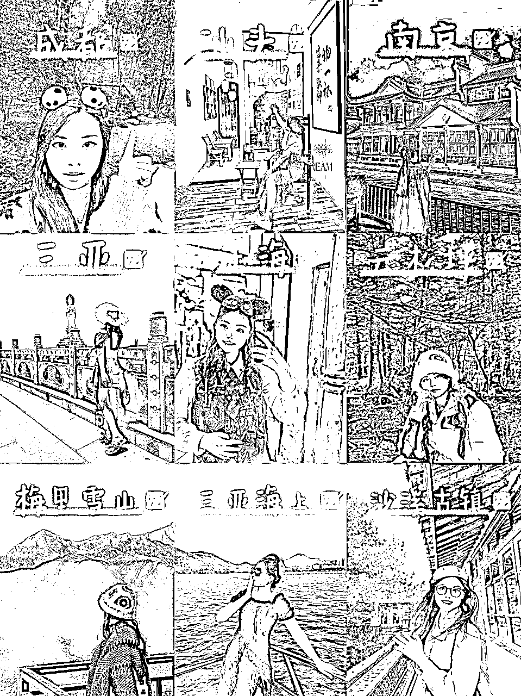
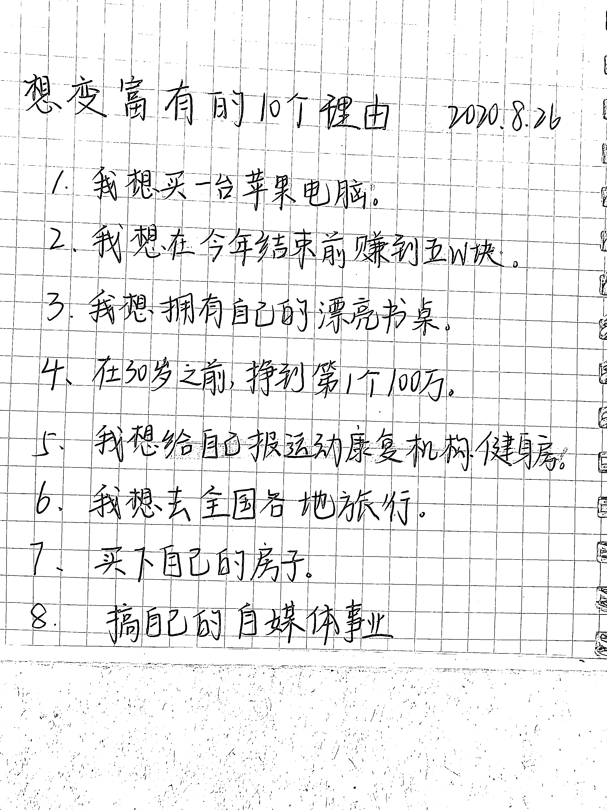
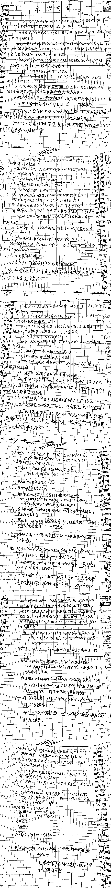
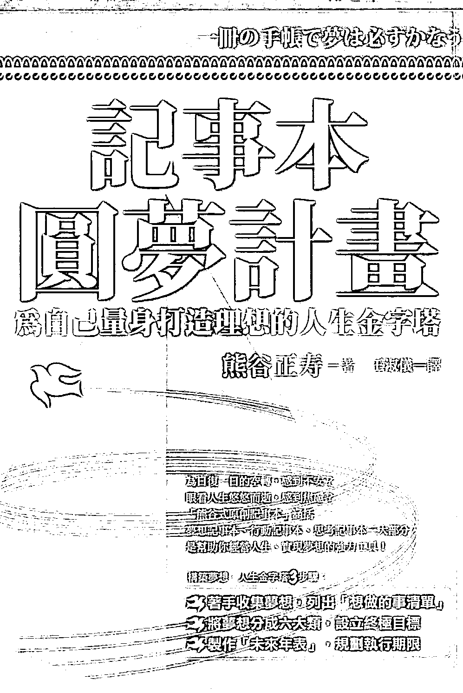
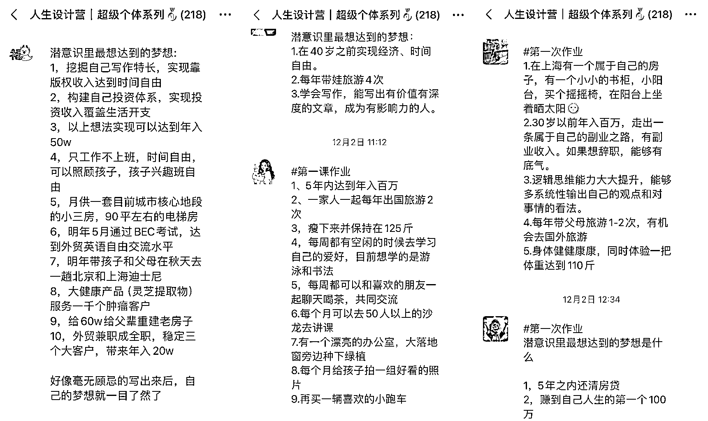
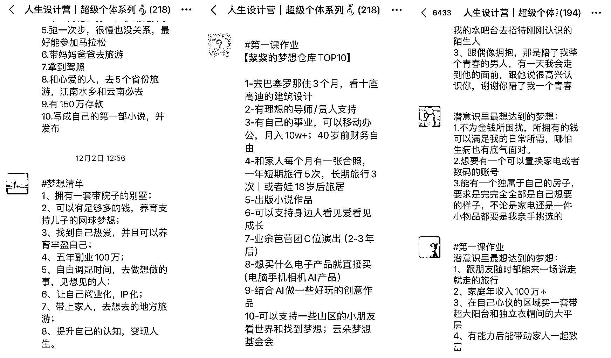
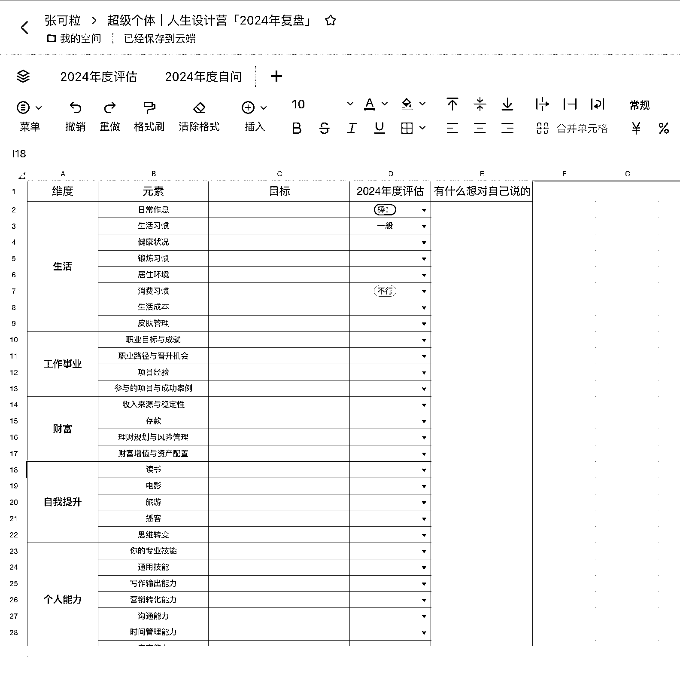
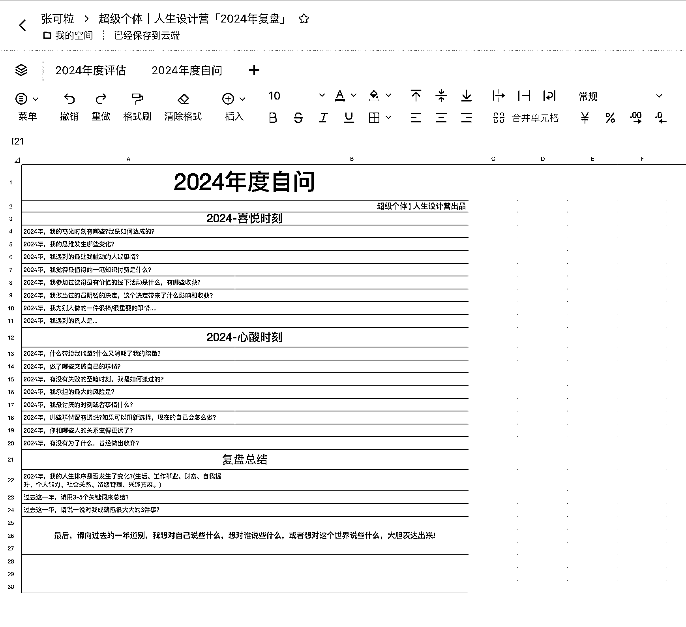
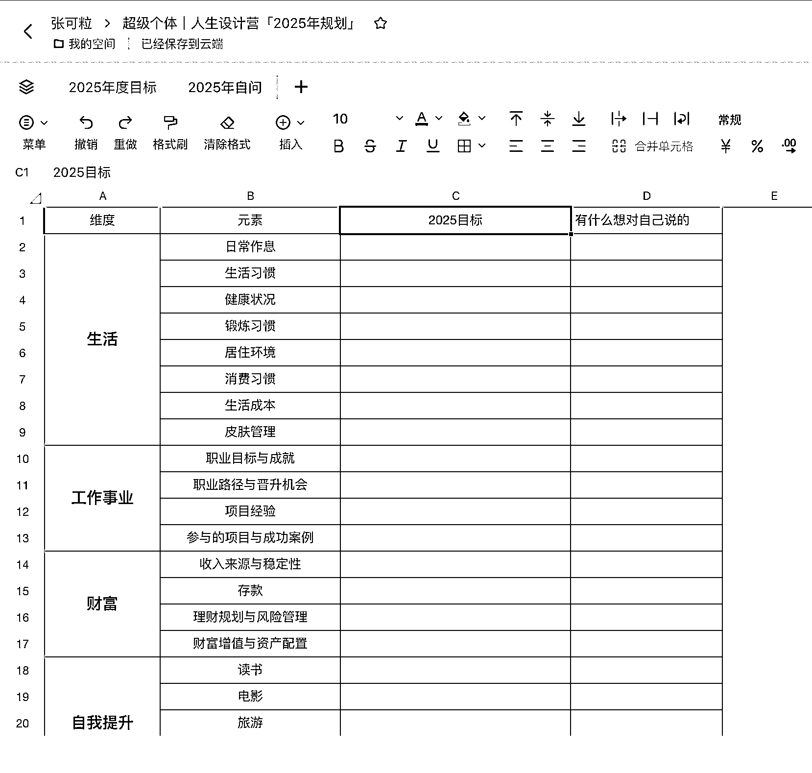
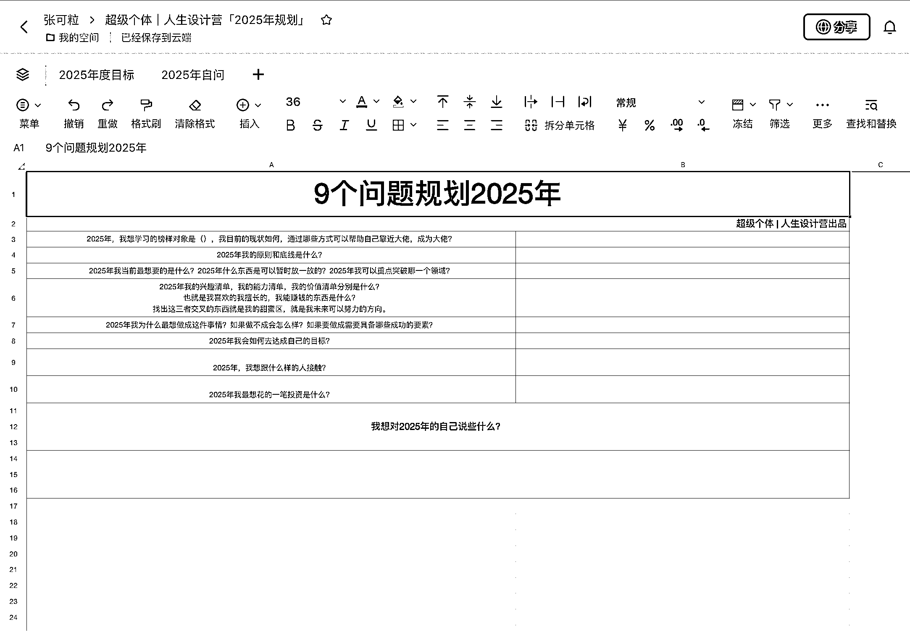

# 普通人如何用「人生设计」思维，彻底改写你的人生命运？（喂饭版）
作者：龙哥

如果你也曾觉得命运像一副烂牌，怎么打都看不到希望，那今天这篇文章，或许能给你一点完全不同的思路。

我不是什么天才，也不是含着金汤匙出生的人。27 岁之前，我的人生关键词几乎是“灰暗”“挫败”“迷茫”的代名词。出身福建山村的普通家庭，初中被欺负过，高中早恋影响过学业，大学又被排挤过，毕业后碰上失恋、工作不顺、身体出毛病……说实话，那时候我真的以为这辈子就这么平庸下去了。

但后来，命运硬生生被我掰了过来。27 岁这年，我存下了 200 多万，办了梦想中的海边草坪婚礼，全网有 20 万粉丝，过上了边旅行边工作的自由生活。

很多人问我到底做对了什么？我反复回想这些年做的每一个决定，终于想明白了——我一直在用一套自己都没意识到的方法论，给自己“重新导演”人生。

这个方法，我把它叫做「人生设计」思维。

你可能会觉得，这不就是鸡汤吗？我当初也这么想。但当我真的开始把它落地执行，生活发生了翻天覆地的变化。

举个最典型的例子。谈了六年的男朋友背叛了我，故事的上半场是狗血悲剧。但下半场怎么演，导演说了算。我选择离开、选择不再纠缠、选择把精力全部放在搞钱和成长上。结果呢？四年后，我过上了有钱有爱有闲的日子。

你看，坏事已经发生，你改变不了开头，但你可以重新定义剧情走向。你是自己人生的导演，你拥有让坏事逆袭成好事的权利。

传统的职业规划，是“找到最适合自己的选项，然后努力做成”。而人生设计的思维是：重新定义问题，给自己尽可能多的选项，先选一个快速尝试，不行再换，直到跑通。

前者是造工程，后者是做设计。你想要哪一种？

我 27 岁那年，终于想通了这个问题。我不愿意再走那条“毕业-打工-结婚-生娃-再帮孩子铺路”的流水线人生。我选择跳出来，成为一名自由职业者。从投稿写作开始，到做知乎好物、做知识付费、做自媒体教练，一步步从月入 4000 到月入 10 万，再到七位数存款。我最大的改变，是开始相信：命运可以靠自己设计和创造。

那具体怎么做呢？我总结了三种非常实用的路径，你完全可以拿来就用。

第一种，记事本圆梦计划。这不是我发明的，是日本作家熊谷正寿的方法。他 21 岁在记事本上写下梦想和计划，15 年后公司成功上市。他原本只是个高中辍学的穷小子，靠一本记事本彻底翻了盘。我自己是受《小狗钱钱》启发，写下变富有的 10 个理由，然后一步一步达成。后来我和一位环游世界的摄影师朋友交流，发现她用的是《记事本圆梦计划》，我们殊途同归。于是我们决定一起做《人生设计营》，因为我们都相信：人生可以被设计，梦想可以实现。

第二种，奥德赛计划。这个词来自斯坦福大学那门著名的《人生设计课》。核心方法是为未来五年设计三种完全不同的人生版本：第一个是你现在正在做的事（或者你已有的想法）；第二个是如果你现在的工作突然没了，你想去做什么；第三个是抛开金钱和面子，你真正想过的生活。很多人一辈子只敢沿着一条路走，害怕失败，于是连开始都不敢。但当你给自己设计出多个版本，你就不会害怕某条路走不通。人生本来就是一场未知的探险，你完全有能力拥有不止一种人生。

第三种，年度复盘和年度规划。很多人焦虑迷茫，不是因为没能力，而是因为从没坐下来好好“和自己对话”。花一两天时间，认真梳理过去一年的高光时刻、心酸时刻、思维变化、贵人、遗憾，再问自己九个问题，规划下一年的方向、原则、甜蜜区、想接触的人、想做的投资……这一套做完，你会清晰地看到自己该往哪里发力。我把自己用到的复盘模板和规划模板都整理出来了，大家可以自建副本使用，非常方便。

关于“最适合”这件事，我很喜欢古典老师在《人生设计课》序言里的一句话：“‘最适合’本身就是一个坑，因为‘最’是极限词，而‘适合’是动词。”随着你不断成长，最适合的答案也在不断变化。真正好的人生状态，不是找到一个唯一答案，而是“我发现了很多适合自己的选择，而且决定从某个选择开始先试试看”。

所以，我现在也不再死磕一个方向。为了五年后赚到一千万，我给自己写了三个人生剧本：一个是百万粉丝家居博主，一个是做知识服务的教育公司，一个是孵化达人 MCN。这三个方向有的已经开始尝试，有的需要慢慢积累。但最重要的是——我会先去做，带着野心去做，不断升级能力，不断向上攀登。

如果你也受够了现在的生活，不甘心一辈子碌碌无为，不妨从今天开始，把自己当成一部电影的导演。你定不了开局，但你可以决定下一幕怎么演。

你的余生，还不算晚。摩西奶奶 80 岁还能拿起画笔开启新的人生，你才几岁？大器晚成也好，年少有为也好，最重要的是：开始设计你的人生，别再让它随波逐流。

毕竟，你的人生如果连自己都不去设计，那还能指望谁呢？

我对自己能赚到一千万这件事，笃定到像已经发生了一样。这份笃定不是凭空的自嗨，而是我用**「人生设计思维」**和**「吸引力法则」**一步步推演出来的结果。

《小狗钱钱》里那句话我一直记着：你挣的那一份钱里，最多只有一半是靠你干活的体力，剩下的那一半，全看你脑子里有没有想法，以及有没有胆量把这个想法落地。

回头看这几年，我是怎么从零开始把赚钱的路子一层层升级，最后把几百万做出来的。说实话，跟天赋没关系，跟背景也没关系。不是我特别厉害，而是我的野心和想要的东西，逼着我的能力跟着往上爬。

我不算聪明的料，学历也普通，没有靠家里，也没有人带我。我所有的东西，都是自己亲手一点点打出来的。

一路走来，我给自己定的规矩很简单：

**能力不够就去学，学会了就立刻去干，赚到钱后就用钱去投入，再用投入去赚钱，去看更大的世界，让钱自己滚雪球。**

所以说，成功当然会看起点，但更看的是你内心有没有一个坚定的信念。

一个人真正的底牌，并不是出生、学历、长相，或是手里现在有多少存款。当然有这些更好，没有也无所谓，它并不会阻挡你去打造想要的人生。

强者心里都明白这一点。归根结底，成功拼的是决心、信念，和那种不撞南墙不回头的气势。

当你某一天真正下定决心，非要成功不可、一定要成功不可的那一刻，成功也就真的开始了。

这就是普通人逆袭的底气，看起来简单，做起来却一点也不容易。

感谢观看，我是张可粒，一人公司创业者，专注自媒体IP孵化和新个体创业，连续年入7位数，可粒等候你的链接。

* * *

评论区：

郑自律 : 太棒啦，谢谢粒子的分享

戴智慧 : 可粒姐牛逼，分享太赞啦

刘海 : 可粒姐牛逼，分享太赞啦

Mr Leo : 鸡汤多了点，具体操作的 sop 有没有呢。

张可粒 : 不太会写，你教一下

天气 : 2025 年，希望向你看齐，你的当下的状态就是我理想中的状态

谦之 : 仔细思考了一下，我自己确实现在也在记日记，记录做好了什么没做好什么，方法有些类似，只是和小狗钱钱的方法比，我的不够完整，以后抽空会去看看这本书，可以细化一下自己的日记。

好奇先生 : 值得学习。