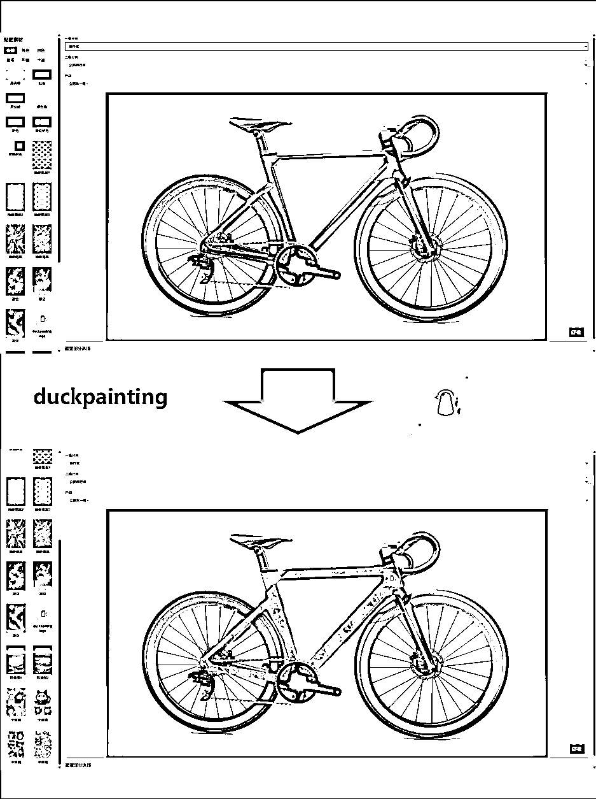
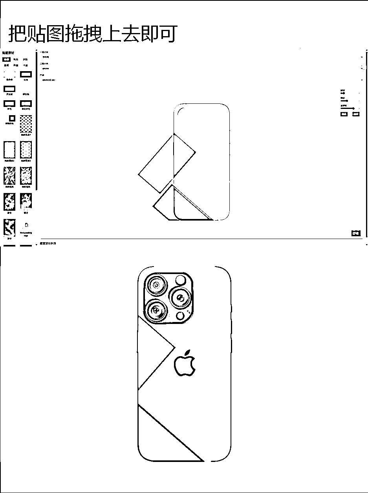
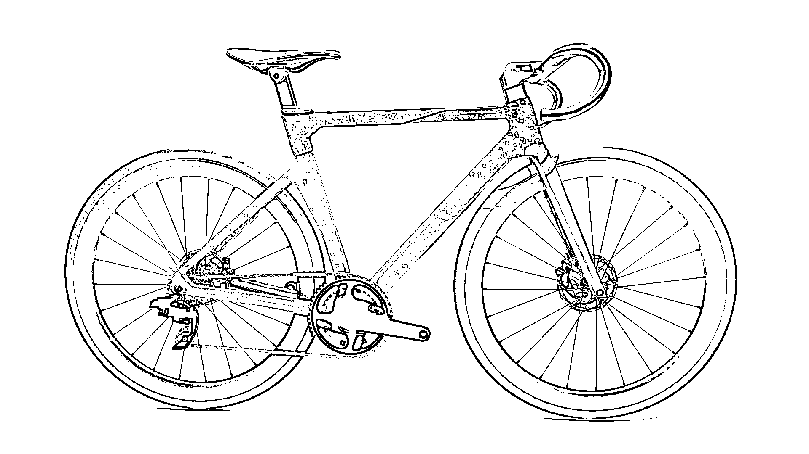
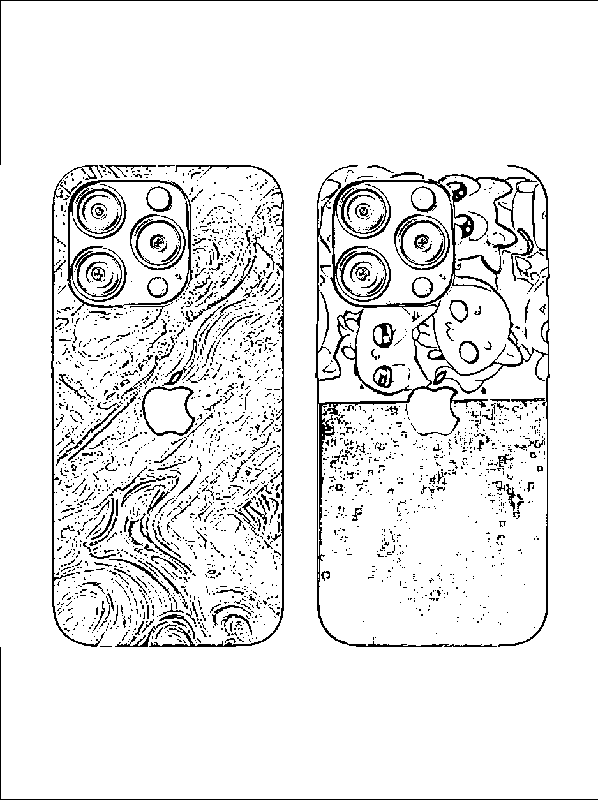

# 从零到上线：我用两周做出了第一个全栈网站

## 从零到一：人生第一个全栈项目终于上线了

作者：阿威
日期：2024-12-24

两周前，我对 React、Next.js、PostgreSQL、FastAPI 这些词完全陌生，更别说把一个全栈应用部署到服务器上。现在，我已经亲手把第一个全栈作品推上线了。访问量虽然只有个位数，但对我来说，这一步的意义远大于结果。

整个过程更像是一次自学摸索。最开始用 v0 快速搭出前端界面雏形，接着用 Cursor 写后端逻辑，遇到技术卡点就和 Claude AI 反复讨论。项目在本地跑通后，进入了最费时的部署环节：买域名、租云服务器、整套架构用 Docker 容器化。说实话，用 Supabase 管理数据库或者直接交给 Netlify 部署会省事得多，但我就是想先吃透自己部署的流程和掌控感，为以后更复杂的业务打基础。部署花掉最多时间，却也收获最深。

这个思路要感谢刘小排老师的文章启发。先把核心功能跑通，其他的都往后放。用户登录、图片 CDN 这类功能全部砍掉，先让主流程能用起来。实战中确实碰到不少坑，但在 AI 工具的辅助下，问题解决的难度被拉低了很多。总结下来，如果不是特别有必要，真的别一上来就自己啃服务器，太折磨人了。像来来老师提到的那样，直接上 Netlify 这类平台，省心省力很多。

我的这个小作品地址是：[`duckpainting.com`](https://duckpainting.com/)，目前只能在电脑端正常浏览，移动端自适应还没做。里面就放了两个模板，一个自行车、一个手机壳，操作也简单：把图片拖进去，调好位置，点击确认就行。

这次经历也要感谢📕航海活动的陪伴。木木教练@李子木、领队@十月、志愿者星星@星星子，以及群里一直分享经验的大佬们。虽然没能把所有任务都完成，但我坚持输出了几篇关于 Cursor 开发的图文到📕，意外涨了几十个粉丝，也慢慢找到了创作手感。现在做内容前，我会先找对标参考再动手，不再过度纠结，先发出来看反馈。第一次航海的目标算是达成，就是完整走下来。

当时没报名 Cursor 的航海团，本来想着看手册就能上手，现在想想，如果早点加入，大概能少走不少弯路。

网站截图：

* * *

评论区：

振 : 飞书打不开

阿威 : 哦哦忘记设置了[衰]谢谢提醒

龙哥 : 贴一下我的作品的访问地址：

，这个地方的域名后多加了一个空格[`duckpainting.com/`](https://duckpainting.com/)

阿威 : 我马上修改一下，都忘了检查[偷笑]粗心大意了，谢谢老大

星星✨ : 👍🏻👍🏻不是是我们的威，真厉害

阿威 : 嘿嘿[呲牙]还需努力