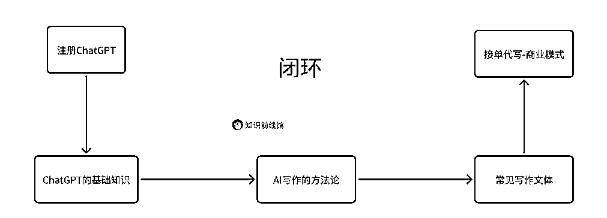

嘿，各位屏幕前的小伙伴们，我是馆主。今天是2024年的最后一篇项目拆解，想和大家聊聊AI写作接单代写这个商业模式。

先说清楚，到底什么是AI写作？这几年人工智能大爆发，市面上的AI工具层出不穷，涉及绘画、视频、编程等很多领域，其中对普通人最友好的，非AI写作莫属。如果你本来就是文字高手，AI能帮你把效率再拉高一个台阶；如果你刚入门，没什么写作经验，AI也能帮你把作品质量托起来。说白了，它就是你随叫随到的智能写作小助理。

那“接单代写”又是什么意思呢？很简单，就是到闲鱼、淘宝、微信这些平台上去“接活儿”，按别人的要求帮他们完成文字内容，从而赚钱。举个例子：眼看到年底了，小明被老板布置了年终报告，实在不想动笔，就挂到闲鱼上找人代写，愿意付佣金。而我正好看到这个需求，接下来后加了他微信，按他的要求把报告搞定，佣金自然也就到手了。这个场景就是典型的接单代写。

当然，接单代写只是AI写作变现的一个切入点。事实上，已经有不少人把它用在自媒体创作、公文处理、商业策划等方向上，大大提升了工作效率。

整体的项目路径是这样的：

文章目录先给大家看一下：一、注册ChatGPT；二、ChatGPT的基础知识；三、AI写作方法论；四、常见写作文体；五、商业模式（变现）；六、小结。全文约五千字，干货很完整，完整版我放在了飞书链接里：https://fcnzyo4fd2j9.feishu.cn/wiki/TC5Ww7FshiMUrzk7SZgcRIDUnPg?from=from_copylink

顺便回应一下评论区：有朋友说“注册好像有点麻烦”。我这次已经是保姆级拆解了，按步骤走就行。而且只要你把第一步打通，后面不仅能上ChatGPT，其他外网资源也都能正常访问了。