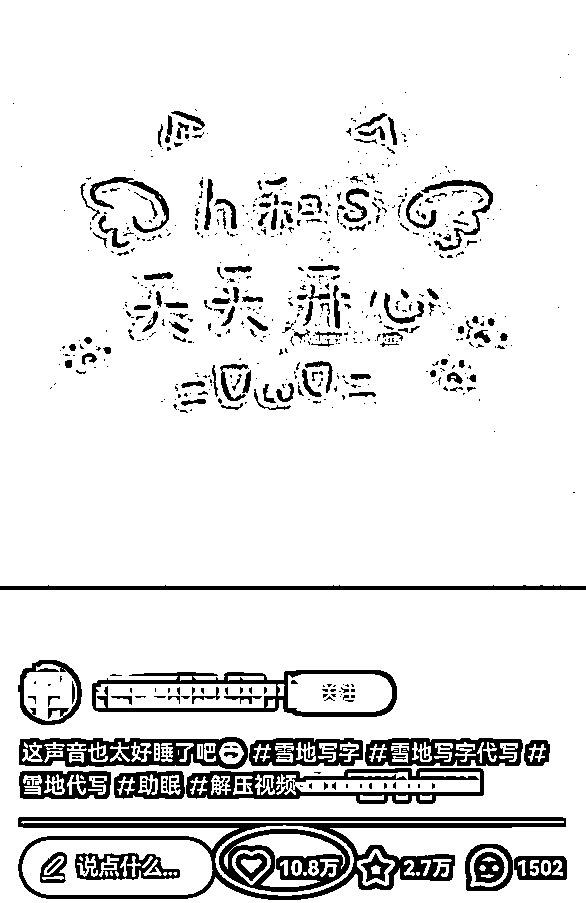
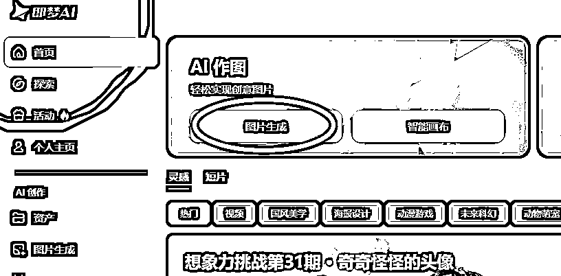
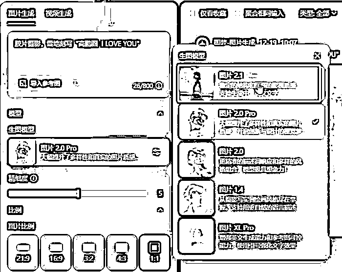
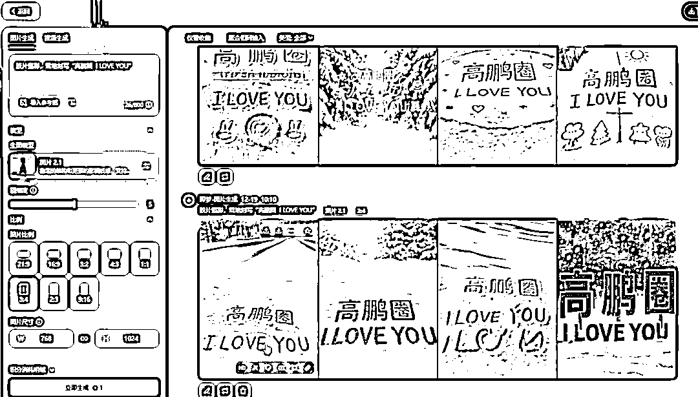
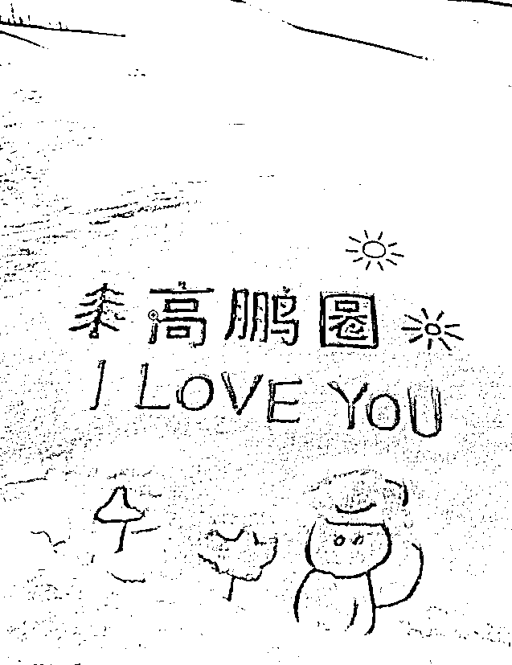
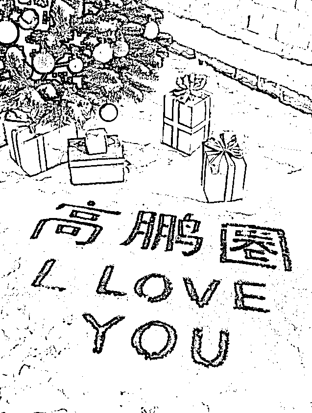
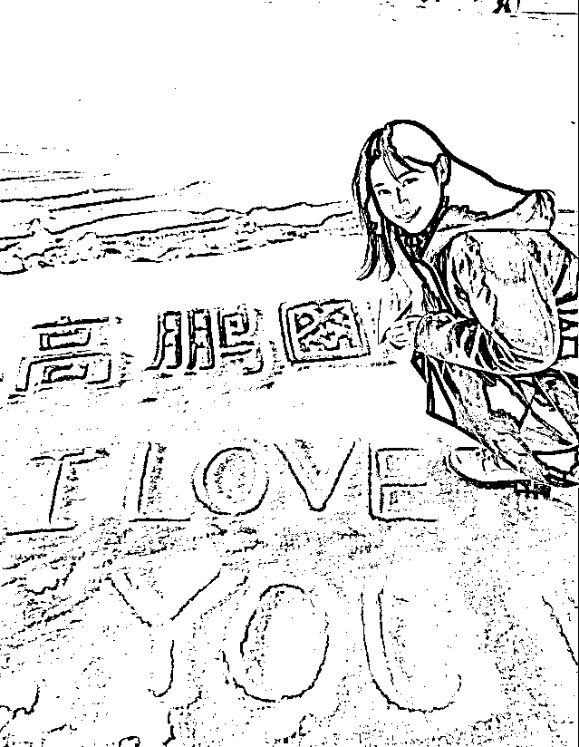
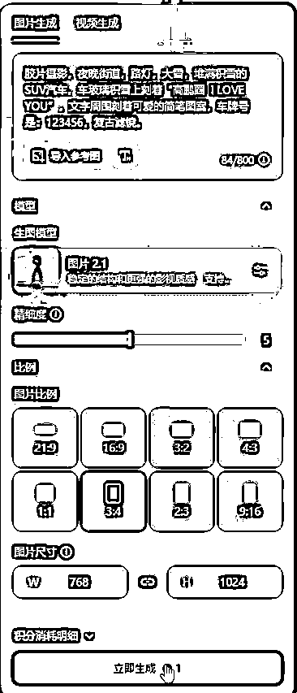
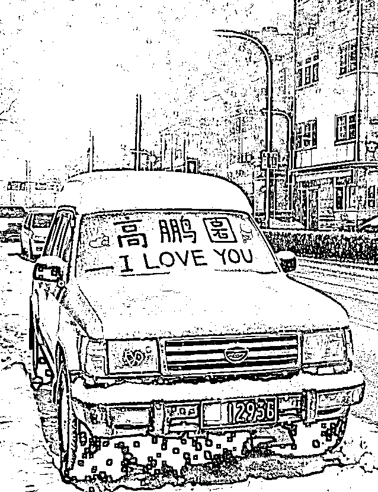

# 一条雪地字帖笔记爆到十万赞，这个 AI 复刻手法也能拿去用

各位读者，笔者 高鹏 再次来聊一个正在走热的内容思路。

最近在该内容平台上出现了一条在白雪覆盖的地面上写字的小视频，点赞量直接破十万。不少人留言说自家所在区域根本不下雪，这种素材从哪来？

其实并不需要等到真实降雪，通过现阶段的生成式图像技术就能把这个概念完美落地，而且场景自由度更高。

本次演示采用的生成平台是即梦，操作入口在首页的图像创作模块。

有伙伴表示本地没有雪景，那要怎么制作同款呢？

思路很简洁，借助目前能力很强的 AI 就可以做出更理想的雪中留字效果。

使用的服务是 即梦 AI，进入主界面后点选图文合成的功能。

进入工作区后，首先把模型切换为 图片 2.1 这个版本。

随后在提示区输入画面指令，注意开头一定要带上“胶片摄影”这类风格限定词。

后面再描述雪面上的文字内容，例如我写的就是“高鹏圈 ILOVE YOU”。确定画面宽高比之后，直接点击开始合成。

稍等片刻，系统会返回四张初稿，其中部分成片质量一般可以直接舍弃，挑选比较满意的那张即可；若四张都不达标，就再跑一次。

不过刚才那段指令过於简单，合成出来的质感也比较普通。

我们可以把指令升级一下，在尾部追加“四周点缀着俏皮的小手绘”，是不是画面立刻多了点装饰感，整体更活泼了。

想象空间完全可以继续放大，比方说在指令里加上“旁边有一棵圣诞树，地面散落着礼品盒”，看一下呈现效果。

再比如在画面里安排一位女生入镜，手上拿着小物件，构图瞬间丰富很多。

若想让成片更饱满，还可以加入更完整的环境描写。

例如 胶片摄影风格，傍晚的市街，路灯投射的光晕，纷纷扬扬的大雪，一辆被白雪覆盖的 SUV 停靠在路边，车窗上出现高鹏圈 I love you 字样，周边点缀着俏皮的小手绘，整体带点复古调色。

选好尺寸后按下立即合成。

这样一套完整的画面指令下去，最终成片的饱满度与细节层次明显提升。

所以只要肯发散联想，AI 完全能够把脑中的画面转化为真实可用的素材。

本次拆解到此结束。文中提到的生成服务与完整指令清单，我已经整理到云文档里了：https://svj4gxvm0v3.feishu.cn/docx/X7zcdK9FhoqHBMxt7hIc96VBnBd?from=from_copylink

笔者 高鹏，互联网项目拆解已有九年沉淀，这期是第701个可落地的案例拆解，更多玩法欢迎私信交流。

* * *

评论区提问：
元宝 : 这些生成工具是不是只能在电脑端使用？移动端效果是否不一样🤔