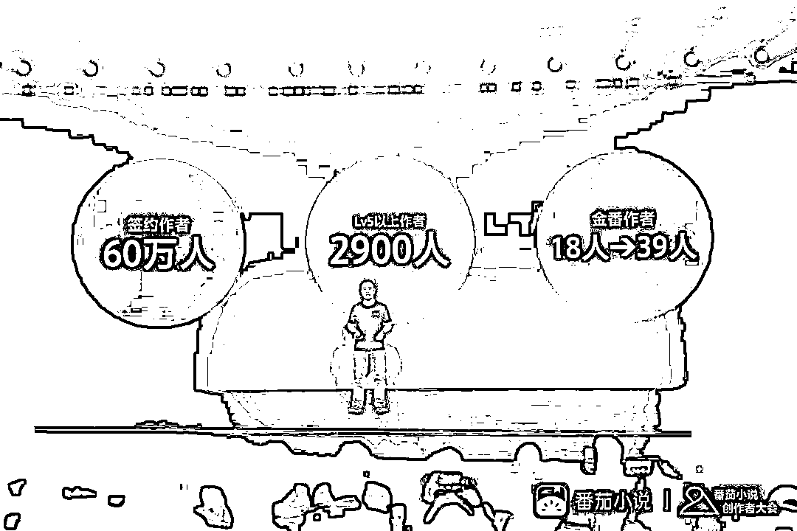

# 用 AI 写长篇小说，让写作变成一份能持续变现的手艺

> 原文：[`www.yuque.com/for_lazy/zhoubao/fyw75nguarcdft6g`](https://www.yuque.com/for_lazy/zhoubao/fyw75nguarcdft6g)

## 靠写小说慢慢累积财富，百万字长篇靠 AI 辅助也能做到月入过万

作者：盟主君
日期：2024-12-25

大家好，我是盟主君，一个 90 后，专注用 AI 做实战变现。

最近两个月，我们把两个方向都跑通了。11 月是借助百度百家做付费专栏，12 月则转向小说平台做短篇创作。两个赛道反馈都不错，现金流也起来了。

在深入研究网文生态后我发现，网络文学依然是个极具潜力的生意场。近期某头部平台公布了一组数据，很能说明问题：

截至 2024 年 10 月，平台上累计已有超过 50 万名写作者实现收入变现。过去一年里，9374 名作者年收入超过 3 万元，3228 名作者年收入突破 10 万元。

我最近也潜伏进了几个写长篇的头部作者交流群。群里的大神们或许达不到顶流作家的年入百万级别，但稳定日入 200 元以上是常态。对普通人而言，写作是一项可以长期经营的技能，而 AI 正好是这件事上最强的放大器，它能把效率拉高几十倍上百倍，把入门门槛降到最低。

先看看群友们晒出来的真实流水：

说实话，我自己也吃过纯手工写作的苦。早几年没有 AI 工具时，我硬生生花了三个月敲出 40 万字，那已经是我单人码字能承受的极限了。过程很煎熬，但也签约成功了，可最终收益微乎其微。那段时间让我觉得写作投入和回报严重失衡，太消耗人了。

两年时间过去，AI 写作彻底改变了局面。现在只要你会用对工具，一天写一万字完全不是问题，一天就能堆出一本书的量。

下面直接进入实操部分，我把长篇小说的 AI 写作流程整理好了。

#龙珠悬赏

详细方法我放在飞书文档里了，大家直接去看：

[`szxb4qbve7.feishu.cn/docx/B2xMdMgnZoCIZAxeNagcm5KInff?from=from_copylink`](https://szxb4qbve7.feishu.cn/docx/B2xMdMgnZoCIZAxeNagcm5KInff?from=from_copylink)

* * *

评论区：

一栗米范 : 你好，评论区那个就是示范使用的 AI 网站吗