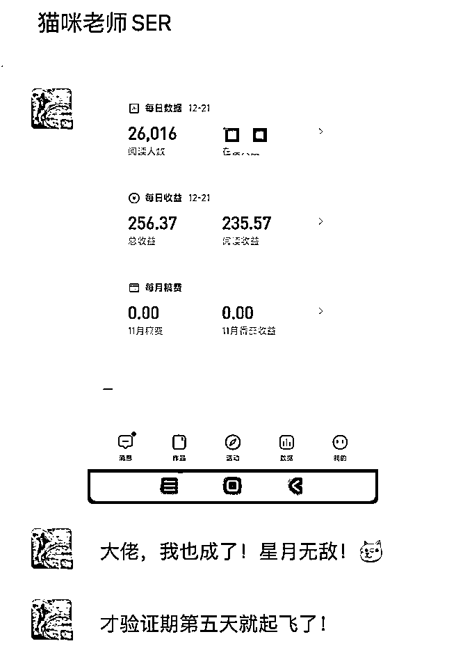
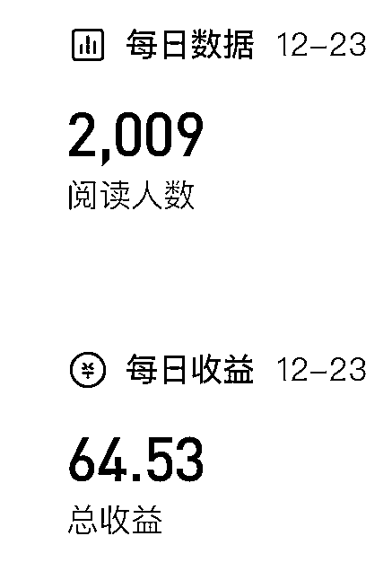

# AI写小说，普通人攒钱翻身的新路子

大家好，我是盟主君，一个90后，靠AI变现赚到了钱。

11月和12月，我接连跑通了两个项目：一个在百度百家号做付费专栏，一个在小说平台发短篇，收益都挺可观。

不过真正深入了解网文市场之后，我才发现自己还是低估了这座金矿。前阵子，某小说平台刚公布过一组数据：截至2024年10月，50万+作者累计从这个平台拿到了收入；过去12个月，年入超过3万的作者有9374位；年入10万以上的，也达到了3228人。

我后来又混进了一些长篇小说作者的交流群。那群人虽然比不上金字塔尖、年入百万的顶流写手，但每天进账200多块对他们来说只是常态。我一直觉得，写作是普通人可以做一辈子的事，无论时代怎么变。而AI的出现，就是这件事最大的杠杆——效率翻了几十倍上百倍，入门门槛也被彻底踩低了。

先看看群里晒出来的真实收入截图：

其实我自己也踩过长篇的坑。两年前，我花了整整3个月，全靠手敲，生生敲出了40万字。那会儿我的码字能力已经到顶了。最终虽然顺利签约，却没赚到多少钱。当时真想骂人：这投入产出比也太离谱了，写小说真是太累了。

但两年后的现在，AI已经把这整件事彻底改写。只要你把工具玩明白，一天一万字根本不叫事，甚至一天干出一本书也不是没有可能。

废话不多说，直接上干货：AI写长篇小说的完整玩法。

#龙珠悬赏

完整教程我放在飞书文档里了，大家点链接自行查看👇

[链接]

评论区：
一栗米范：你好，请问评论区里展示的就是那个AI网站吗？