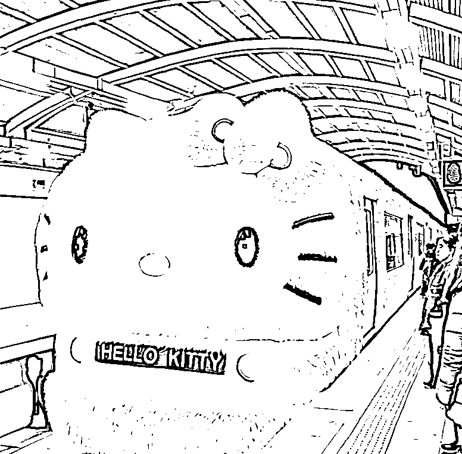
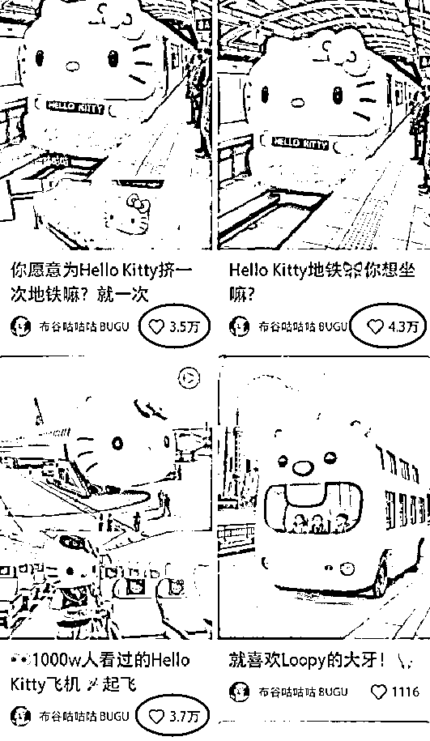
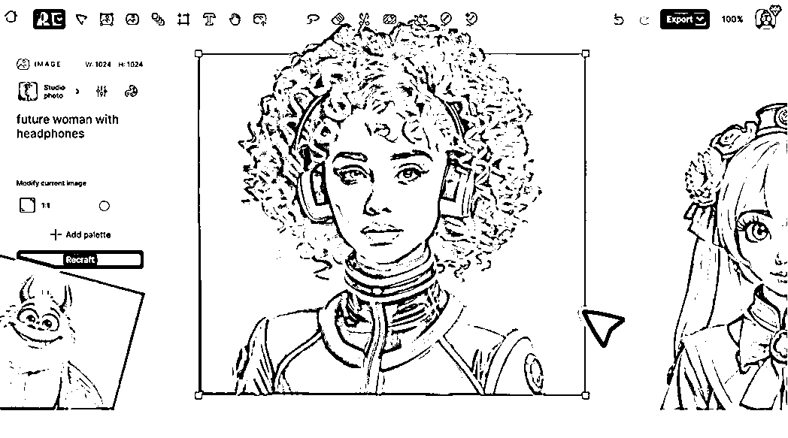
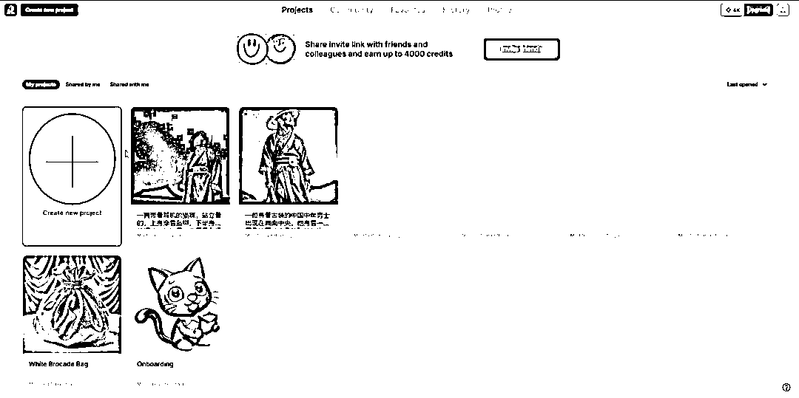
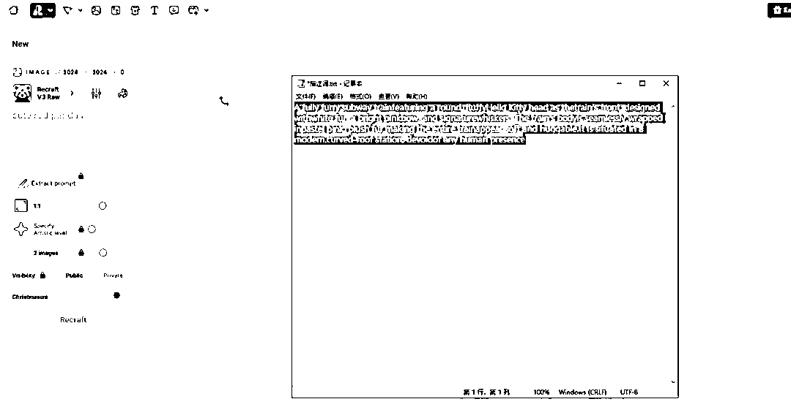
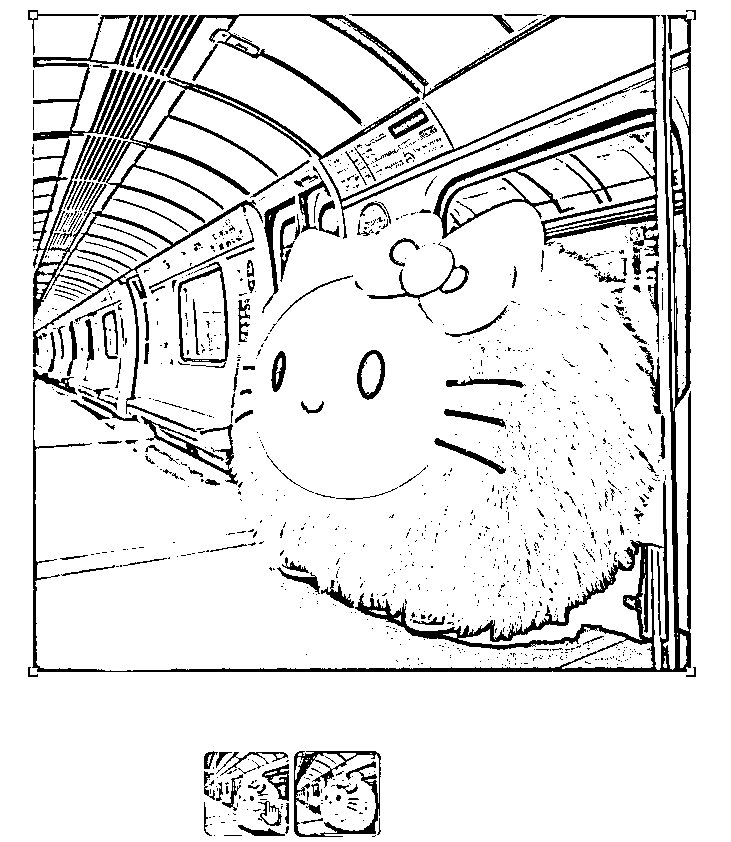
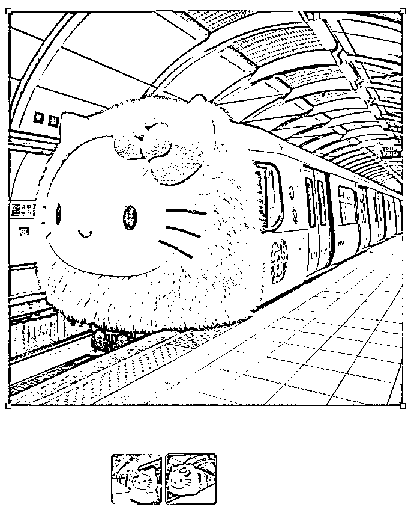
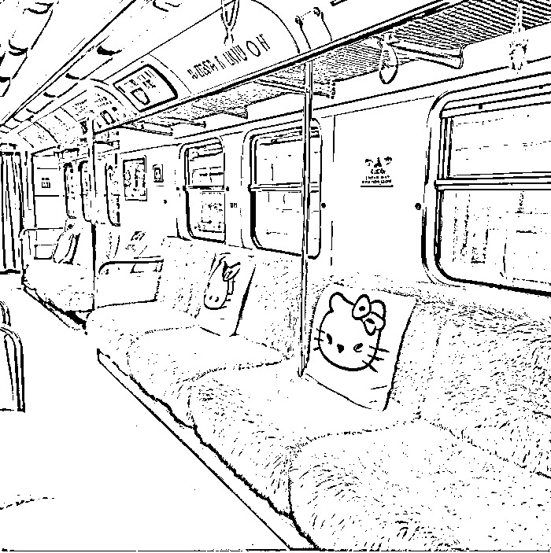
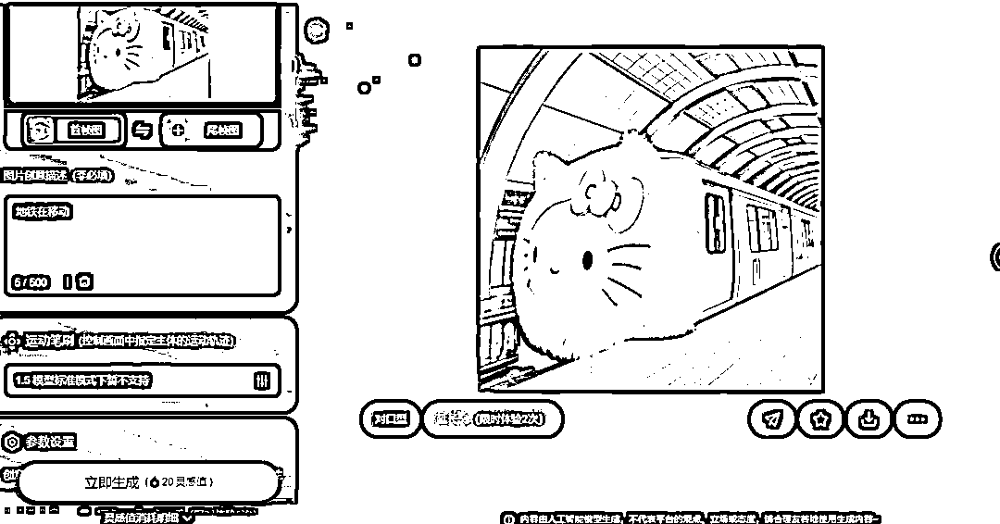

# AI 毛绒列车短视频爆火：两步做出可爱主题，新手也能轻松复刻
作者：龙哥

最近，AI 创作的毛绒列车短视频突然在各大平台刷屏。平时乘坐的地铁，被做成粉色凯蒂猫主题，车身像裹着一层绵软的毛绒面料，看上去又萌又治愈。

我还见过一位创作者，主页清一色都是这种风格的作品，数据相当亮眼。在以年轻女性用户为主的社区里，这种软萌造型天然容易引起好感。

这种效果不是贴几张贴纸那么简单，列车外壳、车窗、座椅等细节全都带有毛绒质感，整体完成度很高。

好消息是制作成本很低，整套流程几分钟内就能走完。关键就两步：先让 AI 画出一张理想的主题图，再把它变成动态短视频。

图片环节我用的是 Recraft。

视频环节用可灵。

打开 Recraft 之后，点击左侧的加号，新建一张画布。

在提示词栏中填入“列车外部拍摄效果”的描述，点一下绘制按钮。

第一次出图时，结果很可能给到车厢里的视角，并不是列车外观。不用改提示词，多试几次，总能等到满意的画面，比如下边这张就比较理想。

然后，再输入“车厢里视角”的描述，把车内场景图也绘制出来。到这儿，图片素材就齐了。

下一步进入可灵，选择 1.5 模型；用 1.6 模型也行，只是渲染等待时间偏长。把刚才的图片传进去，描述词写一句“列车正在行驶”，然后开始渲染。稍等片刻，一段自然流畅的列车动态视频就完成了。

这个玩法并不局限于地铁，把主体换成轮船、飞机、机车也完全成立；主题同样可以跳出凯蒂猫，做成龙猫、超级英雄或任何你喜欢的设定。只要创意充足，AI 就能把你的想象呈现出来。

这次用到的 AI 软件和提示词，我已经统一放进文档里，有需要的朋友可以自取。

高鹏，在互联网创业赛道摸爬滚打九年，这是拆解过的第 703 个玩法，欢迎交流。