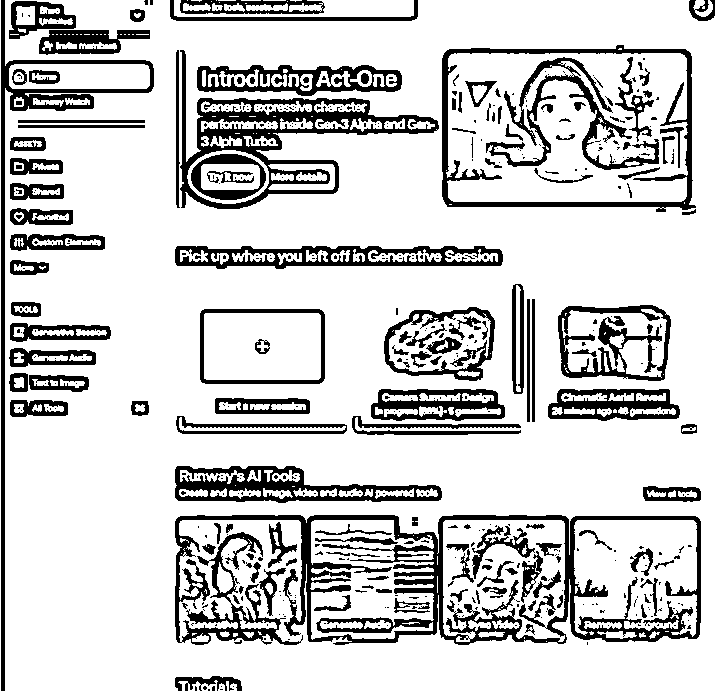
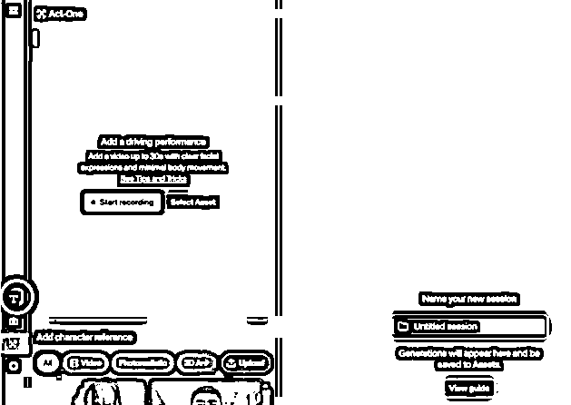
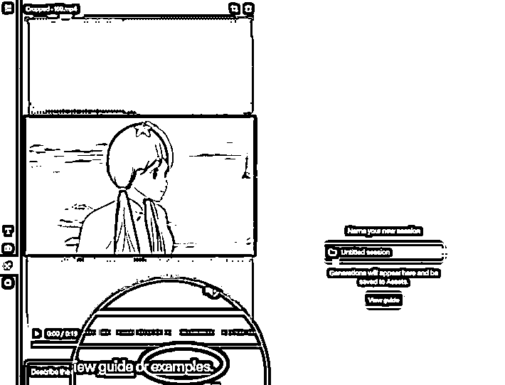
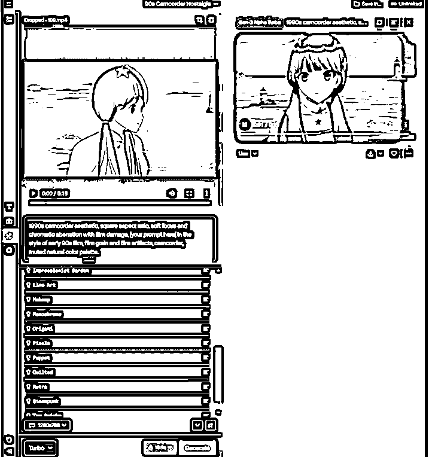

# 30 万播放是怎么来的？AI 套热梗的抽象视频正在疯狂吸粉，实操步骤也讲了

## 一条作品破 30 万，AI + 热梗的抽象化剪法成新爆款，教程来了

作者：高鹏圈

日期：2024-12-24

嗨，大家好，我是龙哥。

今天拆解一个现在正吃流量的玩法。

AI 结合当下热梗做抽象化内容，这波真的太好用了。用 AI 把梗二次演绎，破圈效率极高。

最近《美人鱼的夏天》里的一段梗在全网蔓延，懂行的创作者就用 AI 把它做成了各种魔性抽象版本。

这类内容的传播力非常强，📕上的数据相当漂亮，抖音上同类型的作品也都在持续走高。

那具体要怎么操作才能复刻出这种抽象质感呢？

我这边用的主力工具是 runway。

进入首页后，会看到一个蓝色的入口，点击进入即可。

跳转到创作界面后，找到文本输入相关的按钮，就是那个大写的 T 标志，点击它。

下一步，把电影里对应的原始片段拖到左上角的上传区。

上传完成下方会出现一段英文提示，直接忽略就行，点一下旁边的 examples，也就是示例库。

示例库里内置了二十多种现成模型，风格跨度很大，随便挑一个自己中意的就可以开生成。

选定风格后点生成，等待片刻就能拿到换皮后的新视频。

其实不止这二十多种可选，我这边额外整理了一份 40 多条风格关键词，复制进去就能直接套用，出来的效果也完全不一样。

好啦，今天的实操就分享到这。

我是高鹏，做网创已经 9 年了，这次拆解的是我第 702 个可落地的项目方法，更多玩法随时可以来聊。

* * *

评论区：

暂无评论