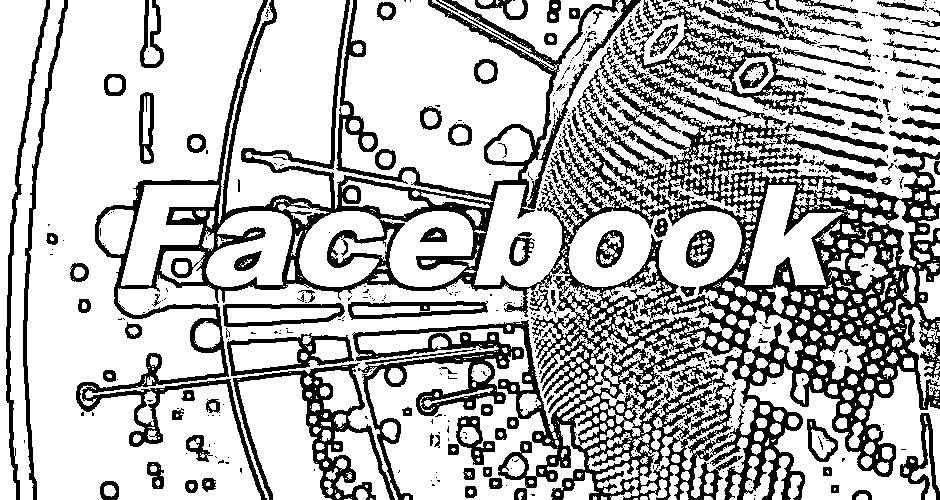
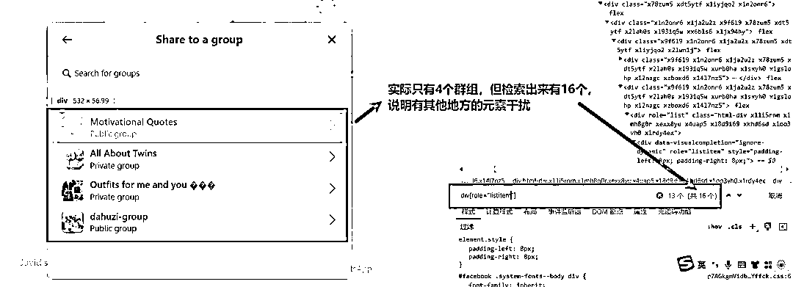
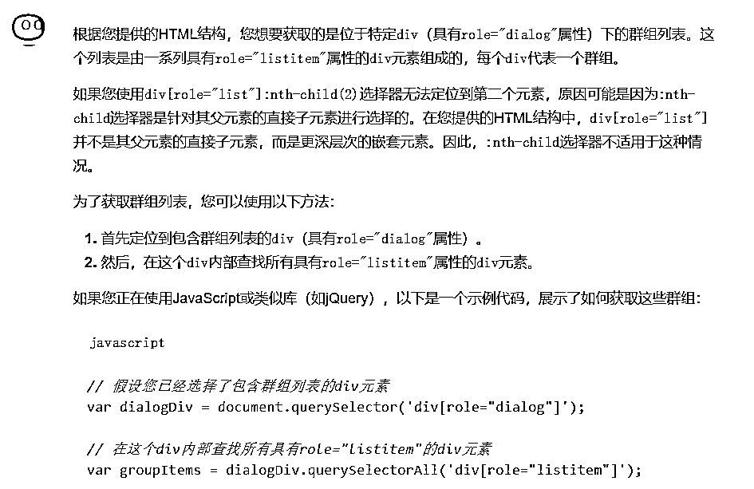
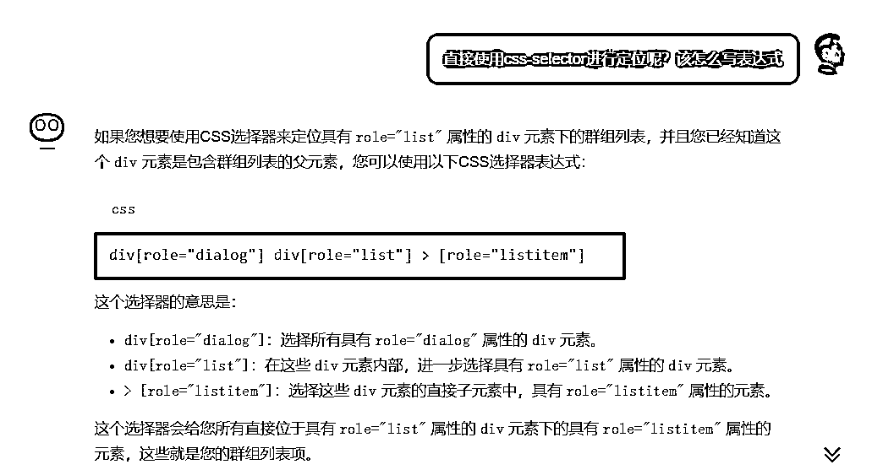

# kimi 提效 RPA，看我怎么用 AI 解决一个复杂的 facebook 元素定位问题
作者：龙哥

我是龙哥，平时主要折腾RPA课程和落地解决方案。很多人问我，RPA到底难在哪？我的看法是：**抓住“元素定位”这个核心，项目基本就成了七七八八**。因为机器人本质上就是靠定位元素，才能完成点击、滚动、输入这些动作。

今天来聊聊一个真实案例——用Kimi帮我把Facebook帖子转发时，弹出来的那个群组列表搞定。

乍一看，这不就是个普通列表嘛。但真上手，你会发现它压根没有“群组”“group”这类带语义的CSS标记，所有class全是一堆随机生成的乱码。想靠listitem来数位置？也不行，数量对不上。

所以问题来了：怎么才能稳定拿到这个列表里的第1个、第2个元素呢？

我干脆把这堆HTML原样丢给Kimi，让它帮我从里面找规律。它先给了我一段JavaScript脚本，能顺着dialog、listitem这些角色标签去抓元素。有点思路了，但我要的是能直接用的CSS表达式，不是脚本。

于是我继续追问，让它把思路浓缩成一条CSS路径。经过两轮调整，它终于给出了一个能用的方案，我再把“第几个群组”换成动态变量就行：

1. `div[role="dialog"] div[role="list"] > [role="listitem"]:nth-child({{variables.curr_index}})`

复盘一下，这个问题的本质不是有多难，而是元素太多了，肉眼根本来不及分辨哪些是关键节点。这时候把脏活丢给AI，让它帮你“读码”，效率直接翻倍。

怎么样，这招你记住了吗？下次遇到类似找不到规律的定位问题，不妨直接把HTML甩给Kimi试试。