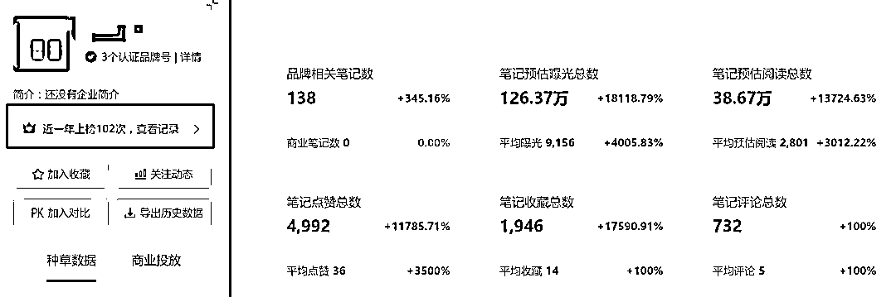
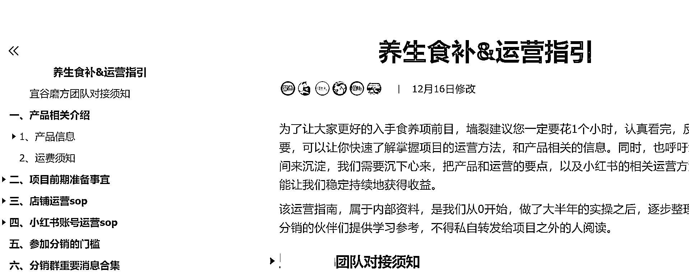
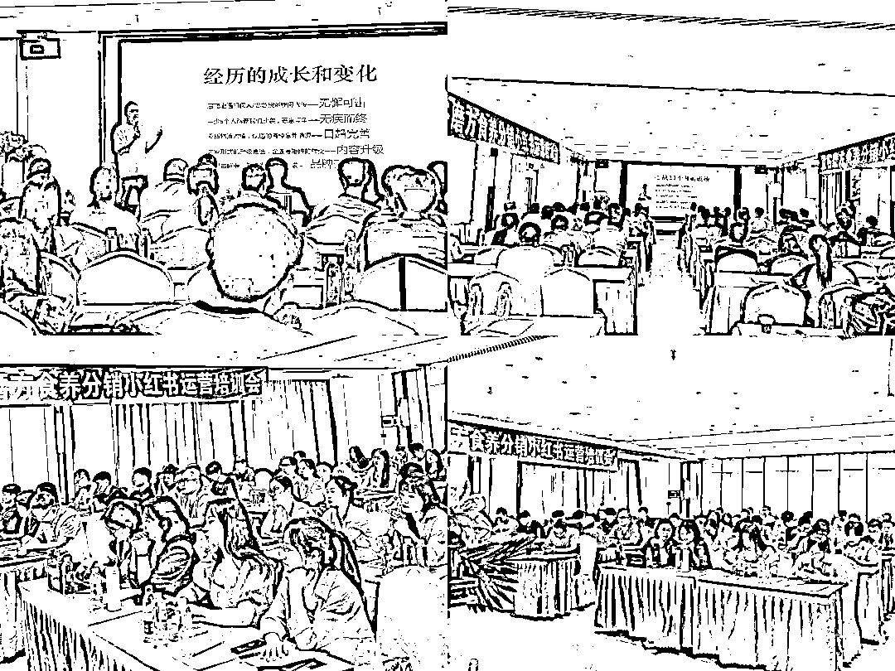

# 一年运营历程：从流量型生意到自建品牌与供应链的转型

先说个背景：我是龙哥，2023年在赚钱发过三篇分享，运气不错，都加精了。后来因为一直忙，就很少露面。这次想把最近一年的真实经历完整复盘一遍，也算给关注我的朋友一个交代。

这一年的大致战果如下：

**一个全新品牌，从0做起，年销冲到千万级别**

**前后开发21款产品，跑出了3个爆款**

**组了一支中医教授领衔的研发团队，外加健康管理师队伍**

**供应链已自主可控，自建工厂也在推进中**

进入食养赛道以前，我做的生意本质都是“流量买卖”——女装、瑜伽服、杂七杂八的产品都碰过，钱确实赚到一些，但始终是个倒流量的角色。没有自己的牌子，供应链也不在手里，随时可能被人卡脖子。那种飘着的感觉，一直让我很难受。

我心里真正想要的，是一份能干到老的事业。哪怕哪一天我干不动了，还能给孩子们留下一点可以延续的东西。

这个念头在脑子里绕了很久，越想越焦虑，后来索性下定决心：必须做自己的产业。

2021到2022年，我主做📕代运营，前前后后操盘了不少品类，最多的时候手上管着300多个号，经手的产品数不清了。正是这段经历，让我摸清了📕的脾性和用户的喜好——什么东西在📕能卖得动，我心里基本有数。

所以后来选择食养赛道，不算莽撞，而是有备而来。

从调研市场、啃中医知识、对接医生和营养师资源，到产品研发、内容测试、私域承接，这一整套流程下来，我搭了半年时间。

2023年8月26日发出第一篇笔记，到现在一年零四个月。坦白说，离超级头部还有距离，但一年做到千万级，我挺满意的。更让我有成就感的是，不少从零跟我做食养项目的伙伴，陆续拿到了人生第一个100万。很多人还在反馈里说，吃了我们的产品身体有明显改善——这种被认可的感觉，比赚到钱还让人踏实。

看千瓜数据，我们的整体销量已经排到了80%同行前面。关键是，**我没花过一分钱投广告，全是靠内容矩阵自然转化。**

（千瓜数据 2023.06）

做食养的契机，得提一位老朋友。他以前在一个知名微商团队做运营，后来自己出来做大健康，主打食养类产品。他跟我说这个赛道值得深挖，他团队不大，做的只是养生零食，一年也能干大几千万。

受他启发，我开始认真研究食养赛道，越研究越觉得是个富矿。

看几个例子：五谷磨房从淘宝系起家，一款“黑之养”黑芝麻核桃粉卖了十几年；📕上的花姐，一款八珍粉单品销量做到10万+；至言良食、妈妈很忙这些牌子，八珍粉也有上万销量，复购和口碑都相当能打。

研究完这些案例，我总结出一个判断：带中医养生逻辑的产品，在📕特别受一二线女性的欢迎，养生日趋年轻化。加上口罩之后，大众对健康的重视上了一个大台阶，这分明是一个大趋势。

于是我对标头部玩家，做出了第一代产品：八珍粉、七白饮、七黑粉、五红粉。

做产品的过程，远没有外人想的那么轻松——不是抄一抄就行。口感、冲泡形态、功效、包装，每个环节都得反复打磨。20多款产品，每一款我都是亲手调、亲自试，连包装都是自己一笔一笔画的。

最头疼的是口感。用道地好食材，有人反馈苦、不好吃；但为了口味上“科技”，食养效果就会打折扣。我咨询了不少中医老师，请他们在配伍上帮忙把关，目标是：效果不缩水，口感也别太难以下咽。

在多位医生教授的指导下，我最终确定了“只用道地食材、不添任何额外添加剂”的路子，跟那些打低价战的玩家主动区隔。想通了一件事：好吃的未必健康，药食同源的东西本就该是天然味道。后来的市场反馈证明，这个选择是对的。

短短一年，我们积累了大量好评，很多客户都是三五盒地往家买，带着家人一起吃。退货率一直压在1%以内。

**我为什么看好食养赛道？**

**产业链够深。** 从基础食养粉、养生茶，到高端滋补品、保健品，再到深度的中医内调定制服务，可以做一条从初级养生到个性化调理的完整链条，品牌矩阵和产品矩阵都能铺开。

**利润足够可观。** 我们现在支持一件代发，分销伙伴每卖一单，大约能拿到50%的利润；不用压货，不用投广告，靠的就是自然流。中医配方本身也有很强的溢价能力。

**市场盘子够大。** 口罩之后，养生不再是中老年人的专利，从18岁女生到35岁女性，再到有健康饮食需求的全家人，市场越来越大。📕的人群质量高、购买力强、认知也到位。根据中商产业研究院的数据，2022年中国保健食品销售额680亿元，2023年约720亿元，2024年预计到778亿元，千亿级盘子正在成形。

**复购高、售后少。** 坚持好食材、坚持中医配伍逻辑，客户吃出效果自然复购。我们现在一天发3000单，售后率依然低于1%。

为了补足中医营养方面的知识短板，我每天读中医书、研究食材配伍，同时聘请了多位营养师和中医专家，和我一起研发产品、调整配方。他们还在社群里帮客户做问诊、推荐搭配、给调理方案，客户信任度高了，团队业绩也翻了几倍，从单品销售升级到组合搭配，效果肉眼可见。

这一年，各种挑战没断过，但也正是这些难题，倒逼我把产品和模式越磨越好。

**第一，复制和放大，让更多人拥有赚钱能力**

想让一群背景、能力完全不同的人都赚到钱，这本就是极难的事。

核心看四种素质：

**理解力。** 能不能真正吃透产品、看懂平台规则、消化我们的SOP课程。第一次做📕的新人，前期往往会很崩溃，一个简单的操作要反复讲很多遍。说实话，有互联网经验的人上手会快得多。

**执行力。** 有人一天写12篇笔记，有人一天4篇都凑不齐。执行力差的人，基本做不起来。

**拆解力。** 做📕没有玄学，核心就是找爆文、拆爆文、改文案、套模板作图。

**抗压力。** 有人试了几天没动静就撤了，有人熬了30天刚有点起色，看到别人每天几十单、几百单，心态直接崩掉。

目前100多名分销伙伴里，大约50%已经实现盈利，70%稳定出单，10%的人赚到了100万以上，20%的人月入10万到50万，30%以上月入1万到9万，剩下的也在慢慢爬坡。

口说无凭，直接上图：

↓↓↓

凡是赚到钱的人，都有共性：要么悟性高，善于从别家爆文里提炼规律，消化后变成自己的东西；要么足够勤快，定好目标、雷打不动地完成笔记量，别人写6篇，他写8篇、12篇。

经验这东西，就是靠实操和复盘一点点熬出来的。我们的课程已经写得尽可能细了，但最终还是要有人肯去做、去试、去死磕，才会出结果。

**第二，产品的竞争力，靠死磕品质**

我对用料的要求，可以说到了吹毛求疵的程度。很多伙伴劝过我：食材没必要用太好，普通货或者残次品也吃不出差别，成本能压不少。比如山药这一味，普通食用山药比河南温县垆土铁棍山药便宜一倍还不止。

但我直接否了。不是跟钱过不去，而是从我手里出去的东西，必须经得起检验。哪怕成本高一些，用户吃一段时间，身体会有感知。有些客户比我们还懂，糊弄别人，其实就是糊弄自己。

我经常在商超和电商平台上看到同类产品，500g一罐的八珍粉标价29元。这种我连看都不用看，肯定有问题。八珍粉里八种食材，就算全用大米粉也得两三块钱一斤，再加上快递、包装、仓储、运营，卖29块钱的东西你敢往嘴里送吗？

我宁愿少赚这笔钱，也得做对得起良心的产品。我自己和家人每天都在吃，做健康行业的，如果连“健康”两个字都立不住，那还做什么？

**第三，持续复盘，把经验沉淀成SOP**

产品做出来，难的是卖出去。基于之前在📕的矩阵经验，我决定继续在这个平台深耕。

启动阶段，我亲自上手带了3个号，每天拍图、写文、做客服、分析数据。最难的是内容形式的打磨——既要能拿到推荐流量，又要保证转化，还得方便批量复制。

我记得特别清楚，2023年8月26日发第一篇笔记，本来没抱什么期望，结果爆了，2000多赞，八珍粉卖出去500多单。那之后我每天写12篇笔记，每个号发4篇，雷打不动地干了两个月。就是从这种笨功夫里，跑出了最初的SOP，再逐步教给团队和分销伙伴。

靠着这套1.0版SOP，第一批加入的分销伙伴都开始出成绩了。小雨是最早的一批，她每个月都记账：第一个月900多，第二个月2000多，第三个月5000多，一直在往上走。

真正意义上的第一波爆发，是2023年春节前。工厂已经放假，单子突然涌进来，一下几千单，准备的年货库存全发光了。厂长刚准备上高速回老家，被我硬叫回工厂加班生产，最后用顺丰给大家寄出去。

过完年到4月，才是真正的爆发期。至少6个伙伴，两个月内实现了100万纯利润。

之后我们持续优化内容，迭代出2.0版SOP，现在已经是3.0了。整套体系已经细到什么程度？小白照着操作就能上手。

所以新同事和分销伙伴入门，第一件事就是学这套课，至少看三遍。从平台规则、起号流程、图文模板、对标拆解，到每个产品的卖点和细节、店铺运营，全部覆盖。说它是养生电商的百科全书也不夸张。

为了让更多人快速上手，我还连着办了四期线下培训研学会，全程免费，现场手把手教。

**有意思的是，做📕电商，个人创业者的成功率，比公司团队至少要高80%。**

**第四，被抄袭，是爆红之后躲不掉的坎**

被人无底线地抄，还花式截流，那种憋屈感，真的比吃了苍蝇还恶心。

我们做起来之后，📕、淘宝、拼多多上一下子冒出一堆“李鬼”：产品照着抄、笔记原封不动搬，连包装都一样，只改了个商标，价格直接腰斩。

一开始我还组织团队去投诉、要求下架，后来发现根本处理不过来。天猫上有几家店，包装和主图直接用我们的，卖39块，还开着直通车抢流量。有消费者买到手发现货不对版，跑来质问我，影响很坏。

但有一句话我一直记着：改变不了环境，就升级自己。

我开始在包装和品牌形象上下功夫。以前用的罐子是公模，满大街都能做，成本极低，换个贴纸就能仿。这次我花了整整两个月设计新包装，改成便携盒装，颜值提升了一大截。新包装用的是定制耗材，印刷厂有起订量，抄袭门槛一下子高了很多。

我还同步做了专利申请。现在的态度是：你想抄就抄，我暂时不追究，等你把市场教育好了、销量做起来了，我再出手不迟，到时候还有一笔额外的“赔偿收入”。

换包装以后，转化率反而变高了，售后负担也减轻了。以前的罐装，经常有人开封后放太久过期来找我们扯皮，还有人吃了大半罐说里面有头发、指甲、碎布之类的东西，根本说不清。现在改成一袋一次的小包装，生产时用精密的设备灌装，从物理上杜绝了异物可能。

从这个角度说，还得谢谢那些抄袭者——没有他们，我不会进步得这么快。

**第五，职业打假，逼着我一次次规范运营**

食养是打假重灾区，我入行没多久就被反复“教育”。他们盯的方向，大多是药食材资质、包装标识、检测报告、详情页话术这些。

今年4月销售大爆发以后，一天发3000多单，人红是非多，团队几乎天天被这类事情缠着，身心俱疲。

好在我们的反应速度够快。我带着文案和设计团队，把每一个产品、每一个字都重新过了一遍，详情页、包装上的描述反复梳理，把所有可能踩线的地方全部修正。

现在回头看，打假人有点像免费的质检员。他们总能发现你忽略的细节，逼着你把工作做得更规范。从这个意义上说，是好事，就是过程确实磨人。

**第六，铁打的营盘，流水的兵**

项目做到现在，跟着我一路走过来的伙伴超过100人，其中有好几位已经赚到了几百万。

有些人赚到第一桶金之后，选择出去自立门户了。我这边其实看得挺开——我几乎把利润大头都让给了伙伴，课件、方法、培训全部免费，连从快递公司争取来的价差都一并分给大家，就希望他们能多赚一点。

有人觉得，这生意门槛不高，不就是找个工厂代工，然后开卖吗？这话也对也不对。单纯模仿一个产品确实不难，难的是持续打造爆款的能力，是内容迭代的速度，是整套运营体系的稳定输出。我卖的从来不是单一产品，而是一台运转良好的系统。

所以那些来抄的人，往往只能抄到皮毛。过一两个月，我产品升级了，门槛抬高了，或者干脆换了新方向，他们手里的旧玩法就玩不转了。

事实也印证了这一点：当初的抄袭者、搅局者，如今大多没了声音。小钱赚到一点，最后却又变成了库存。

这个世界唯一不变的，就是变化本身。我有十几年的运营积累、产品开发能力和快速应变能力，至少在市场判断上已经超过大多数人。更关键的是，我替大家扛掉了大部分的风险。你要做的，就是专注搞流量、卖货就好——创业的成本和风险，我已经压到很低了。

万事开头难，过程也不轻松，最难的这part，我替你们趟完了。这一年，我学到了很多，也还有很多事没做完。

最后总结一句，我始终抱着的16个字：

**单点打透、流量闭环、复制复利、长期主义**

单点打透——在一个细分领域里深耕下去，成为专家，把所有玩法吃透。我在📕已经迭代到3.0，接下来的精力会分一部分去抖音、私域和线下，让食养这件事纵深更长。

流量闭环——建立一套稳定的引流方式和承接体系。我现在已经从第一阶段（测试产品和用户）走出来，开始全力搭私域。未来不管哪个公域平台，都只是引流的入口，最终要导回自己的池子里，形成完整闭环。

复制复利——做能复制的事：运营可复制、产品可复制、品牌可复制。同一套底层逻辑，可以长出品牌矩阵、产品矩阵、账号矩阵。而复利的核心，就是高复购、强粘性、能精准触达用户的需求。

希望我的这些经历，能给你带来一点参考。如果你也在看食养赛道，或者正纠结怎么从流量生意走到品牌和供应链，欢迎来聊。

你有没有想过，什么才算真正值得做的事？

不是赚快钱，不是追风口，而是那种——能一直做下去，顺着趋势走，还能给别人带来价值的事情。这就是我理解的长期主义。

今年我扎进了一个很有意思的领域：食养。它属于大健康赛道里的细分方向。这个赛道有多大的想象力？这么说吧，现在整个行业还没有一个真正称得上“品牌霸主”的存在，产品也非标准化。这意味着什么？意味着有大量未被满足的需求，意味着每一个认真做事的人都有机会，意味着无限可能。

过去这一年，说实话，比想象中更磨练人。但我已经做好了准备：明年开始，我要把工厂建起来，组建自己的产品研发团队，同时铺设线下的食养门店。可以预见，接下来会非常忙。但奇怪的是，心里特别踏实，每一项付出都带着甜味儿。

具体的东西，篇幅有限，就不在这展开说了。如果你对这个领域有兴趣，我们可以私下好好聊聊。

最后想对每一位正在路上的朋友说：找到一件你真正认定的事，然后一头扎进去，死磕到底，不管前面有多少困难，想办法解决它。总有一天，你会拿到自己想要的结果。

评论区也是热闹：
- 到底辣不辣：想了解一下～
- 荣生：精华帖预定👍
- 义茹：想了解一下
- 小乔：想跟着大佬一起干
- 杜静：我是营养师，想了解，怎么联系？