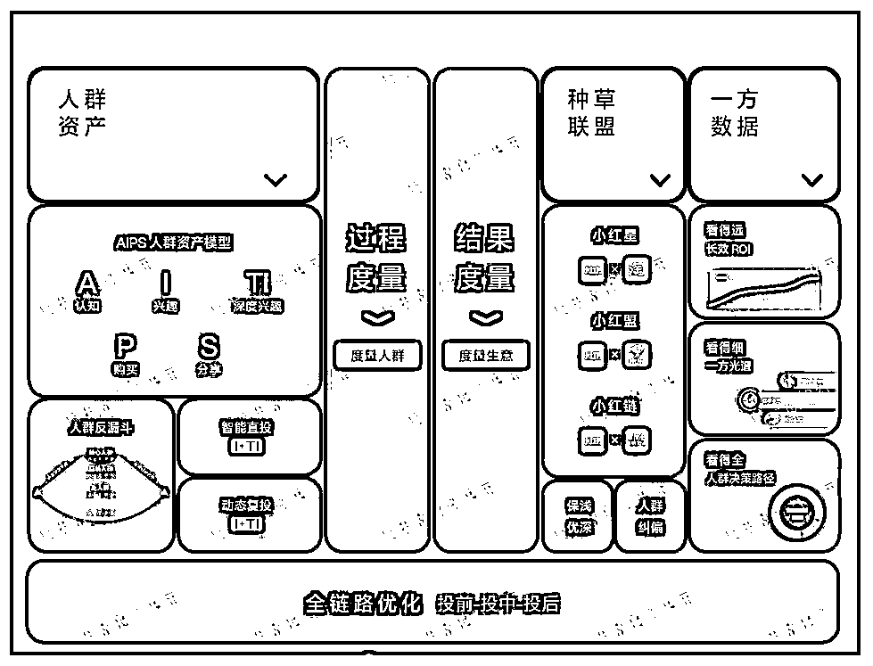
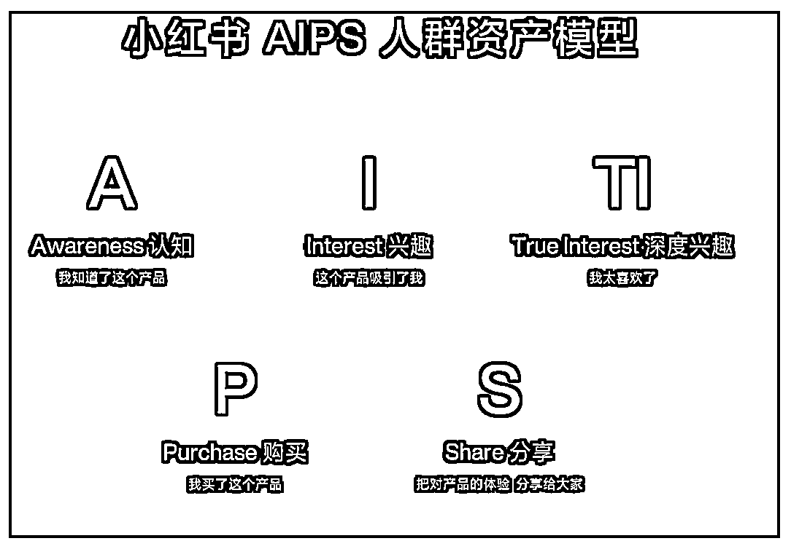
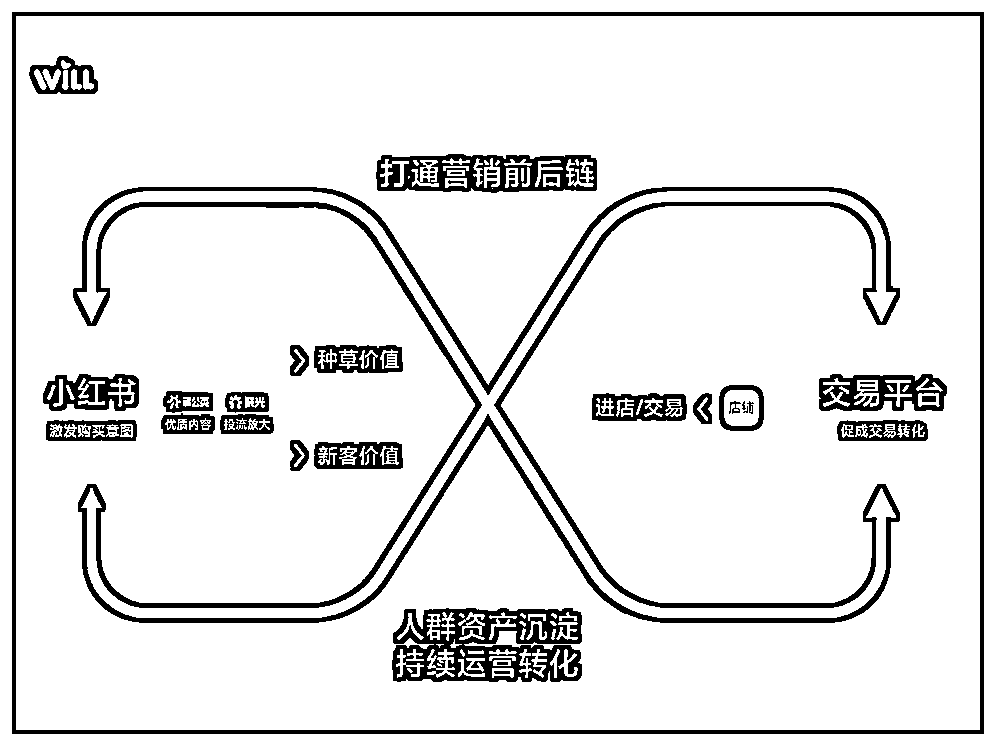
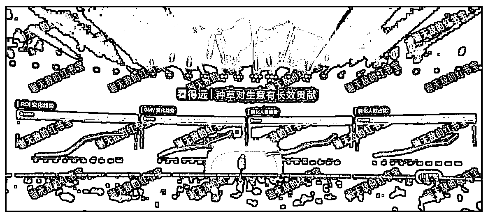
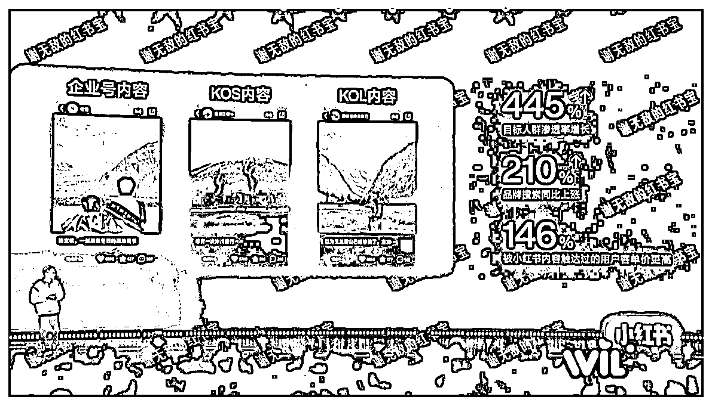
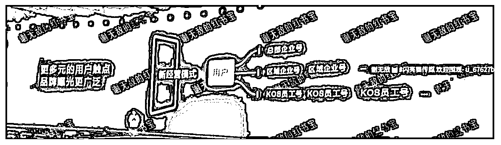
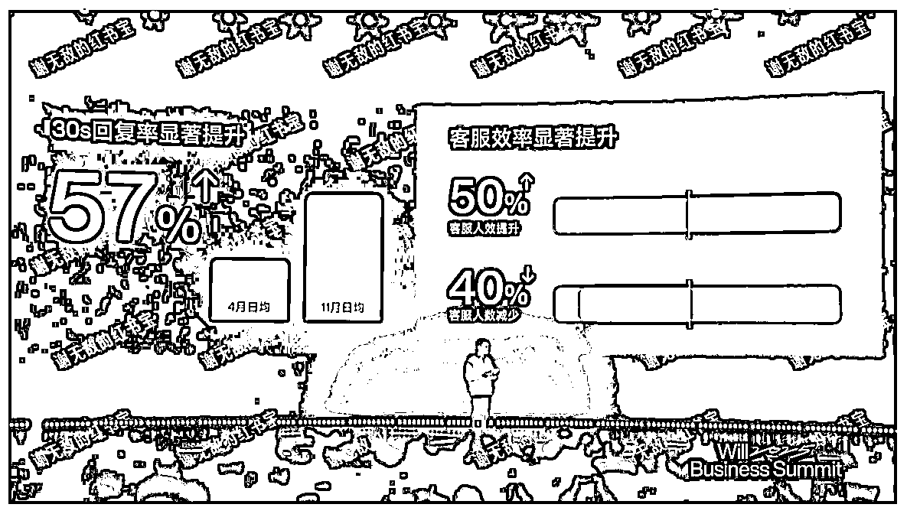
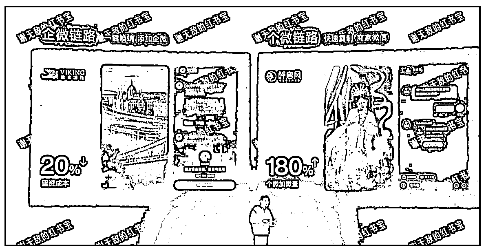
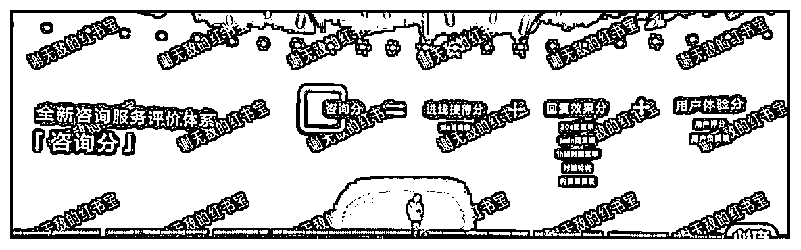
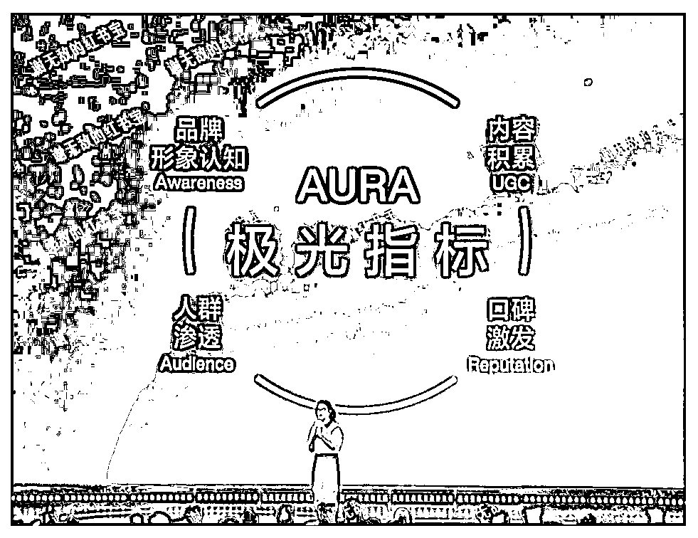

# 小红书2025年WILL大会全解析：10个关键信号，读懂明年增长密码

当多数互联网平台还在为增长发愁、甚至裁员自保时，小红书却活成了“别人家的孩子”：业绩不降反升，商业变现越走越顺。上周的WILL大会，直接扔出了2025年的十张王牌。除了继续深挖生活服务行业的线索价值，平台还打算在商业产品端强化投放优化与效果度量，让商家真正实现低成本、高转化。

更值得注意的是，小红书会进一步敞开大门，与更多垂直行业的商家、MCN机构深度连接。我花了一整天，把大会要点浓缩成了下面这份保姆级笔记。

一、人群资产模型AIPS：看清人，再让转化起飞

小红书把人群资产拆成五个阶段：认知、兴趣、深度兴趣、购买、分享。这套工具本质上是帮商家看清楚某个SPU背后到底有多少人、人群如何流转，从而把商业产品做得更顺手。

落地可以分三步走：第一步靠渗透率把人群“打透”，效率优先，这背后是种草与兴趣激发的价值；第二步用智能直投快速圈住兴趣和深度兴趣人群，以更低成本捞到潜在买家，最终提升转化。雅诗兰黛白金黑钻面霜靠这个玩法，目标人群的人均成本降低了54%。第三步则是复投，一边压进店成本，一边创造生意增量。

二、结果度量双雄：种草联盟+一方数据

种草联盟主打“前后链路打通”，让品牌在小红书里就能更好地完成转化。

具体策略有两个：一个是“人群纠偏计划”，投放过程中不断吃进新的人群数据来判断、调校，把商品的种草力越养越强，靠数据积累换增量；另一个是“保浅优深计划”，在守住点击成本的前提下，尽量优化进店、成交、转化这类深度行为，站外行为成本能下降超50%。

再说一方数据，它更适合渠道复杂、线上线下都在做的品牌，帮商家把运营和投放做得更细。怎么用？把后链路转化数据通过API、数据服务商或离线方式回传，用真实数据算账，把种草对生意的长效贡献变得可衡量。

衡量维度包括ROI、GMV转化人数、转化占比等。

在此基础上，还有“一方光谱”工具，用分层出价策略帮品牌进一步压低成本、精细化运营。

三、灵犀平台：2025年向5000+商家开放

灵犀的本质，是用数据度量种草投放到底影响了多少生意，然后反过来指导投放优化。商家可以用它挖热门话题、做笔记分析，为内容生产提供弹药，获客成本自然降下来。松赞就是个典型：通过深挖内容，目标人群渗透率暴涨超400%，被平台触达的用户客单价提升超46%。

2025年，灵犀的开放规模会从1000+商家扩大到5000+。

四、生活服务经营新范式

过去一年，小红书的生意机会其实已经有苗头：生活服务类商家通过平台做咨询的比例高达98%，这里几乎成了天然营销场。而这个行业常见的五大痛点——用户触点少、内容产出难、服务效率低、转化链路单一、放量空间小，平台也给出了解法。

新玩法下，商家不再只靠一个企业号单打独斗，而是升级成总部企业号、区域企业号、KOS员工号组成的三级矩阵。

用立体化内容去跟用户互动，转化效率自然上去了。比如@圣都家装、@绿城，在提升交互效率后，绿城3个月跑出近2亿成交额，效率达到行业均值的10倍。

五、私信管理大升级

私信通全面换代，现在支持单个账号统一接待和消息汇总，还能打通主流的第三方私信聊天工具。@九匠的效果很直观：30秒回复率提升57%，客服人效提高50%，夜间获客量更是涨了70%。

六、转化链路再提速

小红书新增了一些实用组件，比如企业微信一键换端、一键复制，留资和转化效率都能得到明显改善。

接下来，购买链路还会引入小程序，整个生态会更开放，也更包容。

七、咨询分：优质服务成为新标尺

在小红书的生活服务板块，低价折扣不再是主旋律，平台更看重商家能不能提供好服务。全新的“咨询分”体系就是为了评估商家的经营能力而设，期待能推动生意从0到1、再到N持续增长。

八、极光指标：营销IP的度量衡

极光指标更像一把尺子，从品牌形象认知、内容积累、人群渗透到口碑激发，在不同象限上衡量一个营销IP到底做得怎么样。

前期定策略时，它能让你清楚该往哪个方向用力；项目结束后，又能拿出证据验证效果。

九、站内交易：爆发式增长

2024年，小红书的购买用户数增长了4.3倍；月销500万的商家数量翻了3倍不止；数以千计的月销百万单品冒出来，数量达到去年的3倍。每天有600万条求购需求产生，1.2亿次截屏和图片下载，足以说明用户的购买欲望有多强。更关键的是，平台上有4000万“尝鲜人群”，其中60%不到30岁，95%拥有中高消费力，70%集中在一二线城市——这就是新品卖爆的土壤。

十、2025营销日历与玩法曝光

大会还提前放出了明年的运营指南：

- 新品策略：更多参与方式、全链路营销，还有海上发布之旅；
- 重磅活动：red Gala盛典、万人节、夜人节、潮人节等，开放“人节系列”品牌定制；
- 娱乐营销：短剧、娱乐热点、粉丝人群放大、明星营销创新，助品牌增长；
- 营销节日：CNY小红书过大年、214满分情人节、我就是这样的女孩、满分礼遇季、妈妈的留白、宝贝童乐会、我爸有一套、薯你会买、爱的形状、圆在一起乐在一起、双旦心愿派对；
- 节点IP：过年就来小红书、520满分好礼大作战、618薯你会买、七夕爱的N重形态、双11薯你会买。

种草这件事，正在让生意长出更多可能，也让普通个体找到了属于自己的一份商业价值。2025年，小红书的商业化还会继续进化，先看懂风向，才能接住平台递过来的机会。