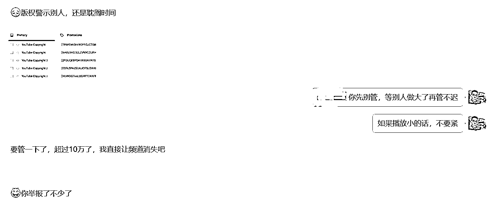
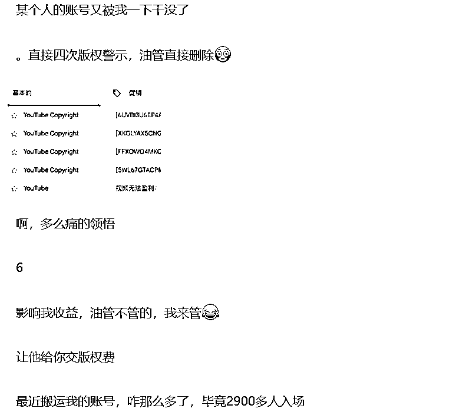
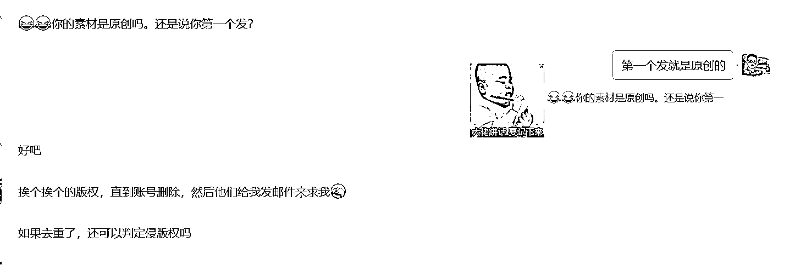
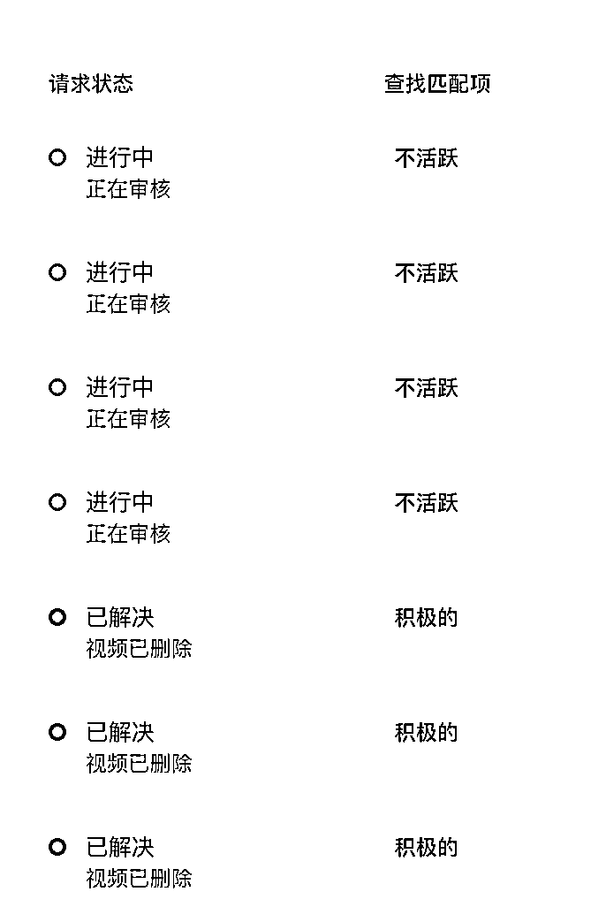
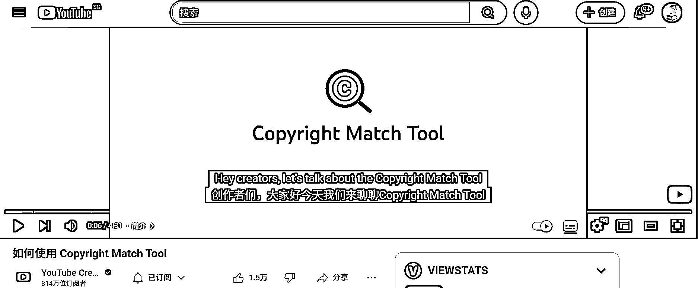
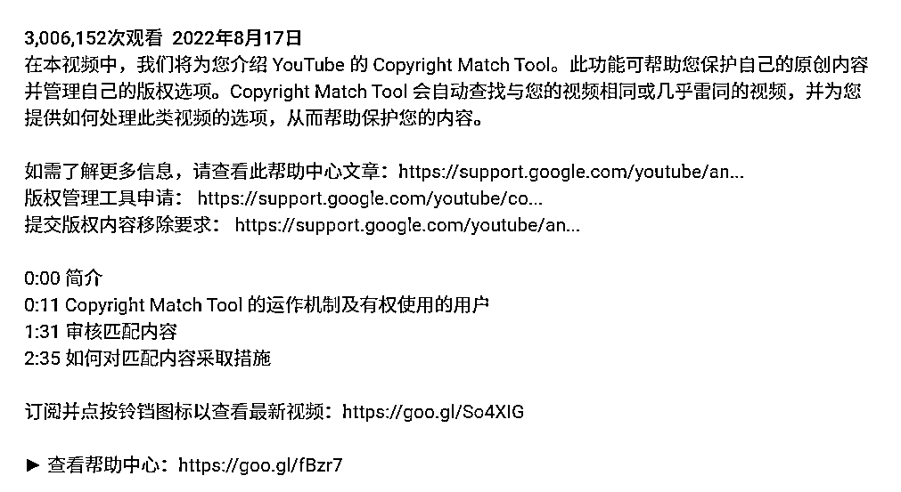
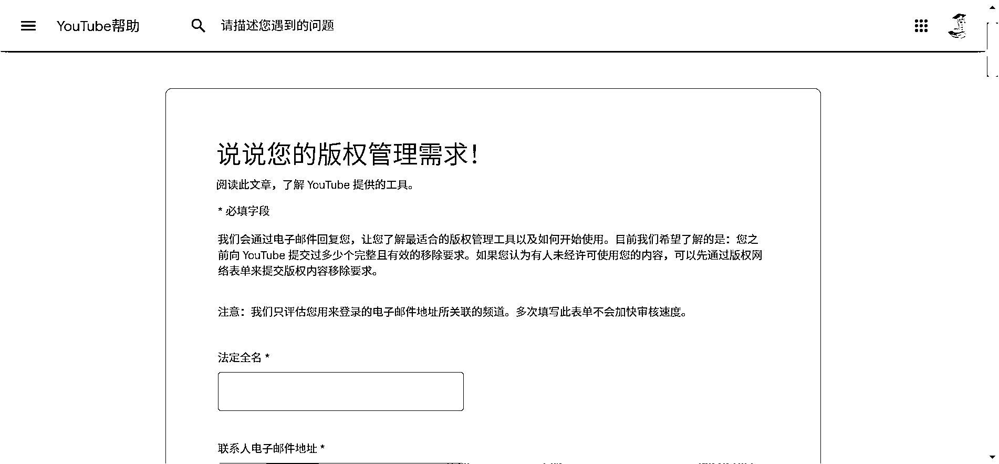
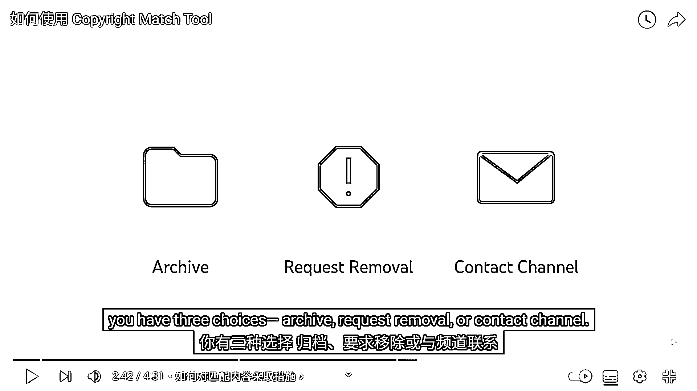
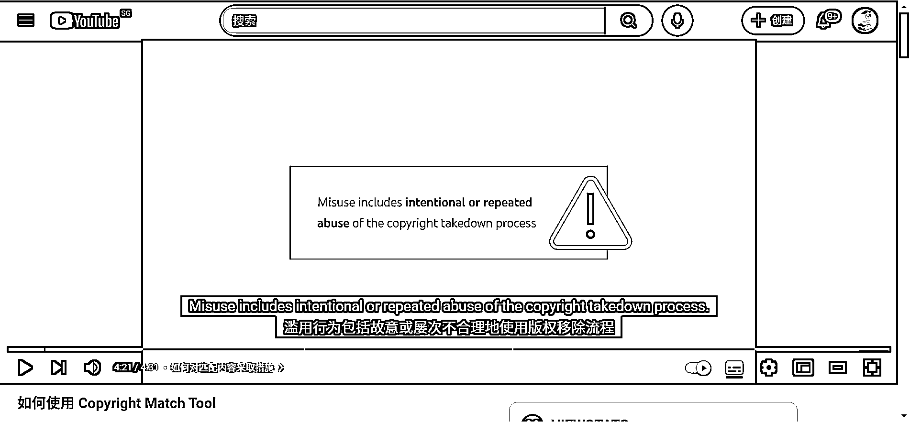
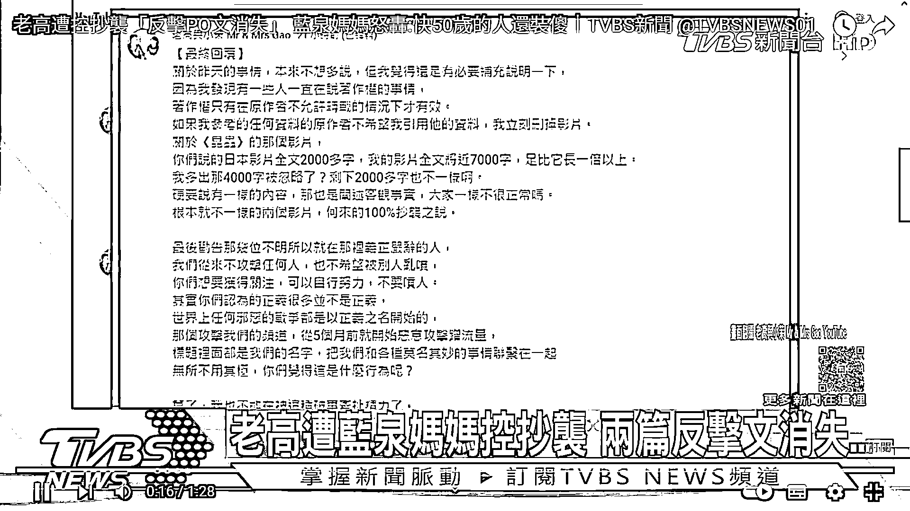

你在 YouTube 上辛苦做的视频，转头发现被人原封不动搬走了，先别急着上火。这篇文章就换个视角，聊聊原创作者能怎么应对“搬运工”。

之前我们聊过搬运者被版权投诉的处理流程，这次站在原创者这边看问题。下面这些对话截图都来自真实群聊，已经做了隐私处理，个人敏感信息全部抹掉。

有位群友脾气比较直，容不下这种事儿。当时他面对的是删除侵权视频时的三种选项：

1、已经安排——发送 7 天通知
2、标准——立即请求删除
3、防止此类内容的副本将来出现在 YouTube 上（如果删除请求有效，平台会尽力拦截后续新上传的同类内容）

简单解释一下：

1、“已安排”的意思，是给对方 7 天缓冲期。之前提过，如果你的视频属于混剪类型，这条反而可能带来流量。你可以借此表明“我已经注意到你了”，但先不急着动手。
2、“标准”就是字面意思——不废话，直接申请删掉。就像上面那位群友的作风。
3、这个选项是“封堵未来”，防止别人以后再把你的内容传上来。

一般情况下，原创者还是得有点容人的肚量。YouTube 的推荐算法比较特殊，别人搬运或混剪，有可能阴差阳错给你导流。上来就把对方赶尽杀绝，未必是最优解。

如果有人搬了你的视频，YouTube 官方会主动提醒你，就像下图这样。

而且，每投诉成功一次，对方就背一次版权警告。累计三次警告，对方的频道就凉了。

这里有个细节：如果你真想一口气端掉对方的老巢，需要针对不同的视频分别投诉。举个例子，假设你发现自己的四个视频都被他搬了，那就四个视频各投诉一次。

这样操作下来，对方的频道不仅没法再靠视频盈利，甚至会被 YouTube 直接封号。

关于 YouTube 如何判定原创，后面有机会再展开，先略过不谈。

处理进度 YouTube 官方都会实时同步给你，具体看下图。

接下来聊点别的，先看图理解。

先放一个官方原版视频链接，英语好的可以直接看原片：
如何使用版权匹配工具：www.youtube.com/watch?v=R_zXuVReajA

下面给不想看英文的朋友做点翻译解读。

这个 Copyright Match Tool（版权匹配工具），凡是加入了 YouTube 合作伙伴计划（YPP）的创作者，在后台都能直接访问。

如果你是新手还没加入，界面就像下图这样。

顺便多说一嘴相关的经验：

如果你已经想好了要做的赛道，记住“同行就是最好的老师”。并且最少备用两个频道：
1、日常生活频道
2、专门赚钱的频道

为什么说同行是老师？无论短视频、直播还是写文章，核心就一个字：抄。想再升级一点，就是：杂交。

前期就是 1 比 1 抄。先选好领域，搜关键词，关注几百个优秀同行。之后多刷关注页，只要看到某个作品发布一小时内就有几百赞，大概率有爆款潜质。这时候你就能复制他的内容，1 比 1 照搬。

等抄熟了再玩杂交：
比如你关注了一堆风格相近的同行，甲的开头好用，你就用甲的开头；乙的封面做得好，就取乙的封面；丙的中间叙述生动，就借鉴丙的中段；丁的结尾有感染力，就采用丁的结尾。把各家的优点拼起来，就成了你自己的杂交版本。每一处细节都出彩，火的概率自然更大。

我给大家看的这个频道，就是我的生活日常号，随便看随便订；而赚钱的那个号只关注同行。因为我订阅的全是同行，YouTube 算法记住了我的偏好，首页刷到的全是同行，方便我每天对标和学习。

如果你还没进 YPP，但也想用这个工具，可以去联系 YouTube 的 YPP 支持团队，请求开通。

比如你可以在官方渠道留言，像下面这样：

##### YouTube 官方 X 客服
x.com/TeamYouTube

开玩笑的。实际上，视频描述区里就有版权管理工具的申请入口。

直接点这个链接：support.google.com/youtube/contact/copyright_management_tools_form
填好相关信息，提交申请即可。

回到正题，继续解读那张工具界面图。

Matching videos：匹配到的视频列表，会显示标题等基本信息。
Total views：对方频道里这条视频的总观看次数。
Subscribers：搬运你视频的那个频道的粉丝数。
% match：匹配度比例，也就是对方用了多少你的内容。如果显示 100%，说明对方一点没改、直接照搬然后重新上传。
Date：日期，也就是匹配视频的发布时间。

补充一句：如果对方是东抄一段西抄一段，系统还真有可能识别不出来。

接下来具体说说三个操作选项是什么意思。

“归档”：
你知道对方用了你的内容，但暂时不采取行动。不行动的理由可能有两种：
1、那条视频观看量很低，没产生什么收益，不值得理。等哪天真火了，再回头处理。
2、你觉得对方的使用不算过分。虽然严格说不算合理使用，但他只截取了你视频的一小部分，影响不大，你也懒得计较。
这种情况下，你可以选择归档。归档就是先放一放，观望一阵子，看看这条视频后面会不会有起色，或者对方是不是还会继续偷你其他内容。

“请求移除视频”：
这一项是最强硬的，前面已经提过。

具体细节再补一下：

“已安排: 发送 7 天通知”——请求验证通过后，YouTube 会给上传者 7 天时间自行删除，避免了版权警告。如果对方 7 天内没删，视频才会被平台移除。这算是一种友好的解决方案：对方主动认错改正，你也不再追击。

“标准: 立即请求删除”——这种删除可能直接触发版权警告。YouTube 验证请求后马上处理视频下架，同时给对方记一次黄牌。

个人建议：如果对方是初犯，得饶人处且饶人，选第一个选项，留个余地。如果对方是惯犯，想尽办法盗你的视频、到处搬运，那就果断选第二个，让他知道疼。就像前面那位群友一样。

“与频道联系”：
选这个之后，只需填上你的邮箱地址。注意，这个邮箱对方是能看见的。等于你给对方发送一个友好提示：“某某某，我已经注意到你用了我的版权内容。”

操作之后，YouTube 官方会替你把一封标准信函发给对方。虽然信不是你自己写的，但对方能看到你的联系邮箱，可以私下联系你——比如请求授权、解释缘由，或者说声抱歉、承诺马上删掉。

一般不建议选这个。像前面那位群友，直接让官方下架省事。

关于“搬运”这事的可行性，理论上确实存在。

举个例子：原创者在国内平台发布视频，比如抖音。搬运工把视频弄到 YouTube，注意，搬运工不是原作者，但他抢先一步在 YouTube 上传了。那么在这平台上，他反而成了“原创”。

换句话说，谁第一个上传，谁就是原创。等真正的原作者再把自己的视频发到 YouTube 时，李逵变李鬼，反被对方投诉，这就非常讽刺了。

极端情况下，李鬼可以给李逵的频道连吃三张黄牌，直接干死。当然，YouTube 官方也不支持滥用这个 Copyright Match Tool。

这里补充李逵的反制招数：

1、申诉。可以尝试，但未必管用。YouTube 官方不是法院，只是平台。不怕对方耍流氓，就怕对方是“有文化的流氓”。这可能就是平台规则的一个漏洞，要是申诉不了，也只好认栽。

2、反杀。你装作什么都不知道，但先下手为强——把视频传到自己的频道。注意：必须设置为“私享”，发了但别人看不到。就这样攒视频，攒够好几个。然后像前面那位群友一样，一次性给对方三张黄牌，把对方频道干死。反杀完成，就是这么简单。

一般情况下，如果你是国内原创作者，后来才来 YouTube，刚发视频就被李鬼干掉频道，建议别纠结申诉了，直接开个新号，然后使用方法 2 去反杀就好。

这篇帖子发出来，估计有些人会动心思去当“有文化的流氓”。我不站任何道德高地，每个人做的选择都是他当下认为最好的选择。你选搬运，总有你的理由——拼速度、欺负没本事上外网的老实人。别人辛辛苦苦做的内容，你转眼就变成自己的利益。我不喜欢站在道德最高处去谴责谁。

再次强调：同行是最好的老师。上面那段话，我再复制一遍——

短视频也好，直播也好，写文章也好，核心就是：抄。想更好一点，就是：杂交。

前期 1 比 1 去抄。定好领域，搜关键词，关注几百个优秀同行。之后刷关注页，发现某个作品发布一小时内就有几百赞，这可能是要火的苗头，赶紧复制，1 比 1 照搬。

抄熟练了就玩杂交。比如关注了好几个同类型的同行，甲的开头好取甲的开头，乙的封面好取乙的封面，丙的中间叙述好取丙的叙述，丁的结尾妙取丁的结尾。把优秀同行的亮点融合成自己的内容，这就是杂交。每一处都做好，火的可能性自然更大。

再次提醒：赚钱的频道别乱刷视频，只看同行、只关注同行，把 YouTube 算法驯化好，让首页永远只出现你正在对标的人。

关于抄袭这事，拥有 642 万粉丝的老高也不是完全干净，没人能做到 100% 原创。想想也是，天天原创，哪来那么多素材？

视频链接：www.youtube.com/watch?v=hKqadBXByFo

路最终都是自己选的。是投机取巧，还是老老实实当个乖宝宝苦哈哈做内容，自己开心就好。