辛苦做出的视频突然被人盗传，甚至反过来被对方投诉，确实让人恼火。先别急着慌，这次我们从内容创作者的角度，聊聊平台提供的应对办法，以及如何借助官方工具快速发现盗用情况、掌握主动权。

当你的作品被他人盗用后，平台的后台申诉中心通常会提供三类处理方式：

第一种，先发出限时提醒，给对方一个自我纠正的缓冲期。这个方案适合对方只是做了混剪或部分引用的情况，而且这种引用有时反而能带来额外流量，可以先观察一下。

第二种，直接要求下架，一步到位。选择该操作后，平台会核实请求并尽快移除侵权内容，同时可能给对方留下警告记录。

第三种，请求拦截未来可能出现的复制内容。这个动作一旦生效，平台会尝试阻止相似内容再次出现在站内，属于长期防护。

一般情况下，没必要一发现盗用就赶尽杀绝。平台的推荐机制有时反而会因别人的混剪或转载给你的频道带来曝光，从策略角度看，可以先容人一步，不必立刻撕破脸。

你可以在后台收到系统提示，告知哪条视频被人搬用了。根据提示可以快速定位到对方的账号和对应内容。

如果你确定要让对方频道承受后果，建议逐条视频单独投诉。比如你发现四条作品被他人盗用，就针对这四条分别发起投诉，这样能更有效地让对方的频道失去变现能力，严重时甚至会被平台处罚。

关于平台如何界定原创标准，这部分比较复杂，我们稍后再细说，先跳过。

投诉之后，平台会同步更新处理进度，你可以随时看到每个步骤的状态。

接下来重点讲一个实用工具——版权匹配工具（Copyright Match Tool）。这个工具面向已经加入YouTube合作伙伴计划（YPP）的创作者开放。如果你还没达到门槛，后台界面会暂时看不到入口。

这个工具能自动汇总哪些视频被他人匹配使用，帮你摸清盗用情况。选择具体赛道后，建议至少准备两个频道：一个用于日常随性浏览，一个专注做变现内容。为什么说同行是最佳参照？因为他们往往已经替你验证了哪些玩法有效。

想更进一步，可以研究“借鉴+重组”的思路。初期阶段，先圈定一个细分领域，搜索核心关键词，关注几百个头部账号，每天刷动态，看到刚发布不久就互动量不错的作品，基本可以判断有火的潜力，这个时候就可以一比一对照学习。

操作熟练后，可以试着“杂交”：从不同同行的作品中摘取各自的长处，比如开头设计、封面处理、内容叙事、结尾转化，把这些亮点融合到自己作品里。每一点都做得比对方好一点点，整体火起来的概率自然会更高。

我的做法是：生活娱乐号随意浏览，保持私人兴趣；变现号只关注同行，系统很快会记住我的偏好，首页推荐的全是对标内容，随时方便拆解和参考。

如果你目前还没加入合作伙伴计划，但很需要这个工具，可以去官方渠道提交申请。在视频管理区域或官方支持账号下，通常能找到版权管理工具的申请入口。

这个匹配工具的界面会列出所有匹配到的视频信息，包括对方频道的订阅人数、盗用内容在对方频道的总播放量、内容重合百分比（如果是100%，基本就是原封不动照搬）、以及匹配视频的发布时间。需要注意的是，东拼西凑的改动有时确实能躲过系统识别。

工具里提供三个处理动作，可以灵活选择：

**归档**：先记录在案，暂不处理。可能因为对方播放量太低、不值得追究，或者对方只截取了一小段，影响有限。归档相当于观望，看看后续数据是否有变化。

**请求移除视频**：这是最严厉的手段。其中又分两个选项：一是“已安排：发送7天通知”，平台会给对方7天时间自行删除，如果对方照做就不会留下警告。这个选项比较温和，适合初次犯错的人；二是“标准：立即请求删除”，平台核实后直接移除视频，并给对方留下版权警告。这个适合反复盗用的惯犯，正如前面那位创作者的果断做法。

**与频道联系**：选择这项后，你需要填一个邮箱地址，对方可以看到。平台会以你的名义发出一封标准信函，提醒对方“已注意到你使用了我的内容”。对方看到联系方式后，可能会私下找你沟通、请求授权或解释情况。不过这种方式比较间接，遇到不讲理的对方，还是直接让平台处理更痛快。

再说说“盗传”这件事本身。理论上确实存在操作空间：如果原内容作者只在国内平台发布，另有人抢先把它传到YouTube，那么先传的人反而可能被认定为该内容的首发者。等真正的原作者后来补发视频，反而可能被系统误判为侵权方。当然，这是极端情况，平台本身也不支持滥用这个工具。

遇到这种“反被抢先”的情况，也有应对思路：第一，走平台申诉流程，虽然不一定成功，但至少有机会说明情况；第二，干脆先将自己的原始版本私密上传，作为时间凭证，攒够几个视频后，再集中发起投诉，一次性给对方频道造成实质影响。

每个人都应该根据自身处境选择行动路径。写下这些内容，不是为了教人走歪路，只是让大家知道有这些可能性存在。至于怎么选，是选择投机取巧，还是踏踏实实积累，全凭个人判断。

还是要强调，同行是最好的老师。短视频、直播、写文章，本质上都离不开借鉴与重组。选定赛道后，先关注几百个优秀同行，从一比一模仿开始，熟练之后再尝试杂交。当你的作品能吸取多个同行的优点，离爆款自然更近一步。还要记得，做变现号的首页只留同行内容，别刷无关视频，这样才能把平台算法驯化成你的选题雷达。

即便是那些上百万粉的大V，也并非纯粹依靠原创，很多时候也是在已有内容基础上二次加工。毕竟，每天完全从零创造，确实不现实。

最后，自己的路终究要自己选——是找巧劲借力，还是老老实实下笨功夫，只要自己认可，就好。

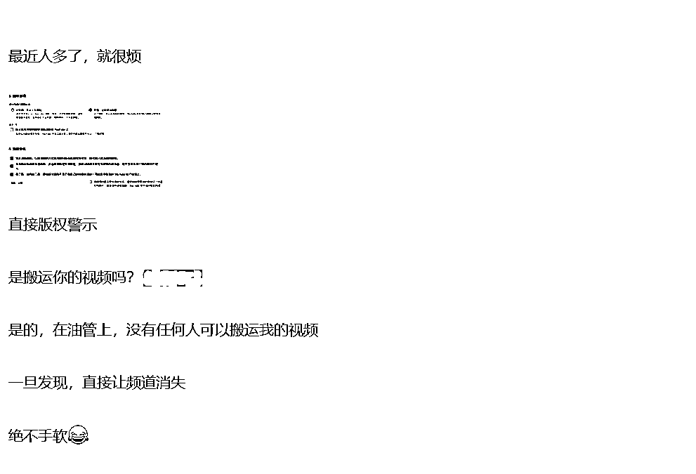

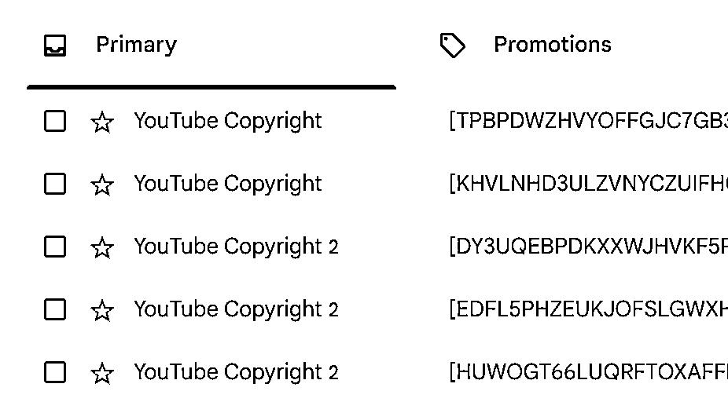
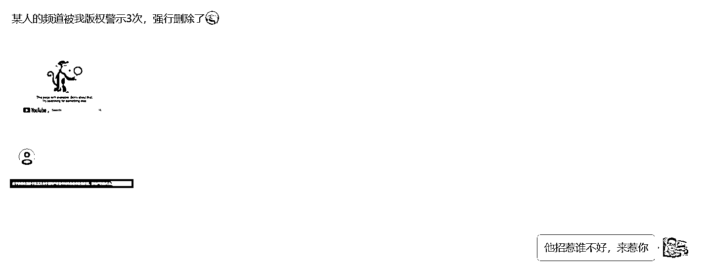
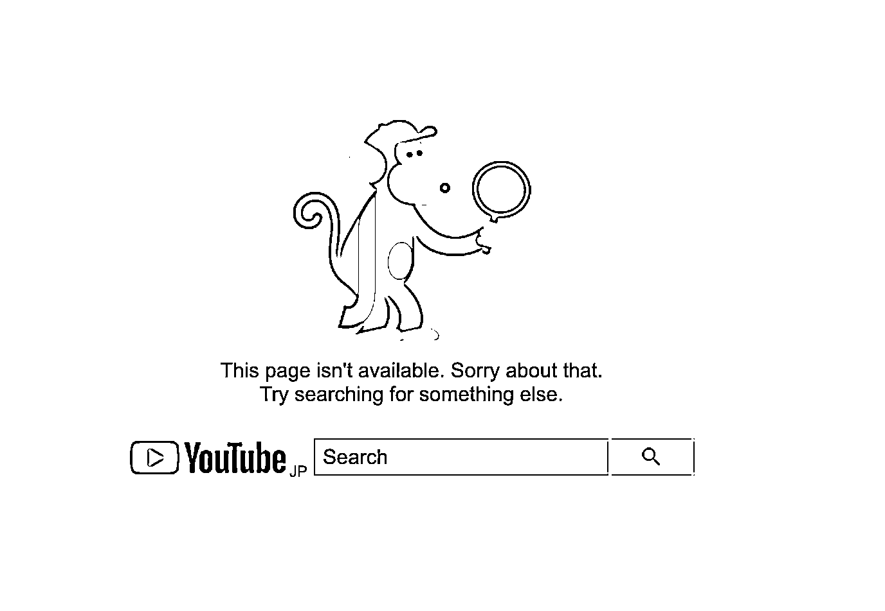
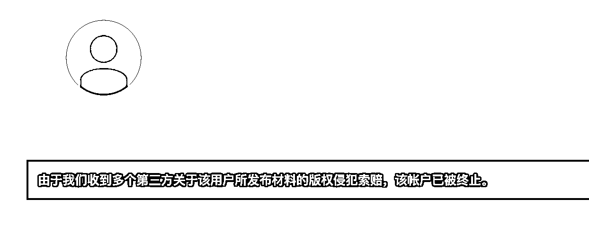

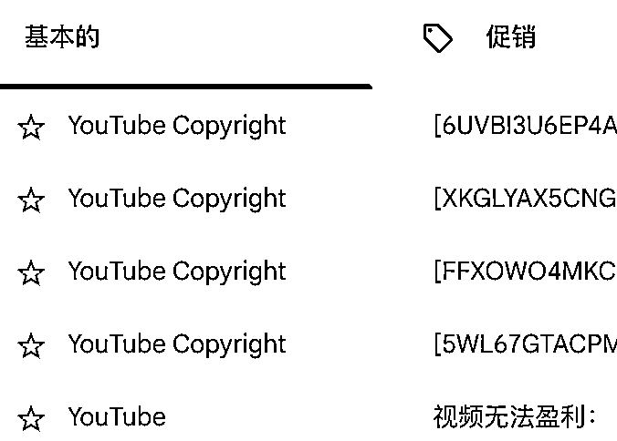

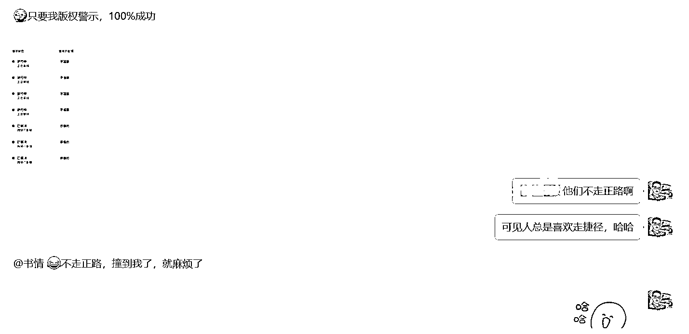

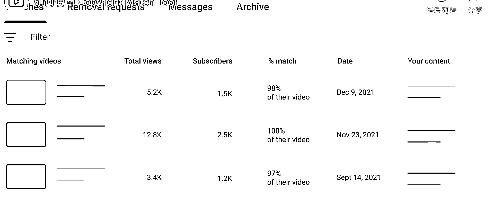
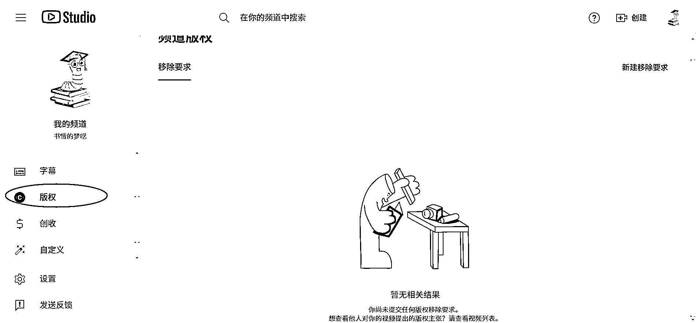
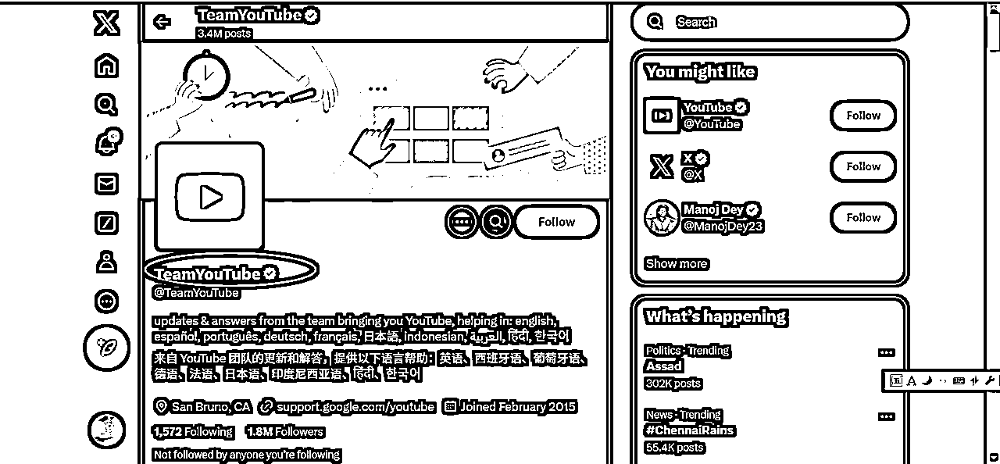

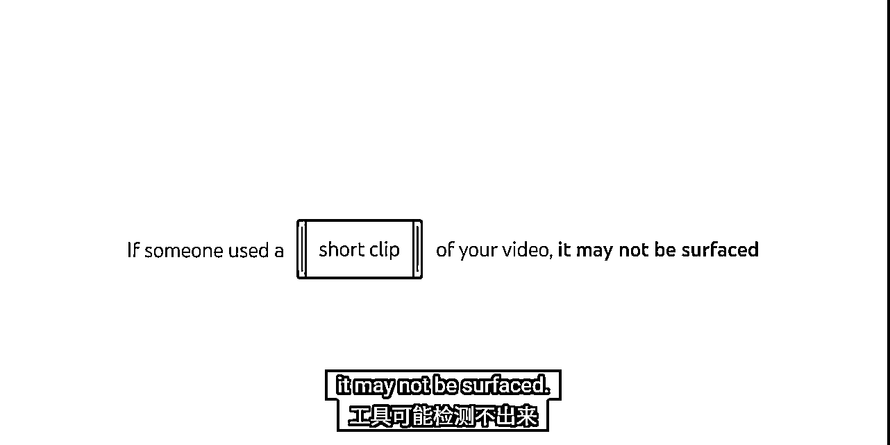

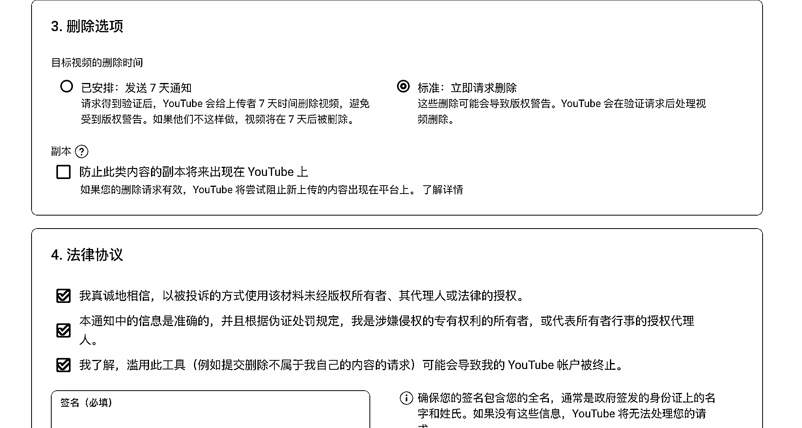
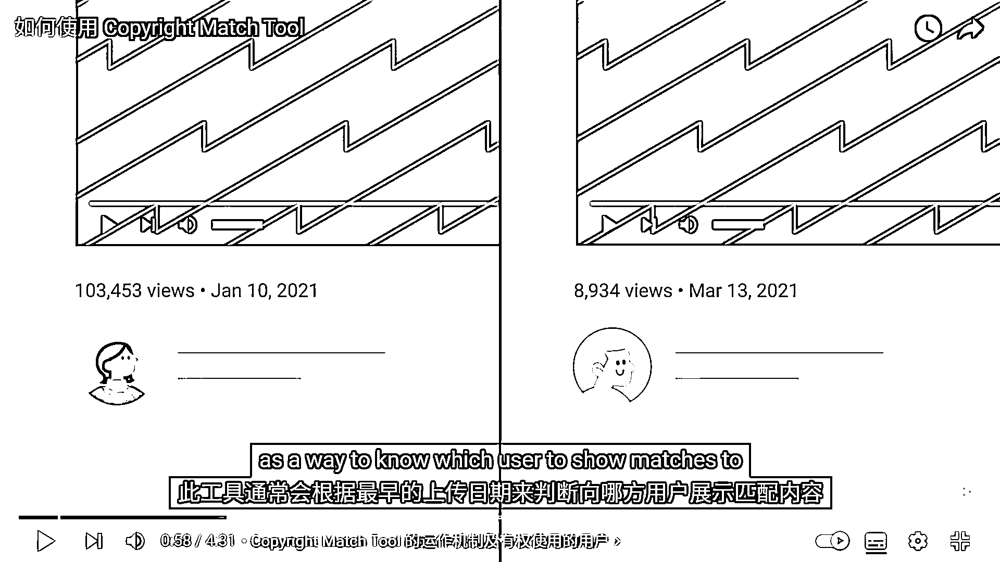
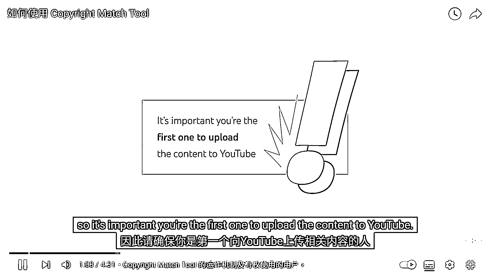
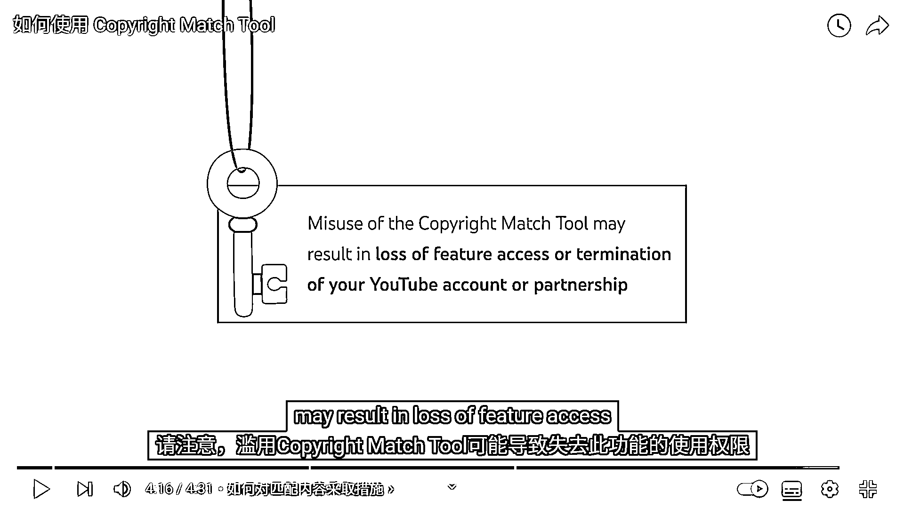
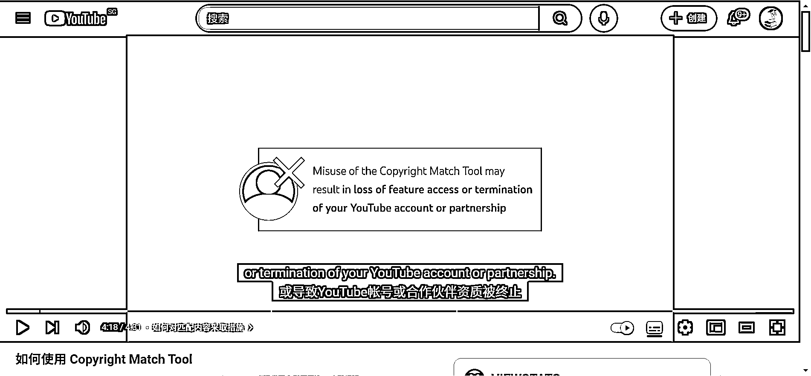

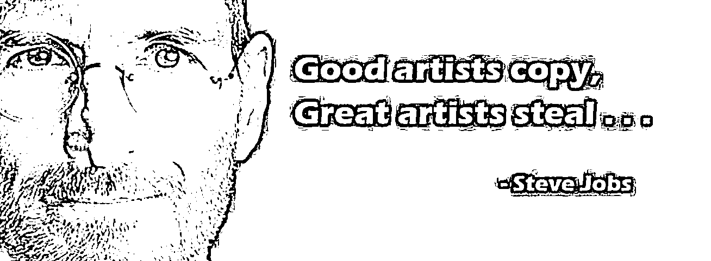
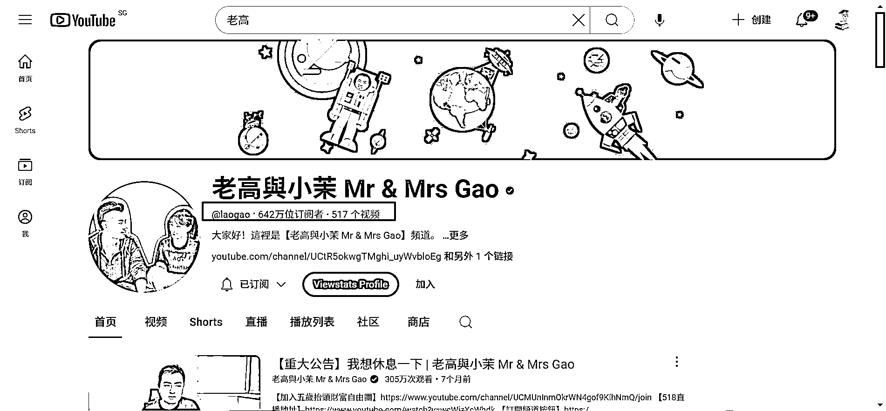

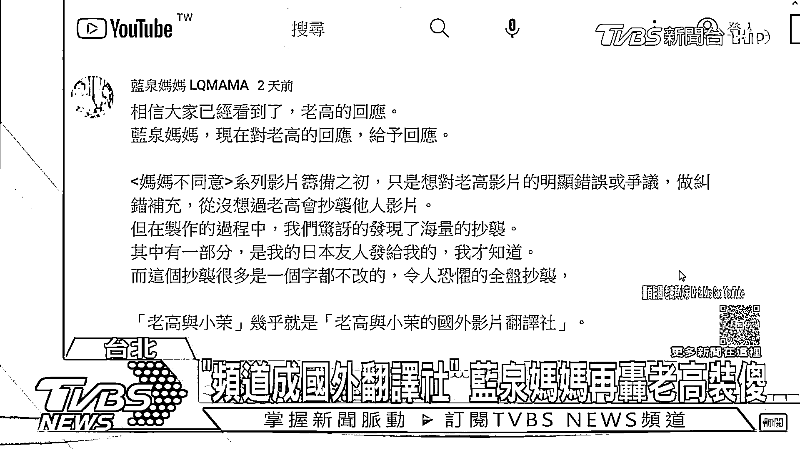